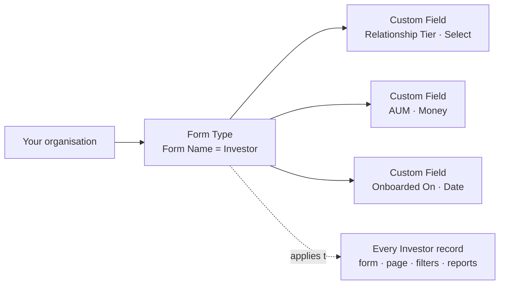
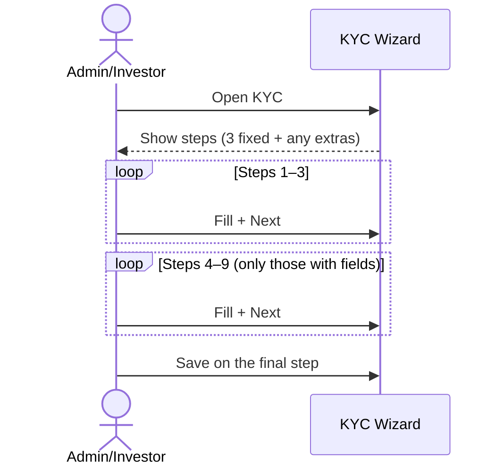

# Custom Fields and Form Types User Guide

Custom fields let you add your own fields to CapHive's standard records — extra KYC questions, fund-specific investor data, CRM attributes, deal notes, and more — without any change to the database. You define them on a **Form Type**, and every record of that kind in your organisation then shows the extra fields on its form, its page, and its list filters.

> **Where to find it:** Company menu (the house icon at the top right) → [**Customize Forms / Design Personalized Form**](/form_types); open a Form Type with **Show** and add fields with **Edit** → **Add Field**, or create one with [**New Form Type**](/form_types/new). The menu item needs the *Form Types* permission on your login, and creating or editing Form Types needs the company admin role.

This guide is written for company administrators. It covers where to find Form Types, how to create one, how to add and configure custom fields, the field types available, multi-step forms, conditional visibility, regulatory fields, and how the data is stored.

**Quick answer — how to add a custom field:**

1. Open the **Company menu** (the house icon at the top right of every page) and click **Customize Forms**. This opens the [**Form Types**](/form_types) list.
2. Click the Form Type for the record you want to extend (for example **Investor**), or click **New Form Type** if none exists yet.
3. Click **Edit**, then **Add Field**.
4. Fill in **Name**, **Field type**, and (optionally) **Label**, **Step**, **Required**, **Show in Filter**, **Meta data** and **Help text**.
5. Click **Save**. The field now appears on every record of that kind.

Details for each step are below.

---

## Table of Contents

1. [Key Concepts](#key-concepts)
2. [What a Form Type Is](#what-a-form-type-is)
3. [Where to Find Form Types](#where-to-find-form-types)
4. [Which Records Support Custom Fields](#which-records-support-custom-fields)
5. [Creating a Form Type](#creating-a-form-type)
6. [Several Form Types for One Record](#several-form-types-for-one-record)
7. [Adding Custom Fields](#adding-custom-fields)
8. [Custom Field Settings](#custom-field-settings)
9. [Field Types](#field-types)
10. [Ordering Fields](#ordering-fields)
11. [Multi-Step Forms](#multi-step-forms)
12. [Extra KYC Steps (4–9)](#extra-kyc-steps-49)
13. [Reviewing a Form Type](#reviewing-a-form-type)
14. [Required and Read-Only Fields](#required-and-read-only-fields)
15. [Conditional Visibility](#conditional-visibility)
16. [Regulatory Fields](#regulatory-fields)
17. [Showing a Field to Specific Users](#showing-a-field-to-specific-users)
18. [How the Data Is Stored](#how-the-data-is-stored)
19. [Renaming a Field](#renaming-a-field)
20. [Importing Custom Field Data](#importing-custom-field-data)
21. [Worked Example](#worked-example)
22. [Frequently Asked Questions](#frequently-asked-questions)

---

## Key Concepts

| Term | Meaning |
|------|---------|
| **Form Type** | The container for custom fields. One Form Type belongs to one kind of record (Investor, Investor KYC, Capital Commitment…) and holds every custom field for that kind. |
| **Custom Field** | A single extra field defined inside a Form Type — for example "Tax Registration Number" on Investor. |
| **Form Name** | The kind of record a Form Type applies to. Chosen from a fixed list when you create the Form Type. |
| **Tag** | A short label that tells several Form Types for the same record kind apart (for example "Individual" vs "Institutional" commitments). |
| **Field Type** | The kind of input — text, number, date, dropdown, money, file, and so on. |
| **Step** | Which page of a multi-step form (KYC, onboarding) the field appears on. |
| **Condition** | A rule that shows a field only when another field has a certain value. |
| **Regulatory Field** | A compliance field mandated by a regulator (SEBI, MAS…), pre-loaded by CapHive and not editable. |

---

## What a Form Type Is

A **Form Type** is the definition of "what extra fields does this kind of record have in my organisation". Think of it as the blueprint for the custom part of a form:

- It is tied to exactly **one record kind** (the **Form Name**, e.g. `Investor`).
- It holds an **ordered list of custom fields**, each with a type, label, step, and rules.
- It applies to **every record of that kind** in your entity — existing records pick it up as soon as it is saved, and new records use it automatically.
- It controls where the fields show up: on the record's **create/edit form**, on the record's **page**, in **list filters** (for fields marked *Show in Filter*), in **imports and exports**, and in the [Report Builder](report_builder_user_guide).

Most record kinds have **one** Form Type per organisation. A few (commitments, KYC, offers, interests) can have several, distinguished by **Tag**, so that different categories of the same record can carry different fields.



---

## Where to Find Form Types

Form Types live under the **Company menu** in the top bar:

1. Click the **Company menu** icon at the top right of any page.
2. Click **Customize Forms** ("Design Personalized Form").

This opens the [**Form Types**](/form_types) list. Each row is one Form Type; click a row to open it. The **New Form Type** button at the top creates a new one.

**Who can see it:** the menu entry appears only for users whose role has the *Form Types* permission enabled. Creating, editing and deleting Form Types requires the **Company Admin** role. Investor users never see it.

---

## Which Records Support Custom Fields

The **Form Name** dropdown on a new Form Type lists every record kind that supports custom fields. The most commonly used are:

| Record (Form Name) | Typical use |
|--------------------|-------------|
| **Investor** (Stakeholder) | CRM fields — relationship tier, AUM, source of introduction. |
| **InvestorKyc / IndividualKyc / NonIndividualKyc** | Extra onboarding and compliance questions on the KYC wizard. |
| **CapitalCommitment** | Fund-specific commitment data. |
| **CapitalCall / CapitalRemittance / CapitalDistribution / CapitalDistributionPayment / CapitalRemittancePayment** | Operational metadata on calls, remittances and distributions. |
| **PortfolioInvestment / AggregatePortfolioInvestment** | Deal-specific investment data. |
| **Deal / DealInvestor / InvestmentOpportunity / ExpressionOfInterest** | Pipeline and deal-flow attributes. |
| **Offer / Interest / SecondarySale** | Secondary-sale participant data. |
| **Fund / FundUnitSetting / FundReport / FundRatio** | Fund-level attributes and reporting fields. |
| **Kpi / KpiReport / InvestorKpiMapping / Valuation / InvestmentInstrument** | Portfolio monitoring and valuation fields. |
| **Document / Task / Approval / ApprovalResponse / AccountEntry / User / InvestorAccess / SupportAgent** | Custom attributes on supporting records. |

If a record kind is not in the dropdown, custom fields are not available for it.

---

## Creating a Form Type

You only need to do this once per record kind (unless the kind allows several, see the next section). If a Form Type for the record already exists in the list, open it and skip to [Adding Custom Fields](#adding-custom-fields).

1. Go to [**Company menu → Customize Forms**](/form_types).
2. Click **New Form Type**.
3. The form is titled **Customize: New**. Fill in:

| Field | Notes |
|-------|-------|
| **Form Name** | Pick the record kind from the dropdown — `Investor`, `InvestorKyc`, `CapitalCommitment`, and so on. This cannot be changed later. |
| **Tag** | Required (defaults to `Default`). A short label for this Form Type. For record kinds that allow only one Form Type, anything descriptive (e.g. `Default`) is fine. For kinds that allow several, the tag is what tells them apart and must be unique per record kind. |

4. You can add custom fields right away in the **Custom Fields** section using **Add Field** (see below), or save the empty Form Type and add fields later.
5. Click **Save**.

On save, the Form Type is linked to every existing record of that kind in your organisation, and the Form Type opens on its own page.

> **Regulatory fields** pre-load the standard compliance fields for KYC and investment-instrument Form Types. They are not on this form: company admins add the SEBI set from the Form Types list with **Add Reporting Fields → SEBI**; the other environments (CRISIL, IFSC, MAS) are set up by CapHive support. See [Regulatory Fields](#regulatory-fields).

---

## Several Form Types for One Record

Most record kinds have a single Form Type per organisation, and the system prevents a second one. These kinds may have **several**, distinguished by **Tag**, so different investor categories or commitment types can carry different field sets:

- Capital Commitment
- Investor KYC (individual / non-individual)
- Offer and Interest
- Support Agent

Each record is assigned to one of the Form Types for its kind; the fields it shows come from that Form Type.

---

## Adding Custom Fields

Custom fields are added from the Form Type's edit screen.

1. Go to [**Company menu → Customize Forms**](/form_types) and click the Form Type (for example **Investor**).
2. Click **Edit**. The page is titled **Customize: Investor** and lists the existing fields under **Custom Fields**.
3. Click **Add Field**. A new blank field row appears at the bottom.
4. Fill in the settings described in [Custom Field Settings](#custom-field-settings). At minimum give the field a **Name** and choose a **Field type**.
5. Repeat **Add Field** for as many fields as you need.
6. Click **Save**.

The new fields are now shown on every record of that kind — on the create/edit form, on the record's page, and (if *Show in Filter* is ticked) as a filter on the list page.

**Editing a single field later:** open the Form Type page and click the **Edit** (pencil) icon on the field's row. An inline editor opens above the list, with the same settings and validation as the full editor. Use this for quick fixes — a label, a step, toggling *Required* — without opening the whole form.

**Bulk add / edit:** on the Form Type page, **Download Custom Fields** exports the field definitions to Excel and **Upload Custom Fields** imports them back, so you can set up many fields in a spreadsheet.

---

## Custom Field Settings

Each field row has these settings. Only **Name** and **Field type** are mandatory.

| Setting | What it does |
|---------|--------------|
| **Name** | The internal identifier and the column name used in imports and exports. Type it with spaces if you like — "Tax Registration Number" is stored as `tax_registration_number`. **Cannot be changed after saving** (see [Renaming a Field](#renaming-a-field)). |
| **Label** | What users see on the form. Leave blank to derive it from the name ("Tax Registration Number"). |
| **Field type** | The kind of input. See [Field Types](#field-types). |
| **Position** | Order within the step. Lower numbers appear first; gaps are fine. |
| **Step** | Which page of a multi-step form the field is on — Step 1, 2, 3, or Steps 4–9 (extra, KYC only). "Step 3 (Default)" puts it on the last fixed page. Single-page forms ignore this. |
| **Required** | The form cannot be submitted until the field is filled. |
| **Read only** | The field is shown but cannot be edited by investors. Cannot be combined with *Required*. |
| **Show in Filter** | Adds the field as a filter on the record's list page. Not available for File, Header, Grid Columns or Calculation fields. |
| **Meta data** | Type-specific configuration: the comma-separated **options** for Select, Radio, DataList and MultiSelect (required for those types); `precision,separator` for Number fields (e.g. `2,comma` or `0,none`); an ISO currency code for Money fields (e.g. `USD`) to override the record's own currency. |
| **Help text** | A hint displayed below the field. |
| **Show only to** | A list of user ids. When set, the field is visible only to those users. Leave blank to show it to everyone. |
| **Show when field / Criteria / Match value / Then** | Conditional visibility. See [Conditional Visibility](#conditional-visibility). |

---

## Field Types

| Field type | What the user gets | Meta data |
|------------|--------------------|-----------|
| **TextField** | Single-line free text (the default). | — |
| **TextArea** | Multi-line free text. | — |
| **NumberField** | A number, formatted on display. | Optional `precision,separator`, e.g. `2,comma`. |
| **Money** | A monetary amount in the record's currency. | Optional ISO currency code to override, e.g. `USD`. |
| **DateField** | A date picker in the user's locale format. | — |
| **CheckBox** | A yes/no tick box. | — |
| **Select** | A dropdown with a single choice. | Required: the options, comma-separated. |
| **Radio** | Radio buttons with a single choice. | Required: the options, comma-separated. |
| **MultiSelect** | A dropdown allowing several choices. | Required: the options, comma-separated. |
| **DataList** | A text box with suggested values; the user can type anything or pick a suggestion. | Required: the suggestions, comma-separated. |
| **File** | A file upload attached to the record. | — |
| **Header** | Not an input — a section heading placed between fields to group them. | — |
| **GridColumns** | Tabular data entry. Configured by CapHive support; hidden from the normal editor. | — |
| **Calculation** | A value computed from other fields by a formula. Configured by CapHive support; hidden from the normal editor. | — |

---

## Ordering Fields

Fields appear in their **Position** order within a step. Edit the position number on each field row (gaps don't matter), or use the inline **Edit** on the Form Type page to move one field. Use a **Header** field to put a titled divider between groups of fields.

---

## Multi-Step Forms

Custom fields can be placed on numbered steps, ending with a fixed review step. KYC forms can add extra steps beyond that.


| Step | Use |
|------|-----|
| Step 1 | First page (basic/required fields). |
| Step 2 | Additional details. |
| Step 3 | Compliance or supplementary. "Step 3 (Default)" is where fields land if no step is chosen. |
| Review | The final fixed step. |
| Steps 4–9 | Extra pages (KYC only). |

Multi-step forms are used for investor onboarding and KYC, where the fields don't fit on one page. On records with a single-page form the step is ignored.

---

## Extra KYC Steps (4–9)

For **Investor KYC** form types, the wizard can run up to nine pages. Any step (4–9) that has at least one field assigned becomes a live page automatically.

**To set up extra steps:**

1. Edit the Investor KYC form type.
2. Set each field's **Step** to the target step (Step 4 … Step 9).
3. Save.
4. Optionally, open the Form Type page: once its fields span more than one step, a **Step Labels** section appears at the top. Click its **Edit** and give each step a meaningful title (e.g. "Beneficial Ownership", "FATCA Declarations"). Blank titles fall back to "Step 4", "Step 5", and so on. Labels are specific to your entity.

The wizard then shows extra navigation steps and renders the pages in order, skipping any step that has no fields.



---

## Reviewing a Form Type

The Form Type page (click a row in the [**Form Types**](/form_types) list) lists every field with its position, import column name, label, type, properties, condition and step. When fields span more than one step, two views are available:

- **Tabs by Step** — one tab per step, with a field count, to audit what appears on each wizard page and spot fields on the wrong step. **Flat List** switches back.
- **Inline edit** — every field row has an **Edit** action to quickly fix a label, change a step, or toggle "required", with the same validation as the full editor.

Buttons at the bottom of the page: **Edit** (the full editor, where you add fields), **Delete** (permanently removes the Form Type and its field definitions — there is no restore — but keeps the data already saved on records), **Configure Grids** (list-column layout for supported records), **Download Custom Fields** and **Upload Custom Fields** (Excel export/import of the field definitions).

---

## Required and Read-Only Fields

- **Required** fields must be filled before the form can be submitted — including when editing existing records created before the field was made required (unless the field is hidden by its condition).
- **Read-Only** fields are shown but can't be edited by investors.
- A field can't be both required and read-only.

---

## Conditional Visibility

A field can appear only when another field has a particular value. On the field row, set:

| Setting | Meaning |
|---------|---------|
| **Show when field** | The **Name** of the controlling field — a standard field (such as investor `category` or KYC `type`) or another custom field in the same Form Type. |
| **Criteria** | How to compare: `eq`, `not_eq`, `contains`, `lt`, `lte`, `gt`, `gte`. |
| **Match value** | The value to compare against. |
| **Then** | `show` — the field is shown when the condition holds and hidden otherwise. |


Rules:

- Conditions can be nested at most **two levels deep** — a conditional field can't depend on a field that is itself conditional on a third.
- A hidden field is not validated as required.

---

## Regulatory Fields

Regulatory fields are standard compliance fields mandated by a regulator. Setting a **regulatory environment** on a form type pre-loads the standard set for that jurisdiction:

| Environment | Use |
|-------------|-----|
| **SEBI** | SEBI KYC and investment fields. |
| **CRISIL** | CRISIL reporting fields. |
| **IFSC** | Banking IFSC code fields. |
| **MAS** | Singapore MAS compliance fields. |

These apply to Individual KYC, Non-Individual KYC and Investment Instrument Form Types. Company admins add the **SEBI** set themselves: on the [**Form Types**](/form_types) list, use **Add Reporting Fields → SEBI** on the Form Type's row and confirm. CRISIL, IFSC and MAS are set up by CapHive support. The field definitions are maintained by CapHive and can't be edited by entity admins.

---

## Showing a Field to Specific Users

A field can be restricted to named users with **Show only to** — useful for sensitive internal fields. Leave it blank to show the field to everyone.

---

## How the Data Is Stored

Custom field values are stored against the record under each field's name, for example:

```json
{
  "tax_registration_number": "ABC1234",
  "annual_income": 5000000,
  "date_of_birth": "1980-05-15"
}
```

This means:

- No database changes are needed to add a field.
- Values are preserved even if the field definition is later deleted (the definition itself is deleted permanently; add a field with the same **Name** to show the values again).
- Values can be pulled into the [Report Builder](report_builder_user_guide).

---

## Renaming a Field

Field names can't be changed in the UI once created, because the stored data is keyed by the original name. If you genuinely need to rename a field (which requires migrating existing values), ask CapHive support to perform it. You can change the **Label** at any time.

---

## Importing Custom Field Data

When you import records, any custom-field columns in the file are detected automatically, and fields are created as **TextField**s for any new columns not already defined — so imported data is immediately visible and editable. Change their field types afterwards if needed. Review what was created under **Import Uploads**.

---

## Worked Example

Adding a FATCA declaration to non-individual KYC, shown only for foreign entities:

1. **Company menu → Customize Forms**, open the `NonIndividualKyc` Form Type (or **New Form Type** with Form Name `NonIndividualKyc` and a tag).
2. Click **Edit → Add Field**: Name **Country of Tax Residence**, Field type **MultiSelect**, Meta data listing the countries, Step **Step 3**.
3. **Add Field** again: Name **FATCA Reference**, Field type **TextField**, Step **Step 4 (Extra)**, and set **Show when field** = `country_of_tax_residence`, **Criteria** = `not_eq`, **Match value** = your home country, **Then** = `show`.
4. Save, then on the Form Type page click **Edit** in the **Step Labels** section and set Step 4 to "FATCA Declarations".
5. The KYC wizard now shows a "FATCA Declarations" page, and the FATCA Reference field appears only when a foreign tax residence is selected.

---

## Frequently Asked Questions

### Navigation and getting there

**Where do I find custom fields in CapHive?**
Click the house icon at the top right to open the Company menu, then **Customize Forms** ("Design Personalized Form"). It opens the [**Form Types**](/form_types) list, one row per Form Type with its **Name** and **Tag**. See [Where to Find Form Types](#where-to-find-form-types).

**How do I open one Form Type and its fields?**
On the [**Form Types**](/form_types) list click **Show** on the row. The page lists every field with position, name, label, type, properties, condition and step, and has **Flat List** / **Tabs by Step** views plus **Edit**, **Delete**, **Configure Grids**, **Download Custom Fields** and **Upload Custom Fields** at the bottom. See [Reviewing a Form Type](#reviewing-a-form-type).

**Where do the custom fields show up once added?**
On the create and edit form of every record of that kind (on the chosen step for multi-step forms such as KYC), on the record's page, as list filters for fields with **Show in Filter**, in imports and exports, and in the Report Builder. See [What a Form Type Is](#what-a-form-type-is).

**I can't see Customize Forms in the menu.**
The item needs the *Form Types* permission on your own login and is never shown to investor logins. Ask your company administrator to switch the permission on for your user (Company menu → [**User / Company Employees**](/users)); creating and editing whole Form Types also needs the company admin role.

**Who can manage Form Types and custom fields?**
Company admins create, edit and delete Form Types and add fields in the full editor. Any user with the *Form Types* permission can open the list, view a Form Type, download its definitions and use the inline **Edit** on a single field. **Calculation** fields can only be changed by CapHive support.

### Creating, updating and managing custom fields

**How do I add a custom field?**
Company menu → [**Customize Forms**](/form_types) → open the Form Type for the record → **Edit** → **Add Field** → fill in Name and Field type → **Save**. See [Adding Custom Fields](#adding-custom-fields).

**How do I create a Form Type?**
On the [**Form Types**](/form_types) list click **New Form Type**, choose the **Form Name** (record kind), keep or change the **Tag** (it defaults to `Default`), optionally add fields with **Add Field**, and **Save**. See [Creating a Form Type](#creating-a-form-type).

**How do I edit an existing custom field?**
For one field, open the Form Type page and click the field row's **Edit** (pencil) action; for several, click **Edit** at the bottom of the page and change the rows in the full editor. The **Name** cannot be changed there. See [Custom Field Settings](#custom-field-settings).

**How do I delete a custom field?**
Open the Form Type → **Edit**, click **Delete** on the field's row in the full editor and **Save**. The definition is deleted; values already stored on records stay in place but are no longer shown. See "What happens when I delete a custom field?" below.

**How do I delete a whole Form Type?**
Open it and click **Delete**, then confirm the prompt "Delete custom form? Note this will not delete the custom data in saved …". The Form Type and all its field definitions are removed permanently.

**How do I set up many fields at once?**
On the Form Type page click **Download Custom Fields** for an Excel file of the current definitions, edit or add rows, then **Upload Custom Fields**, which opens the import form (import type Form Custom Field) with a sample file. Rows with an **Id** update that field; rows without one create a new field.

**How do I get an import template that includes my custom fields?**
On the [**Form Types**](/form_types) list click **Import Template** on the Form Type's row. It downloads an Excel template for importing records of that kind with a column for each custom field. See [Importing Custom Field Data](#importing-custom-field-data).

**How do I change which columns show in a record list?**
Click **Configure Grids** on the Form Type row or page (shown for record kinds that support it, such as Investor, Capital Commitment, Investor KYC, Capital Call and Valuation). Pick standard and custom-field columns for the list grid.

**How do I add SEBI regulatory fields?**
On the [**Form Types**](/form_types) list, rows for Individual KYC, Non-Individual KYC and Investment Instrument Form Types have **Add Reporting Fields → SEBI** for company admins; confirm the prompt. Other environments (CRISIL, IFSC, MAS) are set up by CapHive support. See [Regulatory Fields](#regulatory-fields).

**How do I label extra KYC steps?**
Open the Investor KYC Form Type page; once its fields span more than one step, a **Step Labels** section appears at the top. Click its **Edit** and give steps 4–9 titles such as "Beneficial Ownership". Blank labels fall back to "Step 4", "Step 5" and so on. See [Extra KYC Steps (4–9)](#extra-kyc-steps-49).

### Why use custom fields

**Why should I use custom fields?**
They let you capture data your organisation needs (relationship tier, tax residency, fund-specific terms) on CapHive's own records instead of in side spreadsheets, with validation, filters, imports, exports and reports working on it. No development or database change is needed.

**What can I do with custom fields that I cannot do otherwise?**
Add extra questions to the KYC wizard on up to nine pages, show fields only when another answer matches, give different commitment or KYC categories different fields, restrict sensitive fields to named users, compute values with calculations, and use the fields as list filters, report columns and document-template data.

**Who typically uses custom fields?**
Company administrators and operations leads design the forms, usually with CapHive support for complex setups; fund and IR teams fill the fields in on records; stakeholders (investors) fill KYC custom fields on the portal; reporting teams pull the values into reports and generated documents.

**What happens if I don't set up custom fields?**
Records only have CapHive's standard fields. Anything extra has to live outside the platform, cannot be filtered or reported on, and cannot be collected from investors through the KYC wizard.

### What happens when I …

**What happens when I save a new Form Type?**
The Form Type is created for your company, and every existing record of that kind that had no Form Type is linked to it straight away, so its fields appear on those records' forms and pages. A second Form Type for the same record kind is refused unless the kind allows several. No one is notified.

**What happens when I add a custom field?**
The field appears immediately on every record of that kind; existing records simply show it empty. Nothing is written to the records until someone fills it in. If you tick **Required**, see the next question.

**What happens when I make a field Required?**
From then on a record of that kind cannot be saved from its form without a value in that field (unless the field is hidden by its condition). That includes editing existing records that were created before the field existed, so fill the value in or leave the field optional until your data is complete.

**What happens when I delete a custom field?**
The definition is removed, but the stored values remain on each record — just no longer shown or editable through the form. There is no restore; add a field with exactly the same **Name** to show and edit the values again.

**What happens when I delete a Form Type?**
The Form Type and all its field definitions are deleted permanently; the values already saved on records are kept. The records stop showing those fields until a Form Type with fields of the same names is created again.

**What happens when I import records with columns that are not custom fields yet?**
Any extra column in the import file is added to the record kind's Form Type as a **TextField** labelled with the column header (a Form Type is created if none exists), so the imported values are visible and editable at once. Review and change the field types afterwards.

**What happens when I upload custom field definitions?**
Each spreadsheet row creates a new field or, if it carries an existing field's **Id**, updates that field in your Form Type. Rows that fail validation are reported in the import's results file. Existing record values are not changed.

### Troubleshooting and edge cases

**Can I add custom fields to any record?**
Only the record kinds listed in the **Form Name** dropdown. See [Which Records Support Custom Fields](#which-records-support-custom-fields).

**Can I rename a custom field?**
Not from the normal screens: the **Name** is the key under which values are stored. CapHive support can rename a field and migrate its stored values; ask them, ideally outside peak hours. You can change the **Label** at any time. See [Renaming a Field](#renaming-a-field).

**Can I make a single-select dropdown?**
Yes — use the **Select** field type (or **Radio**) with the options in Meta data. **MultiSelect** allows several choices.

**Can conditional fields chain together?**
Up to two levels deep — a field can depend on another conditional field, but no further.

**I imported data and see values but no field exists — what now?**
Add a custom field with the same name; the existing values will then display and become editable.

**Can different investor categories have different fields?**
Yes for Capital Commitment, Investor KYC, Offer and Interest — create several Form Types for the same record kind, distinguished by tag, and assign each record to the right one. Other record kinds allow one Form Type.

**Can I add more than three KYC steps?**
Yes — up to nine wizard pages. Assign fields to steps 4–9; each step with at least one field becomes a page. See [Extra KYC Steps](#extra-kyc-steps-49).

**The form type page is too long — can I see it by step?**
Switch to **Tabs by Step** at the top of the page.

**Saving a Form Type fails with "Duplicate names detected". Why?**
Two field rows normalise to the same **Name** (for example "Tax ID" and "tax_id"). Field names must be unique within a Form Type; rename or remove one row and save again.

**I get an error when saving a Select, Radio, DataList or MultiSelect field.**
These types need their options in **Meta data**, comma-separated. A **Money** field's Meta data, if set, must be a valid ISO currency code such as `USD`.

**Why can't I tick both Required and Read only?**
A field that investors cannot edit cannot also be mandatory for them, so the combination is rejected. Use one or the other.

**My Calculation field edit was rejected. Why?**
Calculation fields (and adding them) are restricted to CapHive support users because their formulas run on every save of the record. Ask support to change the formula.

## Related Guides

- [Investor KYC](investor_kyc_user_guide) — the KYC wizard where extra steps and regulatory fields appear.
- [Stakeholders (Investors)](investors_user_guide) — the most common record kind to extend with CRM fields.
- [Capital Commitments](capital_commitments_user_guide) — several commitment Form Types distinguished by tag.
- [Report Builder](report_builder_user_guide) — using custom field values as report columns.
- [Validation Rule Engine](validation_rule_engine_user_guide) — additional data checks on top of Required fields.
- [Approvals](approvals_user_guide) — response custom fields such as `approved_amount` read when a fund approval closes.
- [Audit Trail](audit_trail_user_guide) — seeing when a custom field value changed and who changed it.
