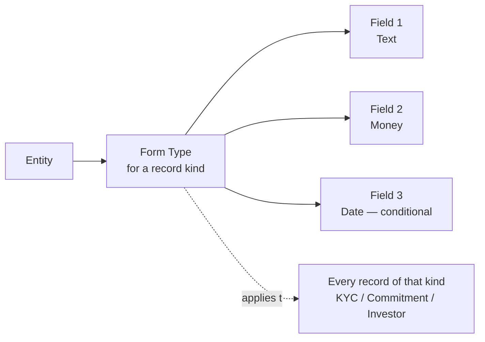
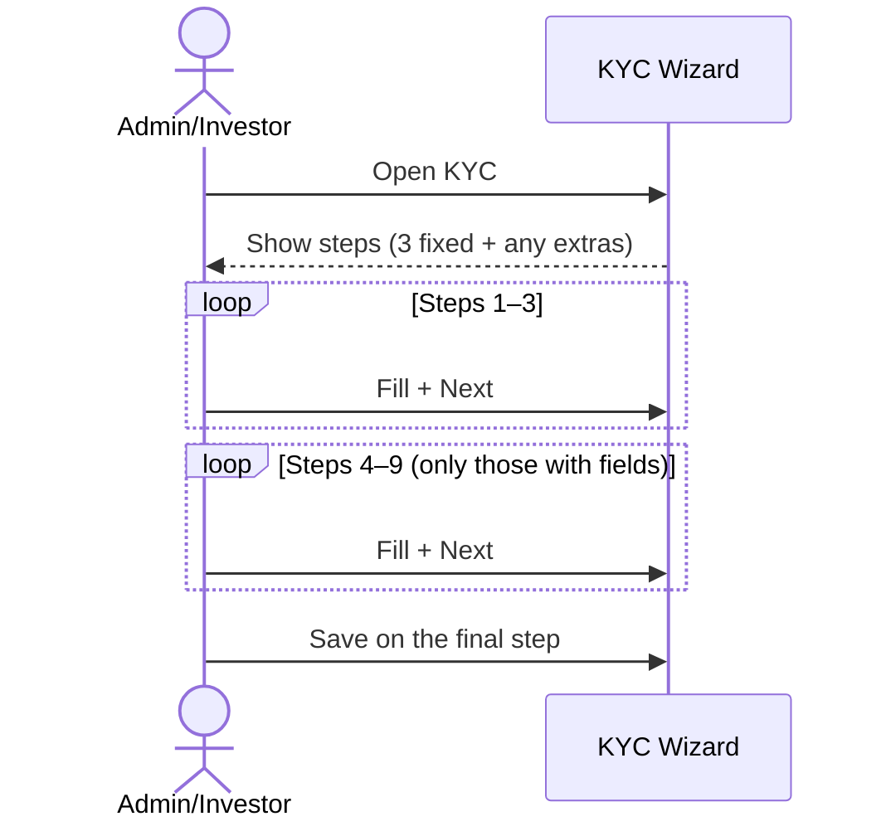

# Custom Fields User Guide

Custom fields let you extend the standard records in CapHive with extra information specific to your organisation — additional KYC questions, fund-specific investor data, CRM attributes, and more. This guide covers how custom fields are organised, the field types available, multi-step forms, conditional visibility, regulatory fields, and how the data is stored.

It's written for administrators configuring forms.

---

## Table of Contents

1. [Key Concepts](#key-concepts)
2. [How Form Types and Custom Fields Fit Together](#how-form-types-and-custom-fields-fit-together)
3. [Which Records Support Custom Fields](#which-records-support-custom-fields)
4. [Creating a Form Type](#creating-a-form-type)
5. [Several Form Types for One Record](#several-form-types-for-one-record)
6. [Adding Custom Fields](#adding-custom-fields)
7. [Field Types](#field-types)
8. [Ordering Fields](#ordering-fields)
9. [Multi-Step Forms](#multi-step-forms)
10. [Extra KYC Steps (4–9)](#extra-kyc-steps-49)
11. [Reviewing a Form Type](#reviewing-a-form-type)
12. [Required and Read-Only Fields](#required-and-read-only-fields)
13. [Conditional Visibility](#conditional-visibility)
14. [Regulatory Fields](#regulatory-fields)
15. [Showing a Field to Specific Users](#showing-a-field-to-specific-users)
16. [How the Data Is Stored](#how-the-data-is-stored)
17. [Renaming a Field](#renaming-a-field)
18. [Importing Custom Field Data](#importing-custom-field-data)
19. [Worked Example](#worked-example)
20. [Frequently Asked Questions](#frequently-asked-questions)

---

## Key Concepts

| Term | Meaning |
|------|---------|
| **Form Type** | A set of custom fields defined for a particular kind of record. |
| **Custom Field** | A single extra field added through a form type. |
| **Field Type** | The kind of input (text, money, date, multi-select…). |
| **Step** | Which page of a multi-step form the field appears on. |
| **Condition** | The field whose value decides whether another field is shown. |
| **Regulatory Field** | A compliance field mandated by a regulator (e.g. SEBI, MAS). |

---

## How Form Types and Custom Fields Fit Together

A **form type** is a template of extra fields for one kind of record. Add a form type for *Investor KYC*, and every KYC record in your organisation shows those extra fields.



---

## Which Records Support Custom Fields

Most major records can carry custom fields, including:

| Record | Example use |
|--------|-------------|
| **Investor KYC** (individual / non-individual) | Extra onboarding or compliance questions. |
| **Capital Commitment** | Fund-specific investor data. |
| **Investor** | CRM fields (AUM, relationship tier). |
| **Portfolio Investment** | Deal-specific notes. |
| **Offer / Interest** | Secondary-sale participant data. |
| **Capital Call / Distribution** | Operational metadata. |
| **Account Entry** | Custom accounting categories. |

---

## Creating a Form Type

Go to **[Entity] → Form Types → New**.

| Field | Notes |
|-------|-------|
| **Name** | The system name of the record kind this applies to — for example `InvestorKyc`, `Investor`, `CapitalCommitment`. |
| **Tag** | A sub-type label (unique per record kind in your entity), used when a record kind has more than one form type. |
| **Regulatory Environment** | If set, pre-loads the standard regulatory fields for that jurisdiction (see [Regulatory Fields](#regulatory-fields)). |

On save, the form type is applied to all existing records of that kind in your entity.

---

## Several Form Types for One Record

Most record kinds have a single form type per entity. A few can have **several**, distinguished by their **tag**, so different investor categories or commitment types can have different field sets:

- Capital Commitment
- Investor KYC (individual / non-individual)
- Offer and Interest

---

## Adding Custom Fields

Go to **Form Type → Custom Fields → Add**.

| Field | Notes |
|-------|-------|
| **Name** | The internal identifier, auto-tidied (e.g. "Tax Registration Number" becomes `tax_registration_number`). |
| **Label** | What users see; defaults to a readable version of the name. |
| **Field Type** | See below. |
| **Step** | Which form step it appears on. |
| **Required** | Whether it must be filled. |
| **Read Only** | Whether it can be edited. |
| **Info** | Help text shown beside the field. |
| **Condition On** | The field whose value controls this one's visibility. |

---

## Field Types

| Type | What it is |
|------|------------|
| **Text** | Free text (the default). |
| **Money** | A monetary amount. |
| **Date** | A date picker. |
| **Multi-Select** | A multiple-choice dropdown. |
| **Calculation** | A value computed from other fields by a formula (used behind the scenes, not shown as an input). |
| **Grid Columns** | Tabular data entry (used behind the scenes). |

---

## Ordering Fields

Fields appear in their **position** order within a step. Drag to reorder them in the form-type editor; gaps don't matter.

---

## Multi-Step Forms

Custom fields can be placed on numbered steps, ending with a fixed review step. KYC forms can add extra steps beyond that.


| Step | Use |
|------|-----|
| Step 1 | First page (basic/required fields). |
| Step 2 | Additional details. |
| Step 3 | Compliance or supplementary. |
| Review | The final fixed step. |
| Steps 4–9 | Extra pages (KYC only). |

Multi-step forms are used for investor onboarding and KYC, where the fields don't fit on one page.

---

## Extra KYC Steps (4–9)

For **Investor KYC** form types, the wizard can run up to nine pages. Any step (4–9) that has at least one field assigned becomes a live page automatically.

**To set up extra steps:**

1. Edit the Investor KYC form type.
2. Set each field's **Step** to the target step (Step 4 … Step 9).
3. Optionally, in **Extra Step Labels**, give each step a meaningful title (e.g. "Beneficial Ownership", "FATCA Declarations"). Blank titles fall back to "Step 4", "Step 5", and so on. Labels are specific to your entity.
4. Save.

The wizard then shows extra navigation steps and renders the pages in order, skipping any step that has no fields.



---

## Reviewing a Form Type

The form type page has two views and a quick edit:

- **Tabs by Step** — switch from a flat list to one tab per step (with a field count), to audit what appears on each wizard page and spot fields on the wrong step. **Flat List** switches back.
- **Inline edit** — every field row has an **Edit** action to quickly fix a label, change a step, or toggle "required", with the same validation as the full editor.

---

## Required and Read-Only Fields

- **Required** fields must be filled before the form can be submitted.
- **Read-Only** fields are shown but can't be edited by investors.
- A field can't be both required and read-only.

---

## Conditional Visibility

A field can appear only when another field has a particular value, set via **Condition On**.


Rules:

- The controlling field can be a standard field (such as investor **category**, or KYC **type**) or another custom field in the same form type.
- Conditions can be nested at most **two levels deep** — a conditional field can't depend on a field that is itself conditional on a third.
- You set which value(s) trigger visibility and how they're matched (equals, includes, etc.).

---

## Regulatory Fields

Regulatory fields are standard compliance fields mandated by a regulator. Setting a **regulatory environment** on a form type pre-loads the standard set for that jurisdiction:

| Environment | Use |
|-------------|-----|
| **SEBI** | SEBI KYC and investment fields. |
| **CRISIL** | CRISIL reporting fields. |
| **IFSC** | Banking IFSC code fields. |
| **MAS** | Singapore MAS compliance fields. |

These apply to KYC records and investment instruments. They're created and maintained by CapHive and can't be edited by entity admins.

---

## Showing a Field to Specific Users

A field can be restricted to named users — useful for sensitive internal fields. Leave the restriction blank to show the field to everyone.

---

## How the Data Is Stored

Custom field values are stored against the record under each field's name, for example:

```json
{
  "tax_registration_number": "ABC1234",
  "annual_income": 5000000,
  "date_of_birth": "1980-05-15"
}
```

This means:

- No database changes are needed to add a field.
- Values are preserved even if the field definition is later deleted.
- Values can be pulled into the [Report Builder](report_builder_user_guide).

---

## Renaming a Field

Field names can't be changed in the UI once created, because the stored data is keyed by the original name. If you genuinely need to rename a field (which requires migrating existing values), ask your system administrator to perform it.

---

## Importing Custom Field Data

When you import records, any custom-field columns in the file are detected automatically, and fields are created for any new columns not already defined — so imported data is immediately visible and editable. Review what was created under **Import Uploads**.

---

## Worked Example

Adding an FATCA declaration to non-individual KYC, shown only for foreign entities:

1. **Form Types → New** for `NonIndividualKyc` (or edit the existing one).
2. Add a multi-select field **Country of Tax Residence** on Step 3.
3. Add a text field **FATCA Reference** and set **Condition On** = Country of Tax Residence, triggering when it's anything other than your home country.
4. Put both on a meaningfully labelled extra step — set the **Step 4 Label** to "FATCA Declarations".
5. Save. The KYC wizard now shows a "FATCA Declarations" page, and the FATCA Reference field appears only when a foreign tax residence is selected.

---

## Frequently Asked Questions

**Can I add custom fields to any record?**
Most major records support them. If a record kind isn't listed in the form-type options, custom fields aren't available for it.

**What happens to the data if I delete a custom field?**
The field definition is removed, but the stored values remain on each record — just no longer shown or editable through the form.

**Can I make a single-select dropdown?**
Use Multi-Select configured for a single choice, or use a standard field if one exists.

**Can conditional fields chain together?**
Up to two levels deep — a field can depend on another conditional field, but no further.

**I imported data and see values but no field exists — what now?**
Add a custom field with the same name; the existing values will then display and become editable.

**Can different investor categories have different fields?**
Yes — create several form types for the same record kind, distinguished by tag, and assign each record to the right one.

**Can I add more than three KYC steps?**
Yes — up to nine wizard pages. Assign fields to steps 4–9; each step with at least one field becomes a page. See [Extra KYC Steps](#extra-kyc-steps-49).

**The form type page is too long — can I see it by step?**
Switch to **Tabs by Step** at the top of the page.
