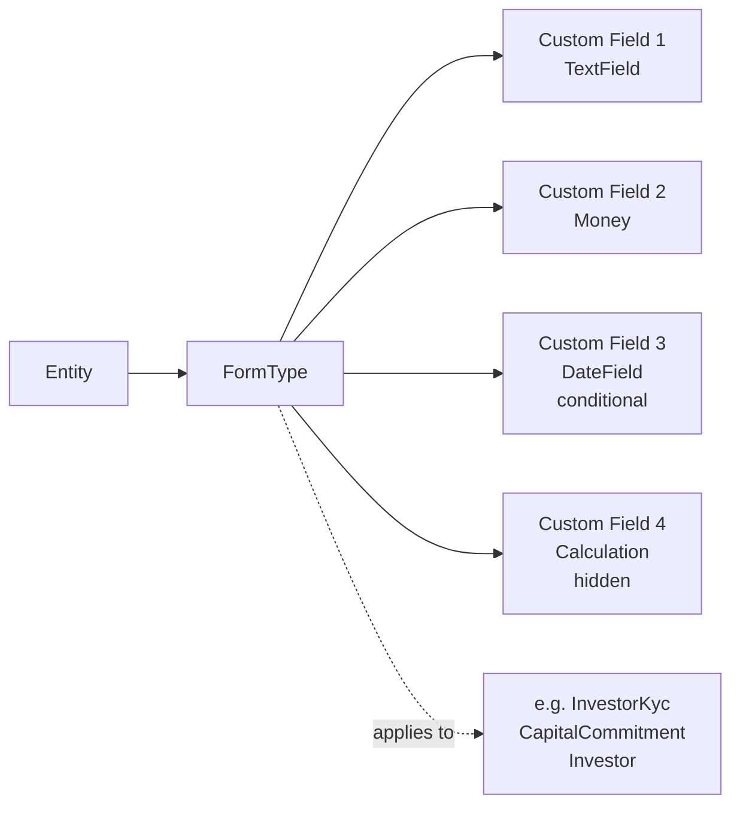
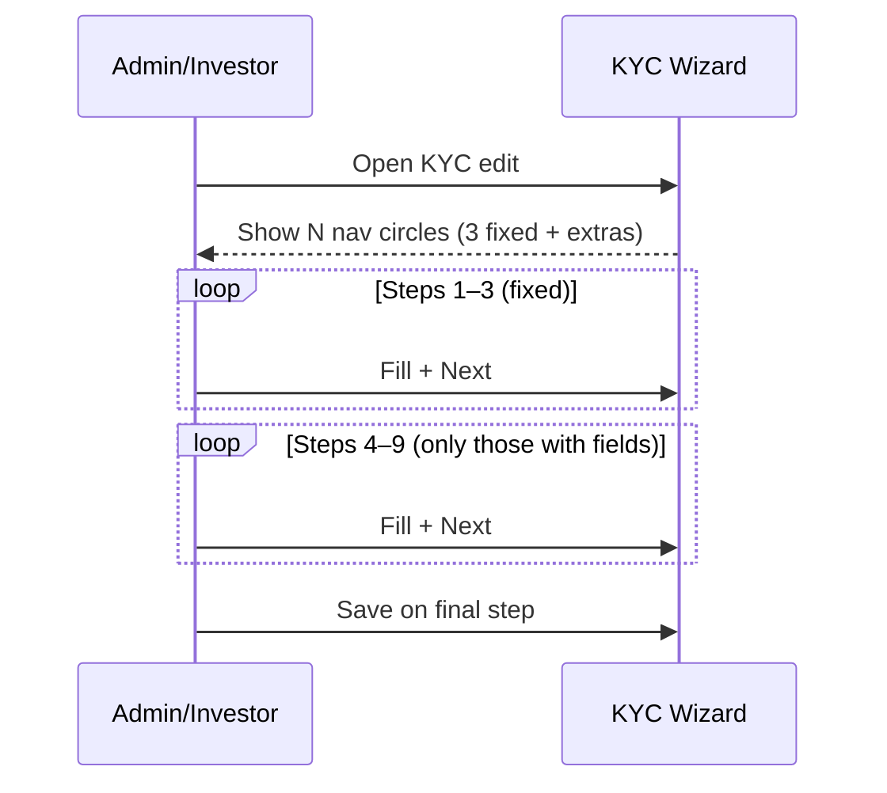

# Custom Fields User Guide

Custom fields allow you to extend any standard model in CapHive with additional data fields specific to your entity. This guide covers creating form types and custom fields, the available field types, multi-step form layouts, conditional field visibility, regulatory compliance fields, and how field data is stored.

---

## Table of Contents

1. [Key Concepts](#key-concepts)
2. [Architecture: Form Types and Custom Fields](#architecture-form-types-and-custom-fields)
3. [Which Models Support Custom Fields](#which-models-support-custom-fields)
4. [Creating a Form Type](#creating-a-form-type)
5. [Form Types with Multiple Instances](#form-types-with-multiple-instances)
6. [Adding Custom Fields](#adding-custom-fields)
7. [Field Types](#field-types)
8. [Field Ordering (Position)](#field-ordering-position)
9. [Multi-Step Forms](#multi-step-forms)
10. [Dynamic Extra Steps for InvestorKyc (Steps 4–9)](#dynamic-extra-steps-for-investorkyc-steps-49)
11. [Reviewing Form Types: Tabbed View and Inline Edit](#reviewing-form-types-tabbed-view-and-inline-edit)
12. [Required and Read-Only Fields](#required-and-read-only-fields)
13. [Conditional Visibility](#conditional-visibility)
14. [Regulatory Fields](#regulatory-fields)
15. [Field Visibility by User](#field-visibility-by-user)
16. [How Field Data is Stored](#how-field-data-is-stored)
17. [Renaming a Field](#renaming-a-field)
18. [Importing Custom Field Data](#importing-custom-field-data)
19. [Key Fields Reference](#key-fields-reference)
20. [Frequently Asked Questions](#frequently-asked-questions)

---

## Key Concepts

| Term | Meaning |
|---|---|
| **Form Type** | A named schema that defines custom fields for a specific model |
| **Custom Field (FCF)** | A single additional field added to a model via a form type |
| **Field Type** | The data type and UI widget for the field |
| **Step** | Which step in a multi-step form this field appears on |
| **Condition On** | The field whose value determines whether this field is shown |
| **Regulatory Field** | A compliance-mandated field (SEBI, CRISIL, IFSC, MAS) |
| **Properties** | The JSON column on the model that stores custom field values |

---

## Architecture: Form Types and Custom Fields



A **Form Type** is a schema definition for a particular model. When you add a Form Type for `InvestorKyc`, every KYC record in your entity will display those additional fields.

---

## Which Models Support Custom Fields

Custom fields can be added to any model that includes `WithCustomField`. Common examples:

| Model | Example Use |
|---|---|
| `InvestorKyc` / `IndividualKyc` / `NonIndividualKyc` | Additional compliance or onboarding fields |
| `CapitalCommitment` | Fund-specific investor data |
| `Investor` | CRM fields (AUM, relationship tier) |
| `PortfolioInvestment` | Investment-specific annotations |
| `Offer` / `Interest` | Secondary sale participant data |
| `CapitalCall` / `CapitalDistribution` | Operational metadata |
| `AccountEntry` | Custom accounting categories |
| `SupportAgent` | Agent configuration fields |

---

## Creating a Form Type

Navigate to **[Entity] → Form Types → New**.

| Field | Notes |
|---|---|
| **Name** | Must be the exact Rails model class name (e.g. `InvestorKyc`, `Investor`, `CapitalCommitment`) |
| **Tag** | A sub-type label, unique per entity+name combination. Used when a model has multiple form types |
| **Regulatory Env** | If set, pre-populates standard regulatory fields (SEBI, CRISIL, IFSC, MAS) |

On save, the system automatically sets `form_type_id` on all existing records of that model type within your entity.

---

## Form Types with Multiple Instances

Most models support only one form type per entity. The following models can have **multiple form types** (distinguished by the `tag` field):

- `CapitalCommitment`
- `InvestorKyc`, `IndividualKyc`, `NonIndividualKyc`
- `Offer`
- `Interest`
- `SupportAgent`

This allows different investor categories or commitment types to have different field sets.

---

## Adding Custom Fields

Navigate to **Form Type → Custom Fields → Add**.

| Field | Notes |
|---|---|
| **Name** | Internal identifier. Auto-normalised to `snake_case` (e.g. `Tax Registration Number` → `tax_registration_number`) |
| **Label** | Display label shown in the UI. Defaults to humanised name |
| **Field Type** | See Field Types below |
| **Step** | Which form step this appears on (1, 2, 3, or end) |
| **Required** | Whether the field must be filled |
| **Read Only** | Whether the field is editable |
| **Info** | Rich text help text displayed alongside the field |
| **Condition On** | Field name whose value triggers this field's visibility |

---

## Field Types

| Field Type | Description | Hidden |
|---|---|---|
| `TextField` | Free text input (default) | No |
| `Money` | Monetary amount input | No |
| `DateField` | Date picker | No |
| `MultiSelect` | Multiple-choice dropdown | No |
| `Calculation` | Computed value derived from other fields using a formula | Yes (internal) |
| `GridColumns` | Tabular data input | Yes (internal) |

`Calculation` and `GridColumns` are **hidden fields** — they are used internally and not shown in the standard form. They are excluded from the `visible` scope.

---

## Field Ordering (Position)

Fields are ordered by `position` within a form type (managed via `acts_as_list`). Drag to reorder in the admin interface. Fields within a step are rendered in position order.

---

## Multi-Step Forms

Custom fields can be assigned to one of the standard steps, or to extra steps 4–9 (InvestorKyc only):


| Step | Enum key | Enum value | Use |
|---|---|---|---|
| Step 1 | `one` | 1 | First step (basic/required fields) |
| Step 2 | `two` | 2 | Additional details |
| Step 3 | `three` | 3 | Compliance or supplementary |
| End | `end` | 100 | Final fixed step (review, sign-off) |
| Step 4–9 | `four`–`nine` | 4–9 | Extra dynamic steps (InvestorKyc only) |

Multi-step forms are used in investor onboarding and KYC workflows where all fields cannot be presented on a single page.

---

## Dynamic Extra Steps for InvestorKyc (Steps 4–9)

For **InvestorKyc** form types, the wizard supports up to nine pages. Extra pages (steps 4–9) are rendered automatically whenever at least one custom field is assigned to that step — no code change needed.

### Setting up extra steps

1. Open the InvestorKyc Form Type for editing.
2. For each field you want on an extra page, set its **Step** dropdown to the target step (*Step 4 (Extra)* … *Step 9 (Extra)*).
3. Optionally fill in the **Extra Step Labels** section to give each step a meaningful title (e.g. *Beneficial Ownership*, *FATCA Declarations*). Blank entries default to *Step 4*, *Step 5*, etc.
4. Save the Form Type.

The KYC wizard now shows additional navigation circles and renders the extra pages in order. Steps with no fields are skipped entirely.

### Step labels

The **Extra Step Labels** section in the Form Type edit page lets you set a custom card-header label for each extra step:

| Input | Applied to | Default if blank |
|---|---|---|
| Step 4 Label | Page 4 card header | "Step 4" |
| Step 5 Label | Page 5 card header | "Step 5" |
| … | … | … |
| Step 9 Label | Page 9 card header | "Step 9" |

Labels are stored as a JSON hash on the Form Type and are **entity-specific** — different fund entities can have different labels for the same step numbers.

### Step ordering in the wizard



---

## Reviewing Form Types: Tabbed View and Inline Edit

The **Form Type show page** (`/form_types/:id`) has two view modes and a quick-edit shortcut.

### Tabbed view

Click **Tabs by Step** at the top of the show page to switch from the flat table to a tab-per-step layout. Each tab shows only the fields assigned to that step, with a count badge. Click **Flat List** to return.

Use the tabbed view to:
- Quickly audit what the investor sees on each wizard page.
- Spot fields that may have been assigned to the wrong step.
- Compare field counts across steps.

### Inline field edit

Every row in both views has an **Edit** button in the Actions column. Clicking it opens that field's edit form with a **Cancel** link that returns you to the Form Type show page. This is the fastest way to correct a label, change a step assignment, or toggle the required flag for a single field.

Fields edited inline go through the same validation as the full Form Type edit — you cannot save an invalid field.

---

## Required and Read-Only Fields

- **Required** fields must be filled before the form can be submitted
- **Read Only** fields are displayed but cannot be edited by investors (hidden via CSS for `investor` role users)
- A field cannot be both required and read-only (validation error)

---

## Conditional Visibility

A field can be shown or hidden based on the value of another field using the **Condition On** setting.


Rules:
- `condition_on` must be the name of either:
  - A standard field (`category` for Investor forms, `kyc_type` for InvestorKyc forms)
  - Another custom field in the same form type
- **Maximum depth is 2 levels** — a conditional field cannot depend on another field that is itself conditional on a third field
- The `condition_params` and `condition_criteria` attributes control the matching logic (e.g. show when value equals "Individual")

---

## Regulatory Fields

Regulatory fields are standard compliance fields mandated by regulatory bodies. Setting `reg_env` on a custom field classifies it as regulatory.

| Regulatory Env | Use |
|---|---|
| `SEBI` | SEBI-mandated KYC and investment fields |
| `CRISIL` | CRISIL reporting fields |
| `IFSC` | Banking IFSC code fields |
| `MAS` | Singapore MAS compliance fields |

Regulatory fields apply to: `IndividualKyc`, `NonIndividualKyc`, `InvestmentInstrument`.

When you set `reg_env` on a Form Type (at creation), `AddRegulatoryCustomFieldsService` runs automatically to pre-populate the standard regulatory fields for your jurisdiction.

Regulatory fields are marked `internal = true` — they are created by CapHive and cannot be modified by entity admins.

---

## Field Visibility by User

The `show_user_ids` field on a custom field accepts a comma-separated list of user IDs. If populated, the field is only visible to those specific users.

Leave blank to show the field to all users.

---

## How Field Data is Stored

Custom field values are stored in a `properties` JSON column on the model. The key is the custom field's `name`.

```json
{
  "tax_registration_number": "ABC1234",
  "annual_income": 5000000,
  "date_of_birth": "1980-05-15"
}
```

This means:
- No schema migrations are needed when adding custom fields
- Field values are preserved even if the custom field definition is later deleted
- You can query properties using Ransack filters in report builder

---

## Renaming a Field

**Field names cannot be changed via the UI** once created (the rename migration is commented out). This is intentional — renaming requires migrating all `properties` data for existing records.

If you need to rename a field, use the admin `change_name` method which:
1. Iterates all entity records of that model
2. Moves the value from the old key to the new key in `properties`
3. Saves each record directly (bypassing callbacks)

Contact your system administrator to perform a field rename.

---

## Importing Custom Field Data

When importing records (e.g. via bulk import), custom field headers in the import file are automatically detected and form fields are created for any new headers not already defined. This ensures imported data is accessible and editable.

Navigate to **Import Uploads** to review what custom fields were created during an import.

---

## Key Fields Reference

### FormType

| Field | Description |
|---|---|
| `name` | Rails model class name (e.g. `InvestorKyc`) |
| `tag` | Sub-type label (for models allowing multiple form types) |
| `entity_id` | Owning entity |
| `step_labels` | JSON hash mapping step numbers 4–9 to custom card-header labels (InvestorKyc only) |

### FormCustomField

| Field | Description |
|---|---|
| `name` | Internal identifier (snake_case, unique per form type) |
| `label` | UI display label |
| `field_type` | TextField / Money / DateField / MultiSelect / Calculation / GridColumns |
| `step` | one / two / three / end / four / five / six / seven / eight / nine |
| `position` | Display order within the step |
| `required` | Whether field must be filled |
| `read_only` | Whether field is editable |
| `condition_on` | Field name that controls visibility |
| `condition_params` | Value(s) that trigger visibility |
| `condition_criteria` | Matching logic (equals / includes / etc.) |
| `reg_env` | Regulatory classification (SEBI / CRISIL / IFSC / MAS) |
| `internal` | System-managed field (not editable) |
| `show_user_ids` | Restrict visibility to specific user IDs |
| `meta_data` | Formula for Calculation fields |

---

## Frequently Asked Questions

**Q: Can I add custom fields to any model?**
Only models that include the `WithCustomField` concern can have custom fields. Most major business records support this. If a model is not listed, custom fields are not available for it.

**Q: What happens to data if I delete a custom field?**
The `FormCustomField` record is deleted, but the data remains in the model's `properties` column. It will no longer be displayed or editable via the form, but it is preserved in the database.

**Q: Can I create a dropdown (single-select) custom field?**
Use `MultiSelect` and configure it with a single-select constraint in the field's options. For true single-select behaviour, use a standard form field if available.

**Q: Can conditional fields depend on each other in a chain?**
Up to 2 levels deep. A field can be conditional on Field A, and Field A can be conditional on Field B, but you cannot add a fourth level (Field C conditional on Field A which is conditional on Field B which is conditional on Field D).

**Q: I imported data and see values in properties but no custom field exists. What do I do?**
Navigate to the Form Type for that model and add a custom field with the same `name` (snake_case). Once added, the existing data will be displayed and editable.

**Q: Can I apply different custom fields to different investor categories?**
Yes. Create multiple Form Types for the same model using the `tag` field to differentiate them, and assign each investor or KYC record to the appropriate form type.

**Q: How do Calculation fields work?**
Calculation fields use a formula in `meta_data` to compute a value from other field values. The formula is evaluated server-side. CRUD operations (creating/deleting records) are blocked in formulas for safety.

**Q: Can I add more than four steps to the InvestorKyc wizard?**
Yes — up to nine total wizard pages. Assign fields to steps 4–9 in the Form Type editor. Each step with at least one field becomes a live wizard page. See [Dynamic Extra Steps for InvestorKyc](#dynamic-extra-steps-for-investorkyc-steps-49).

**Q: I see "Step 4", "Step 5", etc. in the wizard header but want meaningful names.**
Fill in the **Extra Step Labels** section on the Form Type edit page. Enter a label for each step number and save.

**Q: The Form Type show page has too many fields to scroll through — can I filter by step?**
Switch to **Tabs by Step** using the toggle button at the top of the show page. Each tab shows only the fields for one wizard step.
