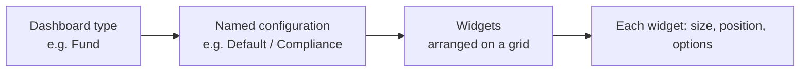
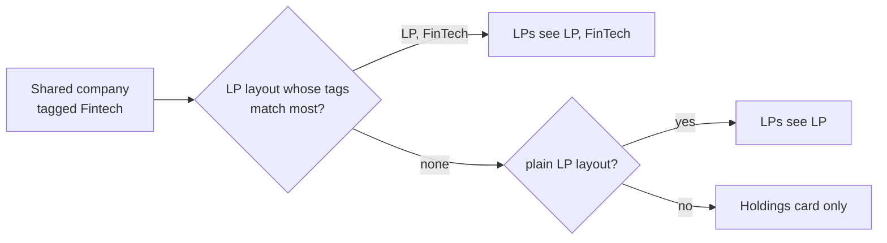

# Dashboard Widgets User Guide

Dashboards in CapHive are built from **widgets** — individual blocks of information or functionality. As an administrator you can enable, resize, reorder, and fine-tune widgets to create tailored dashboards for different users and entities, and even maintain several named versions of the same dashboard.

> **Where to find it:** Company menu (house icon, top right) → [**Dashboard Widgets**](/dashboard_widgets). Create one with **New Dashboard Widget** on that page. Any employee of your company can create and edit widgets; the menu item is hidden only for investor logins.

This guide is a reference for configuring dashboards and their widgets.

---

## Table of Contents

1. [How Dashboards Are Built](#how-dashboards-are-built)
2. [Widget Settings: Size, Position, Enabled](#widget-settings-size-position-enabled)
3. [Widget Options (Metadata)](#widget-options-metadata)
4. [Widget Reference by Dashboard](#widget-reference-by-dashboard)
5. [Named Dashboards](#named-dashboards)
6. [The Dashboard Selector](#the-dashboard-selector)
7. [Per-User Dashboard Preferences](#per-user-dashboard-preferences)
8. [Special Widgets](#special-widgets)
9. [Worked Example](#worked-example)
10. [Frequently Asked Questions](#frequently-asked-questions)

---

## How Dashboards Are Built

Each dashboard is simply a collection of widgets you arrange on a grid. Every dashboard type (Fund, Investor, Portfolio Company, and so on) can have several **named configurations** — distinct sets of widgets you switch between, such as an operational view, a compliance view, and a presentation view. The configuration called **Default** is shown when no other is chosen.

Widgets are configured on Company menu (house icon, top right) → **Dashboard Widgets**. Until you configure any, each dashboard shows its full built-in widget set (landing pages show the first four built-ins). Once at least one enabled widget exists for a dashboard type and name, that dashboard shows **only** your configured widgets.



---

## Widget Settings: Size, Position, Enabled

Each widget record has a **Dashboard name** (the dashboard type), a **Widget Type**, an **Instance Name** (see [Named Dashboards](#named-dashboards)), a required **Tags** display label, and an optional **Tag List** filter (the widget appears only if the dashboard's owner or the viewing user has a matching tag). It also has three core layout settings:

- **Size** — the width on the grid:
  - **XS** 25% (4 per row) · **Small** 33% (3 per row) · **Medium** 50% (2 per row) · **Large** 66% · **XL** 100% (full row).
- **Position** — a number controlling display order (lower appears first).
- **Enabled** — show or hide the widget.

---

## Widget Options (Metadata)

Most widgets accept **options** that customise their behaviour. On the widget form, picking a **Widget Type** loads one input per option under **Widget Configuration**; the generated settings string is shown read-only under **Advanced: Raw Metadata**, and is also the **Metadata** column in Download/Upload files. The format rules:

- Each option is a name followed by a colon and a value.
- Text values go in single quotes (`'My Title'`).
- Yes/no values use `true` or `false` (no quotes).
- Lists go in square brackets (`['XIRR', 'TVPI']`).
- Numbers are written directly (`12`).

**Example:**

```ruby
{title: 'Performance Summary', months: 12, ratio_names: ['XIRR', 'TVPI'], chart: true}
```

> Options entered through the form fields are always valid. A hand-edited or uploaded settings string with a syntax error does not fall back to defaults — the dashboard, the widget's page and its edit form raise an error. Fix it by re-uploading the row with corrected **Metadata**.

---

## Widget Reference by Dashboard

### Fund Dashboard

**Fund Ratios** — performance ratios with optional charts.

| Option | Type | Description |
|--------|------|-------------|
| `title` | Text | Custom widget title. |
| `scenario` | Text | Calculation scenario (default 'Default'). |
| `ratio_names` | List | Ratios to display, e.g. `['XIRR', 'TVPI', 'DPI']`. |
| `months` | Number | History window in months. |
| `chart` / `list` | Yes/No | Show the chart / the table. |
| `condensed` | Yes/No | Compact layout. |
| `decimals` | Number | Decimal places (default 2). |

**Fund Cashflows** — cashflow series over time.

| Option | Type | Description |
|--------|------|-------------|
| `months` | Number | History window (default 36). |
| `series` | Text | Comma-separated series names. |
| `chart_type` | Text | `line`, `bar`, `area`, or `spline`. |

**Fund Portfolio Stats** — aggregate stats across the fund's investments.

| Option | Type | Description |
|--------|------|-------------|
| `fields` | Text | Comma-separated fields (e.g. 'Bought Amount,FMV'). |
| `field_names` | Text | Custom labels for the fields. |
| `force_units` | Text | `Lakhs`, `Crores`, or `Millions`. |
| `currency` | Text | Currency code (e.g. 'USD'). |

### Investor Dashboard

**Documents** — a document browser for the investor's library.

| Option | Type | Description |
|--------|------|-------------|
| `folder_id` | Number | Limit to a specific folder. |
| `card_view` | Yes/No | List vs card view. |
| `per_page` | Number | Documents per page. |
| `per_row` | Number | Cards per row. |
| `show_tags` | Yes/No | Show document tags. |

**Commitments** — a summary of the investor's commitments (no options needed).

### Portfolio Company Dashboard

**Kpis** — a grid view to view and chart company KPIs.

| Option | Type | Description |
|--------|------|-------------|
| `categories` | Text | Comma-separated categories. |
| `period` | Text | `Quarter` or `Year`. |
| `no_of_periods` | Number | Periods to display (default 12). |
| `tag_list` | Text | Filter by tags (e.g. 'Actual, Budget'). |
| `flexible_chart` | Yes/No | Enable interactive charting. |

**Captable** — capitalisation table with ownership breakdowns.

| Option | Type | Description |
|--------|------|-------------|
| `show_charts` | Yes/No | Show ownership charts. |
| `diluted_chart` | Text | `pie`, `donut`, or `half_donut`. |
| `show_captable` | Yes/No | Show the main table. |
| `ag` | Yes/No | Use the high-performance grid for the table. |

**Data Card** — selected record fields in a clean card, e.g. `{cols: 2, fields: "Category:category,City:city,Sector:custom_fields.sector"}`.

### Portfolio Dashboard

- **Portfolio IRR** — IRR for the whole portfolio, e.g. `{show_table: true, show_chart: true}`.
- **FMV %** — a pie chart of fair-market-value distribution.

### Aggregated Portfolio Dashboard

- **Aggre. Portfolio Investments** — a multi-company table, e.g. `{show_grouped: true, group_by_column: 'portfolio_company_name'}`.
- **Company Charts** — sector and company breakdowns, e.g. `{plot: 'fmv,bought_amount', table_limit: 10}`.

### Landing Pages

- **FM Landing Page** (home dashboard for fund-entity employees) — FM Menus, FM Stats, Funds, Investment Opportunities.
- **LP Landing Page** (home dashboard for investor logins) — Funds, Offers, Interests, Deals, Investment Opportunities, Entities.
- **Ops Landing Page** — no built-in widgets today.

My Tasks, Upcoming Events, Investors No Interaction and Notes belong to the **Ops Dashboard** (Sidebar → **Stakeholders → IR Dashboard**), not a landing page.

---

## Named Dashboards

A **named dashboard** is a distinct set of widgets saved under a label for a dashboard type and entity. Every dashboard type supports multiple names.

| Setting | Meaning |
|---------|---------|
| **Dashboard Name** | The dashboard type (e.g. Fund Dashboard). |
| **Instance Name** | The configuration label (e.g. Default, Compliance, Budget View), max 100 characters. |

Widgets sharing the same dashboard type + name + entity form one named dashboard. Those named **Default** are the fallback when no specific name is requested. The same widget can appear in several named dashboards with different options — for example a Fund Ratios widget set to "Actual" in Default and "Budget" in a Budget View.

**To create one:** in **Dashboard Widgets**, create the widgets you want and give them all the same **Instance Name** (e.g. "Compliance").

### LP layouts (what LPs see on a company page)

On the **Portfolio Company Dashboard**, any named dashboard whose name includes the tag **LP** is an **LP layout**: "LP" for every shared company, and "LP, FinTech", "LP, D2C" and so on for companies carrying those tags. Your Default and other layouts stay internal.



- **Set up LP layout** (on the Dashboard Widgets page when no LP layout exists) creates "LP" with Data Card, Key KPIs and Valuations (Key KPIs only if your firm has the KPIs module). LP layouts need the Fund Portfolios module. **New LP layout for a tag** creates "LP, <tag>" as a copy of "LP".
- Only LP-safe widgets can be added: Data Card, Key Kpis, Kpis, Kpis Performance Table, Valuations, Portfolio Investments, Portfolio Stats and Embed Document. KPIs shown to LPs are Actual only.
- A widget's **Tag List** inside an LP layout narrows it to companies with one of those tags; leave it empty for every company using the layout.
- The company's Stakeholder page says which LP layout its LPs get and why, and warns when two layouts match equally (the first by name wins).

---

## The Dashboard Selector

When an entity has **two or more** named dashboards for a type, a selector dropdown appears at the right of the dashboard navigation bar:

- It lists the available names (alphabetically, or in a user's preferred order).
- Choosing one reloads the page with that dashboard.
- The chosen name appears in the page address so the view can be bookmarked and shared.
- With only one named dashboard, no dropdown is shown.

---

## Per-User Dashboard Preferences

You can set, per user, the **order** named dashboards appear in the selector and which one **loads by default**. The first name in their preferred sequence becomes their default when they open that dashboard.

- Edit these on the **User** form, in the **Dashboard Preferences** section (shown for users who already have preferences). The user's profile page also displays a read-only summary.
- To set up preferences for the first time, ask your system administrator to seed them.

**Which dashboard loads:**

| Situation | Dashboard shown |
|-----------|-----------------|
| User has a preferred sequence, no name in the address | First name in the sequence. |
| No preference, no name in the address | Default. |
| A specific name is in the address | That name, always. |
| A preferred name no longer has widgets | Falls back to the default widget set. |

---

## Special Widgets

- **Flexible KPI Charts** — the **Kpis** widget supports interactive charting: pick KPIs from the grid, choose a chart type for each, and save the layout. See the [Flexible KPI Charts guide](kpi_flexible_charts_user_guide).
- **Embed Document** — render an Excel file as an interactive, searchable grid on the dashboard, e.g. `{name: 'Financial Model', xlsx_as_grid: true}`.
- **Agent Chart** (Portfolio Company Dashboard) — shows an AI-generated custom visualisation built from a data question, e.g. `{title: 'AI Insights', height: 420}`. See the [Agent Charts guide](agent_charts_user_guide).

---

## Worked Example

Giving a fund both an operational and a board-presentation dashboard:

1. In **Dashboard Widgets**, build your everyday widgets with **Instance Name** = `Default` — Fund Ratios, Fund Cashflows, Fund Portfolio Stats.
2. Add a second set with **Instance Name** = `Board View` — a condensed Fund Ratios (`{ratio_names: ['XIRR','TVPI','DPI'], condensed: true, chart: true}`), a Large Fund Cashflows chart, and Fund Portfolio Stats.
3. Because the fund now has two named dashboards, the **selector dropdown** appears automatically.
4. For the managing partner, set a **preference** so `Board View` is first — it becomes their default, while everyone else still lands on `Default`.
5. Share the board dashboard by copying its address (which includes the name) into the meeting invite.

---

## Frequently Asked Questions

### Navigation and getting there

**Where do I find Dashboard Widgets in CapHive?**
Company menu (house icon, top right) → [**Dashboard Widgets**](/dashboard_widgets). The page lists every widget configured for your company with its Dashboard Name, Name, Widget Name, Tags, Size, Position and Enabled flag, plus **New Dashboard Widget**, **Filter**, **Download** and **Upload** buttons.

**Where do I see the dashboards these widgets build?**
**Fund Dashboard**: open the fund → **Actions → Dashboard**. **Investor Dashboard** and **Portfolio Company Dashboard**: open the stakeholder → **Misc → Dashboard**. **Ops Dashboard**: Sidebar → [**Stakeholders → IR Dashboard**](/dashboard_widgets/dashboard). **Portfolio Dashboard**: the fund page's **Portfolio** tab.

**Where is the Aggregated Portfolio Dashboard?**
Sidebar → [**Stakeholders → View Stakeholders**](/investors) → [**Actions → Portfolio Dashboard**](/investors?multi_portfolio_dashboard=true), which shows the dashboard across your Portfolio Company stakeholders. Its widgets come from the *Aggregated Portfolio Dashboard* entries on the [**Dashboard Widgets**](/dashboard_widgets) page.

**Where do the landing-page widgets appear?**
Both render on the home dashboard (Sidebar → [**Dashboard**](/entities/dashboard)): *FM Landing Page* widgets for employees of a fund entity, and *LP Landing Page* widgets for investor logins. The *Ops Landing Page* type has no built-in widgets today.

**Where do I set which named dashboard a user sees first?**
Company menu → [**User**](/users) → open the user → **Edit**, then the **Dashboard Preferences** section. A user can also edit their own from Profile menu (avatar) → **My Profile** → **Edit**. The section only appears once the user already has preferences stored. See [Per-User Dashboard Preferences](#per-user-dashboard-preferences).

**Who can manage dashboard widgets?**
Any user of your company (the policy checks only that the widget belongs to your entity; Group Company users can also manage their child entities' widgets). The Company menu link is hidden for investor logins. **Upload** additionally needs the *Enable Import Uploads* permission on your user.

### Creating, updating and managing dashboard widgets

**How do I add a widget to a dashboard?**
On the [**Dashboard Widgets**](/dashboard_widgets) page click [**New Dashboard Widget**](/dashboard_widgets/new), choose the **Dashboard name**, the **Widget Type**, fill **Tags** (required; it is the widget's display label), set **Size** and **Position**, fill the option fields under **Widget Configuration** and click **Save**. See [Widget Settings: Size, Position, Enabled](#widget-settings-size-position-enabled).

**How do I set a widget's options?**
After you pick a **Widget Type**, the form loads one input per option under **Widget Configuration** (text, number, yes/no or a drop-down), built from that widget's sample. The generated settings string is shown read-only under **Advanced: Raw Metadata**. See [Widget Options (Metadata)](#widget-options-metadata).

**How do I edit a widget?**
On the [**Dashboard Widgets**](/dashboard_widgets) page click **Edit** on the row, or open the widget and click **Edit**. Change size, position, options, **Enabled**, **Show Title**, **Show Tags** or **Show Menu** and click **Save**.

**How do I hide a widget without deleting it?**
Edit the widget and untick **Enabled**. Disabled widgets are skipped on the dashboard and do not count towards the named dashboards in the selector; tick it again to bring the widget back with its settings intact.

**How do I delete a widget?**
Open the widget, click **Delete** and confirm. There is no Delete button on the list rows.

**How do I create a named dashboard such as "Board View"?**
Create (or copy) the widgets you want and give each the same **Instance Name** (the form's label for the *Name* setting, max 20 characters), e.g. `Board View`. Widgets left at the default name belong to **Default**. See [Named Dashboards](#named-dashboards).

**How do I bulk create or copy widgets?**
Click **Download** on the [**Dashboard Widgets**](/dashboard_widgets) page to get an Excel file of the current list, edit it, then click **Upload** (import type *DashboardWidget*, with a [sample file](/sample_uploads/dashboard_widgets.xlsx)). Rows whose **Id** matches a widget of your company update it; any other row creates a new widget.

**How do I set a user's dashboard order and default?**
In **Dashboard Preferences** on the user form, enter comma-separated names for each dashboard type, e.g. `Board View,Default`. The first name becomes that user's default view. See [Per-User Dashboard Preferences](#per-user-dashboard-preferences).

### Why use dashboard widgets

**Why should I configure dashboard widgets?**
Without configuration every user sees the full built-in widget set for a dashboard. Widgets let you choose which blocks appear, in what order, at what width and with what options (ratios, periods, charts, currencies), so each audience sees the numbers that matter to them.

**What can I do with dashboard widgets that I cannot do otherwise?**
Keep several named versions of the same dashboard (operations, compliance, board presentation) and switch between them with the selector, give individual users a different default, show a widget only for owners or users with matching tags, embed an Excel file as a grid, and add AI-generated Agent Charts.

**What happens if I never set up any widgets?**
Nothing breaks: each dashboard shows its complete built-in widget set in its default order (landing pages show only the first four). You just cannot trim, reorder or tune it, and there is no dashboard selector.

**Who typically uses this feature?**
Company admins and fund operations staff who design what fund managers, IR teams and board members see. Individual users mainly interact with the dashboard selector and their own dashboard preferences.

### What happens when I …

**What happens when I save my first widget for a dashboard?**
The dashboard stops showing the built-in widget set and shows only your enabled, configured widgets for that dashboard name. If you create just one widget, that is the only block users will see, so add every widget you want before sharing.

**What happens when I save or edit a widget?**
The widget record is saved for your company and the change shows the next time anyone loads that dashboard. Position is managed as a list within the same dashboard, so other widgets' positions can shift to make room. No one is notified and no approval is needed.

**What happens when I disable a widget?**
It disappears from the dashboard and from the dashboard's quick-jump menu for everyone. If it was the only enabled widget for that dashboard name, the dashboard falls back to the full built-in widget set.

**What happens when I delete a widget?**
The record is permanently removed (there is no restore). If you need it again, re-create it or re-upload it from a previously downloaded Excel file. Disabling is the safer choice when you may want it back.

**What happens when I upload a widgets file?**
The import runs in the background and creates or updates one widget per row for your company, stamping each with the import upload. An unmatched **Id** (for example from another company's export) creates a new widget rather than failing. Review the result on the import upload page.

**What happens when I pick a name in the dashboard selector?**
The page reloads with `name=` added to the address, showing only the widgets with that **Instance Name**. The address can be bookmarked or shared, and a name in the address always overrides the user's preference.

**What happens when I change a user's dashboard preferences?**
Only that user is affected: the selector lists their names first in the saved order, and the first name loads by default whenever the address has no `name=`. Names that no longer have enabled widgets are simply left out of the selector.

**What happens if a widget's options are wrong?**
Options entered through the form's fields are always valid. A hand-edited or imported settings string with a Ruby syntax error is not silently ignored: the dashboard, the widget's page and its edit form all raise an error when they read it. Fix it by re-uploading the row (same **Id**) with corrected **Metadata**.

### Troubleshooting and edge cases

**Why isn't my widget showing?**
Check that **Enabled** is on, the **Dashboard name** and **Instance Name** match the dashboard you are viewing, and the **Tag List** (if set) matches a tag on the dashboard's owner or on your user. Widgets whose type does not belong to that dashboard are skipped.

**How do I change the order of widgets?**
Use the **Position** field; widgets sort ascending (1, 2, 3…). Other widgets on the same dashboard may be renumbered automatically when you move one.

**Can I show the same widget twice with different settings?**
Yes. Add it twice with different options and a different **Tags** label (for example one Fund Ratios for Actual and one for Budget); the label is what distinguishes them on the dashboard's menu.

**What does Tag List do, and how is it different from Tags?**
**Tags** is the required display label for the widget. **Tag List** is an optional filter: when set, the widget only appears if the dashboard's owner (e.g. the fund or stakeholder) or the viewing user has at least one matching tag.

**I created a named dashboard but the dropdown isn't appearing.**
The dropdown needs **two or more** distinct names among the enabled widgets of that dashboard type for your company. Check that the widgets really have different **Instance Name** values and are enabled.

**How do I control which named dashboard a user sees first?**
Set a preferred sequence on their user record; the first name is their default. See [Per-User Dashboard Preferences](#per-user-dashboard-preferences).

**A user has a preference but still lands on Default.**
Confirm the name in their sequence exactly matches the widgets' **Instance Name** and that those widgets are enabled for the right company. If the address already contains `name=`, that name wins over the preference.

**The Dashboard Preferences section is missing on the user form.**
It is only rendered for users who already have dashboard preferences stored. For a user with none yet, ask your system administrator to seed them.

**Can I share a link to a specific named dashboard?**
Yes. The page address includes `name=` when you pick one from the selector; copy and share it. The recipient still needs access to the underlying fund or stakeholder.

**The dropdown shows names in the wrong order.**
Names sort alphabetically by default; set a preferred sequence on the user to override. Names not in the sequence are listed after it, alphabetically.

**A widget appears in the list but not on the quick-jump menu at the top of the dashboard.**
The menu only lists widgets with **Show Menu** ticked. Edit the widget and tick **Show Menu**; the widget itself renders either way.

**Why doesn't my widget show a heading?**
Tick **Show Title** (shows the widget type) and/or **Show Tags** (shows the Tags label) on the widget. Both are off by default.

### LP layouts

**Why use an LP layout instead of my Default dashboard?**
So LPs see a curated page — order, sizes and widgets chosen for them — while your internal dashboard stays as it is. Only layouts whose name includes the tag LP are ever shown to LPs.

**How do I give fintech companies different widgets?**
Tag those companies (e.g. Fintech) on their Stakeholder page and click **New LP layout for a tag** with "FinTech". Their LPs see "LP, FinTech" instead of "LP"; matching ignores case.

**What happens if I add a Notes or Captable widget to an LP layout?**
The save is refused: "This widget can't be added to an LP layout: it isn't safe to show LPs." Only the LP-safe widget types are offered when you add a widget from an LP layout.

**How do I show a founder video to LPs?**
Upload the video to each company's documents under one name (e.g. "Founder Video") and add an **Embed Document** widget with that name to the LP layout. It plays inline; a company without that document simply doesn't show the widget.

**Why can't I add a KPI widget to an LP layout?**
KPI widgets (Key Kpis, Kpis, Kpis Performance Table) read KPI data, which needs your firm's **KPIs** module. Without it, the widget form doesn't offer them on LP layouts, a KPI widget already in a layout is skipped on LP pages, and Set up LP layout starts with Data Card and Valuations only. For example, an "LP" layout holding Data Card, Key Kpis and Valuations shows LPs just Data Card and Valuations.

**What does an LP see if no LP layout applies?**
Only their holdings card and "No further company information has been shared." Internal widgets are never used as a fallback.

## Related Guides

- [Agent Charts](agent_charts_user_guide) — AI-generated charts you can place on a dashboard with the Agent Chart widget.
- [KPI Flexible Charts](kpi_flexible_charts_user_guide) — interactive charting inside the Kpis widget.
- [Fund Ratios](fund_ratios_user_guide) — the ratios the Fund Ratios widget displays.
- [Portfolio Investments](portfolio_investments_user_guide) — data behind the Portfolio and Aggregated Portfolio dashboards.
- [Stakeholders (Investors)](investors_user_guide) — the stakeholder pages that host the Investor and Portfolio Company dashboards.
- [User Role Management](user_role_management_user_guide) — user records where dashboard preferences are stored.
