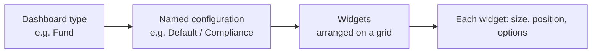

# Dashboard Widgets User Guide

Dashboards in CapHive are built from **widgets** — individual blocks of information or functionality. As an administrator you can enable, resize, reorder, and fine-tune widgets to create tailored dashboards for different users and entities, and even maintain several named versions of the same dashboard.

This guide is a reference for configuring dashboards and their widgets.

---

## Table of Contents

1. [How Dashboards Are Built](#how-dashboards-are-built)
2. [Widget Settings: Size, Position, Enabled](#widget-settings-size-position-enabled)
3. [Widget Options (Metadata)](#widget-options-metadata)
4. [Widget Reference by Dashboard](#widget-reference-by-dashboard)
5. [Named Dashboards](#named-dashboards)
6. [The Dashboard Selector](#the-dashboard-selector)
7. [Per-User Dashboard Preferences](#per-user-dashboard-preferences)
8. [Special Widgets](#special-widgets)
9. [Worked Example](#worked-example)
10. [Frequently Asked Questions](#frequently-asked-questions)

---

## How Dashboards Are Built

Each dashboard is simply a collection of widgets you arrange on a grid. Every dashboard type (Fund, Investor, Portfolio Company, and so on) can have several **named configurations** — distinct sets of widgets you switch between, such as an operational view, a compliance view, and a presentation view. The configuration called **Default** is shown when no other is chosen.



---

## Widget Settings: Size, Position, Enabled

Every widget has three core settings:

- **Size** — the width on the grid:
  - **XS** 25% (4 per row) · **Small** 33% (3 per row) · **Medium** 50% (2 per row) · **Large** 66% · **XL** 100% (full row).
- **Position** — a number controlling display order (lower appears first).
- **Enabled** — show or hide the widget.

---

## Widget Options (Metadata)

Most widgets accept **options** that customise their behaviour, entered in a simple settings format. The rules:

- Each option is a name followed by a colon and a value.
- Text values go in single quotes (`'My Title'`).
- Yes/no values use `true` or `false` (no quotes).
- Lists go in square brackets (`['XIRR', 'TVPI']`).
- Numbers are written directly (`12`).

**Example:**

```ruby
{title: 'Performance Summary', months: 12, ratio_names: ['XIRR', 'TVPI'], chart: true}
```

> If an option's syntax is invalid, the widget falls back to its defaults. Each widget's edit form shows a sample to copy.

---

## Widget Reference by Dashboard

### Fund Dashboard

**Fund Ratios** — performance ratios with optional charts.

| Option | Type | Description |
|--------|------|-------------|
| `title` | Text | Custom widget title. |
| `scenario` | Text | Calculation scenario (default 'Default'). |
| `ratio_names` | List | Ratios to display, e.g. `['XIRR', 'TVPI', 'DPI']`. |
| `months` | Number | History window in months. |
| `chart` / `list` | Yes/No | Show the chart / the table. |
| `condensed` | Yes/No | Compact layout. |
| `decimals` | Number | Decimal places (default 2). |

**Fund Cashflows** — cashflow series over time.

| Option | Type | Description |
|--------|------|-------------|
| `months` | Number | History window (default 36). |
| `series` | Text | Comma-separated series names. |
| `chart_type` | Text | `line`, `bar`, `area`, or `spline`. |

**Fund Portfolio Stats** — aggregate stats across the fund's investments.

| Option | Type | Description |
|--------|------|-------------|
| `fields` | Text | Comma-separated fields (e.g. 'Bought Amount,FMV'). |
| `field_names` | Text | Custom labels for the fields. |
| `force_units` | Text | `Lakhs`, `Crores`, or `Millions`. |
| `currency` | Text | Currency code (e.g. 'USD'). |

### Investor Dashboard

**Documents** — a document browser for the investor's library.

| Option | Type | Description |
|--------|------|-------------|
| `folder_id` | Number | Limit to a specific folder. |
| `card_view` | Yes/No | List vs card view. |
| `per_page` | Number | Documents per page. |
| `per_row` | Number | Cards per row. |
| `show_tags` | Yes/No | Show document tags. |

**Commitments** — a summary of the investor's commitments (no options needed).

### Portfolio Company Dashboard

**KPIs (Grid View)** — view and chart company KPIs.

| Option | Type | Description |
|--------|------|-------------|
| `categories` | Text | Comma-separated categories. |
| `period` | Text | `Quarter` or `Year`. |
| `no_of_periods` | Number | Periods to display (default 12). |
| `tag_list` | Text | Filter by tags (e.g. 'Actual, Budget'). |
| `flexible_chart` | Yes/No | Enable interactive charting. |

**Cap Table** — capitalisation table with ownership breakdowns.

| Option | Type | Description |
|--------|------|-------------|
| `show_charts` | Yes/No | Show ownership charts. |
| `diluted_chart` | Text | `pie`, `donut`, or `half_donut`. |
| `show_captable` | Yes/No | Show the main table. |
| `ag` | Yes/No | Use the high-performance grid for the table. |

**Data Card** — selected record fields in a clean card, e.g. `{cols: 2, fields: "Category:category,City:city,Sector:custom_fields.sector"}`.

### Portfolio Dashboard

- **Portfolio IRR** — IRR for the whole portfolio, e.g. `{show_table: true, show_chart: true}`.
- **FMV %** — a pie chart of fair-market-value distribution.

### Aggregated Portfolio Dashboard

- **Aggregate Portfolio Investments** — a multi-company table, e.g. `{show_grouped: true, group_by_column: 'portfolio_company_name'}`.
- **Company Charts** — sector and company breakdowns, e.g. `{plot: 'fmv,bought_amount', table_limit: 10}`.

### Landing Pages

- **Fund Manager** — Stats, Managed Funds, Investment Opportunities.
- **Investor (LP)** — My Funds, Offers, Interests, Account Entries Chart.
- **Operations** — My Tasks, Upcoming Events, Investors With No Interaction.

---

## Named Dashboards

A **named dashboard** is a distinct set of widgets saved under a label for a dashboard type and entity. Every dashboard type supports multiple names.

| Setting | Meaning |
|---------|---------|
| **Dashboard Name** | The dashboard type (e.g. Fund Dashboard). |
| **Name** | The configuration label (e.g. Default, Compliance, Budget View). |

Widgets sharing the same dashboard type + name + entity form one named dashboard. Those named **Default** are the fallback when no specific name is requested. The same widget can appear in several named dashboards with different options — for example a Fund Ratios widget set to "Actual" in Default and "Budget" in a Budget View.

**To create one:** in **Dashboard Widgets**, create the widgets you want and give them all the same **Name** (e.g. "Compliance").

---

## The Dashboard Selector

When an entity has **two or more** named dashboards for a type, a selector dropdown appears at the right of the dashboard navigation bar:

- It lists the available names (alphabetically, or in a user's preferred order).
- Choosing one loads it instantly without a full page reload.
- The chosen name appears in the page address so the view can be bookmarked and shared.
- With only one named dashboard, no dropdown is shown.

---

## Per-User Dashboard Preferences

You can set, per user, the **order** named dashboards appear in the selector and which one **loads by default**. The first name in their preferred sequence becomes their default when they open that dashboard.

- Edit these on the **User** form, in the **Dashboard Preferences** section (shown for users who already have preferences). The user's profile page also displays a read-only summary.
- To set up preferences for the first time, ask your system administrator to seed them.

**Which dashboard loads:**

| Situation | Dashboard shown |
|-----------|-----------------|
| User has a preferred sequence, no name in the address | First name in the sequence. |
| No preference, no name in the address | Default. |
| A specific name is in the address | That name, always. |
| A preferred name no longer has widgets | Falls back to the default widget set. |

---

## Special Widgets

- **Flexible KPI Charts** — the KPIs widget supports interactive charting: pick KPIs from the grid, choose a chart type for each, and save the layout. See the [Flexible KPI Charts guide](kpi_flexible_charts_user_guide).
- **Embedded Documents** — render an Excel file as an interactive, searchable grid on the dashboard, e.g. `{name: 'Financial Model', xlsx_as_grid: true}`.
- **Agent Charts** — use AI to generate custom visualisations from a data question, e.g. `{title: 'AI Insights'}`. See the [Agent Charts guide](agent_charts_user_guide).

---

## Worked Example

Giving a fund both an operational and a board-presentation dashboard:

1. In **Dashboard Widgets**, build your everyday widgets with **Name** = `Default` — Fund Ratios, Fund Cashflows, Portfolio Stats.
2. Add a second set with **Name** = `Board View` — a condensed Fund Ratios (`{ratio_names: ['XIRR','TVPI','DPI'], condensed: true, chart: true}`), a large FMV % chart, and Portfolio Stats.
3. Because the fund now has two named dashboards, the **selector dropdown** appears automatically.
4. For the managing partner, set a **preference** so `Board View` is first — it becomes their default, while everyone else still lands on `Default`.
5. Share the board dashboard by copying its address (which includes the name) into the meeting invite.

---

## Frequently Asked Questions

**Why isn't my widget showing?**
Check that **Enabled** is on, the **Dashboard Name** matches the page you're viewing, and the options syntax is valid (no missing commas or unquoted text).

**How do I change the order of widgets?**
Use the **Position** field — widgets sort ascending (1, 2, 3…).

**Can I show the same widget twice with different settings?**
Yes — add it twice and give each a different set of options (e.g. one Fund Ratios for Actual, one for Budget).

**What if I enter invalid options?**
The widget falls back to its defaults. Copy the sample shown in the edit form.

**I created a named dashboard but the dropdown isn't appearing.**
The dropdown needs **two or more** named dashboards for the same entity and type. Check the widgets have different **Name** values and are enabled.

**How do I control which named dashboard a user sees first?**
Set a preferred sequence on their user record; the first name is their default. See [Per-User Dashboard Preferences](#per-user-dashboard-preferences).

**A user has a preference but still lands on Default.**
Confirm the name in their sequence exactly matches the widgets' **Name** (case-sensitive) and that those widgets are enabled for the right entity.

**Can I share a link to a specific named dashboard?**
Yes — the page address includes the dashboard name when one is active; copy and share it.

**The dropdown shows names in the wrong order.**
Names sort alphabetically by default; set a preferred sequence on the user to override.
