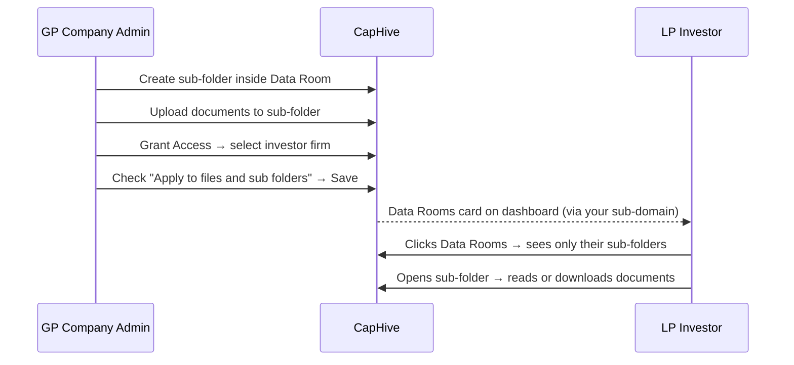
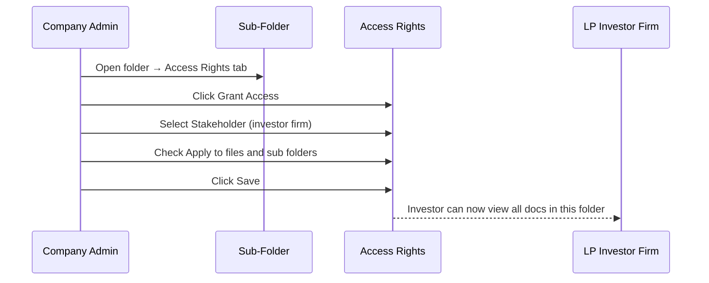

# Data Rooms — Company Admin Guide

Data Rooms give you a dedicated, permission-controlled folder space to share documents selectively with your investors. Each investor sees only the sub-folders you have explicitly shared with them — nothing more. This guide explains how to set up your Data Room, organise it into sub-folders, upload documents, and control exactly who sees what.

> **Where to find it:** Sidebar → [**Documents**](/documents) → click **Data Room** in the **Folders** tree; use **Actions → New Folder** / **New Document** there, and grant investors access from the sub-folder's own page → **Access Rights** tab → **Grant Access**. The *Data Rooms* feature (`enable_data_rooms`) is switched on for your company by CapHive support, and your login needs the *Documents* permission.

---

## Table of Contents

1. [Key Concepts](#key-concepts)
2. [Prerequisites](#prerequisites)
3. [How Data Rooms Work](#how-data-rooms-work)
4. [Navigating to the Data Room](#navigating-to-the-data-room)
5. [Creating Sub-Folders](#creating-sub-folders)
6. [Uploading Documents](#uploading-documents)
7. [Granting Investor Access to a Sub-Folder](#granting-investor-access-to-a-sub-folder)
8. [How Your Investors Experience the Data Room](#how-your-investors-experience-the-data-room)
9. [Revoking or Changing Access](#revoking-or-changing-access)
10. [Sharing Individual Documents via a Link](#sharing-individual-documents-via-a-link)
11. [Frequently Asked Questions](#frequently-asked-questions)

---

## Key Concepts

| Term | Meaning |
|---|---|
| **Data Room** | A top-level folder reserved for investor-facing documents: the folder named exactly **Data Room** directly under your root folder. It is not created automatically when the feature is enabled; CapHive support sets it up. |
| **Sub-Folder** | A folder you create inside the Data Room to organise documents by topic, investor group, or deal. |
| **Access Right** | A permission record that grants a specific investor firm (or user) visibility of a sub-folder, plus anything added to it later. |
| **Cascade** | When "Apply to files and sub folders" is checked on an access right, access is also copied down to the child folders and documents already inside. |
| **Investor Access** | The gate that lets an investor's user log in to the portal. Must be approved before any access rights take effect. |

---

## Prerequisites

Data Rooms are enabled for your account by the **CapHive support team**. Once enabled:

- The **Data Room** folder is **not** created automatically — CapHive support sets up the folder named exactly **Data Room** directly under your root folder, and it then appears in your folder tree under Documents.
- The **Data Rooms** card appears in the **Funds** section of an investor's dashboard only when they log in through your company's own CapHive sub-domain or custom domain (and their login has funds enabled).

Contact CapHive support if the Data Room folder is not visible in your Documents section.

---

## How Data Rooms Work



The Data Room folder itself is never directly visible to investors. What they see are only the **sub-folders you have explicitly shared with them**. An investor with access to "Q3 Update" cannot see "Board Pack" unless you share that separately.

### Example folder structure

```
Data Room/
├── Q3 Investor Update/        ← shared with all investors
│   ├── Portfolio Summary.pdf
│   └── Financial Statements.xlsx
├── Lead Investor Pack/        ← shared with lead investors only
│   └── Board Minutes Oct.pdf
└── New Deal Preview/          ← not yet shared with anyone
    └── Teaser.pdf
```

---

## Navigating to the Data Room

1. Click **Documents** in the left sidebar.
2. In the folder tree on the left panel, locate and click **Data Room**.
3. The right panel shows the documents and sub-folders inside the Data Room.

There is no **Folders** item in the sidebar. Alternatively, open the [folder list](/folders), find the **Data Room** row in the table, and click **View Docs**.

---

## Creating Sub-Folders

Sub-folders let you group documents by topic, investor tier, or deal. You can create them from multiple places:

**From the Data Room folder page:**
1. Open the Data Room folder.
2. Click **Actions** (top right) → **New Folder**, or click the **Create Sub Folder** button on the folder details page.
3. Fill in the form:

| Field | What to enter |
|---|---|
| **Name** | A clear, descriptive name — for example, "Q3 Investor Update" or "Lead Investor Pack". **Important: the name cannot be changed after saving.** |
| **Allow Download** | Check to let investors download documents as files. |
| **Allow Printing** | Check to let investors print documents. |
| **Allow Orignal Format Download** (spelled that way on screen) | Check to serve the original file without watermarking or conversion. |

4. Click **Save**.

To create a child folder inside a sub-folder, open that sub-folder and repeat the same steps.

> **Tip:** Plan your folder structure before creating sub-folders, because names cannot be changed once saved. Use clear names that will still make sense in six months.

---

## Uploading Documents

Upload documents into the sub-folder where investors should find them.

**Steps:**

1. Open the target sub-folder.
2. Click **Actions** → **New Document**.
3. Fill in the form:

| Field | What to enter |
|---|---|
| **Name** | A descriptive document name. |
| **Folder** | Pre-filled with the current folder — change only if you want a different location. |
| **Tags** | Optional comma-separated tags for filtering (e.g. `quarterly, financials`). |
| **As Of Date** | Optional. The date the document applies to, shown in the document list instead of the upload date. Useful for quarterly reports. |
| **Upload File** | Select the file from your computer. |
| **Allow Download** | Check to let investors download. |
| **Allow Printing** | Check to let investors print. |
| **Send Email** | Check to notify investors who have access as soon as the document is saved. |

4. Click **Save** (or **Save & Upload More** to add multiple documents in sequence).

For large batches, use **Actions → Bulk Upload** to import a list of documents via a spreadsheet.

Any investor already granted access to the sub-folder sees new documents once a background job copies the folder's access rights onto them — no additional sharing step is needed.

---

## Granting Investor Access to a Sub-Folder

Access is controlled at the **sub-folder level**. Granting access to a sub-folder gives the investor visibility of documents and child folders added to it in the future; documents and child folders **already inside** are covered only if you tick **Apply to files and sub folders**.



**Steps:**

1. Open the sub-folder you want to share.
2. Click the **Access Rights** tab (below the folder details).
3. Click **Grant Access**.
4. In the form that appears:

| Field | What to do |
|---|---|
| **Access Type** | Select **All Users for Specific Stakeholder** to share with a specific investor firm. |
| **Select Stakeholder** | Choose the investor firm from the dropdown. |
| **Apply to files and sub folders** | **Check this box** to copy access onto the documents and child folders already inside (a background job does this). Without it, existing contents are not shared. |
| **Send Notification** | Has no effect on folders — no email or notification is sent when you grant access to a sub-folder. To tell investors, tick **Send Email** when uploading a document, or email them separately. |

5. Click **Save**.

The investor firm now appears in the Access Rights table. Their users will see this sub-folder (and, once the background job finishes, its existing contents if you ticked cascade) on their next page load.

> **Prerequisite:** The investor must already have an **approved Investor Access** record before the access right takes effect. If they still cannot see the folder after sharing, check that their Investor Access is approved. See the [Investor Access & Permissions Guide](investor_access_tutorial.md).

### Sharing with a category of investors

To share with all investors of a particular type at once (for example all "Lead Investors"), set **Access Type** to **All Stakeholders of Specific Category** and select the category (or **All Stakeholders with Tag** and enter tags). CapHive creates one access right per stakeholder currently in that category or carrying that tag at the moment you save. Stakeholders added to the category or tagged later are **not** covered — grant them access separately.

### Sharing with a specific individual

To share with one person at an investor firm rather than the whole firm, set **Access Type** to **Specific User** and use the **Select Specific User** dropdown.

---

## How Your Investors Experience the Data Room

When an investor logs in through your company's own CapHive sub-domain or custom domain, the **Funds** section of their dashboard shows a **Data Rooms** card ("Shared Docs") that opens your Data Room. Investors arriving any other way don't see the card; they can open the [Data Rooms list](/folders/data_rooms) instead (there is no menu link).

```mermaid
sequenceDiagram
    participant LP as LP Investor
    participant Dashboard as Investor Dashboard
    participant Listing as Data Rooms Listing
    participant Folder as Sub-Folder

    LP->>Dashboard: Logs in via your sub-domain
    Dashboard-->>LP: Data Rooms card visible (green folder icon, "Shared Docs")
    LP->>Listing: Opens /folders/data_rooms (URL only)
    Listing-->>LP: Table lists companies they invest in that have a Data Room
    LP->>Folder: Clicks entity name → sees only shared sub-folders
    Folder-->>LP: Documents visible; can download/print per your settings
```

Investors see:
- On the [Data Rooms list](/folders/data_rooms), every company they invest in that has Data Rooms enabled and a Data Room folder (whether or not anything is shared with them yet).
- Inside each entity's data room, only the sub-folders explicitly shared with their firm.
- Documents within those sub-folders, subject to the download and printing settings you configured.
- Nothing from sub-folders not shared with them — those folders are completely invisible.

---

## Revoking or Changing Access

To remove an investor's access to a sub-folder:

1. Open the sub-folder.
2. Click the **Access Rights** tab.
3. Find the investor's row in the access rights table.
4. Click **Delete**.

The row is removed immediately, and a background job then removes that stakeholder's (or user's) access rights from every child folder and document in the subtree — whether or not cascade was ticked when access was granted. The investor loses sight of the whole subtree once the job finishes.

Folders themselves cannot be deleted or renamed; empty an unwanted sub-folder by deleting its documents and access rights.

---

## Sharing Individual Documents via a Link

For one-off sharing with someone who does not have a CapHive login, you can generate a shareable email link for a single document.

**Steps:**

1. Open the document.
2. Click the **Shares** tab.
3. Click **New**.
4. Enter the recipient's email address.
5. Click **Save** — the recipient receives a link to view that specific document.

The Shares tab appears on documents inside entities where Data Rooms is enabled, and is only visible to company admins.

---

## Frequently Asked Questions

### Navigation and getting there

**Where do I find the Data Room in CapHive?**
Sidebar → [**Documents**](/documents), then click **Data Room** in the **Folders** tree on the left; the right panel lists its sub-folders and documents. There is no "Folders" item in the sidebar: the [folder list](/folders) has no menu link. See [Navigating to the Data Room](#navigating-to-the-data-room).

**How do I open a sub-folder's own page, where the Access Rights tab is?**
Go to the [folder list](/folders) (no menu link; the [full folder list](/folders?all=true) includes system folders) and click **Show** on the sub-folder's row, or open any document inside it and click the **View Folder** badge next to its folder path. The folder page has **View Docs**, **Upload / Edit**, **Create Sub Folder** and **All Docs** buttons and the **Documents** and **Access Rights** tabs.

**How do investors get to the Data Room?**
When an investor logs in through your company's CapHive address (your sub-domain or custom domain), the **Funds** section of their dashboard shows a **Data Rooms** card ("Shared Docs") that opens your Data Room directly. Any investor can also open the [Data Rooms list](/folders/data_rooms) (no menu link), which lists every company they invest in that has Data Rooms enabled. See [How Your Investors Experience the Data Room](#how-your-investors-experience-the-data-room).

**Who can manage the Data Room?**
Any employee of your company can create sub-folders and grant or delete access rights on a regular (non-system) folder. Uploading and deleting documents needs the *Documents* permission plus company-admin rights or an employee access right with update/destroy permission on the folder. The **Shares** tab and **Download Folder** are company-admin only. Investors are always read-only.

**How is Data Rooms switched on for my company?**
CapHive support enables the *Data Rooms* permission (`enable_data_rooms`) on your company. The investor-facing Data Room is the folder named exactly **Data Room** directly under your root folder; if it is not in your tree, ask support to set it up rather than creating a similarly named folder elsewhere. See [Prerequisites](#prerequisites).

### Creating, updating and managing the Data Room

**How do I create a sub-folder in the Data Room?**
Select **Data Room** in the tree, then [**Actions → New Folder**](/folders/new); or open the folder page and click **Create Sub Folder**. Enter a **Name** (it cannot be changed later) and set **Allow Download**, **Allow Printing** and **Allow Orignal Format Download** (spelled that way on screen), then **Save**. See [Creating Sub-Folders](#creating-sub-folders).

**How do I upload documents to a Data Room sub-folder?**
Select the sub-folder in the tree and choose [**Actions → New Document**](/documents/new), fill in **Name** and **Upload File**, optionally tick **Send Email**, and **Save** (or **Save & Upload More**). For many files use **Actions → Bulk Upload** (spreadsheet import) or the folder's **Upload / Edit** page. See [Uploading Documents](#uploading-documents).

**How do I share a sub-folder with an investor?**
Open the sub-folder page → **Access Rights** tab → **Grant Access**. Choose the **Access Type** (**All Users for Specific Stakeholder**, **All Stakeholders of Specific Category**, **All Stakeholders with Tag**, **Specific User** or **Employee**), pick the stakeholder (investor), category, tag or user, tick **Apply to files and sub folders**, and **Save**. See [Granting Investor Access to a Sub-Folder](#granting-investor-access-to-a-sub-folder).

**How do I remove or change an investor's access?**
Open the sub-folder page → **Access Rights** tab, find the row and click **Delete**. Access rights cannot be edited: to change who is covered, delete the row and grant access again. See [Revoking or Changing Access](#revoking-or-changing-access).

**How do I change the download or printing settings of a sub-folder?**
Open the folder page and click **Upload / Edit**, then change **Allow Download**, **Allow Printing** or **Allow Orignal Format Download** and save. The folder's name and parent are locked on this form.

**How do I delete a document from the Data Room?**
Open the document and click **Delete**; to remove many, select the folder, run **Actions → Filter Documents**, then **Actions → Delete** on the results. Signed documents and documents out for e-signature cannot be deleted. Deletes are soft: a deleted document can be restored from the [deleted documents list](/documents/show_deleted) (no menu link).

**Can I delete or rename a Data Room sub-folder?**
No. The folder policy never allows delete, so there is no **Delete** button on a folder page, and the **Name** field is disabled once the folder is saved. Empty an unwanted folder by deleting its documents and removing its access rights, or ask CapHive support to remove it; plan names before creating folders.

**How do I share a single document with someone who has no login?**
Open the document, click the **Shares** tab, then [**New**](/doc_shares/new), enter their email and **Save**. The tab appears only for company admins and only when Data Rooms is enabled, and it shows whether the email went out, when the link was first viewed and how often. See [Sharing Individual Documents via a Link](#sharing-individual-documents-via-a-link).

### Why use a Data Room

**Why should I use a Data Room rather than emailing documents?**
You share once at folder level and every document inside is covered, each investor sees only what was shared with their firm, download and printing can be disabled, and the **Viewed By** tab on each document tells you who actually opened it. Nothing is left in inboxes after access is removed. See [How Data Rooms Work](#how-data-rooms-work).

**What does a Data Room let me do that ordinary document folders do not?**
It gives investors a single entry point (the **Data Rooms** card or the [Data Rooms list](/folders/data_rooms)) into your company's shared material, separate from fund and commitment documents, and adds the admin-only **Shares** tab for sending one document to an outside email with a tracked, expiring link.

**Who typically uses the Data Room?**
Investor-relations and fund-operations teams set up sub-folders for quarterly updates, fundraising material and lead-investor packs; company admins control access and external shares; stakeholders (investors) and their users read and download what was shared with them on the investor portal.

**What can investors do in the Data Room?**
Browse only the sub-folders shared with them and view, download or print documents according to each document's **Allow Download** and **Allow Printing** settings. They cannot upload, rename, delete or see any folder or document not shared with them. See [How Your Investors Experience the Data Room](#how-your-investors-experience-the-data-room).

**What happens if I never grant access to a sub-folder?**
Nothing is exposed. The Data Room folder itself is never shared with investors by default; a sub-folder and its documents stay invisible until an access right exists for that investor, user, category or tag.

### What happens when I …

**What happens when I create a sub-folder?**
A regular folder is created under the chosen parent with its full path, and it copies every access right of its parent, so anyone who can see the parent can see the new folder. Its download, printing and original-format settings pre-fill the upload form for documents added to it. No one is notified.

**What happens when I upload a document to a shared sub-folder?**
The document is saved with the download and printing values on the form (pre-filled from the folder), and a background job copies the folder's access rights onto it, so investors who already have access to the folder see it without a further sharing step. It also appears in the **Documents** tree and the Excel **Index**. No one is emailed unless **Send Email** was ticked.

**What happens when I tick Send Email on the upload form?**
Once the document's access rights are copied, every user covered by them gets an in-app notification and an email ("Document Uploaded: <name>" unless you have a custom notification). It is sent once, right after upload. Only users with an approved Investor Access on your company can then open the document.

**What happens when I grant access with Apply to files and sub folders ticked?**
One access right per selected stakeholder or user is saved on the folder, and a background job copies it onto every document already in the folder and onto every child folder at any depth (and their documents). The investor's users see the sub-folder and its contents on their next page load once the job finishes. Documents added later inherit it automatically.

**What happens if I grant access without ticking Apply to files and sub folders?**
Only the folder itself gets the access right. Documents already inside it and existing child folders are not shared, so the investor sees the folder but not those files; only documents uploaded into the folder afterwards (and sub-folders created afterwards) pick up the access. Delete and re-grant with the box ticked to cover existing content.

**Does ticking Send Notification on a Data Room access right email the investor?**
No. For folder access rights the notification is skipped (folders have no send-email setting), so no one is notified when you grant access to a sub-folder. To tell investors, tick **Send Email** when uploading a document, use **Send Document** on a document, or email them separately.

**What happens when I delete an access right on a sub-folder?**
The row is soft-deleted immediately, and a background job then removes, from that folder, every child folder and every document inside them, all access rights copied from it plus any other rights for the same stakeholder or the same user. The investor loses sight of the whole subtree once the job finishes. No one is notified, and the deletion cannot be undone from the UI; grant access again instead.

**What happens when I change a sub-folder's download or printing settings?**
A background job pushes the new **Allow Download**, **Allow Printing** and original-format values onto every document in the folder and every child folder and its documents, overwriting any per-document settings. No one is notified.

**What happens when I share a document through the Shares tab?**
A share record is created and an email "<document name> been shared with you" is sent to the address with a personal link. The link works without a login for 30 days; each open increments the view count and the first open records **Viewed At** on the **Shares** tab. Deleting the share makes the link stop working.

**What happens when I delete a document?**
The document is soft-deleted and disappears from the tree and from every investor's view immediately. No one is notified. It can be restored from the [deleted documents list](/documents/show_deleted) (no menu link) by a user with the same delete permission.

### Troubleshooting and edge cases

**An investor says they cannot see the Data Room or a shared document. What should I check?**
Check that their Investor Access on your company is approved (Sidebar → [**Stakeholders → Pending Access**](/investor_accesses?approved=false)), since documents are only shown to users with approved access. Then check the sub-folder's **Access Rights** tab lists their firm, category, tag or user, and that the right was granted with **Apply to files and sub folders** if the files were already there.

**The Data Rooms card is missing from an investor's dashboard. Why?**
The card only shows when the investor is logged in through your company's own CapHive sub-domain or custom domain, their login has funds enabled, your company has Data Rooms switched on, and a folder named exactly **Data Room** exists under your root folder. Otherwise send them to the [Data Rooms list](/folders/data_rooms), which lists your company if they are one of your stakeholders.

**I cannot see the Data Room folder in my tree. Why?**
Either the **Data Room** folder has not been set up under your root folder (ask CapHive support) or your login does not have the *Documents* permission, so the sidebar **Documents** item is hidden too.

**There is no Access Rights tab on a folder page. Why?**
The tab is hidden on folders owned by a fund, deal or secondary sale (for example a fund's own **Data Room** folder), because their access follows the owning record. For a fund, grant access on the fund's **Access** tab instead; the fund's Data Room folder mirrors those rights automatically.

**What is the Data Room folder inside a fund's, deal's or secondary sale's documents?**
Each fund, deal, investment opportunity and secondary sale gets its own **Data Room** folder when it is created. Whenever someone is granted access on that record, the same access is copied onto its Data Room with cascade on, and removing the access removes it from the Data Room. It is separate from your company's top-level Data Room.

**Can I share one sub-folder with all my investors at once?**
Yes. Set **Access Type** to **All Stakeholders of Specific Category** and select one or more categories, or **All Stakeholders with Tag** and enter tags. CapHive creates one access right per stakeholder currently in that category or carrying that tag, so each appears as its own row in the **Access Rights** table.

**Does a category or tag share cover stakeholders I add later?**
No. The category or tag is expanded into per-stakeholder access rights at the moment you save, so a stakeholder created or re-categorised later is not covered. Grant them access separately (or grant the category again; existing rows are unaffected).

**Can I grant access to one person within an investor firm rather than the whole firm?**
Yes. In **Grant Access**, set **Access Type** to **Specific User** and pick the person in **Select Specific User**. Other users at the same firm do not get access.

**Does sharing a sub-folder also cover child folders inside it?**
Only if you tick **Apply to files and sub folders**. Without it, existing child folders and existing documents are not covered; see "What happens if I grant access without ticking Apply to files and sub folders?" above.

**Can investors upload documents to the Data Room?**
No. Investors have read-only access. Only your company's users can create folders and upload or delete documents.

**Can I stop investors downloading Data Room documents?**
Yes. Untick **Allow Download** (and **Allow Printing** if needed) on the sub-folder when you create it, or later via **Upload / Edit** on the folder page; the setting is pushed to every document inside. Investors can then only read documents in the viewer.

**Can I see which investors have viewed a specific document?**
Yes. Open the document and click the **Viewed By** tab to see who opened it and when. For documents sent through **Shares**, the **Shares** tab shows first view time and view count per email.

**A Shares link says Not Found. Why?**
The link expires 30 days after the email was sent, or the share was deleted. Create a new share from the document's **Shares** tab to send a fresh link.

**Can I attach an approval workflow to a Data Room sub-folder?**
Yes, if your company has *Workflow Templates* enabled: company admins see a **Workflow** tab on the folder page where a workflow template can be assigned. See the [Workflow Templates](workflow_templates_user_guide) guide.

## Related Guides

- [Document Management](document_management_user_guide) — the folder tree, uploads, access inheritance and restore that the Data Room is built on.
- [Investor Access](investor_access_tutorial) — approving stakeholder logins so Data Room access rights actually reach them.
- [Stakeholders (Investors)](investors_user_guide) — categories and tags you can share sub-folders with.
- [Deals Management](deals_management_user_guide) — deal-level data rooms and deal document access.
- [Investment Opportunities](investment_opportunity_user_guide) — showing an opportunity's data room to interested investors.
- [E-Signing](esigning_user_guide) — why documents out for signature cannot be deleted from a folder.
- [Workflow Templates](workflow_templates_user_guide) — assigning a review workflow on a folder's Workflow tab.
- [Audit Trail](audit_trail_user_guide) — reviewing who changed access rights or deleted a document.
