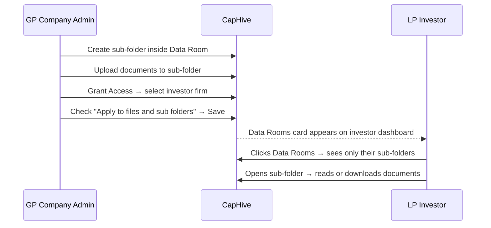
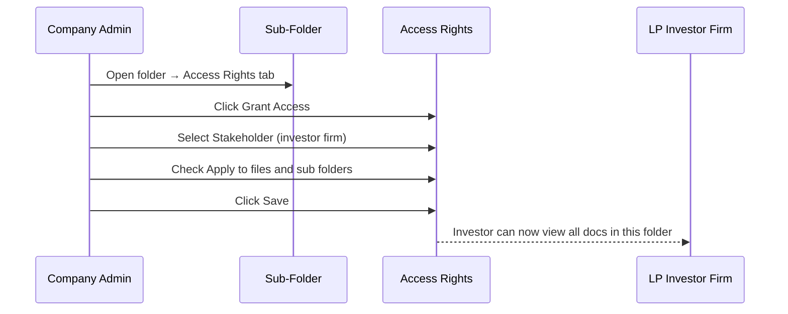

# Data Rooms — Company Admin Guide

Data Rooms give you a dedicated, permission-controlled folder space to share documents selectively with your investors. Each investor sees only the sub-folders you have explicitly shared with them — nothing more. This guide explains how to set up your Data Room, organise it into sub-folders, upload documents, and control exactly who sees what.

---

## Table of Contents

1. [Key Concepts](#key-concepts)
2. [Prerequisites](#prerequisites)
3. [How Data Rooms Work](#how-data-rooms-work)
4. [Navigating to the Data Room](#navigating-to-the-data-room)
5. [Creating Sub-Folders](#creating-sub-folders)
6. [Uploading Documents](#uploading-documents)
7. [Granting Investor Access to a Sub-Folder](#granting-investor-access-to-a-sub-folder)
8. [How Your Investors Experience the Data Room](#how-your-investors-experience-the-data-room)
9. [Revoking or Changing Access](#revoking-or-changing-access)
10. [Sharing Individual Documents via a Link](#sharing-individual-documents-via-a-link)
11. [Frequently Asked Questions](#frequently-asked-questions)

---

## Key Concepts

| Term | Meaning |
|---|---|
| **Data Room** | A top-level folder reserved for investor-facing documents. One exists per entity, created automatically when the feature is enabled. |
| **Sub-Folder** | A folder you create inside the Data Room to organise documents by topic, investor group, or deal. |
| **Access Right** | A permission record that grants a specific investor firm visibility of a sub-folder and everything inside it. |
| **Cascade** | When "Apply to files and sub folders" is checked on an access right, access flows down automatically to all child folders and documents inside. |
| **Investor Access** | The gate that lets an investor's user log in to the portal. Must be approved before any access rights take effect. |

---

## Prerequisites

Data Rooms are enabled for your account by the **CapHive support team**. Once enabled:

- A **Data Room** folder appears automatically in your folder tree under Documents.
- The **Data Rooms** card appears on each investor's dashboard the next time they log in (provided you have shared at least one sub-folder with them).

Contact CapHive support if the Data Room folder is not visible in your Documents section.

---

## How Data Rooms Work



The Data Room folder itself is never directly visible to investors. What they see are only the **sub-folders you have explicitly shared with them**. An investor with access to "Q3 Update" cannot see "Board Pack" unless you share that separately.

### Example folder structure

```
Data Room/
├── Q3 Investor Update/        ← shared with all investors
│   ├── Portfolio Summary.pdf
│   └── Financial Statements.xlsx
├── Lead Investor Pack/        ← shared with lead investors only
│   └── Board Minutes Oct.pdf
└── New Deal Preview/          ← not yet shared with anyone
    └── Teaser.pdf
```

---

## Navigating to the Data Room

1. Click **Documents** in the left sidebar.
2. In the folder tree on the left panel, locate and click **Data Room**.
3. The right panel shows the documents and sub-folders inside the Data Room.

Alternatively, go to **Folders** in the sidebar, find the **Data Room** row in the table, and click **View Docs**.

---

## Creating Sub-Folders

Sub-folders let you group documents by topic, investor tier, or deal. You can create them from multiple places:

**From the Data Room folder page:**
1. Open the Data Room folder.
2. Click **Actions** (top right) → **New Folder**, or click the **Create Sub Folder** button on the folder details page.
3. Fill in the form:

| Field | What to enter |
|---|---|
| **Name** | A clear, descriptive name — for example, "Q3 Investor Update" or "Lead Investor Pack". **Important: the name cannot be changed after saving.** |
| **Allow Download** | Check to let investors download documents as files. |
| **Allow Printing** | Check to let investors print documents. |
| **Allow Original Format Download** | Check to serve the original file without watermarking or conversion. |

4. Click **Save**.

To create a child folder inside a sub-folder, open that sub-folder and repeat the same steps.

> **Tip:** Plan your folder structure before creating sub-folders, because names cannot be changed once saved. Use clear names that will still make sense in six months.

---

## Uploading Documents

Upload documents into the sub-folder where investors should find them.

**Steps:**

1. Open the target sub-folder.
2. Click **Actions** → **New Document**.
3. Fill in the form:

| Field | What to enter |
|---|---|
| **Name** | A descriptive document name. |
| **Folder** | Pre-filled with the current folder — change only if you want a different location. |
| **Tags** | Optional comma-separated tags for filtering (e.g. `quarterly, financials`). |
| **As Of Date** | Optional. The date the document applies to, shown in the document list instead of the upload date. Useful for quarterly reports. |
| **Upload File** | Select the file from your computer. |
| **Allow Download** | Check to let investors download. |
| **Allow Printing** | Check to let investors print. |
| **Send Email** | Check to notify investors who have access as soon as the document is saved. |

4. Click **Save** (or **Save & Upload More** to add multiple documents in sequence).

For large batches, use **Actions → Bulk Upload** to import a list of documents via a spreadsheet.

Any investor already granted access to the sub-folder sees new documents immediately — no additional sharing step is needed.

---

## Granting Investor Access to a Sub-Folder

Access is controlled at the **sub-folder level**. Granting access to a sub-folder automatically gives the investor visibility of every document inside it, including documents added in the future.



**Steps:**

1. Open the sub-folder you want to share.
2. Click the **Access Rights** tab (below the folder details).
3. Click **Grant Access**.
4. In the form that appears:

| Field | What to do |
|---|---|
| **Access Type** | Select **Stakeholder** to share with a specific investor firm. |
| **Select Stakeholder** | Choose the investor firm from the dropdown. |
| **Apply to files and sub folders** | **Check this box** to cascade access to all documents and child folders inside. |
| **Send Notification** | Check to email the investor's users when access is granted. |

5. Click **Save**.

The investor firm now appears in the Access Rights table. Their users will see this sub-folder the next time they log in to the investor portal.

> **Prerequisite:** The investor must already have an **approved Investor Access** record before the access right takes effect. If they still cannot see the folder after sharing, check that their Investor Access is approved. See the [Investor Access & Permissions Guide](investor_access_tutorial.md).

### Sharing with a category of investors

To share with all investors of a particular type at once (for example all "Lead Investors"), set **Access Type** to **Stakeholder Category** and select the category. Every current and future investor in that category gains access automatically.

### Sharing with a specific individual

To share with one person at an investor firm rather than the whole firm, set **Access Type** to a user-level option and use the **Select Specific User** dropdown.

---

## How Your Investors Experience the Data Room

Once you have shared at least one sub-folder, the investor sees a **Data Rooms** card on their dashboard the next time they log in.

```mermaid
sequenceDiagram
    participant LP as LP Investor
    participant Dashboard as Investor Dashboard
    participant Listing as Data Rooms Listing
    participant Folder as Sub-Folder

    LP->>Dashboard: Logs in
    Dashboard-->>LP: Data Rooms card visible (green folder icon, "Shared Docs")
    LP->>Listing: Clicks Data Rooms
    Listing-->>LP: Table shows only their GP entities with data rooms
    LP->>Folder: Clicks entity name → sees only shared sub-folders
    Folder-->>LP: Documents visible; can download/print per your settings
```

Investors see:
- Only the GP entities where they have at least one shared sub-folder.
- Inside each entity's data room, only the sub-folders explicitly shared with their firm.
- Documents within those sub-folders, subject to the download and printing settings you configured.
- Nothing from sub-folders not shared with them — those folders are completely invisible.

---

## Revoking or Changing Access

To remove an investor's access to a sub-folder:

1. Open the sub-folder.
2. Click the **Access Rights** tab.
3. Find the investor's row in the access rights table.
4. Click **Delete**.

Access is revoked immediately. The sub-folder and its documents become invisible to that investor on their next page load. If cascade was applied, child folders and documents inside are also hidden.

---

## Sharing Individual Documents via a Link

For one-off sharing with someone who does not have a CapHive login, you can generate a shareable email link for a single document.

**Steps:**

1. Open the document.
2. Click the **Shares** tab.
3. Click **New**.
4. Enter the recipient's email address.
5. Click **Save** — the recipient receives a link to view that specific document.

The Shares tab appears on documents inside entities where Data Rooms is enabled, and is only visible to company admins.

---

## Frequently Asked Questions

**Can I share one sub-folder with all my investors at once?**
Yes. When granting access, set Access Type to **Stakeholder Category** and select a broad category such as "Co-Investor." Every investor in that category — including new ones added later — gains access automatically.

**Does sharing a sub-folder also cover child folders inside it?**
Only if you check **Apply to files and sub folders** when granting access. If that box is not checked, access applies to the sub-folder itself but not to any folders nested inside it.

**Can investors upload documents to the Data Room?**
No. Investors have read-only access. Only company admins can create folders and upload or delete documents.

**Can I rename a sub-folder after creating it?**
No. The folder name is locked after the first save. Choose names carefully before creating.

**What happens if I upload a new document to a shared sub-folder?**
Investors who already have access see the new document immediately — no further sharing step is needed.

**An investor says they cannot see the Data Rooms card. What should I check?**
1. Confirm that the investor's **Investor Access** record is approved (unapproved users see nothing).
2. Confirm that you have granted that investor access to at least one sub-folder.
3. If those are both correct, contact CapHive support to confirm Data Rooms is enabled for your account.

**Can I see which investors have viewed a specific document?**
Yes. Open the document and click the **Viewed By** tab to see a log of who opened it and when.

**Can I grant access to one person within an investor firm rather than the whole firm?**
Yes. In the Grant Access form, set Access Type to the user-level option and use **Select Specific User** to pick the individual rather than the whole firm.

**What happens when I delete an access right — does it remove access from sub-folders inside too?**
If the access right was created with cascade enabled, deleting it cascades the removal down to child folders and documents. Access rights that were not cascaded must be deleted individually from each folder.
