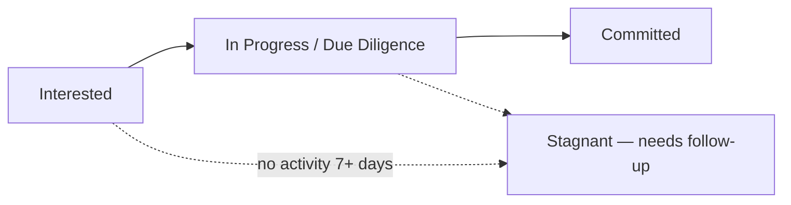
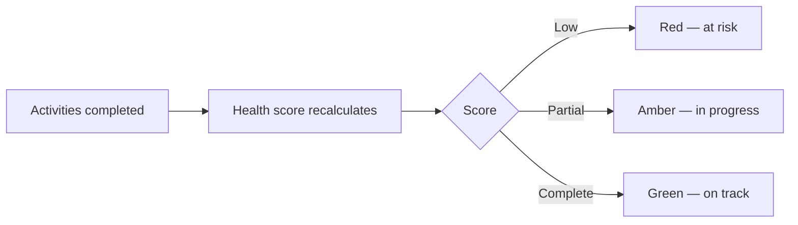
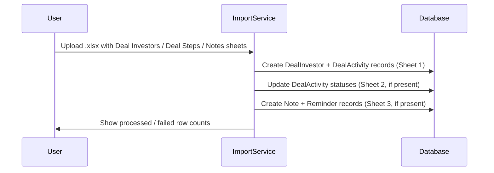

# Deals Management User Guide

The **Deals** workspace is your command centre for running a fundraise. It brings together at-a-glance analytics, interactive charts, and a powerful investor grid so you can track every prospect from first contact to signed commitment — and spot where deals are stalling.

This guide explains each part of the workspace and the day-to-day workflow for managing your investor pipeline.

---

## Table of Contents

1. [The Pipeline at a Glance](#the-pipeline-at-a-glance)
2. [Headline Numbers](#headline-numbers)
3. [Interactive Charts](#interactive-charts)
4. [The Investor Grid](#the-investor-grid)
5. [Configuring Grid Columns](#configuring-grid-columns)
6. [Tracking Activities and Deal Health](#tracking-activities-and-deal-health)
7. [Automatic Tasks When a Stage Changes](#automatic-tasks-when-a-stage-changes)
8. [Importing Investors](#importing-investors)
9. [Importing Step Templates](#importing-step-templates)
10. [Deleting Step Templates](#deleting-step-templates)
11. [The Investor Side Panel](#the-investor-side-panel)
12. [Adding Notes](#adding-notes)
13. [Bulk Actions](#bulk-actions)
14. [Exporting](#exporting)
15. [Worked Example](#worked-example)

---

## The Pipeline at a Glance

A fundraise moves prospects through stages, from initial interest to a firm commitment. The Deals workspace makes that journey visible and measurable.

Everything on the page is connected: click a headline number or a chart segment and the investor grid below filters to match.

---

## Headline Numbers

Four cards at the top summarise the deal's health. Click any card to filter the grid:

| Card | What it shows |
|------|---------------|
| **Total Target** | The overall fundraising goal. Click to clear filters and show all investors. |
| **Committed (Active)** | Total committed by active investors. Click to see committed/active leads. |
| **Conversion Rate** | The share of leads that have reached active/committed status. |
| **Stagnant Leads (>7d)** | Leads with no activity for over a week. Click to prioritise follow-ups. |

---

## Interactive Charts

Several charts give deeper visibility, and many are clickable — selecting a data point filters the grid:

- **Conversion Funnel** — how many investors sit at each stage; click a stage to see them.
- **Commitment Velocity** — how commitments are accumulating over time, to forecast your close.
- **Weighted Pipeline** — expected commitments (adjusted for probability) versus target.
- **Activity Efficiency** — average days spent on key steps (e.g. initial call to due diligence).
- **Concentration by Source** — where leads come from (referrals, outreach…); click to filter.
- **Days in Stage** — a histogram of how long leads have sat in their current stage; click a bar (e.g. "30+ days") to surface stalled leads.
- **Allocation Breakdown** — the split between primary investment, secondary, and fees.

---

## The Investor Grid

The grid is the heart of the workspace — a fast, spreadsheet-style view of every investor.

### Filtering, sorting, grouping

- **Column filters** — click the filter icon on any column for text, number, date, or set filters.
- **Multi-column sort** — click headers to sort; hold **Shift** to sort by several columns.
- **Grouping** — drag a column into the group panel to group investors (e.g. by source or lead).

### Inline editing

Update most fields directly in the grid — changes save automatically:

- **Status** — move an investor between stages (e.g. Interested → Committed).
- **Tier** — set an investor's priority.
- **Lead / Advisor / Source** — assign team members or the referral source.
- **Custom fields** — any custom fields your organisation has set up (e.g. "Investment Thesis") appear here and are editable.

---

## Configuring Grid Columns

By default the grid shows every standard column. You can trim it down — or reorder it — per deal in **Edit Deal → Grid Columns**.

### How to configure

1. Open the deal, click **Edit** and scroll to the **Grid Columns** section.
2. Click **+ Add Column** for each column you want shown.
3. For each row, choose:
   - **Field** — the data column (e.g. Primary Amount, Tier, Tags).
   - **Label** *(optional)* — override the default column heading.
   - **Position** — **Start** places the column before the core investor columns; **End** places it after them.
4. Click **Save**. The grid now shows only your configured columns, plus the always-visible base columns (Investor Name, Health Score, Status, Stage, Tier, Lead, Advisor, Source) and any activity step columns.

> **Tip:** Leave the Grid Columns list empty to revert to showing all standard columns.

### Available fields

| Field | Default label |
|-------|--------------|
| investor_name | Investor Name |
| status | Status |
| primary_amount | Primary Amount |
| secondary_investment | Secondary Investment |
| pre_money_valuation | Pre Money Valuation |
| fee | Fee |
| total_amount | Total Amount |
| tier | Tier |
| deal_lead | Deal Lead |
| source | Source |
| investor_advisor | Investor Advisor |
| company_advisor | Company Advisor |
| notes | Notes |
| tags | Tags |
| health_score | Health Score |

---

## Tracking Activities and Deal Health

Each investor has a **Health Score** showing how many of the required deal activities (tasks) are done.

- **Health Score bar** — a red/amber/green progress bar for the percentage of completed tasks. Hover to see the pending tasks.
- **Activity columns** — each activity (e.g. "Signed NDA", "Data Room Access") has its own column you can set to **Complete**, **Incomplete**, or **Skip**. Changing these recalculates the health score immediately.

---

## Automatic Tasks When a Stage Changes

Moving an investor to a new stage automatically creates the right follow-up tasks, so nothing falls through the cracks:

- **Where they come from** — tasks are drawn from the deal's activity templates for that stage.
- **Who they go to** — assigned to whoever moved the investor, with a default due date a week out.
- **What's required** — some activities need a document uploaded before they can be marked complete.
- **No clutter** — if an investor moves back and forward again, existing tasks are recognised and not duplicated.

### Creating a deal without default templates

When creating a new deal, tick **No Templates** if you want to start with a blank slate and import or build your step templates later. When this box is ticked, the **Clone From** option is hidden — they are mutually exclusive.

---

## Importing Investors

Use the **Import** button on the Investor grid to bulk-load investors from a spreadsheet. Download the sample file from the import dialog for the correct format.

The file supports **up to three sheets**:

### Sheet 1 — Deal Investors *(required)*

Each row adds one investor to the deal.

| Column | Required | Notes |
|--------|----------|-------|
| **Deal Investor** | Yes | Must match an existing investor name exactly. |
| Status | No | Defaults to the first status in the pipeline if omitted. |
| Tier | No | |
| Deal Lead | No | |
| Source | No | |
| Tags | No | |
| Primary Amount | No | Plain number; no currency symbol needed. |
| Secondary Amount | No | |
| Pre Money Valuation | No | |
| *Any other column* | No | Treated as a custom field and stored against the investor record. |

> **Note:** Each row creates a **new** investor entry. Re-uploading an investor that already exists in the deal will be skipped with an error. To update existing investors, edit them directly in the grid.

### Sheet 2 — Deal Steps *(optional)*

Use this sheet to set the completion status of each activity step for each investor.

- **Column A** must be named `Deal Investor` and contain the investor name.
- **Remaining columns** each correspond to one step template by its exact title.
- Cell values must be `Complete`, `Incomplete`, or `Skip` (case-insensitive).
- Blank cells are ignored.

### Sheet 3 — Notes *(optional)*

Creates note records linked to investors.

| Column | Notes |
|--------|-------|
| **Deal Investor** | Must match an existing investor. |
| On | Date of the note (e.g. `2026-06-01`). |
| Details | Note body text. Required — rows without details are skipped. |
| Tags | Comma-separated tags. |
| Reminder Emails | Email address(es) for a reminder. |
| Reminder Date | Date the reminder should fire. |

---

## Importing Step Templates

If you created a deal with **No Templates**, or want to bulk-add process steps, use the **Import Templates** button on the **Deal Steps** tab.

The spreadsheet requires two columns:

| Column | Required | Notes |
|--------|----------|-------|
| **Title** | Yes | The name of the step (e.g. "Deck Sent", "Due Diligence Call"). |
| **Days** | Yes | Target days to complete this step; must be a positive number. |

Templates are appended after any existing steps, preserving the current sequence order.

---

## Deleting Step Templates

Templates can be deleted from the **Deal Steps** list or from a template's detail page.

- Only template records (not investor-specific step copies) show the **Delete** button.
- Before deleting, a confirmation dialog shows **how many investor step copies will also be removed** — this is irreversible.
- After deletion, all investor records that were pointing to that template as their current step are automatically cleared.

> **Caution:** Deleting a template cascades to all investor-specific copies of that step across every investor in the deal.

---

## The Investor Side Panel

Click an investor's name to slide out a side panel with their full profile, contact history, and documents — all without losing your place in the grid. Review the detail, then carry on where you left off.

---

## Adding Notes

From an investor's side panel or the Notes tab, click **New Note** to log a call, meeting, or follow-up.

- After saving, you are returned to the page you came from (e.g. the deal grid) rather than the generic notes list.
- Pass a `return_to` URL in the link if you are linking to the note form from a custom view.

---

## Bulk Actions

Select one or more investors with the checkboxes, then:

- **Bulk Nudge** — send a reminder to everyone selected (e.g. a nudge to complete a signature).
- **Update Status** — move all selected investors to a new stage at once (e.g. mark five as "Declined").

---

## Exporting

Click **Download Excel** to export the current view — including any active filters and grouping — as a formatted spreadsheet for offline analysis or sharing.

---

## Worked Example

You're running a $50M raise and want to focus the week's effort.

1. Click **Stagnant Leads (>7d)** — the grid filters to leads with no recent activity.
2. Open the **Days in Stage** chart and click the **"30+ days"** bar to isolate the most stalled prospects.
3. Select those investors and use **Bulk Nudge** to send a reminder.
4. For a promising lead, change **Status** from "Interested" to "Due Diligence" inline — the system auto-creates the due-diligence tasks (NDA, data room, call) assigned to you, due in a week.
5. As you complete each activity column, the investor's **Health Score** climbs from red toward green.
6. At week's end, click **Download Excel** to share the updated pipeline with your partners.
7. To tune what the team sees, open **Edit Deal → Grid Columns** and remove columns irrelevant to this raise (e.g. hide Pre Money Valuation and Fee), placing Primary Amount at the **Start** so it's the first thing visible.
