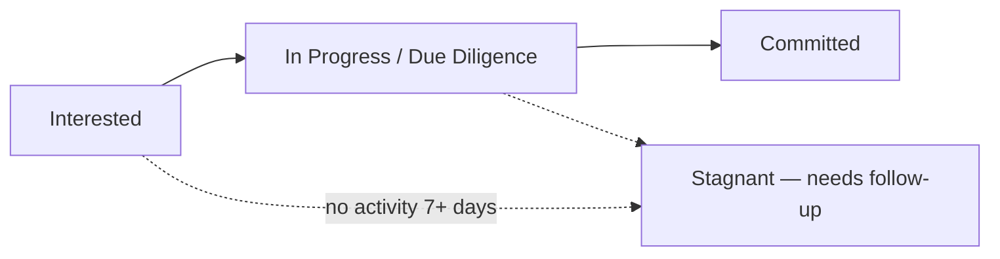
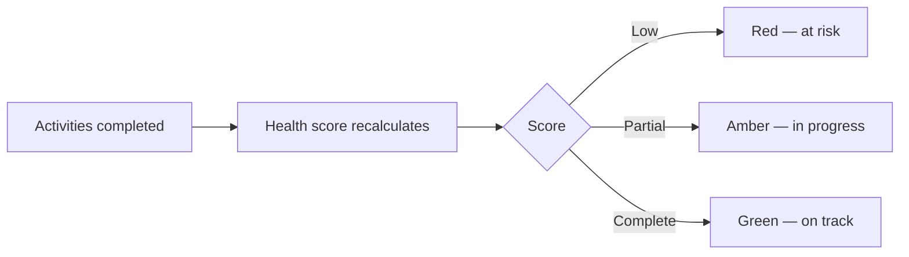
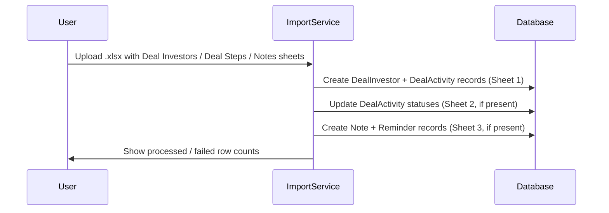

# Deals Management User Guide

The **Deals** workspace is your command centre for running a fundraise. It brings together at-a-glance analytics, interactive charts, and a powerful investor grid so you can track every prospect from first contact to signed commitment — and spot where deals are stalling.

> **Where to find it:** Sidebar → [**Deals**](/deals), shown when your user has the *Deals* feature (`enable_deals`). Create one with [**New Deal**](/deals/new); open a deal to reach the investor grid, its tabs and the **Add Investor** / **Import Investors** buttons. Editing a deal needs update rights on it (the creator gets full rights automatically; company admins see every deal).

This guide explains each part of the workspace and the day-to-day workflow for managing your investor pipeline.

---

## Table of Contents

1. [The Pipeline at a Glance](#the-pipeline-at-a-glance)
2. [Headline Numbers](#headline-numbers)
3. [Interactive Charts](#interactive-charts)
4. [The Investor Grid](#the-investor-grid)
5. [Configuring Grid Columns](#configuring-grid-columns)
6. [Tracking Activities and Deal Health](#tracking-activities-and-deal-health)
7. [Automatic Tasks When a Stage Changes](#automatic-tasks-when-a-stage-changes)
8. [Importing Investors](#importing-investors)
9. [Importing Step Templates](#importing-step-templates)
10. [Deleting Step Templates](#deleting-step-templates)
11. [The Investor Side Panel](#the-investor-side-panel)
12. [Adding Notes](#adding-notes)
13. [Bulk Actions](#bulk-actions)
14. [Exporting](#exporting)
15. [Worked Example](#worked-example)
16. [Frequently Asked Questions](#frequently-asked-questions)

---

## The Pipeline at a Glance

A fundraise moves prospects through stages, from initial interest to a firm commitment. The Deals workspace makes that journey visible and measurable.

Everything on the page is connected: click a headline number or a chart segment and the investor grid below filters to match.

---

## Headline Numbers

Four cards at the top summarise the deal's health. Click any card to filter the grid:

| Card | What it shows |
|------|---------------|
| **Total Target** | The overall fundraising goal. Click to clear filters and show all investors. |
| **Committed (Active)** | Total committed by active investors. Click to see committed/active leads. |
| **Conversion Rate** | The share of leads that have reached active/committed status. |
| **Stagnant Leads (>7d)** | Leads with no activity for over a week. Click to prioritise follow-ups. |

---

## Interactive Charts

Several charts give deeper visibility, and many are clickable — selecting a data point filters the grid:

- **Conversion Funnel** — how many investors sit at each stage; click a stage to see them.
- **Commitment Velocity** — how commitments are accumulating over time, to forecast your close.
- **Weighted Pipeline** — expected commitments (adjusted for probability) versus target.
- **Activity Efficiency** — average days spent on key steps (e.g. initial call to due diligence).
- **Concentration by Source** — where leads come from (referrals, outreach…); click to filter.
- **Days in Stage** — a histogram of how long leads have sat in their current stage; click a bar (e.g. "30+ days") to surface stalled leads.
- **Allocation Breakdown** — the split between primary investment, secondary, and fees.

---

## The Investor Grid

The grid is the heart of the workspace — a fast, spreadsheet-style view of every investor.

### Filtering, sorting, grouping

- **Column filters** — click the filter icon on any column for text, number, date, or set filters.
- **Multi-column sort** — click headers to sort; hold **Shift** to sort by several columns.
- **Grouping** — drag a column into the group panel to group investors (e.g. by source or lead).

### Inline editing

Update most fields directly in the grid — changes save automatically:

- **Status** — move an investor between stages (e.g. Interested → Committed).
- **Tier** — set an investor's priority.
- **Lead / Advisor / Source** — assign team members or the referral source.
- **Custom fields** — any custom fields your organisation has set up (e.g. "Investment Thesis") appear here and are editable.

---

## Configuring Grid Columns

By default the grid shows every standard column. You can trim it down — or reorder it — per deal in **Edit Deal → Grid Columns**.

### How to configure

1. Open the deal, click **Edit** and scroll to the **Grid Columns** section.
2. Click **+ Add Column** for each column you want shown.
3. For each row, choose:
   - **Field** — the data column (e.g. Primary Amount, Tier, Tags).
   - **Label** *(optional)* — override the default column heading.
   - **Position** — **Start** places the column before the core investor columns; **End** places it after them.
4. Click **Save**. The grid now shows only your configured columns, plus the always-visible base columns (Investor Name, Health Score, Status, Stage, Tier, Lead, Advisor, Source) and any activity step columns.

> **Tip:** Leave the Grid Columns list empty to revert to showing all standard columns.

### Available fields

| Field | Default label |
|-------|--------------|
| investor_name | Investor Name |
| status | Status |
| primary_amount | Primary Amount |
| secondary_investment | Secondary Investment |
| pre_money_valuation | Pre Money Valuation |
| fee | Fee |
| total_amount | Total Amount |
| tier | Tier |
| deal_lead | Deal Lead |
| source | Source |
| investor_advisor | Investor Advisor |
| company_advisor | Company Advisor |
| notes | Notes |
| tags | Tags |
| health_score | Health Score |

---

## Tracking Activities and Deal Health

Each investor has a **Health Score** showing how many of the required deal activities (tasks) are done.

- **Health Score bar** — a red/amber/green progress bar for the percentage of completed tasks. Hover to see the pending tasks.
- **Activity columns** — each activity (e.g. "Signed NDA", "Data Room Access") has its own column you can set to **Complete**, **Incomplete**, or **Skip**. Changing these recalculates the health score immediately.

---

## Automatic Tasks When a Stage Changes

Moving an investor to a new stage — that is, to the next deal step (completing their current step) — automatically creates the right follow-up tasks, so nothing falls through the cracks. Changing the investor's **Status** column alone does not create tasks.

- **Where they come from** — tasks are the ones listed on the deal's step template for the new step. Adding an investor to a deal also creates the tasks for their first step.
- **Who they go to** — assigned to whoever moved the investor, with a default due date a week out.
- **What's required** — some activities need a document uploaded before they can be marked complete.
- **No clutter** — if an investor moves back and forward again, existing tasks are recognised and not duplicated.

### Creating a deal without default templates

When creating a new deal, tick **No Templates** if you want to start with a blank slate and import or build your step templates later. When this box is ticked, the **Clone From** option is hidden — they are mutually exclusive.

---

## Importing Investors

Use the **Import Investors** button in the deal header to bulk-load investors from a spreadsheet. Download the sample file from the import dialog for the correct format.

The file supports **up to three sheets**:

### Sheet 1 — Deal Investors *(required)*

Each row adds one investor to the deal.

| Column | Required | Notes |
|--------|----------|-------|
| **Deal Investor** | Yes | Must match an existing investor name exactly. |
| Status | No | Defaults to the first status in the pipeline if omitted. |
| Tier | No | |
| Deal Lead | No | |
| Source | No | |
| Tags | No | |
| Primary Amount | No | Plain number; no currency symbol needed. |
| Secondary Amount | No | |
| Pre Money Valuation | No | |
| *Any other column* | No | Treated as a custom field and stored against the investor record. |

> **Note:** Each row creates a **new** investor entry. Re-uploading an investor that already exists in the deal will be skipped with an error. To update existing investors, edit them directly in the grid.

### Sheet 2 — Deal Steps *(optional)*

Use this sheet to set the completion status of each activity step for each investor.

- **Column A** must be named `Deal Investor` and contain the investor name.
- **Remaining columns** each correspond to one step template by its exact title.
- Cell values must be `Complete`, `Incomplete`, or `Skip` (case-insensitive).
- Blank cells are ignored.

### Sheet 3 — Notes *(optional)*

Creates note records linked to investors.

| Column | Notes |
|--------|-------|
| **Deal Investor** | Must match an existing investor. |
| On | Date of the note (e.g. `2026-06-01`). |
| Details | Note body text. Required — rows without details are skipped. |
| Tags | Comma-separated tags. |
| Reminder Emails | Email address(es) for a reminder. |
| Reminder Date | Date the reminder should fire. |

---

## Importing Step Templates

If you created a deal with **No Templates**, or want to bulk-add process steps, use the **Import Templates** button on the **Deal Steps** tab.

The spreadsheet requires two columns:

| Column | Required | Notes |
|--------|----------|-------|
| **Title** | Yes | The name of the step (e.g. "Deck Sent", "Due Diligence Call"). |
| **Days** | Yes | Target days to complete this step; must be a positive number. |

Templates are appended after any existing steps, preserving the current sequence order.

---

## Deleting Step Templates

Templates can be deleted from the **Deal Steps** list or from a template's detail page.

- Only template records (not investor-specific step copies) show the **Delete** button.
- Before deleting, a confirmation dialog shows **how many investor step copies will also be removed** — this is irreversible.
- After deletion, all investor records that were pointing to that template as their current step are automatically cleared.

> **Caution:** Deleting a template cascades to all investor-specific copies of that step across every investor in the deal.

---

## The Investor Side Panel

Click an investor's name to slide out a side panel with their full profile, contact history, and documents — all without losing your place in the grid. Review the detail, then carry on where you left off.

---

## Adding Notes

From the **Notes** tab of an investor's side panel (or **Add Note** in the investor row's actions menu in the grid), click **New Note** to log a call, meeting, or follow-up.

- After saving, you are returned to the page you came from (e.g. the deal grid) rather than the generic notes list.
- Pass a `return_to` URL in the link if you are linking to the note form from a custom view.

---

## Bulk Actions

Open the deal from Sidebar → [**Deals**](/deals); the investor grid is on the deal page. Tick the checkbox beside each investor's name (or the checkbox in the name column header to select every row). As soon as at least one row is ticked, a bar showing "N items selected" appears above the grid with the bulk buttons; untick all rows and it disappears. There is no Bulk Actions dropdown and no filter is needed.

| Action (exact label) | What it does | Shown when |
|----------------------|--------------|------------|
| **Move to Next Activity** | Opens a confirmation ("This will mark the current activity as Complete and advance N selected investor(s) to their next activity"). On **Confirm**, each selected investor's current step is marked **Complete** and the investor moves to the next step still **Incomplete** further down the sequence (completed and skipped steps are passed over). The same things happen as when you complete a step by hand: the tasks listed on the new step are created for you, the Kanban card moves to the column named after the new step, the last-interaction date becomes today, and stage-move emails go out if the deal's **Enable Notifications** and the step's **Notify Employees** / **Notify Investor** flags are on. | At least one row selected |
| **Bulk Nudge** | Only shows a browser pop-up "Triggering mass nudge for IDs: …" listing internal record numbers. Nothing is saved and no email, task or reminder is sent. | At least one row selected |

**Move to Next Activity** applies only to the rows you ticked. The header checkbox selects every row the grid holds, including rows on other grid pages and rows hidden by a column filter, so tick rows individually after filtering. It runs immediately (not in the background) and the grid reloads when it finishes; a pop-up lists investors that were not moved (for example "already at last activity"), and investors with no current step are skipped silently. Read-only users get "Error: Not authorized". There is no bulk undo: setting a step's activity column back to **Incomplete** reopens that step for one investor, but their current step stays on the new one, and tasks already created and emails already sent remain.

There is no bulk status change on the grid; change **Status** inline for each investor.

---

## Exporting

Click **Download Excel** in the deal header to export the deal's investors as a formatted spreadsheet for offline analysis or sharing. The export does not follow the grid's column filters or grouping; by default it excludes declined investors — click **Clear Filters** first to include everyone.

---

## Worked Example

You're running a $50M raise and want to focus the week's effort.

1. Click **Stagnant Leads (>7d)** — the grid filters to leads with no recent activity.
2. Open the **Days in Stage** chart and click the **"30+ days"** bar to isolate the most stalled prospects.
3. Follow up with those investors by logging notes with reminders (**Bulk Nudge** does not send anything yet), or tick them and use **Move to Next Activity** to advance them all one step.
4. For a promising lead, change **Status** from "Interested" to "Due Diligence" inline, and complete their current step so they move to the due-diligence step — the system auto-creates that step's tasks (NDA, data room, call) assigned to you, due in a week.
5. As you complete each activity column, the investor's **Health Score** climbs from red toward green.
6. At week's end, click **Download Excel** to share the updated pipeline with your partners.
7. To tune what the team sees, open **Edit Deal → Grid Columns** and remove columns irrelevant to this raise (e.g. hide Pre Money Valuation and Fee), placing Primary Amount at the **Start** so it's the first thing visible.

---

## Frequently Asked Questions

### Navigation and getting there

**Where do I find Deals in CapHive?**
Sidebar → [**Deals**](/deals). The menu item appears only when your user has the *Deals* feature (`enable_deals`); ask your company admin if it is missing. The list shows open deals as cards; click a deal's name to open its workspace.

**What is on the deal page?**
The deal opens in the **list view**: headline cards, charts and the investor grid, with **Clear Filters** / **Not Declined**, **Weekly Summary**, **Download Excel**, **Import Investors** and **Add Investor** buttons in the header. Below are the tabs **Deal**, **Deal Investors**, **Deal Steps**, **Documents**, **Tasks**, **Reminders**, **Access Rights**, **Charts**, **Custom Notifications** and **Agent Settings**. See [The Investor Grid](#the-investor-grid).

**Where do I see archived deals?**
On the [Deals list](/deals) click [**View Archived Deals**](/deals?include_archived=true). A deal is archived by ticking **Archived** on its edit form; archived deals are hidden from the default list but keep all their data.

**Where do investors (LPs) see a deal?**
An investor login sees [**Deals**](/deal_investors?for_investor=true) in its sidebar and opens the deal's read-only **overview** page. They see it only after being granted access on the deal's **Access Rights** tab or being added as a deal investor with access.

**Where are the bulk actions for deal investors on the deal grid?**
Open the deal from Sidebar → [**Deals**](/deals) and tick the checkboxes beside investor names in the grid. A bar showing "N items selected" appears above the grid with **Bulk Nudge** and **Move to Next Activity**. There is no Bulk Actions dropdown on the deal page. See [Bulk Actions](#bulk-actions).

**Why don't I see the bulk actions bar on the deal investor grid?**
The bulk bar with **Bulk Nudge** and **Move to Next Activity** stays hidden until at least one investor row is ticked; tick the checkbox beside an investor's name. Investor (LP) logins are sent to the read-only overview page, which has no grid and no bulk actions.

**Where are the tasks generated by deal steps?**
Sidebar → [**Tasks → All Tasks → Deal Tasks**](/tasks/deal_tasks), or the deal's **Tasks** tab. Each task is owned by the deal investor it was generated for. See [Automatic Tasks When a Stage Changes](#automatic-tasks-when-a-stage-changes).

### Creating, updating and managing deals

**How do I create a deal?**
Sidebar → **Deals** → [**New Deal**](/deals/new). Enter the name, start date, deal amount, currency and status (**Open** or **Closed**), optionally tick **No Templates** or pick a **Clone From** deal for the step templates, then save. The deal page opens immediately.

**How do I edit a deal?**
Open the deal → **Deal** tab → **Edit**. Here you change the amount, statuses allowed for investors (**Deal Investor Statuses**), **Enable Notifications**, **Archived**, the **Analytics Stats** cards and the **Grid Columns**. See [Configuring Grid Columns](#configuring-grid-columns).

**How do I delete a deal?**
Open the deal → **Deal** tab → **Delete** and confirm. Only users of the deal's own company with destroy rights see the button. Prefer **Archived** if you just want it out of the list.

**How do I add an investor to a deal?**
Open the deal and click **Add Investor** in the header; the form opens in a side panel. Pick the Stakeholder (investor), status, tier, lead, source and amounts, then save. An investor can be added to a deal only once.

**How do I edit or remove an investor from a deal?**
Edit most fields inline in the grid (status, tier, lead, advisor, source, custom fields), or open the investor's side panel and use **Edit**. Remove with **Delete** on the deal investor's page; this also removes any deal access right that was granted to that investor.

**How do I add or change the deal's process steps?**
Open the deal → **Deal Steps** tab. Add a step template with the form there, reorder them, edit a template to set its target days, task list, and the **Notify Employees** / **Notify Investor** flags, or bulk-load with **Import Templates**. See [Importing Step Templates](#importing-step-templates).

**How do I bulk-import investors?**
Open the deal and click **Import Investors** (opens the upload form with import type **DealInvestor** and a sample file). The workbook can carry **Deal Investors**, **Deal Steps** and **Notes** sheets. See [Importing Investors](#importing-investors).

**How do I move many deal investors to their next activity at once with bulk actions?**
On the deal grid tick the investors, click **Move to Next Activity** in the bar above the grid and **Confirm**. Each one's current step is marked Complete and they move to their next incomplete step; the grid reloads when done. You need update rights on the deal.

**How do I bulk update the status of many deal investors at once?**
You can't from the grid: there is no bulk status button, only **Bulk Nudge** and **Move to Next Activity**. Change the **Status** cell inline for each investor, or re-import the investors with the new status.

**How do I nudge or follow up with many deal investors in bulk?**
**Bulk Nudge** on the deal grid does not send anything yet. Log a note with a reminder for each investor from the side panel's **Notes** tab, or use a deal step with **Notify Investor** and move them with **Move to Next Activity**. See [Adding Notes](#adding-notes).

**How do I export the pipeline?**
Click **Download Excel** in the deal header. By default declined investors are excluded; click **Clear Filters** first to include everyone. See [Exporting](#exporting).

**How do I customise the stage-move email (deal email template) sent when an investor moves to a new step?**
Open the deal → **Custom Notifications** tab → **New Notification** → **New Custom Notification**, choose **Deal activity move** in **For Notification**, write the subject and body and save. Put a step's exact title in **Tag** to use it for that step only; a template with no tag covers the other steps. The email still needs **Enable Notifications** on the deal and a notify flag on the step. See [Custom Notifications](custom_notifications_user_guide).

**Who can create, edit or see deals?**
Anyone with the *Deals* feature can list and create deals. The creator is granted full rights on the deal automatically; other employees need an access right on the deal's **Access Rights** tab (company admins see every deal of the company). Investors and RMs see only deals they have been given access to.

### Why it matters

**Why should I run my fundraise in Deals rather than a spreadsheet?**
Every prospect, stage, activity, note, task and document sits in one place, health scores and stagnant-lead counts are computed for you, stage moves generate follow-up tasks and optional investor emails, and the data feeds the Kanban board, weekly summaries and the Deal Management Agent. Nothing has to be re-keyed when a prospect converts into a commitment.

**What can I do with a deal?**
Track each investor through configurable steps, see conversion funnel, velocity, weighted pipeline and days-in-stage charts, filter the grid by clicking any card or chart, log notes and reminders, file emails automatically to the board, grant investors a read-only overview, and export or summarise the pipeline for partners. See [Interactive Charts](#interactive-charts).

**What happens if I don't set up step templates?**
Investors added to the deal get no steps, so there are no activity columns, no health score, no automatic tasks and no stage-move notifications. Add templates on the **Deal Steps** tab or **Import Templates**; existing investors receive the new steps automatically.

**Who typically uses Deals?**
Founders, IR and fundraising teams of a company or fund manager run the pipeline; partners review the charts and weekly summary; investors with access see the overview; RMs see the deals of the investors they manage.

### What happens when I…

**What happens when I create a deal?**
The deal is saved, you are given full access rights on it (unless you are a company admin, who already has them), step templates are created from your firm's default list (fund entities use a separate default list) or copied from the **Clone From** deal, a **Deal Documents** folder and a deal email address are set up, and the Kanban board columns are synced. Nobody is notified.

**What happens when I add an investor to a deal?**
The deal investor is saved and a background job copies every step template to that investor, sets the first incomplete step as their current step and creates the tasks listed on that step, assigned to you and due in 7 days. A "Deal steps were created, please refresh" message appears on the deal page. No email is sent.

**What happens when I change an investor's status?**
The new status is saved, the status-changed timestamp and last-interaction date are set to today (which resets the stagnant counter), and the grid, cards and charts recalculate. There is no bulk status change on the grid; bulk **Move to Next Activity** advances steps, not **Status**. No one is notified.

**What happens when I move an investor to the next step?**
The current step is marked complete, the investor's current step advances, the tasks listed on the new step are created for you (due in 7 days, duplicates skipped), and the Kanban board refreshes. If the deal's **Enable Notifications** is on and the step has **Notify Employees**, company admins receive an email "Deal Update: <deal> moved to stage: <step>"; with **Notify Investor**, the investor's contacts tagged for deal notifications receive it. A **Custom Notification** on the deal with the step's title as tag replaces the default wording.

**What happens when I mark an activity Complete, Incomplete or Skip?**
The health score recalculates immediately and the investor's last-interaction date is set to today. If your firm requires documents for completion, marking **Complete** is rejected until a document is attached to that step.

**What happens when I edit or add a step template?**
Saving a template queues a background job that re-copies the templates to every investor already in the deal (new steps are added, existing ones updated), then a refresh message appears. See [Importing Step Templates](#importing-step-templates).

**What happens when I delete a step template?**
The template and every investor's copy of that step are removed permanently, and investors currently sitting on that step have their current step cleared. The confirmation dialog shows how many copies will go. See [Deleting Step Templates](#deleting-step-templates).

**What happens when I import investors?**
Each row creates a deal investor with its steps, the optional sheets set step statuses and create notes and reminders, and rows naming an investor already in the deal or an unknown investor fail with a message. You get an in-app alert when the import finishes and the import page under [**Imports**](/import_uploads) lists processed and failed rows.

**What happens when I click Bulk Nudge on the deal investor grid?**
The bulk **Bulk Nudge** button only shows a browser pop-up "Triggering mass nudge for IDs: …" with internal record numbers of the selected investors. Nothing is saved and no email, task or reminder is sent, so there is nothing to undo. To follow up, log notes with reminders instead.

**What happens when I use bulk Move to Next Activity on the deal grid?**
For each ticked investor the current step is marked Complete and the investor moves to the next incomplete step: its tasks are created for you, the Kanban card moves, and stage-move emails go out if **Enable Notifications** and the step's notify flags are on. The grid reloads; not-moved investors are listed in a pop-up. No bulk undo.

**What happens when I delete a deal?**
The deal is soft-deleted together with its deal investors, steps, tasks, access rights, ingested emails and documents folder, and it disappears from the list. A super-admin can restore it from the **Audit Trail** row for the deletion. No one is notified.

**What happens when I archive a deal?**
Nothing else changes: investors, steps and tasks stay as they are, the deal simply drops out of the default [Deals list](/deals) until you untick **Archived** or use **View Archived Deals**.

**What happens when someone emails the deal's address?**
The deal header shows an ingest email address. Emails sent there are read by the Deal Update Agent, which files a meeting note or task against the matched investor and replies with a confirmation; emails it cannot match land on the deal's **Warehouse** tab for you to file manually. See the [Deal Management Agent](agents/deal_management_agent_user_guide) guide.

**What happens when I click Weekly Summary?**
A read-only summary of progress, status changes, stagnation and tasks for the deal is rendered; the button is active only when the Deal Management Agent is enabled for your firm (otherwise it is greyed out with a lock icon). Nothing is written or sent.

### Troubleshooting and edge cases

**I can't see the Deals menu item.**
Your user does not have the *Deals* feature. A company admin can enable it on your user record under Company menu (house icon, top right) → [**User**](/users).

**The Add Investor or Edit button is greyed out or missing.**
You have read-only access to this deal. Ask the deal creator or a company admin to grant you update rights on the deal's **Access Rights** tab.

**Why are stage-move emails not going out?**
Check that **Enable Notifications** is ticked on the deal (edit form), that the step template has **Notify Employees** or **Notify Investor** ticked, and, for investors, that the investor has contacts tagged for deal notifications. Emails are queued in the background, so allow a minute.

**Why does the grid not show my new steps?**
Steps are copied to investors by a background job; wait for the "please refresh your page" message and reload. If a template was just imported, the same applies.

**An investor shows no health score.**
The investor has no step copies yet (the deal was created with **No Templates** and none have been added) or the job that copies steps has not finished. Add templates on the **Deal Steps** tab and refresh.

**Can I undo a status change or a completed step?**
Yes. Change the status back inline, or set the activity column back to **Incomplete**; tasks already generated are kept (and not duplicated if you move forward again). Deleted deals can be restored by a super-admin from the Audit Trail; deleted step templates and deal investors cannot.

**Bulk Move to Next Activity finished but some deal investors did not move — why?**
An investor already on their last incomplete step is listed as "already at last activity", and one with no current step is skipped without a message. If your firm requires documents to complete a step and one has no document, the run stops with "Bulk advance failed. Please try again."; investors processed before it have already moved, so reload and check.

**Does a bulk action on the deal grid apply to investors on other grid pages?**
Only to ticked rows. The header checkbox ticks every row the grid holds, including other grid pages and rows hidden by a column filter, so after filtering tick investors one by one. Declined investors are in the grid only after **Clear Filters**.

**Can I undo bulk Move to Next Activity on the deal grid?**
Not in bulk. Setting an investor's completed activity column back to **Incomplete** reopens that step, but their current step does not move back, and the tasks created and any stage-move emails already sent remain.

**Why is the investor missing from the Excel download?**
The default export excludes declined investors. Click **Clear Filters** and download again to include everyone.

**Can the same investor be in two deals?**
Yes. The uniqueness rule is per deal only, so an investor can sit in several deals with independent stages, notes and tasks.

## Related Guides

- [Deal Management Agent](agents/deal_management_agent_user_guide) — weekly summaries, email ingestion and automated follow-ups for deals.
- [Deals Report Agent](agents/deals_report_agent_user_guide) — periodic deal pipeline reports.
- [Tasks](tasks_user_guide) — the tasks that steps generate and where to work them.
- [Investors (Stakeholders)](investors_user_guide) — the Stakeholder records you add to a deal.
- [LP CRM](lp_crm_user_guide) — notes, touch points and reminders logged against investors.
- [Data Rooms](data_rooms_gp_user_guide) — sharing deal documents with prospects.
- [Custom Fields](custom_fields_user_guide) — adding your own columns to the investor grid.
- [Custom Notifications](custom_notifications_user_guide) — replacing the wording of the deal stage-move email.
