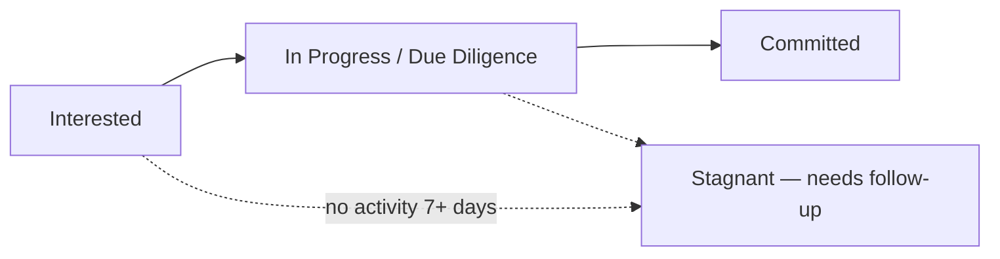
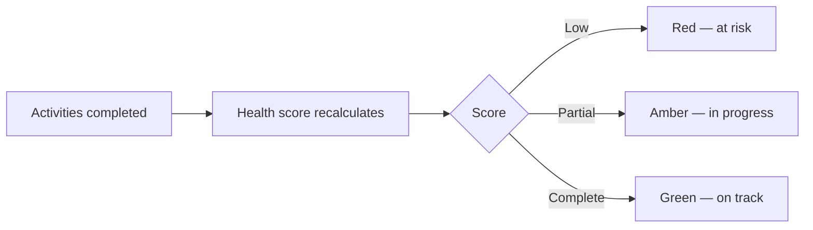

# Deals Management User Guide

The **Deals** workspace is your command centre for running a fundraise. It brings together at-a-glance analytics, interactive charts, and a powerful investor grid so you can track every prospect from first contact to signed commitment — and spot where deals are stalling.

This guide explains each part of the workspace and the day-to-day workflow for managing your investor pipeline.

---

## Table of Contents

1. [The Pipeline at a Glance](#the-pipeline-at-a-glance)
2. [Headline Numbers](#headline-numbers)
3. [Interactive Charts](#interactive-charts)
4. [The Investor Grid](#the-investor-grid)
5. [Tracking Activities and Deal Health](#tracking-activities-and-deal-health)
6. [Automatic Tasks When a Stage Changes](#automatic-tasks-when-a-stage-changes)
7. [The Investor Side Panel](#the-investor-side-panel)
8. [Bulk Actions](#bulk-actions)
9. [Exporting](#exporting)
10. [Worked Example](#worked-example)

---

## The Pipeline at a Glance

A fundraise moves prospects through stages, from initial interest to a firm commitment. The Deals workspace makes that journey visible and measurable.

Everything on the page is connected: click a headline number or a chart segment and the investor grid below filters to match.

---

## Headline Numbers

Four cards at the top summarise the deal's health. Click any card to filter the grid:

| Card | What it shows |
|------|---------------|
| **Total Target** | The overall fundraising goal. Click to clear filters and show all investors. |
| **Committed (Active)** | Total committed by active investors. Click to see committed/active leads. |
| **Conversion Rate** | The share of leads that have reached active/committed status. |
| **Stagnant Leads (>7d)** | Leads with no activity for over a week. Click to prioritise follow-ups. |

---

## Interactive Charts

Several charts give deeper visibility, and many are clickable — selecting a data point filters the grid:

- **Conversion Funnel** — how many investors sit at each stage; click a stage to see them.
- **Commitment Velocity** — how commitments are accumulating over time, to forecast your close.
- **Weighted Pipeline** — expected commitments (adjusted for probability) versus target.
- **Activity Efficiency** — average days spent on key steps (e.g. initial call to due diligence).
- **Concentration by Source** — where leads come from (referrals, outreach…); click to filter.
- **Days in Stage** — a histogram of how long leads have sat in their current stage; click a bar (e.g. "30+ days") to surface stalled leads.
- **Allocation Breakdown** — the split between primary investment, secondary, and fees.

---

## The Investor Grid

The grid is the heart of the workspace — a fast, spreadsheet-style view of every investor.

### Filtering, sorting, grouping

- **Column filters** — click the filter icon on any column for text, number, date, or set filters.
- **Multi-column sort** — click headers to sort; hold **Shift** to sort by several columns.
- **Grouping** — drag a column into the group panel to group investors (e.g. by source or lead).

### Inline editing

Update most fields directly in the grid — changes save automatically:

- **Status** — move an investor between stages (e.g. Interested → Committed).
- **Tier** — set an investor's priority.
- **Lead / Advisor / Source** — assign team members or the referral source.
- **Custom fields** — any custom fields your organisation has set up (e.g. "Investment Thesis") appear here and are editable.

---

## Tracking Activities and Deal Health

Each investor has a **Health Score** showing how many of the required deal activities (tasks) are done.

- **Health Score bar** — a red/amber/green progress bar for the percentage of completed tasks. Hover to see the pending tasks.
- **Activity columns** — each activity (e.g. "Signed NDA", "Data Room Access") has its own column you can set to **Complete**, **Incomplete**, or **Skip**. Changing these recalculates the health score immediately.

---

## Automatic Tasks When a Stage Changes

Moving an investor to a new stage automatically creates the right follow-up tasks, so nothing falls through the cracks:

- **Where they come from** — tasks are drawn from the deal's activity templates for that stage.
- **Who they go to** — assigned to whoever moved the investor, with a default due date a week out.
- **What's required** — some activities need a document uploaded before they can be marked complete.
- **No clutter** — if an investor moves back and forward again, existing tasks are recognised and not duplicated.

---

## The Investor Side Panel

Click an investor's name to slide out a side panel with their full profile, contact history, and documents — all without losing your place in the grid. Review the detail, then carry on where you left off.

---

## Bulk Actions

Select one or more investors with the checkboxes, then:

- **Bulk Nudge** — send a reminder to everyone selected (e.g. a nudge to complete a signature).
- **Update Status** — move all selected investors to a new stage at once (e.g. mark five as "Declined").

---

## Exporting

Click **Download Excel** to export the current view — including any active filters and grouping — as a formatted spreadsheet for offline analysis or sharing.

---

## Worked Example

You're running a $50M raise and want to focus the week's effort.

1. Click **Stagnant Leads (>7d)** — the grid filters to leads with no recent activity.
2. Open the **Days in Stage** chart and click the **"30+ days"** bar to isolate the most stalled prospects.
3. Select those investors and use **Bulk Nudge** to send a reminder.
4. For a promising lead, change **Status** from "Interested" to "Due Diligence" inline — the system auto-creates the due-diligence tasks (NDA, data room, call) assigned to you, due in a week.
5. As you complete each activity column, the investor's **Health Score** climbs from red toward green.
6. At week's end, click **Download Excel** to share the updated pipeline with your partners.
