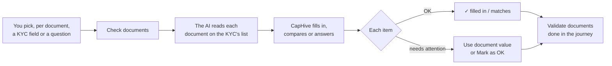
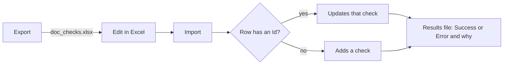

# Document Checks User Guide

Document Checks let the AI read the documents investors upload with their KYC (CML, PAN card, passport…) and, for each item you choose, either **fill in** a KYC field, **compare** the document with the KYC, or answer a **yes-no question**. The AI only reads; CapHive decides. Every item ends **✓ OK** or **⚠ Needs attention** with a reason in plain words, and you settle it where you see it.

> **Where to find it:** Sidebar → [**Funds → KYCs**](/investor_kycs) → **Document checks** → **Set up checks** opens the setup page ([**Document Checks**](/doc_checks)); **Documents needing attention** opens the list of items across all KYCs ([**Documents needing attention**](/doc_check_results)). On a KYC, open it from the KYC list and use the **Document checks** tab. Needs the *Doc LLM validation* permission on your company; resolving items needs permission to edit the KYC.

---

## Table of Contents

1. [How it works](#how-it-works)
2. [Setting up checks](#setting-up-checks)
3. [Exporting and importing checks](#exporting-and-importing-checks)
4. [Trying checks on a KYC](#trying-checks-on-a-kyc)
5. [Checking a KYC's documents](#checking-a-kycs-documents)
6. [Reading the results](#reading-the-results)
7. [Resolving an item](#resolving-an-item)
8. [Documents needing attention](#documents-needing-attention)
9. [The KYC journey](#the-kyc-journey)
10. [What replaced Doc Questions](#what-replaced-doc-questions)
11. [Frequently Asked Questions](#frequently-asked-questions)
12. [Related Guides](#related-guides)

---

## How it works

- The AI never sees the KYC's values — it only reads what is printed on the document. CapHive does the comparing, so a result can always show both sides.
- A KYC only gets checks for the documents on **its own** list: individual KYCs use the individual KYC document list, company KYCs the non-individual list (plus the KYC form's required file fields).

---

## Setting up checks

The [**Document Checks**](/doc_checks) page shows one **tile per document** on your KYC lists, saying in plain words what its checks do ("Fills DP ID, Client ID +3", "Compares PAN"). Documents with checks come first.

The quickest start is **Suggested** checks: the standard checks for every document CapHive recognises (CML, PAN card, Aadhaar, Passport, Address proof, ID proof, Incorporation certificate), matched to your KYC form's fields. Click **Review & add** on the banner, untick anything you don't want and click **Add N checks**, or click **Add N suggested** on one tile. Checks you already have are never suggested again; items your KYC form has no field for are listed as not available.

Click **Edit** on a tile to open that document's side panel. Add a check with one of the three buttons, then **Save <document>**:

| Kind | What it does |
|---|---|
| **Fill in a KYC field** | Copies what the document says into the KYC field — only when the field is empty, unless **Replace a value that's already there** is on |
| **Compare with a KYC field** | Checks the document says the same as the KYC (case, spaces and punctuation don't matter) |
| **Ask a yes-no question** | Asks the AI something about the document, e.g. whether it is signed; pick the answer that counts as OK |

Each check says what to **look for** on the document (it starts as the field's label — change it if the document calls it something else, e.g. "First holder name") and can carry an optional **tip for the AI** ("8 digits"). A field can be used once per document. If a check is wrong nothing on that document is saved, and the check says why ("Pick a KYC field", "Already used on this document", "Say what to look for"). A check you added but never filled in is simply ignored.

---

## Exporting and importing checks

**Export** on the setup page downloads `doc_checks.xlsx`: one row per check. **Import** opens the upload page for that same file, so you can copy checks to another entity, keep a backup, or edit many checks in Excel.

| Column | What to put |
|---|---|
| **Id** | Leave as exported to update that check; blank to add a new one |
| **Document** | A document on your KYC lists (any case) |
| **What To Do** | Fill in, Compare or Question |
| **Look For** | What the AI reads, or the question |
| **KYC Field** | The field's label as the setup page shows it (or its name); blank for a Question |
| **Tip** | Optional guidance for the AI |
| **Replace Existing** | Fill in only: Yes or No |
| **Expected Answer** | Question only: Yes or No |

Every row is checked exactly as a save on the setup page. A row that can't be saved is marked **Error** with the reason in the import's results file, and the other rows are still saved. An import never deletes checks — remove those on the setup page.

---

## Trying checks on a KYC

**Try on a KYC** (top of the setup page — pick a KYC first) runs your checks against one KYC and shows the results under "Trial run — nothing on this KYC was changed". No field changes, and the KYC's own tab and journey are unaffected.

---

## Checking a KYC's documents

On a KYC, **Actions → Check documents** (or the button on the **Document checks** tab) starts a check. The tab shows "Checking CML (1 of 3)…" document by document and refreshes by itself. From the KYC list, **Bulk Actions → Check documents** checks every KYC in your search results (verified KYCs are skipped).

You get a notification when it finishes: "Documents checked for Asha Rao — all OK" or "— 2 need attention". If the AI service can't be reached you'll see "Couldn't check documents for Asha Rao — the AI service is unavailable. Try again later." — nothing on the KYC changes and the earlier results stay.

---

## Reading the results

| You see | It means |
|---|---|
| ✓ DP ID — filled in: IN303622 | The KYC field was empty and is now filled |
| ✓ Client ID — kept your value 86478612 (document says 86478611) | The KYC already had a value; Replace was off |
| ✓ PAN — matches | Same after ignoring case, spaces and punctuation (and word order for names and addresses) |
| ⚠ PAN — doesn't match | Shows "Document: … · KYC: …" |
| ⚠ DP ID — not found on this document | The AI couldn't find it |
| ⚠ Is it signed by the holder? — answered No | With the AI's reason |
| ⚠ Not uploaded yet | The document is on the KYC's list but missing |
| ⚠ Couldn't read this file — upload it as a PDF or image | e.g. a Word file |
| ⟳ Document changed after this check | The document was replaced after the check — click **Check again** |

---

## Resolving an item

- **Use document value** (on a mismatch): asks "Change PAN from ABCPK1243F to ABCPK1234F?" and updates the KYC. The change is recorded in the KYC's audit trail.
- **Mark as OK**: type why ("Initial matches passport") and save. The item shows who marked it and why, with **Undo**.
- **Check again**: re-reads the documents, for example after a new upload.

---

## Documents needing attention

[**Documents needing attention**](/doc_check_results) lists every item needing attention across your KYCs, newest first. Filter by reason (Doesn't match, Not found, Unexpected answer, Couldn't read, Not uploaded, Document changed), document and date; tick rows and click **Check again (n)**.

---

## The KYC journey

The journey's **Validate documents** task passes by itself ("Validated by AI") once the KYC's documents are checked and nothing needs attention. Otherwise it says what's left ("2 document items need attention — resolve them or mark reviewed"), and **Mark reviewed** still lets a person pass it. Replacing a document after the task passed moves it back.

---

## What replaced Doc Questions

Document Checks replace **Doc Questions**. Support converts each fund's existing questions (a report first, then the conversion); items that can't be converted are listed for you. Earlier AI answers stay visible on each KYC under **Earlier AI answers**. The Doc Questions screens and their Excel import are removed in a later release.

---

## Frequently Asked Questions

**Why use Document Checks instead of typing data in by hand?**
The AI reads the values off the document and fills empty KYC fields, and flags where the KYC and the document disagree — so you only look at what needs a person.

**How do I set up checks for a document?**
Open [**Document Checks**](/doc_checks) and add the **Suggested** checks, or click **Edit** on the document's tile, add a check, pick the KYC field and click **Save <document>**.

**How do I copy my checks to another entity?**
Click **Export** on the setup page, then sign in to the other entity and **Import** the same file with the **Id** column cleared — rows without an Id are added as new checks. Documents and fields must exist there too; rows that don't fit are reported in the results file.

**What happens if I import a file with a check I already have?**
With its Id, the row updates that check. Without an Id, the row is refused with "Include its Id to update it instead", so a check is never duplicated.

**Does importing delete checks that aren't in the file?**
No. An import only adds and updates; delete checks from the document's side panel on the setup page.

**Why can't I add a document that isn't shown?**
Cards come from your KYC document lists in Settings. Add the document name there and it appears as a card.

**Why does a company KYC show fewer documents than an individual one?**
Each KYC only gets checks for the documents on its own list (individual or non-individual), so a company KYC never shows a missing Passport.

**Will a check overwrite what the investor typed?**
Only a Fill in check with **Replace existing values** turned on, or a person clicking **Use document value**. Otherwise existing values are kept.

**What happens when I click Use document value?**
The KYC field is changed to the document's value after you confirm, the change is audited, and the item becomes OK.

**What if I mark something OK by mistake?**
Click **Undo** on the item; it goes back to needing attention and the KYC is re-assessed.

**Does Try on a KYC change anything?**
No. It shows what would happen; nothing on the KYC, its tab or its journey changes.

**What happens if the AI service is down?**
The tab says it couldn't check the documents and why, nothing on the KYC changes, and the earlier results stay. Try again later.

**Do checks run when an investor uploads a document?**
Not yet. The document shows "Document changed after this check"; click **Check again**.

**Who can see the results?**
Your company's users who can view the KYC. Investors never see the Document checks tab.

**What happened to our Doc Questions?**
Support converts them into Document Checks and gives you a list of anything that couldn't be converted. Earlier answers stay on each KYC under Earlier AI answers.

---

## Related Guides

- [Investor KYC](investor_kyc_user_guide)
- [AI Features](ai_features_user_guide)
- [Document Management](document_management_user_guide)
- [Custom Fields](custom_fields_user_guide)
