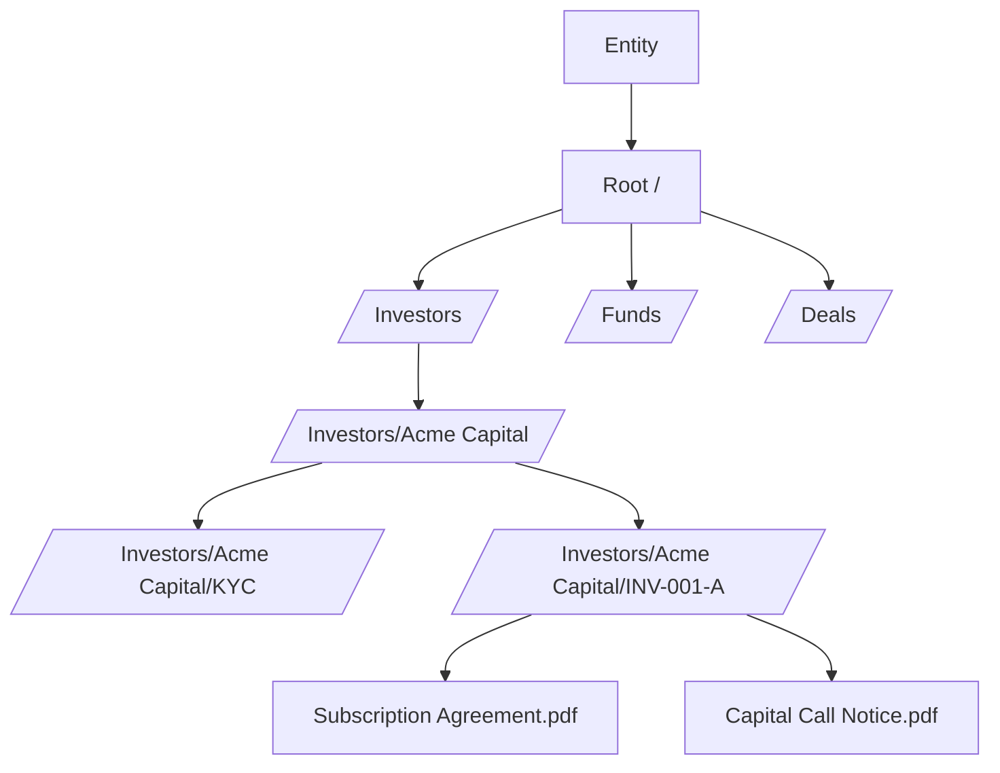
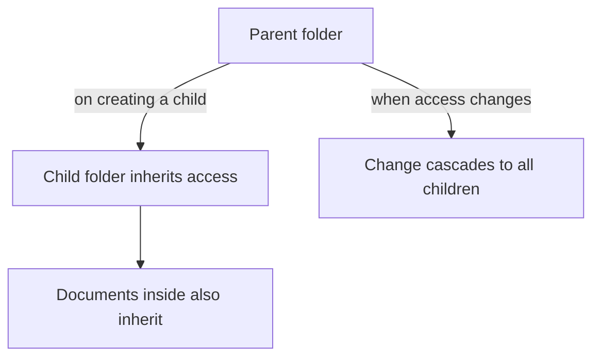
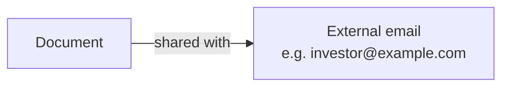

# Document Management User Guide

CapHive organises files in a folder tree with automatic access inheritance, document sharing, AI-powered Q&A extraction, and built-in e-signing. Permissions you set on a folder flow down to everything inside it, so you control access in one place. This guide covers creating and organising documents, managing access, sharing externally, and extracting answers from documents.

---

## Table of Contents

1. [Key Concepts](#key-concepts)
2. [How Documents Are Organised](#how-documents-are-organised)
3. [The Folder Tree](#the-folder-tree)
4. [System vs Regular Folders](#system-vs-regular-folders)
5. [Access Inheritance](#access-inheritance)
6. [Creating a Folder](#creating-a-folder)
7. [What Can Hold Documents](#what-can-hold-documents)
8. [Uploading a Document](#uploading-a-document)
9. [Tags and Owner Tags](#tags-and-owner-tags)
10. [The As-Of Date](#the-as-of-date)
11. [Generated Documents and Templates](#generated-documents-and-templates)
12. [Document Approval](#document-approval)
13. [Sharing a Document Externally](#sharing-a-document-externally)
14. [Document Access Rights](#document-access-rights)
15. [Who Viewed a Document](#who-viewed-a-document)
16. [Document Q&A](#document-qa)
17. [Download and Print Controls](#download-and-print-controls)
18. [Private Folders](#private-folders)
19. [E-Signing](#e-signing)
20. [Worked Example](#worked-example)
21. [Frequently Asked Questions](#frequently-asked-questions)

---

## Key Concepts

| Term | Meaning |
|------|---------|
| **Document** | Any uploaded file (PDF, Excel, image…) stored in a folder. |
| **Folder** | A named container in the tree. |
| **Full Path** | A folder's location, e.g. `/Investors/Acme Capital/KYC`. |
| **Owner** | The business record a document belongs to (a fund, commitment, deal…). |
| **Owner Tag** | A functional label that workflows use to find specific document types (e.g. `KYC`, `Offer Template`). |
| **Share** | Giving an external email address access to one document. |
| **Document Q&A** | AI-extracted question-and-answer facts from a document's content. |
| **Access Right** | A permission controlling who can see a folder or document. |

---

## How Documents Are Organised

Every entity has a **root folder** (`/`). Sub-folders are created automatically as business records are created (investors, commitments, capital calls, deals…), and you can also create folders by hand.

---

## The Folder Tree

Folders form a tree. Each folder has a **full path** built from its parents (the root is always `/`), and its depth is its **level** (root = 0, top-level = 1, and so on). Deleting a folder also deletes the folders and documents inside it.

---

## System vs Regular Folders

| Type | Description |
|------|-------------|
| **System** | Created automatically by the platform (the root, entity, fund, and investor folders). Can't be renamed in the UI. |
| **Regular** | Folders you create. Can be renamed and reorganised. |

---

## Access Inheritance

Access rights cascade down the tree, so you usually only set them once at the folder level.

- When a new folder is created, it inherits the parent's access — and so do any documents already inside it.
- When you change a folder's access, the change cascades to all sub-folders and their documents (when the right is set to cascade).

---

## Creating a Folder

Go to **[Entity] → Documents → Folders → New**. Provide a **Name** and a **Parent** (defaults to the entity's root). The full path is built automatically and must be unique.

---

## What Can Hold Documents

Documents can be attached to most business records, including:

| Owner | Example use |
|-------|-------------|
| **Fund** | PPM, annual report. |
| **Capital Commitment** | Subscription agreements, KYC documents. |
| **Capital Call** | Call notices. |
| **Capital Remittance** | Remittance vouchers. |
| **Deal / Deal Investor** | Deal documents. |
| **Investment Opportunity / EOI** | Opportunity materials, EOI forms. |
| **Offer** | Secondary-sale offer documents. |
| **Investor KYC** | Identity documents. |

A document uploaded to a fund's data room, for example, belongs to that fund and lands in its folder.

---

## Uploading a Document

Open the record (fund, commitment, etc.), go to its **Documents** tab, and upload. Provide:

- **Name** — the display name.
- **File** — the file itself (PDF, Word, Excel, image…).

Optional:

- **Tags** — searchable labels.
- **Owner Tag** — a functional classification used by specific workflows (see below).
- **As-Of Date** — the business date the document applies to (see below).
- **Send Email** — notify relevant users on upload.

The entity and folder are set automatically from the record.

---

## Tags and Owner Tags

- **Tags** are general-purpose searchable labels for filtering and grouping (e.g. `kyc`, `compliance`, `annual-report`).
- **Owner Tags** are functional labels that specific workflows look for:

| Owner Tag | Used by |
|-----------|---------|
| **PAN** | KYC and offer verification (links to the ID image). |
| **Offer / Buyer Template** | Secondary-sale agreement generation. |
| **Seller / Buyer** | Secondary-sale party documents. |
| **Allocation Template** | Secondary-sale allocation confirmation. |
| **KYC** | KYC document management. |
| **Custom** | Any label you need, for bespoke workflows. |

---

## The As-Of Date

Every document can have an **As-Of Date** — the business date it applies to (a statement period end, a call date) rather than its upload date.

- In the document list, the **Date** column shows the As-Of Date when set, falling back to the upload date when blank.
- For uploads, set it on the form (or leave blank if not relevant).
- For generated documents, the system sets it automatically (see below).

This lets you find, say, the March 2025 investor statement at a glance.

### How it's set for generated documents

| Document | As-Of Date |
|----------|-----------|
| Investor Statement | End of the statement period. |
| Capital Call Notice | The call's remittance date. |
| Distribution Notice | The distribution's payment date. |
| Fund Report / Portfolio Report | End of the reporting period. |
| Commitment Agreement, EOI/SPA | Not set — upload date is shown. |

---

## Generated Documents and Templates

A **generated document** is created by merging data into a **template**. Templates power capital-call notices, remittance vouchers, distribution documents, and secondary-sale agreements. Each template keeps a list of every document generated from it, so you can trace any generated document back to its template.

If a template has a problem that only shows up once documents are generated from it — clause numbers that duplicate or skip, unexpected blank space on a page, a section that shows for every investor when it shouldn't — company administrators can open the template and click **Fix Me** to describe the problem and get back a corrected draft to review. See the [Template Fix Agent guide](agents/template_fix_agent_user_guide) for details.

---

## Document Approval

Documents can be **approved** before use — for example, before they're attached to investor emails or sent for signature. The typical states are: uploaded → approved → sent for e-signing. See the [E-Signing guide](esigning_user_guide) for the full signing lifecycle.

---

## Sharing a Document Externally

You can share a single document with an external email address — no account required:

1. Open the document and click **Share**.
2. Enter the recipient's email.
3. They receive a secure link to view the document.

The link respects the document's download and printing settings.

---

## Document Access Rights

Access rights decide who sees a document in the portal, and are usually **inherited from the folder** automatically. You can also grant access on a single document directly (open the document → **Access Rights → Add**, choose the user or investor, and set whether it should cascade further). Document-level access **extends** folder access; it doesn't override folder restrictions.

---

## Who Viewed a Document

Each document records **who viewed it and when** — useful for audit and for confirming an investor received an important communication. Open a document and view its **Viewed By** list.

---

## Document Q&A

CapHive can read a document with AI and extract key facts as question-and-answer pairs — for example pulling fields out of a KYC form or financial statement. Review extracted facts under **[Entity] → Document Questions**. These answers also power the support agents and AI rules, so the system can answer questions about a document's content without someone reading it manually.

---

## Download and Print Controls

Three settings control how a document can be accessed:

| Setting | On | Off |
|---------|----|----|
| **Download** | Users can download the file. | View only. |
| **Printing** | Users can print. | Printing disabled. |
| **Original file** | Users get the original file. | Only a protected/watermarked version. |

You can set these at the **folder** level and have them apply to every document inside.

---

## Private Folders

Marking a folder **private** restricts it to users with explicit access — it won't appear in the folder tree for anyone else. Sub-folders created inside a private folder are private too.

---

## E-Signing

Documents can be sent for electronic signature. Once sent, the signing provider manages the process, and a failed, cancelled, voided, or expired request can be resent. See the **[E-Signing guide](esigning_user_guide)** for signatories, the signing experience, and completion.

---

## Worked Example

Setting up a controlled data room for a fund:

1. The fund's folder is created automatically. Inside it, create a **regular** folder "Data Room".
2. Set **Download = off** on the Data Room folder so investors can view but not download — every document added inherits this.
3. Grant **access** to the fund's investors at the Data Room folder level; all current and future documents inside inherit it.
4. Upload the PPM and quarterly reports, tagging each with `data-room` and setting the **As-Of Date** to the report period.
5. For a prospective investor without an account, use **Share** on the teaser document to send a secure view-only link.
6. Later, open a key document's **Viewed By** list to confirm which investors have opened it.

---

## Frequently Asked Questions

**Can I rename a system folder?**
No — system folders are named by the platform. Ask your administrator if one needs to change.

**What happens to documents when I rename a fund or investor?**
The folder name and path update automatically, including all sub-folders (e.g. renaming a folio updates its folder path).

**If I add access to a folder, do existing documents get it too?**
Yes, when the access right cascades — the change propagates to all sub-folders and documents.

**How do I share with someone who has no account?**
Use **Share** with their email; they get a secure view link, no account needed.

**Can a document live in two folders?**
No — each document is in exactly one folder. Use access rights to widen who can see it, or generate copies from a template.

**How do I stop investors downloading fund documents?**
Set **Download = off** on the fund's document folder; it applies to everything inside. Investors can view but not download.

**What file types are supported?**
Any file can be uploaded. PDFs preview in the viewer; other formats render in the browser or download.
