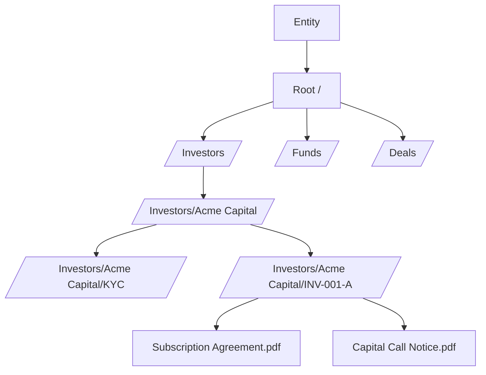
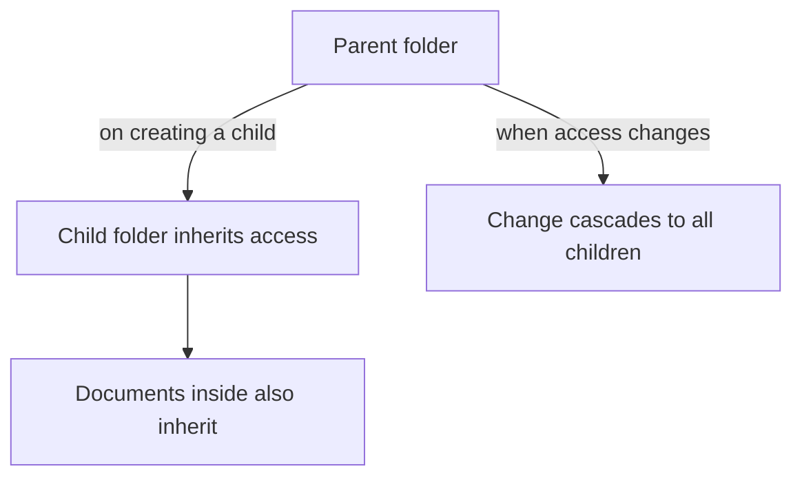
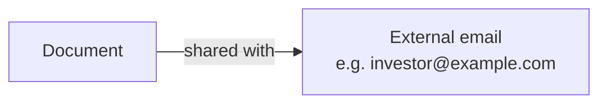

# Document Management User Guide

CapHive organises files in a folder tree with automatic access inheritance, document sharing, AI-powered Q&A extraction, and built-in e-signing. Permissions you set on a folder flow down to everything inside it, so you control access in one place. This guide covers creating and organising documents, managing access, sharing externally, and extracting answers from documents.

> **Where to find it:** Sidebar → [**Documents**](/documents) shows the folder tree and the documents in the selected folder; a fund's or stakeholder's own documents are on the **Documents** tab of the fund or under **Misc → Documents** on the stakeholder page. Select a folder and use **Actions → New Document** / **New Folder** / **Bulk Upload**. The sidebar item and the upload actions need the *Documents* permission (`enable_documents`) on your login plus update rights on the folder or the owning record.

---

## Table of Contents

1. [Key Concepts](#key-concepts)
2. [How Documents Are Organised](#how-documents-are-organised)
3. [The Folder Tree](#the-folder-tree)
4. [System vs Regular Folders](#system-vs-regular-folders)
5. [Access Inheritance](#access-inheritance)
6. [Creating a Folder](#creating-a-folder)
7. [What Can Hold Documents](#what-can-hold-documents)
8. [Uploading a Document](#uploading-a-document)
9. [Tags and Owner Tags](#tags-and-owner-tags)
10. [The As-Of Date](#the-as-of-date)
11. [Generated Documents and Templates](#generated-documents-and-templates)
12. [Document Approval](#document-approval)
13. [Sharing a Document Externally](#sharing-a-document-externally)
14. [Document Access Rights](#document-access-rights)
15. [Who Viewed a Document](#who-viewed-a-document)
16. [Document Q&A](#document-qa)
17. [Download and Print Controls](#download-and-print-controls)
18. [Private Folders](#private-folders)
19. [Bulk Actions on Documents](#bulk-actions-on-documents)
20. [E-Signing](#e-signing)
21. [Worked Example](#worked-example)
22. [Frequently Asked Questions](#frequently-asked-questions)

---

## Key Concepts

| Term | Meaning |
|------|---------|
| **Document** | Any uploaded file (PDF, Excel, image…) stored in a folder. |
| **Folder** | A named container in the tree. |
| **Full Path** | A folder's location, e.g. `/Investors/Acme Capital/KYC`. |
| **Owner** | The business record a document belongs to (a fund, commitment, deal…). |
| **Owner Tag** | A functional label that workflows use to find specific document types (e.g. `KYC`, `Offer Template`). |
| **Share** | Giving an external email address access to one document. |
| **Document Q&A** | AI-extracted question-and-answer facts from a document's content. |
| **Access Right** | A permission controlling who can see a folder or document. |

---

## How Documents Are Organised

Every entity has a [**root folder**](/). Sub-folders are created automatically as business records are created (investors, commitments, capital calls, deals…), and you can also create folders by hand.

---

## The Folder Tree

Folders form a tree. Each folder has a **full path** built from its parents (the root folder's path is just a slash), and its depth is its **level** (root = 0, top-level = 1, and so on). Folders cannot be deleted from the UI; deleting a business record (fund, stakeholder, deal) removes its folder and everything inside it.

---

## System vs Regular Folders

| Type | Description |
|------|-------------|
| **System** | Created automatically by the platform (the root, entity, fund, and investor folders). Have no **Upload / Edit** button. |
| **Regular** | Folders you create. Their download and printing settings can be changed via **Upload / Edit**, but the name and parent folder are locked once saved, so they cannot be renamed or moved. |

---

## Access Inheritance

Access rights cascade down the tree, so you usually only set them once at the folder level.

- When a new folder is created, it inherits the parent's access — and so do any documents already inside it.
- When you change a folder's access, the change cascades to all sub-folders and their documents.

---

## Creating a Folder

Go to Sidebar → **Documents**, click the parent folder in the tree, then **Actions → New Folder**. Provide a **Name** (it cannot be changed later); the **Parent Folder** is pre-filled with the folder you selected. You can also click **Create Sub Folder** on a folder's page. The full path is built automatically and must be unique.

---

## What Can Hold Documents

Documents can be attached to most business records, including:

| Owner | Example use |
|-------|-------------|
| **Fund** | PPM, annual report. |
| **Capital Commitment** | Subscription agreements, KYC documents. |
| **Capital Call** | Call notices. |
| **Capital Remittance** | Remittance vouchers. |
| **Deal / Deal Investor** | Deal documents. |
| **Investment Opportunity / EOI** | Opportunity materials, EOI forms. |
| **Offer** | Secondary-sale offer documents. |
| **Investor KYC** | Identity documents. |

A document uploaded to a fund's data room, for example, belongs to that fund and lands in its folder.

---

## Uploading a Document

Open the record (fund, commitment, etc.), go to its **Documents** tab, and upload. Provide:

- **Name** — the display name.
- **File** — the file itself (PDF, Word, Excel, image…).

Optional:

- **Tags** — searchable labels.
- **Document For** (the owner tag) — a functional classification used by specific workflows (see below). It is shown on the **New Template** forms of a fund (**Actions → Misc → New Template**) and a secondary sale (**Actions → New Template**), and when editing a document that belongs to a fund, secondary sale or investment opportunity; the folder-based **New Document** form shows a **Folder** picker instead.
- **As Of Date** — the business date the document applies to (see below).
- **Send Email** — notify users with access, once, right after upload.
- **Allow Download / Printing / Original Format Download** — see [Download and Print Controls](#download-and-print-controls).

The entity and folder are set automatically from the record.

---

## Tags and Owner Tags

- **Tags** are general-purpose searchable labels for filtering and grouping (e.g. `kyc`, `compliance`, `annual-report`).
- **Owner Tags** are functional labels that specific workflows look for:

| Owner Tag | Used by |
|-----------|---------|
| **PAN** | KYC and offer verification (links to the ID image). |
| **Commitment Template** | Fund template for commitment (contribution / subscription) agreements. |
| **Call Template** | Fund template for capital call notices. |
| **Distribution Template** | Fund template for distribution notices. |
| **Investor Statement Template** | Fund template for investor statements. |
| **Offer / Buyer Template** | Secondary-sale agreement generation. |
| **Seller / Buyer** | Secondary-sale party documents. |
| **Allocation Template** | Secondary-sale allocation confirmation. |
| **KYC** | KYC document management. |
| **Custom** | Any label you need, for bespoke workflows. |

---

## The As-Of Date

Every document can have an **As-Of Date** — the business date it applies to (a statement period end, a call date) rather than its upload date.

- In the document list, the **Date** column shows the As-Of Date when set, falling back to the upload date when blank.
- For uploads, set it on the form (or leave blank if not relevant).
- For generated documents, the system sets it automatically (see below).

This lets you find, say, the March 2025 investor statement at a glance.

### How it's set for generated documents

| Document | As-Of Date |
|----------|-----------|
| Investor Statement | End of the statement period. |
| Capital Call Notice | The call's remittance date. |
| Distribution Notice | The distribution's payment date. |
| Fund Report / Portfolio Report | End of the reporting period. |
| Commitment Agreement, EOI/SPA | Not set — upload date is shown. |

---

## Generated Documents and Templates

A **generated document** is created by merging data into a **template**, a Word file tagged with a **Document For** value such as **Commitment Template** or **Call Template**. Templates power commitment agreements, capital-call notices, distribution notices, investor statements, KYC documents and secondary-sale agreements. A generated document's page shows **Created from template** with a link back to its template. How to add templates, write merge fields and generate documents is covered in the [Document Templates guide](document_templates_user_guide).

If a template has a problem that only shows up once documents are generated from it — clause numbers that duplicate or skip, unexpected blank space on a page, a section that shows for every investor when it shouldn't — company administrators can open the template and click **Fix Me** to describe the problem and get back a corrected draft to review. See the [Template Fix Agent guide](agents/template_fix_agent_user_guide) for details.

---

## Document Approval

**Generated** documents must be **approved** before use: until then they are hidden from stakeholders and cannot be sent with **Send Document** or for e-signature. A user with the **approver** role clicks **Approve** on the document (or, after **Actions → Filter Documents**, **Actions → Approve** for many). Manually uploaded and signed documents never need approval. The typical flow for a generated document is: generated → approved → sent for e-signing. See the [E-Signing guide](esigning_user_guide) for the full signing lifecycle.

---

## Sharing a Document Externally

You can share a single document with an external email address — no account required. The **Shares** tab is available only to company administrators, and only when data rooms are enabled for your company:

1. Open the document, go to the **Shares** tab and click **New**.
2. Enter one or more recipient emails, separated by commas, and save.
3. They receive a secure link to view the document, valid for 30 days.

The link respects the document's download and printing settings.

---

## Document Access Rights

Access rights decide who sees a document in the portal, and are usually **inherited from the folder** automatically. You can also grant access on a single document directly (open the document → **Access Rights** tab → **Grant Access**, then choose the user or stakeholder). Document-level access **extends** folder access; it doesn't override folder restrictions.

---

## Who Viewed a Document

Each document records **who viewed it and when** — useful for audit and for confirming an investor received an important communication. Open a document and view its **Viewed By** list.

---

## Document Q&A

CapHive can read a document with AI and extract key facts as question-and-answer pairs — for example pulling fields out of a KYC form or financial statement. Review extracted facts on the document's **Q&A** tab, which appears next to **Tasks** once CapHive holds extracted facts for the file; there is no separate "Document Questions" page. Extraction is not triggered by upload and has no button — it runs when CapHive support enables it for a document type. These answers also power the support agents and AI rules, so the system can answer questions about a document's content without someone reading it manually.

---

## Download and Print Controls

Three settings control how a document can be accessed:

| Setting | On | Off |
|---------|----|----|
| **Download** | Users can download the file. | View only. |
| **Printing** | Users can print. | Printing disabled. |
| **Original file** | Users get the original file. | Only a protected/watermarked version. |

You can set these at the **folder** level (folder page → **Upload / Edit**): saving queues a job that overwrites the three switches on every document in the folder and all its sub-folders, replacing any per-document exceptions.

---

## Private Folders

A **private** folder is restricted to users with an explicit access right — it won't appear in the folder tree for anyone else, including employees whose rights come only from the owner record. There is no **Private** checkbox on the folder form: private folders are set up by the platform or CapHive support, and sub-folders created inside a private folder are private too. The folder page shows **Private: Yes**.

---

## Bulk Actions on Documents

There is no separate **Bulk Actions** button on the documents list: the bulk actions live in the **Actions** menu of the documents card, and they appear only after you filter. Go to Sidebar → [**Documents**](/documents) (or a fund's, stakeholder's or other record's **Documents** tab), select a folder, choose **Actions → Filter Documents**, and run a filter. On the filtered list the **Actions** menu shows these items instead of **Filter Documents**:

| Action (exact label) | What it does | Shown when |
|---|---|---|
| **Approve** | Marks each generated document that is still pending approval as approved, with you as approver, so stakeholders can see it and it can be sent or signed. Nobody is emailed. Documents that are already approved, not generated, or that you cannot edit are reported as errors. | You have the **approver** role |
| **Send For E Signatures** | Queues each approved document that has signatories, has not been sent yet and is not cancelled, completed, expired or voided, for signing with your provider, a few seconds apart. Unapproved documents are reported as "not approved", other unready ones as "not ready for eSignature". See the [E-Signing guide](esigning_user_guide). | Always |
| **Delete** | Soft-deletes each document. Only documents tagged **Signed** are skipped (and reported); unlike the **Delete** button on a single document, the bulk action does not skip documents that are currently out for e-signature. | Always |
| One item per custom notification, under **Email Using Template:** (the label is the notification's subject) | Emails each document, using that custom notification, to every user with access to it, exactly like **Send Document** on a single document. Unapproved generated documents and documents nobody has access to are reported as errors. | Your company has enabled custom notifications of type **Send Document** |
| **Download ZIP** | Not a bulk action job: zips the filtered documents in the background and emails you a download link (see the FAQ on downloading). | Always |

Every bulk action asks you to confirm and then applies to **all** documents matching the filter, including those on other pages and in sub-folders of the selected folder. Employees who are not company administrators only act on documents they uploaded themselves. The work runs in the background ("Bulk Action started, please check back in a few mins."); you get an in-app alert for each document and a final "*action* completed for N records" alert, and if any documents failed the alert gives the error count and the list is emailed to you. There is no bulk undo: approved documents can be un-approved one at a time with **UnApprove**, deleted documents restored from the [deleted documents](/documents/show_deleted) list, but emails and signing requests already sent cannot be recalled (a company administrator can cancel a signing request per document).

---

## E-Signing

Documents can be sent for electronic signature. Once sent, the signing provider manages the process, and a failed, cancelled, voided, or expired request can be resent. See the **[E-Signing guide](esigning_user_guide)** for signatories, the signing experience, and completion.

---

## Worked Example

Setting up a controlled data room for a fund:

1. The fund's folder, and a **regular** "Data Room" folder inside it, are created automatically with the fund.
2. Open the Data Room folder's page, click **Upload / Edit** and set **Allow Download** off so investors can view but not download — the setting is pushed to every document inside, and new uploads pre-fill from it.
3. Grant **access** to the fund's investors on the fund's **Access** tab; the fund's Data Room folder has no Access Rights tab of its own and mirrors those grants with cascade on, so documents inside are covered.
4. Upload the PPM and quarterly reports, tagging each with `data-room` and setting the **As Of Date** to the report period.
5. For a prospective investor without an account, a company administrator uses the **Shares** tab on the teaser document (data rooms must be enabled) to send a secure view link.
6. Later, open a key document's **Viewed By** list to confirm which investors have opened it.

---

## Frequently Asked Questions

**Where do I find Documents in CapHive?**
Sidebar → [**Documents**](/documents). The left card shows the **Folders** tree and the right card lists the documents in the selected folder. The menu item only appears when the *Documents* permission (`enable_documents`) is on for your login; if you cannot see it, ask your company administrator. See [How Documents Are Organised](#how-documents-are-organised).

**Where are the bulk actions for documents?**
In the **Actions** menu of the documents list, after a filter. Sidebar → [**Documents**](/documents) (or a record's **Documents** tab), select a folder, choose **Actions → Filter Documents** and run a filter; the **Actions** menu then lists **Approve**, **Send For E Signatures**, **Delete**, one item per **Email Using Template:** notification, and **Download ZIP**. See [Bulk Actions on Documents](#bulk-actions-on-documents).

**Why don't I see a Bulk Actions button on the documents list?**
Documents have no separate **Bulk Actions** button; the bulk items appear inside **Actions** only while a filter is applied, replacing **Filter Documents**. Select a folder first, since **Filter Documents** only shows once a folder is selected. **Approve** also needs the **approver** role, and **Email Using Template:** lists nothing until your company has enabled a **Send Document** custom notification.

**How do I open a fund's or a stakeholder's documents?**
For a fund: Sidebar → [**Funds → Funds**](/funds), open the fund, then click the **Documents** tab (the fund card's **Actions** menu on the [**Funds**](/funds) list also has a **Documents** link). For a stakeholder (investor): Sidebar → [**Stakeholders → View Stakeholders**](/investors), open the stakeholder, then **Misc → Documents**, which opens that stakeholder's folder in the document tree. Other records (commitments, capital calls, deals, KYCs) have their own **Documents** tab on their page.

**How do I open a folder's own page?**
Open any document in the folder and click the **View Folder** badge next to the folder path. The folder page shows its path, owner, type and **Private** flag, with **View Docs**, **Upload / Edit** (regular folders only), **Create Sub Folder** and **All Docs** buttons. The plain [folder list](/folders) has no sidebar item, so use this link to reach it.

**How do I create a folder?**
Sidebar → [**Documents**](/documents), click the parent folder in the tree, then [**Actions → New Folder**](/folders/new). Give it a **Name**; the **Parent Folder** is pre-filled. You can also open any folder page and click **Create Sub Folder**, or open the [folder list](/folders) (no sidebar item) and click **New Folder**. Any employee of the company with the Documents permission can create folders. See [Creating a Folder](#creating-a-folder).

**How do I upload a document?**
Sidebar → **Documents**, select the target folder, then [**Actions → New Document**](/documents/new). Fill in **Name**, choose the **Upload File**, and optionally **Tags**, **As Of Date**, **Send Email** and the **Allow Download / Printing / Original Format Download** switches. To upload a Word template for document generation use the fund's **Actions → Misc → New Template** instead, which shows **Document For**. Uploading from a record's **Documents** tab (fund, commitment, deal…) pre-fills the owner and folder. See [Uploading a Document](#uploading-a-document).

**How do I add a document template for document generation?**
Open the fund and choose **Actions → Misc → New Template** (or **Actions → New Template** on a secondary sale), upload the Word file and set **Document For** to what it generates, for example **Commitment Template** for a commitment or contribution agreement or **Call Template** for a capital call notice. Templates are hidden from investors. See [Document Templates](document_templates_user_guide).

**How do I upload many documents at once?**
Select a regular (non-system) folder in the tree and choose **Actions → Bulk Upload**. This opens the import-upload form (import type **Documents**) where you attach a spreadsheet listing the files; a **DOCS_SAMPLE** template is linked from that page. **Bulk Upload** is hidden on system folders (root, entity, investor folders) because it needs update rights on the folder. You can also attach several files on a folder's **Upload / Edit** page under **Folder Documents**.

**How do I edit a document's name, tags, dates or download settings?**
Open the document and click **Edit**. You need update rights on the document or its owner record; locked documents (e.g. ones already sent for signature) cannot be edited. Replacing the **Upload File** swaps the stored file; the document keeps its id, access rights and history.

**How do I delete a document?**
Open the document and click **Delete**. You need the *Documents* destroy permission on your role; signed documents and documents currently out for e-signature cannot be deleted this way. To delete many at once, see the bulk delete question below.

**How do I bulk approve many documents at once?**
Select the folder, choose **Actions → Filter Documents** and filter to the generated documents you want (for example by owner tag **Generated**), then choose **Actions → Approve** and confirm. It needs the **approver** role. To approve generated documents across a date range instead, use [**Approve Generated Documents**](/documents/approve).

**How do I bulk send many documents for e-signature at once?**
Filter the folder with **Actions → Filter Documents**, then choose **Actions → Send For E Signatures** and confirm. Only approved documents that already have signatories and have not been sent are queued; the rest are reported to you. See the [E-Signing guide](esigning_user_guide).

**How do I bulk email many documents at once using a custom notification template?**
Filter the folder with **Actions → Filter Documents**, then under **Email Using Template:** in the **Actions** menu pick the notification (listed by its subject) and confirm. Each document is emailed to everyone with access to it. The list only shows enabled custom notifications of type **Send Document**.

**How do I set up the email template used by Send Document / Email Using Template?**
Create a document email template (custom notification): Sidebar → [**Funds → KYCs**](/investor_kycs) → **New KYC** → **Custom Agreement Notification**, or Profile menu → **My Inbox** → **Custom Notifications** → **New Notification** → **Document Notification**. Write the subject and body, keep **Template enabled** on and save; it needs the Company Admin role. It then appears as **Send <subject>** in every document's **Send Document** menu and under **Email Using Template:**. See [Custom Notifications](custom_notifications_user_guide).

**Why is the Send Document menu empty on a document?**
The menu lists one **Send <subject>** item per enabled document email template (custom notification of type **Send Document**), so it is empty until your company has one. Create a **Custom Agreement Notification** or **Document Notification**, or switch **Template enabled** back on for an existing one. See [Custom Notifications](custom_notifications_user_guide).

**How do I bulk delete many documents at once?**
Select the folder, choose **Actions → Filter Documents**, run a filter, check the results carefully, then choose **Actions → Delete** and confirm. Every matching document on every page and in sub-folders is deleted except those tagged **Signed**. Deleted documents can be restored one at a time from the [deleted documents](/documents/show_deleted) list.

**Can I delete a folder?**
Not from the UI: the folder policy never allows delete, so no **Delete** button appears on a folder page, and folders are not removable from the tree. Empty a folder by deleting or moving its documents, or ask CapHive support to remove it. Deleting a business record (fund, stakeholder, deal) does remove its folder and everything in it with it. See [The Folder Tree](#the-folder-tree).

**How do I restore a document I deleted by mistake?**
Deletes are soft deletes. Open the [deleted documents](/documents/show_deleted) list (there is no menu link to it), find the document and use **Restore**, which brings back the document with its access rights. Restoring needs the same permission as deleting. There is no restore for the file replaced during an **Edit**; re-upload it.

**How do I export the document list?**
On the Documents page click the **Index** button (top right of the Documents card) to download the full list as an Excel file. To get the files themselves, select a folder and choose **Actions → Download Folder** (company administrators only) or, after a filter, **Actions → Download ZIP**. CapHive builds a zip in the background and emails you a link (see the "What happens when I download a folder" question below).

**Who can manage documents and how do I get access?**
Company administrators can create, edit and delete any document of the company. Other employees need the *Documents* permission (`enable_documents`) on their login plus an access right on the record (folder, fund, commitment, deal…) that owns the document; an employee with update rights on a record can attach documents to it. Ask your company administrator to grant the access right. See [Document Access Rights](#document-access-rights).

**Why should I manage documents in CapHive instead of a shared drive?**
Because access follows your business data: each stakeholder, commitment, call and deal gets its own folder automatically, investors only see what they are entitled to on the portal, every view is logged, download and printing can be switched off, and generated notices, statements and agreements land in the right folder without anyone filing them. See [Access Inheritance](#access-inheritance).

**What can I do with a document once it is uploaded?**
From the document page you can grant access (**Access Rights** tab), see who opened it (**Viewed By** tab), share it with an outside email (**Shares** tab), attach tasks (**Tasks** tab), send it by email using a custom notification (**Send Document**), approve it, and, for templates, run **Fix Me**. Signature-enabled documents show their e-sign status and a **Signatures** tab. See [Who Viewed a Document](#who-viewed-a-document) and [E-Signing](#e-signing).

**Who typically uses document management?**
Fund operations and investor-relations teams upload and file documents, company administrators set folder access and download rules, approvers release generated notices and statements, and stakeholders (investors) read their documents on the portal under **Funds → Documents**. Support agents and compliance rules also read documents to answer questions and run checks.

**What happens if I don't set up folder access rights?**
Documents stay visible only to your company's administrators and to users with rights on the owning record. Stakeholders will not see fund or commitment documents on the portal until an access right exists on the folder (or document). Set it once on the folder and everything inside inherits it. See [Access Inheritance](#access-inheritance).

**What happens when I upload a document?**
A document record is created in the chosen folder and, in the background, it copies the folder's access rights onto itself, tells its owner record (fund, commitment, KYC…) that a document changed, and appears in the folder tree, the owner's **Documents** tab and the Excel **Index**. No one is emailed unless **Send Email** was ticked. If a Side Letter Obligation agent is enabled and the upload is a side letter on a commitment, an extraction run is queued too.

**What happens when I tick Send Email on the upload form?**
Every user who has an access right on the new document (and, for fund, deal and opportunity documents, on the owning record) gets an in-app notification and an email titled "<document name> uploaded by <your company>". It is sent once, right after upload; to email the document again later use **Send Document** on the document page. Leave it off for internal working files.

**What happens when I create a folder?**
The folder gets its level and full path from the parent (paths must be unique), copies every access right of the parent onto itself and any documents inside, and inherits the parent's owner and **Private** flag. Nobody is notified. Folders you create are **regular**; their name and parent are locked once saved, so no folder can be renamed from the UI. See [Creating a Folder](#creating-a-folder).

**What happens when I grant access on a folder?**
An access right is created on the folder and a background job copies it onto every document and sub-folder beneath it (large trees take a few minutes). Folder grants always cascade — there is no checkbox, because a right on the folder alone would show the folder and none of its contents. No one is emailed for a folder grant, and the form offers no **Send Notification** box for one: folders have no send-email setting, so the change is silent and stakeholders simply see the documents next time they log in. On a single document, **Send Notification** is still offered and emails only when that document's **Send Email** is on. Removing the access right removes what it granted.

**What happens when I change a folder's Allow Download, Printing or Original switches?**
Saving the folder queues a job that overwrites those three switches on every document in the folder and in all sub-folders, so any per-document exception you had set is replaced. The change takes effect for stakeholders as soon as the job finishes; nobody is notified. See [Download and Print Controls](#download-and-print-controls).

**What happens when I edit a document?**
The change is saved immediately and written to the Audit Trail (name, tags, dates, switches and file replacements). Nobody is notified. Locked documents cannot be edited at all, and changing a document already sent for signature does not update the copy the signing provider holds.

**What happens when I delete a document?**
The document is soft-deleted: it disappears from the tree, the owner's **Documents** tab and the stakeholder portal, and its access rights, tasks, shares, view history and signature records go with it. Nobody is notified. It can be restored from the [deleted documents](/documents/show_deleted) list. The **Delete** button is not offered on signed documents or documents out for signature; a bulk **Delete** only skips (and reports) documents tagged **Signed**.

**What happens when I share a document externally?**
A share record is created and the recipient is emailed a link headed "<document> been shared with you". The link is a signed token valid for 30 days and needs no account; each open increments **View Count** and stamps **Viewed At** on the **Shares** tab. The viewer gets the document with its download and printing switches enforced. Deleting the share from the **Shares** tab stops the link working.

**What happens when I click Send Document?**
CapHive emails the chosen custom notification, with the document attached or linked, to every user who has access to the document, and records an in-app notification for each. **View Who Gets Notified** in the confirmation lists them first. A generated document must be approved first (otherwise you get "not approved"), and if nobody has access the send fails with "No users to send" so you know to grant access first.

**What happens when I approve a document?**
The document is marked approved with your name as approver, appears to stakeholders on the portal (unapproved generated documents are hidden from them), and becomes eligible for **Send Document** and for sending for e-signature. **UnApprove** reverses it. Nobody is notified by the approval itself or by bulk **Actions → Approve** after a filter; only a run from [**Approve Generated Documents**](/documents/approve) can optionally email owners.

**What happens when I download a folder or a filtered result set?**
A background job zips the files you are allowed to see (tmp/temp folders are excluded), stores the zip as a document named `Download-<folder>-<you>-<timestamp>` in a `tmp` folder under your root folder, and sends you an in-app notification plus an email titled "Download link". The link expires in 5 days; missing or unreadable files are listed in the message. **Download Folder** needs the company administrator role.

**What happens when I open a document?**
Each open adds to your entry on the document's **Viewed By** tab (user, first and last time, count), so administrators can prove a stakeholder saw a notice. Opens through an external share are counted on the **Shares** tab instead. See [Who Viewed a Document](#who-viewed-a-document).

**What happens when a document is generated from a template?**
The generated file is saved in the owner's folder with the owner tag **Generated**, an **As Of Date** set by the generating job, and **Approved = No**. It is invisible to stakeholders until an approver approves it, and re-generating from the same template deletes the previous unsigned copy with the same name. The generated document's page links back to its template under **Created from template**. See [Generated Documents and Templates](#generated-documents-and-templates).

**What happens when I bulk upload documents through Import?**
The import job reads each row of the spreadsheet, creates missing folders under the selected folder, and creates one document per row with the name, tags and owner tag given. You get an in-app notification when it finishes, listing any rows that failed; successful rows behave exactly like manual uploads (access inherited from the folder, no emails).

**What happens when I use Actions → Approve on a filtered documents list (bulk approve)?**
Each matching generated document that is pending approval is marked approved with you as approver, becomes visible to stakeholders who have access, and can then be sent or signed. Nobody is emailed. Documents already approved, not generated or that you cannot edit are listed as errors in the final alert and emailed to you; **UnApprove** on a document reverses it.

**What happens when I use Actions → Send For E Signatures on a filtered documents list (bulk e-sign)?**
Each matching approved document with signatories that has not been sent (and is not cancelled, completed, expired or voided) is queued for the signing provider a few seconds apart, exactly like **Send For eSignatures** on the document; the provider emails the signers. Unapproved documents are reported as "not approved" and others as "not ready for eSignature". A company administrator can cancel a request per document.

**What happens when I use Actions → Delete on a filtered documents list (bulk delete)?**
Every matching document, on all pages and in sub-folders, is soft-deleted except documents tagged **Signed**, which are reported as errors. The bulk action does not skip documents out for e-signature the way the single **Delete** button does. Nobody is notified; documents can be restored from the [deleted documents](/documents/show_deleted) list.

**What happens when I use Email Using Template on a filtered documents list (bulk send document)?**
Each matching document is emailed with the chosen custom notification, and an in-app notification recorded, for every user who has access to it — the same as **Send Document** on one document. Unapproved generated documents and documents nobody has access to are reported as errors. Emails cannot be recalled.

**What happens to documents when I rename a fund or investor?**
The folder name and path update automatically, including all sub-folders (e.g. renaming a folio updates its folder path). Documents keep their ids and access rights, so existing links keep working.

**Can I rename a system folder?**
No. System folders are named by the platform and have no **Upload / Edit** button. Ask your administrator if one needs to change. See [System vs Regular Folders](#system-vs-regular-folders).

**If I add access to a folder, do existing documents get it too?**
Yes, always. A background job propagates the right to all sub-folders and documents, and any folder created later under it inherits it at creation. Folder grants cascade unconditionally; there is no option to turn it off.

**How do I share with someone who has no account?**
Open the document, go to the **Shares** tab and click [**New**](/doc_shares/new), then enter one or more recipient emails separated by commas. They receive a secure view link; the tab shows whether the email was sent, when it was first viewed and how many times. The **Shares** tab is only available to company administrators and only when data rooms are enabled for your company. See [Sharing a Document Externally](#sharing-a-document-externally).

**Can a document live in two folders?**
No. Each document is in exactly one folder. Use access rights to widen who can see it, or generate copies from a template.

**How do I stop investors downloading fund documents?**
Set **Allow Download** off on the fund's document folder (open the folder → **Upload / Edit**); a background job applies it to everything inside, including sub-folders. Investors can view but not download. See [Download and Print Controls](#download-and-print-controls).

**What file types are supported?**
Any file can be uploaded. PDFs preview in the viewer; other formats render in the browser or download. Videos play inline.

**How do I grant a single user or stakeholder access to one document?**
Open the document, go to the **Access Rights** tab and click **Grant Access**, then choose the user or stakeholder. Document-level rights extend the folder's rights; they never remove access the folder already grants. See [Document Access Rights](#document-access-rights).

**Where do I see the AI-extracted Q&A for a document?**
Open the document page; a **Q&A** tab appears next to **Tasks** once CapHive holds extracted facts for the file. Extraction is not triggered by upload and there is no button for it; it runs when support enables it for a document type. There is no separate "Document Questions" page. See [Document Q&A](#document-qa).

**How do I make a folder private?**
Private folders are set up by the platform (for example when a private parent folder gets a sub-folder, or through support), not from the folder form; there is no **Private** checkbox. A private folder shows **Private: Yes** on its page and is hidden from everyone without an explicit access right, including employees whose rights come only from the owner record. See [Private Folders](#private-folders).

**How do I approve a document, and why is the Approve button missing?**
Open the document and click **Approve** (or **UnApprove**). The button only shows for users with the **approver** role on a generated document that is still pending approval; to approve many at once, filter the folder and use **Actions → Approve**. Signed documents and manually uploaded documents never need approval. See [Document Approval](#document-approval).

**How do I find a document by tag or name?**
Click a tag on any document page to list every document with that tag, or select a folder and use **Actions → Filter Documents** to filter by name, tags, owner tag or date. The **As Of** date is what you see in the **Date** column, so set it when uploading period documents. See [The As-Of Date](#the-as-of-date).

**Who gets notified when I upload a document?**
Nobody by default. Tick **Send Email** on the upload form, or afterwards use **Send Document** on the document page and pick a custom notification; **View Who Gets Notified** in that dialog lists the recipients (everyone with access to the document). After a filter you can email a whole result set with **Actions → Email Using Template**.

**Why can't I see New Folder, Bulk Upload or Download Folder in the Actions menu?**
Those items only appear once a folder is selected in the tree. **New Document** and **New Folder** need create rights, **Bulk Upload** needs update rights on the folder (so it is hidden on system folders), and **Download Folder** is shown only to company administrators. After a filter the menu switches to the bulk actions (**Approve**, **Send For E Signatures**, **Delete**, **Email Using Template:** items and **Download ZIP**).

**Why isn't my uploaded Word template used when I click Generate Documents?**
Generation only uses documents whose **Document For** tag matches, such as **Call Template** for call notices. A file added with **New Document** on a folder has no tag. Open it, click **Edit** and set **Document For**, or add it again with the fund's **Actions → Misc → New Template**. See [Document Templates](document_templates_user_guide).

**A stakeholder says they cannot see a document. What should I check?**
In order: the stakeholder's portal access is approved (**Stakeholders → Pending Access**); an access right for that stakeholder exists on the folder or document (**Access Rights** tab); the folder is not private; and, for a generated document, that it has been approved. Advisors only see documents of records they are mapped to.

**Why is the Delete button missing on a document?**
Either the document is signed or currently out for e-signature (those cannot be deleted until the request is cancelled, voided, expired or failed), or your role lacks the *Documents* destroy permission. Company administrators can cancel an e-signature request from the **Signatures** tab first.

**A documents bulk action finished but some documents did not change — why?**
Each document is checked on its own: **Approve** skips documents already approved, not generated or not editable by you; **Send For E Signatures** skips unapproved documents and those without signatories or already sent; **Delete** skips **Signed** documents; email templates skip unapproved generated documents and documents nobody has access to. The final alert gives the error count and the list is emailed to you. Employees who are not company administrators only act on documents they uploaded.

**Does a bulk action on documents apply to documents on other pages or in sub-folders?**
Yes. A documents bulk action applies to every document matching the filter in the selected folder and all its sub-folders, including rows not shown on the current page. Narrow the filter before running **Delete** or an email template.

**Can I undo a bulk action on documents?**
There is no bulk undo. Use **UnApprove** on each document to reverse a bulk approve, and **Restore** in the [deleted documents](/documents/show_deleted) list to bring back bulk-deleted documents. Emails and signing requests already sent cannot be recalled, though a company administrator can cancel a signing request on the document's **Signatures** tab.

**What does Allow Public Visibility do?**
It makes the document viewable by anyone who opens its link, without logging in. Only company administrators can switch it on, and it should be used for public material only (a teaser, a public notice). For controlled sharing with an individual use the **Shares** tab instead.

## Related Guides

- [E-Signing](esigning_user_guide) — sending approved documents for electronic signature and tracking signers.
- [Data Rooms (GP)](data_rooms_gp_user_guide) — building controlled data rooms on top of folders and access rights.
- [Investor Access](investor_access_tutorial) — approving stakeholder logins so folder access rights actually reach them.
- [Custom Fields](custom_fields_user_guide) — adding extra fields to the document form.
- [Audit Trail](audit_trail_user_guide) — reviewing who changed or deleted a document.
- [Tasks](tasks_user_guide) — attaching follow-up tasks to a document.
- [Template Fix Agent](agents/template_fix_agent_user_guide) — repairing a template that generates faulty documents.
- [Document Templates](document_templates_user_guide) — adding Word templates and generating agreements, notices and statements from them.
- [Custom Notifications](custom_notifications_user_guide) — the email templates listed under **Send Document** and **Email Using Template:**.
