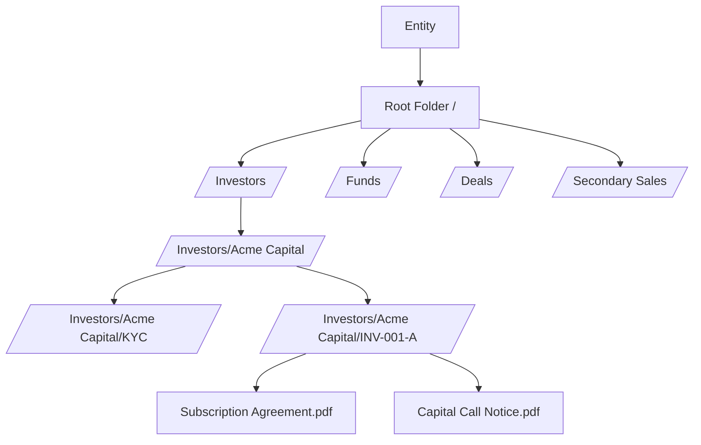
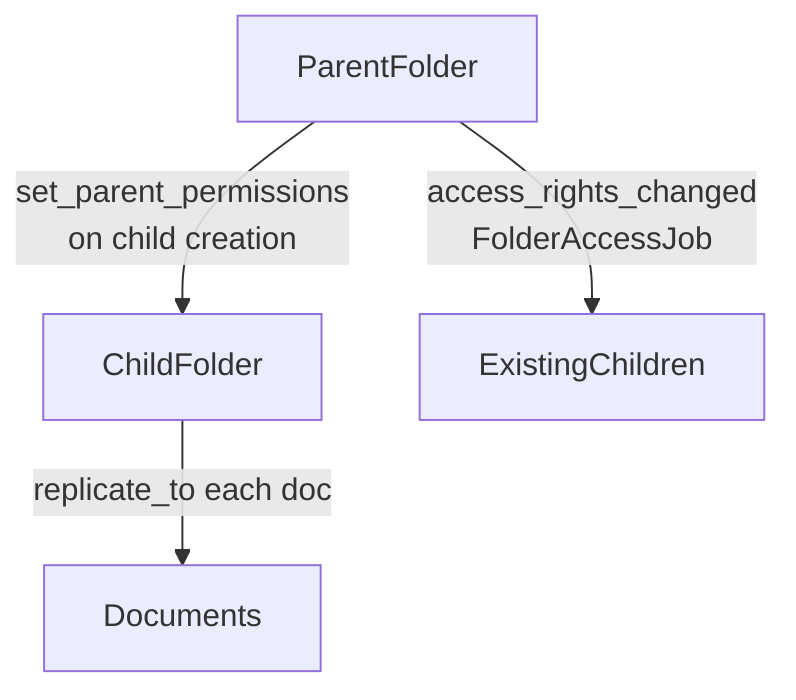
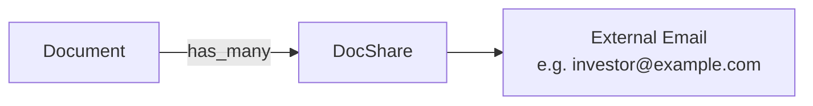

# Document Management User Guide

CapHive provides a folder-based document management system with access control inheritance, document sharing, AI-powered Q&A extraction, and integration with the e-signing workflow. Documents are organised in hierarchical folders, and permissions propagate automatically from parent folders to children. This guide covers creating and organising documents, managing folder access, sharing documents externally, and using doc questions.

---

## Table of Contents

1. [Key Concepts](#key-concepts)
2. [Document Storage Architecture](#document-storage-architecture)
3. [Folder Hierarchy](#folder-hierarchy)
4. [Folder Types: System vs Regular](#folder-types-system-vs-regular)
5. [Folder Access Control Inheritance](#folder-access-control-inheritance)
6. [Creating a Folder](#creating-a-folder)
7. [Document Owners (What Can Have Documents)](#document-owners-what-can-have-documents)
8. [Uploading a Document](#uploading-a-document)
9. [Document Fields and Metadata](#document-fields-and-metadata)
10. [Document Tags and Owner Tags](#document-tags-and-owner-tags)
11. [Template Documents vs Regular Documents](#template-documents-vs-regular-documents)
12. [Document Approval](#document-approval)
13. [Document Sharing (DocShare)](#document-sharing-docshare)
14. [Document Access Rights](#document-access-rights)
15. [Viewing Tracking](#viewing-tracking)
16. [Document Q&A (DocQuestion)](#document-qa-docquestion)
17. [Download and Print Permissions](#download-and-print-permissions)
18. [Private Folders](#private-folders)
19. [E-Signing Documents](#e-signing-documents)
20. [Key Fields Reference](#key-fields-reference)
21. [Frequently Asked Questions](#frequently-asked-questions)

---

## Key Concepts

| Term | Meaning |
|---|---|
| **Document** | Any uploaded file (PDF, Excel, image, etc.) stored in a folder |
| **Folder** | A named container in a hierarchical tree |
| **Full Path** | The absolute path of a folder, e.g. `/Investors/Acme Capital/KYC` |
| **Owner** | The business record a document belongs to (Fund, Deal, CapitalCommitment, etc.) |
| **Owner Tag** | A classification label on a document (e.g. `PAN`, `KYC`, `Offer Template`) |
| **DocShare** | A record sharing a document with a specific email address |
| **DocQuestion** | An AI-extracted question-answer pair from a document's content |
| **Access Right** | A permission record controlling who can see a folder or document |

---

## Document Storage Architecture

Every entity has a **root folder** (`/`). Sub-folders are created automatically when business records are created (investors, commitments, capital calls, deals, etc.). You can also create folders manually.

---

## Folder Hierarchy

Folders form a tree using the **ancestry** gem:

- Each folder knows its `level` (0 = root, 1 = top-level, 2 = sub-folder, etc.)
- `full_path` is computed on creation: `parent.full_path + "/" + name`
- The root folder's path is always `/`

Destroying a folder with the `orphan_strategy: :destroy` setting destroys all child folders and their documents recursively.

---

## Folder Types: System vs Regular

| Type | Description |
|---|---|
| **System** | Created automatically by the platform (e.g. root folder, entity-level folder). Cannot be renamed via the UI |
| **Regular** | User-created folders. Can be renamed and reorganised |

The root folder is always `system`. Top-level sub-folders created by the system (e.g. for funds, investors) are also `system` type.

---

## Folder Access Control Inheritance

Access rights cascade down the folder tree automatically.

When a new folder is created:
1. All access rights from the **parent folder** are replicated to the new folder
2. Any documents already in the new folder also inherit the parent's access rights

When an access right **changes** on a folder (added, modified, or removed):
1. `FolderAccessJob` runs asynchronously
2. It cascades the change to all child folders and documents within them (if `cascade = true` on the access right)

This means you only need to set access rights at the folder level — child folders and documents inherit them automatically.

---

## Creating a Folder

Navigate to **[Entity] → Documents → Folders → New**.

Required:
- **Name** — folder name (stripped of whitespace)
- **Parent** — the parent folder (defaults to the entity's root folder)

The `full_path` is auto-computed and must be unique per entity (scoped by owner if applicable).

---

## Document Owners (What Can Have Documents)

Documents can be attached to most business records via the polymorphic `owner` association. Supported owner types include:

| Owner Type | Example Use |
|---|---|
| `Fund` | Fund-level documents (PPM, annual report) |
| `CapitalCommitment` | Subscription agreements, KYC documents |
| `CapitalCall` | Call notice PDFs |
| `CapitalRemittance` | Remittance vouchers |
| `Deal` | Deal documents |
| `DealInvestor` | Investor-specific deal documents |
| `InvestmentOpportunity` | Investment opportunity materials |
| `ExpressionOfInterest` | EOI forms |
| `Offer` | Secondary sale offer documents |
| `InvestorKyc` | KYC identity documents |

When a document is uploaded to a fund's data room, for example, `owner = fund` and the document lands in the fund's folder.

---

## Uploading a Document

Navigate to the record (Fund, Commitment, etc.) and go to the **Documents** tab.

Required:
- **Name** — document display name
- **File** — the uploaded file (PDF, DOCX, XLSX, image, etc.)

Optional:
- **Tags** — searchable labels (max 120 chars)
- **Owner Tag** — classification for specific workflows (e.g. `PAN`, `Offer Template`)
- **Send Email** — whether to notify relevant users on upload

The `entity_id` and `folder` are set automatically from the owner record.

---

## Document Fields and Metadata

| Field | Description |
|---|---|
| `name` | Display name |
| `file` | Uploaded file (Shrine attachment) |
| `tags` / `tag_list` | Searchable labels |
| `owner_tag` | Functional classification (used by workflows to find specific doc types) |
| `text` | Optional rich-text description |
| `orignal` | Whether the original (unprotected) file is accessible |
| `printing` | Whether printing is permitted |
| `download` | Whether downloading is permitted |
| `signed_by` | User who signed this document |
| `approved_by` | User who approved this document |
| `from_template` | Reference to the template document this was generated from |

---

## Document Tags and Owner Tags

**Tags** (`tag_list`) are general-purpose searchable labels, similar to investor or task tags. Use them for filtering and grouping (e.g. `kyc`, `compliance`, `annual-report`).

**Owner Tags** (`owner_tag`) are functional labels recognised by specific workflows:

| Owner Tag | Used By |
|---|---|
| `PAN` | KYC and offer/interest verification — links to PAN card image |
| `Offer Template` | Secondary sales SPA generation |
| `Buyer Template` | Secondary sales buyer SPA |
| `Seller` | Secondary sale seller documents |
| `Buyer` | Secondary sale buyer documents |
| `Allocation Template` | Secondary sale allocation confirmation |
| `KYC` | KYC document management |
| Custom | Any value up to 40 characters for bespoke workflows |

---

## Template Documents vs Regular Documents

A document with `from_template_id` set is a **generated document** — it was created by merging data into a template. The template is stored as a separate document record.

Templates are used in:
- Capital call notice generation
- Remittance voucher generation
- Distribution payment documents
- SPA generation in secondary sales

The `generated_documents` association on a template document lists all instances created from it.

---

## Document Approval

Documents go through an approval workflow when `send_for_esign` triggers the e-signing process. Before e-signing, a document may be set to `approved` status.

| State | Meaning |
|---|---|
| (no status) | Uploaded, available |
| `approved` | Reviewed and approved for use |
| `sent_for_esign` | Currently in the e-signing workflow |

See the E-Signing User Guide for the full e-sign lifecycle.

---

## Document Sharing (DocShare)

You can share a specific document with an external email address without giving them a full user account:

1. Navigate to the document
2. Click **Share** and enter the recipient's email
3. A `DocShare` record is created linking the email to the document
4. The recipient receives a link to view (but not necessarily download) the document

DocShare requires a valid email address. The sharing link respects the document's `download` and `printing` permission flags.

---

## Document Access Rights

Access rights on documents control which users can see them in the portal. They are typically **inherited from the parent folder** automatically.

You can also set document-level access rights directly:
1. Navigate to **Document → Access Rights → Add**
2. Specify the investor or user to grant access to
3. Set `cascade` if this right should propagate further

Document-level access rights are additive — they don't override folder-level restrictions, they extend them.

---

## Viewing Tracking

The `viewed_bies` association records which users have viewed a document and when. This is used for audit purposes and for confirming investor receipt of important communications.

Navigate to **Document → Viewed By** to see the list of viewers.

---

## Document Q&A (DocQuestion)

CapHive can extract structured information from documents using AI (DocQuestion). This feature:
- Parses uploaded documents (e.g. KYC forms, financial statements)
- Extracts key data points as question-answer pairs
- Stores them as `DocQuestion` records linked to the entity

Navigate to **[Entity] → Document Questions** to review extracted data.

DocQuestions are used in the support agent and AI rules workflows to answer queries about document content without requiring manual review.

---

## Download and Print Permissions

Three permission flags control how documents can be accessed:

| Flag | When true | When false |
|---|---|---|
| `download` | Users can download the file | View-only (no download) |
| `printing` | Users can print the document | Printing disabled |
| `orignal` | Users can access the original unprotected file | Only a protected/watermarked version |

These flags can be set at the **folder** level (via `FolderDefaultsJob`) and propagate to all documents within the folder.

---

## Private Folders

Setting `private = true` on a folder restricts it to users with explicit access rights. Private folders are not shown in the default folder tree for users without access.

Child folders created within a private folder automatically inherit the private flag (via the `set_parent_permissions` callback).

---

## E-Signing Documents

Documents can be sent for electronic signature via the e-signing workflow. Key points:
- E-signing is triggered by setting the document status to `sent_for_esign`
- Once sent, the e-sign provider (Digio or other) manages the signing process
- Statuses to restart signing after failure: `cancelled`, `voided`, `expired`, `failed` (listed in `RESEND_FOR_ESIGN_STATUSES`)
- Completed and expired signatures should not be updated (listed in `SKIP_ESIGN_UPDATE_STATUSES`)

See the **E-Signing User Guide** for the complete workflow including signatories, OTP, and completion callbacks.

---

## Key Fields Reference

### Document

| Field | Description |
|---|---|
| `name` | Display name |
| `file` | Uploaded file |
| `folder_id` | Folder this document lives in |
| `owner_type` / `owner_id` | Polymorphic owner record |
| `owner_tag` | Functional classification |
| `tag_list` | Searchable tags |
| `orignal` | Original file access permission |
| `printing` | Print permission |
| `download` | Download permission |
| `approved_by_id` | User who approved |
| `signed_by_id` | User who signed |
| `from_template_id` | Template document reference |

### Folder

| Field | Description |
|---|---|
| `name` | Folder name |
| `full_path` | Absolute path in tree |
| `level` | Depth (0 = root) |
| `folder_type` | `regular` or `system` |
| `private` | Restricted visibility |
| `orignal` / `printing` / `download` | Default permissions propagated to documents |
| `owner_type` / `owner_id` | Business record that owns this folder |

---

## Frequently Asked Questions

**Q: Can I rename a system folder?**
System folders are created and named by the platform. Renaming them via the UI is not supported. Contact your administrator if a folder name needs to change.

**Q: What happens to documents when I rename a fund or investor?**
The folder name and full_path are updated automatically when the underlying record changes its name (e.g. renaming a folio ID updates its folder path and all linked sub-folders).

**Q: If I add an access right to a folder, will existing documents in it also get access?**
Yes, if the access right has `cascade = true`. The `FolderAccessJob` propagates the change to all child folders and documents asynchronously.

**Q: How do I share a document with someone who doesn't have a CapHive account?**
Use the **DocShare** feature. Enter their email address and they receive a secure link. They don't need an account to view the document via the share link.

**Q: Can a document be in multiple folders?**
No. Each document belongs to exactly one folder. To make a document accessible from multiple places, use access rights to grant access, or generate copies from a template.

**Q: How do I prevent investors from downloading fund documents?**
Set `download = false` on the fund's document folder. This propagates to all documents in that folder. Investors can view but not download.

**Q: What file types are supported?**
Any file type can be uploaded. The viewer supports PDFs natively. For other formats, the browser handles rendering or prompts the user to download.
