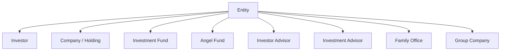
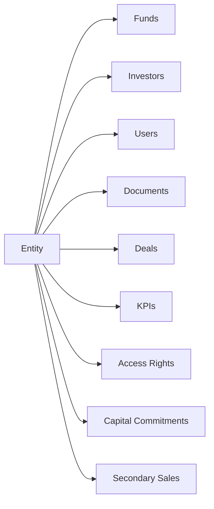

# Entities User Guide

An **entity** is the foundational record in CapHive. Every fund, investor, portfolio company, and advisory firm is represented as an entity. This guide explains the entity types, how to create and configure one, how entities nest into a hierarchy, and the settings that control features, integrations, and the financial year.

> **Where to find it:** Company menu (the **house icon** at the top right, tooltip "Company menu") → **Company Profile / Account Settings** → **Edit** updates your own entity. Creating entities, changing type, features, parent, financial year and integrations is done by CapHive support in the Admin panel ([**Admin → Entities**](/admin/entities)). Editing needs the company admin role.

It's written for administrators setting up and managing organisations on the platform.

---

## Table of Contents

1. [What an Entity Is](#what-an-entity-is)
2. [Entity Types](#entity-types)
3. [Entity Hierarchy](#entity-hierarchy)
4. [Creating an Entity](#creating-an-entity)
5. [Entity Settings](#entity-settings)
6. [Turning Features On and Off](#turning-features-on-and-off)
7. [Financial Year](#financial-year)
8. [E-Sign Provider](#e-sign-provider)
9. [WhatsApp Integration](#whatsapp-integration)
10. [Tracking Currency](#tracking-currency)
11. [Investor Categories](#investor-categories)
12. [Disabling an Entity](#disabling-an-entity)
13. [How Entities Keep Data Separate](#how-entities-keep-data-separate)
14. [Worked Example](#worked-example)
15. [Frequently Asked Questions](#frequently-asked-questions)
16. [Related Guides](#related-guides)

---

## What an Entity Is

Think of an entity as one organisation's "container" in CapHive. It owns that organisation's documents, users, permissions, and financial records, and keeps them separate from every other organisation on the platform. A fund is an entity; so is each investor, each portfolio company, and each advisory firm.

| Term | Meaning |
|------|---------|
| **Entity** | Any organisation in the system — a fund, investor, company, or advisor. |
| **Entity Type** | The classification that decides which features and workflows apply. |
| **Entity Settings** | The configuration attached to an entity (email, integrations, financial year…). |
| **Parent Entity** | A containing entity in a hierarchy (e.g. a management company over its funds). |
| **Permissions** | The set of features switched on for the entity. |

---

## Entity Types

CapHive supports nine entity types. The type determines what setup happens automatically and which features become available.

| Entity Type | Typical use |
|-------------|-------------|
| **Investor** | An LP or investment participant (created automatically when you add an investor). |
| **Investor Advisor** | A third party representing investors. |
| **Company** | A startup or portfolio company. |
| **Holding** | An intermediate holding vehicle. |
| **Investment Advisor** | A regulated investment advisor. |
| **Family Office** | A private family investment office. |
| **Investment Fund** | A closed- or open-ended fund (AIF, VC fund). |
| **Angel Fund** | An angel investment syndicate. |
| **Group Company** | A subsidiary or sister company in a group. |

> **Investment Fund** and **Angel Fund** unlock the full fund-management toolkit (commitments, distributions, fund units, ratios). **Company** and **Holding** unlock portfolio and KPI tracking.

---

## Entity Hierarchy

Entities can be nested using the **Parent Entity** field — useful for grouping related funds under a management company, or representing a holding structure where one entity owns others. Removing a parent entity also removes its children, so restructure with care.

---

## Creating an Entity

New fund and company entities are created by CapHive support in the Admin panel ([**Admin → Entities**](/admin/entities) → **New entity**), which only CapHive super-admin and support users can open. Company admins cannot create entities; they edit their own from Company menu → **Company Profile** → **Edit**. (Investor entities are created automatically when you add a stakeholder, and Investor Advisor entities when you add an advisor.)

**Required:**

| Field | Notes |
|-------|-------|
| **Name** | Unique per primary email. |
| **Entity Type** | Determines available features. |
| **Primary Email** | The main contact email. |
| **Currency** | The base currency for all financial amounts (defaults to INR). |

**Optional but useful:**

| Field | Notes |
|-------|-------|
| **PAN / Tax ID** | Must be unique if provided. |
| **Parent Entity** | For grouping into a hierarchy. |
| **Sub Domain** | A URL-friendly name, auto-generated but editable. |
| **Logo** | Shown in reports and the investor portal. |
| **Investor Categories** | Your own category labels. |
| **Instrument Types** | The investment instruments this entity allows. |

On save, the system sets up the entity automatically — creating its root document folder and attaching a settings record. (Staff accounts are re-aligned to the entity type only when the type is later changed.)

---

## Entity Settings

Each entity has one **Settings** record. Company admins change the everyday options on Company menu → **Company Profile** → **Edit**:

| Setting | What it controls |
|---------|------------------|
| **Mailbox** | The incoming mailbox for the email add-in. |
| **KYC document lists / Document-First KYC Wizard** | The documents expected for Individual and Non-Individual KYCs, and the AI upload-first KYC screen (KYC on). |
| **KPI Document List** | The KPI document types expected from portfolio companies (KPIs on). |
| **Sandbox / Sandbox Emails / cc / Sandbox Numbers** | When on, redirects email and WhatsApp notifications to the sandbox addresses and numbers (for testing). |
| **Document Colors** | Brand colours for generated documents. |
| **Send weekly task digest** | The weekly tasks summary email. |
| **Open-ended fund wording** | Investment Fund entities only: whether investors hold **Units** or **Shares**, and your own word for terms such as Folio, Dealing date, Contract note or Exit load, used on your open-ended funds' screens, emails and confirmations. A blank field keeps the default shown in it. See the [Evergreen Funds guide](evergreen_funds_user_guide). |
| **AI client integration** | Settings for connecting AI clients, where offered. |

Features, entity type, parent entity, financial-year offset, e-sign provider and WhatsApp credentials are not on this page; CapHive support changes them in the Admin panel.

---

## Turning Features On and Off

Each entity has a set of **feature permissions** that switch whole modules on or off. Enabling a feature makes its module visible and usable; disabling it hides the module without deleting any data.

| Feature | What it enables |
|---------|-----------------|
| **Documents** | Document management and sharing. |
| **Funds** | Capital calls, commitments, distributions. |
| **Fund Units** | Fund unit tracking. |
| **KYC** | The KYC workflow. |
| **Approvals** | Approval workflows. |
| **Investments** | Portfolio investment tracking. |
| **Cap Table** | Cap table management. |
| **Secondary Sale** | The secondary sales marketplace. |
| **KPIs** | KPI reporting. |
| **Investment Opportunities** | Deal/opportunity management. |
| **Deals** | The deal pipeline (also turns on kanban boards). |
| **CKYC / KRA** | Identity-verification integrations. |

> When you add an investor to a fund, the fund's enabled features are automatically extended to that investor's entity, so the two work together.

---

## Financial Year

The financial year start is controlled by a **financial-year offset** in settings, set by CapHive support in the Admin panel:

- Offset of **3** → financial year starts **1 April** (the default, standard Indian FY; US deployments default to 0).
- Offset of **0** → financial year starts **1 January** (calendar year).

This start date is used throughout reports, KPI periods, and fund performance calculations, so set it to match how the entity actually reports.

---

## E-Sign Provider

CapHive support configures the **E-Sign Provider** in the entity's settings in the Admin panel:

| Provider | Notes |
|----------|-------|
| **Digio** (default) | Requires the Digio client credentials. |
| **Other** | Set the provider name and its credentials. |

See the [E-Signing guide](esigning_user_guide) for the full signing workflow.

---

## WhatsApp Integration

In the entity's settings (Admin panel, set by CapHive support), provide the WhatsApp endpoint, access token, and a map of message template names. If you leave the entity-level credentials blank, the platform's global WhatsApp configuration is used instead.

---

## Tracking Currency

A **tracking currency** restates the entity's financial amounts into a second reporting currency — for example, an INR fund maintaining USD copies of committed, collected, and distributed amounts. Rates are looked up for each transaction's date. See the [Tracking Currency guide](tracking_currency_guide).

---

## Investor Categories

You can tailor the list of investor categories for your entity (e.g. `HNI, Family Office, Corporate, Trust`). **Prospective** is always added, and fund-type entities also include a **Portfolio Company** category automatically. Set yours as a comma-separated list in **Investor Categories** on Company menu → **Company Profile** → **Edit**; the field is shown only for Company, Investment Fund and Angel Fund entities.

---

## Disabling an Entity

Only CapHive support can deactivate an entity: on the entity profile they click **Deactivate**, tick the confirmation box in the modal and confirm. Company admins never see this button. Deactivating:

1. Marks it inactive.
2. In a background job, deactivates all staff accounts linked to it, blocking their logins.
3. Un-approves every investor access the entity granted, so investors stop seeing its data and receive no further emails.
4. Preserves all data — nothing is deleted. The support user is alerted with the counts when the job finishes.

Re-enabling the entity does **not** automatically reactivate staff or re-approve investor accesses; reactivate or re-approve each one manually.

---

## How Entities Keep Data Separate

Every major record belongs to an entity, which gives the platform its multi-tenancy: one entity's investors, funds, documents, and users are fully isolated from another's.

When you log in, your session is bound to your entity. You see another entity's data only through explicit access rights or investor access.

---

## Worked Example

Setting up a new VC fund that reports on a calendar year and signs documents via Digio:

1. **Ask CapHive support to create the entity** in the Admin panel ([**Admin → Entities**](/admin/entities) → **New entity**): name "Helios Ventures Fund II", type **Investment Fund**, currency **USD**, primary email set.
2. Optionally ask them to set **Helios Management Co.** as the **parent entity** to group it with the firm's other funds.
3. Ask support to set the **financial-year offset to 0** so the FY runs January–December.
4. Ask support to confirm the **Funds**, **KYC**, **Documents**, and **Approvals** features are enabled.
5. Ask support to set the **E-Sign Provider** to **Digio** with the credentials.
6. Add the fund's first investor — an Investor entity is created automatically, and the fund's enabled features extend to it so calls and distributions work end to end.

---

## Frequently Asked Questions

### Navigation and getting there

**Where do I see my own entity's profile?**
Click the **house icon** at the top right (tooltip "Company menu") to open the Company menu, then **Company Profile / Account Settings**, which opens your entity's page. The page shows the logo, Tax ID, primary email and type, plus the configured AI and integration settings.

**Where do I edit my entity's details?**
Company menu → **Company Profile** → **Edit**. The **Edit** button only appears for company admins of that entity (and CapHive support).

**Where are entity types, features, parent entity, financial year and e-sign settings changed?**
In the CapHive Admin panel under [**Admin → Entities**](/admin/entities), reached from Sidebar → [**Admin**](/admin). Only CapHive super-admin and support users can open it, so fund-manager admins ask support to change these. See [Entity Settings](#entity-settings).

**Where do I manage my entity's users, advisors and forms?**
All from the Company menu: [**User / Company Employees**](/users), [**Advisors / External Company Advisors**](/investor_advisors), [**Customize Forms**](/form_types) and [**Exchange Rates**](/exchange_rates). See the [User and Role Management guide](user_role_management_user_guide).

**Where do I see the entities I have invested in, as an investor?**
Investor logins use Sidebar → [**Investments**](/entities/investor_entities), which lists every fund or company entity that has you as a stakeholder.

### Creating, updating and managing entities

**How do I create a new entity?**
Fund-manager users do not create entities directly; CapHive support creates fund and company entities in the Admin panel ([**Admin → Entities**](/admin/entities), **New entity**). Investor entities are created automatically when you add a stakeholder, and Investor Advisor entities when you add an advisor. See [Creating an Entity](#creating-an-entity).

**What can a company admin change on the Edit page?**
**Name**, **Pan** (Tax ID), **Primary Email**, **Industry**, **Url**, **Details**, the logo, the incoming **Mailbox**, **Sandbox** settings (sandbox emails, cc, sandbox numbers) and **Document Colors**. Depending on your setup it also shows KYC document lists and the Document-First KYC Wizard (KYC on), KPI document list (KPIs on), **Investor Categories** (companies and funds), **Currency** (companies) and AI client integration.

**How do I change my investor categories?**
Company menu → **Company Profile** → **Edit**, enter a comma-separated list in **Investor Categories** and **Save**. The field shows for Company, Investment Fund and Angel Fund entities; **Prospective** is always added, and funds also get **Portfolio Company**. See [Investor Categories](#investor-categories).

**How do I turn a feature (Funds, KYC, Deals…) on or off?**
Features are the entity's permissions, set by CapHive support in the Admin panel. Ask support which modules you need; each of your users must also have the matching feature enabled on their user record before the menu appears. See [Turning Features On and Off](#turning-features-on-and-off).

**How do I change the financial year, e-sign provider or WhatsApp settings?**
These are entity settings edited by CapHive support in the Admin panel. Tell support the start month you report on, or the provider and credentials to use. See [Financial Year](#financial-year) and [E-Sign Provider](#e-sign-provider).

**How do I deactivate an entity?**
Only CapHive support can: they open the entity profile, click **Deactivate**, tick the confirmation box in the modal and confirm. Company admins never see this button. See [Disabling an Entity](#disabling-an-entity).

**How do I merge two duplicate investor entities?**
CapHive support can merge investor entities on the [merge entities page](/entities/merge); it repoints stakeholder records, Stakeholder User records and user logins from the old entity to the retained one and renames the old one "(Defunct)". It cannot be undone from the screens. Company admins should raise a support request, or merge the duplicate stakeholders themselves as described in the [Investors guide](investors_user_guide).

**How do I take a database dump of my entity?**
If DB dumps are enabled in your settings, company admins see **Generate DB Dump** on the entity profile. It starts a background job and you are notified when the file is ready.

### Why entities matter

**Why is everything built around entities?**
The entity is the tenant boundary: every fund, stakeholder, document, user and access right belongs to one, which keeps each organisation's data invisible to every other. Features, currency, financial year and branding are all set once per entity and apply to everything inside it. See [How Entities Keep Data Separate](#how-entities-keep-data-separate).

**Why does the entity type matter?**
It decides which workflows and screens apply: Investment Fund and Angel Fund entities get the fund sidebar (commitments, calls, distributions, units), Company entities get cap table, KPIs and investments, and Investor or Investor Advisor entities get the investor portal. See [Entity Types](#entity-types).

**What goes wrong if the financial year or currency is set incorrectly?**
Reports, KPI periods and fund performance figures are computed from the financial-year start, and money fields default to the entity currency (INR if unset). A wrong setting gives quarter and year totals that do not match your books, so confirm both before loading data.

**Who typically manages entity settings?**
Company admins keep the profile, logo, mailbox and investor categories current. CapHive support handles entity type, features, parent entity, financial year, integrations and deactivation.

### What happens when I …

**What happens when I save changes on the Edit page?**
The entity is updated immediately and you return to the profile. Investor categories and instrument types are cleaned of stray spaces, and a website URL without `http` gets it added. No one is notified.

**What happens when an entity is created?**
A root document folder is created, a settings record is attached, the currency defaults to INR and a unique sub-domain is generated if none is given. For investor entities, the enabled features of the fund that added them are copied on.

**What happens when the entity type is changed?**
The setup routine runs again and every employee's recorded entity type is updated to match. Existing data is kept, but screens for features the new type does not use stop appearing.

**What happens when an entity is deactivated?**
In the background, every active user of the entity is made inactive (they can no longer sign in) and every investor access the entity granted is un-approved, so investors stop seeing its data and receive no further emails. No data is deleted, and support is alerted with the counts when it finishes.

**What happens when a deactivated entity is re-activated?**
Only the entity is switched back on. Users stay inactive and investor accesses stay un-approved; each must be re-enabled or re-approved by hand.

**What happens when I change the open-ended fund wording?**
Every open-ended fund of the entity uses the new words from the next page or email — for your team and your investors — unless a fund has chosen its own unit word in its settings. Figures do not change, and documents already generated keep the words they were made with.

**What happens when a feature is switched off?**
Its menus and screens are hidden for the entity, but no records are deleted. Switching it back on brings the same data back.

**What happens if an entity with children is deleted?**
Child entities are deleted with their parent, together with everything they own (funds, stakeholders, documents, users). There is no delete button in the normal screens; only CapHive support can do it, so restructure the hierarchy before removing a parent.

### Troubleshooting and edge cases

**Can I change the entity type after creation?**
Yes, through CapHive support in the Admin panel. The setup routine re-runs and may add default structures; existing data is preserved, though some features may become unavailable if the new type does not support them.

**Why is an Investor entity created automatically when I add an investor?**
Every investor needs their own container for documents, users, and permissions. The system first checks for an existing entity by email and tax ID before creating a new one.

**Can two entities share a name?**
Not with the same primary email: the name must be unique per primary email. The Tax ID (PAN) must also be unique across all entities when it is filled in.

**What happens if I enable a feature partway through operations?**
The module becomes visible and usable immediately; existing data is unaffected. Disabling later hides it without deleting data.

**How do I switch an entity to a January–December financial year?**
Ask CapHive support to set the financial-year offset to 0 in the entity's settings. An offset of 3 (the default) starts the year on 1 April.

**Can an entity and all its data be permanently deleted?**
Only by CapHive support, and it is irreversible: it cascades through every related record, including child entities. Contact support before doing this.

**I cannot see the Edit button on the Company Profile page.**
Editing needs the company admin role in that entity. Investor advisors acting for an investor cannot edit the entity even if they hold an admin role elsewhere.

**Saving fails with "FI code is required to enable CKYC".**
CKYC or KRA is switched on for the entity but no FI code is set in its settings. Ask CapHive support to add the FI code or switch the integration off.

**A feature is enabled for the entity but my colleague still cannot see its menu.**
Menus also depend on the user's own feature toggles (for example *Investors*, *Funds*, *KYCs*). A company admin enables them on the user's **Edit** page under Company menu → **User / Company Employees**.

**Emails are going to test addresses instead of investors.**
**Sandbox** is ticked on the entity's Edit page, which redirects all notifications to the **Sandbox Emails** and **Sandbox Numbers**. Untick it before going live.

## Related Guides

- [Investors (Stakeholders)](investors_user_guide) — adding a stakeholder creates its investor entity.
- [User and Role Management](user_role_management_user_guide) — users, roles and per-user feature toggles inside an entity.
- [Investor Advisor](investor_advisor_user_guide) — advisors get their own Investor Advisor entity.
- [Tracking Currency](tracking_currency_guide) — restating amounts into a second reporting currency.
- [E-Signing](esigning_user_guide) — the e-sign provider configured on the entity.
- [Custom Fields](custom_fields_user_guide) — form types owned by the entity.
- [Reset Access Rights Cache](reset_access_rights_cache_user_guide) — what to do when access looks stale after entity changes.
