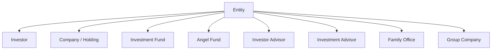
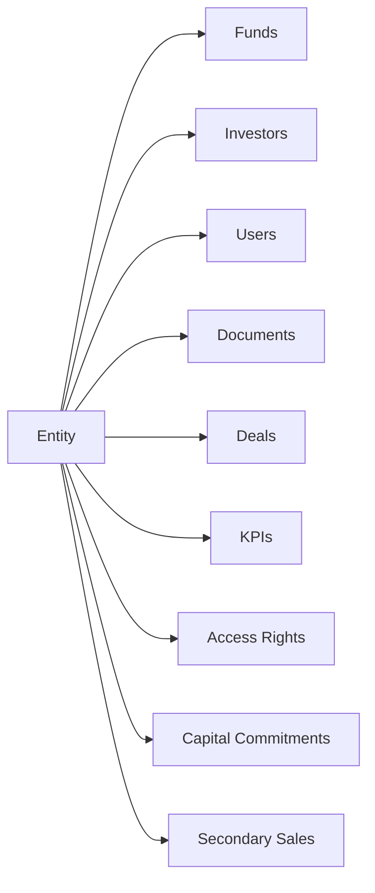

# Entities User Guide

An **entity** is the foundational record in CapHive. Every fund, investor, portfolio company, and advisory firm is represented as an entity. This guide explains the entity types, how to create and configure one, how entities nest into a hierarchy, and the settings that control features, integrations, and the financial year.

It's written for administrators setting up and managing organisations on the platform.

---

## Table of Contents

1. [What an Entity Is](#what-an-entity-is)
2. [Entity Types](#entity-types)
3. [Entity Hierarchy](#entity-hierarchy)
4. [Creating an Entity](#creating-an-entity)
5. [Entity Settings](#entity-settings)
6. [Turning Features On and Off](#turning-features-on-and-off)
7. [Financial Year](#financial-year)
8. [E-Sign Provider](#e-sign-provider)
9. [WhatsApp Integration](#whatsapp-integration)
10. [Tracking Currency](#tracking-currency)
11. [Investor Categories](#investor-categories)
12. [Disabling an Entity](#disabling-an-entity)
13. [How Entities Keep Data Separate](#how-entities-keep-data-separate)
14. [Worked Example](#worked-example)
15. [Frequently Asked Questions](#frequently-asked-questions)

---

## What an Entity Is

Think of an entity as one organisation's "container" in CapHive. It owns that organisation's documents, users, permissions, and financial records, and keeps them separate from every other organisation on the platform. A fund is an entity; so is each investor, each portfolio company, and each advisory firm.

| Term | Meaning |
|------|---------|
| **Entity** | Any organisation in the system — a fund, investor, company, or advisor. |
| **Entity Type** | The classification that decides which features and workflows apply. |
| **Entity Settings** | The configuration attached to an entity (email, integrations, financial year…). |
| **Parent Entity** | A containing entity in a hierarchy (e.g. a management company over its funds). |
| **Permissions** | The set of features switched on for the entity. |

---

## Entity Types

CapHive supports nine entity types. The type determines what setup happens automatically and which features become available.

| Entity Type | Typical use |
|-------------|-------------|
| **Investor** | An LP or investment participant (created automatically when you add an investor). |
| **Investor Advisor** | A third party representing investors. |
| **Company** | A startup or portfolio company. |
| **Holding** | An intermediate holding vehicle. |
| **Investment Advisor** | A regulated investment advisor. |
| **Family Office** | A private family investment office. |
| **Investment Fund** | A closed- or open-ended fund (AIF, VC fund). |
| **Angel Fund** | An angel investment syndicate. |
| **Group Company** | A subsidiary or sister company in a group. |

> **Investment Fund** and **Angel Fund** unlock the full fund-management toolkit (commitments, distributions, fund units, ratios). **Company** and **Holding** unlock portfolio and KPI tracking.

---

## Entity Hierarchy

Entities can be nested using the **Parent Entity** field — useful for grouping related funds under a management company, or representing a holding structure where one entity owns others. Removing a parent entity also removes its children, so restructure with care.

---

## Creating an Entity

Go to **Admin → Entities → New**. (Entities are also created automatically when you add a new investor or fund.)

**Required:**

| Field | Notes |
|-------|-------|
| **Name** | Unique per primary email. |
| **Entity Type** | Determines available features. |
| **Primary Email** | The main contact email. |
| **Currency** | The base currency for all financial amounts (defaults to INR). |

**Optional but useful:**

| Field | Notes |
|-------|-------|
| **PAN / Tax ID** | Must be unique if provided. |
| **Parent Entity** | For grouping into a hierarchy. |
| **Sub Domain** | A URL-friendly name, auto-generated but editable. |
| **Logo** | Shown in reports and the investor portal. |
| **Investor Categories** | Your own category labels. |
| **Instrument Types** | The investment instruments this entity allows. |

On save, the system sets up the entity automatically — creating its document folder, default deal-board columns, and aligning staff accounts to the entity type.

---

## Entity Settings

Each entity has one **Settings** record, reached via **Admin → Entities → [Entity] → Edit Settings**. Key options:

| Setting | What it controls |
|---------|------------------|
| **From Email** | The sender address for outbound notifications. |
| **Mailbox** | The incoming mailbox for the email add-in. |
| **Backup Frequency / Retention** | How often database backups run and how long they're kept. |
| **Sandbox** | When on, suppresses real WhatsApp and email sends (for testing). |
| **Document Colours** | Brand colours for generated documents. |
| **KPI Document List** | The KPI document types expected from portfolio companies. |
| **Deal Board Columns** | The default stages for deal and kanban boards. |

---

## Turning Features On and Off

Each entity has a set of **feature permissions** that switch whole modules on or off. Enabling a feature makes its module visible and usable; disabling it hides the module without deleting any data.

| Feature | What it enables |
|---------|-----------------|
| **Documents** | Document management and sharing. |
| **Funds** | Capital calls, commitments, distributions. |
| **Fund Units** | Fund unit tracking. |
| **KYC** | The KYC workflow. |
| **Approvals** | Approval workflows. |
| **Investments** | Portfolio investment tracking. |
| **Cap Table** | Cap table management. |
| **Secondary Sale** | The secondary sales marketplace. |
| **KPIs** | KPI reporting. |
| **Investment Opportunities** | Deal/opportunity management. |
| **Deals** | The deal pipeline (also turns on kanban boards). |
| **CKYC / KRA** | Identity-verification integrations. |

> When you add an investor to a fund, the fund's enabled features are automatically extended to that investor's entity, so the two work together.

---

## Financial Year

The financial year start is controlled by a **financial-year offset** in settings:

- Offset of **3** → financial year starts **1 April** (the default, standard Indian FY).
- Offset of **0** → financial year starts **1 January** (calendar year).

This start date is used throughout reports, KPI periods, and fund performance calculations, so set it to match how the entity actually reports.

---

## E-Sign Provider

Configure under **Settings → E-Sign Provider**:

| Provider | Notes |
|----------|-------|
| **Digio** (default) | Requires the Digio client credentials. |
| **Other** | Set the provider name and its credentials. |

See the [E-Signing guide](esigning_user_guide) for the full signing workflow.

---

## WhatsApp Integration

Under **Settings**, provide the WhatsApp endpoint, access token, and a map of message template names. If you leave the entity-level credentials blank, the platform's global WhatsApp configuration is used instead.

---

## Tracking Currency

A **tracking currency** restates the entity's financial amounts into a second reporting currency — for example, an INR fund maintaining USD copies of committed, collected, and distributed amounts. Rates are looked up for each transaction's date. See the [Tracking Currency guide](tracking_currency_guide).

---

## Investor Categories

You can tailor the list of investor categories for your entity (e.g. `HNI, Family Office, Corporate, Trust`). Fund-type entities also include a **Portfolio Company** category automatically. Set yours as a comma-separated list under **Entity → Investor Categories**.

---

## Disabling an Entity

Setting an entity to **disabled**:

1. Marks it inactive.
2. Deactivates all staff accounts linked to it, blocking their logins.
3. Preserves all data — nothing is deleted.

Re-enabling the entity does **not** automatically reactivate staff; reactivate each user manually.

---

## How Entities Keep Data Separate

Every major record belongs to an entity, which gives the platform its multi-tenancy: one entity's investors, funds, documents, and users are fully isolated from another's.

When you log in, your session is bound to your entity. You see another entity's data only through explicit access rights or investor access.

---

## Worked Example

Setting up a new VC fund that reports on a calendar year and signs documents via Digio:

1. **Admin → Entities → New.** Name "Helios Ventures Fund II", type **Investment Fund**, currency **USD**, primary email set.
2. Optionally set **Helios Management Co.** as the **parent entity** to group it with the firm's other funds.
3. In **Settings**, set the **financial-year offset to 0** so the FY runs January–December.
4. Confirm the **Funds**, **KYC**, **Documents**, and **Approvals** features are enabled.
5. Under **E-Sign Provider**, choose **Digio** and enter the credentials.
6. Add the fund's first investor — an Investor entity is created automatically, and the fund's enabled features extend to it so calls and distributions work end to end.

---

## Frequently Asked Questions

**Can I change the entity type after creation?**
Yes. The setup routine re-runs and may add or adjust default structures. Existing data is preserved, though some features may become unavailable if the new type doesn't support them.

**Why is an Investor entity created automatically when I add an investor?**
Every investor needs their own container for documents, users, and permissions. The system first checks for an existing entity by email and tax ID before creating a new one.

**Can two entities share a name?**
No — names must be unique per primary email.

**What happens if I enable a feature partway through operations?**
The module becomes visible and usable immediately; existing data is unaffected. Disabling later hides it without deleting data.

**How do I switch an entity to a January–December financial year?**
Set the financial-year offset to 0 in Settings.

**Can an entity and all its data be permanently deleted?**
Yes, but it's irreversible and cascades through every related record. Contact your system administrator before doing this.
