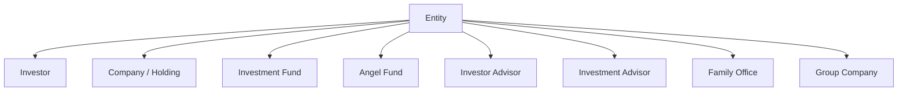

# Entities User Guide

An Entity is the foundational record in CapHive. Every fund, investor, portfolio company, and organisation in the system is represented as an entity. This guide explains the entity types, how to create and configure entities, the parent/child hierarchy, and the EntitySetting options that control feature flags, integrations, and financial year configuration.

---

## Table of Contents

1. [Key Concepts](#key-concepts)
2. [Entity Types](#entity-types)
3. [Entity Hierarchy](#entity-hierarchy)
4. [Creating an Entity](#creating-an-entity)
5. [Entity Settings](#entity-settings)
6. [Feature Permissions](#feature-permissions)
7. [Financial Year Configuration](#financial-year-configuration)
8. [E-Sign Provider](#e-sign-provider)
9. [WhatsApp Integration](#whatsapp-integration)
10. [Tracking Currency](#tracking-currency)
11. [Investor Categories](#investor-categories)
12. [Disabling an Entity](#disabling-an-entity)
13. [How Entities Underpin the Platform](#how-entities-underpin-the-platform)
14. [Key Fields Reference](#key-fields-reference)
15. [Frequently Asked Questions](#frequently-asked-questions)

---

## Key Concepts

| Term | Meaning |
|---|---|
| **Entity** | Any organisational participant: a fund, investor, company, or advisory firm |
| **Entity Type** | Classification that determines which features and workflows apply |
| **Entity Setting** | Extended configuration record attached 1:1 to each entity |
| **Parent Entity** | A containing entity in the hierarchy (e.g. a group holding company) |
| **Sub Domain** | URL-friendly identifier auto-generated from the entity name |
| **Permissions** | Bitflag controlling which feature packs are enabled for this entity |

---

## Entity Types

CapHive supports nine entity types. The type determines the post-creation setup routine (`SetupCompany`) and which features are available.

| Entity Type | Typical Use |
|---|---|
| **Investor** | An LP or investment participant (auto-created when you add an investor) |
| **Investor Advisor** | A third-party advisor representing investors |
| **Company** | A startup or portfolio company |
| **Holding** | An intermediate holding vehicle |
| **Investment Advisor** | A SEBI-registered or regulatory investment advisor |
| **Family Office** | A private family investment office |
| **Investment Fund** | A closed-ended or open-ended investment fund (AIF, VC fund) |
| **Angel Fund** | An angel investment syndicate |
| **Group Company** | A subsidiary or sister company in a corporate group |



> **Note:** "Investment Fund" and "Angel Fund" types expose the full fund management pack (capital commitments, distributions, fund units, ratios). "Company" and "Holding" expose portfolio and KPI tracking.

---

## Entity Hierarchy

Entities can be nested using the **Parent Entity** field. This is useful for:
- Grouping related funds under a management company entity
- Representing a holding structure where one entity owns sub-entities

Destroying a parent entity cascades and destroys all child entities. Use the `nuclear_destroy` method (admin only) for a full teardown including all related financial records.

---

## Creating an Entity

Navigate to **Admin → Entities → New** or entities are created automatically when you add a new investor or fund.

Required fields:

| Field | Notes |
|---|---|
| **Name** | Unique per primary email. Max 255 characters |
| **Entity Type** | Determines available features |
| **Primary Email** | Required for new entities |
| **Currency** | Defaults to INR. Used as the base currency for all financial amounts |

Optional but important:

| Field | Notes |
|---|---|
| **PAN** | Tax identification. Must be globally unique if provided |
| **Parent Entity** | For hierarchical grouping |
| **Sub Domain** | Auto-generated but can be customised |
| **Logo** | Uploaded image shown in reports and investor portal |
| **Investor Categories** | Comma-separated list of custom investor categories |
| **Instrument Types** | Comma-separated list of allowed investment instruments |

On save, `SetupCompany` runs post-processing to:
- Create the root document folder
- Set up default kanban board steps
- Propagate entity type to all employee user records

---

## Entity Settings

Each entity has exactly one **EntitySetting** record. Settings are loaded on-demand (not on every request) to keep the Entity model lean.

Access settings via **Admin → Entities → [Entity] → Edit Settings**.

### Key Settings

| Setting | Description |
|---|---|
| **From Email** | Sender email used for outbound notifications |
| **Mailbox** | Incoming email mailbox identifier for Outlook add-in |
| **DB Dumps Frequency** | How often database backups are taken (daily / weekly / monthly / interval / custom_days / adhoc) |
| **DB Dumps Retention Period** | Number of days to retain backups |
| **Sandbox** | When enabled, suppresses real WhatsApp and email sends (used in development/staging) |
| **Document Colors** | JSON configuration of custom brand colours for generated documents |
| **KPI Doc List** | Array of KPI document types expected from portfolio companies |
| **Kanban Steps** | Default column names for Deal and KanbanBoard boards |

---

## Feature Permissions

Permissions are stored as a bitflag on the Entity and control which packs are active. Enabling a permission on a fund entity typically also needs to be enabled on the investor entities that participate.

Common permissions (set automatically or via admin):

| Permission | What it enables |
|---|---|
| `enable_documents` | Document management and sharing |
| `enable_funds` | Fund management (capital calls, commitments, distributions) |
| `enable_units` | Fund unit tracking |
| `enable_kycs` | KYC workflow |
| `enable_approvals` | Approval workflows |
| `enable_investments` | Portfolio investment tracking |
| `enable_captable` | Cap table management |
| `enable_secondary_sale` | Secondary sales marketplace |
| `enable_kpis` | KPI reporting |
| `enable_inv_opportunities` | Investment opportunity management |
| `enable_deals` | Deal pipeline (also enables kanban automatically) |
| `enable_kanban` | Kanban boards |
| `enable_ckyc` | CKYC identity verification |
| `enable_kra` | KRA identity verification |

When you add a new investor to a fund entity, the fund's permissions are automatically propagated to the investor's entity.

---

## Financial Year Configuration

The financial year start is derived from **Month Offset for FY** in Entity Settings.

```
FY Start = April 1 (when month_offset_for_fy = 3)
         = January 1 (when month_offset_for_fy = 0)
```

The default is 3 (April start, standard Indian financial year). Change this for entities operating on a calendar year or other fiscal cycle.

The `start_of_financial_year_date` helper is used throughout reports, KPI periods, and fund performance calculations.

---

## E-Sign Provider

Configure under **Entity Settings → E-Sign Provider**.

| Provider | Notes |
|---|---|
| **Digio** (default) | Requires `digio_client_id` and `digio_client_secret` |
| **Other** | Set `esign_provider` to the provider name; configure credentials accordingly |

The Digio auth token is auto-generated as a Base64-encoded `client_id:client_secret` string. See the E-Signing guide for the full workflow.

---

## WhatsApp Integration

Configure under **Entity Settings** with:
- **WhatsApp Endpoint** — API endpoint URL
- **WhatsApp Token** — Bearer token
- **WhatsApp Templates** — JSON map of template names to template IDs

If entity-level credentials are blank, the system falls back to the global `WHATSAPP_API_ENDPOINT` and `WHATSAPP_ACCESS_TOKEN` environment variables.

---

## Tracking Currency

A **Tracking Currency** (set on the entity) restates all financial amounts into a secondary reporting currency. For example, an INR fund with USD tracking will maintain USD-denominated copies of committed, collected, and distribution amounts.

Exchange rates are looked up for the tracking currency on each transaction date. See the Tracking Currency guide for details.

---

## Investor Categories

You can customise the investor category list for your entity. Default categories come from the `INVESTOR_CATEGORIES` environment variable plus `Prospective`. Fund-type entities (`Investment Fund`, `Angel Fund`) also get `Portfolio Company`.

Set custom categories in **Entity → Investor Categories** as a comma-separated list (e.g. `HNI,Family Office,Corporate,Trust`).

---

## Disabling an Entity

Setting **Enabled = false** on an entity:
1. Marks the entity as inactive
2. Automatically deactivates all employee user accounts linked to the entity (sets `active = false`)
3. Prevents new logins for those users

Re-enabling the entity does **not** automatically reactivate employees — you must manually reactivate each user.

Disabling does not delete any data. All financial records, documents, and history are preserved.

---

## How Entities Underpin the Platform

Every major record in CapHive has an `entity_id` that scopes it to its owning entity. This provides multi-tenancy: investors, funds, documents, and users of one entity are completely isolated from another.

```mermaid
graph LR
    Entity --> Funds
    Entity --> Investors
    Entity --> Users
    Entity --> Documents
    Entity --> Deals
    Entity --> KPIs
    Entity --> AccessRights
    Entity --> CapitalCommitments
    Entity --> SecondaryS ales
```

When you log in, your session is bound to your user's entity. Access to other entities is granted only via explicit access rights or investor access records.

---

## Key Fields Reference

| Field | Type | Description |
|---|---|---|
| `name` | String | Display name (unique per primary_email) |
| `entity_type` | String | One of the 9 types above |
| `primary_email` | String | Contact/billing email |
| `currency` | String | Base currency (ISO 4217, e.g. INR, USD) |
| `pan` | String | Tax identifier (globally unique) |
| `parent_entity_id` | Integer | Parent entity for hierarchy |
| `sub_domain` | String | URL slug |
| `enabled` | Boolean | Whether entity is active |
| `permissions` | Bitfield | Feature flags (see Feature Permissions) |
| `investor_categories` | String | Comma-separated custom categories |
| `instrument_types` | String | Comma-separated instrument types |
| `funding_units` | String | Lakhs or Crores (for Indian display) |

---

## Frequently Asked Questions

**Q: Can I change the entity type after creation?**
Yes. Changing the type re-runs `SetupCompany` which may create or modify default structures. All existing data is preserved, but some features may become unavailable if the new type does not support them.

**Q: Why is an Investor entity auto-created when I add an investor?**
Every investor in the system needs their own entity so they can have their own document folder, user accounts, and permissions. The system checks for an existing entity by email and PAN before creating a new one.

**Q: Can two entities have the same name?**
No — names must be unique per primary email. If you attempt to create a duplicate, the system will return a validation error.

**Q: What happens if I enable a feature permission mid-way through operations?**
Enabling a permission makes the relevant module visible and functional. Existing data is not affected. Disabling a permission hides the module but does not delete data.

**Q: How do I configure the entity for a different financial year (e.g. January–December)?**
In Entity Settings, set **Month Offset for FY** to `0`. This makes January 1 the start of the financial year.

**Q: Is there a way to completely delete an entity and all its data?**
Yes, via the `nuclear_destroy` admin method, which cascades through all associations. This is irreversible. Contact your system administrator before proceeding.
