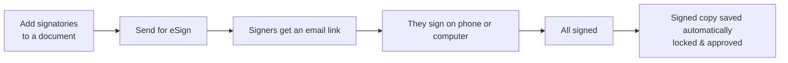

# E-Signing User Guide

This guide walks you through requesting, tracking, and completing electronic signatures on documents in CapHive. No technical knowledge required.

---

## Table of Contents

1. [What is E-Signing?](#what-is-e-signing)
2. [Before You Begin](#before-you-begin)
3. [Setting Up Signatories on a Document](#setting-up-signatories-on-a-document)
4. [Sending a Document for Signature](#sending-a-document-for-signature)
5. [Sending All Documents at Once](#sending-all-documents-at-once)
6. [Tracking Signing Progress](#tracking-signing-progress)
7. [What Signers Experience](#what-signers-experience)
8. [When Signing is Complete](#when-signing-is-complete)
9. [Cancelling a Signature Request](#cancelling-a-signature-request)
10. [Resending After a Failure or Expiry](#resending-after-a-failure-or-expiry)
11. [Status Meanings](#status-meanings)
12. [Worked Example](#worked-example)
13. [Frequently Asked Questions](#frequently-asked-questions)

---

## What is E-Signing?

E-signing lets you send documents — such as subscription agreements, KYC forms, or offer letters — directly to investors and fund staff for legally binding electronic signatures. Signers receive an email with a link and sign from their phone or computer. Once everyone has signed, CapHive automatically saves a final signed copy to the investor's file.

---

## Before You Begin

To use e-signing you need:

- The document must be **generated** (not just a template) and **approved**.
- At least one **signatory** (signer) must be added to the document.
- Your organisation must have e-signing enabled — contact your administrator if you are unsure.

> **Tip:** If you cannot see the e-sign buttons described below, you may not have Documents permission. Ask your administrator to check your access rights.

---

## Setting Up Signatories on a Document

Before sending a document for signature, you tell CapHive who needs to sign it.

1. Open the **document** you want to send.
2. Click the **E-Signatures** tab (or section) on the document page.
3. Click **Add Signatory**.
4. Fill in the details for each signer:

| Field              | What to enter                                                  |
|--------------------|----------------------------------------------------------------|
| **Email**          | The signer's email address — this is where their link is sent |
| **Label**          | A name for this role, e.g. "Investor", "Fund Manager"         |
| **Signature Type** | Choose **Aadhaar** (India biometric) or **DSC** (digital certificate) |
| **Notes**          | Optional — internal notes visible only to your team           |

5. If there are **multiple signers**, add each one separately.
6. To set a **signing order** (one person must sign before the next is notified), drag signers into the desired order. The order is shown by the number next to each row.
7. Click **Save**.

> **Important:** Once you send the document, you cannot add, remove, or change signatories. Set them up correctly before sending.

### Signing Order — Sequential vs. Parallel

| Setting          | What happens                                                         |
|------------------|----------------------------------------------------------------------|
| **Sequential**   | Signer 1 gets the email first. Signer 2 is notified only after Signer 1 signs, and so on. |
| **Parallel**     | All signers receive the email at the same time.                      |

Your administrator configures which mode applies to each document or template.

---

## Sending a Document for Signature

Once signatories are set up:

1. Open the document.
2. Click **Send for eSign**.
3. CapHive queues the request and sends it to the signing provider in the background. You will see a confirmation notification at the top of the screen.
4. The document status changes to **Requested**.

> Signing requests expire after **90 days** if not completed.

---

## Sending All Documents at Once

If you have a folder of documents that are all ready to go:

1. Navigate to the **Folder** containing the documents.
2. Click **Send All for eSign**.
3. CapHive will identify every generated, approved document in the folder that has not yet been sent and queue them all.
4. You will see a notification showing how many documents were queued.

> Documents are sent with a small random delay between each one to avoid overloading the signing service.

---

## Tracking Signing Progress

### On a single document

1. Open the document.
2. Click the **E-Signatures** tab.
3. You will see each signatory with a coloured status badge:

| Badge colour | Meaning                                    |
|--------------|--------------------------------------------|
| 🟡 Yellow    | Awaiting signature (Requested or Sent)     |
| 🟢 Green     | Signed                                     |
| 🔴 Red       | Failed, Cancelled, Expired, or Voided      |
| (none)       | Not yet sent                               |

4. To get the latest status right now, click **Fetch eSign Updates**. CapHive will check with the provider and refresh the page within a few seconds.

> CapHive also checks automatically every night and updates statuses for all open documents.

---

## What Signers Experience

1. **Signer receives an email** from the signing provider (Digio or DocuSign) with a unique link.
2. They click the link and are taken to the provider's secure signing page — no CapHive account required.
3. They review the document and apply their signature (Aadhaar OTP, DSC token, or drawn signature depending on configuration).
4. They receive a confirmation email when done.
5. CapHive is notified automatically and updates the status.

---

## When Signing is Complete

Once **all signatories** have signed:

1. CapHive automatically downloads the signed document from the provider.
2. A new document tagged **"Signed"** is created in the same folder — this is the final, legally binding copy.
3. The signed document is **locked** (cannot be edited) and **approved**.
4. The original document is marked as **Completed**.

You do not need to do anything — this happens automatically. Look for the document with the **Signed** tag in the document list.

---

## Cancelling a Signature Request

If you need to stop a signing process that is in progress:

1. Open the document.
2. Click **Cancel eSign**.
3. CapHive notifies the provider, who invalidates any outstanding signing links.
4. The document status changes to **Cancelled**.

> Once cancelled, signers can no longer use their email links. You can set up new signatories and resend if needed.

---

## Resending After a Failure or Expiry

If a document status shows **Failed**, **Cancelled**, or **Expired**, you can start again:

1. Open the document.
2. Click **Resend for eSign**.
3. CapHive sends a fresh request to the provider. Signers receive new email links.

> **Force Resend** (available to administrators) can restart signing even if the document was previously sent successfully. Use this only if you are sure the previous signing attempt should be discarded.

---

## Status Meanings

### Document status (overall)

| Status        | What it means                                                       |
|---------------|---------------------------------------------------------------------|
| *(blank)*     | Not yet sent for signing                                            |
| **Requested** | Sent to the provider — signing is in progress                       |
| **Completed** | All signers have signed; a Signed copy has been created             |
| **Failed**    | The provider rejected the request or an error occurred              |
| **Cancelled** | The request was cancelled before completion                         |
| **Expired**   | The 90-day signing window passed without all signers completing     |
| **Voided**    | The signing envelope was voided (DocuSign only)                     |

### Individual signatory status

| Status        | What it means                                             |
|---------------|-----------------------------------------------------------|
| *(blank)*     | Not yet sent                                              |
| **Requested** | Provider has the request; signer has not yet acted        |
| **Sent**      | Signer has been emailed                                   |
| **Signed**    | This person has completed their signature                 |
| **Failed**    | Signing attempt failed for this person                    |
| **Cancelled** | Cancelled                                                 |
| **Expired**   | Their window expired                                      |
| **Voided**    | Voided (DocuSign)                                         |

---

## Worked Example

Sending a subscription agreement to an investor and your fund manager, in order:

1. Generate and approve the subscription agreement document.
2. On the document's **E-Signatures** tab, click **Add Signatory** and add the **Investor** (their email, label "Investor", signature type as configured), then **Add Signatory** again for the **Fund Manager**.
3. Drag the **Investor** to position 1 and the **Fund Manager** to position 2 so it signs sequentially. Save.
4. Click **Send for eSign**. The status becomes **Requested**; only the investor is emailed first.
5. The investor signs from their phone → their badge turns green, and the fund manager is then emailed automatically.
6. The fund manager signs → all signatories are green.
7. CapHive downloads the completed file, creates a new document tagged **Signed** (locked and approved) in the same folder, and marks the original **Completed**.

If the investor says they never got the email, you check spam, then click **Resend for eSign** to issue a fresh link.

---

## Frequently Asked Questions

**Can I change the signatories after sending?**
No. Once a document is sent for signing, the signatories are locked. Cancel the request first, update the signatories, then resend.

**A signer says they did not receive the email. What do I do?**
Ask them to check their spam/junk folder first. The email comes from the signing provider (Digio or DocuSign), not from your CapHive email address. If they still cannot find it, click **Resend for eSign** on the document to issue fresh links.

**The status has not updated even though the signer says they signed. What should I do?**
Click **Fetch eSign Updates** on the document. If the status still does not change after a minute, wait — CapHive checks automatically overnight. If it remains stuck the next day, contact your administrator.

**How long do signers have to sign?**
Signing links are valid for **90 days** from the date the document was sent. After 90 days the document expires and you will need to resend.

**Where is the final signed document?**
Look in the same folder as the original document. It has the same name but is tagged **Signed** and shows a green approved indicator.

**Can I see the document before sending?**
Yes — open the document and use the preview or download button before clicking Send for eSign.

**What if I need the same signatories on many documents?**
Your administrator can configure signatories on the **template** document. Every time a document is generated from that template, the same signatory slots are automatically created. Talk to your administrator about setting this up.

**Can investors sign from their phone?**
Yes. The signing provider's link works on any modern smartphone browser. No app download is required.

**Why does it say "No documents found for eSigning" when I use Send All?**
All documents in the folder must be generated and approved before they can be sent. Check that each document shows an Approved status. Also check that each document already has signatories set up.
