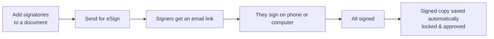

# E-Signing User Guide

This guide walks you through requesting, tracking, and completing electronic signatures on documents in CapHive. No technical knowledge required.

> **Where to find it:** Sidebar → [**Documents**](/documents) → open the document → **Signatures** tab, where **Send For eSignatures**, **Get eSignatures' updates**, **Re-Send for eSignatures** and **Cancel eSignatures** live. Signatories are defined on the document's **Edit** form (**eSignatures** section, **Add Signature**). Needs the *Documents* permission plus edit rights on the document; cancelling needs the company administrator role, and e-signing must be enabled for your company (Digio or DocuSign provider).

---

## Table of Contents

1. [What is E-Signing?](#what-is-e-signing)
2. [Before You Begin](#before-you-begin)
3. [Setting Up Signatories on a Document](#setting-up-signatories-on-a-document)
4. [Who Signs: Signatory Emails and Labels](#who-signs-signatory-emails-and-labels)
5. [Changing Signers on Documents Already Generated or Sent](#changing-signers-on-documents-already-generated-or-sent)
6. [Sending a Document for Signature](#sending-a-document-for-signature)
7. [Sending All Documents at Once](#sending-all-documents-at-once)
8. [Tracking Signing Progress](#tracking-signing-progress)
9. [What Signers Experience](#what-signers-experience)
10. [When Signing is Complete](#when-signing-is-complete)
11. [Cancelling a Signature Request](#cancelling-a-signature-request)
12. [Resending After a Failure or Expiry](#resending-after-a-failure-or-expiry)
13. [Status Meanings](#status-meanings)
14. [Worked Example](#worked-example)
15. [Frequently Asked Questions](#frequently-asked-questions)

---

## What is E-Signing?

E-signing lets you send documents — such as subscription agreements, KYC forms, or offer letters — directly to investors and fund staff for legally binding electronic signatures. Signers receive an email with a link and sign from their phone or computer. Once everyone has signed, CapHive automatically saves a final signed copy to the investor's file.

---

## Before You Begin

To use e-signing you need:

- The document must be **generated** (not just a template) and **approved**.
- At least one **signatory** (signer) must be added to the document.
- Your organisation must have e-signing enabled — contact your administrator if you are unsure.

> **Tip:** If you cannot see the e-sign buttons described below, you may not have Documents permission. Ask your administrator to check your access rights.

---

## Setting Up Signatories on a Document

Before sending a document for signature, you tell CapHive who needs to sign it. Signatories are usually set on the **template** document, and every document generated from it inherits the slots.

1. Open the **document** (usually the template) and click **Edit**.
2. Tick **Template** so the **eSignatures** section appears.
3. Click **Add Signature**.
4. Fill in the details for each signer. There is no email box on the template: signer emails come from the record the document is generated for, or from **Notes** (see [Who Signs](#who-signs-signatory-emails-and-labels)).

| Field              | What to enter                                                  |
|--------------------|----------------------------------------------------------------|
| **Label**          | The signer's role. Pick a suggested label exactly as offered — **Investor Signatories** or **Fund Signatories** on fund and KYC templates, **Buyer Signatories** or **Seller Signatories** on secondary sale templates — to take the signers' emails from the record the document is generated for. Type **Other** or your own label (e.g. **Trustee**) for a fixed signer. See [Who Signs](#who-signs-signatory-emails-and-labels) |
| **Signature**      | With Digio, choose **Electronic** or **Aadhaar**. With DocuSign the box is not shown |
| **Notes**          | For **Other** or a custom label, the signer's email address. Not used for the suggested signatory labels |

5. If there are **multiple signers**, click **Add Signature** for each one.
6. To set a **signing order** (one person must sign before the next is notified), tick **eSign Order** in the **eSignatures** section; signers are sent the document in the order the signature rows were added.
7. Click **Save**.

On a generated document, a signer row's **Edit** (on the **Signatures** tab, until the document is sent) can change its label, signature type or notes, but a changed **Email** is not saved. To change who signs, correct the email at its source and generate the document again — see [Changing Signers on Documents Already Generated or Sent](#changing-signers-on-documents-already-generated-or-sent).

> **Important:** Once you send the document, you cannot add, remove, or change signatories. Set them up correctly before sending.

### Signing Order — Sequential vs. Parallel

| Setting          | What happens                                                         |
|------------------|----------------------------------------------------------------------|
| **Sequential**   | Signer 1 gets the email first. Signer 2 is notified only after Signer 1 signs, and so on. |
| **Parallel**     | All signers receive the email at the same time.                      |

Tick **eSign Order** on the document or template edit form for sequential signing; leave it unticked for parallel.

---

## Who Signs: Signatory Emails and Labels

Signature rows on a template hold no email addresses. When a document is generated, each row's **Label** decides who the real signers are, and their emails are **copied onto the generated document at that moment**.

| Template signature label | Signer email comes from | Where to change it |
|---|---|---|
| **Investor Signatories** — on a document generated for a **commitment** (e.g. a **Commitment Template** agreement) | The **commitment's** **Investor Signatory Emails** (one signer per email). Not the KYC's field. | Open the commitment → **Edit** → **Investor Signatory Emails** → save. Needs update access on commitments. |
| **Investor Signatories** — on a document generated for a **KYC** (templates in the **KYC Templates** folder) | The KYC's (investing entity's) **Investor Signatory Emails** | Open the KYC → **Edit** → step **3. KYC Details** → **Investor Signatory Emails**. The field is shown to your company's users only, not to the investor. |
| **Fund Signatories** — on a document generated for a commitment or for the fund itself | The fund's **Fund Signatory Emails** (one signer per email) | Open the fund from [**Funds → Funds**](/funds) → **Actions → Edit Fund** → section **2. Signatures, Ratios & Other Details** → **Fund Signatory Emails**. Needs update rights on funds. It is not under the Company menu or company details. |
| **Seller Signatories** — on an **Offer Template** document of a secondary sale | The offer's **Seller Signatory Emails** | Open the offer → **Complete Offer Details** (step **2. Personal Details**, shown once the offer is approved). The offer can no longer be edited once verified. |
| **Buyer Signatories** — on an **Offer Template** document of a secondary sale | The **Buyer signatory emails** of every interest allocated to that offer | Open each allocated interest → **Edit** → step **2. Personal Details** (shown once the interest is short-listed). Not editable once the interest is verified. |
| **Other**, or any label you type — e.g. **Trustee**, **Custodian**, **Legal Counsel** | The email typed in that row's **Notes** (exactly one signer) | Open the template → **Edit** → **eSignatures** section → change **Notes** on that row → **Save**. |

Rules that catch people out:

- **Several signers:** the email fields take a comma-separated list; spaces are removed and each address becomes its own signer. On funds, commitments and KYCs an invalid address stops the save ("contains invalid email(s)"); on offers and interests a bad address only shows up as an error when the document is generated.
- **Type suggested labels exactly**, capitals and plural included. "Investor signatories" or "Fund Signatory" count as custom labels and take their email from **Notes**. Generated signer rows show the singular, e.g. **Investor Signatory**.
- **Suggested labels only expand on the documents listed above.** On any other template — a call notice or distribution notice template, or a secondary sale **Buyer Template** or **Allocation Template** — they behave like a custom label and use **Notes**; with **Notes** blank the signer has no email and **Send For eSignatures** stays hidden.
- **KYC and commitment are separate.** A commitment copies the KYC's **Investor Signatory Emails** only when it is created (the commitment form pre-fills a blank field when you pick the KYC; an import fills a blank column). Later changes on the KYC are not copied to existing commitments, and commitment documents always use the commitment's field — update both.
- **Blank source field:** that row adds no signer; the document is generated with fewer signers, or none.
- **One address, one signer:** if the same email appears twice (for example a fund signatory also listed as an investor signatory) generation fails with "contain duplicate emails".
- **Two custom rows** on one template cannot share a label and signature type (except **Other**): use **Trustee** and **Co-Trustee**, or **Other**.
- **No trustee field:** there is no **Trustee Emails** (or custodian) field on the fund, commitment or company. Add a signature row labelled **Trustee** with the email in **Notes**.

---

## Changing Signers on Documents Already Generated or Sent

Because emails are copied at generation, changing a fund's, commitment's, KYC's, offer's or interest's emails — or a template row's **Notes** — only affects documents generated **afterwards**. **Re-Send for eSignatures** reuses the document's existing signers, so it never picks up new emails.

| Document state | To use the corrected emails |
|---|---|
| Generated, not approved | Correct the email at its source, then generate the document again; the unapproved copy is replaced. |
| Approved, not yet sent | Delete the generated document (or an approver clicks **UnApprove**), correct the email, generate again, approve and send. Generation skips a record that already has an approved document with that name ("Approved document already exists"). |
| Sent, status **Requested** | A company administrator clicks **Cancel eSignatures**; then delete the document, correct the email, generate again, approve and send. |
| **Failed**, **Cancelled**, **Expired** or **Voided** | Delete the document, correct the email, generate again, approve and send. Generation skips a record that still has a sent document ("Signed document already exists"). |
| **Completed** | Signers cannot be changed; the **Signed** copy is final. |

---

## Sending a Document for Signature

Once signatories are set up:

1. Open the document and go to its **Signatures** tab.
2. Click **Send For eSignatures**. The button appears only when the document is approved, every signatory has an email address, and the request has not already been sent or expired.
3. CapHive queues the request and sends it to the signing provider in the background. You get an in-app alert with the result.
4. The document status changes to **Requested** (or **Failed**, with the reason on each signer row).

> Signing requests expire after **90 days** if not completed.

---

## Sending All Documents at Once

If you have a folder of documents that are all ready to go:

There is no separate "Send All" button:

1. Sidebar → **Documents**, select the folder containing the documents.
2. Choose **Actions → Filter Documents** and run a filter.
3. Choose **Actions → Send For E Signatures** (the bulk item's on-screen spelling) and confirm. CapHive queues every document in the search results — including other pages and sub-folders — that is approved, has signatories, has not yet been sent and is not cancelled, completed, expired or voided. In practice only generated documents can be approved.
4. Documents that are not ready are skipped: each one is reported by an in-app alert ("not approved" or "not ready for eSignature"), the final alert gives the error count, and the list of skipped documents is emailed to you. There is no bulk cancel; a company administrator cancels requests one document at a time.

> Documents are sent with a small random delay between each one to avoid overloading the signing service.

---

## Tracking Signing Progress

### On a single document

1. Open the document.
2. Click the **Signatures** tab (it appears once the document has at least one signatory).
3. You will see each signatory with a coloured status badge:

| Badge colour | Meaning                                    |
|--------------|--------------------------------------------|
| 🟡 Yellow    | Awaiting signature (Requested or Sent)     |
| 🟢 Green     | Signed                                     |
| 🔴 Red       | Failed, Cancelled, Expired, or Voided      |
| (none)       | Not yet sent                               |

4. To get the latest status right now, click **Get eSignatures' updates**. CapHive will check with the provider and refresh the tab within a few seconds (with DocuSign, at most once every 15 minutes).

> Statuses otherwise update when the provider notifies CapHive through its webhook. There is no nightly automatic polling. For many documents at once, use the **eSignatures Report**.

---

## What Signers Experience

1. **Signer receives an email** from the signing provider (Digio or DocuSign) with a unique link.
2. They click the link and are taken to the provider's secure signing page — no CapHive account required.
3. They review the document and apply their signature (electronic or Aadhaar with Digio, depending on the signatory's type; DocuSign's standard signing experience with DocuSign).
4. They receive a confirmation email when done.
5. CapHive is notified automatically and updates the status.

---

## When Signing is Complete

Once **all signatories** have signed:

1. CapHive automatically downloads the signed document from the provider.
2. A new document tagged **"Signed"** is created in the same folder — this is the final, legally binding copy.
3. The signed document is **locked** (cannot be edited) and **approved**.
4. The original document is marked as **Completed**.

You do not need to do anything — this happens automatically. Look for the document with the **Signed** tag in the document list.

---

## Cancelling a Signature Request

If you need to stop a signing process that is in progress:

Only company administrators can cancel.

1. Open the document's **Signatures** tab.
2. Click **Cancel eSignatures**.
3. CapHive refreshes the status, then asks the provider to invalidate any outstanding signing links.
4. The document status changes to **Cancelled**, and every unsigned signer is cancelled too.

> Once cancelled, signers can no longer use their email links, and signatures already given are discarded. The document stays marked as sent, so its signer rows cannot be edited: either **Re-Send for eSignatures** to the same signers (a fresh start), or delete it and generate it again to use corrected signers (see [Changing Signers](#changing-signers-on-documents-already-generated-or-sent)).

---

## Resending After a Failure or Expiry

If an approved document's status shows **Failed**, **Cancelled**, **Voided** or **Expired**, you can start again:

1. Open the document's **Signatures** tab.
2. Click **Re-Send for eSignatures**.
3. CapHive clears the sent status, resets every signer, and sends a fresh request to the provider. All signers receive new email links and must sign again, even if they had signed before.

> **Re-Send for eSignatures** is not offered while a request is still **Requested**. To restart an in-progress request, a company administrator first clicks **Cancel eSignatures**, then resends. There is no **Force Resend** button in the screens.

---

## Status Meanings

### Document status (overall)

| Status        | What it means                                                       |
|---------------|---------------------------------------------------------------------|
| *(blank)*     | Not yet sent for signing                                            |
| **Requested** | Sent to the provider — signing is in progress                       |
| **Completed** | All signers have signed; a Signed copy has been created             |
| **Failed**    | The provider rejected the request or an error occurred              |
| **Cancelled** | The request was cancelled before completion                         |
| **Expired**   | The 90-day signing window passed without all signers completing     |
| **Voided**    | The signing envelope was voided (DocuSign only)                     |

### Individual signatory status

| Status        | What it means                                             |
|---------------|-----------------------------------------------------------|
| *(blank)*     | Not yet sent                                              |
| **Requested** | Provider has the request; signer has not yet acted        |
| **Sent**      | Signer has been emailed                                   |
| **Signed**    | This person has completed their signature                 |
| **Failed**    | Signing attempt failed for this person                    |
| **Cancelled** | Cancelled                                                 |
| **Expired**   | Their window expired                                      |
| **Voided**    | Voided (DocuSign)                                         |

---

## Worked Example

Sending a subscription agreement to an investor and your fund manager, in order:

1. On the subscription agreement **template**, click **Edit**, and in the **eSignatures** section click **Add Signature** for the **Investor** (label **Investor Signatories**, signature type as configured), then **Add Signature** again for the **Fund Manager** (label **Fund Signatories**).
2. Keep the Investor row first, tick **eSign Order** so it signs sequentially, and **Save**.
3. Generate the subscription agreement from the template; an approver then clicks **Approve** on it.
4. On the generated document's **Signatures** tab, click **Send For eSignatures**. The status becomes **Requested**; only the investor is emailed first.
5. The investor signs from their phone → their badge turns green, and the fund manager is then emailed automatically.
6. The fund manager signs → all signatories are green.
7. CapHive downloads the completed file, creates a new document tagged **Signed** (locked and approved) in the same folder, and marks the original **Completed**.

If the investor says they never got the email, you check spam, then (if needed) cancel and click **Re-Send for eSignatures** to issue fresh links — all signers will then have to sign again.

---

## Frequently Asked Questions

**Where do I find the e-signing controls in CapHive?**
Everything happens on the document page. Sidebar → [**Documents**](/documents), pick the folder in the tree, click the document name, then open the **Signatures** tab under the document card. The tab only appears once the document has at least one signatory. The same document page is reachable from a fund's, commitment's or KYC's **Documents** tab. See [Setting Up Signatories on a Document](#setting-up-signatories-on-a-document).

**Where can I see the signing status of many documents at once?**
Use the **eSignatures Report** page: on a fund page it is under **Reports → Basic Reports → eSignatures Report** (commitment agreements of that fund), on the KYC list under its **Actions** menu (KYC forms), and on a secondary sale page under its actions (offer documents). It lists investor, folio, document, status and one badge per signer. See [Tracking Signing Progress](#tracking-signing-progress).

**How do I add or change signatories?**
Open the template, click **Edit** (with **Template** ticked the **eSignatures** section appears) and click **Add Signature** for each signer: **Label**, **Signature** type (Digio) and **Notes**. There is no email box: suggested labels such as **Investor Signatories** take emails from the commitment, KYC, fund or offer, and any other label uses the email in **Notes**. Documents generated afterwards get the new signers; existing ones must be generated again. See [Who Signs](#who-signs-signatory-emails-and-labels).

**How do I change the fund signatory emails for e-sign?**
Open the fund from [**Funds → Funds**](/funds), choose **Actions → Edit Fund**, go to section **2. Signatures, Ratios & Other Details**, change **Fund Signatory Emails** (comma-separated, one signer per address) and save. The field is not under the Company menu or company details, and needs update rights on funds. Only documents generated afterwards use the new emails, so generate existing documents again. See [Changing Signers](#changing-signers-on-documents-already-generated-or-sent).

**How do I change the investor signatory emails for e-sign?**
For commitment documents (for example subscription or commitment agreements), open the commitment, click **Edit**, change **Investor Signatory Emails** and save. For documents from the **KYC Templates** folder, open the KYC (investing entity), click **Edit** and change **Investor Signatory Emails** in step **3. KYC Details**. Both take a comma-separated list. Documents already generated keep their old signers, so generate them again. See [Who Signs](#who-signs-signatory-emails-and-labels).

**How do I add a trustee (or any other signer) to e-signature?**
Open the template, click **Edit** and, in the **eSignatures** section, click **Add Signature**. Type **Trustee** (or **Custodian**, **Legal Counsel**, **Other**) as the **Label**, put the trustee's email in **Notes**, pick the **Signature** type if you use Digio, and **Save**. Each such row is exactly one signer; for two trustees add two rows with different labels, such as **Trustee** and **Co-Trustee**. Documents generated afterwards include the trustee.

**How do I change a trustee's e-sign email?**
Open the template, click **Edit**, change **Notes** on the **Trustee** row in the **eSignatures** section and **Save**. There is no trustee email on the fund to change. Documents generated afterwards use the new email; an existing document keeps the old one until you delete it and generate it again (a company administrator clicks **Cancel eSignatures** first if it was already sent). See [Changing Signers](#changing-signers-on-documents-already-generated-or-sent).

**Do I need to regenerate a document after changing signatory emails?**
Yes. Signer emails are copied onto a document when it is generated, so changing the fund's, commitment's, KYC's, offer's or interest's emails, or a template row's **Notes**, only affects documents generated afterwards. An unapproved document is replaced by generating again; delete or **UnApprove** an approved one first; for one already sent, a company administrator clicks **Cancel eSignatures**, then delete and generate again. **Re-Send for eSignatures** never picks up new emails.

**How do I send a document for signature?**
On the document's **Signatures** tab click **Send For eSignatures**. The button only appears when the document is approved, every signatory has an email address, the request has not expired and it has not already been sent; the tab reminds you that "the option to send a document for eSignature is enabled only when the document is approved". See [Sending a Document for Signature](#sending-a-document-for-signature).

**How do I bulk send many documents for e-signature at once?**
There is no separate "Send All" button. Sidebar → **Documents**, select the folder, choose **Actions → Filter Documents**, run a filter, then **Actions → Send For E Signatures** queues every approved document in the results (all pages and sub-folders) that has signatories and has not been sent. See [Sending All Documents at Once](#sending-all-documents-at-once).

**Where is the bulk e-signature action for documents?**
On the documents list, after a filter: Sidebar → [**Documents**](/documents) (or a record's **Documents** tab), select a folder, choose **Actions → Filter Documents** and run a filter. The **Actions** menu then shows the bulk **Send For E Signatures** item next to **Approve** and **Delete**. It is not shown on an unfiltered list.

**Can I cancel e-signature requests in bulk?**
No. There is no bulk cancel for e-signature requests; the documents bulk actions only send. A company administrator opens each document's **Signatures** tab and clicks **Cancel eSignatures**.

**How do I check, cancel or restart a signing request?**
All from the **Signatures** tab: **Get eSignatures' updates** asks the provider for the latest status, **Cancel eSignatures** stops an in-progress request (company administrators only), and **Re-Send for eSignatures** starts again after a failure, cancellation, voiding or expiry. See [Tracking Signing Progress](#tracking-signing-progress) and [Resending After a Failure or Expiry](#resending-after-a-failure-or-expiry).

**How do I remove a signatory or delete the signing setup?**
Open the template, click **Edit**, click **Delete** on the row in the **eSignatures** section and **Save**; documents generated afterwards no longer include that signer. Signer rows on an already generated document have no delete button, so generate the document again from the corrected template (cancel and delete it first if it was sent). A template with no signature rows produces documents with no **Signatures** tab.

**Who can send, cancel or edit e-signatures?**
Anyone who can edit the document (company administrators, or employees with update rights on the document or its owner record) can send, resend and fetch updates. Cancelling needs the **company admin** role. Signatories can be edited by anyone in your company until the document has been sent. If you cannot see the **Signatures** tab or its buttons, ask your administrator to check your *Documents* access.

**Why should I use CapHive e-signing instead of emailing PDFs?**
The document, the signers, the status of each signature and the final signed copy stay together on the investor's record: no chasing attachments, no uncertainty about who has signed, and the signed copy is locked and approved automatically. Bulk sending and the eSignatures Report let you run a whole fund closing from one screen. See [When Signing is Complete](#when-signing-is-complete).

**Who typically uses e-signing, and for what?**
Fund operations teams use it for subscription and commitment agreements generated from templates, KYC teams for KYC forms, and secondary-sale teams for offer and transfer agreements. Investors and fund signatories only ever interact with the provider's email link; they need no CapHive login.

**What happens if I don't set up e-signing and collect signatures by email instead?**
Nothing in CapHive tracks who has signed, the commitment or KYC record has no signed copy attached, the E-Sign Monitor agent cannot flag overdue signers, and you have to upload the wet-signed scan by hand and approve it. Downstream steps that look for a **Signed** document (for example KYC verification) stay incomplete.

**What happens when I click Send For eSignatures?**
The document is queued and, within seconds to a minute, a background job uploads it to your provider (Digio or DocuSign) with the signer list. On success the document is marked **sent for eSign** with status **Requested**, the send date and the provider's document id are stored, an e-sign log keeps the request and response, and the provider emails the first (or all) signers. You get an in-app alert with the result; on failure the status is **Failed** and each signer row shows the reason.

**What happens when a signer signs?**
The provider notifies CapHive through its webhook, and that signer's row turns green with status **Signed**. With sequential order the provider then emails the next signer. When the last signer signs, CapHive downloads the signed PDF and creates a new document in the same folder with owner tag **Signed**, **approved**, **locked**, linked back to the original, and marks the original **Completed**. No CapHive email goes to your team; the E-Sign Monitor agent can report on it.

**What happens when I click Get eSignatures' updates?**
CapHive asks the provider for the current status of the document and every signer and refreshes the **Signatures** tab; if everyone has signed it runs the same completion step as the webhook (creates the **Signed** copy). With DocuSign the button is available at most once every 15 minutes. Completed, cancelled, expired and voided documents are skipped. Nightly automatic polling is not enabled; rely on the webhook and this button.

**What happens when I cancel a signing request?**
CapHive first refreshes the status, then asks the provider to invalidate the outstanding signing links. The document status becomes **Cancelled** and every unsigned signer is cancelled too. The document stays marked as sent, so its signer rows cannot be edited, but it can be deleted and generated again, or re-sent to the same signers. Signatures already given are discarded; a later resend starts from scratch. Only company administrators can cancel.

**What happens when I click Re-Send for eSignatures?**
The document's sent flag and status are cleared, every signer's status is reset, and a fresh request goes to the provider, so all signers receive new links and must sign again even if they had signed before. It is offered only for approved documents whose status is failed, cancelled, voided or expired. To restart a request that is still in progress, a company administrator cancels it first; there is no **Force Resend** button in the screens.

**What happens when a document is generated from a template that has signatories?**
Each signature row becomes real signers, with emails copied at that moment: **Investor Signatories** from the commitment's (or, for KYC documents, the KYC's) **Investor Signatory Emails**, **Fund Signatories** from the fund's **Fund Signatory Emails**, **Buyer**/**Seller Signatories** from the interests and offer, and any other label from its **Notes**. The document waits unapproved; once approved, **Send For eSignatures** appears. See [Who Signs](#who-signs-signatory-emails-and-labels).

**What happens when I run the bulk Send For E Signatures action on documents?**
Each document in the filtered results that is approved, has signatories, has not been sent and is not cancelled, completed, expired or voided is queued a few seconds apart so the provider is not flooded, then sent exactly like **Send For eSignatures** on one document. Every other document is skipped and reported — "not approved" or "not ready for eSignature" (including ones already sent or completed) — by in-app alert, and the list is emailed to you when the run finishes.

**What happens if a request expires?**
Signing links are valid for **90 days**; after that the provider reports **Expired**, the document and its unsigned signers show the red badge, and the request cannot be cancelled or fetched further. Use **Re-Send for eSignatures** to issue fresh links; the document also becomes deletable again.

**Which signature types are available?**
With the Digio provider you choose **Electronic** or **Aadhaar** per signatory on the signature form. With DocuSign there is no per-signer type; signers use DocuSign's standard signing experience. Your company's provider is a company-level setting managed with CapHive support.

**Can I change the signatories after sending?**
Not on the sent document: its signers are locked, even after cancelling, and **Re-Send for eSignatures** reuses them. A company administrator clicks **Cancel eSignatures**; then delete the document, correct the emails at their source (fund, commitment, KYC, offer, interest or the template row's **Notes**), generate it again, approve and send. See [Changing Signers](#changing-signers-on-documents-already-generated-or-sent).

**Is there a Trustee Emails field on the fund?**
No. The fund has only **Fund Signatory Emails**, used by **Fund Signatories** rows, and there is no trustee or custodian email field on the fund, commitment or company. To have a trustee sign, add a signature row labelled **Trustee** on the template with the trustee's email in **Notes**. See [Who Signs](#who-signs-signatory-emails-and-labels).

**Which Investor Signatory Email is used for e-sign, the KYC's or the commitment's?**
It depends on the document. Documents generated for a commitment (for example from a **Commitment Template**) use the commitment's **Investor Signatory Emails**, never the KYC's. Documents generated from templates in the **KYC Templates** folder use the KYC's (investing entity's) field. The KYC's value only pre-fills a commitment's blank field when the commitment is created. See [Who Signs](#who-signs-signatory-emails-and-labels).

**I updated the Investor Signatory Email on the KYC (investing entity) but e-sign still goes to the old email — why?**
Commitment documents take signers from the commitment's own **Investor Signatory Emails**, copied from the KYC only when the commitment was created, and signers are fixed on a document when it is generated. Open the commitment, click **Edit**, update **Investor Signatory Emails** and save, then delete the document and generate it again (a company administrator cancels it first if it was sent). **Re-Send for eSignatures** reuses the old signers.

**Does changing Investor Signatory Emails on the KYC update existing commitments?**
No. The KYC's (investing entity's) value is copied into a commitment only when the commitment is created: the commitment form pre-fills a blank field when you pick the KYC, and an import fills a blank column. Later KYC changes never reach existing commitments, so also edit each commitment's **Investor Signatory Emails**, then generate its documents again.

**Why did the e-sign request go to the wrong person?**
Signers are copied when the document is generated, from the source for each row's label: the commitment's (not the KYC's) **Investor Signatory Emails**, the fund's **Fund Signatory Emails**, or **Notes** for labels such as **Trustee**. A label typed differently from the suggestion (e.g. "Investor signatories") also falls back to **Notes**. Check the document's **Signatures** tab, correct the source, cancel the request if sent, then delete and generate the document again. See [Changing Signers](#changing-signers-on-documents-already-generated-or-sent).

**A signer says they did not receive the email. What do I do?**
Ask them to check their spam/junk folder first. The email comes from the signing provider (Digio or DocuSign), not from your CapHive email address. If they still cannot find it, a company administrator clicks **Cancel eSignatures** on the document's **Signatures** tab, then **Re-Send for eSignatures** to issue fresh links (all signers will have to sign again). **Re-Send** is not offered while the request is still **Requested**.

**The status has not updated even though the signer says they signed. What should I do?**
Click **Get eSignatures' updates** on the **Signatures** tab. If the status still does not change after a minute, wait and try again later (DocuSign allows one refresh per 15 minutes). If it remains stuck the next day, contact your administrator; the provider's webhook may not be reaching CapHive.

**How long do signers have to sign?**
Signing links are valid for **90 days** from the date the document was sent. After 90 days the document shows **Expired** and you will need to click **Re-Send for eSignatures**.

**Where is the final signed document?**
Look in the same folder as the original document. It has the same name but carries the **Signed** owner tag, is approved and locked, and its page shows "Created from template" pointing at the original. See [When Signing is Complete](#when-signing-is-complete).

**Can I see the document before sending?**
Yes. Open the document and use the preview or download button before clicking **Send For eSignatures**.

**What if I need the same signatories on many documents?**
Set the signatories on the **template** document (open the template → **Edit** → **eSignatures** → **Add Signature**). Every time a document is generated from that template, the same signatory slots are created automatically.

**Can investors sign from their phone?**
Yes. The signing provider's link works on any modern smartphone browser. No app download is required.

**Why does nothing get queued when I use the bulk "Send For E Signatures" action on documents?**
Documents must be approved (only generated documents can be) and already have signatories, and must not have been sent or be cancelled, completed, expired or voided. Check the **Approved** status in the list, approve with **Actions → Approve** if needed, and read the in-app alerts or the error email, which name each skipped document. See [Before You Begin](#before-you-begin).

**Why is the "Send For eSignatures" button missing?**
The button is hidden when the document is not yet **Approved**, when a signatory has no email address, when the document has already been sent (status **Requested**) or has expired, or when you lack edit rights on it. Approve the document first (an **approver** clicks **Approve** on the document page). See [Document Approval](document_management_user_guide#document-approval) in the Document Management guide.

**How do I control the order in which people sign?**
On the document (or template) edit form, tick **eSign Order** in the **eSignatures** section; signers are then sent the document one after another in the order the signature rows were added. Leave it unticked for everyone to be emailed at once. See [Signing Order — Sequential vs. Parallel](#signing-order--sequential-vs-parallel).

**Can I delete or bulk delete a document that is out for signature?**
The **Delete** button is not offered on a document that has been sent for signature until the request has failed, been cancelled, voided or expired, and a completed **Signed** copy can never be deleted. The documents bulk **Actions → Delete** does not make the e-signature check — it only skips documents tagged **Signed** — so exclude documents out for signature from your filter, or cancel the request first.

**Who is notified as signing progresses?**
Signers get the provider's emails (request, reminders, completion). Your team is not emailed by CapHive; you get in-app alerts when you send or refresh, and the **Signatures** tab shows each signatory's colour badge (yellow awaiting, green signed, red failed/cancelled/expired). For a daily summary of stale and failed requests enable the E-Sign Monitor agent. See [Status Meanings](#status-meanings).

**Can two signatories share the same email address?**
No. A document rejects duplicate signer emails, and a template slot that expands to the same email twice produces an error on generation. Use one row per person; a person who signs in two roles signs once.

## Related Guides

- [Document Management](document_management_user_guide) — uploading, approving and filing the documents you send for signature.
- [Investor KYC](investor_kyc_user_guide) — KYC forms are generated and e-signed from the KYC page.
- [Capital Commitments](capital_commitments_user_guide) — commitment agreements are the most common e-signed document.
- [Secondary Sales](secondary_sales_user_guide) — offer and transfer agreements signed by buyer and seller.
- [E-Sign Monitor Agent](agents/esign_monitor_agent_user_guide) — daily report of overdue, expired and failed signature requests.
- [Audit Trail](audit_trail_user_guide) — tracing who sent, cancelled or resent a request.
