# Evergreen Funds User Guide

An **evergreen fund** (also called an open-ended fund) has no fixed size and no end date. Investors can come in and go out on set **dealing dates**, at the fund's **NAV per unit** on that date. There are no capital calls and no drawdown schedule: an investor pays the full amount up front and gets units, and redeems by handing units back for cash.

> **Where to find it:** Sidebar → [**Funds → Funds**](/funds) → open the fund. An evergreen fund shows its own tabs: **Dealing** (with **Dealing Dates**, **Subscriptions** and **Redemptions** inside it), **NAV** (with **NAV** and **Fees** inside it), **Investors, Portfolio, Documents, Notifications, Access** (US wording calls Dealing **Calendar** — see [Wording and US Terms](#wording-and-us-terms)). To create one, choose **Open-ended** as the fund type on [**New Fund**](/funds/new). Your entity must have the **Evergreen funds** switch on (ask CapHive support) and units switched on, and you need rights to create funds.

Closed-ended funds are not affected in any way: their pages, calls, distributions and statements look and behave exactly as before.

---

## Table of Contents

1. [How an Evergreen Fund Works](#how-an-evergreen-fund-works)
2. [Key Terms in Plain English](#key-terms-in-plain-english)
3. [Dates in an Evergreen Fund](#dates-in-an-evergreen-fund)
4. [Creating an Open-ended Fund](#creating-an-open-ended-fund)
5. [Settings You Can Choose](#settings-you-can-choose)
6. [Publishing the NAV](#publishing-the-nav)
7. [Subscription and Redemption Orders](#subscription-and-redemption-orders)
8. [Per-Order Journeys](#per-order-journeys)
9. [Dealing Dates: Pricing and Confirming](#dealing-dates-pricing-and-confirming)
10. [Lock-ups](#lock-ups)
11. [Redemption Gates](#redemption-gates)
12. [Settlement: Money, Units and Documents](#settlement-money-units-and-documents)
13. [Notifications](#notifications)
14. [Fees on NAV](#fees-on-nav)
15. [The GP Screens](#the-gp-screens)
16. [What Investors See](#what-investors-see)
17. [Wording and US Terms](#wording-and-us-terms)
18. [Frequently Asked Questions](#frequently-asked-questions)
19. [Related Guides](#related-guides)

---

## How an Evergreen Fund Works

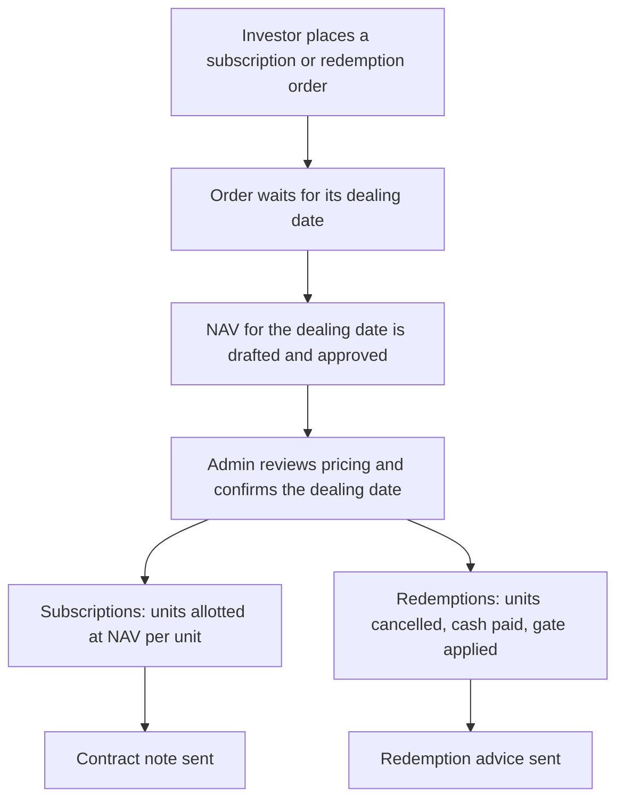

Every order is matched to the **next dealing date whose cut-off it meets**. On the dealing date, the fund's **approved NAV per unit** sets the price for everyone dealing that day. Subscriptions get **amount ÷ NAV per unit** units; redemptions get **units × NAV per unit** in cash, less any exit load (early redemption fee).

---

## Key Terms in Plain English

| Evergreen term | What it means | Closed-ended equivalent |
|---|---|---|
| **Dealing date** | A date on which investors can come in or go out | — |
| **Cut-off** | The last moment a subscription can be placed for a dealing date | — |
| **Notice period** | How many days before a dealing date a redemption must be placed | — |
| **NAV per unit** | Net asset value of a class divided by its units outstanding | Unit price on a call |
| **Subscription** | Buying units with money paid in | Capital call + remittance |
| **Redemption** | Selling units back to the fund for cash | Distribution |
| **Gate** | A cap on how much can be redeemed on one dealing date | — |
| **Contract note** | Confirmation of units allotted on a subscription | Call notice |
| **Redemption advice** | Confirmation of units cancelled and cash paid | Distribution notice |
| **Folio** | An investor's holding in one class (US wording: **Account**) | Commitment |
| **High-water mark** | The class's NAV per unit after the last performance fee was booked (or its first approved NAV per unit). A performance fee is only charged on gains above it | ₹10,176 |

The screens use these words for evergreen funds; US users see US terms, and your firm can choose its own words — see [Wording and US Terms](#wording-and-us-terms). Behind the scenes CapHive still keeps the money in its usual settlement records, so the ledger, reports and allocations keep working.

---

## Dates in an Evergreen Fund

A dealing date is not a single day. It sits in the middle of a run of dates, which fall into three stages:

1. **Before the dealing date — deadlines** decide *which* dealing date an order joins.
2. **Around the dealing date — pricing.** The NAV fixes *the price*, and confirming the date fixes the figures.
3. **After the dealing date — settlement.** Money and units actually *move*.

The example follows one dealing date, **Tuesday 1 December 2026**, and two investors: **P** subscribes ₹1 crore, and **Q** redeems 1,000 Class A units. The fund deals subscriptions and redemptions monthly and takes money before dealing (pre-funded), with a 5-day **Cut-off**, 30 days' **Notice** for Class A and 2 for Class B, **Remind investors** 2 days before the cut-off, and redemptions **Paid within** 10 business days.

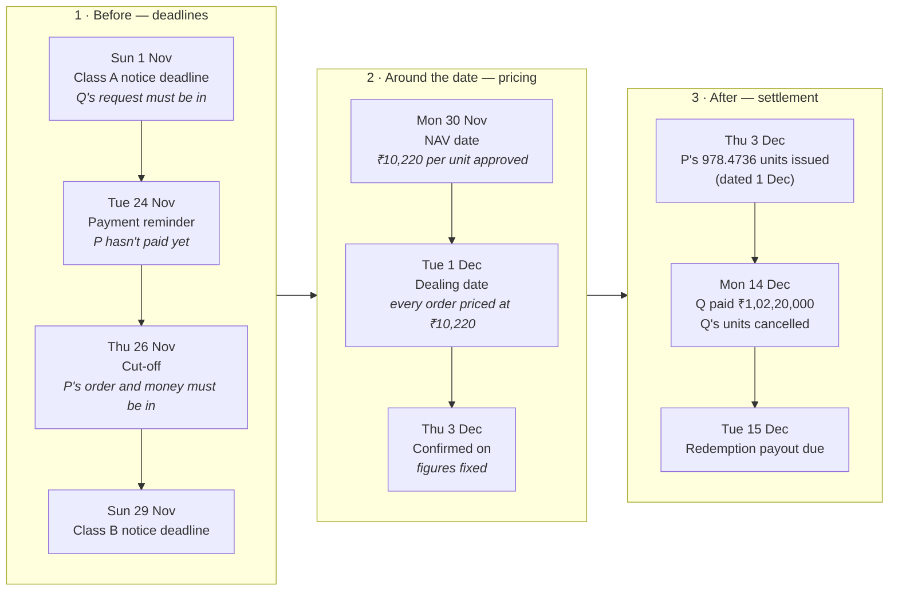

### Stage 1 — which dealing date does an order join?

Each order is checked against its own deadline, counted back from the dealing date and ending at 23:59. The order's **Received** time is what is checked; a fund user entering an order on **New subscription** / **New redemption** can set an earlier **Received at**, but the order is never placed on a dealing date that is already confirmed. An order that misses it is not refused — it joins the next dealing date of its kind, and **Check** shows that date before the order is submitted.

| Date | Deadline | Applies to | Worked out as | If missed |
|---|---|---|---|---|
| **Sun 1 Nov** | Redemption notice, Class A | Class A redemptions | 1 Dec − 30 days | Deals on 1 Jan |
| **Thu 26 Nov** | Cut-off — order placed and, pre-funded, paid | All subscriptions | 1 Dec − 5 days | Rolls to 1 Jan, or is cancelled, as set in **Not paid or not ready by the cut-off** |
| **Sun 29 Nov** | Redemption notice, Class B | Class B redemptions | 1 Dec − 2 days | Deals on 1 Jan |

Two days before the cut-off (**Tue 24 Nov**), investors with unpaid or unfinished orders get a **Payment reminder** or **Action needed** email.

*Example:* Q asked to redeem on 25 October, before the 1 November deadline, so the redemption joins 1 December. P subscribed on 20 November and paid on 25 November, before the 26 November cut-off, so the subscription joins too. Had Q waited until 20 November, the redemption would deal on 1 January.

### Stage 2 — what price?

| Date | What happens | Where you see it |
|---|---|---|
| **Mon 30 Nov** — NAV date | The NAV for each class is approved. Orders use each class's latest **approved** NAV dated on or before the dealing date. | Blue preview line on the dealing date, contract note |
| **Tue 1 Dec** — dealing date | Every order on the date — subscriptions and redemptions — is priced at the same NAV per unit, ₹10,220. | Everywhere |
| **Thu 3 Dec** — confirmed on | Someone clicks **Confirm dealing date**. Units, fills and gate results are fixed; orders not ready roll or are cancelled. Possible only once the NAV is approved (and newer than the one the previous dealing date used) and the **last** deadline — here Class B's notice, 29 Nov — has passed. | Green line on the dealing date |

*Example:* P gets ₹1 crore ÷ ₹10,220 = **978.4736 units**. Q is owed 1,000 × ₹10,220 = **₹1,02,20,000**, less any early-redemption fee.

### Stage 3 — when do money and units move?

| | Subscription (P) | Redemption (Q) |
|---|---|---|
| **Money** | Already in by the cut-off (pre-funded) | Due within 10 business days: by **Tue 15 Dec**. A **Settlement overdue** alert goes to Fund ops on 16 Dec if it is unpaid. |
| **Units** | Issued on confirmation, dated **1 Dec** | Cancelled on the **Payment date** entered on **Mark paid**: **Mon 14 Dec** |
| **Investor gets** | Contract note | Redemption advice |

*Pay-after funds:* P would be priced on 1 Dec at the same 978.4736 units, asked to pay by **Tue 8 Dec** (1 Dec + 7 **Days to pay**) in the **Payment instructions** email, and issued the units on the day the money arrives, e.g. **Mon 7 Dec**.

### Later dates that start from this one

| Date | What it is | In the example | Where you see it |
|---|---|---|---|
| **Lock-up end** | P's units become free: issue date + lock-up months | 12 months → **1 Dec 2027** | **Holding**, **Investors** tab |
| **Crystallisation date** | The performance fee is booked: end of the class's quarter, half-year or year | Quarterly → **Thu 31 Dec 2026** | **NAV → Fees** |
| **Gate period** | The span a quarterly or yearly gate is shared over | Quarterly → **1 Oct – 31 Dec 2026**: what the October and November dates paid out reduces what 1 December can pay | Gate card on **Redemptions** |

- From the dealing date, redeemed units no longer count in the NAV even though they leave the folio only when paid: any NAV dated in between holds the payout as money owed to the investor (see [Money waiting to be dealt](#money-waiting-to-be-dealt)).
- A pay-after subscriber's units are issued on the day their money arrives, so their lock-up clock starts then, not on the dealing date.
- Only weekends are skipped; public holidays are not known to the calendar, so use custom dates to avoid them.

---

## Creating an Open-ended Fund

A fund is closed-ended or open-ended (evergreen) from the day it is created. You choose once, on **New Fund**, and the type can't be changed afterwards.

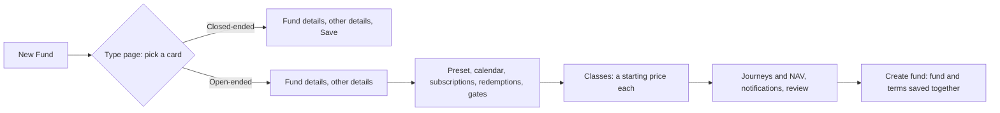

1. Go to [**New Fund**](/funds/new). The first page asks **What kind of fund is this?** and describes both types. Pick the **Open-ended (evergreen)** card and click **Continue**. The fund details then show the type you picked, with **Change** (or **Back**) to return to the cards.
2. Fill in the fund details as usual. **Unit Types** is required: each unit type becomes a class, for example "A, B".
3. Click **Next** through the other details. The wizard carries on into the evergreen steps. Use **Back** at any point to change something.
4. Pick a **preset** that matches your fund: *Indian Cat III AIF (open-ended)*, *US evergreen / tender-offer fund*, *US interval fund* or *Hedge-fund style*. It fills in the next steps, and you can change every value.
5. On **Classes**, set each class's **starting price**. There is one card per unit type you entered.
6. Check the **Review** step and click **Create fund**. The fund and its evergreen terms are saved together. If anything is missing (for example a starting price), nothing is saved, the message tells you what to fix, and everything you typed is kept.

### Editing an open-ended fund

There are two ways to change an open-ended fund later. Both apply changes forward only.

- **Actions › Edit Fund** opens the same wizard as New Fund, filled with the fund's current details and terms. The fund type is shown but can't be changed. Click **Next** through the fund details into the open-ended steps and finish with **Save fund**: the fund's details and its terms are saved together, or neither is if something is wrong.
- **Actions › Evergreen Settings** opens the open-ended steps on their own, for changing terms without touching the fund's details.

To add a class, edit the fund and add the unit type, for example change "A" to "A, B". A **Class B** card appears on the Classes step; give it a starting price and save. Classes that are already saved are never removed from the Classes step, because they may already hold units.

### Telling the two types apart

The **Funds** list shows each fund's type as a badge in the **Tag List** column: **Open-ended** or **Closed-ended**. The badge comes from the fund's type, so it is always right; it isn't a tag you can edit. It appears only for companies with open-ended funds switched on.

---

## Settings You Can Choose

| Setting | Choices | What it controls |
|---|---|---|
| Subscription and redemption calendars | Monthly, quarterly, half-yearly, annual, custom dates | Which dates are dealing dates |
| Dealing day | First, last or a set day (1–28) of the period | Where in the month the dealing date falls |
| Subscription cut-off | 0–30 days before the dealing date | Late subscriptions move to the following date |
| Notice period | 0–180 days (fund default, per class override) | Late redemptions move to the following date |
| Payment timing | **Before** dealing (pre-funded) or **after** dealing | When the investor's money must arrive |
| Redemption settlement days | 1–90 | When redemption cash is due after the dealing date |
| Lock-up | 0–60 months, **hard** or **soft** | Hard: units cannot be redeemed; soft: they can, with an exit load (early redemption fee) |
| Gate | % of NAV, fund or class level, per dealing date / quarter / year, **FIFO** or **pro-rata** | How much can be redeemed |
| Per-investor gate | % of an investor's holding per gate period | Caps any one investor's redemptions |
| Order journeys | Off, subscriptions only, or both | Whether each order runs its own approval journey |
| Orders not ready at cut-off | **Roll** to the next date or **cancel** | What happens to orders whose journey or money is incomplete |
| Minimums | Initial and additional subscription, minimum holding | Orders below these are refused |
| Redemption forms | By units, by amount, all units | What investors may ask for |
| Class expense entries (per class) | Two ledger entry names, or none | Expenses that belong to one class only (see below) |

Changing a setting applies **forward only**: dealing dates already confirmed keep the settings they were confirmed with.

---

## Publishing the NAV

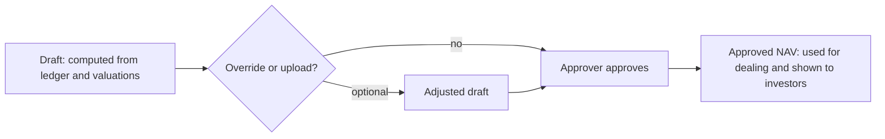

- **Draft** — open the **NAV** tab and draft the NAV for a date. CapHive adds up portfolio valuations and the ledger's cash, other assets and liabilities, splits that across classes by each class's stake (roughly its value), and deducts each class's own management and performance fees and class expenses. Every class gets its own NAV and NAV per unit — see [How each class gets its own NAV](#how-each-class-gets-its-own-nav).
- **Override or upload** — on a draft NAV, **Override line** opens a small form to override one line with a reason, or upload NAVs from a spreadsheet (columns *Unit Class, Nav Date, Nav, Units Outstanding, Nav Per Unit*).
- **Approve** — someone with the **approver** role approves it; who drafted it doesn't matter, and the audit trail records who did what. A draft marked **Stale** can't be approved until it is recalculated. Only approved NAVs are used for dealing and shown to investors.
- **Reopen** — an approved NAV can be reopened if no dealing date has used it; reopening also reverses any performance-fee crystallisation it caused.

### How each class gets its own NAV

All classes own one shared portfolio, but each pays its own fees. So every NAV date has **one NAV per class**, and investors deal at their own class's NAV per unit.

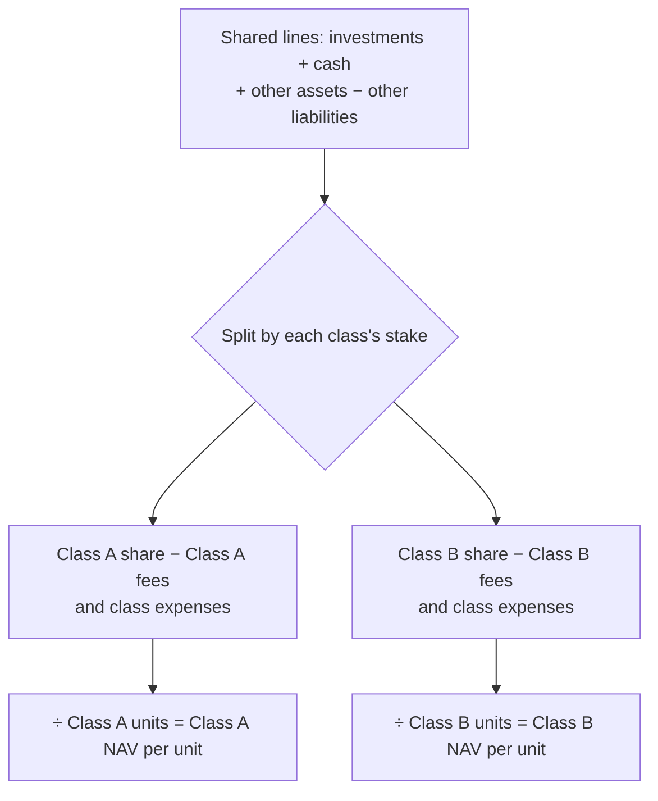

1. **Shared lines**: investments, cash, other assets and other liabilities belong to the whole fund.
2. **Split by each class's stake, not its units**: a class's stake is its previous approved NAV, plus any fees and class expenses it still owed then, scaled for units issued or cancelled since, minus fees and class expenses paid for it since (its starting price × units for its first NAV). A class with fewer units but a higher price can get the bigger share, and an unpaid fee never shifts value to another class.
3. **The class's own lines come off its share**: its management fee (at its rate), its performance fee (against its own high-water mark), its own class expenses, and money received for its orders not yet dealt.
4. **NAV per unit** = the class's NAV ÷ the class's units.

*Example* — on 30 September Class A had 60,000 units at ₹10,000 (₹60 Cr) and Class B 20,000 units at ₹20,000 (₹40 Cr), so A gets 60% and B 40%. On 31 October the shared lines come to ₹110 Cr:

| | Class A | Class B |
|---|---|---|
| Share of ₹110 Cr | ₹66,00,00,000 | ₹44,00,00,000 |
| Management fee | − ₹10,00,000 | − ₹4,00,000 |
| Performance fee accrued | — | − ₹19,20,000 |
| **NAV per unit** | **₹10,983.33** | **₹21,884.00** |

Where to see it: open any class's NAV on the **NAV** tab; its lines show where each figure came from (shared lines are already this class's part). Each class's NAV is overridden, uploaded and approved on its own.

### Expenses for one class only

Some costs belong to one class, for example a servicing fee charged only to Class B. To keep them off the other classes:

1. **Name the entries:** go to **Settings › Classes**, choose the class, click **Customise this class**, and fill in **Class expenses entry** (for example "Class B Servicing Fee") and **Class expenses paid entry** (for example "Class B Servicing Fee Paid"). Fill in both or neither. Each name belongs to one class, can't be one of the fund's own ledger names, and the two must differ.
2. **Book them in the ledger:** record the expenses and their payments under those names, like any other ledger entry.
3. **Draft the NAV:** the class shows **Class expenses payable** (previous payable + expenses since − payments since). It comes off that class only, before its performance fee.

*Example* — ₹40,00,000 is booked to "Class B Servicing Fee" in October. Class B's 31 October NAV per unit falls from ₹10,000 to ₹9,920, and Class A stays at ₹10,000. When it is paid in November, Class B's payable goes to ₹0, and both classes stay where they were: the payment leaves the shared cash, but it comes off Class B's stake.

- **Unclaimed entries:** if the ledger has an entry whose name starts with "Class " that no class has named, the NAV page warns you, so an expense isn't missed.
- **Removing the entries:** refused while the class's latest NAV still shows class expenses payable. Pay or reverse them first.
- **Uploaded NAVs** are taken as given; no line is added.

### Money waiting to be dealt

In a fund where investors pay **before** the dealing date, their money reaches the fund's bank account a few days before their units are issued. That money still belongs to the investor, not to the fund's existing investors, so the NAV keeps it out on its own line: **Money received for orders not yet dealt**.

*Example* — the fund is worth ₹102.2 Cr with 1,00,000 units (₹10,220 a unit). P sends ₹5 Cr on 25 October for the 2 November dealing date, and the bank balance on 31 October includes it. The 31 October NAV shows the ₹5 Cr on this line, so NAV per unit stays **₹10,220** (not ₹10,720), and P gets 4,892.3679 units on 2 November — the fair number.

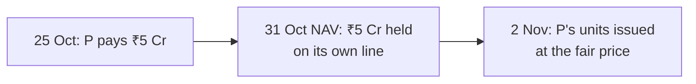

- The line is worked out from the orders — nothing to enter. Each order behind it is listed in the NAV breakdown.
- Money is charged to the **order's own class**, not shared between classes.
- The reverse case is on the same line: a redemption dealt on 2 November but paid on 3 December is held as money owed to that investor, and its units are no longer counted, on any NAV dated in between.
- An **uploaded** NAV is taken as given — the line is not added to it.
- The line assumes your cash balance ("Cash In Hand") is up to date and already includes the money. If the latest cash balance is older than money received, the NAV page warns you to update it and draft again — otherwise the NAV would come out too low.

---

## Subscription and Redemption Orders

Investors place orders from the portal; admins can place them on an investor's behalf from **Dealing → Subscriptions** (**New subscription**) or **Dealing → Redemptions** (**New redemption**), or upload many at once with **Upload** (one file can hold both kinds, so Upload is on both tabs).

- A **subscription** is for an amount. If the investor already has a folio in that class it is topped up; otherwise a new folio is opened.
- A **redemption** is for units, an amount, or all units (as the fund allows), from a specific folio.
- On **Check**, CapHive shows which dealing date the order will go to, the estimated units or cash, and any exit load, before the order is submitted.
- The investor receives an acknowledgement email.
- An order can be **cancelled** while it is pending and its dealing date is still open. A pre-funded subscription whose money has already arrived must be refunded first.

---

## Per-Order Journeys

If the fund's **Order journeys** setting is on, each order runs a journey (for example: collect the signed form, check KYC, verify the signatory, accept). The order's page shows the step bar and **What's needed now**. An order whose journey is not finished by the cut-off is rolled or cancelled, as the fund chooses.

---

## Dealing Dates: Pricing and Confirming

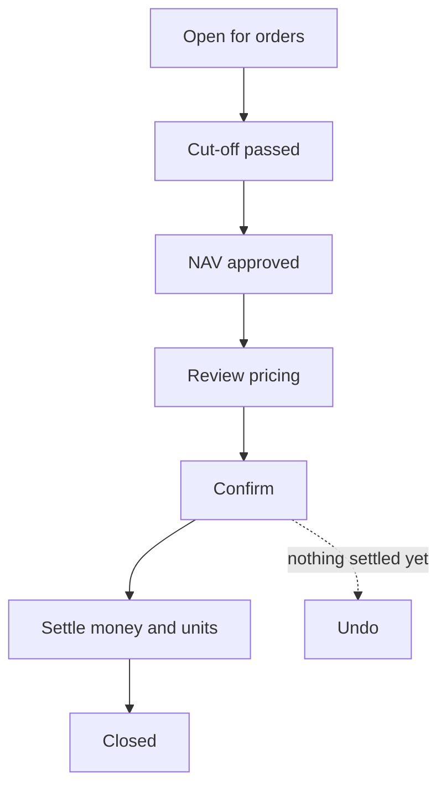

On **Dealing → Dealing Dates**, open a dealing date to see its pricing in two tabs, each with its count — **Subscriptions (n)** and **Redemptions (n)**. The page opens on Subscriptions, or on Redemptions when the date has no subscriptions. Until you click **Confirm dealing** it is a **preview**: a blue line above the tabs says so and names the NAV used, and nothing is allotted, paid, carried or cancelled yet. After confirming, the page keeps the same two tabs and columns: a green line says the date is **Confirmed** (or **Closed**) and the figures are final, the wording turns past tense (**Paid**, **Carried**, **Part-filled**), and each row gains a **Settlement** column with its status and actions.

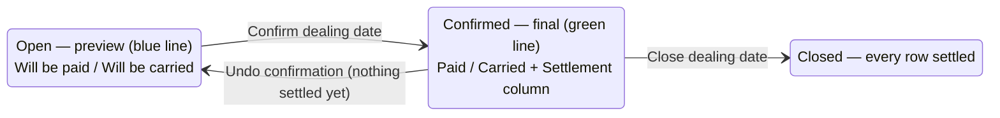

- **Subscriptions** — the units each subscription will receive at the NAV per unit.
- **Redemptions** — four cards first: the **Gate** (e.g. ₹96,71,000.00 · 5% of NAV · FIFO), **Requested**, **Will be paid** with the %, and **Will be carried to** *(the next redemption date)*. Then the same rows as the fund's Redemptions list — Amount, Units, Running total, **Will be paid**, **Will be carried** and **At the gate** (**Will be paid in full**, **Will be part-filled** or **Will be carried**) — here with the exact figures confirming will apply.
- **Not-ready orders** sit in their own tab's table, greyed with a **Not ready** badge, the reason and what confirming will do ("Not paid by cut-off — will roll to 01 December 2026" or "will be cancelled"). They are counted in the tab's number.
- Every row has **View** to open the order.

**Confirm** stores the fills, creates the settlement records, rolls or cancels orders that weren't ready, and emails investors. Confirm is disabled, with the reason beside it, until:

- **the last deadline for the date has passed** — the subscription cut-off and every class's redemption notice deadline ("Cut-off is 26 November 2026 — confirm after it"), so orders placed on time are never pushed out;
- **every class dealing that day has an approved NAV** on or before the date;
- **that NAV is newer than the one the class's previous dealing date used** — two dealing dates never deal at the same NAV per unit ("Class A's 31 October 2026 NAV already priced 02 November 2026 — draft and approve a newer NAV first").

If anything changed since you opened the pricing, confirm is refused and you are asked to review again.

**Undo** returns every order to pending, as long as no units have been allotted and no money has been recorded.

---

## Lock-ups

A lock-up is a minimum time an investor must hold units before redeeming them. It is set on **Evergreen Settings → Redemptions** (0–60 months; 0 means none) and can be different for each class on the **Classes** step.

- **Hard lock-up** — locked units cannot be redeemed. The order is refused: *"1,200 of these units are locked until 15 March 2027."*
- **Soft lock-up** — locked units can be redeemed, with an **exit load** (US wording: **early redemption fee**) deducted from the payout. The fee can be one rate, or a schedule by the units' age (for example 3% in the first year, 2% in the second).

**The clock runs per purchase, not per investor.** Every subscription's units have their own lock-up end date. A redemption uses the **oldest units first**, after netting any units already redeemed:

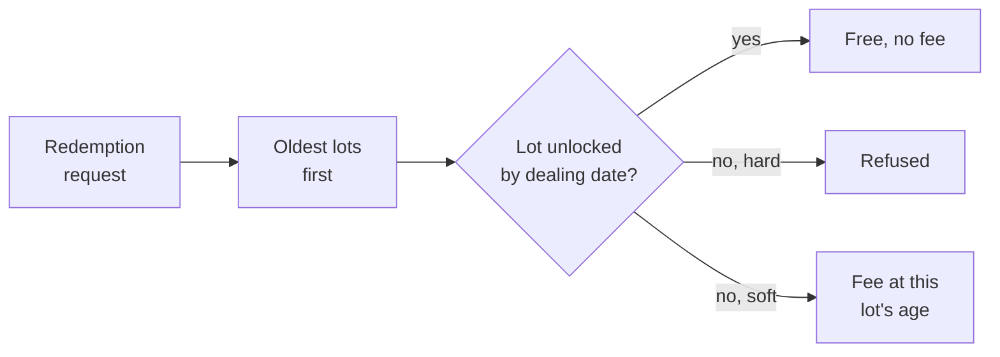

**Worked example** — 12-month lock-up, A Ltd holds 1,000 units bought June 2025 and 300 bought June 2026, and redeems 1,100 units dealt on 1 January 2027:

| Lot | Unlocks | Used | Hard lock-up | Soft lock-up, 2% |
|---|---|---|---|---|
| 1,000 units, Jun 2025 | Jun 2026 | 1,000 (free) | — | no fee |
| 300 units, Jun 2026 | 1 Jun 2027 | 100 (locked) | Refused: *"100 of these units are locked until 01 June 2027."* | 2% on 100 units only |

**Rules worth knowing**

- The lock-up is judged on the **dealing date**, not the day the order is placed. Units bought on 1 Feb 2026 with a 12-month lock-up are free on a 1 Feb 2027 dealing date.
- If a redemption **rolls or is carried** to a later dealing date, its fee is worked out again on that date — units that unlocked in between pay nothing.
- With a fee schedule, **each lot pays the rate for its own age**: 100 units 18 months old at 2% plus 100 units 3 months old at 3%, at ₹10,000 a unit, is ₹20,000 + ₹30,000 = ₹50,000.
- Units already queued in other open redemptions count as used, so they aren't free a second time.
- Investors see locked units, the unlock date and "Free to redeem" on their **Holding**; Redeem is disabled when nothing is free. The GP sees a lock badge per folio on **Investors** (the unit register).
- Optionally, investors get a "Units free to redeem" email the day a lot unlocks.

## Redemption Gates

When redemptions on a dealing date exceed the gate, only part of them is paid:

- **FIFO** — orders are filled in the order they were received until the gate is reached.
- **Pro-rata** — every order is filled by the same percentage.

The unfilled part is **carried** (US wording: **deferred**) to the next redemption date and keeps its place at the front of the queue. Investors whose orders were partly filled receive a gate notice.

---

## Settlement: Money, Units and Documents

| Situation | When units change |
|---|---|
| Pre-funded subscription (payment before dealing) | Units allotted when the dealing date is confirmed |
| Pay-after subscription | Units allotted when the payment is recorded and verified |
| Redemption | Units cancelled when the redemption is marked paid |

On a confirmed dealing date (its Subscriptions and Redemptions tabs), the **Settlement** column shows each row's status as badges — **Allotted**, **Contract note sent**, **Awaiting money**, **Paid**, **Units cancelled**, **Awaiting payment** — and the **Actions** column holds the buttons for that row: **Verify** and **Resend** (each asks first, showing what will happen), **Record payment** and **Mark paid** (each opens a small form for the date and the payment reference), and **Document** / **Regenerate** while a document awaits approval. The order's own page shows what dealing did next to the amount — **Units allotted** (or **Units cancelled**, "to allot" / "to cancel" until the money or payout is done) with the NAV per unit and date — and the same badges and buttons appear in its **Dealing** card. For fund users the order page also links out: the investor, the folio, the dealing date, the units (the fund unit record) and, in the Dealing card, the amount (the remittance or distribution payment); investors see the same details without links — one row per dealing date the order was dealt on, so a carried redemption has a row for each. Units always use the dealing date's NAV per unit, and there are no manual "allocate units" or "redeem units" buttons for evergreen funds. Units are allotted only once a subscription is paid in full.

### Part payments

Units are allotted only once a subscription is paid in full. If an investor pays only part — say ₹50 L of a ₹1 Cr subscription — and you want to take that as their subscription, click **Accept received amount** on the order (or in its row's **Settlement** column on the dealing date). The subscription becomes ₹50 L: the order, the payment due and the folio's subscribed amount all drop to ₹50 L, and units are allotted for ₹50 L at the dealing date's NAV per unit. The order keeps its original amount and who reduced it, and the contract note shows "Subscription reduced from ₹1,00,00,000.00". This can't be undone — money arriving later is an excess to refund.

### Contract notes and redemption advices

The investor is told when their order completes: a **contract note** when units are allotted, a **redemption advice** (gross amount, any exit load, net paid) when a redemption is paid. How depends on whether the fund has document templates:

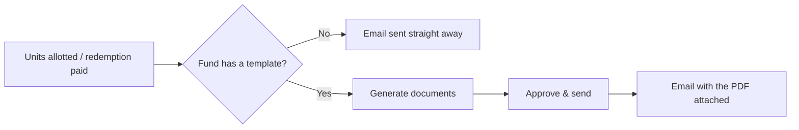

- **No template** — the email goes out at once with the figures in its body; the **Generate documents** and **Approve and send documents** steps show as optional on the dealing date's step bar.
- **With a template** — upload a Word template tagged **Contract Note Template** or **Redemption Advice Template** to the fund. A folio can use its own version by uploading a template with the same name to the folio. On the dealing date, click **Generate documents**: CapHive builds a PDF per settled order, saved to the folio but hidden from investors. Approvers are notified. Check them (**View**, **Regenerate** while unapproved), then click **Approve & send**: every document is approved and emailed to its investor with the PDF attached. Template fields include `evergreen.units_allotted`, `evergreen.nav_per_unit`, `evergreen.amount`, `evergreen.net_paid` and the fund, folio and investor records.

A dealing date can be closed once every investor has been sent their email.

### Customising investor emails

Every evergreen email can be replaced with your own wording. Open the fund's **Notifications** tab → **New Notification** → **New Evergreen Notification**, choose the email, and write its subject and body. Your text replaces the standard email; tick **Show details** to add the request summary (fund, folio, class, amount, date) after it, and keep **Show details link** on to end with the "View your request" link. Text in the template's **WhatsApp** field is also sent on WhatsApp to investors who have it switched on.

| Email | When it is sent |
|---|---|
| Subscription / Redemption acknowledgement | An order is placed |
| Payment instructions | A pay-after subscription is priced |
| Gate notice | A redemption is only partly filled |
| Request moved | An order not ready by the cut-off rolls to the next date |
| Request cancelled | An order is cancelled or rejected |
| Contract note | Units are allotted (no template), or at Approve & send with the PDF attached |
| Redemption advice | A redemption is paid (no template), or at Approve & send with the PDF attached |
| Payment reminder | A few days before the cut-off, pre-funded subscription still unpaid (optional) |
| Action needed | A few days before the cut-off, the order's journey isn't finished (optional) |
| Payment received | The subscription payment is recorded and verified (optional) |
| Units free to redeem | The day a lock-up ends (optional, off by default) |
| NAV update | Each approved NAV, with the investor's holding value (optional, off by default) |

To reuse another fund's wording, choose **Copy from fund…** in the same menu: every template is copied except emails this fund already customises (attached files are not copied).

The body can use placeholders such as `{{investor_name}}`, `{{folio_id}}`, `{{units_dealt}}`, `{{nav_per_unit}}`, `{{amount_dealt}}`, `{{dealing_date}}`, `{{early_redemption_fee}}` and `{{net_paid}}`. Without a custom notification the standard email is sent.

---

## Notifications

Which emails go out, and to whom, is set per fund in **Evergreen Settings → Notifications** (step 8 of the wizard). Investor emails go to the investor's users and to advisors approved to see that order. Team alerts go to named roles:

| Role | Who | How to set it up |
|---|---|---|
| Approvers | Users with the approver role | User → roles |
| Relationship manager | The investor's **Managed by** employee (else Fund ops) | Investor → Managed by |
| Fund ops / Fund accounting / Compliance | Users tagged **FundOps**, **FundAccounting** or **Compliance** | User → tags |

| Team alert | When |
|---|---|
| New order received | An investor places an order on the portal |
| NAV awaiting approval / NAV approved | A NAV is drafted or uploaded / approved |
| Cut-off summary | The day after a cut-off |
| Ready to confirm | The NAV is approved and the cut-off has passed |
| Gate applied | A dealing date is confirmed with redemptions carried forward |
| Large redemption | A redemption at or above the threshold (% of class NAV) |
| Settlement overdue | The day after a payment falls due, then weekly |
| Fee accrual behind | A NAV is drafted before the management fee is accrued to its date |
| Documents awaiting approval | Contract notes / advices were generated and wait for Approve & send |

Each notification is sent once; running the daily checks again never repeats it.

---

## Fees on NAV

- **Management fee** — on **NAV → Fees**, click **Add formula** on step 1 of the three steps at the top. Each allocation run then charges *NAV per unit × units held × class fee % × days ÷ 365* to every folio. Accrued fees reduce the next NAV until a "Management Fee Paid" entry is recorded.
- **Performance fee** — charged only on the gain above the class's **high-water mark** (optionally above a hard or soft hurdle). It is accrued in each NAV and **crystallised** on the class's crystallisation dates when that NAV is approved, raising the mark. See [Performance fee and crystallisation](#performance-fee-and-crystallisation).

### Performance fee and crystallisation

A performance fee goes through two stages:

- **Accrued** — every NAV works out the fee the manager *would* earn if the period ended today, and deducts it from the NAV. Nothing is booked in the ledger yet, and the next NAV works it out again from scratch, so if performance falls the accrual shrinks or disappears.
- **Crystallised** — on the class's crystallisation date (the last day of each quarter, half-year or year, as set on the **Classes** step), approving that NAV makes the accrued fee final: CapHive books a "Performance Fee Crystallised" entry for every folio of the class, split by units held, and raises the **high-water mark** to that NAV per unit. From then on the fee is only charged on gains above the new mark.

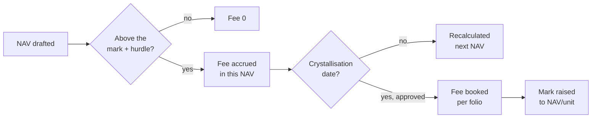

**Worked example** — Class A, 20% performance fee, quarterly crystallisation, mark ₹10,000, 1,00,000 units:

| NAV date | NAV/unit before fee | Fee | NAV/unit after fee | Mark after |
|---|---|---|---|---|
| 31 Oct 2026 | ₹10,220 | 20% × (₹10,220 − ₹10,000) × 1,00,000 = **₹44,00,000** accrued | ₹10,176 | ₹10,000 (not a crystallisation date) |
| 30 Nov 2026 | ₹10,100 | 20% × ₹100 × 1,00,000 = **₹20,00,000** accrued (recalculated, not added) | ₹10,080 | ₹10,000 |
| 31 Dec 2026 | ₹10,220 | **₹44,00,000** crystallised: booked across the folios | ₹10,176 | **₹10,176** |
| 31 Jan 2027 | ₹9,800 | ₹0 — below the mark | ₹9,800 | ₹10,176 |
| 28 Feb 2027 | ₹10,300 | 20% × (₹10,300 − ₹10,176) × 1,00,000 = **₹24,80,000** accrued | ₹10,275.20 | ₹10,176 |

So investors never pay twice for the same gain: after the loss in January, the fee only restarts once NAV per unit climbs back above ₹10,176.

#### How the high-water mark works

##### Why there is a mark at all

A performance fee should pay the manager for **new** gains — never twice for the same gain. Without a mark, a fund that rises, falls and recovers would be charged again for the recovery.

*Example without a mark* — NAV per unit goes ₹10,000 → ₹10,220 (a fee is paid on the ₹220) → falls to ₹9,800 → climbs back to ₹10,220. Measured only against the last low, the manager would earn 20% of the ₹420 climb from ₹9,800, even though investors are no better off than before the fall.

The high-water mark stops this. It is **the NAV per unit up to which investors have already paid a performance fee**. A fee is only ever charged on value above it.

##### How the mark is applied to each NAV

Every time a NAV is drafted for a class, CapHive:

1. **Finds the mark in force on that NAV date.** That is the mark set by the latest *crystallised* NAV before it. If nothing has crystallised yet, it is the class's first approved NAV per unit. If the class has no approved NAV at all, there is no mark and no fee.
2. **Measures the gain above it:** NAV per unit before the fee − mark (raised by the hurdle, if the class has one).
3. **Accrues the fee:** fee % × that gain × units outstanding. A gain of zero or less means a fee of ₹0.
4. **Deducts the fee from the NAV,** so the NAV per unit investors buy and sell at is already net of it.

*Example* — mark ₹10,176, 20% fee, 1,00,000 units, NAV per unit before fee ₹10,300:
gain = ₹10,300 − ₹10,176 = ₹124 → fee = 20% × ₹124 × 1,00,000 = **₹24,80,000** → NAV per unit ₹10,300 − ₹24.80 = **₹10,275.20**.

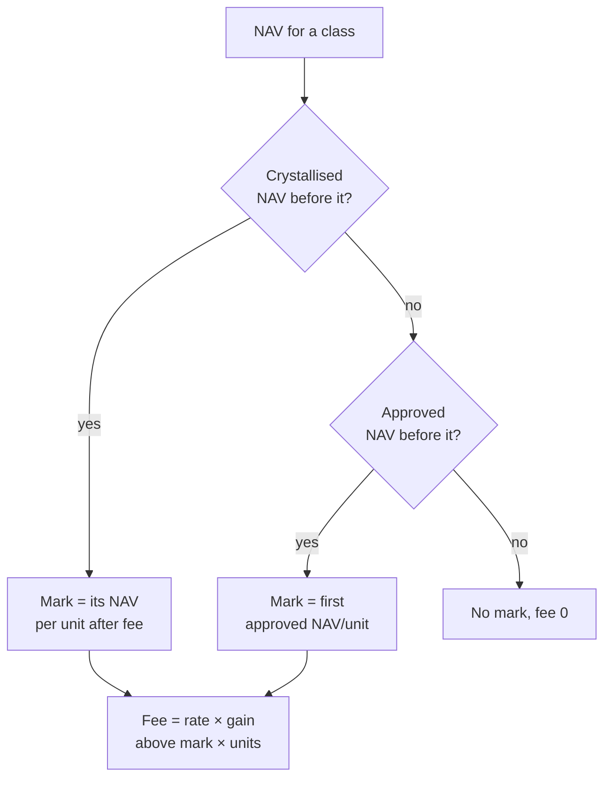

##### When and why the mark changes

The mark changes in exactly one situation: **a NAV on the class's crystallisation date is approved with a performance fee above ₹0.** At that moment the fee is booked — the manager has now actually been paid for the gain up to that level — so the mark moves up to it.

**It moves to the NAV per unit *after* the fee.**
*new mark = NAV per unit before fee − fee per unit*

The after-fee figure is what investors' units are really worth once the manager has taken their share, so it is the level investors have "paid up to":

- Leave the mark at the old ₹10,000 and the manager would be paid **again** for the ₹176 investors already paid on.
- Set it at the before-fee ₹10,220 and investors would have to win back the manager's own ₹44 before the manager earned anything new — the manager would go unpaid on gains investors genuinely made.

| Crystallisation, 31 Dec 2026 | |
|---|---|
| NAV per unit before fee | ₹10,220 |
| Mark in force | ₹10,000 |
| Gain | ₹220 |
| Fee per unit (20%) | ₹44 — ₹44,00,000 booked across the folios |
| **New mark** | ₹10,220 − ₹44 = **₹10,176** |

With a 20% fee the mark therefore rises by 80% of the gain: the part investors kept.

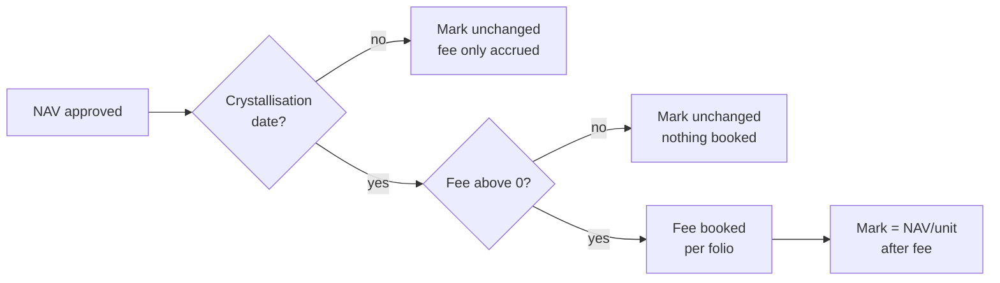

##### Why the mark does not change at other times

- **On ordinary NAV dates** the fee is only an estimate. If NAV falls before the crystallisation date the accrual shrinks or disappears, so nothing has been paid and nothing should move.
- **On a crystallisation date with a ₹0 fee** — NAV below the mark, or a hard hurdle not beaten — no fee is booked, so investors have not paid up to any new level. The mark stays, even if NAV per unit is above the old mark.
- **After a fall** the mark never comes down. Lowering it would let the manager charge again for regaining ground investors already paid on.
- **Subscriptions, redemptions, NAV overrides and re-drafts** don't move it. Only a booked fee does.
- **Reopening** a crystallised NAV un-books its fee, so the mark goes back to the one before it. Approving it again books the fee and raises the mark once.

##### What it means for investors joining or leaving

There is **one mark per class**, shared by everyone in it. It is not tracked per investor.

- An investor who **subscribes while NAV per unit is below the mark** pays no performance fee on the climb back up to the mark, even though that climb is a gain for them.
- An investor who **subscribes while a fee is accruing** buys at a NAV per unit that is already net of that accrued fee, so their price already reflects it.
- When a fee is **booked**, it is split across the class's folios by units held on that NAV date.

##### A year of one class

20% fee, quarterly crystallisation, 1,00,000 units:

| NAV date | Crystallisation date? | NAV/unit before fee | Mark used | Fee | Mark afterwards | Why |
|---|---|---|---|---|---|---|
| 30 Sep 2026 | Yes | ₹10,000 | none | ₹0 | **₹10,000** | First approved NAV sets the mark |
| 31 Oct 2026 | No | ₹10,220 | ₹10,000 | ₹44,00,000 accrued | ₹10,000 | Only an estimate — nothing booked |
| 31 Dec 2026 | Yes | ₹10,220 | ₹10,000 | ₹44,00,000 **booked** | **₹10,176** | Fee paid up to ₹10,220 − ₹44 |
| 31 Mar 2027 | Yes | ₹9,900 | ₹10,176 | ₹0 | ₹10,176 | Below the mark — no fee, no change |
| 30 Jun 2027 | Yes | ₹10,500 | ₹10,176 | 20% × ₹324 × 1,00,000 = ₹64,80,000 **booked** | **₹10,435.20** | Fee paid up to ₹10,500 − ₹64.80 |

Reading it: the manager is paid once for the climb to ₹10,220, nothing for the dip to ₹9,900 or for recovering it, and then only for the new ground above ₹10,176.

**The hurdle clock restarts with the mark.** A hurdle raises the mark by the hurdle rate for the days since the mark was set — the last crystallisation date, or the first NAV date.

**Hurdles** raise the bar before any fee is due. The mark grows by the hurdle rate for the days since it was set: *mark × (1 + hurdle % × days ÷ 365)*. With a 6% hurdle and 92 days, ₹10,000 becomes ₹10,151.2329.

- **Hard hurdle** — the fee is charged only on the gain above the hurdle-adjusted mark: 20% × (₹10,220 − ₹10,151.2329) × 1,00,000 = ₹13,75,342.
- **Soft hurdle** — once NAV per unit beats the hurdle-adjusted mark, the fee is charged on the whole gain above the plain mark: 20% × ₹220 × 1,00,000 = ₹44,00,000.

**Rules worth knowing**

- A crystallisation date that falls on a weekend uses the NAV of the last business day before it (a Friday 29 Sep NAV crystallises the September quarter).

### How fee payments are taken off each class

Each class keeps its own fees, because fee rates can differ by class. When you record a fee payment ("Management Fee Paid" or "Performance Fee Paid", one entry for the whole fund), CapHive takes it off **the classes that owed it**, in proportion to what each owed — never off a class that owed nothing.

*Example* — only Class A has a performance fee. Class A (₹50 Cr before fees) owes ₹2 Cr, so it is worth ₹48 Cr; Class B is worth ₹50 Cr and owes nothing. When the fund pays the ₹2 Cr, Class A stays at **₹48 Cr** and Class B at **₹50 Cr**: paying a fee that was already owed changes neither class's value.

| Owed before the payment | Paid | Taken off |
|---|---|---|
| A ₹9,00,000 · B ₹3,00,000 | ₹6,00,000 | A ₹4,50,000 · B ₹1,50,000 |
| A ₹9,00,000 · B ₹3,00,000 | ₹15,00,000 | Both settled; the extra ₹3,00,000 is split by each class's share of the fund and shows as fee paid in advance |
| Nothing | ₹1,00,000 | Split by each class's share of the fund |

The NAV page warns you if the management fee has not been accrued up to the NAV date.

---

## The GP Screens

The evergreen fund page has the same layout as any fund page:

- **Stats on top** — NAV, NAV per unit, units, net flows for the quarter and the next dealing date (a newer draft NAV awaiting approval is flagged).
- **Details card** — the fund's details plus an **Evergreen** card: NAV per unit by class, the next dealing date with its cut-off and step, the dealing calendar, payment timing and the gate with queued redemptions against it.
- **Tabs** — Dealing, NAV, Investors, Portfolio, Documents, Notifications and Access. Two of them hold a second row of tabs: **Dealing** has Dealing Dates, Subscriptions and Redemptions (the counts are the orders still open), and **NAV** has NAV and Fees. Status badges (with tooltips) show where each dealing date, order and NAV stands.

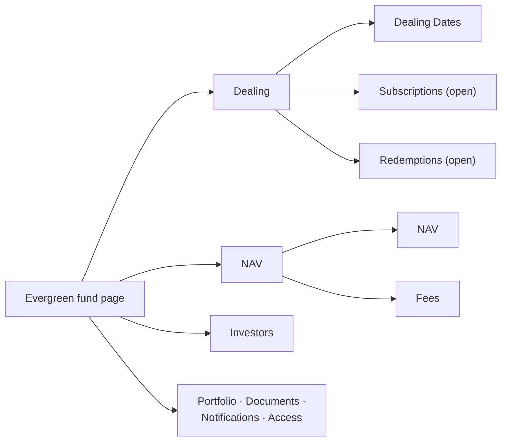

- **Dealing → Dealing Dates** — dealing dates with their cut-off and step. The list shows **With orders** by default: dates with orders or dealt figures, any confirmed date still being settled, and the next date still taking orders even if it's empty. Choose **All dates** in the filter to see every date the calendar has generated.
- **Dealing → Subscriptions** — open subscriptions, in the order they will be dealt; unpaid pre-funded subscriptions near the cut-off are highlighted. **Amount** is what the investor is paying in; **Units** is an estimate (≈) at the latest approved NAV. The date column is the **Subscription date**.
- **Dealing → Redemptions** — open redemption requests, in the order the gate pays them (first received, first paid). One table shows both the request and what the gate does to it:
  - **Amount** and **Units** — the side the investor asked in is shown plainly; the other is an estimate (≈) at the latest approved NAV. A dealt order shows what it actually got.
  - **Running total** — the requests added up in queue order, so you can see where the gate runs out.
  - **Will be paid** and **Will be carried** — the money and units the gate will pay on the next dealing date, and what will move to the one after.
  - **At the gate** — **Will be paid in full**, **Will be part-filled** or **Will be carried**. A request due on a later dealing date shows **Queued for** *(its date)*.
  - Four cards above the table — the same as on the dealing date's Redemptions tab — give the **Gate** (e.g. ₹96,71,000.00 · 5% of NAV · FIFO), what is **Requested for** the next dealing date, what **Will be paid** with the %, and what **Will be carried to** the date after.
- **The filter** (top right of Subscriptions and Redemptions) — the tabs open on **Open** orders only. Choose **Dealt**, **Cancelled / rejected** or **All** to see finished orders, newest first. The gate columns appear only on **Open**, where every row is still waiting.

How the Redemptions tab fills the gate, using the example in the FAQ below:

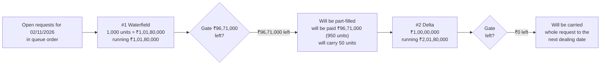
- **Investors** — the unit register: units, value, cost, gain, lock-up and **Queued (units)** per folio, with totals (units only when the fund has one class), downloadable as a spreadsheet. The investor's name links to the investor's page.
- **NAV → Fees** — management fee payable by NAV date, performance fee against the mark, crystallisation history.

Opening a folio (from the register) shows its holding and three tabs:

- **Requests** — the folio's subscriptions and redemptions: received, type, date, requested, the NAV per unit used and the units moved (+ allotted, − redeemed), with any carried units or exit load under the units, status and **View**. An order not priced yet shows "—".
- **Unit History** — every unit movement, oldest first, with a running balance that ends at Holding → Units. A movement made by dealing links to its order; others (opening units, transfers) show their reason. A movement dated after today is badged **Not yet issued**, because Holding counts only units issued up to today.
- **Documents** — the folio's documents.

On an investor's page (Stakeholders → investor → **Commitments**) the list shows **Fund Name** instead of the stakeholder, since every row is the same investor; the main commitments list shows both fund and stakeholder, whatever columns your firm has saved.

---

## What Investors See

Investors see their evergreen holdings as **value, units and NAV per unit** — never committed, called or uncalled amounts. Their fund page has these sections, each opening with its own title and a line saying what its rows are:

- **Holding** — units, value, cost, gain, locked units and units free to redeem, with **Subscribe more** and **Redeem**.
- **Transactions** — allotments and redemptions with their contract notes and advices.
- **Requests** — every order with its timeline (received, money in, filled or part-filled, queue place).
- **NAV history** — approved NAVs per unit only; drafts are never shown.
- **Documents** — statements, contract notes and advices.

Quarterly statements can show opening and closing units, NAV per unit, value, subscriptions, redemptions and fees for the period.

---

## Wording and US Terms

The same screens, emails and confirmations speak the investor's market. Each word is chosen in this order — the first that is set wins:

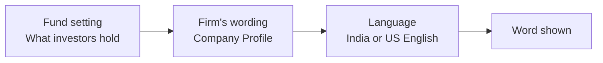

| Word | India English | US English |
|---|---|---|
| Investor's holding in a class | Folio | Account |
| Date both kinds deal on | Dealing date | Transaction date |
| Dealing tab | Dealing | Calendar |
| Confirmation of units bought | Contract note | Trade confirmation |
| Confirmation of a redemption | Redemption advice | Redemption confirmation |
| Unfilled part of a gated redemption | Carried | Deferred |
| Fee on locked units redeemed early | Exit load | Early redemption fee |
| Status after dealing | Dealt | Processed |
| Money in | Money received | Funds received |

Where a screen is about one kind of order it names the date by kind: **Subscription date** or **Redemption date**.

- **Language** follows the user's browser language (en-US gives US English), and the deployment's default when the browser sends none.
- **Your firm's wording** — Company Profile → **Edit** → **Open-ended fund wording**: choose **Units** or **Shares**, and type your own word for any of the listed terms. A blank field keeps the default shown in it. It applies to your team and your investors.
- **One fund's units** — Evergreen Settings → **Classes** → **What investors hold**: **Units** or **Shares**. It overrides the firm's choice for that fund only, and changes every unit word: "NAV per share", "1,000.0000 shares", "Share Register".
- Wording never changes a figure. Documents already generated keep the words they were made with.

---

## Frequently Asked Questions

### Navigation and getting there

**Where do I find evergreen (open-ended) funds in CapHive?**
There is no separate menu: evergreen funds sit with every other fund under Sidebar → [**Funds → Funds**](/funds). Open the fund and it shows the evergreen tabs: **Dealing** (US wording: **Calendar**), **NAV**, **Investors**, **Portfolio**, **Documents**, **Notifications** and **Access**. **Portfolio** appears only when your company uses fund portfolios, and **Documents** only when the fund has a document folder.

**How do I tell open-ended and closed-ended funds apart on the Funds list?**
Each fund on [**Funds → Funds**](/funds) carries a badge: **Open-ended** (infinity icon) or **Closed-ended** (lock icon). The badge comes from the fund's type, so it is always right and can't be edited. It only appears for companies that have open-ended funds switched on.

**Why don't I see the Open-ended option on New Fund?**
The **What kind of fund is this?** page on [**New Fund**](/funds/new) only appears when your company has both the **Evergreen funds** switch and units switched on. Both are company-level switches that CapHive support turns on. Without them New Fund goes straight to the closed-ended form.

**Who can create an open-ended fund?**
Anyone who can create funds: in practice a company admin with funds enabled. Your company also needs the **Evergreen funds** and units switches on. Ask a company admin if New Fund is missing for you, and CapHive support if the Open-ended card is missing for everyone.

**Where are the dealing dates (transaction dates) of an evergreen fund?**
Open the fund → **Dealing** tab → **Dealing Dates** (US wording: **Calendar** → **Transaction Dates**). The **Actions** menu on the fund also has **Dealing Dates**. Open a date with **View** to see its pricing, confirm it and settle it.

**Where do I see open subscriptions and redemption requests?**
Open the fund → **Dealing** tab → **Subscriptions** or **Redemptions**. The number on each tab is the orders still open. Both lists open on **Open** orders; use the filter at the top right for **Dealt**, **Cancelled / rejected** or **All**.

**Where do I draft or upload the NAV of an evergreen fund?**
Open the fund → **NAV** tab → **NAV**, then click **New NAV** to draft one from the ledger or **Upload** to load your administrator's figures. The fund's **Actions** menu has the same page as **Draft / Upload NAV**. You need update access on the fund to see these buttons.

**Where is the unit register of an evergreen fund?**
Open the fund → **Investors** tab. It lists every folio that holds units with its class, units, value, cost, gain, lock-up and units queued for redemption, and **Download** gives the same as a spreadsheet.

**Where do I see one investor's folio (account) and its history?**
On the fund's **Investors** tab, click **View** on the folio's row. The folio page shows its holding and three tabs: **Requests** (its subscriptions and redemptions), **Unit History** (every unit movement with a running balance) and **Documents**. A folio is the evergreen name for a capital commitment; US wording calls it an **Account**.

**Where do I change an evergreen fund's settings?**
On the fund, open **Actions → Evergreen Settings**, or click **Calendar settings** on the **Dealing Dates** list. It holds the same steps as the New Fund wizard (calendar, subscriptions, redemptions, gates, classes, journeys and NAV, notifications) and saves with **Save settings**. **Actions → Edit Fund** opens the whole wizard including the fund details.

**What is in the Actions menu of an evergreen fund?**
**Edit Fund**, **Draft / Upload NAV**, **Dealing Dates**, **Evergreen Settings**, **Unit Settings**, **Units**, **Ledger** and, if you can see stakeholders, **View Stakeholders**. If the fund says shares, the unit items read **Share Settings** and **Shares**. There is no delete item.

**Why don't I see the Actions menu on an evergreen fund?**
The **Actions** menu is only shown to users with update access on the fund. With read-only access you can still open every tab, but you can't edit the fund, draft NAVs, confirm dealing dates or settle orders. Ask a company admin for update access on the fund.

**Where do I reword the emails investors get from an evergreen fund?**
Open the fund → **Notifications** tab → **New Notification** → **New Evergreen Notification**, then choose which email to replace. The same menu has **Copy from fund…** to reuse another evergreen fund's wording. These options appear only on evergreen funds.

**Where do I choose which evergreen emails and team alerts are sent?**
Open **Actions → Evergreen Settings** and go to the **Notifications** step. It has two cards, **Investor emails** and **Team alerts**, with a switch for each optional email and alert plus the reminder days and large-redemption threshold. The everyday emails (acknowledgements, contract notes, redemption advices) are always sent and have no switch.

**Where are the bulk actions for evergreen subscriptions, redemptions or dealing dates?**
Evergreen lists have no **Bulk Actions** button. To act on many records at once, use **Upload** on the **Subscriptions** or **Redemptions** tab to load many orders, or the dealing-date buttons that act on the whole date: **Confirm dealing date**, **Generate documents** and **Approve & send**. Payments are recorded and verified row by row in each row's **Actions** column.

**Where do investors see their evergreen holding?**
On the investor portal, the fund's page shows **Holding**, **Transactions**, **Requests**, **NAV history** and **Documents**, and the home page shows a fund card with value, units, gain, the next dealing date and **Subscribe** / **Redeem** buttons. Investors only see the investors they have approved access to.

**Where did the Subscriptions, Redemptions and Fees tabs go?**
They moved inside other tabs so the top row stays short. Subscriptions and Redemptions are under **Dealing**, next to **Dealing Dates**, because orders wait for a dealing date and are priced on it. Fees are under **NAV**, because the management and performance fees are lines in the NAV. The pages themselves are unchanged.

### Creating, updating and managing evergreen funds

**How do I create and set up an evergreen (open-ended) fund?**
Go to [**New Fund**](/funds/new), pick the **Open-ended (evergreen)** card and click **Continue**. Fill in the fund details, including **Unit Types** (each one becomes a class, for example "A, B"), click **Next** through the other details and the open-ended steps, set a starting price for each class, then click **Create fund** on **Review**. The fund and its terms are saved together; if anything is missing nothing is saved and your entries are kept.

**What are the presets on the Preset step?**
There are four: **Indian Cat III AIF (open-ended)** (monthly redemptions, 30 days' notice, 12-month soft lock-up with a 1% exit load, no gate), **US evergreen / tender-offer fund** (quarterly, 30 days' notice, 12-month soft lock-up at 2%, 5% quarterly pro-rata gate), **US interval fund** (quarterly, 21 days' notice, no lock-up, 5% pro-rata gate per dealing date) and **Hedge-fund style** (quarterly, 45 days' notice, 12-month hard lock-up, 25% per-investor cap, journeys on both kinds). All four take money before dealing and deal subscriptions monthly.

**What does choosing a preset change, and what does it keep?**
A preset fills the form only; nothing is saved until you click **Create fund** or **Save**. It sets the calendars, payment timing, notice, lock-up and early fee, the gate and per-investor cap, and per-order journeys, marking each "Filled from the preset". It keeps the dealing day, cut-off, days to pay, minimums, payment instructions, ways to redeem, settlement days, starting prices, class overrides, NAV ledger names and every notification switch. You can change any value after choosing.

**How do I set when an evergreen fund deals (monthly, quarterly or custom dates)?**
On the **Dealing dates** step of the wizard or **Evergreen Settings**, choose a subscription calendar and a redemption calendar: monthly, quarterly, half-yearly, annual or custom. For custom, list the dates as YYYY-MM-DD. **Dealing date falls on** chooses the **First business day**, **Last business day** or **A set day of the month** (1–28).

**How do I set the subscription cut-off and when investors pay?**
On the **Subscriptions** step, **Cut-off** is how many days (0–30) before the dealing date a subscription must arrive. **Payment timing** is **Before dealing (by the cut-off)** or **After dealing**; for after dealing, **Days to pay** (1–30, default 7) sets the payment deadline after the dealing date. The same step holds **Payment instructions**, which go into the acknowledgement email.

**How do I set a redemption notice period, and can it differ per class?**
On the **Redemptions** step, set **Notice** in days (0–180, default 30): a redemption must be placed that many days before the dealing date. The notice is the redemption order itself — the investor doesn't send anything else — and its deadline is the dealing date minus the notice days, at 23:59. It gives the fund time to raise the cash. A redemption placed after the deadline is not refused: it moves to the next redemption date, and the Check screen shows which date that is before the investor submits. Notice applies to redemptions only; subscriptions have the fund's **Cut-off** instead. To give one class a different notice, go to **Classes**, click **Customise this class** and fill in **Notice (days)**. A blank class field uses the fund's value. For example, with monthly redemptions, Class A on 30 days and Class B on 2 days, a request placed on 20 November misses the 1 December date for Class A (deadline 1 November) and deals on 1 January, while a Class B request placed the same day deals on 1 December (deadline 29 November).

**How do I set a lock-up and exit load (early redemption fee)?**
On the **Redemptions** step, set the lock-up **Length** (0–60 months; 0 means none) and **Type**: **Hard — cannot redeem** or **Soft — redeem with a fee**. For a soft lock-up enter the exit load % (0–10%), or a **Fee by unit age** schedule. A class can override length, type and fee under **Classes → Customise this class**.

**How do I make the exit load depend on how long units were held?**
Use **Fee by unit age** on the **Redemptions** step to enter bands, for example 3% for months 0–12 and 2% for months 12–24. Each purchase lot then pays the rate for its own age on the dealing date. Each rate must be between 0 and 10%; a band that can't be read is dropped and the flat rate is used, so check the schedule after saving.

**How do I set a redemption gate?**
On the **Gates** step, set **Gate (share of NAV)** as a % (0 means no gate), **Gate applies to** the whole fund or each class, **Gate period** per dealing date, quarter or year, and **Who is paid first**: FIFO (first received, first paid) or Pro-rata (everyone filled by the same %). **Gate period** is how long one gate has to last. With **Each dealing date**, every redemption date can pay up to the full gate on its own — with monthly dates and a 5% gate, up to 15% can leave in a quarter. With **Each quarter** or **Each year**, all the dates in that calendar quarter or year share one gate: what earlier dates paid is taken off, and a new quarter or year starts with the full gate. For example, with a 5% gate on a ₹100 crore NAV and ₹4 crore asked for each month, a quarterly gate pays ₹4 crore on 1 October, ₹1 crore on 2 November (₹3 crore carried) and nothing on 1 December, while a per-date gate pays ₹4 crore every time.

**How do I cap how much one investor can redeem?**
On the **Gates** step, set **Per-investor cap (share of holding)**. Each investor can then redeem at most that % of their holding in the class (measured at the start of the gate period) per gate period. The cap is applied before the fund gate; 0 means no cap.

**How do I set minimum subscriptions and a minimum holding?**
On the **Subscriptions** step set **Minimum first subscription** and **Minimum top-up**; on **Redemptions** set **Minimum holding**. A class can override the minimum holding under **Classes → Customise this class**. Orders below the minimum are refused with the minimum in the message, and a redemption that would leave less than the minimum holding is refused unless it redeems all units.

**How do I choose whether investors redeem by units, amount or all units?**
On the **Redemptions** step, tick the **Ways to redeem** you allow: units, amount and all units. At least one must stay ticked. The redemption form then only offers the ticked ways.

**How do I add a new share class (unit type) to an evergreen fund?**
Open **Actions → Edit Fund** and add the name to **Unit Types**, for example change "A" to "A, B". Click **Next** to the **Classes** step, give the new **Class B** card a **Starting price** and click **Save fund**. Classes can't be added from Evergreen Settings, because the class list comes from the fund's Unit Types.

**Can I remove or rename a share class?**
No. A saved class may already hold investors' units, so removing its unit type on Edit Fund never deletes it and its card stays on the Classes step. A saved class can't be renamed either. Only a class card that hasn't been saved yet disappears when you remove its unit type.

**What is a class's starting price for?**
It prices the first subscriptions of the class until it has an approved NAV, and a class with no units outstanding keeps it as its NAV per unit. It must be above zero, and the wizard won't save until every class has one.

**How do I give one class its own fees, lock-up or notice?**
On the **Classes** step click **Customise this class** on the class's card. You can set **Performance fee** (None or Above high-water mark) with **Fee %**, **Hurdle %**, **Hurdle type** and **Crystallises**, plus **Notice (days)**, **Lock-up (months)**, **Lock-up type**, the exit load %, **Minimum holding** and the class expense entries. Blank fields follow the fund's settings.

**How do I set up a performance fee with a high-water mark?**
On **Classes → Customise this class**, set **Performance fee** to **Above high-water mark**, a **Fee %** (0–50), optionally a **Hurdle %** (0–50) with **Hurdle type** Hard or Soft, and **Crystallises** Annually, Half-yearly or Quarterly. Each NAV then accrues the fee on the gain above the class's mark, and the fee is booked when the NAV on a crystallisation date is approved.

**How do I set up the management fee on an evergreen fund?**
Set each class's **Management fee** % on its unit setting (**Actions → Unit Settings**), then open **NAV → Fees** and click **Add formula** on step 1 (*Fee accrues*). The fee is charged only when an allocation run includes the formula, at NAV per unit × units held × class fee % × days ÷ 365 for each folio. Step 1 then reads *set up* and the button disappears. If your NAVs are uploaded from an administrator, you don't need the formula: their NAV already has the fee deducted, and step 1 says so.

**How do I read the Fees tab's management fee table?**
Each row is one approved NAV, newest first, and shows how its payable was reached: **Payable at previous NAV** + **Accrued this period** (the "Management Fees" entries dated after the previous NAV, up to this one) − **Paid this period** (your "Management Fee Paid" entries in the same window, split by what each class owed) = **Payable**, the amount owed to the manager and deducted from this NAV. The three cards above it give the class's fee rate, the payable at its latest NAV and the date the fee is accrued to. A NAV drafted before this split was saved shows "—" in Accrued and Paid. Recalculate a draft to see them.

**Why does a row on the Fees tab say "No fee in this NAV" or "Accrued only to …"?**
The NAV was approved before the management fee was accrued up to its date, so its NAV per unit is too high. Usually the fee formula hadn't been added, or the allocation run stopped short. If no dealing date was priced at that NAV, the row shows **Reopen**: reopen it, run an allocation with the fee formula up to the NAV date, recalculate and approve again. If a dealing date was priced at it, the row says it's locked and names the dealing date, because investors have already dealt at that price and it can't be reopened. A fee booked into its period later appears on the next draft to include or exclude.

**What does "Net flows QTD" on the fund page count?**
Subscriptions minus redemptions **dealt** on dealing dates this quarter, counted when each dealing date is confirmed, because that is when units are priced. A redemption counts as soon as it's dealt, even before it's marked paid. Hover over the card to see the working: what came in, what went out, and how much of it hasn't been allotted or paid yet.

**Why does a dealing date say its gate figures are an estimate?**
Some redemptions on it are waiting for their class's NAV, but they still hold their place in the gate queue. So that every row shows where it stands, the whole queue is valued at each class's latest approved NAV. The box above the cards names that NAV, and the figures become final once the missing NAV is approved. Confirm stays unavailable until then.

**Why can't I approve this NAV?**
The Approve button is disabled with the reason beside it, and a direct request is refused with the same reason. There are three possible reasons. The draft's inputs may have changed since it was drafted: recalculate it. The management fee may not be accrued up to the NAV date: run an allocation with the "Management Fee on NAV" formula up to that date, then recalculate. Or a late management fee may be waiting for your decision in the Late management fees panel. Uploaded NAVs, classes with a 0% fee and a class's first NAV with no units are never refused for the fee.

**What is the Late management fees panel on a NAV draft?**
It appears when management fee entries were booked into a period whose NAV is already approved, so no NAV has counted them. It shows the amount, the period it belongs to, its % of this NAV, how many of the class's investors redeemed since then, and whether that period's NAV can still be reopened. An approver clicks **Decide** and picks **Include in this NAV** (the payable rises by the amount and today's holders bear it) or **Exclude** (with a reason; the fee is never taken through a NAV). Neither is pre-selected, and the draft can't be approved until it's decided. Late fee *payments* need no choice: they're always included, because the cash has already left the fund.

**What happens to a late fee if I reopen the old NAV instead?**
If no dealing date was priced at the old NAV, you can reopen it, recalculate it and approve it again, and the fee then lands in its own month. The panel and the Fees tab say when this is possible. Once a dealing date was priced at that NAV, investors have dealt at its price, so it can't be reopened and the fee can only be included or excluded on the next draft.

**Why do uploaded NAVs show no payable on the Fees tab?**
An upload carries only the NAV, units and NAV per unit. The administrator's figure already has the fee deducted, but there are no fee lines to break down, so the row reads **Fee included by the administrator**. When every NAV of a class is uploaded, the working columns are left out.

**How do I charge an expense to one class only?**
Name the class's two expense entries under **Settings › Classes › Customise this class**, then book the expense and its payment under those names. The class's NAV shows them as **Class expenses payable** and the other classes are not affected, even when it is paid from the fund's cash. See [Expenses for one class only](#expenses-for-one-class-only).

**How do I turn on per-order journeys (approval steps for each order)?**
On the **Journeys & NAV** step, set **Per-order journeys** to **Subscriptions only** or **Subscriptions and redemptions** (default **Off**). Each order then runs its own step bar: check the investor's KYC, collect the signed subscription form, verify the signatory (redemptions), accept the order and collect the money. Also choose under **Not paid or not ready by the cut-off** whether such orders roll or are cancelled.

**What are the NAV ledger names on the Journeys & NAV step?**
They tell the NAV which ledger entries to read: **Cash** (default "Cash In Hand"), **Other assets** ("Net Current Assets"), **Other liabilities** ("Other Liabilities"), **Management fee paid** ("Management Fee Paid") and **Performance fee paid** ("Performance Fee Paid"). Change them if your ledger uses other names; each is required and at most 125 characters.

**How do I change an evergreen fund's terms after it is created?**
Use **Actions → Evergreen Settings** to change only the open-ended terms, or **Actions → Edit Fund** to change the fund details and terms together (finish with **Save fund**). Changes apply to orders received and dealing dates confirmed from then on; dealing dates already confirmed keep the terms they were confirmed with.

**How do I place a subscription on behalf of an investor?**
Open the fund → **Dealing** → **Subscriptions** and click **New subscription** (or **New Order** on the fund page). Choose the **Investor**, **Class** and, to top up, the **Folio** (leave it blank to open a new folio), enter the **Amount** and optionally a back-dated **Received at**. Click **Check** to see the dealing date and estimated units, tick the offering-documents box, then **Submit subscription**. You need update access on the fund.

**How do I place a redemption on behalf of an investor?**
Open the fund → **Dealing** → **Redemptions** and click **New redemption**, or **Redeem** on the folio page. Choose the investor, class and folio, then enter **Units**, an **Amount** or tick **All units**, as the fund allows. **Check** shows the dealing date, estimated value, any exit load and the queue place; **Submit request** places it.

**How do I bulk upload evergreen subscriptions and redemptions?**
On the **Subscriptions** or **Redemptions** tab click **Upload** and load a spreadsheet with the columns **Type** (subscription or redemption), **Folio No**, **Investor**, **Unit Class**, **Amount**, **Units**, **All Units** (yes) and **Received At**. One file can hold both kinds. Each row goes through the same checks as an order entered on screen, and rows that fail are marked in the results sheet while the rest are placed. There is no sample file, so copy these headers exactly.

**How do I check which dealing date an order will go to before submitting it?**
Click **Check** on the new order form once an amount, units or all units is entered. It shows "Will be dealt on" the date (with the payment cut-off for pre-funded funds), the indicative units or value at the latest approved NAV, any exit load and, for redemptions, the queue place. Nothing is saved until you submit.

**How do I cancel a subscription or redemption request?**
Open the order and click **Cancel**, then **Proceed** in the popup. The investor (or their advisor) and fund users with update access can cancel while the order is pending and its dealing date has not been confirmed. If money has already been received for a pre-funded subscription, refund it first.

**How do I reject an order?**
Click **Reject** on the order page, enter a **Reason** and save. Reject appears only when the fund runs per-order journeys for that kind of order, the order is pending and not yet accepted, and you have the **approver** role with update access on the fund. Without journeys, use **Cancel** instead.

**How do I accept an order in a per-order journey?**
Open the order and click **Accept**, then **Proceed**. It needs the **approver** role and update access on the fund, and completes the journey's **Accept order** step; the order stays on its dealing date.

**How do I verify the signatory on a redemption request?**
When the fund runs journeys for redemptions, open the order and click **Verify signatory**. This completes the **Verify request** step. It needs update access on the fund and the order must still be pending.

**How do I upload a signed subscription form for an order?**
Open the subscription and use the **Signed form** card to upload a PDF, image or Word copy. This completes the **Collect signed subscription form** journey step. The investor can upload it from their own request page as well.

**How do I record a subscription payment for an evergreen fund?**
Before the dealing date, open the pending subscription and click **Record payment**: enter the **Amount** (blank means the full amount owed), **Payment date** and **Reference**. After the dealing date is confirmed, use **Record payment** in the subscription's row on the dealing date, which records the full amount still owed. Either way the payment is verified straight away.

**How do I verify a subscription payment and allot units?**
On the confirmed dealing date's **Subscriptions** tab, click **Verify** in the row once the money received covers the amount due, then **Proceed**. Units are allotted automatically at the dealing date's NAV per unit and the contract note goes out (or waits for approval if the fund has a template). Payments recorded with **Record payment** are verified for you.

**How do I accept a part payment as the full subscription?**
Click **Accept received amount** on the order, or in its row on the dealing date, and **Proceed**. The subscription, the payment due and the folio's subscribed amount all drop to the money received, and units are allotted for that amount at the dealing date's NAV per unit. The button appears only for a part-paid subscription without units, and it can't be undone. See [Part payments](#part-payments).

**How do I mark a redemption as paid?**
On the confirmed dealing date's **Redemptions** tab, click **Mark paid** in the row, enter the **Payment date** and **Reference**, and save. Saving cancels the redeemed units and sends the redemption advice (or holds it for approval if the fund has a template).

**How do I draft a NAV?**
Open the fund → **NAV** → **NAV**, click **New NAV**, pick the **NAV date** and click **Draft NAV**. CapHive drafts every class for that date from the portfolio valuations and the ledger and opens the first class's NAV. It stays a draft until someone with the **approver** role approves it.

**How do I upload NAVs from my fund administrator?**
On the **NAV** tab click **Upload** and load a spreadsheet with **Unit Class**, **NAV Date**, **NAV**, **Units Outstanding** and **NAV Per Unit**, one row per class and date. Each uploaded NAV is saved as a draft and must be approved like a drafted one. There is no sample file, so copy these headers exactly.

**How do I override a line in a draft NAV?**
Open the draft class NAV and click **Override line**. Choose the **Line**, enter the **Value** and a **Reason** (required, up to 255 characters), then click **Override line**. The value replaces the computed figure, is kept if the NAV is recalculated, and shows an **Overridden** badge with who changed it and why.

**How do I recalculate a draft NAV?**
Click **Recalculate** on the draft. It appears only when the draft is marked **Stale**, meaning the ledger, valuations, units or payments changed after it was drafted. It rebuilds every class's draft for that date and keeps overridden lines. To re-draft a NAV that isn't stale, use **New NAV** with the same date.

**How do I delete a draft NAV?**
Open the draft class NAV and click **Delete draft**, then **Proceed**. Only that class's draft for that date and its overrides are removed; other classes and approved NAVs are untouched. Approved NAVs can't be deleted; reopen them instead.

**How do I approve a NAV?**
Open the draft class NAV and click **Approve**, then **Proceed**. You need the **approver** role and update access on the fund; who drafted the NAV doesn't matter. A draft marked **Stale** must be recalculated first. Approved NAVs are used to price dealing dates and are shown to investors; each class is approved on its own.

**How do I give someone the approver role for NAVs and orders?**
A company admin opens the user → **Edit** and adds `approver` in **Roles**. Approvers approve and reopen NAVs, accept or reject orders in a journey, and click **Approve & send** for contract notes and redemption advices. See [User Roles](user_role_management_user_guide).

**How do I reopen an approved NAV?**
Open the approved class NAV and click **Reopen**, then **Proceed**. It goes back to draft so you can recalculate, override and approve it again. It needs the **approver** role, and it is not possible once a dealing date has been priced with that NAV.

**How do I record a management or performance fee payment for an evergreen fund?**
Book a ledger entry named "Management Fee Paid" or "Performance Fee Paid" (or the names set on the **Journeys & NAV** step) for the whole fund. The next NAV takes it off the classes that owed the fee, in proportion to what each owed. See [How fee payments are taken off each class](#how-fee-payments-are-taken-off-each-class).

**How do I confirm a dealing date?**
Open the dealing date, check the **Subscriptions** and **Redemptions** tabs (they are a preview until you confirm), then click **Confirm dealing date** and **Proceed**. You need update access on the fund, the last deadline for the date (cut-off and every class's notice) must have passed, and every class dealing that day needs an approved NAV on or before the date that is newer than the one its previous dealing date used.

**How do I undo a dealing date confirmation?**
Open the confirmed dealing date and click **Undo confirmation**, then **Proceed**. It works only while no units have been allotted and no money recorded on that date, and while orders carried or rolled from it haven't been dealt on a later date.

**How do I close a dealing date?**
Click **Close dealing date** once every row is settled: every subscription's units allotted, every redemption paid with its units cancelled, and every investor sent their contract note or redemption advice. The button stays disabled with the reason until then.

**How do I set up contract note and redemption advice templates?**
Upload a Word template to the fund's documents and tag it **Contract Note Template** or **Redemption Advice Template**. Fields include `evergreen.units_allotted`, `evergreen.nav_per_unit`, `evergreen.amount`, `evergreen.gross_amount`, `evergreen.early_redemption_fee`, `evergreen.net_paid` and `evergreen.payment_date`, plus the fund, folio and investor records. See [Document Templates](document_templates_user_guide).

**Can one folio use a different contract note template?**
Yes, but only by replacing a fund template: upload a template to the folio with the same name as the fund's **Contract Note Template** (or **Redemption Advice Template**), and that folio uses it instead. A folio template with no same-named fund template is not used.

**How do I generate contract notes and redemption advices?**
On the confirmed dealing date click **Generate documents (n)**, then **Proceed**. CapHive builds a PDF for every settled order from the fund's templates and saves it to the folio, hidden from investors until approved. You are notified when they're ready, and approvers get a **Documents awaiting approval** alert.

**How do I approve and send contract notes and redemption advices?**
Check the generated PDFs with **Document** (use **Regenerate** to rebuild one), then click **Approve & send (n)** on the dealing date and **Proceed**. Every document waiting is approved and emailed to its investor with the PDF attached. It needs the **approver** role.

**How do I resend a contract note or redemption advice?**
Click **Resend** in the order's row on the dealing date (or in the order's **Dealing** card) and **Proceed**. The same email goes to the investor again; nothing else changes. It appears once the first email has been sent, and only until the dealing date is closed.

**How do I reword an evergreen investor email?**
On the fund's **Notifications** tab choose **New Notification → New Evergreen Notification**, pick the email, write the subject and body, and save with the template enabled. It replaces the standard email for every order in this fund. Use **+ Insert placeholder...** for values such as the investor's name or units dealt.

**What placeholders can I use in evergreen email templates?**
`{{investor_name}}`, `{{fund_name}}`, `{{folio_id}}`, `{{unit_class}}`, `{{request_type}}`, `{{requested_amount}}`, `{{requested_units}}`, `{{dealing_date}}`, `{{cutoff_date}}`, `{{payment_instructions}}`, `{{pending_step}}`, and for emails about a priced order `{{nav_per_unit}}`, `{{units_dealt}}`, `{{amount_dealt}}`, `{{units_carried}}`, `{{early_redemption_fee}}` and `{{net_paid}}`. The NAV update email adds `{{nav_date}}`, `{{holding_units}}` and `{{holding_value}}`; units free to redeem adds `{{unlocked_units}}`.

**How do I copy evergreen email templates from another fund?**
On the fund's **Notifications** tab choose **Copy from fund…**, pick the fund under **Copy from** and click **Copy templates**. Every enabled investor-email template is copied, except emails this fund already has a template for (even a disabled one); attached files are not copied. You need update access on the fund.

**How do I make sure my team receives evergreen alerts?**
Team alerts go to named groups: users with the **approver** role, users tagged **FundOps**, **FundAccounting** or **Compliance** (User → **Tags**, spelt exactly so), and the investor's **Managed by** user. Users must be active and able to see the fund. Then check the alert is switched on under **Evergreen Settings → Notifications**.

**How do I change words like Folio and Dealing date for my firm?**
Open Company Profile → **Edit** → **Open-ended fund wording**. Choose **Units** or **Shares** and type your own word for any of the listed terms (up to 40 characters; blank keeps the default shown). It applies to your team and your investors, on screens, emails and documents generated afterwards. See [Wording and US Terms](#wording-and-us-terms).

**How do I make a fund say shares instead of units?**
Open the fund's Evergreen Settings, go to **Classes** and set **What investors hold** to **Shares**, then save. Every screen, email and confirmation for that fund then says shares — "NAV per share", "Share Register" — while your other funds keep the firm's choice. The numbers do not change.

**How do I download the unit register?**
Open the fund → **Investors** tab and click **Download**. The spreadsheet "<fund> unit register" lists investor, folio, class, units, value, cost, gain %, locked until and queued units for every folio holding units.

**How does an investor subscribe or redeem from the portal?**
On the fund's page or fund card, the investor clicks **Subscribe** / **Subscribe more** or **Redeem**, fills in the class, folio and amount or units, clicks **Check** to see the estimate, then submits. For subscriptions they must tick that they have read the offering documents. They receive an acknowledgement email straight away.

**Can an investor's advisor place evergreen orders?**
Yes. An advisor with approved access, switched into the investor, sees the investor's evergreen page and can subscribe, redeem and cancel pending orders as that investor. Advisors receive the investor emails for orders and folios they are allowed to see.

### Why use evergreen funds

**Why use an open-ended (evergreen) fund instead of a closed-ended fund?**
An evergreen fund has no fixed size or end date: investors pay the full amount when they subscribe and get units at NAV, and redeem by handing units back on dealing dates. There are no commitments to call, no drawdown schedule and no distributions waterfall. Use it for Category III AIFs, hedge-fund style, tender-offer and interval funds.

**Will my closed-ended funds change?**
No. Closed-ended funds keep their pages, capital calls, distributions, unit allocation and statements exactly as before. Evergreen screens only appear for funds created as open-ended.

**Why does an evergreen fund deal only on dealing dates with cut-offs?**
Everyone dealing on a date gets the same approved NAV per unit, so nobody can buy or sell at a stale price. The cut-off and notice period give the fund time to collect money, prepare the NAV and raise cash for redemptions before the date.

**Why have a redemption gate?**
A gate caps how much can leave on one dealing date (or quarter or year), so the fund isn't forced to sell investments cheaply when many investors redeem at once. Unfilled requests are carried to the next date at the front of the queue, so they keep their place.

**Why have a lock-up?**
A lock-up keeps new money in the fund long enough to be invested. A hard lock-up refuses early redemptions; a soft one allows them but charges an exit load that stays in the fund, compensating the investors who remain.

**Why does a NAV need approval before it is used?**
The approved NAV per unit sets the price every investor deals at that day and is what investors see, so it is checked by an approver first. Drafts are never used for dealing or shown to investors. The NAV's audit trail records who drafted, overrode and approved it.

**Why use per-order journeys?**
They make sure each order has what your process needs — KYC approved, signed form, signatory verified, GP acceptance, money in — before it is dealt. An order still waiting at the cut-off is rolled or cancelled automatically, and investors get an **Action needed** reminder before the cut-off.

**Why use contract note and redemption advice templates instead of plain emails?**
With a template, each investor gets a PDF confirmation on your letterhead, saved to their folio, and an approver checks every one before it goes. Without a template, the confirmation email goes out with the figures in its body as soon as units move, with no approval step.

**Why is there a high-water mark?**
It stops the manager being paid twice for the same gain. A performance fee is only charged on NAV per unit above the level investors have already paid a fee up to, so after a fall the fee restarts only once the class climbs back above the mark. See [How the high-water mark works](#how-the-high-water-mark-works).

**Why do my two classes have different NAVs per unit when they hold the same portfolio?**
Each class pays its own fees, so the same portfolio gain leaves each class with a different amount. CapHive splits the shared lines by each class's stake, then takes off that class's own management and performance fees and class expenses, and divides by that class's units. A class that started at a different price, or charges a higher fee, will always show a different NAV per unit.

**Why didn't my classes split the portfolio in proportion to their units?**
The split is by each class's stake (roughly units × the previous NAV per unit, plus fees it still owes), not by units. If Class A has 60,000 units at ₹10,000 and Class B 20,000 units at ₹20,000, A has 75% of the units but only 60% of the value, so it gets 60%. Splitting by units would hand Class A part of Class B's money.

**Why is there a "Money received for orders not yet dealt" line in my NAV?**
Investors in this fund paid before their dealing date. Until their units are issued that money is theirs, not the fund's, so it is held on its own line; otherwise the NAV per unit would be too high and the new investors would get too few units. The line also holds the payout of redemptions dealt but not yet paid.

**Why can't I switch a fund between closed-ended and open-ended?**
A fund's type comes from its offering documents and is chosen once, on New Fund. Switching a live fund would leave its commitments, units or orders without the rules that created them, so CapHive offers no switch. If you picked the wrong type, create the fund again with the right type; moving a fund that already has activity is a CapHive support task.

### What happens when I …

**What happens when I create an open-ended fund?**
The fund, its open-ended terms, its classes and their order journeys are saved together, and the fund page opens with the evergreen tabs. Dealing dates for the next year are generated overnight from the calendar; the first order for a date also creates that date. No one is notified.

**What happens when an investor places a subscription?**
CapHive picks the first dealing date whose cut-off the order meets and emails the investor a **Subscription received** acknowledgement (with payment instructions and a SUB- reference when money is due before dealing). In a pre-funded fund a new folio is opened, or the existing one topped up, straight away. Orders placed on the portal also alert the investor's relationship manager (**New order received**).

**What happens when an investor places a redemption request?**
It is queued for the first redemption date whose notice period it meets, and the investor gets a **Redemption request received** email with their place in the queue. If the request is at or above the large-redemption threshold (% of the class's NAV, default 2%), Compliance and the relationship manager get a **Large redemption** alert.

**What happens when an order is placed after the cut-off?**
It goes to the next dealing date whose cut-off (subscriptions) or notice period (redemptions) it meets. The Check screen and the acknowledgement both say so, for example "Received after the 1 November cut-off — dealt on 1 December."

**What happens when I cancel an order?**
Its status becomes **Cancelled** with who cancelled it, the unpaid payment row is removed, and a folio opened only for this order is removed (a top-up is reversed). For redemptions the queue moves up. The investor is emailed **Request cancelled**. It can't be reopened; place a new order instead.

**What happens when I reject an order?**
It closes as **Rejected** with your reason shown on the order, and will not be dealt. The investor receives the **Request cancelled** email with the reason. As with cancel, money already received must be refunded first.

**What happens when I draft a NAV?**
Every class gets a draft NAV for the date, built from portfolio valuations and the ledger and net of its own fees and class expenses. Approvers other than you get a **NAV awaiting approval** alert, and Fund accounting gets **Fee accrual behind** if the management fee isn't accrued to that date. Nothing is used for dealing or shown to investors yet.

**What happens when I upload a NAV?**
Each row becomes a draft NAV for its class and date, taken exactly as given: no line breakdown, no overrides and no performance-fee accrual, so approving it books no crystallisation. Approvers get **NAV awaiting approval**. Rows that fail are marked in the results sheet and the rest are saved.

**What happens when I approve a NAV?**
It becomes the price for dealing dates on or after its date and appears in investors' NAV history. If it is the class's crystallisation date, the performance fee is booked per folio and the high-water mark raised. The preparer and Fund ops get **NAV approved**, dealing dates past their cut-off that can now be confirmed raise **Ready to confirm**, and if **Monthly NAV update** is on, investors holding the class get a **NAV update** email.

**What happens when I reopen a NAV?**
It goes back to draft and can't price dealing dates until approved again. If it crystallised a performance fee, those fee entries are deleted and the high-water mark goes back to the previous one. No one is notified.

**What happens when I confirm a dealing date?**
The figures in the preview become final: subscriptions get their units priced, redemptions are filled up to the gate and the rest carried, not-ready orders roll or are cancelled, and settlement records are created. Pay-after subscribers get **Payment instructions**, part-filled redeemers a gate notice, and moved or cancelled orders their emails; your team gets **Gate applied** if anything was carried.

**What happens to an order that isn't ready at the cut-off?**
It is rolled to the next dealing date or cancelled, depending on **Not paid or not ready by the cut-off**. An order whose money has already arrived always rolls. The pricing screen shows why it isn't ready ("Not paid by cut-off" or the journey step it is waiting on) and what confirming will do.

**What happens if redemptions exceed the gate (redemption only partly paid)?**
Orders are filled up to the gate, FIFO or pro-rata as the fund chooses. The rest is carried (US wording: deferred) to the next redemption date, keeping its original received time so it stays ahead of newer requests, and the investor gets a **Redemption partly filled** email. If there is no later redemption date in the calendar, the unfilled part closes instead.

**What happens when I undo a dealing date confirmation?**
The priced rows and settlement records are removed and every order on the date — including those rolled, carried or cancelled at confirm — goes back to pending on that date. The date is open again so you can re-check and confirm. Emails already sent are not recalled.

**What happens when I close a dealing date?**
The date shows **Closed** and its step bar is complete; the green line says every row is settled. It is final: no more settlement actions (record payment, verify, mark paid, resend) are offered or accepted on it. Close it once all money, units and investor emails are done.

**What happens when a subscription payment is verified?**
Once the dealing date is confirmed and the subscription is fully paid, units are allotted automatically at that date's NAV per unit. The investor gets **Payment received** (if switched on) and then the contract note, straight away without a template or after **Approve & send** with one. In a pay-after fund this is the moment units are issued.

**What happens when I mark a redemption paid?**
The folio's redeemed units are cancelled and the investor is sent the redemption advice — gross amount, exit load and net paid — straight away, or after **Approve & send** if the fund has a template.

**What happens when I click Accept received amount?**
The subscription becomes the amount received: the order, payment due and folio's subscribed amount drop to it, the original amount is kept on the order, and units are allotted for the reduced amount at the dealing date's NAV per unit. The contract note shows "Subscription reduced from" the original amount. It is final; money arriving later is an excess to refund.

**What happens when I click Generate documents?**
A PDF contract note or redemption advice is built in the background for every settled order that doesn't have one, saved to its folio and hidden from investors. You're notified when they are ready, and approvers get **Documents awaiting approval**. No investor is emailed yet.

**What happens when I click Approve & send?**
Every generated document on the dealing date that awaits approval is approved and emailed to its investor with the PDF attached, and becomes visible in the investor's documents. Approved documents can no longer be regenerated.

**What happens when a performance fee crystallises?**
When the NAV on a class's crystallisation date (quarter, half-year or year end) is approved with a fee above zero, CapHive books a "Performance Fee Crystallised" entry for every folio of the class, split by units held, and raises the high-water mark to that NAV per unit after the fee. If the period ends on a weekend, the last business day's NAV crystallises.

**What happens when I change an evergreen fund's settings?**
Changes apply forward: to orders received and dealing dates confirmed from then on. Dealing dates already generated keep the cut-off they were created with; only payment timing is updated on open dates. The change is recorded in the fund's audit trail.

**What happens every day for an evergreen fund?**
At 01:45 local time, dealing dates for the coming year are generated from the calendar. At 08:00 local time (India time for the India service, about 8am Eastern for the US service) CapHive sends payment reminders and action-needed emails before cut-offs, units-free-to-redeem emails, the cut-off summary, ready-to-confirm alerts and weekly settlement-overdue alerts. Each is sent once; rerunning never repeats it.

**What happens when a lock-up ends?**
The units become free to redeem without a fee on dealing dates from that day, and the investor's Holding shows them as free. If **Units free to redeem** is switched on (off by default), the investor is emailed that day.

**What happens when a fee payment is booked from the fund?**
A fee payment is taken off the classes that owed it, in proportion to what each owed. If only Class A has a performance fee, paying it settles Class A's payable and leaves Class B untouched; any overpayment is split by each class's share of the fund.

**What happens when I copy notifications from another fund?**
Every enabled investor-email template of that fund is copied to this one, unless this fund already has a template for that email. Attachments are not copied. The message says how many were copied and skipped.

### Troubleshooting and edge cases

**Why does Confirm say "Cut-off is … — confirm after it"?**
A dealing date can only be confirmed after its last deadline has passed: the subscription cut-off and every class's redemption notice deadline, each ending at 23:59. Until then investors may still place or pay for orders on time, and confirming early would treat them as late. The message names the deadline still open; confirm the day after it.

**Why does Confirm say a NAV "already priced" an earlier dealing date?**
Two dealing dates never deal at the same NAV per unit. The class's latest approved NAV was already used by its previous dealing date, so pricing this date at it would deal at last period's price. Draft and approve the NAV for this period, then confirm. Undoing the previous date (if nothing has settled) frees its NAV again.

**Why can't I draft a NAV — "An uploaded NAV exists"?**
Drafting rebuilds every class for the date from the ledger, and one class on that date already has your administrator's uploaded figures. CapHive won't replace them silently. To use the ledger instead, open the uploaded draft and click **Delete draft**, then **New NAV**; to correct the upload, upload again.

**Are evergreen emails sent on WhatsApp?**
Yes, when you write text in the **WhatsApp** field of the fund's evergreen template for that email and the investor's access has WhatsApp switched on. Without a template, or with the field empty, only the email is sent.

**Why don't I see New Order, Calendar settings or Save settings?**
These appear only to users who can change the fund: update access on the fund (company admins have it). With read access you can open every evergreen screen and the settings view-only. Ask a company admin for update access on the fund.

**Why is the Confirm dealing date button disabled (greyed out)?**
Confirm waits for the last deadline for the date (the cut-off and every class's notice), and needs an approved NAV for every class dealing that day, dated on or before the date and newer than the one its previous dealing date used. The reason shows beside the button, for example "Cut-off is 26 November 2026 — confirm after it" or "Approve the NAV for Class A dated 31 October 2026 first". It is also disabled with nothing to deal or without update access on the fund.

**Why did Confirm say "Pricing changed — review again"?**
Something changed after you opened the preview — an order, payment or NAV — so the figures you saw are no longer the ones confirming would apply. Reload the dealing date, check the tabs again and click **Confirm dealing date** once more.

**Why does a newer draft NAV stop a dealing date from being priced?**
A dealing date prices at the class's latest NAV on or before its date, and that NAV must be approved. If a newer draft exists, CapHive won't fall back to an older approved NAV. Approve the draft, or delete it if it is not meant to be used.

**Why can't I draft a NAV — "An approved NAV exists for this date"?**
At least one class already has an approved NAV for that date, and drafting rebuilds every class for the date. Reopen the approved NAV first (only possible if no dealing date used it), or draft a different date.

**Why does drafting fail with "No valuation for … on or before …"?**
A portfolio holding has no valuation on or before the NAV date, so its fair value can't be worked out. Add a valuation for that company, or upload the NAV instead. Nothing is saved when drafting fails.

**Why does the NAV say it "would be negative"?**
For that class, liabilities exceed assets on the NAV date. Check the portfolio valuations and the ledger balances (cash, other assets, other liabilities, fee payables). A negative NAV can't be drafted, uploaded or overridden.

**Why is my draft NAV marked Stale?**
The ledger, valuations, units, fee accruals, payments or dealing dated on or before the NAV date changed after the draft was made, so its figures may be out of date. A stale draft can't be approved: click **Recalculate** to rebuild it, then approve. Dealing on later dates doesn't make it stale, and uploaded NAVs are never marked stale.

**Why can't I reopen a NAV?**
A dealing date has already been priced with it ("Used by dealing date … — cannot reopen"), or you don't have the **approver** role. Undo that dealing date first if nothing has settled; otherwise correct the figures in a later NAV.

**Why can't I approve a NAV?**
NAVs are approved by a user with the **approver** role, whoever drafted or changed them; the NAV's audit trail records who drafted, overrode and approved it. Without that role the Approve button is disabled — ask a company admin to give you the approver role. It is also disabled while the draft is **Stale** ("Inputs changed since drafted — recalculate before approving"): click **Recalculate** first.

**Why can't I override a line in an uploaded NAV?**
An uploaded NAV is taken as given and has no lines, only totals. Upload a corrected NAV for the same class and date instead (only while it is still a draft).

**Why did my NAV upload fail?**
Check the results sheet: each failed row gives its reason. Common ones are a class that isn't a unit class of the fund, NAV per unit not equal to NAV ÷ units outstanding (within 0.01), zero units, a negative NAV, or an approved NAV already existing for that class and date. If the same class and date appear twice, the whole file is refused.

**Why does the NAV warn that the cash balance is out of date?**
Investors paid money for orders not yet dealt after the latest "Cash In Hand" balance in the ledger, so the cash figure doesn't include it yet and the NAV would come out too low. Update the cash balance in the ledger and draft the NAV again.

**Why does the NAV warn that the management fee is accrued only to an earlier date?**
The management fee formula has not been run up to the NAV date, so the NAV doesn't include the full fee. Run an allocation that includes the **Management Fee on NAV** formula up to the NAV date, then recalculate. It is a warning, not a block, and never appears on an uploaded NAV, whose figures already include the fee.

**Why is the management fee not reducing my NAV?**
The fee is only accrued when an allocation run includes the **Management Fee on NAV** formula, and the class needs a management fee % on its unit setting. Add the formula from **NAV → Fees** if it isn't there, run the allocation to the NAV date and draft again.

**Why does the NAV warn that a ledger entry "looks class-specific"?**
The ledger has an entry whose name starts with "Class " that no class has named as its expense entry. CapHive doesn't know which class it belongs to, so it is not charged to any class. Name it on the right class (or rename it if it is fund-wide) and draft the NAV again.

**Why can't I remove a class's expense entries?**
The class still owes class expenses on its latest NAV. Pay or reverse them in the ledger, draft and approve a NAV showing nothing payable, then remove the entries.

**Does an unpaid fee in one class change another class's NAV?**
No. A class's stake in the shared portfolio counts the fees it still owes, and falls only when they are paid. If Class A owes ₹1 Cr and nothing else changes, Class A stays ₹49 Cr and Class B ₹50 Cr on the next NAV; when the fee is paid from cash, both stay where they are.

**Why did the performance fee go down from last month?**
The accrued fee is recalculated from the high-water mark on every NAV, not added up. If NAV per unit fell from ₹10,220 to ₹10,100 against a ₹10,000 mark, the accrual falls from ₹44,00,000 to ₹20,00,000 (20% fee, 1,00,000 units).

**What does "crystallised" mean for the performance fee?**
Until a crystallisation date, the performance fee is only an estimate inside each NAV and is recalculated every time. On the class's crystallisation date, approving the NAV books the fee per folio and raises the high-water mark, so the same gain is never charged again. See [Performance fee and crystallisation](#performance-fee-and-crystallisation).

**How does the high-water mark go up?**
Only when a NAV on the class's crystallisation date is approved with a performance fee above ₹0. The mark then becomes that NAV's NAV per unit after the fee — ₹10,220 before a ₹44 fee gives a new mark of ₹10,176. It never goes down; reopening that NAV puts the old mark back.

**Why was a subscription refused for being below the minimum?**
A first subscription into a class must meet **Minimum first subscription**; a top-up of a folio that already holds units must meet **Minimum top-up**. When the two differ, the hint under Amount shows both, for example "Minimum ₹25,00,000 first subscription · ₹10,00,000 top-up".

**Why was my redemption refused when I hold enough units?**
Some of the units are still in a hard lock-up on the dealing date. A redemption uses the oldest units first; the message says how many units are locked and until when — redeem fewer units, or wait for that date.

**Why does a redemption say "You hold N units; M are already queued for redemption"?**
Other open redemption requests on the same folio already use some of its units, and units dealt but not yet paid are no longer free. Redeem only the free units, or cancel the other request first. This also blocks **All units** while another request is open on the folio.

**Why was a redemption refused for leaving less than the minimum holding?**
After the redemption, the folio would be worth less than the class's **Minimum holding** at the latest approved NAV. Redeem less, or tick **All units** to redeem the whole holding.

**Why can't I redeem by amount — "No approved NAV yet"?**
An amount has to be converted to units at an approved NAV, and the class doesn't have one yet. Enter units instead, or wait until a NAV is approved.

**Why does the order say "This fund accepts redemptions in units only" (or amount only)?**
The fund's **Ways to redeem** setting doesn't allow the form you used. Use one of the allowed ways, or ask a fund user to change the setting under **Evergreen Settings → Redemptions**.

**Why does an order say "No open subscription date is available"?**
The fund's dealing calendar has no date within the next three years that the order can meet — usually a custom calendar whose listed dates have all passed. Add dates under **Evergreen Settings → Dealing dates**.

**Why did an investor's order go to a later dealing date than expected?**
Subscriptions must meet the cut-off, and redemptions must meet the notice period, of a dealing date. An order placed later goes to the following dealing date. The order's Check screen shows the date before it is submitted.

**Which dates matter for a dealing date?**
The cut-off (subscriptions) and the class's redemption notice deadline decide which dealing date an order goes to; the NAV date decides its price; the date it is confirmed fixes the figures; and the payment dates decide when money and units move. Pay-after money is due **Days to pay** after the dealing date, and redemption money **Paid within** business days after it. See [Dates in an Evergreen Fund](#dates-in-an-evergreen-fund) for every date on one timeline.

**Which NAV date is used to price a dealing date?**
Each class is priced at its latest approved NAV dated on or before the dealing date — for a 1 December dealing date, usually the 30 November NAV. A NAV dated after the dealing date is never used, a newer draft must be approved first, and the NAV must be newer than the one the class's previous dealing date used. The blue preview line on the dealing date names the NAV it will use.

**When are units issued and cancelled — on the dealing date or later?**
Subscription units are issued with the later of the dealing date and the day the last payment arrived as their date: a pre-funded subscription's units are dated the dealing date, a pay-after one's the day the money came. Redeemed units leave the folio on the **Payment date** entered on **Mark paid**, but stop counting in the NAV from the dealing date.

**When is redemption money (the payout) due to the investor?**
On the dealing date plus the fund's **Paid within** days, counting Monday to Friday only. With 10 days, a 1 December 2026 redemption is due on 15 December. If it isn't marked paid by then, users tagged **FundOps** get a **Settlement overdue** alert the next day and weekly after that.

**When must a pay-after subscriber pay?**
By the dealing date plus the fund's **Days to pay**, counted in calendar days — with 7 days, a 1 December dealing date means 8 December. The date is in the **Payment instructions** email sent when the dealing date is confirmed. Units are issued when the payment is recorded and verified.

**When does a lock-up start, and why does a pay-after subscriber's start later?**
A lock-up runs from the date the units were issued, and a pay-after subscriber's units are issued on the day their money arrives. Units paid on 7 December 2026 under a 12-month lock-up are free from 7 December 2027, not 1 December.

**Why does a dealing date fall on a different day from the one I set (weekends and holidays)?**
Dealing dates are moved to business days: the first business day or a set day moves forward past a weekend, and the last business day moves back. Only weekends count; public holidays are not known, so use a custom calendar to avoid them.

**Why don't changes to the calendar or cut-off show on existing dealing dates?**
Dealing dates already generated keep the cut-off they were created with; settings apply forward. Only payment timing is updated on open dates when you save.

**Why can't I cancel an order — "refund it before cancelling"?**
Money has already been received for this pre-funded subscription. Refund the investor and reverse the payment first, or use **Accept received amount** if the investor paid part and wants to keep that. The Cancel button still shows in this case but refuses with this message.

**Why can't an investor cancel their request any more?**
Requests can only be cancelled while pending and while their dealing date is still open. Once the dealing date is confirmed, the order is priced and Cancel disappears. A fund user can undo the confirmation if nothing has settled yet.

**Why is Undo confirmation disabled?**
Settlement has started on that date: units allotted or money recorded ("Units allotted or payments recorded — reverse them first"). Undo also refuses when orders carried or rolled from the date have since been dealt on a later date — undo that later date first.

**Why can't I close a dealing date?**
Something is still unsettled: a subscription without units, a redemption not paid or its units not cancelled, or an investor not yet sent their contract note or redemption advice. The disabled button names what is left — "Settle every row first" or "Send every contract note and redemption advice first".

**Have the redemptions on a dealing date gone through?**
Not until someone clicks **Confirm dealing date**. Before that the dealing date is a preview — the blue line above its tabs says so, and every figure reads "will be paid" or "will be carried". Confirming prices the orders and starts the payments; the line turns green ("Confirmed … these figures are final"), the rows read "paid" and "carried", and each row's **Settlement** column tracks the money and units from there.

**Can a dealing date be undone after confirming?**
Yes, until anything has settled: no units allotted and no money recorded. Undo returns its orders to pending, including those rolled or cancelled at confirm. After settlement starts, reverse the payments first.

**Why did a subscription get units only days after the dealing date?**
The fund takes payment after dealing. Units are allotted when the payment is recorded and verified, at the dealing date's NAV per unit, and the contract note goes out then.

**Why doesn't Record payment on the dealing date ask for an amount?**
On a dealing date's row, **Record payment** always records the full amount still owed, with a date and reference. To record a smaller amount before dealing, use **Record payment** on the order page, where **Amount** can be entered; to take a part payment as the subscription, use **Accept received amount**.

**An investor paid only part of their subscription — what happens?**
No units are allotted until it is paid in full. Record the rest when it arrives, or click **Accept received amount** to make the money received the subscription; units are then allotted for that amount at the dealing NAV.

**Why is there no Verify button on a subscription row?**
**Verify** shows only once the money received covers the amount due and units aren't allotted yet. While money is short you'll see **Record payment** and, for part payments, **Accept received amount** instead. Rows already verified show **Allotted**.

**Does an investor hear when their subscription or redemption is completed?**
Yes. A contract note is emailed when units are allotted and a redemption advice when the redemption is paid — with the figures in the email, or with a PDF after **Approve & send** if the fund has templates. You can reword both from the fund's **Notifications** tab with a **New Evergreen Notification**.

**Why was no contract note sent to my investor when units were allotted?**
The fund has a **Contract Note Template**, so the note waits for approval. Open the dealing date, click **Generate documents** if needed, check the PDFs, then **Approve & send** — the email goes out with the PDF attached.

**Why can't I click Approve & send?**
Approve & send needs the **approver** role; without it the button is disabled with "Only approvers can approve documents". It also needs documents to have been generated first with **Generate documents**.

**Why can't I regenerate a contract note?**
Documents can be regenerated only while they await approval (or if generation failed). Once approved and sent they are final. A document is also only generated after the order has settled, and only if the fund still has a template.

**Why did an investor not get any evergreen email?**
Evergreen emails go to the investor's users with approved access and email switched on, and to advisors allowed to see that order. Check that the stakeholder has an approved **Investor Access** user (a stakeholder user) with email switched on. Optional emails (payment reminder, action needed, payment received, units free to redeem, NAV update) must also be switched on in **Evergreen Settings → Notifications**.

**Why did nobody on my team get the cut-off summary?**
Team alerts go to named roles. Tag the right users **FundOps** (or **FundAccounting** / **Compliance**) and make sure the alert is switched on in **Evergreen Settings → Notifications**.

**Why didn't I get the "NAV awaiting approval" alert for my own NAV?**
That alert goes to approvers other than the person who drafted or uploaded the NAV. If you are the only approver, no one receives it — open the NAV and approve it yourself.

**Why didn't the relationship manager get a "New order received" alert?**
It is sent only for orders investors or advisors place on the portal, not for orders entered or uploaded by your team. It goes to the investor's **Managed by** user, or to users tagged **FundOps** when there is none.

**Why do investors get a NAV update email every time a NAV is approved?**
**Monthly NAV update** (off by default) sends an email for every approved NAV of a class the investor holds — monthly if you approve monthly NAVs. Switch it off under **Evergreen Settings → Notifications** if NAVs are approved more often than you want to email.

**Why didn't investors get a "units free to redeem" email?**
**Units free to redeem** is off by default. Switch it on under **Evergreen Settings → Notifications**; it is then sent on the day a purchase lot's lock-up ends.

**What does a redemption's queue number (#) mean?**
It is the request's place among the open redemption requests on the same dealing date — and in the same class when the gate is per class — in the order received. With a FIFO gate that is the order requests are paid in; with a pro-rata gate every request on the date is filled by the same %, whatever its place. Hover over the badge to see which applies.

**How does the Redemptions tab work out who the gate pays?**
It lists open requests for the next dealing date in queue order (first received, first paid), values each at the latest approved NAV and keeps a **Running total**. Each request is paid until the gate is used up. For example, with a ₹96,71,000 gate, Waterfield (1,000 units ≈ ₹1,01,80,000) is paid ₹96,71,000 — 950 units — and carries 50 units; Delta (₹1,00,00,000, received later) carries the whole request.

**Why is the amount paid on the Redemptions tab different from what was actually paid?**
The tab estimates at the latest approved NAV and does not apply investor-level limits. Confirming the dealing date re-prices at that date's NAV and applies them, so treat the tab as a forecast and the dealing date's review as final. Gate already used earlier in a quarterly or yearly gate period is taken off in both, and the gate card says how much.

**Why does one request show an amount and the other only "≈" units?**
An investor redeems either a sum of money or a number of units. The side they asked in is shown plainly; the other is converted at the latest approved NAV and marked ≈ because the dealing date's NAV sets the final figure. Hover over the ≈ figure to see the NAV used.

**Why wasn't a gated redemption carried forward?**
There is no later redemption date in the fund's calendar, so the unfilled part closes instead of being carried. The investor's gate notice says so. Add dates to the calendar if redemptions should continue.

**Why does a dealing date say Subscriptions (1) when no subscription is priced?**
The count includes orders that are not ready, such as a pre-funded subscription not paid by the cut-off. They are listed in the same table, greyed with a **Not ready** badge, the reason and what confirming will do — roll to the next date or be cancelled. Open it with **View** to chase the payment.

**What do the Awaiting money and Not ready badges on an order mean?**
**Awaiting money** means a pre-funded subscription isn't fully paid yet; it will roll or be cancelled if money misses the cut-off. **Not ready** means a step of the order's journey is still pending; hover over it to see which. Both clear on their own once the money or step is done.

**Why don't I see every dealing date in the list?**
The calendar generates months of dates ahead, most with nothing on them yet, so the list opens on **With orders**: dates with orders, confirmed dates still being settled, and the next date still taking orders. Choose **All dates** from the filter at the top right to see the whole calendar.

**Why can't I find a dealing date from more than six months ago?**
The Dealing Dates list shows dates from six months ago onwards, up to 50 at a time. Older orders are still on the **Subscriptions** and **Redemptions** tabs under the **Dealt** or **All** filter, and on each folio's **Requests** tab.

**Why don't I see last month's redemptions on the Redemptions tab?**
The tab opens on **Open** requests only — the ones still waiting to be dealt — so the list and its gate columns are about what happens next. Finished requests are one click away: choose **Dealt**, **Cancelled / rejected** or **All** from the filter at the top right. Those views list newest first and show what each dealt order actually got.

**Why does a folio hold units that no subscription explains?**
The units were loaded directly — for example opening units when the fund was moved onto CapHive — rather than allotted on a dealing date. Open the folio's **Unit History**: every movement is listed with its source and a running balance, so units with no order show their reason, such as "Opening units".

**Why does a unit movement say "Not yet issued"?**
Its issue date is after today. The folio's **Units held** counts only units issued up to today, so the movement is listed but not yet in the holding.

**Why does one redemption pay different exit load (early redemption fee) rates?**
Each purchase lot pays the fee for its own age. Under a 3% (first year) / 2% (second year) schedule, units bought 18 months ago pay 2% and units bought 3 months ago pay 3%.

**Why is the Redeem button disabled for an investor?**
The investor has no units free to redeem: they are all in a hard lock-up, or already queued in other redemption requests. The reason is shown under the button, for example "All your units are locked until 15 March 2027".

**A fee was paid from the fund — why did only one class's payable change?**
A fee payment is taken off the classes that owed it. If only Class A has a performance fee, paying it settles Class A's payable and leaves Class B untouched.

**Why does the order form not have the "New subscription" button on the Redemptions tab?**
Each tab offers its own kind: **New subscription** on Subscriptions and **New redemption** on Redemptions. **Upload** is on both tabs because one file can hold both kinds.

**I added a unit type on Edit Fund but no class card appeared — why?**
The Classes step keeps one card for each unit type in the Unit Types box, updated as you type. Spaces around a unit type are ignored and repeats count once, so typing "A, A " or "A ,B" for an existing class A adds no second A card. Check the box on step 1 lists the new name exactly as you want it, and give the new class a starting price before **Save fund**.

**I removed a unit type on Edit Fund — why is its class still there?**
A saved class may already hold investors' units, so editing the Unit Types box never deletes it. Only class cards that haven't been saved yet disappear when their unit type is removed.

**Why does Evergreen Settings say "A fund's type is chosen when it is created and can't be changed"?**
The fund is closed-ended, and open-ended terms can only be set on a fund created as open-ended. Create a new fund with the **Open-ended (evergreen)** card on [**New Fund**](/funds/new).

**Why can't I save Evergreen Settings?**
Saving needs update access on the fund: users with read access see the settings view-only, without **Save settings**. Otherwise read the messages at the top: common ones are a custom calendar with no dates, a gate or cap outside 0–100%, an exit load above 10%, no way to redeem ticked, or class expense entries filled in only one of the pair.

**Why can't I delete an evergreen fund?**
The evergreen fund's Actions menu has no delete item, because a fund with orders, units and NAVs should not be removed by mistake. Contact CapHive support if a fund created in error needs to be removed.

**Why do some of my users see "Account" and "Transaction date" instead of "Folio" and "Dealing date"?**
Their browser is set to US English, which shows the US terms. To make everyone see the same words, set them under Company Profile → **Edit** → **Open-ended fund wording**; your firm's words apply whatever the browser language.

**Why don't I see "Open-ended fund wording" on the Company Profile?**
The section is shown only when the company's type is **Investment Fund**. Ask CapHive support if your company runs evergreen funds under another type.

**Why does a button ask me to confirm before it does anything?**
Every action that sends an email, moves units or money, or can't be undone in one click shows an **Immediate Actions** popup first, listing what will happen. Click **Proceed** to go ahead or **Cancel** to leave everything as it is. Actions that need a date or a reason (Record payment, Mark paid, Reject, Override line, New NAV) open a small form instead; saving it is the confirmation.

**Why is NAV per unit shown with two decimals when units have four?**
Screens show NAV per unit rounded to two decimals and units to four, but CapHive keeps more precision behind them: units are calculated as amount ÷ NAV per unit to eight decimals. So units × the displayed NAV per unit can differ from the amount by a few paise.

---

## Related Guides

- [Fund Units](fund_units_user_guide) — the unit records evergreen dealing creates, and unit settings such as the class management fee.
- [Capital Commitments](capital_commitments_user_guide) — a folio is a capital commitment; how commitments work for closed-ended funds.
- [Custom Notifications](custom_notifications_user_guide) — the email template editor behind **New Evergreen Notification**.
- [Document Templates](document_templates_user_guide) — building the Word templates for contract notes and redemption advices.
- [Stakeholders (Investors)](investors_user_guide) — the investors who hold folios, and the **Managed by** relationship manager.
- [Investor Access](investor_access_tutorial) — who on the investor's side receives emails and can place orders.
- [Investor Advisors](investor_advisor_user_guide) — advisors acting for an investor on the portal.
- [User Roles](user_role_management_user_guide) — giving users the approver role and tags for team alerts.
