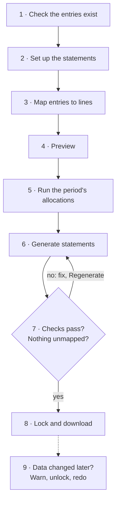
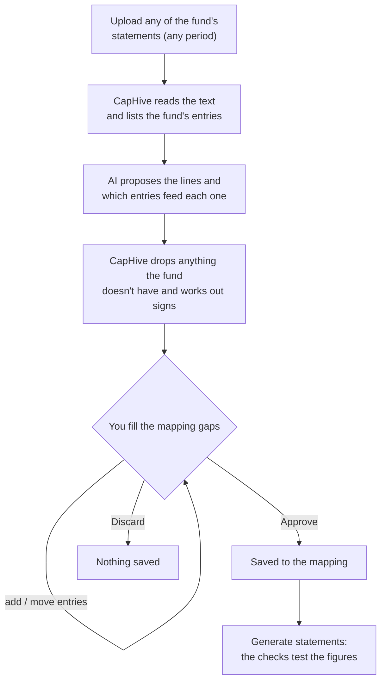
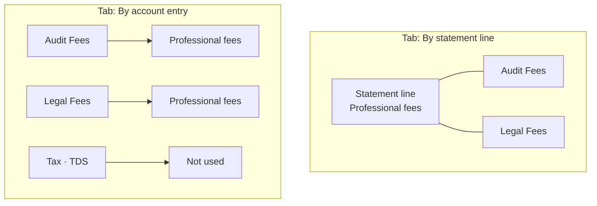
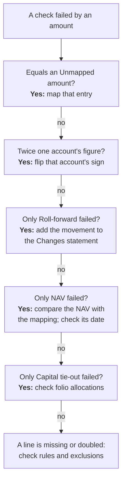

# Financial Statements User Guide

Financial Statements produces a fund's Balance Sheet, Profit & Loss and Statement of Changes in Partners' Capital directly from the account entries the fund already keeps in CapHive, checks them, and lets you lock and download them.

> **Where to find it:** Sidebar → [**Funds → Funds**](/funds) → open the fund → **Actions → Account Entries → Financial Statements**. Viewing and downloading need read access to the fund; setting up, editing the mapping or layout, generating and locking need update access.

---

## Table of Contents

1. [What this is for](#what-this-is-for)
2. [The journey, step by step — and why](#the-journey-step-by-step--and-why)
3. [What you end up with](#what-you-end-up-with)
4. [The idea in plain words](#the-idea-in-plain-words)
5. [What to expect: the first time, and every period after](#what-to-expect-the-first-time-and-every-period-after)
6. [Before you start](#before-you-start)
7. [Key terms](#key-terms)
8. [The four tabs](#the-four-tabs)
9. [Setting up a fund (once)](#setting-up-a-fund-once)
10. [Starting from last year's statements (AI draft)](#starting-from-last-years-statements-ai-draft)
11. [Statement accounts](#statement-accounts)
12. [Mapping account entries to accounts](#mapping-account-entries-to-accounts)
13. [Laying out the statements](#laying-out-the-statements)
14. [Settings](#settings)
15. [Previewing the statements](#previewing-the-statements)
16. [Generating statements for a period](#generating-statements-for-a-period)
17. [Reviewing a statement set](#reviewing-a-statement-set)
18. [Checks and warnings](#checks-and-warnings)
19. [Locking](#locking)
20. [Downloading Excel and PDF](#downloading-excel-and-pdf)
21. [When data changes after locking](#when-data-changes-after-locking)
22. [Unlocking allocation runs over locked statements](#unlocking-allocation-runs-over-locked-statements)
23. [Worked example: Q3 2026 from start to finish](#worked-example-q3-2026-from-start-to-finish)
24. [Who can do what](#who-can-do-what)
25. [Frequently Asked Questions](#frequently-asked-questions)
26. [Related Guides](#related-guides)

---

## What this is for

Every fund has to produce financial statements — usually quarterly for investors and yearly for the auditors: a **Balance Sheet** (what the fund owns and owes, and what belongs to the partners) and a **Profit & Loss** (the income, expenses and gains for the period), plus a statement of how partners' capital moved.

The numbers for those statements are **already in CapHive**. Every fee, expense, income item, contribution, distribution and valuation the fund records is an *account entry* — uploaded by the fund administrator or calculated by the fund's allocation formulas. What has been missing is a way to turn those entries into statements:

- **Today**, someone exports the entries and builds the statements in Excel, or keeps a Word template that adds up entries by their exact names. Both break quietly: a new expense name (say *Director Fees*, uploaded for the first time) simply doesn't appear, and nothing tells you the Balance Sheet no longer balances.
- **With Financial Statements**, you tell CapHive **once** which entries make up which statement line. From then on it builds the statements for any period in a few clicks, **flags every entry it doesn't know where to put**, and **checks** that the Balance Sheet balances, ties to the fund's NAV and agrees with the investors' capital accounts — before anyone can lock and publish them.

It is **not** an accounting system: there are no journals, debits or credits, and you don't re-enter anything. It reads the entries the fund already has.

---

## The journey, step by step — and why

This is the whole journey from "nothing set up" to published statements. Steps 1–4 happen **once per fund**; steps 5–8 happen **every period**; step 9 only if data changes after you've published.

| # | Step | What you do | What you see | Why this step exists |
|---|---|---|---|---|
| 1 | **Check the entries exist** *(once)* | Make sure the fund has fund-level entries for every line its statements print (cash, investments, payables, contributions, distributions, income, fees, expenses, NAV) | — | The statements only read account entries. A figure that isn't an entry can't appear on a statement, so anything missing is uploaded or created by an allocation formula first |
| 2 | **Set up the statements** *(once)* | **Suggest from statements** (upload last year's statements for an AI draft) or **Set up by hand** | The Balance Sheet, P&L and Changes in Partners' Capital with standard sections; with the AI, a draft of which entries feed each printed line | CapHive has to know what your statements look like — which lines they print and in what order — before it can produce them |
| 3 | **Map entries to lines** *(once)* | On the **Mapping** tab, add statement accounts and rules; **Map** or **Exclude** everything under **Unmapped** | The Unmapped list shrinking to zero; each account's figure filling in | This is the seating plan. Every entry must land on exactly one line, or be excluded on purpose, so nothing is double counted and nothing silently drops out |
| 4 | **Preview** *(once, and whenever you change the mapping)* | Pick a period and open **Preview statements**; set the NAV entry on **Settings** | The statements for that period and the checks, computed live; nothing is saved | So you can see the result — and spot a missing entry or a wrong sign — before generating anything official |
| 5 | **Run the period's allocations** *(every period)* | Run and complete the accounting allocation run as you do today (**Allocate Account Entries**) | The run shows Success (locked or not) | The allocation formulas create many of the entries the statements read (fees, contributions, valuations). Statements must be built from the period's final figures, so Generate refuses until a successful run covers the period |
| 6 | **Generate statements** *(every period)* | On the **Statements** tab, enter the period and click **Generate statements** | A set showing *Generating…*, then **Draft** | Produces the statement set for that period. It runs separately from the accounting run, so it never changes any accounting entry and works even when that run is locked |
| 7 | **Review, fix, regenerate** *(every period)* | Read the statements and the **Checks**; map any new entry; fix data if a check fails; **Regenerate** | Checks Passed / Failed with the difference; the Unmapped count; warnings such as a stale balance | Catches problems before anything is published: a new expense nobody mapped, a balance that wasn't uploaded, statements that don't agree with the NAV or the investors' capital |
| 8 | **Lock and download** *(every period)* | **Lock**, then **Excel** or **PDF** | *Locked on … by …*; the downloads | Locking freezes the figures as the published version: downloads and next year's comparatives use exactly these numbers, even if the data is edited later |
| 9 | **If data changes later** *(only when needed)* | Read the **Changed since locked** warning; unlock the period's allocation runs, re-run, regenerate and lock again | A yellow banner with each changed line; a warning popup when unlocking; Fund accounting is notified | Published figures should never change silently. CapHive keeps what was published, shows what has changed, and makes re-publishing a deliberate, visible step |

---

## What you end up with

For any period (a quarter, a half year, a year), a **statement set**: the fund's statements, generated together so they agree with each other.

| Statement | What it shows | Columns |
|---|---|---|
| **Balance Sheet** | What the fund owns (investments, cash), what it owes (accrued expenses), and partners' capital | At the period end · at the prior financial year-end |
| **Profit & Loss** | Income, expenses and gains for the period | This period · year to date · same period last year |
| **Statement of Changes in Partners' Capital** | Opening capital, contributions, distributions, the P&L result, closing capital | This period · year to date · same period last year |
| **Schedules** you add (optional) | E.g. a Schedule of Fund Expenses listing every expense line | Either style |

A Balance Sheet looks like this (the fund in the [worked example](#worked-example-q3-2026-from-start-to-finish)):

| Balance Sheet as at 30/09/2026 | |
|---|---|
| Investments at fair value | 9,200,000 |
| Cash | 596,700 |
| **Total assets** | **9,796,700** |
| Accrued expenses | (30,000) |
| **Net assets** | **9,766,700** |
| Contributions | 10,000,000 |
| Distributions | (400,000) |
| Accumulated net result | 166,700 |
| **Total partners' capital** | **9,766,700** |
| **Total liabilities and partners' capital** | **9,796,700** |
| *Assets = Liabilities + Partners' capital* | *9,796,700 = 30,000 + 9,766,700 ✓* |

Alongside the statements you get:

- a **Checks** panel — does it balance, does it match the NAV, do the investors' capital accounts add up, does capital roll forward — each Passed, Failed (with the difference) or Skipped;
- an **Unmapped** count — entries with amounts that aren't on any line yet;
- **Lock**, which freezes the figures as the published version and uses them as next year's comparatives;
- **Excel** and **PDF** downloads.

---

## The idea in plain words

Think of a seating plan for a dinner.

- The **guests** are the fund's account entries — there can be hundreds of names: *Audit Fees*, *Legal Fees*, *Custody Fees*, one *Deal Expense* per portfolio company, *Bank Balance*…
- The **tables** are the lines of your statements — a few dozen: *Professional fees*, *Transaction costs*, *Cash*… In CapHive these are called **statement accounts**.
- The **seating plan** is the **mapping**: *every Non Deal Expense named Audit Fees sits at Professional fees*; *every Deal Expense, whatever its name, sits at Transaction costs*; *Portfolio Allocation entries don't come to dinner* (**Excluded**).
- Anyone who turns up **without a seat** is listed under **Unmapped** instead of quietly going missing. You can't lock the statements until everyone is seated or deliberately excluded.

Once the seating plan exists, CapHive does the adding up for any period, lays the lines out as your statements print, and checks the totals.

Three things CapHive works out for you:

- **Balances and movements.** A Balance Sheet line is a value at a date; a P&L line is a total over a period. You say which each account is; CapHive computes the period, year-to-date and opening figures from the entries.
- **The P&L closes into capital.** Partners' capital on the Balance Sheet automatically includes the P&L result since the fund started (*Accumulated net result*), so the Balance Sheet balances without a separate retained-earnings entry.
- **Signs.** Accounts hold natural amounts (an expense is a positive cost); on the statements, expenses and liabilities print in brackets.

---

## What to expect: the first time, and every period after

**The first time (once per fund) is where the work is** — you are teaching CapHive how this fund's entries become its statements. After that, each period is a few clicks plus a review.

| | First time (set-up) | Every period after |
|---|---|---|
| **What you do** | Set up the statements (AI draft from last year's statements, or by hand); create the statement accounts; map the fund's entries to them; check the layout; set the NAV entry for the NAV check | Make sure the period's accounting allocations have been run; click **Generate statements**; review; map any new entry names; **Lock**; download |
| **What you'll see** | An empty Mapping tab filling up as you add accounts and rules; the **Unmapped** list shrinking to zero; the **Checks** turning green on the preview | A Draft set appearing within a short while; usually 0 unmapped and all checks passed, unless something new was uploaded |
| **Typical first-time surprises** | Entries you didn't know the fund had (they show under Unmapped); a sign the wrong way round (fix with **Flip the sign**); the Balance check failing until the last missing entry is mapped | A new expense name under Unmapped; a **Stale balance** warning when a balance (e.g. Cash) wasn't uploaded for the period |
| **Who** | Someone who knows the fund's statements (fund admin / accountant) | Fund admin generates; accountant reviews and locks |

**The fastest start** is **Suggest from statements**: upload any of the fund's published statements and the AI proposes the accounts, layout and which entries feed each line. Nothing is saved until you approve.

**Before you lock**, every entry must be mapped or excluded and every check must pass (or be skipped because it isn't set up). Locking is what makes the figures "published": they no longer change, even if the data does — CapHive shows a warning instead.

---

## Before you start

A statement can only show what exists as an account entry. Before setting up, check that the fund has **fund-level** entries (not per investor) for everything its statements print:

| Statement line | Example account entry (entry type / name) | Usually comes from |
|---|---|---|
| Investments at fair value | Portfolio FMV / Investments at FMV | An allocation formula over portfolio valuations |
| Cash | Cash / Bank Balance | Upload from the bank or fund administrator |
| Accrued expenses | Payable / Audit Fee Payable | Upload |
| Contributions | Capital Remittance / Contribution | An allocation formula over capital remittances |
| Distributions | Capital Distribution / Distribution | An allocation formula over distributions |
| Dividend and interest income | Income / Dividend, Income / Interest | Upload or formula |
| Management fees | Fees / Management Fee | The fund's fee formulas |
| Professional fees | Non Deal Expense / Audit Fees, Legal Fees | Upload |
| Change in unrealised gain | Portfolio FMV / Unrealised Gain | An allocation formula over valuations |
| NAV (for the NAV check only) | NAV / NAV Post Carry | The fund's NAV formula |

Anything missing is added the usual way: upload it, or ask for an allocation formula that creates it.

You also need the period's **accounting allocation run** to have finished successfully (**Actions → Account Entries → Allocate Account Entries**). Locking that run is fine; statements can be generated over a locked run.

**Two ways entries can be stored** — both work:

- **Movements** (*cumulative* off): each entry is an amount for its date. A balance is the sum since the fund started.
- **Running totals** (*cumulative* on): each entry is the value at its date (e.g. Cash uploaded as a balance every quarter). The value at a date is the latest entry on or before it.

---

## Key terms

| Term | Meaning |
|---|---|
| Account entry | A figure the fund records in CapHive: an entry type, a name, a date and an amount, at fund level or for one investor (folio). Statements use **fund-level** entries only |
| Statement account | A line your statements print, such as *Professional fees*, with a type (asset, liability, partners' capital, income, expense, gain / loss) |
| Mapping rule | Sends account entries (by entry type, and optionally an exact name) to a statement account, or excludes them |
| Unmapped | Entries with amounts that no rule covers. They block locking |
| Layout | The rows of each statement, in print order: headings, accounts, subtotals, net result, opening / closing capital |
| Statement set | The fund's statements for one period, generated together |
| Statements run | The background allocation run Generate starts; it writes the statement lines as account entries of type *Financial Statement*, named "FS · …" |
| Draft / Locked | A Draft can be regenerated; a Locked set's figures are frozen as published |
| Frozen copy | The figures and statements kept at lock; used for the locked view, downloads and later comparatives |

---

## The four tabs

Every Financial Statements page has the same tab bar:

| Tab | What it is for |
|---|---|
| **Statements** | Generate statements for a period; the list of statement sets with their status, checks and who locked them |
| **Mapping** | Statement accounts, mapping rules, the Unmapped list, live figures and checks for a preview period, and **Preview statements** |
| **Layout** | The rows of each statement (headings, accounts, subtotals), the order they print in, renaming statements and adding schedules |
| **Settings** | Financial year start, and the entries the NAV and partners' capital checks compare with |

**Suggest mapping from statements** (top right) starts an AI draft from an uploaded statement at any time.

---

## Setting up a fund (once)

The first time you open **Financial Statements** for a fund, you choose how to start:

| Choice | What happens |
|---|---|
| **Suggest from statements** | You upload last year's statements; the AI drafts the accounts, layout and mapping; you review and approve. See the next section. |
| **Set up by hand** | CapHive creates the three core statements with starter layouts, the settings and the statement formula. You then add accounts on the Mapping tab. |

**What setting up creates:**

- **Balance Sheet** — sections *Assets* (with *Total assets*), *Liabilities* (with *Total liabilities*), *Net assets*, *Partners' capital* with *Accumulated net result*, *Total partners' capital*, and *Total liabilities and partners' capital* (equal to Total assets when it balances).
- **Profit & Loss** — *Investment income* (with *Total income*), *Expenses* (with *Total expenses*), *Net investment income / (loss)*, *Gains and losses*, and *Net increase / (decrease) from operations*.
- **Statement of Changes in Partners' Capital** — *Opening partners' capital*, *Net increase / (decrease) from operations*, *Closing partners' capital*.
- **Settings** with the fund's own financial year.
- The fund formula **Financial Statement Lines** (rule type *GenerateFinancialStatementLines*, tag *Financial Statements*) on its Allocation Formulas page. Leave it enabled; Generate refuses while it is disabled.

The three core statements can be renamed (for example to *Statement of Operations*) but never deleted.

---

## Starting from last year's statements (AI draft)

Use this when the fund already publishes statements. Upload any of them — last year's, last quarter's; the period doesn't matter. The AI proposes the **mapping only**: which statements and lines you print, and which of the fund's account entries make up each line. **Amounts are not compared** — the statement you upload is a sample of your layout, not something to reconcile. Nothing is saved until you approve.

**Step by step**

1. Click **Suggest mapping from statements** (or **Suggest from statements** on the set-up screen).
2. Choose the file — **PDF or Excel, up to 20 MB**. A scanned PDF (an image with no text) can't be read; use the text PDF or the Excel version. No dates are needed.
3. Click **Read the statements**. The draft page shows *Reading the statements…* and updates by itself, usually within a minute or two. You also get an in-app alert when it is ready or has failed.

**What the AI receives:** the text of your file, and the fund's fund-level entry types and names (with their totals up to today, as a hint). No investor, folio or user data. It uses your entity's own AI keys and model when they are set.

**The review page** opens with a three-step explanation and four counts: lines found, lines mapped to entries, lines with no entries yet, and account entries not used. **Mapping gaps to look at before you approve** then lists every line no entry feeds and every entry not used by any line, each with a link to the right tab.

The mapping itself is shown on **two tabs. Both show the same mapping, read in opposite directions**; a change made on either tab shows on the other.

| Tab | Direction | Use it to |
|---|---|---|
| **By statement line** (opens first) | Statement line ← account entries | Check every printed line is made up of the right entries |
| **By account entry** | Account entry → statement line | Make sure no entry is left out — only here can you see entries that are on no line |

After a Move or Add you come back to the tab you were on.

**By statement line** — one table per statement found in the file:

| Column | Meaning |
|---|---|
| ① Line from your statement | The printed label and its type (Asset, Expense… or Subtotal / Net result / Opening / Closing), tagged *new account*, *changes an existing account* or *existing account* |
| ② Account entries in CapHive that will feed it | The fund's entries (entry type · name) proposed for the line. Totals and calculated rows say what they add up instead |
| Status | A badge: **Mapped** (has entries), **No entries yet**, **Calculated** (CapHive works it out — totals, net result, opening / closing capital) or **Mapped on another statement** (the same account shown twice) |
| ③ What to do | On a line with no entries: an instruction and a **+ Add an entry to this line…** list. On a mapped line: a dimmed **Move … to** list per entry (full strength on hover) to send it to another line, *Excluded* or *Not placed yet* |

**By account entry** — every fund-level entry of the fund, not-used ones first:

| Column | Meaning |
|---|---|
| Account entry | Entry type · name |
| Goes to | A badge: **Mapped → *line***, **Excluded — not a statement figure** (e.g. NAV) or **Not used — choose a line or Excluded** |
| Change | A list to send the entry to a line, *Excluded* or *Not placed yet* (dimmed unless the entry is not used) |

Below the tabs, **Parts of the AI's answer CapHive ignored** lists, for example, a rule naming an entry the fund doesn't have.

**Signs** are worked out by CapHive from the entries (an expense stored as a negative amount is shown positive on the P&L), not taken from the AI.

**Why no amounts?** The statement you upload is usually for an earlier period than the fund's entries, so its figures would never agree and every line would look wrong. Whether the figures add up is tested after approving, when you generate statements: the Balance, NAV tie-out, Capital and Roll-forward checks show any gap (see *Checks*).

**Approve draft** saves, in one go: the accounts (an account with the same name is updated, not duplicated), each statement found laid out as printed, the mapping rules and exclusions, and the core statements renamed to their printed titles. You can approve with gaps left; fill them afterwards on the Mapping tab, where the unmapped-entries list and the checks show what's missing.

**Discard** throws the draft away; the fund's mapping is not touched. **Retry** (on a failed draft) asks the AI again with the same file.

---

## Statement accounts

On the **Mapping** tab, **Statement accounts** lists every account with its figure for the preview period and its balance.

**+ Add account** fields:

| Field | What to enter |
|---|---|
| Account name | The line label printed on the statements, exactly as typed (up to 100 characters; unique within the fund; can't start with "FS ·", which CapHive adds to the stored statement lines) |
| Type | **Asset**, **Liability**, **Partners' capital**, **Income**, **Expense** or **Gain / Loss** |
| Behaviour | **Balance (value at the date)** or **Movement (change over the period)**. Leave it on *Default for the type*: assets, liabilities and partners' capital are balances; income, expenses and gains are movements |
| Flip the sign of the entries | Tick when the fund stores these entries the other way round — for example distributions uploaded as positive amounts (a distribution reduces capital) or expenses uploaded as negatives |
| Add it to the Balance Sheet or Profit & Loss under its section | On by default: the account is placed under its section (*Assets*, *Liabilities*, *Partners' capital*, *Investment income*, *Expenses*, *Gains and losses*) above that section's total. Partners' capital accounts are also placed on the Statement of Changes in Partners' Capital |

**Signs.** Accounts hold their natural amounts: assets, liabilities, capital, income and expenses are positive; a distribution is a negative capital amount; a loss is a negative gain. On the statements, **expenses and liabilities print in brackets**.

**Deleting** an account is refused while a mapping rule or a statement row still uses it; the message names the rules. Change or remove them first.

---

## Mapping account entries to accounts

A **mapping rule** sends fund-level account entries to an account, or excludes them on purpose.

| Rule | Example | What it catches |
|---|---|---|
| Entry type + exact name | *Non Deal Expense* · *Audit Fees* → Professional fees | Only that name |
| Entry type, name left blank | *Deal Expense* · *(any name)* → Transaction costs | Every name of that entry type, **including names uploaded later** (e.g. one Deal Expense per portfolio company) |
| Excluded | *Portfolio Allocation* · *(any name)* → Excluded | Nothing: those entries are deliberately left off every statement (e.g. per-investor working figures, NAV) |

When an entry matches both an exact-name rule and an any-name rule, **the exact-name rule wins**. There can be only one rule per entry type and name.

**The Unmapped list** shows every fund-level entry type and name with an amount in the preview period, or a balance, that no rule covers, with its period amount and balance. Entries that net to zero are not listed. Each row has:

- **Map** — opens a new rule with the entry type and name filled in. Choose the account under **Goes to** and click **Save rule**. Clear the name to catch every name of that entry type.
- **Exclude** — creates an Excluded rule in one click.

**Statements can't be locked while anything is Unmapped.** That is how a new expense name can never silently drop out of the statements.

**Mapping rules** lists every rule with the number of entries it picked up and their total for the preview period. **Edit** changes where a rule sends entries; **Delete** removes it (the entries become Unmapped again).

**The preview period** at the top of the Mapping tab (**Preview from … to …**, then **Preview**) decides which period every figure, the Unmapped list and the checks on the tab are computed for. Nothing is run or saved.

---

## Laying out the statements

The **Layout** tab shows the fund's statements along the top. Select one to see its rows, with a preview of that statement beside them.

**Row types:**

| Row | Shows |
|---|---|
| Heading | A section title. Its section is every row down to the next heading |
| Account | An account's figure (label defaults to the account name) |
| Subtotal | The total of the rows it lists. For each row choose **Add** or **Subtract**. Choosing a heading uses its whole section. Expenses and liabilities print in brackets, so **subtract** them to add their amount |
| Net result (from P&L) | Income − expenses + gains: for the period on period statements, accumulated since the fund started on the Balance Sheet |
| Opening partners' capital | Partners' capital at the start of the column's period |
| Closing partners' capital | Partners' capital at the end of the column's period |

**Buttons:** **+ Heading**, **+ Account**, **+ Subtotal**, **+ Net result**, **+ Opening capital**, **+ Closing capital** add a row at the end; **↑** and **↓** move a row; **Edit** changes it; **Remove** takes it off this statement only (the account and its rules are kept).

**Statements:** **Rename** works on every statement. **+ Add schedule** adds a statement of your own, such as a *Schedule of Fund Expenses*, with columns either:

- **For a period** — this period, year to date, and last year's year to date (like the P&L), or
- **At a date** — the period end and the prior financial year-end (like the Balance Sheet).

An account can be placed on as many statements as you like; it shows the same figure on each. Core statements can't be deleted; schedules can.

**Partners' capital always includes the P&L.** The *Net result* row on the Balance Sheet is the accumulated result since the fund started, so the Balance Sheet balances without a retained-earnings entry.

---

## Settings

| Setting | What it does |
|---|---|
| **Financial year starts in** | Year-to-date columns start in this month; the Balance Sheet's prior column is the day before it. Defaults to the fund's own financial year |
| **NAV tie-out** — Entry type, Name | The fund-level entry that holds the NAV (e.g. *NAV* / *NAV Post Carry*). Partners' capital must equal its latest value on or before the end date. Leave blank to skip the check |
| **Partners' capital tie-out** — Entry type, Name | The entry that holds each investor's capital balance on every folio (e.g. *Capital* / *Closing Capital*). Their total must equal partners' capital. Leave blank to skip the check |

Exclude the NAV entry in the mapping (a rule with **Goes to: Excluded**) so it doesn't show as Unmapped.

---

## Previewing the statements

**Preview statements** on the Mapping tab opens a **new browser tab** for the same period, showing:

- one tab per statement, each laid out as it will print;
- under each statement, **Accounts on this statement** — only the accounts that statement uses, each with its type, the entries feeding it and their amounts, and its period figure and balance. An account nothing feeds says so;
- the **Checks** and a warning if any entries are unmapped.

Change the period at the top to preview another one. Nothing is run or saved, so use it as often as you like while building the mapping.

---

## Generating statements for a period

On the **Statements** tab, the **Generate statements** form is filled in with the next period to do (the quarter after your latest set). Change **From** and **To** if needed and click **Generate statements**.

The set appears as **Generating…** and the page updates by itself when the statements run finishes. Behind the scenes:

1. CapHive checks the guards below.
2. A new allocation run is created, tagged *Financial Statements*, covering only the end date. It runs only the fund's statement formula.
3. The formula computes every account from the fund's entries and writes three *Financial Statement* entries per account, named "FS · …" and dated the end date. Its earlier lines for that date are replaced; nothing else is touched.
4. CapHive stores the checks and the Unmapped count, and the set becomes **Draft**.

**Generate is refused, with this message, when:**

| Message | Why |
|---|---|
| Run and complete the fund's allocations for this period first. | No successful accounting allocation run covers the whole period |
| An allocation run is in progress for this fund. Try again when it finishes. | Another run is queued or running (this also stops a double click) |
| Statements ending … already exist (…). Open them instead; their year-to-date column covers this period. | Statement lines are dated on the end date, so two sets can't end on the same day |
| These statements are locked. | The period's set is locked |
| Enable the fund's financial statement formula first. | *Financial Statement Lines* is disabled on the Allocation Formulas page |
| Unlock the statements run for this period first. | The set's statements run was locked from the allocation runs list |

**Regenerate** (on a draft) runs it again from the current entries and mapping, into the same set.

### Where the statement lines are stored, and the "FS · " names

Each generated set is also saved as ordinary account entries, so templates and reports can use the figures:

| | |
|---|---|
| Entry type | *Financial Statement* |
| Names | **"FS · " + the line**, three per account. Movement accounts: "FS · Professional fees" (the period), "FS · YTD Professional fees", "FS · Since Inception Professional fees". Balance accounts: "FS · Cash" (the balance), "FS · Opening Cash", "FS · YTD Opening Cash" |
| Date | The statement end date |
| Folio | None (fund level) |

**Why the prefix:** fund ratios and fund / investor document templates look up the fund's entries **by name**. Without the prefix, an account named like one of your own entries (say *Cash In Hand*) would create a second entry with that name, and those lookups could pick the statement line instead of your upload. With it, they never clash.

**What you see where:**

- **The statements, previews, Excel and PDF never show the prefix.** They print each line's label from the layout, e.g. "Professional fees".
- **The fund's own entries are never renamed.** Your uploaded *Audit Fees* keeps its name; rules match it exactly as it is.
- **On the account entries pages**, statement lines appear under entry type *Financial Statement* with their "FS · " names. **View statement lines** on the statement page opens exactly that set's lines.
- **In a document template**, use the "FS · " name (e.g. `FS · Professional fees`), or filter on entry type *Financial Statement*.
- **Don't add the prefix to an account name yourself**: CapHive refuses a name starting with "FS ·", because it adds the prefix automatically.

Ordinary allocation runs never create, delete or allocate statement lines.

---

## Reviewing a statement set

Click **Open** on a set (or follow the link after generating). The page shows:

- **The header** — the period, the status (**Generating…**, **Draft**, **Failed**, **Locked**, plus **Changed since locked** when relevant), *Built from accounting run #…*, and who locked it and when.
- **Buttons** — **Regenerate** and **Lock** on drafts; **Excel** and **PDF** once the statements are ready.
- **Banners** — the run failed (with the reason and a link to the fund's allocation runs); entries aren't mapped (with **Map them**, which opens the Mapping tab for this period); or the data changed since locking.
- **The statement tabs** — one per statement.
- **The Checks panel** — each check as Passed, Failed (with the difference), Skipped (with why), and any warnings.

**Columns:**

| Statement | Columns |
|---|---|
| Balance Sheet and *at a date* schedules | **As at** the end date · **As at** the prior financial year-end |
| P&L, Changes in Partners' Capital and *for a period* schedules | **The period** · **Year to date** · **Year to date** last year |

The prior columns come from the **locked** set ending on that date when there is one (headed *As locked*, or *As locked — changed since locked* if its data has since changed). Otherwise they are computed from today's data and headed **Not locked — computed**.

The Balance Sheet ends with **Assets = Liabilities + Partners' capital** for each column, with ✓ when it balances or ✗ and the difference.

---

## Checks and warnings

**Blocking checks** — Lock stays disabled until each has passed or been skipped:

| # | Check | Passes when | Catches |
|---|---|---|---|
| V5 | Nothing unmapped | Every fund-level entry with an amount has a rule | New names silently dropping out |
| V6 | Balance | Assets − liabilities − partners' capital is under 1.00 | Missing, double-counted or wrongly signed lines |
| V7 | NAV tie-out | Partners' capital − the NAV entry is under 1.00 (skipped when not set up, or no NAV entry yet) | Statements that disagree with the NAV the fund reports |
| V8 | Partners' capital tie-out | Partners' capital − the sum of every investor's capital entry is under 1.00 (skipped when not set up) | Statements that disagree with investor statements |
| V9 | Roll-forward | Opening capital + every movement on the Changes statement − closing capital is under 1.00 (skipped when the Changes statement has no account rows) | A Changes statement missing a movement, such as distributions |

A difference of exactly 1.00 fails. A **Skipped** check is shown as skipped, never as passed, so you can see what wasn't tested.

**Warnings** — shown on the set and listed in the Lock popup for you to confirm, but they don't block:

| # | Warning | Meaning | What to do |
|---|---|---|---|
| V10 | Stale balance | A running-total entry feeding a line has nothing dated in the period, so its last earlier value is used | Upload the period's value and Regenerate, or confirm it hasn't changed |
| V11 | No entries | An account placed on a statement is fed by no entries and prints 0 | Map entries to it or remove it from the layout |
| V12 | Mixed running total / movements | An entry is stored both ways; the running total is used | Fix the uploads so each entry is stored one way |

**What if something the Balance Sheet needs wasn't uploaded for the period?** A running total uses its last value and raises *Stale balance*. A movement that wasn't uploaded just makes its line too low, and usually the **Balance** or **NAV tie-out** check fails by that amount, because cash or the NAV includes it.

### Checks explained

Every check uses the same figures the statements show. **Partners' capital** always means contributions − distributions + the P&L result since the fund started. A difference under 1.00 passes; 1.00 or more fails and disables Lock.

Each check below is worked on the [worked example](#worked-example-q3-2026-from-start-to-finish) fund for Q3 2026.

**Balance — do the statements add up?**
Assets − liabilities − partners' capital should be 0.
9,796,700 − 30,000 − 9,766,700 (10,000,000 − 400,000 + 166,700) = **0 → Passed**. Never skipped.

**NAV tie-out — do the statements agree with the NAV the fund reports?**
Partners' capital − the latest NAV entry (set on **Settings**) on or before the end date should be 0.
9,766,700 − 9,766,700 = **0 → Passed**. Skipped when no NAV entry is set, or there isn't one yet.

**Partners' capital tie-out — do the investors' capital accounts add up to the fund's?**
Partners' capital − the sum of every investor's capital entry (set on **Settings**, e.g. *Capital / Closing Capital*) should be 0.
For example, three investors at 5,000,000 + 3,000,000 + 1,766,700 = 9,766,700 → **Passed**. Skipped when no capital entry is set.

**Roll-forward — does capital move correctly from the start of the period to the end?**
Opening capital + every movement on the Statement of Changes in Partners' Capital − closing capital should be 0.
10,053,800 opening + 0 contributions − 400,000 distributions + 112,900 net result − 9,766,700 closing = **0 → Passed**. Skipped when the Changes statement has no account rows.

**Before *Director Fees* (8,000) was mapped**, the same fund failed **Balance** and **NAV tie-out** by **8,000**. Cash had already paid the fee, but no statement line showed the expense, so the P&L and partners' capital were 8,000 too high. Unmapped showed 1 entry.

### Reading a failed check

The difference a failed check shows usually points straight at the cause:

| What you see | Likely cause | Fix |
|---|---|---|
| The difference equals an amount under **Unmapped** | That entry isn't on any line | **Map** it (or **Exclude** it if it really doesn't belong) |
| The difference is **twice** one account's figure | That account's sign is the wrong way round | Edit the account and tick **Flip the sign** |
| Balance and NAV fail by the same amount | Something is missing from, or doubled in, the statements | Check Unmapped, the rules and the exclusions |
| Balance passes, NAV fails | The statements are consistent but disagree with the NAV formula | Compare what the NAV includes with what is mapped or excluded; check the NAV entry is dated in the period |
| Only Roll-forward fails, by one capital account's movement | That account isn't on the Statement of Changes in Partners' Capital | **Layout** tab → add it to that statement |
| Only Capital tie-out fails | An allocation didn't reach every folio | Check the period's accounting allocation run for that entry |

**Where to investigate:** the **Mapping** tab recomputes the checks live for any period. **Preview statements** shows every account on each statement with the entries feeding it, so you can trace a difference to a specific entry before regenerating.

---

## Locking

**Lock** is enabled when the set is **Draft** and ready, nothing is unmapped, and every check passed or was skipped. Hover over a greyed-out Lock to see why.

Clicking **Lock** shows what will happen — figures frozen, used as next year's comparatives, statements run locked — plus any warnings to confirm. On **Proceed**:

- every figure, the statements as shown (with their comparatives), the mapping and the checks are kept as the **frozen copy**;
- the set shows **Locked on … by …**;
- the set's statements run is locked, so unlocking the period's allocation runs goes through the warning below.

From then on, the statement page and the downloads show the frozen copy, and later periods use it for their prior columns. Layout changes don't alter a locked set.

---

## Downloading Excel and PDF

| Download | Contents |
|---|---|
| **Excel** | One sheet per statement — title, period and currency, the column headings with their source notes, every row, and the Balance Sheet's *Assets = Liabilities + Partners' capital* line — plus a **Checks** sheet. Amounts are numbers in currency units |
| **PDF** | One section per statement and a Checks page, with page numbers. A draft says **DRAFT — not for distribution** at the top of every page and carries a DRAFT watermark; a locked set names its lock date |

A locked set always downloads its frozen figures, even if the data has changed since.

---

## When data changes after locking

Locking doesn't stop anyone editing or deleting account entries. If an entry behind a locked set changes, opening the set shows a yellow **Changed since locked** banner listing each affected line — locked figure → current figure (with *year to date* or *balance* named when that is what changed). The statements and downloads keep showing the locked figures.

To publish corrected figures: unlock the period's allocation runs (below), Regenerate, review and Lock again. The new lock replaces the frozen copy.

---

## Unlocking allocation runs over locked statements

On the fund's allocation runs list (**Actions → Account Entries → Allocate Account Entries**), clicking **Unlock** on a run whose period overlaps a locked statement set — or **Unlock All** (support) when any set is locked — first shows a popup:

- **Runs unlocked** — this run and every locked run overlapping its period;
- **Statements back to Draft** — the locked sets named; what was published is kept;
- **Fund accounting notified** — users tagged *FundAccounting* get an email and an in-app alert.

**Proceed** unlocks the runs, returns those sets to Draft (keeping their frozen copy until they are locked again, so comparatives and the drift banner still use it) and sends one notification listing every period. **Cancel** changes nothing. When no locked statements are affected, Unlock works exactly as before.

To receive the notification, a user needs the tag **FundAccounting** (user form → Tags) and access to the fund.

---

## Worked example: Q3 2026 from start to finish

A USD fund with a January financial year. Its fund-level entries up to 30 September 2026 include: contributions 10,000,000; a distribution of 400,000 (stored positive); investments at fair value 9,200,000 (a running total); cash; management fees 250,000 a quarter; audit and legal fees; dividends and interest; unrealised gains; an accrued audit fee of 30,000; and a NAV entry of 9,766,700. In Q3 a new entry, *Non Deal Expense / Director Fees* 8,000, was uploaded.

| Step | Where | What you do | What you see |
|---|---|---|---|
| 1 | Set-up screen | **Set up by hand** | The three core statements with starter layouts |
| 2 | Settings | NAV entry *NAV* / *NAV Post Carry* | NAV tie-out will run |
| 3 | Mapping → **+ Add account** | Add Investments at fair value, Cash (assets), Accrued expenses (liability), Contributions, Distributions with **Flip the sign** (capital), Dividend income, Interest income (income), Management fees, Professional fees (expense), Change in unrealised gain (gain / loss) | Each placed under its section |
| 4 | Mapping → Unmapped → **Map** / **Exclude** | Map each entry to its account; **Exclude** NAV | Unmapped shows only *Director Fees 8,000* |
| 5 | Mapping, preview 01/07/2026 – 30/09/2026 | Look at the checks | **Balance ✗ (8,000)**, **NAV tie-out ✗ (8,000)** — cash paid the fee but no line shows the expense |
| 6 | Unmapped → **Map** on Director Fees → *Professional fees* | Save | Unmapped empty; all checks pass |
| 7 | **Preview statements** | Look through the tabs | The Balance Sheet below |
| 8 | Statements → **Generate statements** 01/07/2026 – 30/09/2026 | Wait a moment | Draft; checks 3/3 passed (partners' capital tie-out skipped) |
| 9 | **Lock** → **Proceed** | | *Locked on … by you* |
| 10 | **Excel** / **PDF** | | The published figures |

Balance Sheet as at 30/09/2026:

| Line | Amount |
|---|---|
| Investments at fair value | 9,200,000 |
| Cash | 596,700 |
| **Total assets** | **9,796,700** |
| Accrued expenses | (30,000) |
| **Total liabilities** | **(30,000)** |
| **Net assets** | **9,766,700** |
| Contributions | 10,000,000 |
| Distributions | (400,000) |
| Accumulated net result | 166,700 |
| **Total partners' capital** | **9,766,700** |
| **Total liabilities and partners' capital** | **9,796,700** |
| Assets = Liabilities + Partners' capital | 9,796,700 = 30,000 + 9,766,700 ✓ |

The accumulated net result of 166,700 is income 114,400 − expenses 1,947,700 + unrealised gains 2,000,000 since the fund started.

---

## Who can do what

| Action | Needs |
|---|---|
| Open Financial Statements, view statements, mapping, layout and preview; download Excel / PDF | Read access to the fund |
| Set up; add or edit accounts, rules, layout, statements and settings; AI draft; generate, regenerate, lock | Update access to the fund |
| Unlock one allocation run | Update access to the fund |
| Unlock All allocation runs | Support |
| Receive the unlock notification | User tag **FundAccounting** and access to the fund |

Investors and advisors never see financial statements. Users of another entity can't reach a fund's statements at all.

---

## Frequently Asked Questions

### Navigation and getting there

**Where do I find a fund's financial statements?**
Open the fund and choose **Actions → Account Entries → Financial Statements**. The page has four tabs: **Statements**, **Mapping**, **Layout** and **Settings**.

**Why do I only see a set-up screen?**
The fund hasn't been set up yet. Choose **Suggest from statements** to start from last year's statements with an AI draft, or **Set up by hand** to get the three core statements with standard sections.

**Where do I see what a statement will look like before generating it?**
Click **Preview statements** on the Mapping tab. It opens a new browser tab with every statement for the preview period, and under each one the accounts it uses and the entries feeding them. Nothing is run or saved.

### Creating, updating and managing financial statements

**How do I map an expense that shows under Unmapped?**
Click **Map** on its row, choose the account under **Goes to** and click **Save rule**. Leave the name blank to catch every name of that entry type. Click **Exclude** instead if it shouldn't be on any statement.

**How do I add a schedule such as a Schedule of Fund Expenses?**
On the **Layout** tab click **+ Add schedule**, name it and choose **For a period** or **At a date**. Then add its headings, accounts and subtotals with the **+** buttons. An account can appear on several statements and shows the same figure on each.

**How do I make a subtotal add liabilities to partners' capital?**
Edit the subtotal and set the liabilities row to **Subtract** and the capital row to **Add**. Liabilities print in brackets, so subtracting them adds their amount, which is how the starter *Total liabilities and partners' capital* line works.

**How do I get year-to-date figures for an April financial year?**
Set **Financial year starts in** to April on the **Settings** tab. Year-to-date columns then run from 1 April, and the Balance Sheet's prior column becomes 31 March.

**Distributions show as positive and the roll-forward fails. What do I change?**
Edit the Distributions account and tick **Flip the sign of the entries**. A distribution reduces partners' capital, so it must be a negative capital amount; flipping turns positive uploads into that.

### Why use financial statements

**Why not keep using a Word template that sums entries by name?**
A template silently misses any name it doesn't list. Here every entry with an amount is mapped, excluded or listed under Unmapped, and each set is checked to balance and tie to the NAV before it can be locked.

**Does generating statements change my allocations?**
No. The statements run writes only *Financial Statement* entries and replaces only its own earlier lines for that end date. Ordinary allocation runs never create, delete or allocate statement lines.

**Is the AI's figure ever used in my statements?**
No. The AI only proposes lines and which entries feed them. Every figure, including the CapHive column on the draft, is computed from the fund's own entries, and nothing is saved until you approve.

### What happens when I …

**What happens when I generate statements?**
CapHive checks the guards, then starts a separate allocation run tagged *Financial Statements* that writes each account's figures as entries dated the end date. When it finishes the set becomes Draft with its checks and Unmapped count.

**What happens when I lock a statement set?**
Every figure and the statements as shown are frozen, the lock records who and when, and the statements run is locked. Downloads and later periods' prior columns use the frozen figures from then on.

**What happens when I unlock allocation runs for a period with locked statements?**
A popup warns first. On **Proceed** the runs unlock, the locked statements go back to Draft with their frozen copy kept, and users tagged FundAccounting get one email and in-app alert listing the periods.

**What happens if someone edits an entry after the statements were locked?**
The locked set shows a **Changed since locked** banner listing each line, locked → current. The statements and downloads keep showing the locked figures until the set is unlocked, regenerated and locked again.

**What happens when I approve an AI draft?**
The accounts, the layout of each statement found and the mapping rules are saved in one step, and the core statements take their printed titles. Accounts and rules that already exist are updated, not duplicated.

### Troubleshooting and edge cases

**Why is Lock greyed out?**
Hover over it for the reason: entries are still unmapped, a check failed, or the set is still generating. Map or exclude the entries, fix the data or mapping, then click **Regenerate**.

**Why does the Balance check fail?**
Usually a line is missing (an unmapped or excluded entry that belongs on the statements), counted twice, or stored with the opposite sign. Check Unmapped first, then the accounts' **Flip the sign** setting. The difference is assets − liabilities − partners' capital.

**Why does Cash show an old figure with a Stale balance warning?**
Cash is uploaded as a running total and has no value dated in this period, so the last value is used. Upload the period's balance and click **Regenerate**.

**Why is Generate refused saying statements ending on that date already exist?**
Statement lines are dated on the end date, so two sets can't end on the same day. Open the existing set: its year-to-date column already covers the longer period.

**Why was my AI draft marked Failed?**
The reason is shown on the draft. A scanned PDF with no text can't be read; upload the text PDF or the Excel version. If the AI service failed, click **Retry**.

**Why do statement lines in the account entries list start with "FS · "?**
So they never share a name with the fund's own entries, which fund ratios and document templates look up by name. The statements, Excel and PDF print the plain names; only the stored entries carry the prefix. Use the FS names in templates.

**Do I need to rename my uploaded entries to use them in statements?**
No. Rules match the fund's own entries by their existing entry type and name. Only the lines the statements run writes are named "FS · …".

**Why does a prior-year column say Not locked — computed?**
There is no locked statement set ending on that date, so the figures were computed from today's data. Lock the earlier period's set and later periods will use its frozen figures.

---

## Related Guides

- [Allocation Run Templates](allocation_run_templates_user_guide.md) — how allocation runs are started, locked and unlocked
- [Account Entries Period Report](account_entries_period_report_user_guide.md) — reviewing the entries behind the statements
- [AI Features](ai_features_user_guide.md) — how CapHive uses AI and your entity's keys
- [Custom Notifications](custom_notifications_user_guide.md) — how email and in-app alerts reach users
