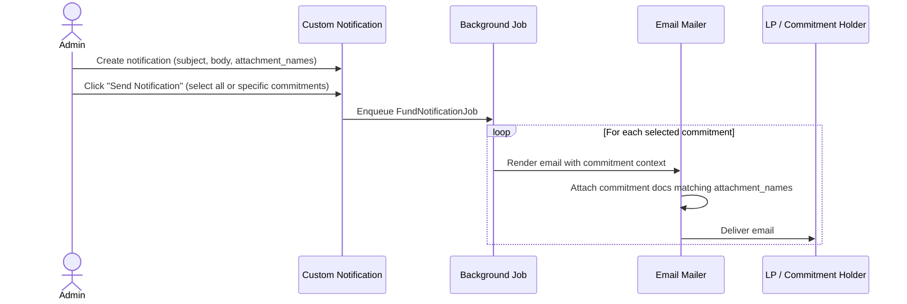

# Fund & Commitment Notifications User Guide

Custom notifications let you send a bespoke email to some or all of your fund's commitment holders — with optional commitment-specific document attachments — without touching any code. This guide covers how to set up a notification template, how to send it to everyone or to a targeted subset, and how to attach per-investor documents automatically.

---

## Table of Contents

1. [Overview](#overview)
2. [Key Concepts](#key-concepts)
3. [Step 1 — Create a Custom Notification](#step-1--create-a-custom-notification)
4. [Step 2 — Write the Email Body](#step-2--write-the-email-body)
5. [Step 3 — Attach Documents from Each Commitment](#step-3--attach-documents-from-each-commitment)
6. [Step 4 — Send the Notification](#step-4--send-the-notification)
7. [Sending to All vs. Selected Commitments](#sending-to-all-vs-selected-commitments)
8. [Who Receives the Email](#who-receives-the-email)
9. [Notify by Investor KYC Instead of Commitment](#notify-by-investor-kyc-instead-of-commitment)
10. [Dynamic (ERB) Templates](#dynamic-erb-templates)
11. [Delivery Settings](#delivery-settings)
12. [Checking Delivery Status](#checking-delivery-status)
13. [Frequently Asked Questions](#frequently-asked-questions)

---

## Overview

The fund notification flow works like this:



One notification template drives an individual personalised email to every recipient. Each email is rendered in the context of that investor's commitment, so dynamic content (investor name, folio ID, amounts) is unique per recipient.

---

## Key Concepts

| Term | Meaning |
|---|---|
| **Custom Notification** | A saved template (subject + body) attached to a Fund. One template → many individual emails. |
| **Email Method** | Chosen from the **For Notification** dropdown. For fund adhoc notifications this is either **Adhoc Notification** (per commitment, the default) or **Adhoc Kyc Notification** (per investor KYC record — see [Notify by Investor KYC Instead of Commitment](#notify-by-investor-kyc-instead-of-commitment)). |
| **Attachment Names** | A comma-separated list of document names to auto-attach from each commitment. Each name can be an exact document name, or a pattern using `*` to match a family of similarly-named documents (e.g. `SOA_*_2026`). |
| **Only Attach the Latest Match** | A checkbox that controls how many matching documents get attached per name/pattern: checked (default) attaches just the single most recently uploaded match; unchecked attaches every document that matches. |
| **Notification Users** | The users who actually receive the email for each investor — determined by approved InvestorAccess records and email-enabled settings. |
| **ERB Body** | Optional: when "Dynamic Template" is on, the body is evaluated as Ruby/ERB so you can embed live data like `<%= @capital_commitment.folio_committed_amount %>`. |
| **Latest** | Only the most recently created notification for a given method is active. Creating a new one automatically retires the previous version. |

---

## Step 1 — Create a Custom Notification

1. Go to **Fund → [Fund Name]**
2. Click the **Notifications** tab (or navigate to the notifications section in Fund settings)
3. Click **New Custom Notification**
4. Fill in the fields:

| Field | Required | Notes |
|---|---|---|
| **Subject** | Yes | Email subject line (max 255 characters) |
| **Body** | Yes | HTML email body. Use the rich-text editor for formatting. |
| **For Notification** | Yes | Select **Adhoc Notification** for the standard, per-commitment flow described in this guide, or **Adhoc Kyc Notification** for the per-investor-KYC flow (see [Notify by Investor KYC Instead of Commitment](#notify-by-investor-kyc-instead-of-commitment)) |
| **Enabled** | Yes | Must be enabled before the Send button appears |
| **Tag** | No | Optional label for organising multiple notifications |
| **Attachment Names** | No | Comma-separated document names to auto-attach (see Step 3) |
| **Only Attach the Latest Match** | No | Checked by default. See Step 3 for how this interacts with Attachment Names. |

5. Click **Save**

> **Versioning:** if you save a second notification with the same **For Notification** value, the old one is automatically marked as not-latest and the new one becomes active. The old version is kept for audit history.

---

## Step 2 — Write the Email Body

The body supports standard HTML. For plain text use the rich-text editor; for advanced formatting paste HTML directly.

### Available Variables (ERB mode only)

When **Dynamic Template** is enabled, the body is evaluated as ERB in the mailer context. The following variables are available:

| Variable | Contains |
|---|---|
| `@capital_commitment` | The current investor's commitment record |
| `@fund` | The fund |
| `@user` | The recipient user |
| `@entity` | The GP entity |
| `@custom_notification` | This custom notification record itself |

**Example body using ERB:**

```html
<p>Dear <%= @capital_commitment.investor_name %>,</p>

<p>
  Your commitment of <strong><%= @capital_commitment.folio_committed_amount %></strong>
  in <strong><%= @fund.name %></strong> (Folio: <%= @capital_commitment.folio_id %>) is confirmed.
</p>

<p>Please find your documents attached.</p>
```

> **Security note:** ERB bodies are evaluated server-side. Never paste untrusted content into an ERB-enabled body.

---

## Step 3 — Attach Documents from Each Commitment

Two attachment mechanisms are available:

### A. Fixed attachments — documents uploaded directly on the notification

Upload files directly to the notification record. These same files are sent to every recipient regardless of which investor they are.

Use this for: fund-level letters, generic announcements, PDFs that are identical for all LPs.

### B. Per-commitment attachments — Attachment Names

Set **Attachment Names** to a comma-separated list of document names (e.g. `Statement of Account, K-1, Annual Report`).

At send time, the system looks up each commitment's documents and attaches any that match.

**Exact match (default)**

By default, each name in the list must match a document's name exactly. This is the safest option when your documents always use the same fixed name.

```
Attachment Names field:  "Statement of Account, K-1"

Investor A's commitment has:
  ✓ "Statement of Account"      → attached (exact match)
  ✓ "K-1"                       → attached (exact match)
  ✗ "Statement of Account v2"   → NOT attached — name doesn't match exactly

Investor B's commitment has:
  ✗ no matching document        → silently skipped
```

**Wildcard match — use `*` to match a family of documents**

Add an asterisk (`*`) anywhere in a name to match documents whose name follows that pattern:

| Pattern you type | Matches document names like | Notes |
|---|---|---|
| `SOA_*_2026` | `SOA_FundA_2026`, `SOA_FundB_2026` | `*` in the middle matches anything in between |
| `*Statement of Account*` | `Statement of Account`, `Statement of Account v2 FINAL` | wrapping the whole name works like a "contains" search |
| `Drawdown*` | `Drawdown Notice`, `Drawdown Notice - Signed` | `*` at the end matches anything after the fixed prefix |

Use a wildcard when your generated documents include a date, investor code, or version suffix in the name, so you don't have to type an exact match for every variation.

**Only Attach the Latest Match**

Once a name or pattern matches more than one document on a commitment, this checkbox decides how many get attached:

```
Attachment Names: "SOA_*_2026"

Investor A's commitment has two matching documents:
  "SOA_Jan_2026"  (uploaded January)
  "SOA_Mar_2026"  (uploaded March — more recent)

Only Attach the Latest Match — checked (default):
  ✓ "SOA_Mar_2026"   → attached
  ✗ "SOA_Jan_2026"   → not attached (older)

Only Attach the Latest Match — unchecked:
  ✓ "SOA_Mar_2026"   → attached
  ✓ "SOA_Jan_2026"   → attached
```

- **Checked (default):** only the single most recently uploaded matching document is attached — good for "always send the newest version" (e.g. the latest Statement of Account).
- **Unchecked:** every matching document is attached — good when a wildcard pattern is meant to sweep up several related documents at once.

Use this for: personalised statements, K-1s, account summaries — any document that has been generated per investor and stored against their commitment.

> **Tip:** Plain names (no `*`) must match exactly. Add a `*` if you want looser matching, or if you need to sweep up several similarly-named documents at once.

> **Before you send:** Use the **Preview** button (available from each commitment's action menu once a notification exists) to see exactly which documents would be attached for that commitment — a good way to check that a pattern matches what you expect before sending to everyone.

---

## Step 4 — Send the Notification

1. Navigate to the Custom Notification show page (**Fund → Notifications → [Notification Name]**)
2. Confirm the notification is **Enabled**
3. A **Select Commitments to Notify** panel appears at the bottom of the page
4. Choose your recipients (see next section)
5. Click **Send Notification**
6. A success message confirms the job has been queued. Emails are delivered in the background.

---

## Sending to All vs. Selected Commitments

### Send to everyone (leave the selector blank)

Leave the multi-select dropdown empty and click **Send Notification**. The system sends to all active commitment holders of this fund.

```
┌─────────────────────────────────────────────────────┐
│  Select Commitments to Notify                        │
│  Leave blank to notify all commitments.              │
│  [View Who Gets Notified]                            │
│                                                      │
│  ┌─────────────────────────────────────────────┐    │
│  │  Type to search investors…              ▼   │    │
│  └─────────────────────────────────────────────┘    │
│                                                      │
│  [Send Notification]                                 │
└─────────────────────────────────────────────────────┘
```

### Send to specific commitments only

Click in the dropdown to search and select investors by name or folio ID. You can select multiple. Only the selected commitments receive the notification.

```
┌─────────────────────────────────────────────────────┐
│  Select Commitments to Notify                        │
│  Leave blank to notify all commitments.              │
│  [View Who Gets Notified]                            │
│                                                      │
│  ┌──────────────────────────────────────────────┐   │
│  │ × Sharma Family Trust, Folio: F-0012         │   │
│  │ × Redwood Capital, Folio: F-0027             │   │
│  └──────────────────────────────────────────────┘   │
│                                                      │
│  [Send Notification]                                 │
└─────────────────────────────────────────────────────┘
```

> **Resending:** You can send the same notification multiple times, to the same or different subsets. Each send is independent. There is no built-in deduplication — selecting the same investor twice (across two separate sends) will result in two emails.

### Checking who will receive emails before sending

Click the **View Who Gets Notified** link next to the selector. It opens a new tab showing all investor email addresses that would receive the notification if you were to send to everyone.

---

## Who Receives the Email

For each selected commitment, the system identifies **notification users** as follows:

```
For each selected CapitalCommitment:
  Investor → approved InvestorAccess records
    → filter: email_enabled = true
    → filter: user passes CapitalCommitmentPolicy#show?
    → each qualifying user receives one email
```

### Key rules

- Only users with **approved** InvestorAccess records receive emails.
- If an InvestorAccess record has `email_enabled: false`, that user is skipped.
- If the entity is in **sandbox mode**, all emails are redirected to the sandbox email list instead of real investor addresses.
- If an investor has no qualifying notification users, that commitment is silently skipped — no error is raised.

### CC and Reply-To

| Header | Resolved from |
|---|---|
| **From** | Fund's `from_email` custom field → EntitySetting `from_email` → system default |
| **CC** | EntitySetting CC + InvestorAccess per-investor CC (merged) |
| **Reply-To** | EntitySetting `reply_to` → CC → From |

---

## Notify by Investor KYC Instead of Commitment

By default, a fund notification sends **one email per commitment**. If an
investor holds several commitments in the same fund, they receive several
separate emails. Some documents and updates, though, belong to the *investor's
KYC record* rather than to any one commitment — a PAN card, an updated bank
account form, a compliance document — and it doesn't make sense to send that
same thing to the same investor two or three times just because they hold
multiple commitments.

Selecting **Adhoc Kyc Notification** in the **For Notification** dropdown (see
[Step 1](#step-1--create-a-custom-notification)) switches the whole
notification over to this mode:

| | Adhoc Notification (default) | Adhoc Kyc Notification |
|---|---|---|
| One email per... | commitment | unique investor KYC record |
| If an investor has 3 commitments sharing one KYC | 3 separate emails | **1 combined email** |
| Attachment Names looks for documents on... | the commitment | the investor's KYC record |
| ERB/placeholder data comes from... | the commitment (folio ID, committed amount, etc.) | the KYC record (investor name, fund name) |

Everything else in this guide — writing the body, Attachment Names (including
wildcards and "Only Attach the Latest Match"), delivery delay, WhatsApp,
checking delivery status — works exactly the same way, just resolved against
the investor's KYC record instead of a commitment.

### Sending

The **Send Notification** popup adapts automatically: instead of **Select
Commitments to Notify**, you'll see **Select Investor KYCs to Notify**, listing
every investor KYC record linked to this fund. Leave it blank to notify
everyone, or pick specific investors the same way you would with commitments.
If an investor has multiple commitments sharing one KYC, they still appear —
and receive — only once.

### Previewing before you send

Because this mode is about the investor's KYC record rather than a specific
commitment, the preview link lives on the **investor's KYC page** instead of a
commitment page. Open the investor's KYC record, click **Preview
Notifications**, and look for **Preview Adhoc Notification** entries — one per
fund the KYC is linked to, since the same KYC can span more than one fund.

---

## Dynamic (ERB) Templates

Enable **Dynamic Template** on the notification to use ERB expressions in the body.

### Common patterns

**Investor name:**
```erb
Dear <%= @capital_commitment.investor_name %>,
```

**Commitment amount (formatted):**
```erb
Your commitment: <%= humanized_money @capital_commitment.folio_committed_amount %>
```

**Folio ID:**
```erb
Account / Folio: <%= @capital_commitment.folio_id %>
```

**Conditional content:**
```erb
<% if @capital_commitment.folio_currency != @fund.currency %>
  <p>Note: your folio is denominated in <%= @capital_commitment.folio_currency %>.</p>
<% end %>
```

**Fund close:**
```erb
Close: <%= @capital_commitment.fund_close %>
```

### Testing your template

Before sending to all investors, test with a single commitment (use the commitment selector to pick one investor) and review the delivered email in your inbox.

---

## Delivery Settings

### Email delay

To avoid hitting email provider rate limits when sending to large numbers of investors, the system adds a random delay between deliveries. The delay range is controlled by **EntitySetting → Email Delay Seconds**.

- If set to `0`, the system uses a default range of 1–300 seconds.
- For urgent sends, reduce this setting temporarily.

### WhatsApp

If your entity has WhatsApp enabled and the investor's InvestorAccess has `whatsapp_enabled: true`, a WhatsApp message is also sent. Set the **WhatsApp** field on the notification to provide the message text (max 255 characters, no `&^#\`~` characters).

If the WhatsApp field is blank, the **Subject** is used as the WhatsApp message fallback.

---

## Checking Delivery Status

### In the notification show page

After sending, the Noticed Events table (linked from the notification record) shows one row per delivered email, with:

- Recipient email address
- Sent timestamp
- Full email content (to, from, cc, subject, body)

### Via the admin panel

Go to **Admin → Noticed Notifications** to see all notification events with their delivery status, including whether email was sent and whether WhatsApp was delivered.

### Delivery failures

If a commitment has no notification users (no approved, email-enabled InvestorAccess), no email is sent and no error is recorded. Use **View Who Gets Notified** before sending to catch this scenario.

---

## Frequently Asked Questions

**Q: Can I edit the notification after I send it?**

Yes. Editing creates a new version. The old version is marked not-latest but retained for audit. The next time you click Send, the newest version is used.

**Q: What if a commitment has no document matching my Attachment Names?**

That attachment is silently skipped for that commitment. The email is still sent — just without that particular file. Other matching documents on the same commitment are still attached.

**Q: Can I use a wildcard in Attachment Names?**

Yes. Add an asterisk (`*`) anywhere in a name to match a family of similarly-named documents, e.g. `SOA_*_2026`. See [Step 3](#step-3--attach-documents-from-each-commitment) for examples. Names without a `*` must still match exactly.

**Q: A wildcard pattern matches several documents on the same commitment — how many get attached?**

Depends on the **Only Attach the Latest Match** checkbox: checked (the default) attaches just the newest one, unchecked attaches all of them. See [Step 3](#step-3--attach-documents-from-each-commitment).

**Q: Can the same notification be sent multiple times?**

Yes, there is no send-once lock. Each click of Send Notification queues a new batch of emails. Use the commitment selector to limit re-sends to a specific subset if needed.

**Q: Will investors know I only sent to some of them?**

No. Each investor receives their own individual email. There is no indication in the email that it was a targeted send.

**Q: How do I know if the email was delivered?**

Check the Noticed Notifications in the admin panel. Each delivered email updates the notification record with `email_sent: true` and stores the full email details.

**Q: The Send Notification button is not visible. Why?**

The button only appears when:
1. The notification is **Enabled**
2. The owner type is **Fund**
3. Your user has the `trigger_adhoc_notification` permission (company admin role)

**Q: Can I send to investors across multiple funds at once?**

No. Each Custom Notification is attached to one specific fund. To send across funds, create a notification on each fund and send separately.

**Q: My investor has multiple commitments — will they get duplicate emails?**

With the default **Adhoc Notification** mode, yes — one email per commitment. If that's not what you want (e.g. for a document that belongs to the investor rather than any one commitment), switch **For Notification** to **Adhoc Kyc Notification**; see [Notify by Investor KYC Instead of Commitment](#notify-by-investor-kyc-instead-of-commitment). It sends exactly one combined email per investor KYC record, regardless of how many commitments share it.

**Q: Does WhatsApp send even if email fails?**

Yes, the two channels are independent. WhatsApp delivery does not depend on email delivery and vice versa.
