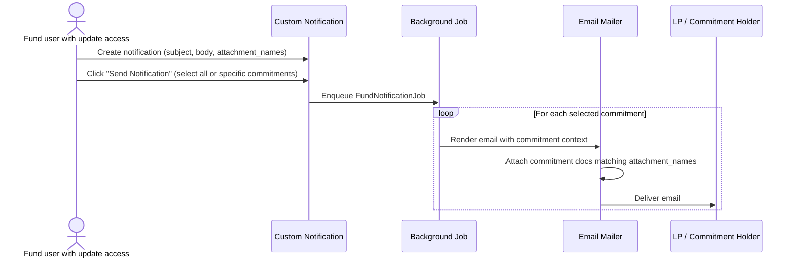

# Fund & Commitment Notifications User Guide

Custom notifications let you send a bespoke email to some or all of your fund's commitment holders — with optional commitment-specific document attachments — without touching any code. This guide covers how to set up a notification template, how to send it to everyone or to a targeted subset, and how to attach per-investor documents automatically.

> **Where to find it:** Sidebar → [**Funds → Funds**](/funds) → open the fund → **Notifications** tab → [**New Notification → New Fund Notification**](/custom_notifications/new). Open the saved notification and click **Send Notification** to email some or all commitment holders. Creating needs create access on the fund; sending needs update access on the fund (company admins have both).

---

## Table of Contents

1. [Overview](#overview)
2. [Key Concepts](#key-concepts)
3. [Step 1 — Create a Custom Notification](#step-1--create-a-custom-notification)
4. [Step 2 — Write the Email Body](#step-2--write-the-email-body)
5. [Step 3 — Attach Documents from Each Commitment](#step-3--attach-documents-from-each-commitment)
6. [Step 4 — Send the Notification](#step-4--send-the-notification)
7. [Sending to All vs. Selected Commitments](#sending-to-all-vs-selected-commitments)
8. [Who Receives the Email](#who-receives-the-email)
9. [Notify by Investor KYC Instead of Commitment](#notify-by-investor-kyc-instead-of-commitment)
10. [Dynamic (ERB) Templates](#dynamic-erb-templates)
11. [Delivery Settings](#delivery-settings)
12. [Checking Delivery Status](#checking-delivery-status)
13. [Frequently Asked Questions](#frequently-asked-questions)

---

## Overview

The fund notification flow works like this:



One notification template drives an individual personalised email to every recipient. Each email is rendered in the context of that investor's commitment, so dynamic content (investor name, folio ID, amounts) is unique per recipient.

---

## Key Concepts

| Term | Meaning |
|---|---|
| **Custom Notification** | A saved template (subject + body) attached to a Fund. One template → many individual emails. |
| **Email Method** | Chosen from the **For Notification** dropdown. For fund adhoc notifications this is either **Adhoc fund notification** (per commitment) or **Adhoc kyc notification** (per investor KYC record — see [Notify by Investor KYC Instead of Commitment](#notify-by-investor-kyc-instead-of-commitment)). |
| **Attachment Names** | A comma-separated list of document names to auto-attach from each commitment. Each name can be an exact document name, or a pattern using `*` to match a family of similarly-named documents (e.g. `SOA_*_2026`). If a name itself contains a comma, wrap it in double quotes so it isn't split into separate entries. |
| **Only Attach the Latest Match** | A checkbox that controls how many matching documents get attached per name/pattern: checked (default) attaches just the single most recently uploaded match; unchecked attaches every document that matches. |
| **Notification Users** | The users who actually receive the email for each investor — determined by approved InvestorAccess records and email-enabled settings. |
| **ERB Body** | Support only: when "Dynamic Template" is on (a switch only CapHive support can see), the body is evaluated as Ruby/ERB so you can embed live data like `<%= @capital_commitment.folio_committed_amount %>`. |
| **Latest** | Creating a new notification with the same method marks older ones as not-latest. Ad-hoc fund templates stay editable and can still be sent individually. |

---

## Step 1 — Create a Custom Notification

1. Go to **Funds → Funds** and open the fund
2. Click the **Notifications** tab
3. Click **New Notification → New Fund Notification**
4. Fill in the fields:

| Field | Required | Notes |
|---|---|---|
| **Subject** | Yes | Email subject line (max 255 characters) |
| **Body** | Yes | HTML email body. Use the rich-text editor for formatting. |
| **For Notification** | Yes | Select **Adhoc fund notification** for the standard, per-commitment flow described in this guide, or **Adhoc kyc notification** for the per-investor-KYC flow (see [Notify by Investor KYC Instead of Commitment](#notify-by-investor-kyc-instead-of-commitment)) |
| **Template enabled** | Yes | Must be on before the Send button appears |
| **Tag** | No | Optional label for organising multiple notifications |
| **Attachment Names** | No | Comma-separated document names to auto-attach (see Step 3). Wrap a name in double quotes if the name itself contains a comma. |
| **Only Attach the Latest Match** | No | Checked by default. See Step 3 for how this interacts with Attachment Names. |
| **Attachment mandatory** | No | When on, a recipient whose required document is missing is skipped and reported to the sender by email (see Step 3). |

5. Click **Save**

> **Versioning:** if you save a second notification with the same **For Notification** value, the old one is automatically marked as not-latest, but ad-hoc fund templates stay editable and can still be sent individually. Editing an existing notification updates it in place; no new version is created.

---

## Step 2 — Write the Email Body

The body supports standard HTML. For plain text use the rich-text editor; for advanced formatting paste HTML directly.

> **An empty-looking body means no email is sent.** The Body field must have some content to save, but it's still possible to end up with a body that looks blank — for example, if you select all the text in the editor and delete it, an empty line can remain even though the field technically isn't empty. If that happens, **no email goes out for that notification at all** — it does not fall back to any generic message. Always check the **Preview** (see [Step 4](#step-4--send-the-notification)) before sending to real investors; if the previewed email looks empty, fix the body before sending.

### Available Variables (ERB mode only)

When **Dynamic Template** is enabled (only CapHive support can switch it on or edit such a template), the body is evaluated as ERB in the mailer context. The following variables are available:

| Variable | Contains |
|---|---|
| `@capital_commitment` | The current investor's commitment record |
| `@fund` | The fund |
| `@user` | The recipient user |
| `@entity` | The GP entity |
| `@custom_notification` | This custom notification record itself |

**Example body using ERB:**

```html
<p>Dear <%= @capital_commitment.investor_name %>,</p>

<p>
  Your commitment of <strong><%= @capital_commitment.folio_committed_amount %></strong>
  in <strong><%= @fund.name %></strong> (Folio: <%= @capital_commitment.folio_id %>) is confirmed.
</p>

<p>Please find your documents attached.</p>
```

> **Security note:** ERB bodies are evaluated server-side. Never paste untrusted content into an ERB-enabled body.

---

## Step 3 — Attach Documents from Each Commitment

Two attachment mechanisms are available:

### A. Fixed attachments — documents uploaded directly on the notification

Upload files directly to the notification record. These same files are sent to every recipient regardless of which investor they are.

Use this for: fund-level letters, generic announcements, PDFs that are identical for all LPs.

### B. Per-commitment attachments — Attachment Names

Set **Attachment Names** to a comma-separated list of document names (e.g. `Statement of Account, K-1, Annual Report`).

At send time, the system looks up each commitment's documents and attaches any that match.

**Exact match (default)**

By default, each name in the list must match a document's name exactly. This is the safest option when your documents always use the same fixed name.

```
Attachment Names field:  "Statement of Account, K-1"

Investor A's commitment has:
  ✓ "Statement of Account"      → attached (exact match)
  ✓ "K-1"                       → attached (exact match)
  ✗ "Statement of Account v2"   → NOT attached — name doesn't match exactly

Investor B's commitment has:
  ✗ no matching document        → silently skipped
```

**Wildcard match — use `*` to match a family of documents**

Add an asterisk (`*`) anywhere in a name to match documents whose name follows that pattern:

| Pattern you type | Matches document names like | Notes |
|---|---|---|
| `SOA_*_2026` | `SOA_FundA_2026`, `SOA_FundB_2026` | `*` in the middle matches anything in between |
| `*Statement of Account*` | `Statement of Account`, `Statement of Account v2 FINAL` | wrapping the whole name works like a "contains" search |
| `Drawdown*` | `Drawdown Notice`, `Drawdown Notice - Signed` | `*` at the end matches anything after the fixed prefix |

Use a wildcard when your generated documents include a date, investor code, or version suffix in the name, so you don't have to type an exact match for every variation.

**Document names that contain a comma**

Attachment Names uses a comma to separate one entry from the next, so if a document's own name contains a comma — for example a date range like `01 July,2025 to 31 December,2025` — wrap that whole name in double quotes. This tells the system the comma is part of the name, not a separator between two entries.

```
Document name:  SOA Unit 01 July,2025 to 31 December,2025 - AA Holdings LLP

Attachment Names field:  "SOA Unit 01 July,2025 to 31 December,2025 - *", KYC Certificate

  ✓ matches the document above          → attached (comma inside the quoted name is preserved)
  ✓ "KYC Certificate"                   → attached (plain entry, unaffected by the quoting)
```

Only names that actually contain a comma need quotes — plain names and wildcard patterns without a comma work exactly as before, with no quoting needed.

**Only Attach the Latest Match**

Once a name or pattern matches more than one document on a commitment, this checkbox decides how many get attached:

```
Attachment Names: "SOA_*_2026"

Investor A's commitment has two matching documents:
  "SOA_Jan_2026"  (uploaded January)
  "SOA_Mar_2026"  (uploaded March — more recent)

Only Attach the Latest Match — checked (default):
  ✓ "SOA_Mar_2026"   → attached
  ✗ "SOA_Jan_2026"   → not attached (older)

Only Attach the Latest Match — unchecked:
  ✓ "SOA_Mar_2026"   → attached
  ✓ "SOA_Jan_2026"   → attached
```

- **Checked (default):** only the single most recently uploaded matching document is attached — good for "always send the newest version" (e.g. the latest Statement of Account).
- **Unchecked:** every matching document is attached — good when a wildcard pattern is meant to sweep up several related documents at once.

Use this for: personalised statements, K-1s, account summaries — any document that has been generated per investor and stored against their commitment.

**Attachment mandatory:** when this switch is on and a recipient's required document is missing, that recipient's email is not sent; the user who clicked Send (or the company admins) gets one email listing the skipped recipients. With it off, a name with no match is simply skipped and the email still goes.

> **Tip:** Plain names (no `*`) must match exactly. Add a `*` if you want looser matching, or if you need to sweep up several similarly-named documents at once.

> **Before you send:** Use **Preview** on the notification page, or **Actions → Preview Adhoc Fund Notification** on a specific commitment, to see exactly which documents would be attached for that commitment — a good way to check that a pattern matches what you expect before sending to everyone.

---

## Step 4 — Send the Notification

1. Navigate to the notification's page (**Fund → Notifications → [Notification Name]**)
2. Confirm the notification is **Template enabled** (the button is also only shown to users with update access on the fund)
3. Click **Send Notification** — a pop-up with the **Select Commitments to Notify** picker opens
4. Choose your recipients (see next section)
5. Click **Send Notification** in the pop-up
6. A success message ("Notification trigger started for [fund]") confirms the job has been queued. Emails are delivered in the background.

---

## Sending to All vs. Selected Commitments

### Send to everyone (leave the selector blank)

Leave the multi-select dropdown empty and click **Send Notification**. The system sends to all active commitment holders of this fund.

```
┌─────────────────────────────────────────────────────┐
│  Select Commitments to Notify                        │
│  Leave blank to notify all commitments.              │
│  [View Who Gets Notified]                            │
│                                                      │
│  ┌─────────────────────────────────────────────┐    │
│  │  Type to search investors…              ▼   │    │
│  └─────────────────────────────────────────────┘    │
│                                                      │
│  [Send Notification]                                 │
└─────────────────────────────────────────────────────┘
```

### Send to specific commitments only

Click in the dropdown to search and select investors by name or folio ID. You can select multiple. Only the selected commitments receive the notification.

```
┌─────────────────────────────────────────────────────┐
│  Select Commitments to Notify                        │
│  Leave blank to notify all commitments.              │
│  [View Who Gets Notified]                            │
│                                                      │
│  ┌──────────────────────────────────────────────┐   │
│  │ × Sharma Family Trust, Folio: F-0012         │   │
│  │ × Redwood Capital, Folio: F-0027             │   │
│  └──────────────────────────────────────────────┘   │
│                                                      │
│  [Send Notification]                                 │
└─────────────────────────────────────────────────────┘
```

> **Resending:** You can send the same notification multiple times, to the same or different subsets. Each send is independent. There is no built-in deduplication — selecting the same investor twice (across two separate sends) will result in two emails.

### Checking who will receive emails before sending

Click the **View Who Gets Notified** link next to the selector. It opens a new tab showing all investor email addresses that would receive the notification if you were to send to everyone.

---

## Who Receives the Email

For each selected commitment, the system identifies **notification users** as follows:

```
For each selected CapitalCommitment:
  Investor → approved InvestorAccess records
    → filter: email_enabled = true
    → filter: user passes CapitalCommitmentPolicy#show?
    → each qualifying user receives one email
```

### Key rules

- Only users with **approved** InvestorAccess records receive emails.
- If an InvestorAccess record has `email_enabled: false`, that user is skipped.
- If the entity is in **sandbox mode**, all emails are redirected to the sandbox email list instead of real investor addresses.
- If an investor has no qualifying notification users, that commitment is silently skipped — no error is raised.

### CC and Reply-To

| Header | Resolved from |
|---|---|
| **From** | Fund's `from_email` custom field → EntitySetting `from_email` → system default |
| **CC** | EntitySetting CC + InvestorAccess per-investor CC (merged) |
| **Reply-To** | EntitySetting `reply_to` → CC → From |

---

## Notify by Investor KYC Instead of Commitment

By default, a fund notification sends **one email per commitment**. If an
investor holds several commitments in the same fund, they receive several
separate emails. Some documents and updates, though, belong to the *investor's
KYC record* rather than to any one commitment — a PAN card, an updated bank
account form, a compliance document — and it doesn't make sense to send that
same thing to the same investor two or three times just because they hold
multiple commitments.

Selecting **Adhoc kyc notification** in the **For Notification** dropdown (see
[Step 1](#step-1--create-a-custom-notification)) switches the whole
notification over to this mode:

| | Adhoc fund notification | Adhoc kyc notification |
|---|---|---|
| One email per... | commitment | unique investor KYC record |
| If an investor has 3 commitments sharing one KYC | 3 separate emails | **1 combined email** |
| Attachment Names looks for documents on... | the commitment | the investor's KYC record |
| ERB/placeholder data comes from... | the commitment (folio ID, committed amount, etc.) | the KYC record (investor name, fund name) |

Everything else in this guide — writing the body, Attachment Names (including
wildcards and "Only Attach the Latest Match"), delivery delay, WhatsApp,
checking delivery status — works exactly the same way, just resolved against
the investor's KYC record instead of a commitment.

An **Adhoc kyc notification** is not a **Custom KYC Notification**. The latter
is a company-wide template created from **Funds → KYCs → New KYC** that changes
the wording of the automatic KYC emails (KYC required, reminders and so on); see
[Custom Notifications](custom_notifications_user_guide).

### Sending

The **Send Notification** popup adapts automatically: instead of **Select
Commitments to Notify**, you'll see **Select Investor KYCs to Notify**, listing
every investor KYC record linked to this fund. Leave it blank to notify
everyone, or pick specific investors the same way you would with commitments.
If an investor has multiple commitments sharing one KYC, they still appear —
and receive — only once.

### Previewing before you send

Because this mode is about the investor's KYC record rather than a specific
commitment, the preview link lives on the **investor's KYC page** instead of a
commitment page. Open the investor's KYC record, click **Preview
Notifications**, and look for **Preview Adhoc Notification** entries — one per
fund the KYC is linked to, since the same KYC can span more than one fund.

---

## Dynamic (ERB) Templates

**Dynamic Template** is a support-only switch: ask CapHive support to set up an ERB template. Once it is on, only support can edit the template; everyone else should use the placeholder picker's `{{...}}` tokens.

### Common patterns

**Investor name:**
```erb
Dear <%= @capital_commitment.investor_name %>,
```

**Commitment amount (formatted):**
```erb
Your commitment: <%= humanized_money @capital_commitment.folio_committed_amount %>
```

**Folio ID:**
```erb
Account / Folio: <%= @capital_commitment.folio_id %>
```

**Conditional content:**
```erb
<% if @capital_commitment.folio_currency != @fund.currency %>
  <p>Note: your folio is denominated in <%= @capital_commitment.folio_currency %>.</p>
<% end %>
```

**Fund close:**
```erb
Close: <%= @capital_commitment.fund_close %>
```

### Testing your template

Before sending to all investors, test with a single commitment (use the commitment selector to pick one investor) and review the delivered email in your inbox.

---

## Delivery Settings

### Email delay

To avoid hitting email provider rate limits when sending to large numbers of investors, the system adds a random delay between deliveries. The delay range is controlled by **EntitySetting → Email Delay Seconds**.

- If set to `0`, the system uses a default range of 1–300 seconds.
- For urgent sends, reduce this setting temporarily.

### WhatsApp

If your entity has WhatsApp messaging enabled, and the investor has WhatsApp enabled on their access record, a WhatsApp message is also sent alongside the email. Set the **WhatsApp** field on the notification to provide the message text (max 255 characters; avoid the characters `&^#~` — WhatsApp won't display them correctly).

**Leave the WhatsApp field blank if you don't want a WhatsApp message sent for this notification at all.** No WhatsApp message will go out for it — it will never fall back to the Subject or Body. Email and WhatsApp are configured, and sent, completely independently of each other.

---

## Checking Delivery Status

### In the notification show page

The notification page has no delivery table. Each recipient's email is recorded as an in-app notification against your company; CapHive support can list them for you.

### Via the admin panel

CapHive support can see full delivery details, including whether email was sent and whether WhatsApp was delivered, in the admin panel.

### Delivery failures

If a commitment has no notification users (no approved, email-enabled InvestorAccess), no email is sent and no error is recorded. Use **View Who Gets Notified** before sending to catch this scenario. Recipients skipped because of a missing mandatory attachment are reported to you by email.

---

## Frequently Asked Questions

### Navigation and getting there

**Where do I find a fund's notifications?**
Sidebar → [**Funds → Funds**](/funds), open the fund and click the **Notifications** tab on the fund page. It lists every custom notification template owned by the fund (ad-hoc, call and distribution templates) with its email type and subject; click one to open it.

**How do I open the page to create a fund notification?**
On the fund's **Notifications** tab click **New Notification** and choose **New Fund Notification**. (**New Call Notification** and **New Distribution Notification** in the same menu create default templates for call and distribution emails, which are covered in the Capital Calls and Capital Distributions guides.) See [Step 1 — Create a Custom Notification](#step-1--create-a-custom-notification).

**Where is the Send Notification button?**
On the notification's own page, next to **Edit**, **Preview** and **Delete**. Clicking it opens a **Send Notification** pop-up with the recipient picker and a final **Send Notification** button. See [Step 4 — Send the Notification](#step-4--send-the-notification).

**Where can I preview the email for one investor?**
Open the notification and click **Preview** (it renders for the fund's first commitment), or open a specific commitment and choose **Actions → Preview Adhoc Fund Notification ([tag or subject])**. For **Adhoc kyc notification** templates, open the investor KYC record and use **Preview Notifications → Preview Adhoc Notification**.

**Where do I check who will receive the email?**
Click **View Who Gets Notified** inside the Send Notification pop-up, or use the fund page's **Actions → Misc → Show Email List**. Both open the list of investor contacts for the fund.

### Creating, updating and managing notifications

**How do I create a fund notification?**
Fund → **Notifications** tab → **New Notification → New Fund Notification**. Pick **For Notification** (**Adhoc fund notification** for one email per commitment, **Adhoc kyc notification** for one per investor KYC), enter **Subject** and **Body** (use the placeholder picker for tokens like `{{investor_name}}`), optionally **Tag**, **WhatsApp**, **Attachment names**, **Only attach the latest match** and **Attachment mandatory**, keep **Template enabled** on, and **Save**.

**How do I edit a notification?**
Open it and click **Edit**. Saving updates the same template in place; the next send uses the new wording. Templates marked **Dynamic Template** (ERB) can only be edited by CapHive support.

**How do I delete a notification?**
Open it and click **Delete**, then confirm. The template disappears from the fund's **Notifications** tab and can no longer be sent or previewed; emails already sent are not recalled. A deleted template can be restored from [deleted notifications](/custom_notifications/show_deleted).

**How do I stop a notification from being used without deleting it?**
Edit it and switch off **Template enabled**. The **Send Notification** button and the commitment **Preview Adhoc Fund Notification** entry disappear until you switch it back on.

**How do I send it to everyone or to selected investors?**
Open the notification, click **Send Notification**, and in **Select Commitments to Notify** (or **Select Investor KYCs to Notify** for KYC mode) either leave the box blank to send to all, or search and pick specific folios or investors. Then click **Send Notification** in the pop-up. See [Sending to All vs. Selected Commitments](#sending-to-all-vs-selected-commitments).

**How do I attach the same file to every email?**
Open the notification and upload the file on its **Documents** tab. Every recipient's email gets it. For per-investor files, use **Attachment names** instead. See [Step 3 — Attach Documents from Each Commitment](#step-3--attach-documents-from-each-commitment).

**What permission do I need?**
The **Funds** module for your login, plus an access right on the fund: create access to add, edit or delete notifications, and update access on the fund to see and use **Send Notification**. Company admins have both automatically. The **Dynamic Template** switch is only shown to CapHive support users.

### Why use fund notifications

**Why use fund notifications instead of emailing investors from Outlook or Gmail?**
Each investor gets an individual, personalised email with their own name, folio and documents attached automatically from their commitment or KYC record, sent only to their approved contacts, and every delivery is recorded against the investor. There is no manual BCC list to maintain and no risk of attaching one investor's statement to another's email.

**What can I do with fund notifications?**
Send ad-hoc announcements, quarterly letters, statements, K-1s or compliance requests to every commitment holder or a chosen subset; attach per-investor documents by name or wildcard; send one combined email per investor KYC; add a WhatsApp message; and re-use the template for later sends.

**What happens if investor contacts are not set up properly?**
Investors with no approved, email-enabled contact silently receive nothing, and no error is raised. Check **View Who Gets Notified** before sending and fix access under the stakeholder's access records first.

**How is a fund Adhoc kyc notification different from a Custom KYC Notification (KYC email template)?**
An **Adhoc kyc notification** belongs to one fund: you write it on the fund's **Notifications** tab and send it yourself with **Send Notification**, one email per investor KYC linked to that fund. A **Custom KYC Notification** is company-wide, created from [**Funds → KYCs**](/investor_kycs) → **New KYC**, and replaces the wording of the automatic KYC emails such as KYC required and KYC reminders. See [Custom Notifications](custom_notifications_user_guide).

**Where do I see all custom notifications (email templates) across funds and KYCs?**
Profile menu → **My Inbox** → **Custom Notifications** lists every custom notification template in your company, with its type and owner, and opens for Company Admins. A fund's own templates are on its **Notifications** tab. See [Custom Notifications](custom_notifications_user_guide) for every kind of template and where each is created.

**Who typically uses fund notifications?**
Investor-relations and fund operations teams, usually company admins or users with update access on the fund. Investors only receive the emails.

### What happens when I …

**What happens when I save a new fund notification?**
The template is stored on the fund and shown on the **Notifications** tab. Nothing is sent. Older notifications with the same **For Notification** value are marked not-latest, but ad-hoc templates stay editable and can still be sent individually. No one is notified.

**What happens when I click Send Notification?**
A background job is queued immediately and you see "Notification trigger started for [fund]". For each selected commitment (or every commitment if none selected) it finds the investor's approved contacts who can see that commitment and queues one personalised email per contact, with a random delay of up to the entity's **Email Delay Seconds** (1 to 300 seconds if unset). The email also appears in each recipient's in-app inbox.

**What happens when I send an Adhoc kyc notification?**
The job works per unique investor KYC linked to the fund instead of per commitment, so an investor with several commitments sharing one KYC gets one email. Attachment names are looked up on the KYC record and placeholders come from the KYC. See [Notify by Investor KYC Instead of Commitment](#notify-by-investor-kyc-instead-of-commitment).

**What happens to attachments at send time?**
Files on the notification's **Documents** tab go to everyone. Each **Attachment names** entry is matched against that commitment's (or KYC's) documents, exactly or with `*` wildcards, newest first; generated documents that are not yet approved are never attached. A name with no match is skipped and the email still goes, unless **Attachment mandatory** is on.

**What happens when Attachment mandatory is on and a document is missing?**
That recipient's email is not sent and is recorded as skipped with "Missing required attachment(s): …". About five minutes later the user who clicked Send (or the company admins) gets one email listing all skipped recipients with a **View skipped notifications** link. Other recipients are unaffected.

**What happens if I click Send Notification twice?**
Two separate batches are queued and every selected investor receives the email twice; there is no deduplication. Queued emails cannot be cancelled from the screen.

**What happens when I delete or disable a template after sending?**
Emails already delivered stay in investors' inboxes. The template can no longer be sent or previewed. Delete is a soft delete, so the template can be restored from [deleted notifications](/custom_notifications/show_deleted).

**What happens if the entity is in sandbox mode?**
Every email is redirected to the entity's sandbox email addresses instead of real investor addresses, so you can test a send safely. Switch sandbox mode off before the real send.

### Troubleshooting and edge cases

**Can I edit the notification after I send it?**
Yes. Editing changes the template in place; emails already sent are unaffected and the next send uses the new text. If you want to keep the old wording, create a new notification instead.

**The Send Notification button is not visible - why?**
It only appears when the notification is **Template enabled**, it belongs to a fund (created from the fund's **Notifications** tab, not a call or distribution), and you have update access on that fund. Company admins always have update access.

**What if a commitment has no document matching my Attachment names?**
That attachment is silently skipped for that commitment. The email is still sent - just without that particular file - unless **Attachment mandatory** is on, in which case that recipient is skipped and reported to you.

**Can I use a wildcard in Attachment names?**
Yes. Add an asterisk (`*`) anywhere in a name to match a family of similarly-named documents, e.g. `SOA_*_2026`. See [Step 3](#step-3--attach-documents-from-each-commitment) for examples. Names without a `*` must still match exactly.

**A wildcard pattern matches several documents on the same commitment - how many get attached?**
It depends on **Only attach the latest match**: on (the default) attaches just the newest one, off attaches all of them. See [Step 3](#step-3--attach-documents-from-each-commitment).

**Do I need to put quotes around every document name in Attachment names?**
No. Only wrap a name in double quotes if the name itself contains a comma (for example a date range like `01 July,2025 to 31 December,2025`). Plain names and wildcard patterns without a comma need no quoting. See [Step 3](#step-3--attach-documents-from-each-commitment).

**Why wasn't a generated statement attached?**
Generated documents are only attached once approved. Approve the statement on the commitment's **Documents** tab (approver role needed), then send again to that investor.

**Can the same notification be sent multiple times?**
Yes, there is no send-once lock. Each click of **Send Notification** queues a new batch of emails. Use the commitment selector to limit re-sends to a specific subset.

**Will investors know I only sent to some of them?**
No. Each investor receives their own individual email. There is no indication in the email that it was a targeted send.

**How do I know if the email was delivered?**
Each recipient's email is recorded as an in-app notification. These are kept against your company, and CapHive support can see full delivery details in the admin panel. Skipped recipients (missing mandatory attachments) are reported to you by email.

**Can I send to investors across multiple funds at once?**
No. Each fund notification belongs to one fund. To send across funds, create a notification on each fund and send separately.

**My investor has multiple commitments - will they get duplicate emails?**
With **Adhoc fund notification**, yes - one email per commitment. For a document that belongs to the investor rather than any one commitment, set **For Notification** to **Adhoc kyc notification**, which sends one combined email per investor KYC record. See [Notify by Investor KYC Instead of Commitment](#notify-by-investor-kyc-instead-of-commitment).

**Does WhatsApp send even if email fails?**
Yes, the two channels are independent. WhatsApp goes out only if WhatsApp is enabled for your company, for the investor's access record and for the user with a phone number, and the notification's **WhatsApp** text is filled in.

**What happens if I leave the WhatsApp field blank?**
No WhatsApp message is sent for that notification, for anyone. It will not fall back to using the Subject or Body as the WhatsApp text - leave it blank on purpose if you only want this notification to go out by email.

**I saved the notification but the email body looks empty - what happens?**
No email is sent, for anyone, until the body actually has text. This can happen if the rich-text editor is left with just an empty line (it still lets you save). Always check the **Preview** before sending - an empty-looking preview means the real send will be skipped entirely, with no error shown.

**Can I use ERB (Dynamic Template) myself?**
No. The **Dynamic Template** switch is only shown to CapHive support, and ERB templates can only be edited by support. Use the placeholder picker's `{{...}}` tokens instead, or ask support to set up an ERB template. See [Dynamic (ERB) Templates](#dynamic-erb-templates).

**An investor's contact got no email - why?**
Their investor access may not be approved, may have email switched off, or the user may not have access to that commitment. Check **View Who Gets Notified**, then open the stakeholder and fix the access record before sending again to that investor only.

---

## Related Guides

- [Capital Commitments](capital_commitments_user_guide) - the folios an ad-hoc fund notification is sent to, and where per-investor documents live.
- [Investor KYC](investor_kyc_user_guide) - the records used by **Adhoc kyc notification** and its per-KYC attachments.
- [Investor Access Tutorial](investor_access_tutorial) - approving investor contacts so they receive emails.
- [Capital Calls](capital_calls_user_guide) - **New Call Notification** templates for call notices, reminders and payment emails.
- [Capital Distributions](capital_distributions_user_guide) - **New Distribution Notification** templates for payment emails.
- [Document Management](document_management_user_guide) - naming and approving the documents that Attachment names picks up.
- [Custom Notifications](custom_notifications_user_guide) - every kind of email template, including company-wide KYC and agreement templates.
