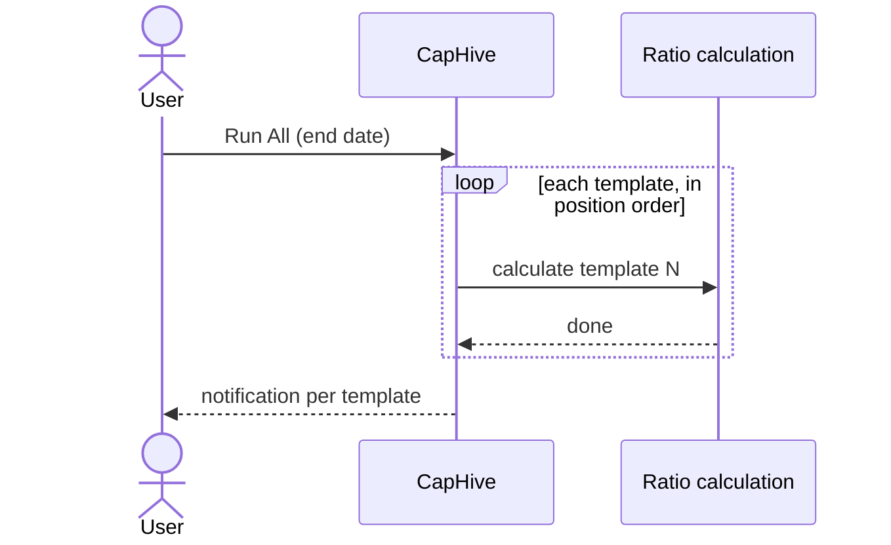

# Ratio Run Templates User Guide

Ratio Run Templates let you save a set of filter parameters once and re-run the same calculation for any date with a single click — individually, all at once, or grouped by tag.

> For background on how cross-fund and cross-portfolio ratios are computed and what a ratio run record contains, see the **[Fund Ratios User Guide](fund_ratios_user_guide)**.

---

## Table of Contents

1. [What Is a Ratio Run Template?](#what-is-a-ratio-run-template)
2. [Creating a Template](#creating-a-template)
3. [Run Types — Cross-Fund vs Cross-Portfolio](#run-types)
4. [Position and Run Order](#position-and-run-order)
5. [Tags and Bulk Triggering](#tags-and-bulk-triggering)
6. [Triggering a Single Template](#triggering-a-single-template)
7. [Trigger All](#trigger-all)
8. [Trigger by Tag](#trigger-by-tag)
9. [Viewing Past Runs](#viewing-past-runs)
10. [Idempotency — Re-running the Same Date](#idempotency)
11. [Frequently Asked Questions](#frequently-asked-questions)

---

## What Is a Ratio Run Template?

A template stores the filter inputs for a cross-fund or cross-portfolio ratio calculation:

- Which **source funds** to include
- Which **portfolio companies** to include (explicit selection, tags, or sector filter)
- An optional **anchor fund** used for document storage
- A **display name**, optional **tags** for grouping, and a **position** that controls run order

When you trigger a template you supply only the **end date**. Everything else comes from the saved configuration. The system creates (or reuses) a **ratio run** that links to the resulting ratios.

---

## Creating a Template

1. Go to **Funds → Ratio Templates** in the sidebar.
2. Click **New Template**.
3. Fill in:
   - **Name** — must be unique within your entity.
   - **Tags** — optional grouping labels (Select2, free-text or existing tags). Multiple tags allowed.
   - **Anchor Fund** — the fund used for document storage. Leave blank for cross-portfolio runs that span all funds.
   - **Source Funds** — the funds whose data feeds the calculation. Leave blank to include all entity funds.
   - **Portfolio Companies / Tags / Sectors** — leave all blank for a cross-fund run; fill any one (or more) for a cross-portfolio run. All three filter types are **unioned**: explicit company IDs, tag matches, and sector matches each contribute independently — a company is included if it matches any of them.
   - **Display Order (Position)** — a number that controls where this template appears in the index table and the order it runs when using **Run All** or **Run by Tag**. Lower numbers run first. Leave blank to place the template at the end.
4. Click **Save**. The **run type** (cross-fund or cross-portfolio) is inferred automatically from the filter fields — you do not set it manually.

---

## Run Types {#run-types}

| Run Type | When it applies |
|---|---|
| **Cross-fund** | Source funds selected, no portfolio company filters |
| **Cross-portfolio** | Any portfolio company filter set (explicit IDs, tags, or sectors) |

The run type is re-inferred every time you save the template, so changing the filters automatically updates the type.

---

## Position and Run Order {#position-and-run-order}

The **Position** field is an integer that controls two things simultaneously:

1. **Index display order** — the index table always shows templates sorted by position (ascending), with unpositioned templates at the end sorted alphabetically by name.
2. **Execution order for bulk runs** — when you use **Run All** or **Run by Tag**, templates execute one after another in position order. The next template starts only after the previous one finishes.

| Position | Behaviour |
|---|---|
| Set (e.g. 1, 2, 10) | Appears and runs in ascending numeric order |
| Blank | Treated as last; sorted alphabetically among other blank-position templates |

You set position on the template's **Edit** form (the **Display Order** field). To reorder templates, edit each one and assign a new number — there is no drag-and-drop. Gaps in the sequence are fine (`1, 5, 10` works the same as `1, 2, 3`).

---

## Tags and Bulk Triggering

Tags are free-text labels you assign to group templates together. For example, tagging several templates `monthly` lets you trigger all of them in one action for a given end date.

- A template can have **multiple tags**.
- Tags are shared across your entity — typing in the Tags field shows existing tags as suggestions.
- Tags have no effect on the calculation itself; they are purely for organisation and bulk triggering.

---

## Triggering a Single Template

From the index table, click the **Run** button (or open the Actions dropdown → Run) next to the template you want to trigger, enter an end date, and submit. The job runs in the background and you will receive a notification when it completes.

---

## Trigger All

Click **Run All** at the top of the index, enter an end date, and click **Run All Templates**. Every template for the entity is then run **sequentially in position order** — each template starts only after the previous one finishes.

Each template produces its own **ratio run**, identified by its unique combination of filters. Two templates with identical filters share a single run record (see [Idempotency](#idempotency)).

---

## Trigger by Tag

Click **Run by Tag**, select a tag and an end date, then click **Run Tag**. Only templates carrying that tag are triggered, and they run **sequentially in position order** — the same sequencing as Run All, but scoped to the chosen tag.

Useful when you have templates organised by frequency (e.g. `monthly`, `quarterly`) and want to run only the relevant group on the reporting date.

---

## Viewing Past Runs

Click **Actions → View Runs** on any template row to see every past ratio run produced by that template, newest first. From there you can open a run to see the exact inputs used and follow links to the ratios it generated.

---

## Idempotency — Re-running the Same Date {#idempotency}

Triggering the same template twice for the same end date does **not** create duplicate data. The system recognises a run by its unique combination of filter inputs. If a run with the same filters already exists for that date, the existing record is reused and its ratios are recalculated in place.

This means you can safely re-trigger a template to refresh ratios after updating valuations or cash flows without worrying about duplicates.

---

## Frequently Asked Questions

**Does Run All run templates in parallel or one at a time?**
One at a time, in position order. A single background job processes the list sequentially — each template's ratios are fully computed and saved before the next template begins. This prevents resource contention and makes it easy to reason about which run finished first.

**Do I need to set an anchor fund?**
No. The anchor fund is used only for document storage (cash flow documents). If you leave it blank, the system picks the entity's first fund as a fallback for that purpose. The calculation itself is unaffected.

**What happens if I change a template's filters?**
Saved templates are independent snapshots. Changing a template's filters changes its filter combination, so future triggers produce a new ratio run. Existing runs are not affected.

**Can I delete a template?**
Yes. Deleting a template does not delete the ratio runs or ratio figures it produced — those remain and can still be viewed through the fund ratios index.

**The run type shows "cross-fund" but I expected "cross-portfolio". Why?**
The run type is inferred: unless at least one portfolio company filter (explicit IDs, tags, or sectors) is set, the template is treated as cross-fund. Add a portfolio company tag or sector filter to switch it to cross-portfolio.

**What happens when both Portfolio Company Tags and Sectors are set?**
They are **unioned** — companies matching any tag **or** any sector are both included. For example, if Tags = `growth` and Sectors = `Ecommerce`, any company tagged `growth` is included, and any company in `Ecommerce` is included, regardless of whether they satisfy both conditions.

**What if I set explicit Portfolio Companies alongside Tags and Sectors?**
All three filter types are unioned. Explicitly selected companies are always included, and any additional companies matched by tags or sectors are added to the pool.
