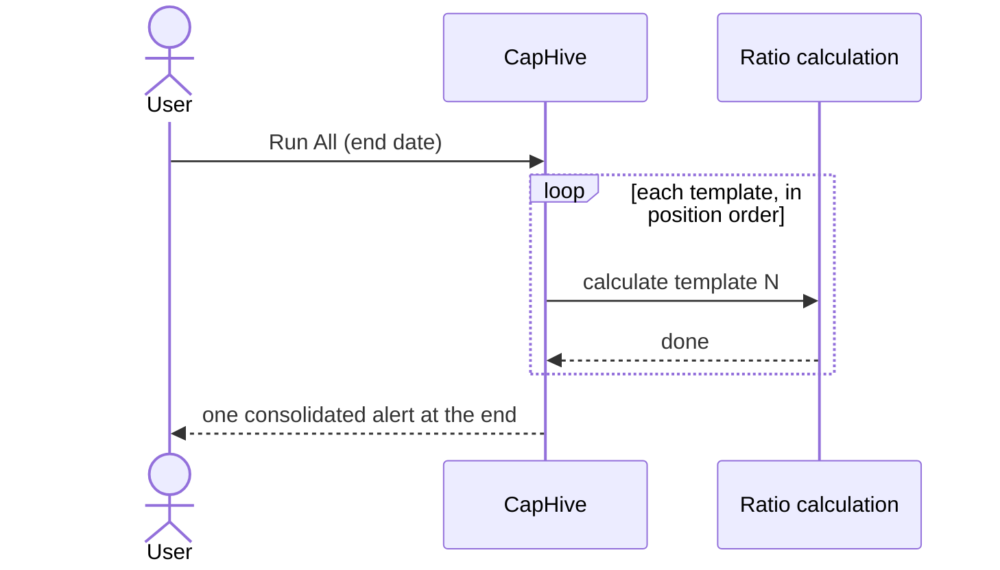

# Ratio Run Templates User Guide

Ratio Run Templates let you save a set of filter parameters once and re-run the same calculation for any date with a single click — individually, all at once, or grouped by tag.

> **Where to find it:** Sidebar → [**Funds → Ratio Templates**](/fund_ratio_run_templates); create with **New Template** and run with **Actions → Run**, **Run All** or **Run by Tag**. Past runs are under Sidebar → [**Funds → Ratio Runs**](/fund_ratio_runs). Running needs the Funds module; creating, viewing and editing templates need a company admin.

> For background on how cross-fund and cross-portfolio ratios are computed and what a ratio run record contains, see the **[Fund Ratios User Guide](fund_ratios_user_guide)**.

---

## Table of Contents

1. [What Is a Ratio Run Template?](#what-is-a-ratio-run-template)
2. [Creating a Template](#creating-a-template)
3. [Run Types — Cross-Fund vs Cross-Portfolio](#run-types)
4. [Position and Run Order](#position-and-run-order)
5. [Tags and Bulk Triggering](#tags-and-bulk-triggering)
6. [Triggering a Single Template](#triggering-a-single-template)
7. [Trigger All](#trigger-all)
8. [Trigger by Tag](#trigger-by-tag)
9. [Viewing Past Runs](#viewing-past-runs)
10. [Idempotency — Re-running the Same Date](#idempotency)
11. [Frequently Asked Questions](#frequently-asked-questions)
12. [Related Guides](#related-guides)

---

## What Is a Ratio Run Template?

A template stores the filter inputs for a cross-fund or cross-portfolio ratio calculation:

- Which **source funds** to include
- Which **portfolio companies** to include (explicit selection, tags, or sector filter)
- An optional **anchor fund** used for document storage
- A **display name**, optional **tags** for grouping, and a **position** that controls run order

When you trigger a template you supply only the **end date**. Everything else comes from the saved configuration. The system creates (or reuses) a **ratio run** that links to the resulting ratios.

---

## Creating a Template

1. Go to **Funds → Ratio Templates** in the sidebar.
2. Click **New Template** (creating, viewing, editing and deleting templates need the company admin role; any non-investor user with the Funds module can run them).
3. Fill in:
   - **Name** — must be unique within your entity.
   - **Tags** — optional grouping labels (Select2, free-text or existing tags). Multiple tags allowed.
   - **Anchor Fund** — the fund used for document storage. Leave blank for cross-portfolio runs that span all funds.
   - **Source Funds** — the funds whose data feeds the calculation. Leave blank to include all entity funds.
   - **Portfolio Companies / Tags / Sectors** — leave all blank for a cross-fund run; fill any one (or more) for a cross-portfolio run. When both **Portfolio Company Tags** and **Sectors** are set they are **intersected** — a company must carry one of the tags **and** be in one of the sectors (the run page labels this an intersection filter). Explicitly selected **Portfolio Companies** are always included and added to that result.
   - **Display Order (Position)** — a number that controls where this template appears in the index table and the order it runs when using **Run All** or **Run by Tag**. Lower numbers run first. Leave blank to place the template at the end.
4. Click **Save**. The **run type** (cross-fund or cross-portfolio) is inferred automatically from the filter fields — you do not set it manually.

---

## Run Types {#run-types}

| Run Type | When it applies |
|---|---|
| **Cross-fund** | Source funds selected, no portfolio company filters |
| **Cross-portfolio** | Any portfolio company filter set (explicit IDs, tags, or sectors) |

The run type is re-inferred every time you save the template, so changing the filters automatically updates the type.

---

## Position and Run Order {#position-and-run-order}

The **Position** field is an integer that controls two things simultaneously:

1. **Index display order** — the index table always shows templates sorted by position (ascending), with unpositioned templates at the end sorted alphabetically by name.
2. **Execution order for bulk runs** — when you use **Run All** or **Run by Tag**, templates execute one after another in position order. The next template starts only after the previous one finishes.

| Position | Behaviour |
|---|---|
| Set (e.g. 1, 2, 10) | Appears and runs in ascending numeric order |
| Blank | Treated as last; sorted alphabetically among other blank-position templates |

You set position on the template's **Edit** form (the **Display Order** field). To reorder templates, edit each one and assign a new number — there is no drag-and-drop. Gaps in the sequence are fine (`1, 5, 10` works the same as `1, 2, 3`).

---

## Tags and Bulk Triggering

Tags are free-text labels you assign to group templates together. For example, tagging several templates `monthly` lets you trigger all of them in one action for a given end date.

- A template can have **multiple tags**.
- Tags are shared across your entity — typing in the Tags field shows existing tags as suggestions.
- Tags have no effect on the calculation itself; they are purely for organisation and bulk triggering.
- The **Run by Tag** button only appears once at least one template has a tag.

---

## Triggering a Single Template

From the index table, open the **Actions** dropdown on the template's row and choose **Run**, enter an end date, and click **Run**. The job runs in the background and you will receive a notification when it completes.

---

## Trigger All

Click **Run All** at the top of the index, enter an end date in the **Run All Templates** pop-up, and click **Run All**. Every template for the entity is then run **sequentially in position order** — each template starts only after the previous one finishes. Templates rejected by a blocking validation rule for that date are skipped silently (only logged); the notice tells you how many calculations were enqueued.

Each template produces its own **ratio run**, identified by its unique combination of filters. Two templates with identical filters share a single run record (see [Idempotency](#idempotency)).

---

## Trigger by Tag

Click **Run by Tag** (shown only when at least one template has a tag), select a tag and an end date, then click **Run Tag**. Only templates carrying that tag are triggered, and they run **sequentially in position order** — the same sequencing, silent skipping of blocked templates and single end-of-batch alert as Run All, but scoped to the chosen tag.

Useful when you have templates organised by frequency (e.g. `monthly`, `quarterly`) and want to run only the relevant group on the reporting date.

---

## Viewing Past Runs

Click **Actions → View Runs** on any template row to see every past ratio run produced by that template, newest first. From there you can open a run to see the exact inputs used and follow links to the ratios it generated.

---

## Idempotency — Re-running the Same Date {#idempotency}

Triggering the same template twice for the same end date does **not** create duplicate data. The system recognises a run by its unique combination of filter inputs. If a run with the same filters already exists for that date, the existing record is reused and its ratios are recalculated in place.

This means you can safely re-trigger a template to refresh ratios after updating valuations or cash flows without worrying about duplicates.

---

## Frequently Asked Questions

### Navigation and getting there

**Where do I find Ratio Run Templates in CapHive?**
Sidebar → [**Funds → Ratio Templates**](/fund_ratio_run_templates). The page lists templates by position with **Run All**, **Run by Tag** (shown only once at least one template has a tag), **View Runs** and **New Template** at the top, and an **Actions** menu on each row.

**Is there another way to get to the templates page?**
Yes. On a fund's generate ratios form (opened with **Compute Ratios** on the fund's **Ratios** tab) every tab has a **Manage Templates** button next to **Generate** that opens the same page.

**Where do I see the ratio runs a template produced?**
On the templates page choose **Actions → View Runs** on the row, newest end date first. All runs from every template and ad-hoc cross-fund or cross-portfolio generation are under Sidebar → [**Funds → Ratio Runs**](/fund_ratio_runs); open one to see its inputs. See [Viewing Past Runs](#viewing-past-runs).

**Where do I see the ratios a run calculated?**
When a run completes, the in-app alert has **View Generated Ratios** (the [ratios list](/fund_ratios), filtered to that run) and **View All Ratios** links. Cross-fund runs produce XIRR, MOIC, RVPI, DPI, TVPI, Portfolio Value to Cost, Paid In to Committed Capital and Gross Portfolio IRR rows.

**I can't see Ratio Templates in the sidebar. Why?**
The **Funds** sidebar block needs the Funds module (`enable_funds`) and a non-investor login; investors never see ratio templates. If the page opens but **View**, **Edit**, **New Template** or **View Runs** says you are not authorized, those actions need a company admin.

### Creating, updating and managing templates

**How do I create a ratio run template?**
Sidebar → **Funds → Ratio Templates**, click [**New Template**](/fund_ratio_run_templates/new), fill in **Name**, optional **Tags**, **Anchor Fund**, **Source Funds**, **Portfolio Companies**, **Portfolio Company Tags**, **Sectors** and **Display Order**, then **Save**. The run type is inferred from the filters. See [Creating a Template](#creating-a-template).

**How do I edit a template?**
Choose **Actions → Edit** on the row, change the filters, tags or **Display Order**, and **Save**. You need the company admin role.

**How do I delete a template?**
Choose **Actions → Delete** on the row and confirm. The ratio runs and ratios it produced stay; they simply lose their link to the template.

**How do I change the run order?**
Edit each template and set its **Display Order** (position). Lower numbers run first, blanks run last in name order, and gaps are fine; there is no drag-and-drop. See [Position and Run Order](#position-and-run-order).

**How do I run one template?**
Choose **Actions → Run** on the row, enter the **End Date** and click **Run**. See [Triggering a Single Template](#triggering-a-single-template).

**How do I run all templates, or all templates with one tag?**
Click **Run All**, enter the **End Date** and click **Run All**; or click **Run by Tag**, pick a **Tag** and **End Date** and click **Run Tag**. Templates run one after another in position order. See [Trigger All](#trigger-all) and [Trigger by Tag](#trigger-by-tag).

**Can I import or export templates?**
No. There is no bulk upload or export for ratio run templates; create them one by one on **New Template**. (Support can seed a standard set with a server task.)

**What permission do I need to work with ratio run templates?**
Any non-investor user with the Funds module can open the list and use **Run**, **Run All** and **Run by Tag**. Viewing a template, **View Runs**, opening a single run, and creating, editing or deleting templates need the company admin role; ask an existing company admin if you need it.

### Why use ratio run templates

**Why should I use ratio run templates?**
Cross-fund and cross-portfolio ratios are usually wanted every quarter with the same fund, company, tag and sector selections. A template saves those filters once, so each period you enter only an end date instead of re-selecting everything on the generate form, and every period uses exactly the same inputs.

**What do templates let me do that the generate form does not?**
Run many saved calculations in one action (**Run All** or **Run by Tag**), in a fixed order, with one consolidated alert at the end, and see every run a template produced over time with **View Runs**.

**What happens if I don't use templates?**
Each period someone re-selects funds and companies on the **Cross Fund** or **Cross Portfolio** tab of the generate form. A slightly different selection produces a separate ratio run that no longer compares like for like with earlier periods.

**Who typically uses ratio run templates?**
Fund finance and investor-reporting teams who publish portfolio-level or group-level performance (for example all growth-stage companies, or all funds of one strategy) at each reporting date.

### What happens when I …

**What happens when I save a template?**
Only the template is saved; nothing is calculated. Its run type is set to cross-portfolio if any portfolio company, company tag or sector filter is set, otherwise cross-fund, and it appears on the templates list in position order.

**What happens when I run a template?**
Blocking validation rules for Ratio Run Templates are checked first; if one fires, nothing is queued and the alert explains why. Otherwise a background job finds or creates the ratio run for that filter set and end date, deletes that run's previous ratios, and writes fresh ones in the entity's currency.

**Who is notified when a run finishes?**
Only the user who clicked Run, by an in-app alert: for a single template "… ratio calculations are now complete" with **View Generated Ratios**; for **Run All** or **Run by Tag** one alert at the end listing every completed run and **View All Runs**. No email is sent and investors are not notified.

**What happens when I click Run All or Run by Tag?**
Each template is checked against blocking validation rules; blocked ones are skipped silently (only logged), and the notice says how many calculations were enqueued. The rest run in one background job, strictly one after another in position order.

**What happens if one template fails during Run All?**
The user gets a red "Error in fund ratios" alert and the batch job stops, so later templates are not run. The job is retried once, re-running the list from the start; because runs are idempotent, templates that already finished are simply recalculated.

**What happens when I run the same template again for the same end date?**
No duplicate is created. The existing ratio run for that filter set and date is reused, its ratios are deleted and recalculated, so the figures reflect the latest valuations and cash flows. See [Idempotency](#idempotency).

**What happens when I delete a template?**
The template is removed; its ratio runs and ratio figures remain on **Ratio Runs** and the ratios list, with the template link cleared. It cannot be undone, but you can recreate the template with the same filters and it will reuse those runs.

**Can I delete a ratio run?**
No. **Ratio Runs** has only a list and a detail page; runs are replaced in place when you re-run the same filters for the same date.

### Troubleshooting and edge cases

**Does Run All run templates in parallel or one at a time?**
One at a time, in position order. A single background job processes the list sequentially; each template's ratios are fully computed and saved before the next template begins.

**Do I need to set an anchor fund?**
No. The anchor fund is recorded on the run and used to store cash-flow documents in its **FundRatios** folder. If you leave it blank the calculation is unaffected, but no cash-flow document is stored for aggregate rows that have no fund of their own.

**What happens if I change a template's filters?**
Changing the filters changes the run's fingerprint, so future triggers create a new ratio run. Existing runs and their ratios are not changed.

**Can I delete a template?**
Yes. Deleting a template does not delete the ratio runs or ratio figures it produced; those remain and can still be viewed under **Ratio Runs** and the fund ratios list.

**The run type shows "cross-fund" but I expected "cross-portfolio". Why?**
The run type is inferred: unless at least one portfolio company filter (explicit companies, company tags or sectors) is set, the template is treated as cross-fund. Add a company, tag or sector filter and save to switch it.

**What happens when both Portfolio Company Tags and Sectors are set?**
They are intersected, not unioned: only companies that carry one of the tags **and** are in one of the sectors are included. The run's page flags this as an intersection filter. If nothing matches both, the run has no companies and returns no company figures.

**What if I set explicit Portfolio Companies alongside Tags and Sectors?**
Explicitly selected companies are always included, and the companies matched by the tag and sector filters (their intersection when both are set) are added to them.

**Why is Run by Tag missing from the page?**
It appears only when at least one template has a tag. Edit a template and add a tag in **Tags**.

**Why did Run All enqueue fewer calculations than I have templates?**
Templates that a blocking validation rule rejects for that end date (for example a quarter-end date check) are skipped without an alert. Run the skipped template on its own with **Actions → Run** to see the rule message.

**I get "not authorized" when I click View, Edit or New Template. Why?**
Viewing, creating, editing and deleting templates, and opening runs, need the company admin role. Other employees can still use **Run**, **Run All** and **Run by Tag** from the list.

**Can a template run on a schedule?**
No. Templates run only when someone clicks **Run**, **Run All** or **Run by Tag**; there is no scheduled trigger.

**Which currency are template ratios calculated in?**
The entity's currency. The template form has no currency field.

## Related Guides

- [Fund Ratios](fund_ratios_user_guide) — what each ratio means and how cross-fund and cross-company ratios are computed.
- [Ratio Formulas](ratio_formulas_user_guide) — customising what feeds a fund's ratios.
- [Allocation Run Templates](allocation_run_templates_user_guide) — the equivalent saved runs for account entry allocations.
- [Valuations](valuations_user_guide) — the FMV behind RVPI, TVPI, MOIC and the IRRs.
- [Validation Rule Engine](validation_rule_engine_user_guide) — the rules that can block a template run for a date.
