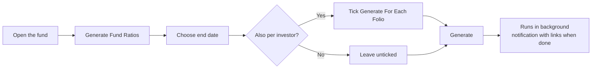

# Fund Ratios User Guide

**Fund ratios** are the performance metrics that tell you — and your investors — how a fund is doing: how much capital has been returned, what the annualised return is, and how each portfolio company is performing. This guide explains what each ratio means, how to generate them, how to combine performance across several funds or companies, and how to find and report on the results.

No technical background is needed; everything is explained in fund-performance terms.

---

## Table of Contents

1. [What Fund Ratios Are](#what-fund-ratios-are)
2. [The Standard Ratios at a Glance](#the-standard-ratios-at-a-glance)
3. [What Goes Into Each Ratio](#what-goes-into-each-ratio)
4. [A Worked Example](#a-worked-example)
5. [Generating Fund Ratios](#generating-fund-ratios)
6. [Per-Investor (Folio) Ratios](#per-investor-folio-ratios)
7. [Company and Instrument Ratios](#company-and-instrument-ratios)
8. [Cross-Fund Ratios](#cross-fund-ratios)
9. [Cross-Company Ratios](#cross-company-ratios)
10. [Reporting in a Tracking Currency](#reporting-in-a-tracking-currency)
11. [Customising Ratios with Ratio Formulas](#customising-ratios-with-ratio-formulas)
12. [Saved Runs and Reusable Templates](#saved-runs-and-reusable-templates)
13. [Finding and Filtering Ratios](#finding-and-filtering-ratios)
14. [Importing Ratios](#importing-ratios)
15. [Auditing a Result (Cash Flow Documents)](#auditing-a-result-cash-flow-documents)
16. [Tracking Trends with the Pivot View](#tracking-trends-with-the-pivot-view)
17. [Frequently Asked Questions](#frequently-asked-questions)

---

## What Fund Ratios Are

Fund ratios are performance snapshots taken as of a chosen **end date**. They answer questions such as:

- How much have we returned to investors versus what they put in? *(DPI, TVPI)*
- What is the fund's annualised return? *(XIRR)*
- How is each portfolio company performing against its cost? *(IRR, MOIC per company)*
- What does performance look like across several funds combined? *(cross-fund ratios)*

Ratios are **saved records**, not live figures. You generate them on demand; the system computes them in the background and stores the results so you can view, export, and compare them over time. Generating again for the same fund and date simply replaces the earlier result — it's always safe to refresh.

---

## The Standard Ratios at a Glance

| Ratio | Reads as | Tells you | Calculated for |
|-------|----------|-----------|----------------|
| **XIRR** | a % | The annualised return to investors, accounting for the timing of every cash flow. | Fund, investor |
| **Net IRR** | a % | XIRR after deducting the GP's estimated carry. | Fund, investor |
| **DPI** | a multiple (×) | Cash already returned per dollar paid in. | Fund, investor, cross-fund |
| **RVPI** | a multiple (×) | Value still held per dollar paid in. | Fund, investor, cross-fund |
| **TVPI** | a multiple (×) | Total value (returned + remaining) per dollar paid in. | Fund, investor, cross-fund |
| **MOIC** | a multiple (×) | Value created on invested capital. | Fund, company, cross-fund |
| **Gross Portfolio IRR** | a % | Annualised return on the investments themselves, before fund fees and carry. | Fund, cross-fund, cross-company |
| **Portfolio Value to Cost** | a multiple (×) | How current value compares to cost of holdings still owned. | Fund, cross-fund |
| **PIC (Paid-In to Committed)** | a multiple (×) | How much of total commitments has been drawn down. | Fund, cross-fund |
| **IRR / Value to Cost** | a % / × | The same measures at the level of a single company or instrument. | Company, instrument |

---

## What Goes Into Each Ratio

The two families of ratios use different inputs:

- **Investor-facing ratios** (XIRR, DPI, RVPI, TVPI, PIC) are built from investor cash flows — capital called in and value returned.
- **Investment ratios** (MOIC, Gross Portfolio IRR, Value to Cost) are built from the investments themselves — money put into companies and the value that came back.

### XIRR

XIRR is the annualised return that balances all the money flowing in and out, dated to when each event happened.

> **Money out** (counts against return): capital paid in by investors, plus amounts reinvested.
> **Money in** (counts toward return): distributions received, plus the value still held at the end date — fair market value (FMV), cash in hand, and net current assets.

**Net IRR** goes one step further and subtracts the GP's estimated carry from the remaining value, reflecting the investor's share after the manager's cut.

### DPI — Distributed to Paid-In

> DPI = Distributions returned ÷ Capital paid in

A DPI of 1.5× means investors have received one and a half times their money back in cash.

### RVPI — Residual Value to Paid-In

> RVPI = (FMV + Cash in hand + Net current assets) ÷ Capital paid in

This is the unrealised value — what's still in the fund — per dollar paid in.

### TVPI — Total Value to Paid-In

> TVPI = DPI + RVPI = (Distributions + Remaining value) ÷ Capital paid in

The total value multiple: realised plus unrealised.

### MOIC — Multiple on Invested Capital

> MOIC = (FMV + Total realised on sales) ÷ Total invested in companies

MOIC looks at the investments rather than investor cash flows, so it's a pure investment-performance measure.

### Gross Portfolio IRR

The annualised return on the investments **before** fund fees and carry — money into companies (out), against sale proceeds, income such as dividends, and remaining FMV (in). Where shares were converted from one company into another, the original cost is carried across so the history stays intact.

### Portfolio Value to Cost

> Value to Cost = FMV ÷ Cost of holdings still owned

The mark-to-market multiple on what the fund still holds.

### PIC — Paid-In to Committed

> PIC = Capital paid in ÷ Total committed

A PIC of 0.8× means 80% of total commitments has been drawn down.

---

## A Worked Example

*Acme Growth Fund I* as of 31 Dec 2025:

| Input | Amount |
|-------|--------|
| Total committed | $50,000,000 |
| Capital paid in (called and collected) | $40,000,000 |
| Distributions returned to investors | $24,000,000 |
| Remaining value (FMV + cash + net current assets) | $36,000,000 |

The ratios work out as:

| Ratio | Calculation | Result |
|-------|-------------|--------|
| **PIC** | 40M ÷ 50M | **0.80×** — 80% drawn down |
| **DPI** | 24M ÷ 40M | **0.60×** — 60c returned per dollar in |
| **RVPI** | 36M ÷ 40M | **0.90×** — 90c still held per dollar in |
| **TVPI** | 0.60 + 0.90 | **1.50×** — $1.50 of total value per dollar in |

So far investors have had $0.60 back and still hold $0.90 of value, for $1.50 of total value on every dollar paid in. The XIRR would then annualise those same flows according to *when* the money moved.

---

## Generating Fund Ratios

1. Open the **Fund**.
2. Click **Generate Fund Ratios** and choose the **Fund** tab.
3. Choose the **end date** (defaults to today).
4. Optionally tick **Generate For Each Folio** to also produce per-investor ratios.
5. Click **Generate**.

A fund-level run produces XIRR, DPI, RVPI, TVPI, MOIC, Gross Portfolio IRR, Portfolio Value to Cost, and PIC, plus IRR and MOIC for each portfolio company and instrument. You'll get a notification with links to the results when it finishes. Regenerating for the same date replaces the earlier figures.

---

## Per-Investor (Folio) Ratios

Tick **Generate For Each Folio** to compute the same ratios separately for each investor. The difference from fund-level ratios:

| Component | Fund ratio | Investor (folio) ratio |
|-----------|------------|------------------------|
| Cash flows | All of the fund's calls and distributions | Only that investor's calls and distributions |
| Remaining value | The fund's total | That investor's share |
| Folio-level ratio formulas | Not applied | Applied, scoped to the investor |

Per-investor ratios produced: XIRR, DPI, RVPI, and TVPI.

---

## Company and Instrument Ratios

Every fund-ratio run also measures each investment:

- **Per portfolio company** — IRR, MOIC, and Value to Cost for each company the fund holds.
- **Per instrument** — the same measures for each instrument *within* a company (e.g. equity vs. preference shares vs. convertible notes). This is useful when the fund holds several instrument types in one company.

> IRR for a company uses that company's own buys, sells, income, and ending FMV. MOIC is (FMV + sale proceeds) ÷ amount invested. Value to Cost is FMV ÷ cost of holdings still owned.

---

## Cross-Fund Ratios

A cross-fund ratio combines performance **across several funds**, converting every amount to one base currency before adding it up. Use it for a consolidated view — for example all funds of a vintage year, or all funds investing in one region.

### How to generate

1. Open any fund and click **Generate Fund Ratios** (or use **Funds → Cross-Fund Ratios**).
2. Choose the **Cross Fund** tab.
3. Select the **funds** to include.
4. Choose the **end date** and click **Generate**.

It produces XIRR, MOIC, DPI, RVPI, TVPI, Gross Portfolio IRR, Portfolio Value to Cost, and PIC across the selected funds.

### How combining works

Each fund's components are calculated in its own currency, converted to the base currency at the rate on the relevant date, then added together — and the ratio is computed from the combined totals.

**Cross-fund DPI example:**

| Fund | Distributions | Capital paid in |
|------|---------------|-----------------|
| Fund A (USD) | $500,000 | $400,000 |
| Fund B (EUR, at 1.10) | €300,000 → $330,000 | €200,000 → $220,000 |
| **Combined** | **$830,000** | **$620,000** |

> Cross-fund DPI = 830,000 ÷ 620,000 = **1.34×**

Each fund's own ratio formulas are applied before its figures are combined, so a customisation on one fund flows through correctly.

---

## Cross-Company Ratios

A cross-company analysis measures IRR and value metrics **per company**, combined across funds or filtered to a chosen set. Use it to ask "what is the IRR for Company X across all our funds?" or to benchmark a group of companies.

### How to generate

1. Open any fund and click **Generate Fund Ratios** (or use **Investors → Cross-Portfolio Ratios**).
2. Choose the **Cross Portfolio** tab.
3. Optionally limit to specific **funds**.
4. Optionally narrow the companies by selecting **companies**, entering **tags**, or choosing **sectors**. Leave all blank to include every company.
5. Choose the **end date** and click **Generate**.

It produces IRR, MOIC, and Value to Cost per company, plus a combined Gross Portfolio IRR for the whole selection.

### How the company filters combine

- **Tags** on their own — a company is included if it matches **any** selected tag.
- **Sectors** on their own — included if in **any** selected sector.
- **Tags and sectors together** — included only if it matches **both** at least one tag **and** at least one sector.
- **Companies you select explicitly** — always included, on top of whatever tags and sectors match.
- **Funds** — act as an overall boundary: only companies within the chosen funds are considered.

---

## Reporting in a Tracking Currency

If a fund has a **tracking (reporting) currency**, the system automatically produces a second version of each ratio in that currency. For example, alongside an XIRR of 18.5% you'd also see "XIRR (USD): 16.2%". Every amount is converted at the rate on its own transaction date before the tracking-currency ratio is calculated, so currency movements are reflected faithfully.

---

## Customising Ratios with Ratio Formulas

**Ratio formulas** let you fine-tune how a ratio is calculated by folding in specific recorded amounts — for example adding a management-fee rebate into DPI, or excluding a particular distribution. They're defined per fund under **Fund → Ratio Formulas**.

In short, a formula says *"for this ratio, take these named amounts and add or subtract them on the value side or the paid-in side."* When you next generate ratios, the adjustment is applied automatically.

**Example — boosting DPI with a fee rebate:** create a formula on *DPI* that **adds** the "Fee Rebate" amount to the value (numerator) side. From then on, generated DPI includes the rebate in distributions before dividing by capital paid in.

> Ratio formulas have their own detailed guide covering every adjustment type, scope, and period option. See the **[Ratio Formulas User Guide](ratio_formulas_user_guide)**.

---

## Saved Runs and Reusable Templates

### Saved runs

Each cross-fund or cross-company generation is recorded as a **run** that captures exactly which funds, companies, tags, and sectors were used, the end date, and who triggered it. Every ratio it produced links back to that run, so you can always see precisely how a combined figure was built. Open any cross-fund ratio and click **View Run Inputs** to see its run.

A run is identified by its unique combination of inputs. Triggering the same selection for the same date reuses the existing run and recalculates in place — it never creates duplicates.

### Reusable templates

If you run the same cross-fund or cross-company calculation regularly (monthly board reporting, for instance), save the configuration once as a **template** and trigger it for any new date with a single click — individually, all at once, or grouped by tag.

> See the **[Ratio Run Templates User Guide](fund_ratio_run_templates_user_guide)** for creating, tagging, and triggering templates.

---

## Finding and Filtering Ratios

From a fund page, click **Fund Ratios** to see all ratios, newest first. You can narrow the list by:

| Filter | Use it to |
|--------|-----------|
| **Fund** | Show one fund's ratios. |
| **Investor** | Show one investor's ratios. |
| **Owner type** | Show fund-level, company-level, or instrument-level ratios. |
| **End date** | Show ratios for a specific date. |
| **Recent months** | Show, say, the last 6 months. |
| **Latest only** | Show just the most recent figure for each ratio. |
| **Fund ratios only** | Hide per-investor ratios. |
| **By run** | Show every ratio from one cross-fund/cross-company run. |

The **search box** matches on ratio name, fund name, scenario, label, or end date (typing "Gross" finds "Gross Portfolio IRR"). After a cross-fund or cross-company run finishes, your notification links straight to that run's ratios.

---

## Importing Ratios

You can upload ratios in bulk from a spreadsheet — handy for custom metrics the system doesn't compute (e.g. "Revenue Multiple" or "Cash Yield").

| Column | Required | Notes |
|--------|----------|-------|
| **Fund** | Yes | Must match exactly. |
| **Folio No** | No | Assigns the ratio to a specific investor. |
| **Portfolio Company** | No | For a company-level ratio. |
| **Instrument** | No | For an instrument-level ratio within a company. |
| **Ratio Name** | Yes | e.g. "XIRR", "DPI", "Custom KPI". |
| **Value** | Yes | The numeric value. |
| **End Date** | Yes | The date the ratio applies to. |
| **Label / Note** | No | Display label and internal note. |
| **Update Only** | No | "yes" updates an existing ratio instead of adding one. |
| **Scenario** | No | Defaults to "Default". |

Who the ratio belongs to is inferred from the columns you fill: a folio number ties it to an investor; a company (with or without an instrument) ties it to that company or instrument; otherwise it belongs to the fund. You can't set both a folio and a company in the same row. Names containing "IRR" display as a percentage; everything else displays as a multiple.

---

## Auditing a Result (Cash Flow Documents)

To understand exactly why an XIRR or Gross Portfolio IRR came out at a given value, you can have the **underlying cash flows** saved as a spreadsheet when you generate (available in debug mode). For each ratio, the system writes a CSV into a **FundRatios** folder on the fund listing every transaction's date, amount, and description (e.g. "Remittance 123", "FMV", "Sold Amount"). This is the fastest way to reconcile a figure against your own workings.

---

## Tracking Trends with the Pivot View

The **pivot view** lays ratios out as a grid of period against ratio, making trends easy to read. Choose to group by **month** (Jan 2025, Feb 2025…) or **quarter** (Q1 2025, Q2 2025…), with the most recent periods last. Generate ratios at each date you want to compare, then open the pivot view from the Fund Ratios list.

---

## Frequently Asked Questions

**How do I generate ratios for one investor without redoing the whole fund?**
Generate at the fund level with **Generate For Each Folio** ticked — this produces both fund and per-investor figures in one pass.

**Why does XIRR differ from my own spreadsheet?**
Check whether ratio formulas are adjusting the cash flows (**Fund → Ratio Formulas**), confirm the end date matches, and use the cash flow document (debug mode) to see exactly what went in.

**Can I generate ratios for a past date?**
Yes. Set any past date as the end date — only transactions and valuations on or before that date are used.

**What currency are cross-fund ratios in?**
Your entity's base currency.

**Can different funds have different XIRR adjustments?**
Yes. Ratio formulas are fund-specific.

**IRR shows 0% even though we've invested — why?**
XIRR can't be computed when every cash flow points the same way (e.g. only money out, with no distributions and no ending value). Once a valuation exists so the company has an FMV, the ending value is included and IRR computes correctly.

**How do I compare Q1 vs Q2 for a fund?**
Generate ratios at both dates, then use the pivot view (or filter by fund and read the rows by end date).

**What does "latest" mean on a ratio?**
It flags the most recent figure for each ratio so you can show only the current snapshot rather than the full history.

**Can I store a metric the system doesn't compute?**
Yes — import any custom ratio name and it's stored and displayed alongside the computed ones.

**I run the same cross-fund report every month — is there a shortcut?**
Yes — save it as a template and trigger it per date. See the [Ratio Run Templates User Guide](fund_ratio_run_templates_user_guide).
