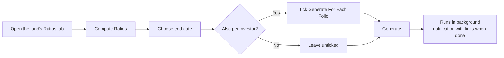

# Fund Ratios User Guide

**Fund ratios** are the performance metrics that tell you — and your investors — how a fund is doing: how much capital has been returned, what the annualised return is, and how each portfolio company is performing. This guide explains what each ratio means, how to generate them, how to combine performance across several funds or companies, and how to find and report on the results.

> **Where to find it:** Sidebar → [**Funds → Funds**](/funds) → open the fund → **Ratios** tab. Generate with **Compute Ratios** on that tab, which opens the generate form with **Fund**, **Cross Fund** and **Cross Portfolio** tabs. Viewing needs read access on the fund; computing needs update rights (fund **Access** tab or company admin).

No technical background is needed; everything is explained in fund-performance terms.

---

## Table of Contents

1. [What Fund Ratios Are](#what-fund-ratios-are)
2. [The Standard Ratios at a Glance](#the-standard-ratios-at-a-glance)
3. [What Goes Into Each Ratio](#what-goes-into-each-ratio)
4. [A Worked Example](#a-worked-example)
5. [Generating Fund Ratios](#generating-fund-ratios)
6. [Per-Investor (Folio) Ratios](#per-investor-folio-ratios)
7. [Company and Instrument Ratios](#company-and-instrument-ratios)
8. [Cross-Fund Ratios](#cross-fund-ratios)
9. [Cross-Company Ratios](#cross-company-ratios)
10. [Reporting in a Tracking Currency](#reporting-in-a-tracking-currency)
11. [Customising Ratios with Ratio Formulas](#customising-ratios-with-ratio-formulas)
12. [Saved Runs and Reusable Templates](#saved-runs-and-reusable-templates)
13. [Finding and Filtering Ratios](#finding-and-filtering-ratios)
14. [Importing Ratios](#importing-ratios)
15. [Auditing a Result (Cash Flow Documents)](#auditing-a-result-cash-flow-documents)
16. [Tracking Trends with the Pivot View](#tracking-trends-with-the-pivot-view)
17. [Frequently Asked Questions](#frequently-asked-questions)

---

## What Fund Ratios Are

Fund ratios are performance snapshots taken as of a chosen **end date**. They answer questions such as:

- How much have we returned to investors versus what they put in? *(DPI, TVPI)*
- What is the fund's annualised return? *(XIRR)*
- How is each portfolio company performing against its cost? *(IRR, MOIC per company)*
- What does performance look like across several funds combined? *(cross-fund ratios)*

Ratios are **saved records**, not live figures. You generate them on demand; the system computes them in the background and stores the results so you can view, export, and compare them over time. Generating again for the same fund and date simply replaces the earlier result — it's always safe to refresh.

---

## The Standard Ratios at a Glance

| Ratio | Reads as | Tells you | Calculated for |
|-------|----------|-----------|----------------|
| **XIRR** | a % | The annualised return to investors, accounting for the timing of every cash flow. | Fund, investor |
| **Net IRR** | a % | XIRR after deducting the GP's estimated carry. | Fund, investor |
| **DPI** | a multiple (×) | Cash already returned per dollar paid in. | Fund, investor, cross-fund |
| **RVPI** | a multiple (×) | Value still held per dollar paid in. | Fund, investor, cross-fund |
| **TVPI** | a multiple (×) | Total value (returned + remaining) per dollar paid in. | Fund, investor, cross-fund |
| **MOIC** | a multiple (×) | Value created on invested capital. | Fund, company, cross-fund |
| **Gross Portfolio IRR** | a % | Annualised return on the investments themselves, before fund fees and carry. | Fund, cross-fund, cross-company |
| **Portfolio Value to Cost** | a multiple (×) | How current value compares to cost of holdings still owned. | Fund, cross-fund |
| **PIC (Paid-In to Committed)** | a multiple (×) | How much of total commitments has been drawn down. | Fund, cross-fund |
| **IRR / Value to Cost** | a % / × | The same measures at the level of a single company or instrument. | Company, instrument |

---

## What Goes Into Each Ratio

The two families of ratios use different inputs:

- **Investor-facing ratios** (XIRR, DPI, RVPI, TVPI, PIC) are built from investor cash flows — capital called in and value returned.
- **Investment ratios** (MOIC, Gross Portfolio IRR, Value to Cost) are built from the investments themselves — money put into companies and the value that came back.

### XIRR

XIRR is the annualised return that balances all the money flowing in and out, dated to when each event happened.

> **Money out** (counts against return): capital paid in by investors, plus amounts reinvested.
> **Money in** (counts toward return): distributions received, plus the value still held at the end date — fair market value (FMV), cash in hand, and net current assets.

**Net IRR** goes one step further and subtracts the GP's estimated carry from the remaining value, reflecting the investor's share after the manager's cut.

### DPI — Distributed to Paid-In

> DPI = Distributions returned ÷ Capital paid in

A DPI of 1.5× means investors have received one and a half times their money back in cash.

### RVPI — Residual Value to Paid-In

> RVPI = (FMV + Cash in hand + Net current assets) ÷ Capital paid in

This is the unrealised value — what's still in the fund — per dollar paid in.

### TVPI — Total Value to Paid-In

> TVPI = DPI + RVPI = (Distributions + Remaining value) ÷ Capital paid in

The total value multiple: realised plus unrealised.

### MOIC — Multiple on Invested Capital

> MOIC = (FMV + Total realised on sales) ÷ Total invested in companies

MOIC looks at the investments rather than investor cash flows, so it's a pure investment-performance measure.

### Gross Portfolio IRR

The annualised return on the investments **before** fund fees and carry — money into companies (out), against sale proceeds, income such as dividends, and remaining FMV (in). Where shares were converted from one company into another, the original cost is carried across so the history stays intact.

### Portfolio Value to Cost

> Value to Cost = FMV ÷ Cost of holdings still owned

The mark-to-market multiple on what the fund still holds.

### PIC — Paid-In to Committed

> PIC = Capital paid in ÷ Total committed

A PIC of 0.8× means 80% of total commitments has been drawn down.

---

## A Worked Example

*Acme Growth Fund I* as of 31 Dec 2025:

| Input | Amount |
|-------|--------|
| Total committed | $50,000,000 |
| Capital paid in (called and collected) | $40,000,000 |
| Distributions returned to investors | $24,000,000 |
| Remaining value (FMV + cash + net current assets) | $36,000,000 |

The ratios work out as:

| Ratio | Calculation | Result |
|-------|-------------|--------|
| **PIC** | 40M ÷ 50M | **0.80×** — 80% drawn down |
| **DPI** | 24M ÷ 40M | **0.60×** — 60c returned per dollar in |
| **RVPI** | 36M ÷ 40M | **0.90×** — 90c still held per dollar in |
| **TVPI** | 0.60 + 0.90 | **1.50×** — $1.50 of total value per dollar in |

So far investors have had $0.60 back and still hold $0.90 of value, for $1.50 of total value on every dollar paid in. The XIRR would then annualise those same flows according to *when* the money moved.

---

## Generating Fund Ratios

1. Open the **Fund** and click its **Ratios** tab.
2. Click **Compute Ratios**, confirm the prompt, and use the **Fund** tab of the form that opens.
3. Choose the **end date** (defaults to today).
4. Optionally tick **Generate For Each Folio** to also produce per-investor ratios.
5. Click **Generate**.

A fund-level run produces XIRR, DPI, RVPI, TVPI, MOIC, Gross Portfolio IRR, Portfolio Value to Cost, and PIC, plus IRR and MOIC for each portfolio company and instrument. You'll get a notification with links to the results when it finishes. Regenerating for the same date replaces the earlier figures.

---

## Per-Investor (Folio) Ratios

Tick **Generate For Each Folio** to compute the same ratios separately for each investor. The difference from fund-level ratios:

| Component | Fund ratio | Investor (folio) ratio |
|-----------|------------|------------------------|
| Cash flows | All of the fund's calls and distributions | Only that investor's calls and distributions |
| Remaining value | The fund's total | That investor's share |
| Folio-level ratio formulas | Not applied | Applied, scoped to the investor |

Per-investor ratios produced: XIRR, DPI, RVPI, and TVPI.

---

## Company and Instrument Ratios

Every fund-ratio run also measures each investment:

- **Per portfolio company** — IRR, MOIC, and Value to Cost for each company the fund holds.
- **Per instrument** — the same measures for each instrument *within* a company (e.g. equity vs. preference shares vs. convertible notes). This is useful when the fund holds several instrument types in one company.

> IRR for a company uses that company's own buys, sells, income, and ending FMV. MOIC is (FMV + sale proceeds) ÷ amount invested. Value to Cost is FMV ÷ cost of holdings still owned.

---

## Cross-Fund Ratios

A cross-fund ratio combines performance **across several funds**, converting every amount to one base currency before adding it up. Use it for a consolidated view — for example all funds of a vintage year, or all funds investing in one region.

### How to generate

1. Open any fund's **Ratios** tab and click **Compute Ratios** (or use the **Cross-Fund Ratios** button at the top of the Funds list).
2. Choose the **Cross Fund** tab.
3. Select the **funds** to include.
4. Choose the **end date** and click **Generate**.

It produces XIRR, MOIC, DPI, RVPI, TVPI, Gross Portfolio IRR, Portfolio Value to Cost, and PIC across the selected funds.

### How combining works

Each fund's components are calculated in its own currency, converted to the base currency at the rate on the relevant date, then added together — and the ratio is computed from the combined totals.

**Cross-fund DPI example:**

| Fund | Distributions | Capital paid in |
|------|---------------|-----------------|
| Fund A (USD) | $500,000 | $400,000 |
| Fund B (EUR, at 1.10) | €300,000 → $330,000 | €200,000 → $220,000 |
| **Combined** | **$830,000** | **$620,000** |

> Cross-fund DPI = 830,000 ÷ 620,000 = **1.34×**

Each fund's own ratio formulas are applied before its figures are combined, so a customisation on one fund flows through correctly.

---

## Cross-Company Ratios

A cross-company analysis measures IRR and value metrics **per company**, combined across funds or filtered to a chosen set. Use it to ask "what is the IRR for Company X across all our funds?" or to benchmark a group of companies.

### How to generate

1. Open any fund's **Ratios** tab and click **Compute Ratios** (or use the **Cross-Portfolio Ratios** button at the top of the Stakeholders list).
2. Choose the **Cross Portfolio** tab.
3. Optionally limit to specific **funds**.
4. Optionally narrow the companies by selecting **companies**, entering **tags**, or choosing **sectors**. Leave all blank to include every company.
5. Choose the **end date** and click **Generate**.

It produces IRR, MOIC, and Value to Cost per company, plus a combined Gross Portfolio IRR for the whole selection.

### How the company filters combine

- **Tags** on their own — a company is included if it matches **any** selected tag.
- **Sectors** on their own — included if in **any** selected sector.
- **Tags and sectors together** — included only if it matches **both** at least one tag **and** at least one sector.
- **Companies you select explicitly** — always included, on top of whatever tags and sectors match.
- **Funds** — act as an overall boundary: only companies within the chosen funds are considered.

---

## Reporting in a Tracking Currency

If a fund has a **tracking (reporting) currency**, the system automatically produces a second version of each ratio in that currency. For example, alongside an XIRR of 18.5% you'd also see "XIRR (USD): 16.2%". Every amount is converted at the rate on its own transaction date before the tracking-currency ratio is calculated, so currency movements are reflected faithfully.

---

## Customising Ratios with Ratio Formulas

**Ratio formulas** let you fine-tune how a ratio is calculated by folding in specific recorded amounts — for example adding a management-fee rebate into DPI, or excluding a particular distribution. They're defined per fund under the fund's **Actions → Account Entries → Ratio Formulas**.

In short, a formula says *"for this ratio, take these named amounts and add or subtract them on the value side or the paid-in side."* When you next generate ratios, the adjustment is applied automatically.

**Example — boosting DPI with a fee rebate:** create a formula on *DPI* that **adds** the "Fee Rebate" amount to the value (numerator) side. From then on, generated DPI includes the rebate in distributions before dividing by capital paid in.

You can also give a set of formulas a shared **label** so they produce a separate, additional ratio (e.g. "xirr outflow" alongside the standard "XIRR") instead of adjusting the standard figure — handy for showing variants side by side.

> Ratio formulas have their own detailed guide covering every adjustment type, scope, period option, and label grouping. See the **[Ratio Formulas User Guide](ratio_formulas_user_guide)**.

---

## Saved Runs and Reusable Templates

### Saved runs

Each cross-fund or cross-company generation is recorded as a **run** that captures exactly which funds, companies, tags, and sectors were used, the end date, and who triggered it. Every ratio it produced links back to that run, so you can always see precisely how a combined figure was built. Open any cross-fund ratio and click **View Run Inputs** to see its run.

A run is identified by its unique combination of inputs. Triggering the same selection for the same date reuses the existing run and recalculates in place — it never creates duplicates.

### Reusable templates

If you run the same cross-fund or cross-company calculation regularly (monthly board reporting, for instance), save the configuration once as a **template** and trigger it for any new date with a single click — individually, all at once, or grouped by tag.

> See the **[Ratio Run Templates User Guide](fund_ratio_run_templates_user_guide)** for creating, tagging, and triggering templates.

---

## Finding and Filtering Ratios

From a fund page, click the **Ratios** tab to see its ratios (the **Actions** dropdown there switches between fund, folio, portfolio company and instrument rows); the [list of all ratios](/fund_ratios) shows every fund, newest first. You can narrow the list by:

| Filter | Use it to |
|--------|-----------|
| **Fund** | Show one fund's ratios. |
| **Investor** | Show one investor's ratios. |
| **Owner type** | Show fund-level, company-level, or instrument-level ratios. |
| **End date** | Show ratios for a specific date. |
| **Recent months** | Show, say, the last 6 months. |
| **Latest only** | Show just the most recent figure for each ratio. |
| **Fund ratios only** | Hide per-investor ratios. |
| **By run** | Show every ratio from one cross-fund/cross-company run. |

The **search box** matches on ratio name, fund name, scenario, label, or end date (typing "Gross" finds "Gross Portfolio IRR"). After a cross-fund or cross-company run finishes, your notification links straight to that run's ratios.

### Bulk Actions on the Ratios List

The ratios list has a **Bulk Actions** dropdown (next to **Analytics** and **Compute Ratios**) for deleting many ratios in one step. It is shown to company users (not investor logins) **only when the list is for one fund and a filter is applied**: from the fund's **Ratios** tab pick one of the **Actions → Filter: …** items (for example **Filter: Folios**), or use the **Filter** card with a **Fund Name** selected and click the search icon. The list of all ratios with **All Funds** selected never shows it.

| Action (exact label) | What it does | Shown when |
|---|---|---|
| **Delete** | Deletes each ratio matching the filter that you are allowed to delete (create rights on the fund), together with any cash-flow document attached to it. | One fund is selected and a filter is applied; not for investor logins |

After you confirm, the delete applies to **every ratio for that fund matching the filter conditions, including rows on other pages**. Other narrowing in the page address or the table's search box is not carried over, so check the filter conditions rather than the visible rows. It runs in the background: the page shows "Bulk Action started, please check back in a few mins.", you get an in-app alert per deleted ratio and a final "Delete completed for N records" alert, and if any row was skipped (no rights) or failed you also get an email listing them. There is no undo on screen; regenerate with **Compute Ratios** or re-import the rows.

---

## Importing Ratios

You can upload ratios in bulk from a spreadsheet — handy for custom metrics the system doesn't compute (e.g. "Revenue Multiple" or "Cash Yield").

| Column | Required | Notes |
|--------|----------|-------|
| **Fund** | Yes | Must match exactly. |
| **Folio No** | No | Assigns the ratio to a specific investor. |
| **Portfolio Company** | No | For a company-level ratio. |
| **Instrument** | No | For an instrument-level ratio within a company. |
| **Ratio Name** | Yes | e.g. "XIRR", "DPI", "Custom KPI". |
| **Value** | Yes | The numeric value. |
| **End Date** | Yes | The date the ratio applies to. |
| **Label / Note** | No | Display label and internal note. |
| **Update Only** | No | "yes" updates an existing ratio instead of adding one. |
| **Scenario** | No | Defaults to "Default". |

Who the ratio belongs to is inferred from the columns you fill: a folio number ties it to an investor; a company (with or without an instrument) ties it to that company or instrument; otherwise it belongs to the fund. You can't set both a folio and a company in the same row. Names containing "IRR" display as a percentage; everything else displays as a multiple.

---

## Auditing a Result (Cash Flow Documents)

To understand exactly why an XIRR or Gross Portfolio IRR came out at a given value, you can have the **underlying cash flows** saved as a spreadsheet when you generate, by ticking **Return Cash Flows** on the generate form. For each ratio, the system writes a CSV into a **FundRatios** folder on the fund listing every transaction's date, amount, and description (e.g. "Remittance 123", "FMV", "Sold Amount"). This is the fastest way to reconcile a figure against your own workings.

---

## Tracking Trends with the Pivot View

The **pivot view** lays ratios out as a grid of period against ratio, making trends easy to read. Choose to group by **month** (Jan 2025, Feb 2025…) or **quarter** (Q1 2025, Q2 2025…), with the most recent periods last. Generate ratios at each date you want to compare, then open the pivot view by adding `pivot=true` to the ratios page address, as in the [pivot view of all ratios](/fund_ratios?pivot=true) (quarterly by default; add `&group_by_period=month` for months) — there is no button for it.

---

## Frequently Asked Questions

**Where do I find a fund's ratios in CapHive?**
Sidebar → [**Funds → Funds**](/funds), open the fund, then click the **Ratios** tab; it shows the fund-level rows. The **Actions** dropdown on the tab switches the view with **Filter: Folios**, **Filter: Portfolio Company**, **Filter: Instrument**, **Filter: Fund Only** and **Filter: Cross-Portfolio Only**. The same list without a fund filter is the [list of all ratios](/fund_ratios). See [Finding and Filtering Ratios](#finding-and-filtering-ratios).

**How do I generate (compute) ratios for a fund?**
On the fund's **Ratios** tab click **Compute Ratios**; confirm the prompt and the generate form opens on its **Fund** tab. Set the **End Date**, optionally tick **Generate For Each Folio** and **Return Cash Flows**, and press **Generate**. See [Generating Fund Ratios](#generating-fund-ratios).

**How do I generate cross-fund or cross-company ratios?**
Open the same generate form and switch to the **Cross Fund** or **Cross Portfolio** tab, or use the **Cross-Fund Ratios** button at the top of the [Funds list](/funds) and the **Cross-Portfolio Ratios** button at the top of the [Stakeholders list](/investors), which open the form on the right tab. Pick the funds, companies, tags or sectors, set the end date and press **Generate**. See [Cross-Fund Ratios](#cross-fund-ratios) and [Cross-Company Ratios](#cross-company-ratios).

**How do I edit a ratio?**
Computed ratios cannot be edited; the **Edit** button on a ratio's page appears only for rows that were loaded by spreadsheet import (users with create rights on the fund) or for support users. To change a computed figure, correct the underlying calls, distributions, valuations or account entries and run **Compute Ratios** again.

**How do I delete ratios?**
Open the row and click **Delete**, or apply a filter on one fund's ratios list and use **Bulk Actions → Delete** to remove every row matching the filter, across all pages. Both need create rights on the fund. There is no undo on screen, but a computed set can always be regenerated for the same end date.

**Where are the bulk actions for fund ratios?**
On a fund's ratios list, once a filter is applied, a **Bulk Actions** dropdown with **Delete** appears next to **Analytics**. Get there from the fund's **Ratios** tab via **Actions → Filter: …**, or with the **Filter** card and a fund selected. See [Bulk Actions on the Ratios List](#bulk-actions-on-the-ratios-list).

**Why don't I see the Bulk Actions button on the fund ratios list?**
The fund ratios **Bulk Actions** dropdown needs three things: the list is for one fund (not **All Funds**), a filter is applied, and you are logged in as a company user rather than an investor. The plain **Ratios** tab has no filter applied, so pick an **Actions → Filter: …** item first.

**How do I delete many fund ratios at once with bulk actions?**
Open the fund's ratios list, narrow it with the **Filter** card (for example by end date or name) or an **Actions → Filter: …** item, then choose **Bulk Actions → Delete** and confirm. Every matching ratio for that fund that you have create rights on is deleted in the background.

**How do I import ratios from a spreadsheet, and export them?**
On the Ratios tab open **Actions → Upload** (an Import Upload of type FundRatio with a sample file on the next screen) or **Actions → Download** for an Excel export of the current filter. Uploads are tracked under Company menu → [**Imports**](/import_uploads). See [Importing Ratios](#importing-ratios).

**What permission do I need?**
Any employee with read access to the fund (fund **Access** tab) can view ratios; the **Compute Ratios** button and cross-fund buttons require update rights on the fund, and delete/import require create rights. Investor logins see a fund's ratios only when **Show fund ratios to LPs** is ticked on **Actions → Edit Fund**.

**Why should I compute ratios rather than track performance in a spreadsheet?**
Because the figures are built from the same calls, distributions, valuations and account entries the platform already holds, dated to the day, and stored as records: every LP statement, dashboard widget, Fund Assistant answer and LP-portal page reads the same number. Regenerating for a new date gives a history you can compare, and ratio formulas and tracking-currency variants are applied consistently across funds.

**What can I do with ratios once they are generated?**
Show them on the Ratios tab and its **Analytics** panel, publish them to investors on the LP portal, merge them into statements and notices as template fields, export them to Excel, chart them on dashboards, combine funds or companies in cross-fund runs, and audit any figure with its cash-flow document. See [Saved Runs and Reusable Templates](#saved-runs-and-reusable-templates).

**Who typically uses fund ratios?**
Fund finance and fund administration teams generate and check them at each period end, fund managers and IR use them for reporting and board packs, and investors read their own folio-level ratios on the LP portal when the fund is set to show them.

**What happens if I never compute ratios?**
The Ratios tab, the LP-portal ratios section, the ratio dashboard widgets and any statement fields that pull ratios stay empty or show the last computed date, and cross-fund reports for the entity have nothing to combine for that fund. Nothing else in the fund (calls, distributions, allocations) depends on ratios existing.

**What happens when I press Generate on the Fund tab?**
Validation rules configured for fund ratios are checked first (a blocker stops the run with a message). Then a background job deletes any existing rows for that fund and end date, recomputes XIRR, DPI, RVPI, TVPI, MOIC, Gross Portfolio IRR, Portfolio Value to Cost and PIC plus per-company and per-instrument IRR/MOIC, adds tracking-currency variants if the fund has one, marks the newest rows as latest and sends you an in-app alert with **View Generated Ratios** / **View All Ratios** links. No email is sent and no investor is notified.

**What happens when I tick Generate For Each Folio?**
The same job also computes XIRR, DPI, RVPI and TVPI for every commitment in the fund, posting an in-app alert per folio as each finishes; on a KYC-level fund, commitments flagged to skip document generation are skipped. The rows appear under **Actions → Filter: Folios** and on each commitment's page, and are what investors see on the LP portal.

**What happens when I generate a cross-fund or cross-portfolio run?**
A **Fund Ratio Run** record is created (or reused when the same funds, companies, tags, sectors and date were used before), the rows previously produced by that run are deleted and recomputed in the entity's base currency, stored against the anchor fund you launched from, and you receive an in-app alert linking to that run's rows. The run's inputs are visible under Sidebar → [**Funds → Ratio Runs**](/fund_ratio_runs) and via **View Run Inputs** on any of its ratios.

**What happens when I import ratios?**
Each spreadsheet row creates a ratio (or, with **Update Only** = yes, updates the existing one) owned by the fund, folio, company or instrument the columns describe; the latest flag is refreshed for every fund and end date touched, and a results file listing any row errors is attached to the import under **Imports**. Imported rows are editable afterwards; nothing is recomputed and no one is notified.

**What happens when I delete a ratio or use Bulk Actions → Delete on the fund ratios list?**
The rows disappear from the lists with any attached cash-flow document, each deletion is written to the audit trail, and a bulk delete runs in the background, sending you an in-app alert per row, a final "Delete completed for N records" alert and an email listing any rows skipped or failed. No one else is notified; account entries, valuations and formulas are untouched, the latest flag is not recalculated, and there is no undo on screen.

**What happens if data is missing when I generate?**
A missing exchange rate for a tracking-currency or cross-fund conversion makes the job fail with a red in-app alert (and for a fund-level run the old rows for that date are already gone, so fix the rate and rerun). Missing FMV, `Cash in Hand` or `Net Current Assets` entries do not fail the run: they count as zero, so RVPI, TVPI and both IRRs are understated.

**How do I generate ratios for one investor without redoing the whole fund?**
Generate at the fund level with **Generate For Each Folio** ticked; this produces both fund and per-investor figures in one pass. There is no per-folio button, and a fund-level rerun for the same date is harmless because it simply replaces the earlier rows.

**Why does XIRR differ from my own spreadsheet?**
Check whether ratio formulas are adjusting the cash flows (**Actions → Account Entries → Ratio Formulas** on the fund page), confirm the end date matches, and regenerate with **Return Cash Flows** ticked to get the exact dated cash flows as a document on the ratio. See [Auditing a Result (Cash Flow Documents)](#auditing-a-result-cash-flow-documents).

**Can I generate ratios for a past date?**
Yes. Set any past date as the end date; only transactions and valuations on or before that date are used, and the result is stored as its own row, so you can build a history of quarter-end snapshots.

**What currency are cross-fund ratios in?**
Your entity's base currency; each fund's components are converted at the exchange rate on the relevant date before being combined, so the rates must exist under Company menu → [**Exchange Rates**](/exchange_rates).

**Can different funds have different XIRR adjustments?**
Yes. Ratio formulas are fund-specific, and in a cross-fund run each fund's own formulas are applied before its figures are combined.

**IRR shows 0% even though we've invested. Why?**
XIRR can't be computed when every cash flow points the same way (e.g. only money out, with no distributions and no ending value). Once a valuation exists so the company has an FMV, the ending value is included and IRR computes correctly.

**How do I compare Q1 vs Q2 for a fund?**
Generate ratios at both dates, then filter by fund and read the rows by end date, or open the pivot view by adding `pivot=true` to the ratios page address (e.g. the [pivot view of all ratios](/fund_ratios?pivot=true), quarterly by default; add `&group_by_period=month` for months); there is no button for it. The **Analytics** button on the Ratios tab charts the trend. See [Tracking Trends with the Pivot View](#tracking-trends-with-the-pivot-view).

**What does "latest" mean on a ratio?**
It flags the most recent figure for each ratio so you can show only the current snapshot rather than the full history; it is refreshed after every generation and import.

**Can I store a metric the system doesn't compute?**
Yes. Import any custom ratio name and it's stored and displayed alongside the computed ones; names containing "IRR" display as a percentage, everything else as a multiple.

**I run the same cross-fund report every month. Is there a shortcut?**
Yes. Save it as a template under Sidebar → [**Funds → Ratio Templates**](/fund_ratio_run_templates) and trigger it per date, individually, with **Run All**, or by tag. See the [Ratio Run Templates User Guide](fund_ratio_run_templates_user_guide).

**The Compute Ratios button is missing, or the Ratios tab is empty for an investor.**
The button is shown only to users who can update the fund; ask a company admin for update rights on the fund's **Access** tab. Investors see the tab only when **Show fund ratios to LPs** is ticked on **Actions → Edit Fund**, and then only fund-level and their own folio rows.

**A fund ratio bulk delete finished but some ratios are still there — why?**
Rows you are not allowed to delete (you need create rights on that ratio's fund) are skipped with "Not authorized to delete", and a row that fails to delete is skipped too. The final alert gives the error count and the email lists each skipped ratio. Ask a company admin for create rights on the fund's **Access** tab and run it again.

**Does a bulk action on fund ratios apply to rows on other pages?**
Yes. Fund ratio **Bulk Actions → Delete** covers every ratio for the selected fund that matches the filter conditions, on all pages. Narrowing from the table's search box or the page address (such as latest-only or a folio's own ratio tab) is not carried over, so filter precisely before confirming.

**Can I undo a computation?**
Not directly: a run deletes the previous rows for that fund and end date before writing new ones. If the new figures are wrong, fix the data and regenerate; if you need the old figures back, restore them from an earlier Excel **Download**.

## Related Guides

- [Carry & Performance Metrics](carry_computations_user_guide) — how Estimated Carry turns Gross IRR into Net IRR.
- [Ratio Formulas](ratio_formulas_user_guide) — fold extra account entries into a ratio's value or capital side.
- [Fund Ratio Run Templates](fund_ratio_run_templates_user_guide) — save cross-fund and cross-company runs and trigger them by date or tag.
- [Valuations](valuations_user_guide) — the FMV that feeds RVPI, TVPI, MOIC and the IRRs.
- [Capital Calls](capital_calls_user_guide) and [Capital Distributions](capital_distributions_user_guide) — the cash flows on each side of the ratios.
- [Tracking Currency](tracking_currency_guide) — the second-currency variants and the exchange rates they need.
- [Dashboard Widgets](dashboard_widgets_user_guide) — charting ratios on dashboards.
