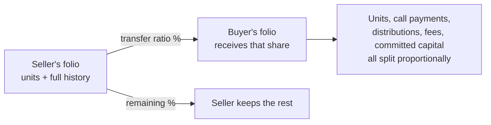

# Fund Unit Transfers — User Guide

This guide explains how to transfer fund units between investors. It is written for fund managers and investor relations teams who need to record a secondary sale or transfer of a fund stake — no technical background required.

---

## Table of Contents

1. [What Is a Fund Unit Transfer?](#what-is-a-fund-unit-transfer)
2. [When Would You Use This?](#when-would-you-use-this)
3. [Before You Begin — Checklist](#before-you-begin--checklist)
4. [Step-by-Step: Running a Transfer](#step-by-step-running-a-transfer)
5. [Understanding the Transfer Form](#understanding-the-transfer-form)
6. [Transfer Ratio Examples](#transfer-ratio-examples)
7. [Worked Example](#worked-example)
8. [Account Entries — Should You Transfer Them?](#account-entries--should-you-transfer-them)
9. [What Happens After You Click Transfer](#what-happens-after-you-click-transfer)
10. [Validation Errors and What They Mean](#validation-errors-and-what-they-mean)
11. [After the Transfer — What to Check](#after-the-transfer--what-to-check)
12. [Frequently Asked Questions](#frequently-asked-questions)

---

## What Is a Fund Unit Transfer?

When an investor commits capital to a fund, they receive **fund units** that represent their ownership stake. A **fund unit transfer** moves some or all of those units from one investor (the seller) to another investor (the buyer) who is already in the same fund.

The system automatically splits the seller's financial history — their capital call payments, any fees recorded, and any distributions they have received — between the two parties in proportion to how much of the stake changed hands.

Think of it like a property transfer: the buyer takes on a share of everything that came with the original investment.

---

## When Would You Use This?

- An LP sells part or all of their stake to another investor in the same fund (secondary market transaction).
- An investor restructures their holding across two folios within the fund.
- A merger or reorganisation requires moving ownership between entities that both hold folios in the fund.

---

## Before You Begin — Checklist

Before starting the transfer, confirm the following:

- [ ] **Both investors are already in the fund.** The buyer must have an existing folio (capital commitment record) in the same fund as the seller.
- [ ] **Both investors hold the same unit class.** For example, if the seller holds Class A units, the buyer's folio must also be Class A. You cannot transfer Class A units to a Class B folio.
- [ ] **The buyer's folio has an earlier or equal commitment date.** The buyer's commitment date must be on or before the seller's. In practice this is always satisfied because the buyer's folio is created as a copy of the seller's, giving both the same date.
- [ ] **You know the agreed price and premium per unit.** These are typically set by the parties to the transaction (or determined by the fund's NAV at the transfer date).
- [ ] **You know the transfer ratio.** This is the percentage of the seller's units being transferred (e.g. 50 means half, 100 means all).

---

## Step-by-Step: Running a Transfer

1. Navigate to the **seller's Capital Commitment** (folio) page.
2. Click **Transfer Fund Units** in the actions menu.
3. Fill in the transfer form (see [Understanding the Transfer Form](#understanding-the-transfer-form) below).
4. Click **Transfer**.
5. If successful, you are taken to the seller's Fund Units tab, where you will see the new transfer records.
6. If there is an error, the form reloads with a message explaining what went wrong.

---

## Understanding the Transfer Form

| Field | What to enter |
|-------|--------------|
| **From Folio** | Pre-filled automatically with the seller's folio. You cannot change this. |
| **To Folio** | Select the buyer's folio from the dropdown. Only folios in the same fund are shown. |
| **Transfer Ratio** | The percentage of the seller's units being transferred. Enter a whole number between 1 and 100. |
| **Transfer Date** | The date the transfer takes effect. This is the date that will appear on the new unit records. |
| **Price** | The agreed price per unit at the time of transfer. |
| **Premium** | Any premium per unit agreed between the parties. Enter 0 if there is no premium. |
| **Transfer Account Entries** | Tick this box if you want the seller's fee and cost records (account entries) to be split between buyer and seller in proportion to the transfer. See [Account Entries](#account-entries--should-you-transfer-them) for guidance. |
| **Account Entries Not Pro-Rated** | If you ticked the box above, list here (comma-separated) any specific fee types that should be copied to the buyer in full rather than split. Leave blank if not applicable. |

---

## Transfer Ratio Examples

| Scenario | Transfer Ratio to Enter |
|----------|------------------------|
| Seller transfers **half** their stake | `50` |
| Seller transfers **all** their stake | `100` |
| Seller transfers **a quarter** of their stake | `25` |
| Seller transfers **75%** of their stake | `75` |

A transfer ratio of 100 means the seller's folio ends up with zero units after the transfer. All their payment history and distributions are moved to the buyer.

---

## Worked Example

**Before the transfer** — *Northwind LP* holds the following in *Acme Growth Fund I*:

| Item | Northwind (seller) |
|------|--------------------|
| Fund units held | 1,000 |
| Committed capital | $5,000,000 |
| Capital paid in to date | $2,000,000 |
| Distributions received to date | $300,000 |

Northwind sells **40%** of its stake to *Briar Capital* (transfer ratio = `40`), with **Transfer Account Entries** ticked so fees move across too.

**After the transfer** — everything is split 40 / 60:

| Item | Northwind keeps (60%) | Briar receives (40%) |
|------|----------------------|----------------------|
| Fund units | 600 | 400 |
| Committed capital | $3,000,000 | $2,000,000 |
| Capital paid in | $1,200,000 | $800,000 |
| Distributions received | $180,000 | $120,000 |

Briar's folio now carries 40% of Northwind's full history, so future performance metrics (XIRR, DPI, TVPI) for both investors reflect the correct share. A "transfer out" of 400 units appears on Northwind's Fund Units tab and a matching "transfer in" of 400 units on Briar's.

---

## Account Entries — Should You Transfer Them?

Account entries are amounts recorded against an investor's folio — for example, management fees, setup costs, or any other charges or credits.

**Tick "Transfer Account Entries" if:**
- The buyer is taking on responsibility for the seller's historical costs and credits.
- You want the buyer's folio to reflect the full financial history of the transferred stake.

**Leave it unticked if:**
- The buyer and seller have agreed that historical costs stay with the seller.
- Your fund's legal documents specify that fees are non-transferable.

### Account Entries Not Pro-Rated

Some account entries may need to be treated differently from the rest. Enter the name of any fee type here (comma-separated if more than one) that should be copied to the buyer at its **full original amount** rather than split by the transfer ratio. The seller's entry is also kept intact — so both parties end up holding the full amount for that line item.

This is appropriate for one-time fees (such as a setup cost) that are not meaningfully divisible. For ongoing periodic fees, leave this field blank so they are split proportionally.

If you are unsure, leave this field blank — your fund administrator or compliance team can advise.

---

## What Happens After You Click Transfer

Once you confirm the transfer, the system carries out several steps automatically:

1. **Units are recorded.** A debit (negative) unit entry is created on the seller's folio and a credit (positive) unit entry on the buyer's folio, both dated as of the transfer date.

2. **Capital call history is split.** Each of the seller's capital call payment records is divided between the two folios in proportion to the transfer ratio. The seller retains the remaining share; the buyer receives the transferred share.

3. **Account entries are split** (if you ticked the box). Fee and cost records on the seller's folio are reduced by the transfer ratio, and matching entries are created on the buyer's folio.

4. **Distribution payment history is split.** Any distributions previously paid to the seller are also divided proportionally, so both folios reflect the correct historical receipts going forward.

5. **Committed capital is adjusted.** The fund records a formal adjustment to the committed capital figures for both folios to reflect the change in ownership.

6. **Totals are recalculated.** Unit balances, payment totals, and committed amounts for both folios are refreshed immediately.

The transfer is recorded with a unique reference ID, and every modified record is stamped with the original amount and the transfer details for audit purposes.

---

## Validation Errors and What They Mean

If the transfer cannot proceed, you will see one of the following error messages:

| Error Message | What it means | What to do |
|---------------|--------------|------------|
| **Invalid folio `[id]`** | The folio selected as the buyer does not exist in this fund. | Check that the buyer has a capital commitment record in the same fund, and select the correct folio. |
| **Transfer ratio must be greater than 0.** | A transfer ratio of 0 (or negative) was submitted. | Enter a whole number between 1 and 100. |
| **Transfer ratio must be 100 or less.** | A transfer ratio above 100 was submitted. | Enter a whole number between 1 and 100. |
| **Commitments are not from the same fund.** | The buyer's folio is in a different fund. | You can only transfer between folios in the same fund. Verify that the correct fund and folio are selected. |
| **Commitments are not the same unit type.** | The buyer holds a different class of units than the seller. | Fund unit transfers require both parties to hold the same unit class (e.g. both Class A). If the buyer needs to hold a different class, contact your fund administrator. |
| **From commitment does not have enough units.** | The seller does not hold as many units as the transfer ratio implies. | Check that units have been generated for the seller's folio. If they have, reduce the transfer ratio or regenerate units before retrying. |

---

## After the Transfer — What to Check

Once the transfer completes, verify the following:

- **Seller's fund units tab:** You should see a new "transfer out" unit entry with a negative quantity dated on the transfer date.
- **Buyer's fund units tab:** You should see a new "transfer in" unit entry with a positive quantity dated on the transfer date.
- **Seller's total unit balance:** Should have decreased by the transferred amount.
- **Buyer's total unit balance:** Should have increased by the transferred amount.
- **Capital remittances:** Both the seller's and buyer's folio pages should show updated payment amounts reflecting the split.
- **Fund ratios / performance metrics:** If your fund uses XIRR or DPI/TVPI calculations, regenerate them after the transfer so that the performance figures for both investors are updated.

---

## Frequently Asked Questions

**Can I transfer units to an investor who is not yet in the fund?**
No. The buyer must already have an active folio (capital commitment) in the same fund before the transfer can be processed. Add the buyer as a capital commitment first, then return to run the transfer.

**Can I undo a transfer?**
There is no automatic reversal. If a transfer was made in error, contact your system administrator to discuss corrective options.

**What if I only want to transfer a partial stake?**
Enter a transfer ratio less than 100. For example, entering 40 transfers 40% of the seller's units to the buyer while leaving 60% with the seller.

**Does the transfer affect the seller's historical performance metrics?**
Yes. The system splits the seller's capital call and distribution history in proportion to the transfer ratio, so future performance calculations for both investors will reflect the correct share of the fund's history.

**Will the buyer receive future distributions on the transferred stake?**
Yes, but only if distributions are generated or recalculated after the transfer date. Past distributions recorded before the transfer are split retrospectively; future distributions will be calculated based on the updated unit balances.

**Can I transfer between investors who hold different unit classes?**
No. Both the seller's and buyer's folio must have the same unit class. If they differ, the transfer will fail with a validation error.

**Does the buyer's folio need an earlier or equal commitment date?**
Yes, but in practice this is always met. When a buyer's folio is created for a transfer it is copied from the seller's folio and shares the same commitment date, so the constraint is never a problem in normal use.

**Can I see a record of all past transfers?**
Each unit entry created by a transfer is labelled as a transfer-in or transfer-out and includes a reference to the transfer ID. You can view these on the Fund Units tab of either folio. The modified payment records also contain notes showing the original amounts and the transfer reference.

**Should I regenerate fund ratios after a transfer?**
Yes. If your fund uses ratio or performance calculations (XIRR, DPI, TVPI, RVPI), regenerating them after a transfer ensures the figures reflect the updated ownership structure.
