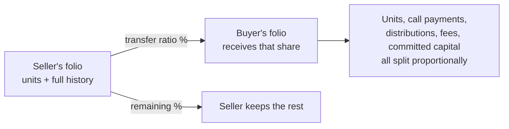

# Fund Unit Transfers — User Guide

This guide explains how to transfer fund units between investors. It is written for fund managers and investor relations teams who need to record a secondary sale or transfer of a fund stake — no technical background required.

> **Where to find it:** Sidebar → [**Funds → Funds**](/funds) → open the fund → **Commitments** tab → open the seller's commitment → **Units** tab → **Transfer**. Needs the Units feature enabled for your company and update access on the fund (company admins have it automatically).

---

## Table of Contents

1. [What Is a Fund Unit Transfer?](#what-is-a-fund-unit-transfer)
2. [When Would You Use This?](#when-would-you-use-this)
3. [Before You Begin — Checklist](#before-you-begin--checklist)
4. [Step-by-Step: Running a Transfer](#step-by-step-running-a-transfer)
5. [Understanding the Transfer Form](#understanding-the-transfer-form)
6. [Transfer Ratio Examples](#transfer-ratio-examples)
7. [Worked Example](#worked-example)
8. [Account Entries — Should You Transfer Them?](#account-entries--should-you-transfer-them)
9. [What Happens After You Click Transfer](#what-happens-after-you-click-transfer)
10. [Validation Errors and What They Mean](#validation-errors-and-what-they-mean)
11. [After the Transfer — What to Check](#after-the-transfer--what-to-check)
12. [Frequently Asked Questions](#frequently-asked-questions)

---

## What Is a Fund Unit Transfer?

When an investor commits capital to a fund, they receive **fund units** that represent their ownership stake. A **fund unit transfer** moves some or all of those units from one investor (the seller) to another investor (the buyer) who is already in the same fund.

The system automatically splits the seller's financial history — their capital call payments, any fees recorded, and any distributions they have received — between the two parties in proportion to how much of the stake changed hands.

Think of it like a property transfer: the buyer takes on a share of everything that came with the original investment.

---

## When Would You Use This?

- An LP sells part or all of their stake to another investor in the same fund (secondary market transaction).
- An investor restructures their holding across two folios within the fund.
- A merger or reorganisation requires moving ownership between entities that both hold folios in the fund.

---

## Before You Begin — Checklist

Before starting the transfer, confirm the following:

- [ ] **Both investors are already in the fund.** The buyer must have an existing folio (capital commitment record) in the same fund as the seller.
- [ ] **Both investors hold the same unit class.** For example, if the seller holds Class A units, the buyer's folio must also be Class A. You cannot transfer Class A units to a Class B folio.
- [ ] **The buyer's folio has an earlier or equal commitment date.** The buyer's commitment date must be on or before the seller's. The buyer's folio is not created for you, so check its date; a later date makes the transfer fail.
- [ ] **You know the agreed price and premium per unit.** These are typically set by the parties to the transaction (or determined by the fund's NAV at the transfer date).
- [ ] **You know the transfer ratio.** This is the percentage of the seller's units being transferred (e.g. 50 means half, 100 means all).

---

## Step-by-Step: Running a Transfer

1. Navigate to the **seller's Capital Commitment** (folio) page and open its **Units** tab.
2. Click **Transfer**.
3. Fill in the transfer form (see [Understanding the Transfer Form](#understanding-the-transfer-form) below).
4. Click **Transfer**.
5. If successful, you are taken to the seller's commitment with the **Units** tab selected, where you will see the new transfer records.
6. If there is an error, the form reloads with a message explaining what went wrong.

---

## Understanding the Transfer Form

| Field | What to enter |
|-------|--------------|
| **From Folio** | Pre-filled automatically with the seller's folio. You cannot change this. |
| **To Folio** | Select the buyer's folio from the dropdown. It lists every folio in the fund, including the seller's own, so make sure you pick the buyer's. |
| **Transfer Ratio** | The percentage of the seller's units being transferred. Enter a whole number between 1 and 100; any decimal part is dropped (33.5 becomes 33). |
| **Transfer Date** | The date the transfer takes effect. This is the date that will appear on the new unit records. |
| **Price** | The agreed price per unit at the time of transfer. |
| **Premium** | Any premium per unit agreed between the parties. Enter 0 if there is no premium. |
| **Transfer Account Entries** | Tick this box if you want the seller's fee and cost records (account entries) to be split between buyer and seller in proportion to the transfer. See [Account Entries](#account-entries--should-you-transfer-them) for guidance. |
| **Account Entries Not pro-rated** | If you ticked the box above, list here (comma-separated) the names of any account entries that should be copied to the buyer in full rather than split. Leave blank if not applicable. |

---

## Transfer Ratio Examples

| Scenario | Transfer Ratio to Enter |
|----------|------------------------|
| Seller transfers **half** their stake | `50` |
| Seller transfers **all** their stake | `100` |
| Seller transfers **a quarter** of their stake | `25` |
| Seller transfers **75%** of their stake | `75` |

A transfer ratio of 100 means the seller's folio ends up with zero units after the transfer. All their payment history and distributions are moved to the buyer.

---

## Worked Example

**Before the transfer** — *Northwind LP* holds the following in *Acme Growth Fund I*:

| Item | Northwind (seller) |
|------|--------------------|
| Fund units held | 1,000 |
| Committed capital | $5,000,000 |
| Capital paid in to date | $2,000,000 |
| Distributions received to date | $300,000 |

Northwind sells **40%** of its stake to *Briar Capital* (transfer ratio = `40`), with **Transfer Account Entries** ticked so fees move across too.

**After the transfer** — everything is split 40 / 60:

| Item | Northwind keeps (60%) | Briar receives (40%) |
|------|----------------------|----------------------|
| Fund units | 600 | 400 |
| Committed capital | $3,000,000 | $2,000,000 |
| Capital paid in | $1,200,000 | $800,000 |
| Distributions received | $180,000 | $120,000 |

Briar's folio now carries 40% of Northwind's full history, so future performance metrics (XIRR, DPI, TVPI) for both investors reflect the correct share. A "transfer out" of 400 units appears on Northwind's Fund Units tab and a matching "transfer in" of 400 units on Briar's.

---

## Account Entries — Should You Transfer Them?

Account entries are amounts recorded against an investor's folio — for example, management fees, setup costs, or any other charges or credits.

**Tick "Transfer Account Entries" if:**
- The buyer is taking on responsibility for the seller's historical costs and credits.
- You want the buyer's folio to reflect the full financial history of the transferred stake.

**Leave it unticked if:**
- The buyer and seller have agreed that historical costs stay with the seller.
- Your fund's legal documents specify that fees are non-transferable.

### Account Entries Not Pro-Rated

Some account entries may need to be treated differently from the rest. Enter the name of any account entry here (comma-separated if more than one) that should be copied to the buyer at its **full original amount** rather than split by the transfer ratio. The seller's entry is also kept intact — so both parties end up holding the full amount for that line item.

This is appropriate for one-time fees (such as a setup cost) that are not meaningfully divisible. For ongoing periodic fees, leave this field blank so they are split proportionally.

If you are unsure, leave this field blank — your fund administrator or compliance team can advise.

---

## What Happens After You Click Transfer

Once you confirm the transfer, the system carries out several steps automatically:

1. **Units are recorded.** A debit (negative) unit entry is created on the seller's folio and a credit (positive) unit entry on the buyer's folio, both dated as of the transfer date.

2. **Capital call history is split.** Each of the seller's capital call payment records is divided between the two folios in proportion to the transfer ratio. The seller retains the remaining share; the buyer receives the transferred share.

3. **Account entries are split** (if you ticked the box). Fee and cost records on the seller's folio are reduced by the transfer ratio, and matching entries are created on the buyer's folio.

4. **Distribution payment history is split.** Any distributions previously paid to the seller are also divided proportionally, so both folios reflect the correct historical receipts going forward.

5. **Committed capital is adjusted.** The fund records a formal adjustment to the committed capital figures for both folios to reflect the change in ownership.

6. **Totals are recalculated.** Unit balances, payment totals, and committed amounts for both folios are refreshed immediately.

The transfer is recorded with a unique reference ID, and every modified record is stamped with the original amount and the transfer details for audit purposes. No one is notified, and documents such as call notices are not copied to the buyer's records.

---

## Validation Errors and What They Mean

If the transfer cannot proceed, you will see one of the following error messages:

| Error Message | What it means | What to do |
|---------------|--------------|------------|
| **Invalid folio `[id]`** | The folio selected as the buyer does not exist in this fund. | Check that the buyer has a capital commitment record in the same fund, and select the correct folio. |
| **Transfer ratio must be greater than 0.** | A transfer ratio of 0 (or negative) was submitted. | Enter a whole number between 1 and 100. |
| **Transfer ratio must be 100 or less.** | A transfer ratio above 100 was submitted. | Enter a whole number between 1 and 100. |
| **The `To-Commitment` commitment_date should be on or before the `From-Commitment`.** | The buyer's commitment date is later than the seller's. | Edit the buyer's commitment so its date is on or before the seller's, then retry. |
| **Commitments are not from the same fund.** | The buyer's folio is in a different fund. | You can only transfer between folios in the same fund. Verify that the correct fund and folio are selected. |
| **Commitments are not the same unit type.** | The buyer holds a different class of units than the seller. | Fund unit transfers require both parties to hold the same unit class (e.g. both Class A). If the buyer needs to hold a different class, contact your fund administrator. |
| **From commitment does not have enough units.** | The seller does not hold as many units as the transfer ratio implies. | Check that units have been generated for the seller's folio. If they have, reduce the transfer ratio or regenerate units before retrying. |

---

## After the Transfer — What to Check

Once the transfer completes, verify the following:

- **Seller's fund units tab:** You should see a new "transfer out" unit entry with a negative quantity dated on the transfer date.
- **Buyer's fund units tab:** You should see a new "transfer in" unit entry with a positive quantity dated on the transfer date.
- **Seller's total unit balance:** Should have decreased by the transferred amount.
- **Buyer's total unit balance:** Should have increased by the transferred amount.
- **Capital remittances:** Both the seller's and buyer's folio pages should show updated payment amounts reflecting the split.
- **Fund ratios / performance metrics:** If your fund uses XIRR or DPI/TVPI calculations, regenerate them after the transfer so that the performance figures for both investors are updated.

---

## Frequently Asked Questions

### Navigation and getting there

**Where do I start a fund unit transfer?**
Sidebar → [**Funds → Funds**](/funds), open the fund, stay on the **Commitments** tab and open the seller's commitment. Click the commitment's **Units** tab and then the **Transfer** button above the unit list to open the transfer form. See [Step-by-Step: Running a Transfer](#step-by-step-running-a-transfer).

**Is Transfer Fund Units in the commitment's Actions menu?**
No. The commitment's **Actions** dropdown has statements, documents and advisor options only; the transfer is launched from the **Transfer** button on the commitment's **Units** tab.

**I can't see the Units tab or the Transfer button - why?**
The **Units** tab only appears when the Units feature is enabled for your company; ask CapHive support to switch it on. Opening the form needs update access on the seller's commitment, and submitting it also checks update access on the buyer's.

**Where do I see the result of a transfer?**
After a successful transfer you land on the seller's commitment with the **Units** tab selected. The buyer's commitment **Units** tab shows the matching entry, both folios' **Remittances**, **Distributions** and **Adjustments** tabs show the split records, and the fund-wide list is under the fund page's **Actions → Fund Units**.

**Is there a list of all transfers?**
There is no dedicated transfers screen. Each transfer's unit entries carry a reason such as "Transfer from A to B. transfer_id: …", so filter the fund's **Actions → Fund Units** list by reason, or look at each folio's **Units** and **Adjustments** tabs.

### Creating, updating and managing transfers

**How do I run a transfer?**
Open the **Transfer** form from the seller's **Units** tab, enter **Transfer Ratio**, **Transfer Date**, **Price** and **Premium**, pick the buyer in **To Folio**, optionally tick **Transfer Account Entries** and fill **Account Entries Not pro-rated**, then click **Transfer**. See [Understanding the Transfer Form](#understanding-the-transfer-form).

**How do I prepare the buyer's folio?**
If the buyer is not yet in the fund, create a commitment for them first on the fund's **Commitments** tab (**New Commitment**) with the same unit type as the seller and a commitment date on or before the seller's. A zero committed amount is fine; the transfer adds the transferred commitment to it.

**Can I edit a transfer after it is done?**
No. There is no edit screen for a transfer. Individual records it created (unit entries, adjustments) can be opened and changed or deleted, but that does not re-split the other records, so correct a wrong transfer with a second transfer in the opposite direction or ask support.

**Can I cancel or delete a transfer?**
There is no cancel or reversal action. If a transfer was made in error, run a reverse transfer from the buyer back to the seller for the right ratio, or contact support to discuss corrective options.

**Can I bulk upload transfers?**
No. Transfers are one folio pair at a time through the form. For migrated history you can instead upload unit entries on the fund's **Fund Units** list (**Upload**), but that only moves units, not payments, distributions or commitment.

**What permission do I need to transfer units?**
Update access on the fund for both the seller's and the buyer's commitment (company admins have it automatically), plus the Units feature enabled for your company. A company admin grants fund access on the fund page's **Access** tab.

### Why use fund unit transfers

**Why use the transfer feature instead of editing units by hand?**
A transfer moves units and splits the seller's whole history in one step: call remittances and payments, distributions, optionally account entries, and committed capital. Editing units alone would leave paid-in capital, distributions and commitments with the seller, so the buyer's statements, capital account and XIRR/DPI/TVPI would be wrong.

**What does a transfer let me do?**
Record a secondary sale of all or part of a stake, restructure one investor's holding across two folios, or move ownership after a merger, while keeping an audit trail: every changed record stores its original amount, the transfer ratio and a transfer ID.

**What happens if I don't record a secondary sale as a transfer?**
The seller keeps the units, called and collected capital, distributions and commitment in CapHive, so future calls and distributions are split to the wrong folio, the buyer's portal shows nothing for the transferred stake, and performance figures for both investors are wrong.

**Who typically runs transfers?**
Fund operations or investor-relations staff, after the legal transfer documents are signed; finance or compliance usually checks the ratio, price and account-entry choice first. Investors do not run transfers.

### What happens when I …

**What happens when I click Transfer?**
The checks run first; if all pass, the seller gets a negative unit entry and the buyer a positive one for ratio × the seller's current units, at your price and premium, dated the transfer date. Every remittance and its payments, and every distribution payment, on the seller's folio is split: the seller keeps (100 − ratio)% and a copy with ratio% is created on the buyer's folio. Then totals are refreshed for the whole fund.

**What happens to committed capital?**
Two **Transfer** adjustments are created: plus ratio × the seller's folio committed amount on the buyer's folio and the same amount negative on the seller's, both dated the seller's commitment date. Committed amounts and every folio's percentage in the fund are recalculated and the adjustments appear on each folio's **Adjustments** tab.

**What happens to account entries when I tick Transfer Account Entries?**
Each account entry on the seller's folio is reduced to the retained share and a copy with the transferred share is created on the buyer's folio. Entries whose names you list in **Account Entries Not pro-rated** are copied to the buyer at the full amount and left at the full amount on the seller. Unticked, all account entries stay with the seller. See [Account Entries — Should You Transfer Them?](#account-entries--should-you-transfer-them).

**Who is notified when I run a transfer?**
No one. The transfer sends no email or in-app notification to the seller, the buyer or fund staff; you only see the on-screen success or error message. Tell the investors yourself and share updated statements if needed.

**What happens if a check fails or something goes wrong midway?**
You are returned to the form with the error message and your entries kept. The transfer runs inside a database transaction that is rolled back on failure, so the checks failing leaves nothing changed. If someone else is transferring from the same folio at the same moment you see "Another transfer is in progress for this commitment. Please try again."

**What happens to future calls and distributions after a transfer?**
New calls and distributions that use commitment percentage split by each folio's percentage, which the transfer has already updated, so the buyer receives their share automatically. Calls and distributions created before the transfer are not regenerated; only their existing records were split.

**Is a transfer reversible?**
Not automatically. Records are split in place and the originals keep their pre-transfer amounts only in audit notes, so reversing means a new transfer from buyer to seller, which will not restore the exact original rounding.

### Troubleshooting and edge cases

**Can I transfer units to an investor who is not yet in the fund?**
No. The buyer must already have a folio (capital commitment) in the same fund. Add the buyer's commitment first on the fund's **Commitments** tab, then return to run the transfer.

**What if I only want to transfer a partial stake?**
Enter a transfer ratio less than 100. For example, entering 40 transfers 40% of the seller's units, payments, distributions and commitment to the buyer while leaving 60% with the seller.

**Can I enter a ratio like 33.5?**
No. The ratio is taken as a whole number, so any decimal part is dropped (33.5 becomes 33). Enter a whole number from 1 to 100.

**Does the transfer affect the seller's historical performance metrics?**
Yes. The system splits the seller's capital call and distribution history in proportion to the transfer ratio, so future performance calculations for both investors will reflect the correct share of the fund's history.

**Will the buyer receive future distributions on the transferred stake?**
Yes, for distributions generated after the transfer on a commitment-percentage basis: the updated percentages give the buyer's folio its share. Past distributions recorded before the transfer are split retrospectively at the transfer ratio.

**Can I transfer between investors who hold different unit classes?**
No. Both the seller's and buyer's folio must have the same unit class. If they differ, the transfer will fail with "Commitments are not the same unit type."

**The transfer fails with a commitment date message - why?**
The buyer's commitment date must be on or before the seller's; otherwise you get "The `To-Commitment` commitment_date should be on or before the `From-Commitment`." Edit the buyer's commitment so its date is on or before the seller's, then run the transfer again.

**It says "From commitment does not have enough units" - why?**
The seller has no units, or fewer than the ratio implies. Allocate units on the seller's calls first (open the call, **Actions → Allocate Units**), check the seller's **Units** tab shows a positive balance, then retry.

**Why does the To Folio list include the seller's own folio?**
The list shows every folio in the fund. Make sure you pick the buyer's folio; choosing the seller's own folio would split the folio's records onto itself.

**Can I see a record of all past transfers?**
Each unit entry created by a transfer has a reason "Transfer from [seller folio] to [buyer folio]. transfer_id: …" and a negative quantity on the seller or positive on the buyer. You can view these on the **Units** tab of either folio. The split remittances, payments, distribution payments and account entries also carry notes with the original amounts and the transfer reference.

**Should I regenerate fund ratios after a transfer?**
Yes. If your fund uses ratio or performance calculations (XIRR, DPI, TVPI, RVPI), regenerating them after a transfer ensures the figures reflect the updated ownership structure.

**Are documents such as call notices moved to the buyer?**
No. The split copies of remittances and distribution payments on the buyer's folio carry the amounts only; notices and other documents stay on the seller's records. Generate fresh notices or statements for the buyer if they need them.

---

## Related Guides

- [Fund Units](fund_units_user_guide) - how units are issued, redeemed and listed.
- [Capital Commitments](capital_commitments_user_guide) - creating the buyer's folio and reading **Transfer** adjustments.
- [Capital Calls](capital_calls_user_guide) - remittances and payments that a transfer splits.
- [Capital Distributions](capital_distributions_user_guide) - distribution payments that a transfer splits.
- [Fund Ratios](fund_ratios_user_guide) - regenerate performance figures after a transfer.
- [Secondary Sales](secondary_sales_user_guide) - running the buyer/seller matching that may lead to a transfer.
