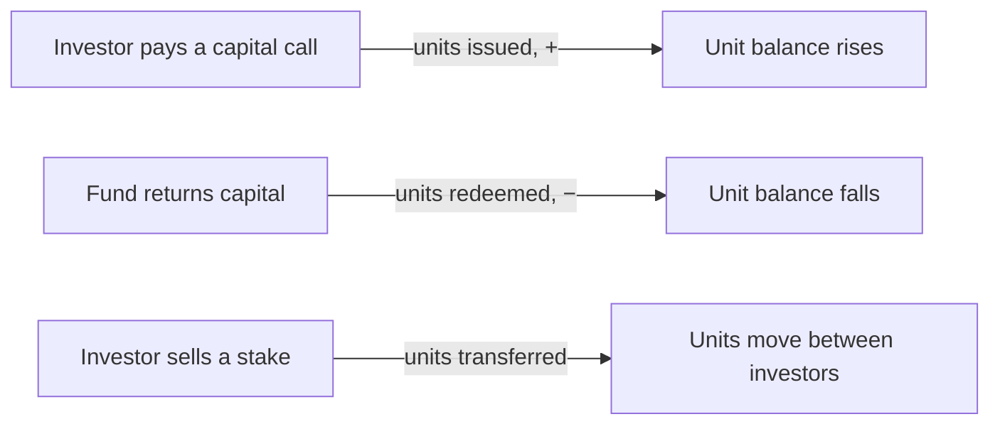
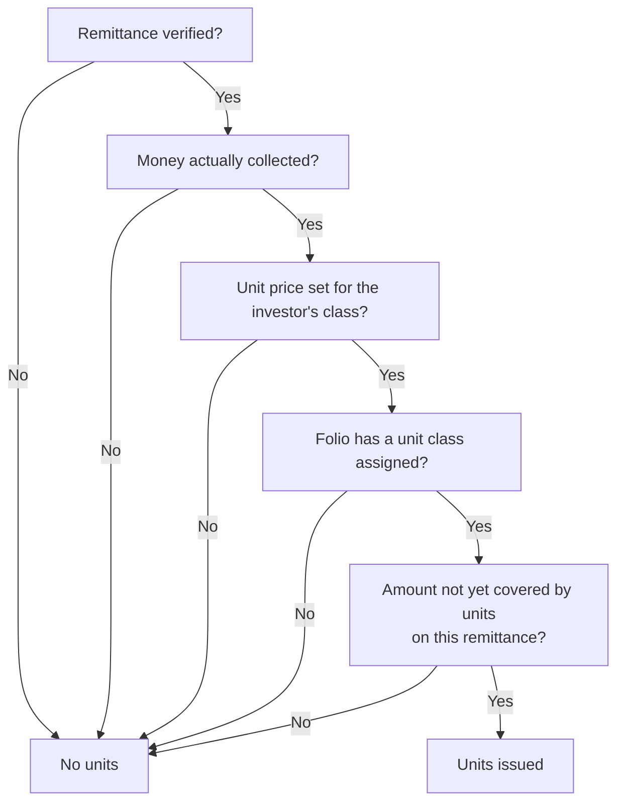
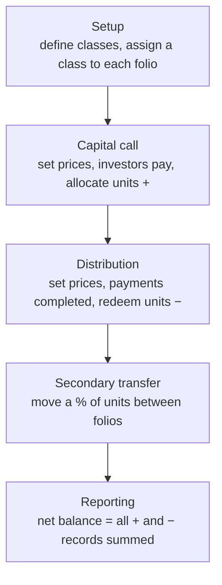

# Fund Units User Guide

**Fund units** are how the system tracks each investor's ownership stake in a fund — the fund's equivalent of shares. As investors pay into capital calls they receive units; as the fund returns capital they redeem units; and investors can transfer units to one another. The running unit balance gives you a live, auditable cap table where every unit ties back to the cash transaction that created it.

> **Where to find it:** Sidebar → [**Funds → Funds**](/funds) → open the fund → **Actions** dropdown → **Fund Units** or **Fund Unit Settings**. New unit types (unit classes) are added to the fund's **Unit types** field on **Actions → Edit Fund** and set up on **Fund Unit Settings → New**. Units are issued with **Actions → Allocate Units** on an approved capital call and redeemed with **Actions → Redeem Units** on a distribution. Needs the Units feature enabled for your company and update access on the fund.

This guide covers the whole picture: defining unit classes, issuing units on capital calls, redeeming them on distributions, transferring them between investors, and reporting on the result.

---

## Table of Contents

1. [What Fund Units Represent](#what-fund-units-represent)
2. [Key Terms in Plain English](#key-terms-in-plain-english)
3. [Step 1 — Defining Unit Classes](#step-1--defining-unit-classes)
4. [Step 2 — Assigning a Class to Each Investor](#step-2--assigning-a-class-to-each-investor)
5. [Step 3 — Setting Unit Prices](#step-3--setting-unit-prices)
6. [Issuing Units from a Capital Call](#issuing-units-from-a-capital-call)
7. [Redeeming Units on a Distribution](#redeeming-units-on-a-distribution)
8. [The Full Unit Lifecycle](#the-full-unit-lifecycle)
9. [Transferring Units Between Investors](#transferring-units-between-investors)
10. [The Investor's Unit Balance (Cap Table)](#the-investors-unit-balance-cap-table)
11. [Viewing and Filtering Units](#viewing-and-filtering-units)
12. [Importing Unit Classes and Units](#importing-unit-classes-and-units)
13. [Worked Example](#worked-example)
14. [Frequently Asked Questions](#frequently-asked-questions)

---

## What Fund Units Represent

A fund unit is a measure of an investor's proportional ownership. The principle is simple:

At any moment, an investor's net unit balance reflects their current ownership in the fund. Because each unit record links back to the call payment, distribution, or transfer that produced it, the cap table is fully traceable.

---

## Key Terms in Plain English

| Term | What it means |
|------|---------------|
| **Unit Class (Type / Series)** | A category of unit, such as "Class A" or "Series I". A fund can have several classes with different fee or carry terms. |
| **Unit Price** | The base price per unit set on a capital call or distribution. |
| **Premium** | An extra amount per unit charged over the base price, used in some fund structures. |
| **Issue Date** | The date units are issued. For call-based units it's the later of the payment date and the call's due date, so units are never dated before the call was due. |
| **GP Units** | Units held by the General Partner (the fund manager) rather than by investors. |
| **Transfer Ratio** | The percentage of an investor's units being moved in a secondary transfer. |
| **Folio** | An investor's account within the fund. Each folio carries one unit class. |

---

## Step 1 — Defining Unit Classes

Before any units can be issued you define the **unit types** the fund offers — also called unit classes, share classes or series. In CapHive each unit type is a **Fund Unit Setting**. There is no separate "New Unit Type" button; setting one up takes two steps:

1. On the fund page choose **Actions → Edit Fund** and add the class name to the **Unit types** field (a comma-separated list, e.g. `Class A, Class B`). The field is shown only when the Units feature is enabled for your company.
2. On the fund page choose **Actions → Fund Unit Settings**, click **New**, pick the name in **Class / Series / Unit Type** and save. The list only offers names from the fund's **Unit types** field, and each name can be set up once per fund.

| Field | Required | What it's for |
|-------|----------|---------------|
| **Class / Series / Unit Type** | Yes | The class name (e.g. "Class A"), picked from the fund's unit types. Must be unique within the fund. |
| **Management Fee %** | No | The class's management fee. Shown for reference and reporting. |
| **Setup Fee %** | No | A one-time setup fee. For reference. |
| **Carry %** | No | The carried-interest rate for the class. Used as a reference for carry reporting. |
| **ISIN** | No | The securities identification number, if the class has one. |
| **GP Units** | No | Tick if this class is held by the General Partner rather than investors. |

> The class name must exactly match one of the unit classes configured on the fund; otherwise it won't save. The fee and carry percentages here are **informational** — they appear in reports but aren't applied to calculations automatically.

---

## Step 2 — Assigning a Class to Each Investor

Every commitment (folio) needs a **unit class** before it can receive units. Set it on the investor's **Capital Commitment** record; it must be one of the fund's defined classes. This tells the system which class to issue when the investor pays a call.

---

## Step 3 — Setting Unit Prices

Units are valued at the price you set on the relevant call or distribution.

- **On a capital call:** set a **price and premium per class**. These are used when issuing units. If a class has no price on the call, no units are issued for investors in that class — even if they've paid.
- **On a distribution:** set a **price per class**. This determines how many units are redeemed for each unit of capital returned.

Prices live on each call and distribution individually, because a fund's unit price (NAV) changes from one drawdown to the next.

---

## Issuing Units from a Capital Call

Once a call is approved and remittances are verified, open the call and choose **Actions → Allocate Units** (shown only when the call has unit prices).

### What must be true for an investor to receive units

### How many units

> **Units issued = Amount not yet covered by units ÷ (Price + Premium)**, where the amount is the call amount if the remittance is fully paid, otherwise the amount collected so far.

The **issue date** is the later of the payment date and the call's due date, so early payers don't get backdated units.

Each issuance creates one unit record holding the class, quantity, price, premium, total value, and issue date, linked to the remittance that triggered it. Re-running allocation is safe — each run issues units only for money not already covered by units on the remittance (capped at the call amount), so fully allocated folios get nothing and folios that paid more since the last run get an extra unit record for the difference. Unit records have no manual create button, and on an existing record only the unit type, quantity and reason can be edited; price and premium are fixed at issue. You'll get a confirmation when it finishes, and a detailed error report if any investor couldn't be processed (for example a missing unit class).

---

## Redeeming Units on a Distribution

When a distribution's payments are completed, open the distribution and choose **Actions → Redeem Units** (shown only when unit prices are set).

### What must be true

- The distribution payment is **completed**.
- There is a face value for redemption (return of capital) to redeem against.
- A **unit price** is set for the investor's class on the distribution.
- The folio has a **unit class** assigned.
- Units haven't already been redeemed for this payment.

### How many units

> **Units redeemed = − (Face value for redemption with adjustments ÷ Price)**

The quantity is **negative** — redemptions reduce the balance — and the issue date is the payment date. As with issuance, re-running is safe and won't double-redeem.

---

## The Full Unit Lifecycle

---

## Transferring Units Between Investors

A **fund unit transfer** moves some or all of one investor's units to another investor in the same fund — typically a secondary-market sale. Because this is a detailed workflow with its own validations and effects (it also splits the seller's call payments, distributions, and fees), it has a dedicated guide.

> **See the [Fund Unit Transfers User Guide](fund_unit_transfers_user_guide)** for the step-by-step process, the transfer form, validation messages, and what to check afterwards.

In brief, a transfer:

- Records units leaving the seller's folio and arriving on the buyer's folio, dated to the transfer date.
- Splits the seller's call payments, distributions, and (optionally) fee line items between the two folios in proportion to the transfer ratio.
- Adjusts each folio's committed capital to reflect the change.
- Refreshes both folios' totals immediately.

Both folios must be in the **same fund** and hold the **same unit class**, and the seller must hold enough units to cover the transfer.

---

## The Investor's Unit Balance (Cap Table)

Every unit record automatically updates the investor's totals, so the folio always shows a live balance:

| Shown on the folio | What it tracks |
|--------------------|----------------|
| **Units held** | Net units — every issuance, redemption, and transfer summed together. |
| **Total premium paid** | The total premium the investor has paid on their units. |
| **Total unit value** | The value of units issued (issuances only, not redemptions). |

The fund also rolls up total premium across all investors. These figures update automatically whenever a unit is issued, redeemed, or transferred — no manual tallying.

---

## Viewing and Filtering Units

On the fund page choose **Actions → Fund Units** to see every unit record for a fund. You can narrow the list by fund, folio, investor, or import batch, and filter the columns by class, quantity, price, premium, issue date, or reason.

Reading the list:

| What you see | What it means |
|--------------|---------------|
| **Positive quantity** | Units issued from a capital-call payment. |
| **Negative quantity** | Units redeemed on a distribution. |
| **Transfer "in"** | Units received via a secondary transfer. |
| **Transfer "out"** | Units sent via a secondary transfer. |

The sum of all quantities for a folio equals the unit balance shown on that commitment.

### Bulk Actions on the Fund Units List

The Fund Units list has a **Bulk Actions** dropdown (next to **Download** and **Upload**) for deleting many unit records in one step. It appears **only when the list is showing filter results** — the **Filter** card is visible at the top. The list has no **Filter** button of its own and the fund's **Units** tab and **Actions → Fund Units** open it unfiltered, so the menu is normally reached by opening a saved report of fund units from Sidebar → [**Funds → Reports**](/reports); once the **Filter** card is showing you can change its conditions (fund, folio, investor, class, quantity, price, issue date, reason…) and click the search icon.

| Action (exact label) | What it does | Shown when |
|---|---|---|
| **Delete** | Deletes each unit record matching the filter that you are allowed to delete, and reduces the folio, remittance or payment and fund unit totals accordingly. | The list is showing filter results |

After you confirm, the delete applies to **every unit matching the filter, including rows on other pages**; the fund, folio and investor the list was opened for are kept, but other narrowing (such as an import batch) is not. A unit created by a capital call or distribution is deleted only if you could delete that remittance or distribution payment (destroy access on the fund); others are skipped. It runs in the background: the page shows "Bulk Action started, please check back in a few mins.", you get an in-app alert per deleted unit and a final "Delete completed for N records" alert, plus an email listing each skipped or failed unit. There is no undo; re-issue units with **Allocate Units** / **Redeem Units** or an upload.

---

## Importing Unit Classes and Units

You can bulk-load both, mainly for migrating historical data.

**Unit classes** — provide the fund, class name (must be an allowed class), and optional management fee %, setup fee %, carry %, GP-units flag, and ISIN. Use the **Update Only** column to update existing classes rather than create new ones. A class that already exists is skipped unless you're updating; an update for a class that doesn't exist is also skipped.

**Units** — provide the fund, folio, the call name (for issuances) or distribution title (for redemptions), unit class, quantity (positive to issue, negative to redeem), price, optional premium, optional reason, and issue date. Positive rows are matched to the investor's remittance for that call; negative rows to their payment on that distribution. A row for a folio that already has a unit with the same issue date is skipped unless **Update Only** is Yes, which updates that unit instead.

---

## Worked Example

**Setup**

- Fund: *Acme Growth Fund I*. Unit class **Class A**, no premium.
- Investor *Northwind LP* holds Class A.

**Capital call**

The fund issues a call with **Class A priced at $1,000**. Northwind pays **$1,000,000** by the due date.

> Units issued = $1,000,000 ÷ $1,000 = **1,000 units**, dated the due date.

**Second call at a higher NAV**

A later call prices **Class A at $1,250**. Northwind pays **$625,000**.

> Units issued = $625,000 ÷ $1,250 = **500 units**.

Northwind now holds **1,500 units**.

**Distribution with redemption**

A distribution returns capital and prices **Class A at $1,300**, redeeming $260,000 of Northwind's capital.

> Units redeemed = − ($260,000 ÷ $1,300) = **−200 units**.

**Resulting balance:** 1,000 + 500 − 200 = **1,300 units held**.

---

## Frequently Asked Questions

### Navigation and getting there

**Where do I find a fund's units?**
Sidebar → [**Funds → Funds**](/funds), open the fund, click **Actions** and choose **Fund Units**. The list shows every unit record with unit type, folio, issue date, quantity, price, premium and reason. See [Viewing and Filtering Units](#viewing-and-filtering-units).

**Where do I set up a new unit type (unit class)?**
On the fund page choose **Actions → Fund Unit Settings**; the fund cards on the [Funds list](/funds) also have **Fund Unit Settings** in their Actions menu. The class names themselves come from the fund's **Unit types** field (fund **Actions → Edit Fund**). See [Step 1 — Defining Unit Classes](#step-1--defining-unit-classes).

**Where do I see one investor's units?**
Open the commitment (fund → **Commitments** tab → the folio) and click its **Units** tab, or open the stakeholder (investor) from Sidebar → **Stakeholders → View Stakeholders** and click **Units** for all their folios. Units from one call or distribution show on the remittance's and the distribution payment's **Units** tab.

**I don't see Fund Units or Fund Unit Settings in the fund's Actions menu - why?**
Both entries (and the commitment's **Units** tab) only appear when the Units feature is enabled for your company. Ask CapHive support to switch it on.

**Where are the bulk actions for fund units?**
On the Fund Units list, a **Bulk Actions** dropdown with **Delete** appears next to **Download** once the list shows filter results (the **Filter** card is visible). See [Bulk Actions on the Fund Units List](#bulk-actions-on-the-fund-units-list).

**Why don't I see the Bulk Actions button on the Fund Units list?**
The fund units **Bulk Actions** dropdown is shown only when a filter is applied, and the list has no **Filter** button: the fund's **Units** tab, **Actions → Fund Units** and a commitment's **Units** tab all open it unfiltered. Open a saved fund units report from Sidebar → [**Funds → Reports**](/reports) so the **Filter** card shows, adjust the conditions and click the search icon.

**Can investors see their units?**
Only if the fund's **Show fund units to LPs** box is ticked (fund **Actions → Edit Fund**). Then investors see a **Units** section on the fund in their portal and units on their remittances; otherwise unit records are hidden from them.

### Creating, updating and managing units

**How do I set up a new unit type (unit class, share class or series)?**
First add the name to the fund's **Unit types** field (fund **Actions → Edit Fund**, comma-separated) and save the fund. Then on the fund page choose **Actions → Fund Unit Settings**, click **New**, pick the name in **Class / Series / Unit Type**, fill in ISIN, management fee, setup fee, carry and **GP units** as needed, and save.

**Is a unit type the same as a Fund Unit Setting?**
Yes. Each unit type (unit class) a fund issues is stored as a **Fund Unit Setting**, which holds that class's ISIN, fees, carry and GP units flag. The allowed names come from the fund's **Unit types** field, so a new unit type needs both: the name on the fund and a Fund Unit Setting for it.

**How do I edit or delete a unit class setting?**
Open it from the Fund Unit Settings list and use **Edit** or **Delete** (update or destroy access on the fund). The fee, carry and ISIN values are reference data only, so editing or deleting a setting does not change any unit already issued.

**How do I issue units for a capital call?**
Set a price and premium per class on the call, assign a unit type to every commitment, approve the call and verify the remittances, then open the call and choose **Actions → Allocate Units**. For a single folio open the remittance and choose **Actions → Allocate Fund Units**. See [Issuing Units from a Capital Call](#issuing-units-from-a-capital-call).

**How do I redeem units on a distribution?**
Set a unit price per class on the distribution, complete the payments, then open the distribution and choose **Actions → Redeem Units** (only shown when unit prices are set). See [Redeeming Units on a Distribution](#redeeming-units-on-a-distribution).

**Can I create a unit record by hand?**
There is no New button on the Fund Units list. Units come from **Allocate Units**, **Redeem Units**, a transfer, or an upload: on the Fund Units list click **Upload** (an import of type FundUnit) and fill the sample file.

**How do I edit a unit record?**
Open the unit from the Fund Units list (click its unit type) and click **Edit** (update access needed). Only **Unit type**, **Quantity** and **Reason** can be changed; price and premium are fixed at issue. The unit's amount becomes quantity × (price + premium) and the folio totals update.

**How do I delete many fund units at once with bulk actions?**
One record: open it and click **Delete** (destroy access needed). Many: bring up the Fund Units list with a filter so the **Bulk Actions** menu appears (see [Bulk Actions on the Fund Units List](#bulk-actions-on-the-fund-units-list)), check the conditions and choose **Bulk Actions → Delete**. It removes every matching unit you are allowed to delete in the background and emails you the ones it skipped.

**How do I bulk upload or download units and unit classes?**
Units: on the Fund Units list use **Upload** (columns Fund, Folio No, Call / Distribution Name, Unit Type, Quantity, Price, Reason, Premium, Issue Date, Update Only) and **Download** (Excel). Unit classes: on Fund Unit Settings use **Upload** and **Download**. See [Importing Unit Classes and Units](#importing-unit-classes-and-units).

**How do I transfer units from one folio to another?**
Open the selling commitment, click its **Units** tab and then **Transfer**. See the [Fund Unit Transfers User Guide](fund_unit_transfers_user_guide) for the form and its effects.

**What permission do I need?**
The Units feature must be enabled for your company and the **Funds** module for your login. On the fund you need update access to allocate, redeem, transfer and edit units, create access to add unit class settings, and destroy access to delete; company admins have all of these automatically.

### Why use fund units

**Why should I track fund units?**
Units turn money paid in and returned into an ownership balance per folio, priced at each call's and distribution's NAV. That gives a live, auditable cap table where every unit record links back to the remittance, distribution payment or transfer that created it, instead of a spreadsheet you reconcile by hand.

**What can I do with units?**
Issue units when calls are paid, redeem them on distributions, transfer them between folios in a secondary sale, show investors their holdings, report units, premium and unit value per folio and class, and spot folios where money was collected but units were never issued.

**What happens if I don't set up unit classes and prices?**
Nothing is issued. **Allocate Units** is hidden on calls without unit prices, **Redeem Units** is hidden on distributions without them, and folios without a unit type are skipped with "No unit type in commitment". The fund still tracks called and collected money, but there is no unit balance or cap table.

**Who typically uses fund units?**
Fund operations or the fund's registrar team set up classes, price calls and distributions and run allocations; finance and compliance use the balances for reporting. Investors only view their own units when the fund shows units to LPs.

### What happens when I …

**What happens when I click Allocate Units on a call?**
A background job goes through every verified remittance on the call. For each folio with a unit type and a price for that class it issues units for the call amount if fully paid, otherwise for the amount collected so far, less any amount already covered by units, at quantity = amount ÷ (price + premium). Each run adds a new unit record linked to the remittance. You get in-app alerts and an email listing skipped folios; investors are not notified.

**What happens when I click Redeem Units on a distribution?**
A background job creates one negative unit record for each completed payment that has a face value for redemption, a folio unit type and no units yet: quantity = −(face value for redemption with adjustments ÷ unit price), dated the payment date. Re-running skips payments already redeemed. You get an in-app alert and an error email for skipped payments; investors are not notified.

**What happens when I save a unit class setting?**
The setting is stored for the fund and appears on the Fund Unit Settings list. It must be one of the fund's unit types and unique in the fund, otherwise saving fails. Nothing else changes: no unit is issued, repriced or re-fee'd, and no one is notified.

**What happens to balances when a unit is issued, edited or deleted?**
The folio's units held, total premium and (for positive amounts) total unit value, the remittance's or payment's unit quantity and the fund's total premium are all updated automatically. The commitment's **Units** tab and the Fund Units list show the change immediately.

**What happens when I delete a unit record?**
The unit is removed from all lists and the folio, remittance or payment and fund totals drop by its quantity and amount. The payment behind it can be deleted again, and a later **Allocate Units** or **Redeem Units** run will issue it again if the conditions still hold. There is no restore screen for units and no one is notified.

**What happens when I use Bulk Actions → Delete on the Fund Units list?**
After you confirm, a background bulk job deletes every unit matching the filter (all pages) that you may delete; units from a call or distribution need destroy access on that remittance or payment. Folio, remittance or payment and fund totals drop as for a single delete. You get an in-app alert per unit, a final "Delete completed for N records" alert and an email listing skipped units; investors are not notified and there is no undo.

**What happens when I upload units?**
Each row is matched to the folio and to its remittance on the named call (positive quantity) or its payment on the named distribution (negative quantity); the unit type must equal the folio's unit type. A row for a folio that already has a unit with the same issue date is skipped unless **Update Only** is Yes, which updates that unit instead.

**What happens if a folio has no unit type?**
It gets no units from calls or distributions; allocation reports "No unit type in commitment" in the error email. Edit the commitment, pick a unit type from the fund's classes, and run **Allocate Units** or **Redeem Units** again.

### Troubleshooting and edge cases

**What happens if I allocate units twice for the same call?**
Nothing harmful. Each run only issues units for money not already covered by units on that remittance, so folios that are fully allocated get nothing and folios that paid more since the last run get an extra unit record for the difference.

**An investor paid but didn't receive units - why?**
Check that the remittance is **verified** and has a collected amount, the folio has a **unit type**, and the call has a **price for that class**. The error email from the allocation run lists the exact reason per folio.

**Allocate Units is missing on the call - why?**
It only appears on an **approved** call that has unit prices, for users with update access on the fund. On a single remittance, **Allocate Fund Units** additionally needs the remittance to be verified.

**A fund units bulk delete finished but some units are still there — why?**
Units you may not delete are skipped: a unit created by a remittance or distribution payment needs destroy access on that record, and other units need destroy access on the fund. Each skipped unit is listed in the email with "Not authorized to delete" and its owner. Ask a company admin for destroy access on the fund's **Access** tab and run it again.

**Does a bulk action on fund units apply to rows on other pages?**
Yes. Fund units **Bulk Actions → Delete** covers every unit matching the filter on all pages, within the fund, folio or investor the list was opened for. Narrowing by import batch, and text typed in the table's search box, is not carried over, so check the filter conditions before confirming.

**I can't delete a payment because units were allocated - what now?**
Delete the unit record first (open it from the remittance's **Units** tab and click **Delete**), then delete or correct the payment, verify the remittance again and re-run **Allocate Units**.

**Is there a "New Unit Type" button or menu?**
No. There is no **New Unit Type** item under Funds or on the Fund Units list. Add the name to the fund's **Unit types** field (fund **Actions → Edit Fund**), then create it on the fund's **Actions → Fund Unit Settings** page with **New**.

**Why can't I pick my class in Fund Unit Settings?**
The **Class / Series / Unit Type** list is built from the fund's **Unit types** field. Edit the fund, add the class name there (comma-separated), then create the setting.

**If a transfer is 100%, does the seller end up with zero units?**
Yes. A full transfer moves all units (and the related payment and fee history) to the buyer, leaving the seller's balance at zero. See the [Fund Unit Transfers guide](fund_unit_transfers_user_guide).

**Can I transfer units between different funds?**
No - both folios must be in the same fund.

**Can I transfer between investors holding different classes?**
No - both folios must hold the same unit class, or the transfer is rejected.

**Do transfers affect performance metrics?**
Yes. Because a transfer splits the underlying call payments and distributions, the buyer's XIRR and DPI/RVPI/TVPI will reflect the transferred history. Regenerate fund ratios after a transfer to see updated figures.

**Why aren't unit prices taken from the unit class settings?**
Because the fee and carry percentages on a class are reference information. The actual price and premium must be set per call and per distribution, since a fund's unit price changes with each drawdown.

**Why does a folio show collected money but fewer units than expected?**
Units are issued on the call amount at most, and on the collected amount while a remittance is part-paid, so a partly paid or unverified remittance has fewer units. The fund page's **Reports → Basic Reports → Collected without Fund Units** lists folios where collected money exceeds unit value; verify them and re-run **Allocate Units**.

---

## Related Guides

- [Capital Calls](capital_calls_user_guide) - unit prices are set on calls and **Allocate Units** runs from there.
- [Capital Distributions](capital_distributions_user_guide) - unit prices for redemption and **Redeem Units**.
- [Capital Commitments](capital_commitments_user_guide) - each folio's unit type and its **Units** tab.
- [Fund Unit Transfers](fund_unit_transfers_user_guide) - moving units between folios in a secondary sale.
- [Fund Ratios](fund_ratios_user_guide) - performance figures to regenerate after units move.
- [Agent: RTA Reconciliation](agents/rta_reconciliation_agent_user_guide) - reconciling unit holdings against the registrar's records.
