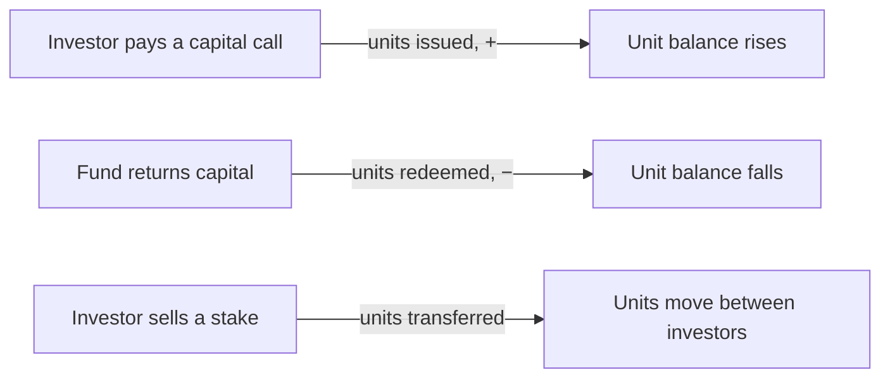
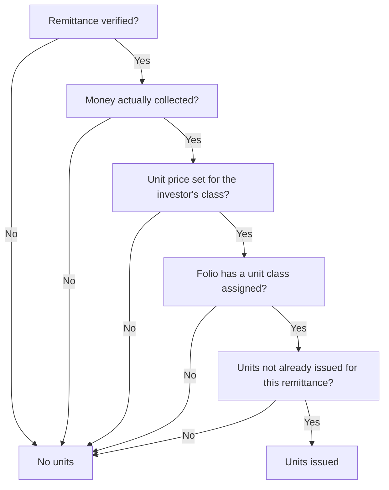
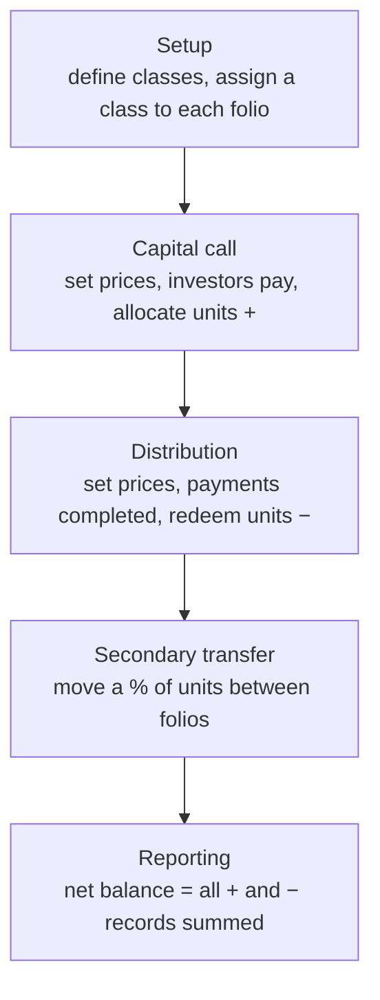

# Fund Units User Guide

**Fund units** are how the system tracks each investor's ownership stake in a fund — the fund's equivalent of shares. As investors pay into capital calls they receive units; as the fund returns capital they redeem units; and investors can transfer units to one another. The running unit balance gives you a live, auditable cap table where every unit ties back to the cash transaction that created it.

This guide covers the whole picture: defining unit classes, issuing units on capital calls, redeeming them on distributions, transferring them between investors, and reporting on the result.

---

## Table of Contents

1. [What Fund Units Represent](#what-fund-units-represent)
2. [Key Terms in Plain English](#key-terms-in-plain-english)
3. [Step 1 — Defining Unit Classes](#step-1--defining-unit-classes)
4. [Step 2 — Assigning a Class to Each Investor](#step-2--assigning-a-class-to-each-investor)
5. [Step 3 — Setting Unit Prices](#step-3--setting-unit-prices)
6. [Issuing Units from a Capital Call](#issuing-units-from-a-capital-call)
7. [Redeeming Units on a Distribution](#redeeming-units-on-a-distribution)
8. [The Full Unit Lifecycle](#the-full-unit-lifecycle)
9. [Transferring Units Between Investors](#transferring-units-between-investors)
10. [The Investor's Unit Balance (Cap Table)](#the-investors-unit-balance-cap-table)
11. [Viewing and Filtering Units](#viewing-and-filtering-units)
12. [Importing Unit Classes and Units](#importing-unit-classes-and-units)
13. [Worked Example](#worked-example)
14. [Frequently Asked Questions](#frequently-asked-questions)

---

## What Fund Units Represent

A fund unit is a measure of an investor's proportional ownership. The principle is simple:

At any moment, an investor's net unit balance reflects their current ownership in the fund. Because each unit record links back to the call payment, distribution, or transfer that produced it, the cap table is fully traceable.

---

## Key Terms in Plain English

| Term | What it means |
|------|---------------|
| **Unit Class (Type / Series)** | A category of unit, such as "Class A" or "Series I". A fund can have several classes with different fee or carry terms. |
| **Unit Price** | The base price per unit set on a capital call or distribution. |
| **Premium** | An extra amount per unit charged over the base price, used in some fund structures. |
| **Issue Date** | The date units are issued. For call-based units it's the later of the payment date and the call's due date, so units are never dated before the call was due. |
| **GP Units** | Units held by the General Partner (the fund manager) rather than by investors. |
| **Transfer Ratio** | The percentage of an investor's units being moved in a secondary transfer. |
| **Folio** | An investor's account within the fund. Each folio carries one unit class. |

---

## Step 1 — Defining Unit Classes

Before any units can be issued you define the **unit classes** the fund offers. Go to **Fund → Unit Settings**.

| Field | Required | What it's for |
|-------|----------|---------------|
| **Class / Series Name** | Yes | The class name (e.g. "Class A"). Must be one of the unit classes set up on the fund, and unique within the fund. |
| **Management Fee %** | No | The class's management fee. Shown for reference and reporting. |
| **Setup Fee %** | No | A one-time setup fee. For reference. |
| **Carry %** | No | The carried-interest rate for the class. Used as a reference for carry reporting. |
| **ISIN** | No | The securities identification number, if the class has one. |
| **GP Units** | No | Tick if this class is held by the General Partner rather than investors. |

> The class name must exactly match one of the unit classes configured on the fund; otherwise it won't save. The fee and carry percentages here are **informational** — they appear in reports but aren't applied to calculations automatically.

---

## Step 2 — Assigning a Class to Each Investor

Every commitment (folio) needs a **unit class** before it can receive units. Set it on the investor's **Capital Commitment** record; it must be one of the fund's defined classes. This tells the system which class to issue when the investor pays a call.

---

## Step 3 — Setting Unit Prices

Units are valued at the price you set on the relevant call or distribution.

- **On a capital call:** set a **price and premium per class**. These are used when issuing units. If a class has no price on the call, no units are issued for investors in that class — even if they've paid.
- **On a distribution:** set a **price per class**. This determines how many units are redeemed for each unit of capital returned.

Prices live on each call and distribution individually, because a fund's unit price (NAV) changes from one drawdown to the next.

---

## Issuing Units from a Capital Call

Once a call is approved and remittances are verified, trigger **Allocate Units** from the call.

### What must be true for an investor to receive units

### How many units

> **Units issued = Amount collected ÷ (Price + Premium)**

The **issue date** is the later of the payment date and the call's due date, so early payers don't get backdated units.

Each issuance creates one unit record holding the class, quantity, price, premium, total value, and issue date, linked to the remittance that triggered it. Re-running allocation is safe — investors who already have units for that call are skipped, and only those still missing units are processed. You'll get a confirmation when it finishes, and a detailed error report if any investor couldn't be processed (for example a missing unit class).

---

## Redeeming Units on a Distribution

When a distribution's payments are completed, trigger **Redeem Units** from the distribution.

### What must be true

- The distribution payment is **completed**.
- There is a return-of-capital amount to redeem against.
- A **unit price** is set for the investor's class on the distribution.
- The folio has a **unit class** assigned.
- Units haven't already been redeemed for this payment.

### How many units

> **Units redeemed = − (Return of capital ÷ Price)**

The quantity is **negative** — redemptions reduce the balance — and the issue date is the payment date. As with issuance, re-running is safe and won't double-redeem.

---

## The Full Unit Lifecycle

---

## Transferring Units Between Investors

A **fund unit transfer** moves some or all of one investor's units to another investor in the same fund — typically a secondary-market sale. Because this is a detailed workflow with its own validations and effects (it also splits the seller's call payments, distributions, and fees), it has a dedicated guide.

> **See the [Fund Unit Transfers User Guide](fund_unit_transfers_user_guide)** for the step-by-step process, the transfer form, validation messages, and what to check afterwards.

In brief, a transfer:

- Records units leaving the seller's folio and arriving on the buyer's folio, dated to the transfer date.
- Splits the seller's call payments, distributions, and (optionally) fee line items between the two folios in proportion to the transfer ratio.
- Adjusts each folio's committed capital to reflect the change.
- Refreshes both folios' totals immediately.

Both folios must be in the **same fund** and hold the **same unit class**, and the seller must hold enough units to cover the transfer.

---

## The Investor's Unit Balance (Cap Table)

Every unit record automatically updates the investor's totals, so the folio always shows a live balance:

| Shown on the folio | What it tracks |
|--------------------|----------------|
| **Units held** | Net units — every issuance, redemption, and transfer summed together. |
| **Total premium paid** | The total premium the investor has paid on their units. |
| **Total unit value** | The value of units issued (issuances only, not redemptions). |

The fund also rolls up total premium across all investors. These figures update automatically whenever a unit is issued, redeemed, or transferred — no manual tallying.

---

## Viewing and Filtering Units

Go to **Fund → Fund Units** to see every unit record for a fund. You can narrow the list by fund, folio, investor, or import batch, and filter the columns by class, quantity, price, premium, issue date, or reason.

Reading the list:

| What you see | What it means |
|--------------|---------------|
| **Positive quantity** | Units issued from a capital-call payment. |
| **Negative quantity** | Units redeemed on a distribution. |
| **Transfer "in"** | Units received via a secondary transfer. |
| **Transfer "out"** | Units sent via a secondary transfer. |

The sum of all quantities for a folio equals the unit balance shown on that commitment.

---

## Importing Unit Classes and Units

You can bulk-load both, mainly for migrating historical data.

**Unit classes** — provide the fund, class name (must be an allowed class), and optional management fee %, setup fee %, carry %, GP-units flag, and ISIN. Use the **Update Only** column to update existing classes rather than create new ones. A class that already exists is skipped unless you're updating; an update for a class that doesn't exist is also skipped.

**Units** — provide the fund, folio, the call name (for issuances) or distribution title (for redemptions), unit class, quantity (positive to issue, negative to redeem), price, optional premium, optional reason, and issue date. Positive rows are matched to the investor's remittance for that call; negative rows to their payment on that distribution. A unit that already exists for the same source and issue date is skipped.

---

## Worked Example

**Setup**

- Fund: *Acme Growth Fund I*. Unit class **Class A**, no premium.
- Investor *Northwind LP* holds Class A.

**Capital call**

The fund issues a call with **Class A priced at $1,000**. Northwind pays **$1,000,000** by the due date.

> Units issued = $1,000,000 ÷ $1,000 = **1,000 units**, dated the due date.

**Second call at a higher NAV**

A later call prices **Class A at $1,250**. Northwind pays **$625,000**.

> Units issued = $625,000 ÷ $1,250 = **500 units**.

Northwind now holds **1,500 units**.

**Distribution with redemption**

A distribution returns capital and prices **Class A at $1,300**, redeeming $260,000 of Northwind's capital.

> Units redeemed = − ($260,000 ÷ $1,300) = **−200 units**.

**Resulting balance:** 1,000 + 500 − 200 = **1,300 units held**.

---

## Frequently Asked Questions

**What happens if I allocate units twice for the same call?**
Nothing harmful. Investors who already have units for that call are skipped, so re-running only fills in anyone who was missed.

**An investor paid but didn't receive units — why?**
Check three things: the remittance is **verified**, the folio has a **unit class** assigned, and the call has a **price set for that class**. All three are required.

**Can I edit a unit record manually?**
Yes — open it and edit. Changing the quantity or price updates the investor's balance automatically.

**If a transfer is 100%, does the seller end up with zero units?**
Yes. A full transfer moves all units (and the related payment and fee history) to the buyer, leaving the seller's balance at zero. See the [Fund Unit Transfers guide](fund_unit_transfers_user_guide).

**Can I transfer units between different funds?**
No — both folios must be in the same fund.

**Can I transfer between investors holding different classes?**
No — both folios must hold the same unit class, or the transfer is rejected.

**Do transfers affect performance metrics?**
Yes. Because a transfer splits the underlying call payments and distributions, the buyer's XIRR and DPI/RVPI/TVPI will reflect the transferred history. Regenerate fund ratios after a transfer to see updated figures.

**Why aren't unit prices taken from the unit class settings?**
Because the fee and carry percentages on a class are reference information. The actual price and premium must be set per call and per distribution, since a fund's unit price changes with each drawdown.
