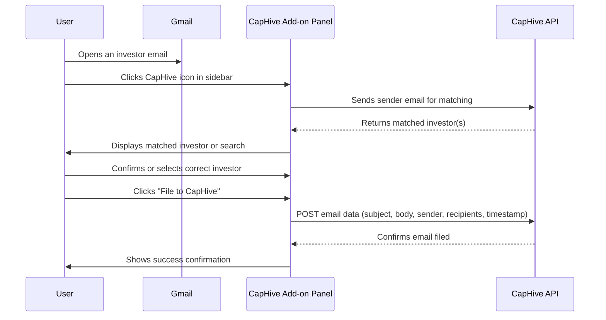

# CapHive Gmail Add-on

## User Setup Guide

This guide explains how to install and use the **CapHive Gmail Add-on**, which allows you to **file investor emails directly into CapHive** from Gmail.

Once installed, you can file any email under the appropriate investor in just a few clicks.

> **Availability:** the add-on is not yet published to the Google Workspace Marketplace.
> Searching for it there will not find it. Until it is listed, your CapHive administrator
> installs it for your organisation and shares the link with you — so start at section 3,
> Option B.

---

# 1. What the Add-on Does

The CapHive Gmail Add-on allows you to:

• File emails from Gmail directly into CapHive
• Automatically match investors based on email address
• Maintain a central investor communication history
• Ensure important communication is recorded and visible to your team

---

# 2. Requirements

Before installing the add-on, ensure you have:

• A **CapHive user account**
• A **Google Workspace or Gmail account**
• Access to **Google Workspace Marketplace** (or a direct install link from your administrator)

You will also need your **CapHive login credentials**.

---

# 3. Installing the Add-on

## Option A — Install via Google Workspace Marketplace

### Step 1 — Open Gmail

Go to:

```
https://mail.google.com
```

Sign in with your Google account.

---

### Step 2 — Open Add-ons

Click the **Google Apps icon (⋮⋮⋮)** or **+ icon** in the right sidebar.

Then click:

```
Get add-ons
```

This opens the **Google Workspace Marketplace**.

---

### Step 3 — Search for CapHive

In the search bar, type:

```
CapHive
```

Select **CapHive for Gmail** from the results.

---

### Step 4 — Install

Click:

```
Install
```

Review the permissions requested and click:

```
Allow
```

The add-on will appear in your Gmail right sidebar.

---

## Option B — Install via Admin-Provided Link

If your administrator has shared a direct install link:

1. Click the link provided by your admin
2. You will be redirected to the Marketplace listing
3. Click **Install** and grant the requested permissions

---

# 4. Verifying Installation

Open any email in Gmail.

You should now see the **CapHive icon** in the right sidebar panel:

```
📁 CapHive
```

Clicking this icon opens the **CapHive panel**.

---

# 5. First-Time Sign In

When you open the add-on for the first time, it will ask you to sign in to CapHive.

Click **Sign in to CapHive**. A browser tab opens on your normal CapHive sign-in page.

Sign in there exactly as you usually do — including single sign-on and any two-factor step
your organisation uses. You will never be asked to type your CapHive password into the
Gmail sidebar itself.

Once you have signed in, close the tab and return to Gmail. The add-on panel will show the
matched investor for the email you have open.

> **Note:** Your sign-in is remembered for 30 days. After that, or if your access is
> revoked, the add-on will show the **Sign in to CapHive** button again.

---

# 6. Filing an Email



### Step 1 — Open an Email

Open an email from an investor.

Example:

```
From: investor@abcfo.com
Subject: Capital call question
```

---

### Step 2 — Open the CapHive Panel

Click the **CapHive icon** in the right sidebar:

```
📁 CapHive
```

The CapHive panel opens on the right side.

---

### Step 3 — Investor Matching

The system automatically tries to match the email to an investor.

Matching is based on the investor email address stored in CapHive.

Possible outcomes:

| Result             | Description                     |
| ------------------ | ------------------------------- |
| Investor found     | Investor detected automatically |
| Multiple investors | You must select the correct one |
| No match           | You can search for the investor |

---

### Step 4 — Confirm Filing

Once the correct investor is selected, click:

```
File to CapHive
```

The email will now be stored in CapHive.

---

# 7. What Gets Stored in CapHive

The following information is saved:

• Email subject
• Sender email
• Recipients (To / CC)
• Email body
• Timestamp
• Associated investor

This information is stored in CapHive under the investor's communication record.

---

# 8. Viewing Filed Emails in CapHive

Once filed, emails will appear in:

```
Investor → Communications → Emails
```

Team members with permission can view the stored communication.

---

# 9. Duplicate Protection

If an email has already been filed, CapHive will detect this and notify you.

Duplicate emails will not be stored again.

---

# 10. Admin: Deploying to Your Organization

If you are a Google Workspace administrator, you can deploy the add-on to all users in your organization.

### Step 1 — Open Google Admin Console

Go to:

```
https://admin.google.com
```

---

### Step 2 — Navigate to Apps

Go to:

```
Apps → Google Workspace Marketplace apps
```

---

### Step 3 — Add the App

Click:

```
Add app to Domain Install list
```

Search for **CapHive** and follow the prompts to deploy it organization-wide.

Once deployed, the add-on will appear automatically in Gmail for all users in your domain.

---

# 11. Troubleshooting

### The CapHive icon does not appear in the sidebar

Try the following:

• Refresh Gmail (Ctrl+R / Cmd+R)
• Check that the add-on is installed under **Settings → See all settings → Add-ons**
• Reinstall the add-on from Google Workspace Marketplace

---

### Login keeps redirecting to sign-in

Make sure:

• Third-party cookies are enabled for the CapHive domain in your browser
• Your browser is not blocking pop-ups from Gmail

---

### Investor was not matched

You can manually search and select the correct investor within the CapHive panel.

---

### The panel shows a blank screen

Try:

• Logging out of the add-on and logging back in
• Clearing your browser cache
• Contacting your administrator to ensure the add-on has the correct API endpoint configured

---

# 12. Security

The add-on uses your existing **CapHive login session**.

• No email data is stored outside CapHive
• Only authorized users can file emails
• Permissions are enforced based on investor access rights in CapHive
• The add-on requests only the minimum Gmail permissions required (read current email)

---

# 13. Support

If you encounter any issues installing or using the add-on, contact:

```
support@caphive.com
```

Include:

• Your Gmail / Google Workspace account type
• A screenshot of the issue
• The email you attempted to file (if applicable)

---

# 14. Best Practices

To keep investor communication well organized:

• File important investor emails promptly
• Verify the investor match before confirming
• Avoid filing internal-only emails

---

✅ **Tip:** Filing emails immediately after reading them ensures the communication is captured for your entire team.

---
