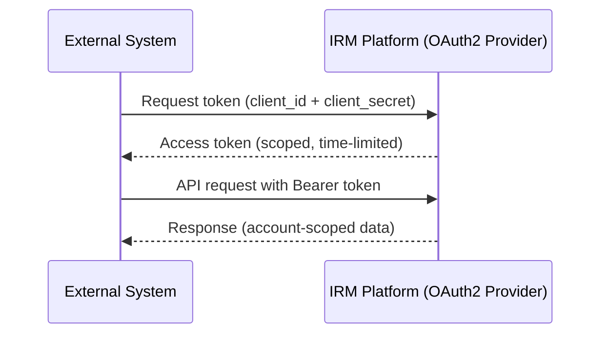
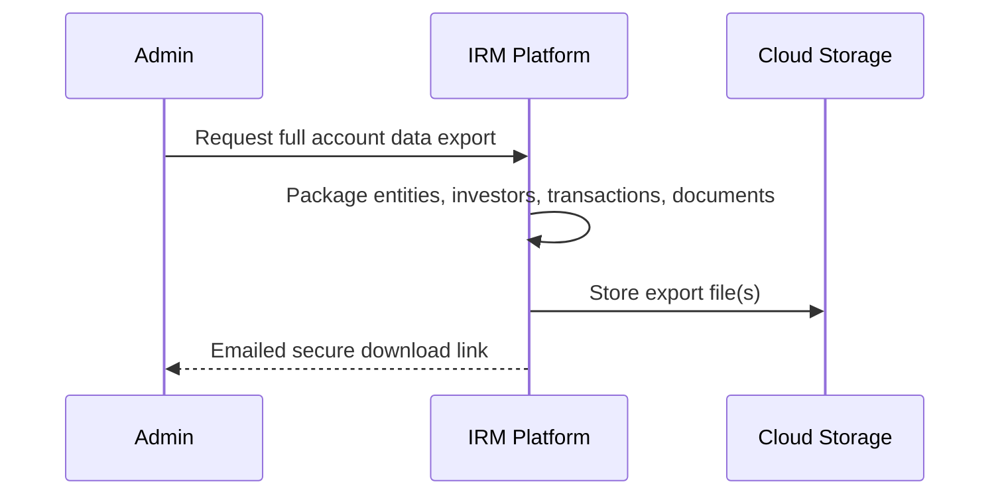

# Integration & Architecture — Due Diligence Responses

## Contents

1. [Integration and API Architecture](#1-integration-and-api-architecture)
2. [Data Residency and Compliance](#2-data-residency-and-compliance)
3. [Architecture and Scalability](#3-architecture-and-scalability)
4. [Operational Resilience](#4-operational-resilience)
5. [Data Portability and Exit Strategy](#5-data-portability-and-exit-strategy)

---

## 1. Integration and API Architecture

### 1.1 API Documentation

*Can you provide comprehensive API documentation (OpenAPI/Swagger specification) covering all available endpoints, authentication methods, rate limits, and data models?*

**Response:** Yes. A full OpenAPI (Swagger) specification is published and interactively browsable at **https://app.caphive.com/api-docs/index.html**, covering the platform's endpoints — investors, funds, capital calls and commitments, deals, documents, KPIs, and more — including request/response schemas and authentication requirements. These are the same endpoints the application itself uses internally, so the documentation always reflects current behavior. Formal published rate limits are not yet part of the documentation and can be defined as part of a contractual SLA if required.

### 1.2 SSO/SAML/OAuth2

*Do you support SAML 2.0 or OAuth2/OIDC for enterprise single sign-on? Specifically, can you integrate with Okta as an identity provider? If not, what is the roadmap and timeline?*

**Response:** The platform supports username/password login with optional two-factor authentication, and it already operates as an OAuth2 / OpenID Connect **provider** — other systems can authenticate against it using industry-standard OAuth2 flows, including a client-credentials flow suited to server-to-server integration.

Acting as a **consumer** of an external enterprise identity provider — letting your users log in with your own Okta, Azure AD, or other SAML/OIDC system — is not built today. This is a well-understood integration pattern and would be a scoped, plannable piece of work, but there is no committed timeline yet.

*Pending: confirm priority and timeline internally before committing a date to the prospect.*

### 1.3 Webhook/Event Architecture

*Do you support outbound webhooks or event-driven notifications for state changes (e.g., investor onboarded, compliance filing completed, document signed)?*

**Response:** No, only inbound API calls are supported at the moment.

### 1.4 Machine-to-Machine Authentication

*Beyond cookie-based sessions, do you support API key or OAuth2 client credentials flow for server-to-server integration?*

**Response:** Yes. Server-to-server integration is supported via bearer token authentication, and via an OAuth2 client-credentials flow with OpenID Connect support — a client system exchanges credentials for a scoped, time-limited access token (30-day refresh window), automatically scoped to the correct customer account.

---

## 2. Data Residency and Compliance

### 2.1 Data Residency Options

*Can data be hosted outside India (e.g., EU, Singapore, US regions on AWS)? What is the roadmap for multi-region deployment given your current Mumbai/Hyderabad infrastructure?*

**Response:** Each tenant is deployed to a shared instance, and we operate separate instances by jurisdiction — India (IN) and US — so data does not leave its jurisdiction (e.g., India data stays in India). Today, instances run in AWS's Mumbai (India) region and a separate US region. Because each deployment is already independent, standing up a new instance in an additional region (EU, Singapore, etc.) is primarily an infrastructure/provisioning exercise rather than a code change — the deployment tooling already supports creating region-specific environments.

The Hyderabad region is a cold backup site: all infrastructure is provisioned but not running day-to-day (see Disaster Recovery Testing below).

### 2.2 SOC 2 Certification

*Do you hold or plan to obtain SOC 2 Type II certification? What is the timeline?*

**Response:** *Pending input from compliance/leadership — this is an audit/certification status, not something derivable from the codebase.*

### 2.3 GDPR/Data Protection

*What data subject access request (DSAR) capabilities exist? How do you handle cross-border data transfer requirements?*

**Response:** There isn't a dedicated, self-service DSAR feature today — no built-in tooling for an individual to request export or erasure of just their own personal data, and no anonymization workflow.

That said, the platform has strong account-level data lifecycle tools that partially cover this ground: a complete export of an entire customer's dataset can be generated on demand (see Data Export below), and deleting a customer's account removes all associated data. Extending this down to individual-level DSAR handling would be new, scoped work.

On cross-border transfer: since each customer's instance is deployed to a single jurisdiction, data doesn't move across borders as part of normal operation.

---

## 3. Architecture and Scalability

### 3.1 Rails Version and Patching

*What version of Ruby on Rails is currently in production? What is your patching cadence for framework, dependencies, and the five open Low-severity VAPT findings?*

**Response:** The platform runs on Ruby on Rails 8.1 with Ruby 3.4 — both current, actively maintained versions. Dependency versions are pinned and reproducible across environments, and security/dependency-vulnerability scanning tooling is part of the standard toolchain. All dependencies are upgraded on a two-week cycle. The latest VAPT report is available on request.

### 3.2 Multi-Tenancy Isolation

*What is your tenant isolation model — row-level, schema-level, or dedicated database per tenant? How do you prevent cross-tenant data leakage?*

**Response:** Row-level isolation within a shared database. Every customer's records carry an account-identifying column, present across virtually the entire data model (well over 100 tables). Every model and every action is checked through a role-based authorization policy layer before data is returned or modified, and that layer's core check compares the record's account identifier against the current user's — applied consistently across all ~150+ policy classes covering every part of the platform, not left to individual controllers to remember. A dedicated "Group Company" relationship also allows a parent organization's users to see their own sub-organizations' data, again governed by the same policy check, not an ad-hoc exception.

Separately, deployments can be split across independent regional instances (each with its own database) for customers who need jurisdictional or full physical separation — but within a given instance, isolation between customer accounts is enforced at the row level via this consistent policy layer, not by separate databases.

### 3.3 Scalability Architecture

*What is your current user/entity scale? Do you employ database sharding, read replicas, or caching layers? What are your performance SLAs?*

**Response:** Background processing (search indexing, report generation, notifications, scheduled tasks) runs on a distributed job-processing system with prioritized queues, so heavy background work doesn't block user-facing requests. Search is offloaded to a dedicated search index rather than querying the primary database directly. A database-backed caching layer is enabled in production for cached configuration data and external-service tokens. A read-replica database is provisioned alongside the primary for high availability, and application servers are deployed across multiple Availability Zones within the region.

There is no database sharding today — the platform scales on a shared primary database plus replica, with the job-processing and search layers absorbing load that would otherwise hit the database directly.

*Pending: current user/entity scale figures and any committed performance SLAs.*

---

## 4. Operational Resilience

### 4.1 SLA/RTO/RPO

*What are your committed SLA uptime targets, Recovery Time Objective (RTO), and Recovery Point Objective (RPO)?*

**Response:** *Pending input from business/infra — these are commercial commitments, not code artifacts.* What the infrastructure supports today: full database backups plus continuous incremental backups streamed to cloud storage, and weekly full system snapshots — a solid technical basis for a recovery point objective, with the committed numbers to be confirmed by leadership/infra.

### 4.2 Disaster Recovery Testing

*How frequently is DR failover to Hyderabad tested? What is the documented failover time?*

**Response:** Once every quarter. Documented failover time is under 4 hours.

### 4.3 Monitoring and Incident Response

*What application performance monitoring (APM) tools are in use? What is your incident response SLA for P1/P2 issues?*

**Response:** Infrastructure and application metrics (system health, request performance, background-job throughput) are collected via an industry-standard Grafana/Prometheus monitoring stack hosted on AWS. Application error tracking uses a built-in exception notification mechanism, and an external service (BetterStack) tracks uptime of critical services.

*Pending: committed incident-response SLA for P1/P2 issues.*

---

## 5. Data Portability and Exit Strategy

### 5.1 Data Export

*What formats and mechanisms are available for full data extraction (entities, investors, documents, transaction history) in the event of contract termination?*

**Response:** This is a strong existing capability. Business users can export data (investors, capital calls, commitments, funds, deals, KPIs, and more) to Excel directly from the relevant screens, plus export a full audit trail of historical changes. Beyond individual screens, a bulk export capability can pull an entire dataset for a given data type (up to 50,000 records per export, with a warning if a set is larger) and deliver it as a downloadable file.

Most relevant to contract termination: there's a purpose-built, full-account data export that packages a customer's entire dataset — all entities, investors, transactions, and more — into a single portable file, and a bulk document-download feature explicitly designed to let a departing customer pull every document associated with their account into one downloadable archive.

### 5.2 Transition Support

*What transition assistance period and data retention commitments do you provide post-termination?*

**Response:** The technical capability to hand over a complete, portable copy of a customer's data and documents exists and can be exercised at any time, including at offboarding. The commercial terms — length of transition assistance and post-termination retention before deletion — are contractual decisions for the business/legal team to specify.
