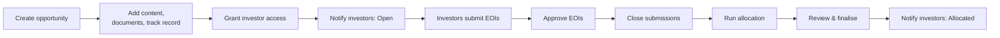
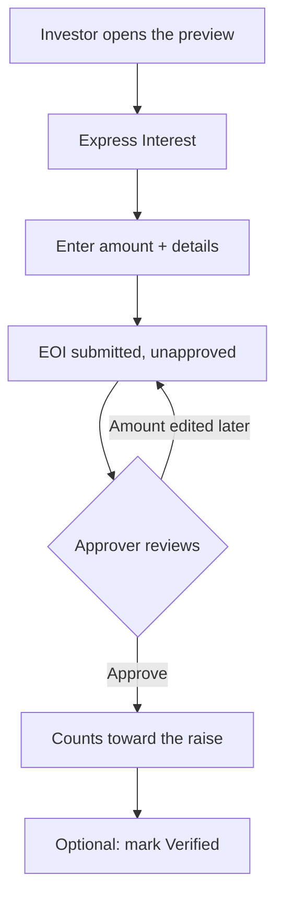
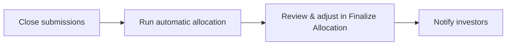

# Investment Opportunity User Guide

**Investment Opportunities** let a fund manager put a deal or fundraise in front of a chosen set of investors, collect their **Expressions of Interest (EOIs)**, and run the allocation process through to close. Each opportunity has a polished, investor-facing preview page, a documents area and private data room, marketing content sections, a track-record strip, and a fully tracked EOI pipeline with approval, verification, and proportional allocation.

> **Where to find it:** Sidebar → [**Opportunities**](/investment_opportunities), shown when both your company and your user have the *Investment Opportunities* feature (`enable_inv_opportunities`). Create one with [**New Investment Opportunity**](/investment_opportunities/new); open an opportunity for its **Allocation** and **Notifications** menus and the **Documents, Widgets, Track Record, Tasks, Interests, Access Rights, Notifications** tabs. Creating, editing and allocating need create/update rights on the opportunity (company admins have them for every opportunity).

This guide walks through the whole journey — from creating an opportunity to notifying investors of their final allocation.

---

## Table of Contents

1. [The Opportunity Journey](#the-opportunity-journey)
2. [Who Does What (Roles)](#who-does-what-roles)
3. [Creating an Opportunity](#creating-an-opportunity)
4. [Enriching the Opportunity](#enriching-the-opportunity)
5. [Controlling Who Can See It](#controlling-who-can-see-it)
6. [The Investor Preview](#the-investor-preview)
7. [Notifying Investors](#notifying-investors)
8. [The Expression of Interest Workflow](#the-expression-of-interest-workflow)
9. [The Allocation Process](#the-allocation-process)
10. [Worked Allocation Example](#worked-allocation-example)
11. [Tracking Progress](#tracking-progress)
12. [Frequently Asked Questions](#frequently-asked-questions)

---

## The Opportunity Journey

---

## Who Does What (Roles)

| Role | What they can do |
|------|------------------|
| **Fund Admin** | Create, edit, and delete opportunities; manage access, documents, content, track record, and notifications. |
| **Approver** | Everything a fund admin can do, plus approve or unapprove individual EOIs. |
| **Relationship Manager (RM)** | Submit EOIs on behalf of their clients and view those EOIs. RMs cannot edit an EOI after submitting it. |
| **Investor** | View opportunities they've been given access to, submit their own EOI and update it while it is unapproved, and access the data room if granted. |

> The Investment Opportunities feature must be switched on for your account. If you don't see the menu, ask your administrator to enable it.

---

## Creating an Opportunity

Go to **Opportunities** in the sidebar → **New Investment Opportunity**.

### Required information

| Field | What it's for |
|-------|---------------|
| **Company Name** | The deal or company name shown on the listing card and preview. |
| **Fund Raise Amount** | The total being raised. Drives the progress bar showing how much has been covered by approved EOIs. |
| **Min Ticket Size** | The smallest amount an investor may express interest for. EOIs below this are rejected. |
| **Currency** | The currency for all amounts. Defaults to your entity's currency. |
| **Last Date** | The closing date for EOIs. Defaults to one month out. |

### Optional information

| Field | What it's for |
|-------|---------------|
| **Valuation** | The deal/company valuation, shown in the key-metrics strip. |
| **Logo** | The company logo for the card and preview header. |
| **Tags** | Labels like `SaaS, Series B, Healthcare` for filtering the opportunity list. |
| **Details** | The investment thesis or deal description — long-form rich text shown prominently on the preview. |
| **Shareable** | When on, a private link lets anyone view the preview *without logging in* — handy for advisors sharing a deal with prospects. |
| **Show Key Metrics** | Shows the key-metrics strip on the preview. |
| **Show Express Interest** | Shows the **Express Interest** button and **Ready to Invest?** card on the preview (on by default). Untick it to stop new EOIs being placed from the preview. |

Click **Save** to create the opportunity and open its detail page.

---

## Enriching the Opportunity

The detail page is organised into tabs: **Documents, Widgets, Track Record, Tasks, Interests, Access Rights, Notifications**.

### Documents and data room

- **Documents** — files shown by default on the preview: offering memoranda, term sheets, pitch decks, and the like.
- **Data Room** — a separate, private folder. Its documents are shown only to investors whose EOI has **Show Data Room** turned on.

### Content sections (Widgets)

**Widgets** are rich content blocks that make up the body of the preview — market opportunity, team bios, product highlights, financial projections, and so on. Each has a title, a short intro, a main body, an optional image or video (positioned left/right/centre, or an embedded YouTube video), and an optional link. They appear in the order you add them, so arrange them to tell the full story.

### Track record

**Track Record** entries appear as highlight cards on the preview (for example "3.2× Realised MOIC" or "$500M AUM"). Each has a name, an optional prefix and suffix (like `$` or `Cr`), the value, and an optional explanatory note.

---

## Controlling Who Can See It

The **Access Rights** tab decides which investors can see the opportunity and submit an EOI.

- Add investors or investor groups individually.
- An added investor immediately gains view access and is included in notification recipient lists.

Before sending any notification, use **View Who Gets Notified** (linked in the confirmation prompt) to check the recipient list.

---

## The Investor Preview

Click **Preview** to see the opportunity exactly as an investor does:

- **Header** — company name, logo, and close date.
- **Key metrics strip** — fund raise amount, approved EOI amount, valuation, and minimum ticket size (when **Show Key Metrics** is ticked).
- **Details** — the investment thesis.
- **Content sections** — all your widgets, in order.
- **Track record** — the highlight cards.
- **Documents panel** — everything in the opportunity's documents folder.
- **"Ready to Invest?"** — a clear call-to-action linking to the EOI form (when **Show Express Interest** is ticked).
- **Your Interest** — for investors, a card showing their own EOI.
- **Data Room** — shown to investors with data-room access (and always to fund managers).

### The shareable link

With **Shareable** enabled, click **Copy** on the preview to copy a private, signed link that lets advisors or prospective investors view the full preview without an account. The link expires after 7 days. They can't submit an EOI from that link — they'd need to log in for that.

---

## Notifying Investors

Send notifications from the **Notifications** dropdown menu on the detail page (the **Notifications** tab below holds your custom templates).

| Notification | Use it to |
|--------------|-----------|
| **Send Investment Opportunity Open : To LPs** | Announce that investors can now place EOIs. |
| **Send Investment Opportunity Allocated : To LPs** | Announce that final allocations are set. |

Both go to all investors with access. Any enabled custom notification template set up for opportunities (created on the **Notifications** tab) appears as an extra **Send …** item in the dropdown and supports a custom subject, body, and attachments. The confirmation prompt always offers **View Who Gets Notified** so you can verify recipients first.

---

## The Expression of Interest Workflow

### How investors submit

1. Open the opportunity (from a notification, a link, or the portal listing).
2. Click **Express Interest**.
3. Enter the **amount** (must be at least the minimum ticket and no more than the raise), optionally link a **KYC record**, and add any **notes**.
4. **Save.** The EOI is created unapproved, and the investor is automatically granted access.

> If the amount is changed after submission, the EOI returns to unapproved and must be approved again.

### How RMs submit for clients

Relationship managers can submit on behalf of clients, additionally providing the investor's **name**, **email**, and a **KYC record** (required before approval). When an RM's EOI is approved, the system finds or creates the investor record from that name and email and links the KYC to them; unapproving reverses this.

### Approving EOIs

Users with the *Approver* role approve or unapprove EOIs from the **Interests** tab row menu (**Approve** / **UnApprove**). Approving adds the EOI's amount to the opportunity's **Approved EOI Amount** and advances the progress bar; unapproving reverses it. For an RM-submitted EOI without a KYC record, **Approve** is shown but greyed out until a KYC is attached.

An unapproved EOI can also be approved by ticking **Approved** when editing its row on the Finalize Allocation screen. That route does not need the *Approver* role and skips the RM steps above (no investor record is created and the KYC is not moved).

### Verification and data room

- **Verified** is a manual flag for your internal process (e.g. confirming KYC, documents, and transfer are done). It doesn't affect allocation maths.
- **Show Data Room** can be toggled per EOI from the Interests tab row menu to give that investor data-room access on the preview. The toggle is available only while the EOI is unapproved.

### Filtering EOIs

The Interests tab shows filter cards — **Total, Approved, Verified, Unapproved, Unverified** — click any to filter the table.

---

## The Allocation Process

### Step 1 — Lock EOIs

When the opportunity closes (or sooner), stop new submissions by unticking **Show Express Interest** on the opportunity (**Edit**), which hides the **Express Interest** button on the preview. The **Allocation** menu also has **Lock EOIs** (it toggles to **Unlock EOIs**), but that only sets a **Lock EOI** flag shown on the detail page — it is not enforced, and investors can still submit and edit EOIs while it is on.

### Step 2 — Run automatic allocation

Click **Allocate**. The system works in the background: it first resets every EOI's allocation to zero (wiping any manual overrides), then for each approved EOI it calculates a proportional allocation, and if the raise is **over-subscribed** it applies a pro-rata haircut so the total comes back to the target. The page shows "Allocation in progress" — refresh after a moment.

> The allocation each approved investor receives = their EOI amount × (target raise ÷ total approved EOIs), capped so a fully- or under-subscribed raise gives everyone their full amount.

### Step 3 — Review and adjust

Click **View Allocations** to open **Finalize Allocation**, a table of every EOI. Filter by **All Interests** / **Verified** / **Un-Verified**. Unapproved EOIs have an **Edit** button that lets you set **Allocation Amount**, **Approved**, **Verified** and **Comment** and **Save** the row in place. Approved EOIs have no **Edit** button — unapprove one on the **Interests** tab first to override its allocation. The search box on this screen does not work.

### Step 4 — Lock allocations

There is no **Lock Allocations** button. The detail page displays a **Lock Allocations** flag, but nothing sets or enforces it. To freeze allocations, restrict who has update rights on the opportunity.

### Step 5 — Notify investors

Send the **Send Investment Opportunity Allocated : To LPs** notification to tell investors their final allocation.

---

## Worked Allocation Example

A deal targets a **$100M** raise. After approvals, EOIs total **$150M** — 150% subscribed, so everyone is scaled back to fit $100M.

> Scale factor = target ÷ total approved = 100 ÷ 150 = **66.67%**

| Investor | EOI amount | Allocation (× 66.67%) |
|----------|-----------|------------------------|
| Northwind LP | $60M | $40.0M |
| Briar Capital | $50M | $33.3M |
| Kestrel Family Office | $40M | $26.7M |
| **Total** | **$150M** | **$100M** |

If the raise had instead come in **under** target — say $80M of EOIs against the $100M raise — no haircut applies and each investor receives their full stated amount.

You can still override a single allocation on the Finalize Allocation screen (for example to honour a strategic investor's full ask) after the final **Allocate** run — re-running **Allocate** wipes overrides.

---

## Tracking Progress

The detail page header shows four summary cards: **Fund Raise Amount** (the target), **Approved EOI Amount** (the running total of approved EOIs), **Valuation**, and **Min Ticket Size**. A progress bar shows how much of the raise is covered by approved EOIs.

Each EOI also has its own detail page (via **Show** on the Interests tab) with the investor's details, a documents tab for attachments like signed subscription forms, and a tasks tab.

---

## Frequently Asked Questions

### Navigation and getting there

**Where do I find Investment Opportunities in CapHive?**
Sidebar → [**Opportunities**](/investment_opportunities). The item appears only when the *Investment Opportunities* feature is enabled for both your company and your user; ask your administrator if it is missing. Click a card to open the opportunity.

**Where do investors (LPs) and RMs find an opportunity?**
An investor or RM login with the feature sees the same **Opportunities** sidebar item, listing only opportunities they have access to. They can also follow the link in the "open for interests" email or in-app notification, or use **Investment Opportunities** in the fund's dropdown on the investor [**Investments**](/entities/investor_entities) page.

**What is on the opportunity detail page?**
For users who can edit it: the summary table, **Edit**, **Delete**, **Preview**, the **Allocation** menu (**Lock EOIs**, **Allocate**, **View Allocations**, **Investors**) and the **Notifications** menu. Below are the tabs **Documents**, **Widgets**, **Track Record**, **Tasks**, **Interests**, **Access Rights** and **Notifications**. See [Enriching the Opportunity](#enriching-the-opportunity).

**How do I see the page the way an investor sees it?**
Click **Preview** on the detail page. Users without edit rights (investors, RMs) always get the preview instead of the admin page. See [The Investor Preview](#the-investor-preview).

**Where is the Finalize Allocations screen?**
Open the opportunity → **Allocation** → **View Allocations**. It lists every EOI with **All Interests**, **Verified** and **Un-Verified** filters. See [Step 3 — Review and adjust](#step-3--review-and-adjust).

**How do I filter opportunities by tag?**
Click any tag badge on an opportunity card; the list reloads showing only opportunities with that tag. Tags come from the **Tags** field on the opportunity form.

### Creating, updating and managing opportunities

**How do I create an investment opportunity?**
Sidebar → **Opportunities** → [**New Investment Opportunity**](/investment_opportunities/new). Enter **Company Name**, **Fund Raise Amount**, **Min Ticket Size**, **Currency** and **Last Date** (defaults to one month out), optionally a logo, tags, details and the **Shareable**, **Show Key Metrics** and **Show Express Interest** checkboxes, then **Save**. See [Creating an Opportunity](#creating-an-opportunity).

**How do I edit an opportunity?**
Open it and click **Edit**. Every field on the create form stays editable, even after EOIs have arrived; changing the raise amount or minimum ticket does not re-check existing EOIs until they are next saved.

**How do I delete an opportunity?**
Open it, click **Delete** and confirm. Only users with destroy rights on the opportunity (or company admins) see the button.

**How do I add documents and a data room?**
Open the opportunity → **Documents** tab. Files in the opportunity's folder show on the preview's documents panel; the **Data Room** sub-folder (created automatically) is shown only to investors whose EOI has **Show Data Room** on. See [Documents and data room](#documents-and-data-room).

**How do I add content sections and track-record cards?**
Open the opportunity → **Widgets** tab → **New Widget** for rich content blocks, or **Track Record** tab → **New Track Record** for highlight cards such as "3.2× MOIC". Both appear on the preview in the order added. See [Content sections (Widgets)](#content-sections-widgets).

**How do I give investors access to an opportunity?**
Open the opportunity → **Access Rights** tab and add Stakeholders (investors) or investor categories. Tick **Send Notification** on the access-right form if you want them emailed that they have been granted access. See [Controlling Who Can See It](#controlling-who-can-see-it).

**How do I submit an EOI for an investor myself?**
Open the opportunity → **Interests** tab → **New Interest**. Pick the Stakeholder, enter the amount (at least the minimum ticket, at most the raise), optionally a KYC and **Show Data Room**, then save.

**How does an investor or RM submit an EOI?**
From the preview they click **Express Interest** (shown only while **Show Express Interest** is ticked on the opportunity), enter the amount, optional KYC and details, and save. An RM also enters the end investor's **Investor Name** and **Investor Email**. See [How investors submit](#how-investors-submit).

**How do I approve or unapprove an EOI?**
Open the opportunity → **Interests** tab → the row's actions menu → **Approve** or **UnApprove**. Only users holding the *Approver* role (with update rights on the opportunity) see these items. See [Approving EOIs](#approving-eois).

**How do I edit or delete an EOI?**
Open the EOI with **Show** and use **Edit** or **Delete**. Both buttons appear only while the EOI is unapproved; unapprove it first to change or remove an approved EOI. Investors can edit their own unapproved EOIs; deleting needs employee destroy rights.

**How do I run and adjust the allocation?**
**Allocation** → **Allocate** calculates allocations in the background; then **Allocation** → **View Allocations** and click **Edit** on a row to set **Allocation Amount**, **Approved**, **Verified** and **Comment**, then **Save**. See [The Allocation Process](#the-allocation-process).

**How do I send the "open" or "allocated" email to investors?**
Open the opportunity → **Notifications** menu → **Send Investment Opportunity Open : To LPs** or **Send Investment Opportunity Allocated : To LPs**, and confirm. Enabled custom templates for opportunities appear as extra **Send <subject>** items. See [Notifying Investors](#notifying-investors).

**How do I create a custom notification template for opportunities?**
Open any opportunity → **Notifications** tab → **New Notification**. Templates created here are saved for your company with type *Investment Opportunity* and appear in the **Notifications** menu of every opportunity once enabled.

**How do I customise the "open" or "allocated" email (email template) for investment opportunities?**
Open any opportunity → **Notifications** tab → **New Notification** → **New Custom Notification**, choose **Notify open for interests** or **Notify allocation** in **For Notification**, write the subject and body and save (Company Admin role). While enabled it replaces the wording of **Send Investment Opportunity Open : To LPs** or **Send Investment Opportunity Allocated : To LPs** for every opportunity. See [Custom Notifications](custom_notifications_user_guide).

**How do I export the EOIs?**
Open the opportunity → **Interests** tab → **Download** for an Excel sheet of the EOIs you can see.

**Who can create, edit or approve opportunities and EOIs?**
Anyone with the feature can list opportunities; creating needs create rights and editing, allocating and sending notifications need update rights on the opportunity (company admins have all). Approving needs the *Approver* role as well. Investors and RMs can submit EOIs on opportunities they have access to.

### Why use investment opportunities

**Why should I run a raise through Investment Opportunities instead of email and a spreadsheet?**
Every investor sees the same polished preview, documents and data room, submits EOIs into one tracked pipeline, and the approved total and progress bar update automatically. Pro-rata allocation is calculated for you and the open and allocated emails go to exactly the investors with access.

**What can I do with an opportunity?**
Market a deal to a chosen set of investors, share a no-login preview link, collect and approve EOIs (including RM-submitted ones), control data-room access per EOI, calculate and override allocations, and notify investors of the outcome. See [The Opportunity Journey](#the-opportunity-journey).

**Who typically uses Investment Opportunities?**
Fund managers and IR teams create and allocate opportunities, approvers sign off EOIs, relationship managers submit interest for their clients, and investors review the preview and express interest. See [Who Does What (Roles)](#who-does-what-roles).

**What happens if I don't grant access rights?**
No investor can see the opportunity, the **Send … To LPs** notifications reach nobody (they go only to investors with access), and **View Who Gets Notified** shows an empty list. Only people who already submitted an EOI get access automatically.

### What happens when I…

**What happens when I create an opportunity?**
The opportunity is saved with a document folder and an empty **Data Room** sub-folder, and you land on its detail page. No one is notified; investors see nothing until you grant access rights.

**What happens when I edit an opportunity?**
The changes show immediately on the detail page and preview, and cached investor dashboards are refreshed. No one is notified. Existing EOIs are not re-validated, so an EOI can end up below a raised minimum ticket until it is next saved.

**What happens when I delete an opportunity?**
The opportunity is permanently removed together with all its EOIs, access rights, widgets, track records, documents and data room. No one is notified and it cannot be undone.

**What happens when I grant an investor access?**
An access right is created, the investor's users can open the opportunity and submit an EOI, the same access is copied to the data-room folder, and the investor joins the notification recipient list. They are emailed only if **Send Notification** was ticked on the access right.

**What happens when an investor or RM submits an EOI?**
The EOI is created unapproved and appears on the **Interests** tab, and the submitter's investor record is automatically given access to the opportunity. It does not count toward the **Approved EOI Amount** yet, and no one is notified.

**What happens when I approve an EOI?**
Its amount is added to the opportunity's **Approved EOI Amount** and progress bar, and the investor's users receive an email ("Expression Of Interest received for: <company>") plus an in-app notification. For an RM-submitted EOI the system also finds or creates a Stakeholder from the investor name and email and moves the attached KYC to that Stakeholder.

**What happens when I unapprove an EOI?**
Its amount is removed from the **Approved EOI Amount**, and for an RM EOI the KYC is moved back to the RM's investor record (the Stakeholder created on approval stays). No one is notified. The EOI becomes editable again, but its existing allocation amount is not cleared until you re-run **Allocate**.

**What happens when an investor changes the amount on their EOI?**
The EOI goes back to unapproved and its old amount drops out of the approved total, so an approver must approve it again. Approving again re-sends the approval email.

**What happens when I click Allocate?**
A background job first resets the allocation amount and percentage of every EOI to zero, then gives each approved EOI its amount scaled by target ÷ total approved (no haircut if the raise is not over-subscribed). Unapproved EOIs end with zero. No one is notified; refresh after a few minutes. See [Worked Allocation Example](#worked-allocation-example).

**What happens when I save a row on Finalize Allocations?**
The allocation amount, comment, **Verified** and **Approved** values are saved and the allocation percentage is recomputed. Ticking **Approved** there approves the EOI (updating the approved total and emailing the investor) without the RM-KYC steps of the **Approve** button.

**What happens when I send the "open" or "allocated" notification?**
Every user with an approved access to each investor on the opportunity (users tagged for investment opportunities) gets an email and an in-app notification linking to the opportunity. Sending is immediate, cannot be recalled, and nothing checks whether you already sent it.

**What happens when I click Lock EOIs?**
The opportunity's **Lock EOI** flag switches on (the menu item becomes **Unlock EOIs**) and shows on the detail page. The flag is not enforced by the application: investors can still submit and edit EOIs, so to stop new submissions also untick **Show Express Interest** on the opportunity.

**What happens when I toggle Show Data Room on an EOI?**
The investor behind that EOI sees (or stops seeing) the **Data Room** section on the preview straight away. No one is notified. The toggle is on the **Interests** tab row menu only while the EOI is unapproved; afterwards change it through **Edit** after unapproving.

### Troubleshooting and edge cases

**An investor can't see the opportunity. Why?**
Check that the Stakeholder is listed on the **Access Rights** tab, that the user has an approved investor access for that Stakeholder, and that the *Investment Opportunities* feature is on for their login. Use **View Who Gets Notified** in any notification confirmation to see which users qualify.

**Why is the Approve option greyed out on an RM-submitted EOI?**
An RM EOI cannot be approved until a KYC record is attached. Open the EOI with **Show**, use **New KYC** or **Edit** to select one, save, then approve.

**Why don't I see Approve or UnApprove at all?**
Those items appear only for users who hold the *Approver* role in addition to update rights on the opportunity. Ask your company admin to add the role to your user.

**Why is there no Edit button for an EOI on Finalize Allocations?**
**Edit** is shown only for unapproved EOIs. To override an approved EOI's allocation, **UnApprove** it on the **Interests** tab, then **Edit** the row, set the amount, tick **Approved** and **Save** (this re-sends the approval email).

**Will re-running Allocate overwrite my manual overrides?**
Yes. **Allocate** resets every EOI's allocation to zero before recalculating, so manual amounts entered on Finalize Allocations are lost. Make overrides after the final allocation run.

**How do I stop further allocation changes?**
There is no **Lock Allocations** button on the opportunity and no lock is enforced; the detail page only displays a **Lock Allocations** flag. Restrict update rights on the opportunity (on its **Access Rights** tab) if you need to freeze allocations.

**What if I unapprove an EOI after allocating?**
Its amount drops out of the approved total but its allocation amount stays until you re-run **Allocate**, which recalculates everyone (and wipes manual overrides).

**Can an investor edit their EOI after submitting?**
Yes, while it is still unapproved. Once approved, **Edit** and **Delete** disappear for everyone until it is unapproved.

**Why was an EOI rejected with an amount error?**
The amount must be at least the opportunity's **Min Ticket Size** and no more than its **Fund Raise Amount**. Enter an amount inside that range, or edit the opportunity if the limits are wrong.

**What's the Verified flag for?**
It is a manual marker for your internal process (KYC, documents, transfer complete). It has no effect on allocation maths and notifies no one.

**Can I share the opportunity with someone without a portal account?**
Yes. Tick **Shareable** on the opportunity, open the preview and click **Copy** to copy the signed link. The link opens the preview without login, expires after 7 days, and the viewer must log in to submit an EOI. See [The shareable link](#the-shareable-link).

**Why doesn't the Express Interest button appear on the preview?**
The header button and the **Ready to Invest?** card show only when **Show Express Interest** is ticked on the opportunity (it is by default). Visitors on the shareable link see the card but must log in before they can submit.

**How is allocation calculated when oversubscribed?**
Each approved investor gets their EOI amount × (target ÷ total approved EOIs). Under-subscribed raises get their full amount. See the [Worked Allocation Example](#worked-allocation-example).

**Who receives the opportunity notifications?**
Only users of investors that have access to the opportunity and approved investor access; click **View Who Gets Notified** in the confirmation prompt to see the exact list before sending.

## Related Guides

- [Investors (Stakeholders)](investors_user_guide) — the Stakeholder records you grant access and allocate to.
- [Investor Access Tutorial](investor_access_tutorial) — approving the investor logins that receive opportunity emails.
- [Investor KYC](investor_kyc_user_guide) — the KYC records attached to EOIs, required for RM submissions.
- [Data Rooms](data_rooms_gp_user_guide) — how data-room folders and their access work.
- [Document Management](document_management_user_guide) — uploading and organising the opportunity's documents.
- [Deals Management](deals_management_user_guide) — tracking a fundraise pipeline before opening it to EOIs.
- [Custom Fields](custom_fields_user_guide) — adding your own fields to opportunities and EOIs.
- [Custom Notifications](custom_notifications_user_guide) — the company-wide email templates behind the opportunity **Notifications** menu.
