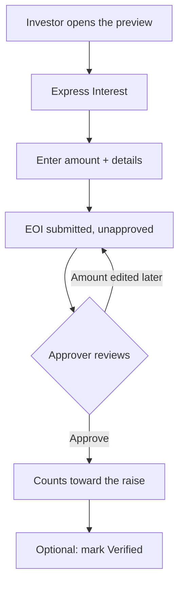
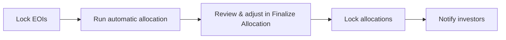

# Investment Opportunity User Guide

**Investment Opportunities** let a fund manager put a deal or fundraise in front of a chosen set of investors, collect their **Expressions of Interest (EOIs)**, and run the allocation process through to close. Each opportunity has a polished, investor-facing preview page, a documents area and private data room, marketing content sections, a track-record strip, and a fully tracked EOI pipeline with approval, verification, and proportional allocation.

This guide walks through the whole journey — from creating an opportunity to notifying investors of their final allocation.

---

## Table of Contents

1. [The Opportunity Journey](#the-opportunity-journey)
2. [Who Does What (Roles)](#who-does-what-roles)
3. [Creating an Opportunity](#creating-an-opportunity)
4. [Enriching the Opportunity](#enriching-the-opportunity)
5. [Controlling Who Can See It](#controlling-who-can-see-it)
6. [The Investor Preview](#the-investor-preview)
7. [Notifying Investors](#notifying-investors)
8. [The Expression of Interest Workflow](#the-expression-of-interest-workflow)
9. [The Allocation Process](#the-allocation-process)
10. [Worked Allocation Example](#worked-allocation-example)
11. [Tracking Progress](#tracking-progress)
12. [Frequently Asked Questions](#frequently-asked-questions)

---

## The Opportunity Journey

```mermaid
flowchart LR
    A[Create opportunity] --> B[Add content,<br/>documents, track record]
    B --> C[Grant investor access]
    C --> D[Notify investors: Open]
    D --> E[Investors submit EOIs]
    E --> F[Approve EOIs]
    F --> G[Lock EOIs]
    G --> H[Run allocation]
    H --> I[Review & finalise]
    I --> J[Lock allocations]
    J --> K[Notify investors: Allocated]
```

---

## Who Does What (Roles)

| Role | What they can do |
|------|------------------|
| **Fund Admin** | Create, edit, and delete opportunities; manage access, documents, content, track record, and notifications. |
| **Approver** | Everything a fund admin can do, plus approve or unapprove individual EOIs. |
| **Relationship Manager (RM)** | Submit EOIs on behalf of their clients and manage those EOIs. |
| **Investor** | View opportunities they've been given access to, submit and update their own EOI, and access the data room if granted. |

> The Investment Opportunities feature must be switched on for your account. If you don't see the menu, ask your administrator to enable it.

---

## Creating an Opportunity

Go to **Investment Opportunities → New Investment Opportunity**.

### Required information

| Field | What it's for |
|-------|---------------|
| **Company Name** | The deal or company name shown on the listing card and preview. |
| **Fund Raise Amount** | The total being raised. Drives the progress bar showing how much has been covered by approved EOIs. |
| **Min Ticket Size** | The smallest amount an investor may express interest for. EOIs below this are rejected. |
| **Currency** | The currency for all amounts. Defaults to your entity's currency. |
| **Last Date** | The closing date for EOIs. Defaults to one month out. |

### Optional information

| Field | What it's for |
|-------|---------------|
| **Valuation** | The deal/company valuation, shown in the key-metrics strip. |
| **Logo** | The company logo for the card and preview header. |
| **Tags** | Labels like `SaaS, Series B, Healthcare` for filtering the opportunity list. |
| **Details** | The investment thesis or deal description — long-form rich text shown prominently on the preview. |
| **Shareable** | When on, a private link lets anyone view the preview *without logging in* — handy for advisors sharing a deal with prospects. |

Click **Save** to create the opportunity and open its detail page.

---

## Enriching the Opportunity

The detail page is organised into tabs: **Documents, Widgets, Track Record, Tasks, Interests, Access Rights, Notifications**.

### Documents and data room

- **Documents** — files shown by default on the preview: offering memoranda, term sheets, pitch decks, and the like.
- **Data Room** — a separate, private folder. Its documents are shown only to investors whose EOI has **Show Data Room** turned on.

### Content sections (Widgets)

**Widgets** are rich content blocks that make up the body of the preview — market opportunity, team bios, product highlights, financial projections, and so on. Each has a title, a short intro, a main body, an optional image or video (positioned left/right/centre, or an embedded YouTube video), and an optional link. They appear in the order you add them, so arrange them to tell the full story.

### Track record

**Track Record** entries appear as highlight cards on the preview (for example "3.2× Realised MOIC" or "$500M AUM"). Each has a name, an optional prefix and suffix (like `$` or `Cr`), the value, and an optional explanatory note.

---

## Controlling Who Can See It

The **Access Rights** tab decides which investors can see the opportunity and submit an EOI.

- Add investors or investor groups individually.
- An added investor immediately gains view access and is included in notification recipient lists.

Before sending any notification, use **View Who Gets Notified** (linked in the confirmation prompt) to check the recipient list.

---

## The Investor Preview

Click **Preview** to see the opportunity exactly as an investor does:

- **Header** — company name, logo, and close date.
- **Key metrics strip** — fund raise amount, approved EOI amount, valuation, and minimum ticket size.
- **Details** — the investment thesis.
- **Content sections** — all your widgets, in order.
- **Track record** — the highlight cards.
- **Documents panel** — everything in the opportunity's documents folder.
- **"Ready to Invest?"** — a clear call-to-action linking to the EOI form.
- **Your Interest** — for investors, a card showing their own EOI.
- **Data Room** — shown to investors with data-room access (and always to fund managers).

### The shareable link

With **Shareable** enabled, a private, signed link lets advisors or prospective investors view the full preview without an account. They can't submit an EOI from that link — they'd need to log in for that.

---

## Notifying Investors

Send notifications from the **Notifications** menu on the detail page.

| Notification | Use it to |
|--------------|-----------|
| **Opportunity Open: To LPs** | Announce that investors can now place EOIs. |
| **Opportunity Allocated: To LPs** | Announce that final allocations are set. |

Both go to all investors with access. Any custom notification template set up for opportunities appears as an extra menu item and supports a custom subject, body, and attachments. The confirmation prompt always offers **View Who Gets Notified** so you can verify recipients first.

---

## The Expression of Interest Workflow

### How investors submit

1. Open the opportunity (from a notification, a link, or the portal listing).
2. Click **Express Interest**.
3. Enter the **amount** (must be at least the minimum ticket and no more than the raise), optionally link a **KYC record**, and add any **notes**.
4. **Save.** The EOI is created unapproved, and the investor is automatically granted access.

> If the amount is changed after submission, the EOI returns to unapproved and must be approved again.

### How RMs submit for clients

Relationship managers can submit on behalf of clients, additionally providing the investor's **name**, **email**, and a **KYC record** (required before approval). When an RM's EOI is approved, the system finds or creates the investor record from that name and email and links the KYC to them; unapproving reverses this.

### Approving EOIs

Approvers approve or unapprove EOIs from the **Interests** tab or the Finalize Allocation screen. Approving adds the EOI's amount to the opportunity's **Approved EOI Amount** and advances the progress bar; unapproving reverses it. An RM-submitted EOI can't be approved until a KYC record is attached.

### Verification and data room

- **Verified** is a manual flag for your internal process (e.g. confirming KYC, documents, and transfer are done). It doesn't affect allocation maths.
- **Show Data Room** can be toggled per EOI from the Interests tab to give that investor data-room access on the preview.

### Filtering EOIs

The Interests tab shows filter cards — **Total, Approved, Verified, Unapproved, Unverified** — click any to filter the table.

---

## The Allocation Process

### Step 1 — Lock EOIs

When the opportunity closes (or sooner), open the **Allocation** menu and click **Lock EOIs** to stop new submissions. You can toggle it back at any time.

### Step 2 — Run automatic allocation

Click **Allocate**. The system works in the background: for each approved EOI it calculates a proportional allocation, and if the raise is **over-subscribed** it applies a pro-rata haircut so the total comes back to the target. The page shows "Allocation in progress" — refresh after a moment.

> The allocation each approved investor receives = their EOI amount × (target raise ÷ total approved EOIs), capped so a fully- or under-subscribed raise gives everyone their full amount.

### Step 3 — Review and adjust

Click **View Allocations** to open **Finalize Allocation**, a table of every EOI with inline editing. For each one you can approve/verify it, **override the allocation amount**, and add comments. Filter by Verified / Unverified / All, search by investor, and **Save** each row in place.

### Step 4 — Lock allocations

Once finalised, click **Lock Allocations** to prevent further changes to allocation amounts.

### Step 5 — Notify investors

Send the **Opportunity Allocated: To LPs** notification to tell investors their final allocation.

---

## Worked Allocation Example

A deal targets a **$100M** raise. After approvals, EOIs total **$150M** — 150% subscribed, so everyone is scaled back to fit $100M.

> Scale factor = target ÷ total approved = 100 ÷ 150 = **66.67%**

| Investor | EOI amount | Allocation (× 66.67%) |
|----------|-----------|------------------------|
| Northwind LP | $60M | $40.0M |
| Briar Capital | $50M | $33.3M |
| Kestrel Family Office | $40M | $26.7M |
| **Total** | **$150M** | **$100M** |

If the raise had instead come in **under** target — say $80M of EOIs against the $100M raise — no haircut applies and each investor receives their full stated amount.

You can still override any single allocation on the Finalize Allocation screen (for example to honour a strategic investor's full ask) before locking.

---

## Tracking Progress

The detail page header shows four summary cards: **Fund Raise Amount** (the target), **Approved EOI Amount** (the running total of approved EOIs), **Valuation**, and **Min Ticket Size**. A progress bar shows how much of the raise is covered by approved EOIs.

Each EOI also has its own detail page (via **Show** on the Interests tab) with the investor's details, a documents tab for attachments like signed subscription forms, and a tasks tab.

---

## Frequently Asked Questions

**An investor can't see the opportunity — why?**
Check that they're listed under **Access Rights**, and that they have approved portal access for their entity.

**Can I edit an opportunity after EOIs are in?**
Yes — name, amounts, dates, and details stay editable. Be aware that changing the raise amount or minimum ticket can put existing EOIs out of range.

**Why is there no Approve option on an RM-submitted EOI?**
It needs a linked KYC record first. Open the EOI, select a KYC, save, then approve.

**What if I unapprove an EOI after allocating?**
Its amount drops out of the approved total. Re-run **Allocate** to recalculate everyone's allocation.

**Can an investor edit their EOI after submitting?**
Yes, while it's unapproved and EOIs aren't locked. Once approved, it can't be edited.

**What's the Verified flag for?**
It's a manual marker for your internal process (KYC, documents, transfer complete). It has no effect on allocation maths.

**Can I share the opportunity with someone without a portal account?**
Yes — enable **Shareable** and send the signed link. They can view the full preview but must log in to submit an EOI.

**How is allocation calculated when oversubscribed?**
Each approved investor gets their EOI amount scaled by (target ÷ total approved). See the [Worked Allocation Example](#worked-allocation-example).
