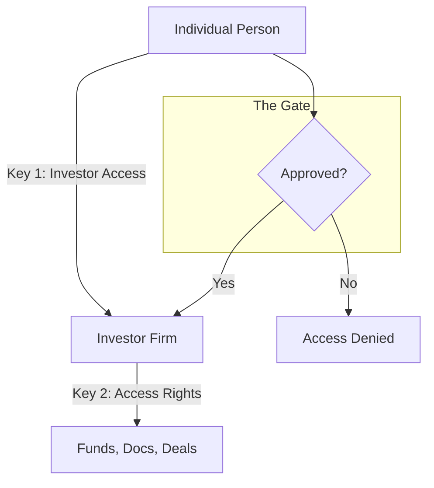
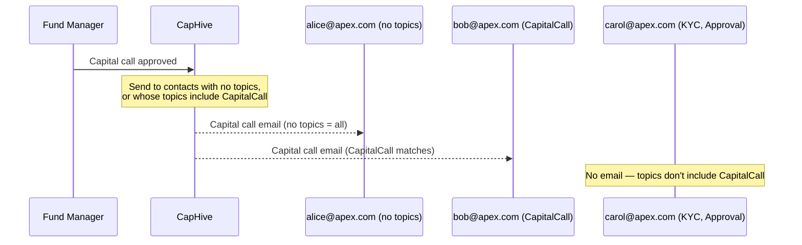
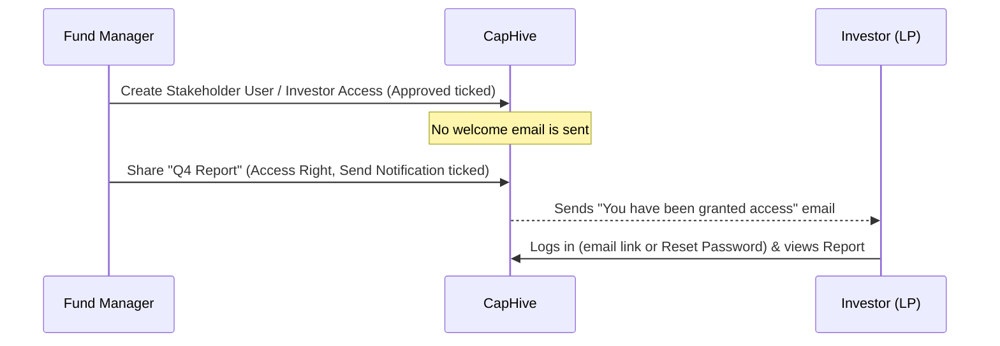

# Investor Access & Permissions Guide

Managing who can see what in CapHive is handled through a simple "Two-Key" system. This guide explains how to grant access to your investors and control exactly what data they can view.

> **Where to find it:** Sidebar → [**Stakeholders → View Stakeholders**](/investors) → open the stakeholder → **Users** tab → **New Users** adds a person who can log in; [**Stakeholders → All Stakeholder Access**](/investor_accesses) lists them across stakeholders (company admins only). Share a fund from its **Access** tab, or a document or folder from its **Access Rights** tab, with **Grant Access**. Both need permission to update the stakeholder, fund, document or folder concerned.

> **Terminology:** A **Stakeholder** is the investor organisation itself (the LP firm, the portfolio company) — to create one, see the [Investors (Stakeholders) guide](investors_user_guide). This guide is about **Stakeholder Users**: the individual people at a stakeholder who log in. Each Stakeholder User is an **Investor Access** record, added from the **Users** tab of the stakeholder's page.

## 📑 Table of Contents
1. [Key Takeaways](#-key-takeaways)
2. [The "Two-Key" System](#1-the-two-key-system)
3. [Step 1: Granting Entry (Investor Access)](#2-step-1-granting-entry-investor-access)
4. [Step 2: Sharing Content (Access Rights)](#3-step-2-sharing-content-access-rights)
5. [Managing Visibility & Folders](#4-managing-visibility--folders)
6. [Notification Topic Subscriptions (Tags)](#5-notification-topic-subscriptions-tags)
7. [The Investor Experience](#6-the-investor-experience)
8. [Frequently Asked Questions](#7-frequently-asked-questions)
9. [Related Guides](#related-guides)

---

## 🚀 Key Takeaways
*   **Approval is Mandatory**: A user sees nothing until their "Investor Access" is approved. The **Approved** box is pre-ticked on the **New Users** form; bulk-uploaded rows are unapproved unless the **Approved** column says `Yes`.
*   **Access is Explicit**: Investors only see data (Funds, Docs) that has been specifically shared with them via "Access Rights."
*   **Inheritance Saves Time**: Sharing a folder covers the documents and sub-folders already inside it, and anything added later inherits the access automatically.
*   **Immediate Revocation**: Unapproving a user instantly blocks their view of all data.
*   **Multi-Firm Support**: A regular investor login belongs to one investor entity; people who act for several investors are set up as investor advisors and switch using the persona dropdown in the top bar.
*   **Notification Topics**: Tag a contact with specific topics (e.g. `CapitalCall`, `KYC`) so they only receive relevant emails. Contacts with no tags receive everything.

---

## 1. The "Two-Key" System

Think of your fund as a secure building:

1.  **The Door Key (Investor Access)**: This determines **WHO** can enter the building. You create an "Investor Access" record for a person (e.g., John Doe) and link them to an Investor Firm (e.g., Acme Capital).
2.  **The Room Keys (Access Rights)**: This determines **WHAT** they can see once they are inside. You grant "Access Rights" to specific rooms (Funds, Documents, Deals, etc.).

---

## 2. Step 1: Granting Entry (Investor Access)

To allow a person at an investor firm to log in, you must create an **Investor Access** record (a **Stakeholder User**) for them. The stakeholder (investor firm) must already exist.

### How to add a new Stakeholder User:
1.  Open **Stakeholders → View Stakeholders** in the sidebar and click the stakeholder (investor firm).
2.  On the stakeholder's page, open the **Users** tab (it is the first tab).
3.  Click **New Users**. The form is titled **Stakeholder User**.
4.  Enter their Email, First Name, and Last Name.
5.  **The Approval Gate**: The **Approved** box is pre-ticked, so saving as-is gives the person access immediately. Untick it to store the person as a contact only; they cannot see any data until you click **Approve**. Rows loaded by bulk upload are unapproved unless the **Approved** column says `Yes`.

You can also see every Stakeholder User across all stakeholders under **Stakeholders → All Stakeholder Access**.

### What happens automatically:
*   **User Creation**: If the person doesn't have a CapHive account yet, the system creates one for them automatically.
*   **No Welcome Email**: Neither saving nor clicking **Approve** sends an email. The person logs in from the login page using **Log in with an email link instead** (a one-time link) or **Reset Password**.

---

## 3. Step 2: Sharing Content (Access Rights)

Once a user has a "Door Key," you need to give them "Room Keys" to specific data.

### Three Ways to Share:
You can grant access at different levels of granularity:

1.  **By Firm (Recommended)** — **All Users for Specific Stakeholder**: Share a Fund or Document with "Acme Capital." Every approved person at Acme Capital will automatically see it.
2.  **By Category** — **All Stakeholders of Specific Category**: Share with every stakeholder in a category such as `LP` or `Portfolio Company`, including stakeholders added to the category later. This is the fastest way to share general updates or newsletters.
3.  **By Tag** — **All Stakeholders with Tag**: A one-off shortcut that creates a specific-stakeholder grant for each stakeholder carrying the tag when you save; stakeholders tagged later are not added.
4.  **By Person** — **Specific User** (documents and folders only): Share a specific document with only one individual.

The **Access Type** list also offers **Employee** (and **Advisor** on funds, investment opportunities, secondary sales and deals) for your own team and investor advisors. Deals offer only **All Users for Specific Stakeholder**, **Employee** and **Advisor**.

### Permission Levels:
*   **View (Read)**: The user can see and download the information.
*   **Manage (Create/Update/Delete)**: Usually reserved for your internal team or advisors who need to upload data on your behalf.

---

## 4. Managing Visibility & Folders

### Automatic Sharing (Inheritance)
If you share a **Folder** with an investor, they automatically get access to:
*   Any new documents you upload to that folder in the future.
*   Any sub-folders created inside it later.
*   Documents and sub-folders already inside it — a background job copies the grant down the tree. This always happens on a folder grant; there is no option to skip it.

### Revoking Access
*   **Temporary Block**: Click **UnApprove** on their Investor Access record. They immediately stop seeing the stakeholder's funds, documents and other shared items and stop receiving its notification emails; clicking **Approve** restores access.
*   **Permanent Removal**: Delete the Investor Access record or the specific Access Right. No one is notified either way.

---

## 5. Notification Topic Subscriptions (Tags)

By default, every approved investor contact receives **all** email notifications. If a contact only wants to hear about specific topics — or if your fund has contacts who manage different areas (e.g. one person handles capital calls, another handles KYC) — you can use **Notification Topics** to filter what each person receives.

### How it works

Set a comma-separated list of topic names in the **Notification Topics** field on the Investor Access form. The contact will then receive **only** emails matching those topics. Leave the field blank to receive everything.

| `Notification Topics` field | What the contact receives |
|---|---|
| *(blank)* | All notifications — subscribed to everything |
| `CapitalCall` | Only capital call and remittance notices |
| `KYC` | Only KYC-related emails |
| `CapitalCall,Approval` | Capital calls and approval requests only |

> **Rule:** A contact with **no topics** gets all notifications. A contact with **any topics** gets only those topics and nothing else.

### Available topics

| Topic | Covers |
|---|---|
| `Approval` | Approval requests sent to investors |
| `CapitalCall` | Capital call notices and remittance confirmations |
| `Distribution` | Capital distribution payment notices |
| `InvestmentOpportunity` | New deal / investment opportunity alerts |
| `KYC` | KYC submission requests and reminders |
| `SecondarySale` | Secondary sale interest and SPA notifications |
| `Deal` | Deal stage-move notifications |
| `Kpi` | KPI reporting notifications |

### How to set topics for a contact

1. Open the stakeholder (investor firm) from **Stakeholders → View Stakeholders**.
2. Go to the **Users** tab.
3. Click **Actions → Edit** on the contact's Stakeholder User (Investor Access) row.
4. Fill in the **Notification Topics (tag_list)** field with the relevant topic names, separated by commas (e.g. `CapitalCall,KYC`).
5. Click **Save**.

> **Note:** A topic matches if its name appears anywhere in the field's text, and the match is not case-sensitive. Use the exact names from the table above so topics don't match by accident.

### Example scenario

Your fund has three contacts at Apex Capital:

| Contact | Role | `Notification Topics` |
|---|---|---|
| alice@apex.com | CFO — handles all calls | *(blank)* |
| bob@apex.com | Operations — capital calls only | `CapitalCall` |
| carol@apex.com | Legal — KYC and approvals only | `KYC,Approval` |

When a capital call is issued:
- Alice receives it (no topics = receives all).
- Bob receives it (`CapitalCall` matches).
- Carol does **not** receive it (`KYC,Approval` has no `CapitalCall` topic).

When a KYC request is sent:
- Alice receives it.
- Bob does **not** receive it (`CapitalCall` only).
- Carol receives it (`KYC` matches).

### How the filtering works

### Employee notifications are unaffected

Topic filtering applies **only to investor contacts** (entries in Investor Access). Your internal team members receive notifications through a separate path and are never filtered by `Notification Topics`.

---

## 6. The Investor Experience

When an investor logs in, they see a simplified dashboard tailored to them:
*   **Investments**: Details of the funds they have invested in.
*   **Documents**: A library of reports, tax forms, and notices shared with them.
*   **Deals**: Information on active or past investment opportunities.
*   **Notifications**: They receive an in-app notification and email ("You have been granted access to …") when you share a fund or a single document with them and tick **Send Notification** — for a document, only when its **Send Email** option is on. Folder grants offer no **Send Notification** box and never email. These access emails are not filtered by Notification Topics.

---

## 7. Frequently Asked Questions

### Navigation and getting there

**Where do I add or manage the people (Stakeholder Users) at an investor firm?**
Sidebar → [**Stakeholders → View Stakeholders**](/investors), click the stakeholder (investor) name, and stay on the first tab, **Users**. That tab lists every Stakeholder User (Investor Access record) for that stakeholder and has the **New Users**, **Upload** and **Filter** buttons. See [Step 1: Granting Entry](#2-step-1-granting-entry-investor-access).

**Is a Stakeholder User the same as an investor access?**
Yes. A **Stakeholder User** on screen is an **investor access** record: one person given portal access on behalf of a stakeholder (investor). The **Users** tab, **Pending Access** and **All Stakeholder Access** all list investor accesses.

**Where can I see Stakeholder Users across all stakeholders at once?**
Sidebar → [**Stakeholders → All Stakeholder Access**](/investor_accesses) lists every Stakeholder User in your entity, and [**Stakeholders → Pending Access**](/investor_accesses?approved=false) shows only the unapproved ones. Both pages need the company admin role; other employees work from the stakeholder's **Users** tab.

**Where do I share a fund with investors (grant an Access Right)?**
Sidebar → [**Funds → Funds**](/funds), open the fund, click the **Access** tab, then **Grant Access**. The same **Grant Access** button appears on the **Access Rights** tab of a document or folder. See [Step 2: Sharing Content](#3-step-2-sharing-content-access-rights).

**Where do I see what a particular stakeholder has been given access to?**
Open the stakeholder and click the **Access Rights** tab (shown if you can edit the stakeholder). Company admins see two sub-tabs: **Employee Access** (which of your employees may work on this stakeholder) and **Investor Access** (the funds, documents and other items shared with this stakeholder, including deleted grants).

**Where do I set a contact's Notification Topics?**
Open the stakeholder → **Users** tab → **Actions → Edit** on the person's row, fill **Notification Topics (tag_list)** and **Save**. The row then shows the topics as badges, or an "all topics" badge when the field is blank. See [Notification Topic Subscriptions](#5-notification-topic-subscriptions-tags).

### Creating, updating and managing access

**How do I add a new Stakeholder User?**
Open the stakeholder → **Users** tab → **New Users**. The **Stakeholder User** form asks for **Email**, **First Name**, **Last Name**, country code and phone, plus **Email Enabled**, **Notification Topics**, **Cc**, **WhatsApp Enabled** and **Approved**, then **Save**. The stakeholder itself must already exist.

**Is a new Stakeholder User approved by default?**
On the **New Users** form the **Approved** box is pre-ticked, so saving as-is gives the person access immediately. Untick it to store the person as a contact only (no portal access), which is how the LP CRM records prospects. Rows loaded by bulk upload are unapproved unless the **Approved** column says `Yes`.

**How do I approve or un-approve a Stakeholder User?**
On the stakeholder's **Users** tab (or **All Stakeholder Access**), click **Approve** on an unapproved row or **UnApprove** on an approved one. The button toggles the flag and records you as the granter; you need permission to update that stakeholder.

**How do I edit a Stakeholder User?**
Click **Actions → Edit** on the row. You can change **Email Enabled**, **Notification Topics**, **Cc**, **Approved** and any custom contact fields. Email, name and phone cannot be changed here; they come from the person's CapHive user account.

**How do I remove a Stakeholder User?**
Click **Actions → Delete** on the row and confirm. Use **UnApprove** instead if you may want to restore access later, because the row keeps its topics, Cc and history.

**How do I bulk-add Stakeholder Users?**
Click **Upload** on the **Users** tab or on **All Stakeholder Access**; it opens the import form (import type **InvestorAccess**) with a sample sheet. Columns are **Stakeholder**, **First Name**, **Last Name**, **Email**, **Email Enabled**, **Cc**, **Country Code**, **Phone**, **WhatsApp Enabled** and **Approved** (`Yes` to approve).

**How do I download all investor access (Stakeholder User) data?**
In the sidebar go to [**Stakeholders → All Stakeholder Access**](/investor_accesses) and click **Download Stakeholder Users**. You get an Excel file of every Stakeholder User (investor access) in your company, approved and pending, employees and advisors, with name, email, phone, WhatsApp settings and approval status. The button is not on a single stakeholder's **Users** tab.

**Does Download Stakeholder Users apply my filter or search?**
No. **Download Stakeholder Users** always exports every investor access in your company, even if the list is filtered or you opened it from **Pending Access**. Filter the Excel file afterwards, for example on the **Approved** column, to get a subset.

**How do I grant an Access Right, and what are the options?**
On the fund, document or folder, click **Grant Access**, pick an **Access Type** and the target, and **Save**. On a fund or a single document you can also tick **Send Notification** to email the users covered; folder grants have no such box and never email. Types are **All Users for Specific Stakeholder**, **All Stakeholders of Specific Category**, **All Stakeholders with Tag**, plus **Employee** and **Advisor** (funds, opportunities, secondary sales) or **Specific User** and **Employee** (documents and folders). Deals offer only **All Users for Specific Stakeholder**, **Employee** and **Advisor**.

**How do I remove an Access Right?**
On the fund's **Access** tab, or the document's or folder's **Access Rights** tab, click **Delete** on the grant's row. You need the same permission as for granting, which is permission to update the fund, document or folder.

**Which permission do I need?**
Adding, editing, approving or deleting a Stakeholder User needs permission to update that stakeholder (company admin, *Investor Update* on your user, or explicit employee access to the stakeholder). Granting Access Rights needs permission to update the fund, document or folder. The **All Stakeholder Access** and **Pending Access** lists are company-admin only.

### Why use Investor Access and Access Rights

**Why is access split into two keys?**
Investor Access decides **who** can log in on behalf of a stakeholder; Access Rights decide **what** that stakeholder can see. Keeping them separate means you share a fund once with the firm and every approved person at the firm sees it, and removing one person never touches the firm's grants. See [The Two-Key System](#1-the-two-key-system).

**What does this let me do that I could not do otherwise?**
Give LPs a self-service portal for their commitments, statements and documents, send capital call, distribution and KYC emails to the right people automatically, copy extra recipients with **Cc**, and cut off a departing contact with one click. Without it, investor communication falls back to manual email outside CapHive.

**What happens if I do not create a Stakeholder User for an investor?**
Nobody at that stakeholder can log in, and automated emails (capital calls, distributions, KYC requests, approvals, document shares) have no approved recipient, so they are silently not sent for that stakeholder. The stakeholder's own records still exist on your side.

**Who typically uses this?**
Investor-relations and fund-operations staff add and approve Stakeholder Users; company admins review **Pending Access** and **All Stakeholder Access**; whoever manages a fund or data room grants Access Rights on it. Compliance sometimes uses Notification Topics to route KYC emails to a specific person.

**Why use Notification Topics instead of just unticking Email Enabled?**
**Email Enabled** is all-or-nothing for that person. Topics let one contact get only capital calls and another only KYC, so each person at the LP receives what they handle while still keeping portal access.

### What happens when I …

**What happens when I save a new Stakeholder User?**
CapHive looks up a user by email and, if none exists, creates a CapHive account for them under the stakeholder's investor entity with a random password. The person appears on the **Users** tab and the stakeholder's user counters update. No email is sent when the row is saved, whether or not it is approved.

**What happens when I click Approve?**
The row's **Approved** flag turns on and you are recorded as the granter; the person can now see whatever has been shared with their stakeholder and starts receiving notifications. No welcome email is sent automatically: the person logs in from the login page using **Log in with an email link instead** (a one-time link) or **Reset Password**.

**What happens when I click UnApprove?**
The person immediately stops seeing the stakeholder's funds, documents and other shared items, and is dropped from all future notification emails for that stakeholder. Nothing is deleted and nobody is notified, so clicking **Approve** again restores access exactly as before.

**What happens when I delete a Stakeholder User?**
The Investor Access row is soft-deleted and disappears from the **Users** tab; the person's CapHive login account is not deleted. If the person was an investor advisor, their fund-level Access Rights are also revoked for any fund where no other approved access still links them. There is no restore button, so re-add the person to undo it; no one is notified.

**What happens when I grant an Access Right?**
One grant is saved per selected stakeholder, category or user (a tag creates one grant per stakeholder currently carrying that tag), and every approved user it covers can see the item at once. If **Send Notification** is ticked, those users get an in-app notification and an email ("You have been granted access to …"); for a document this happens only when its **Send Email** option is on. Folder grants have no **Send Notification** box and never email. Replicated copies on sub-folders and files never send notifications.

**What happens when I share a folder?**
The grant applies to the folder, and new documents and sub-folders added later inherit it automatically. Existing files and sub-folders are covered too: a background job copies the grant down the tree, always, with no checkbox to turn it off. See [Managing Visibility & Folders](#4-managing-visibility--folders).

**What happens when I delete an Access Right?**
The grant is soft-deleted and users covered only by it lose sight of the item immediately. When the item is a folder, or owns a document folder (such as a fund), a background job also removes the copies that were cascaded to the files and sub-folders beneath it. No one is notified.

**What happens when I create a capital commitment? Do I still need to share the fund?**
Creating a commitment (on screen or by import) automatically grants the stakeholder access to that fund, with no notification. You still need at least one approved Stakeholder User at the firm for anyone to see it. Fund page **Actions → Misc → Check Access Rights** lists commitments whose stakeholder has no fund grant.

**What happens when a contact has Notification Topics set?**
Topic-aware emails (capital calls, distributions, KYC, approvals, deals, investment opportunities, secondary sales, KPIs) go only to contacts whose topics include that topic or whose topics are blank. Access-right "granted access" emails are not topic-filtered, and topics never change what the person can see in the portal.

### Troubleshooting and edge cases

**My investor says they can't see the fund details.**
Check three things: the person's row on the stakeholder's **Users** tab shows **Approved**; the fund's **Access** tab has a grant covering their stakeholder (by name, category or tag); and the person was added under the correct stakeholder. Fund page **Actions → Misc → Check Access Rights** reports commitments with no matching grant.

**How do I share a document with everyone at once?**
When you click **Grant Access**, choose **All Stakeholders of Specific Category** and select the category (for example `LP`) in **Select Stakeholder Category**. Every approved user of every stakeholder in that category gets access, including stakeholders added to the category later.

**Can I see what the investor sees?**
There is no "View As" button for fund-manager users. CapHive support staff can log in as a client user only through an enabled support mapping that whitelists them. To verify a share yourself, check the stakeholder's **Access Rights → Investor Access** sub-tab and the fund page **Actions → Misc → Show Email List**.

**What if a person works for multiple investor firms?**
A regular investor login belongs to one investor entity, so adding an existing user under a stakeholder of a different firm fails with "cannot be given access. Belongs to …". People who act for several investors should be set up as investor advisors; they then pick which investor they are acting for from the persona dropdown in the top bar. See the [Investor Advisor guide](investor_advisor_user_guide).

**I shared with a tag, but a stakeholder I tagged later cannot see the item.**
**All Stakeholders with Tag** is a one-off shortcut: it creates a specific-stakeholder grant for each stakeholder that has the tag at the moment you save. Stakeholders tagged afterwards are not added, so grant them individually or use **All Stakeholders of Specific Category**, which is evaluated live.

**Saving fails with "Aready added as a stakeholder".**
That email already has an Investor Access row on this stakeholder (possibly unapproved). Find it on the **Users** tab and **Approve** or **Edit** it instead of adding a second one.

**Saving fails because the email belongs to an Investor Advisor.**
The **New Users** form refuses users who hold the Investor Advisor role. Add advisors through the investor advisor flow instead, which creates their access and fund grants together. See the [Investor Advisor guide](investor_advisor_user_guide).

**I cannot open Pending Access or All Stakeholder Access.**
Those pages are restricted to company admins, even though the sidebar links are visible to everyone with the Stakeholders menu. Work from each stakeholder's **Users** tab instead, or ask a company admin for the role.

**The Approve, Edit or Delete buttons are missing on the Users tab.**
They only appear if you can update that stakeholder. Ask a company admin to give you *Investor Update* on your user, or to add you on the stakeholder's **Access Rights → Employee Access** sub-tab.

**A contact says they stopped receiving capital call emails after I tagged them.**
Once any topics are added to a contact's **Notification Topics** field, they only receive emails for those topics. If you tagged them with `KYC` but not `CapitalCall`, add `CapitalCall` or clear the field so they receive everything again. Also check **Email Enabled** is ticked on their row.

**Do tags affect what the investor can see in the portal?**
No. Notification Topics only control which automated **emails** are delivered. What the investor can see when logged in is controlled by approval and Access Rights.

**Can investor advisors also be tagged?**
Yes. Investor advisors are stored in Investor Access records (shown as **Advisor** in the type column) and follow the same subscription rules as regular investor contacts.

**Can someone else at the LP receive copies of a contact's emails without a login?**
Yes. Put their addresses, comma separated, in the contact's **Cc** field; they are copied on every email sent to that contact. Invalid addresses are rejected on save.

**Does un-approving or deleting access notify the investor?**
No. Approve, un-approve, delete and access-right removal send no email or in-app message to the investor; only granting an Access Right on a fund or a single document with **Send Notification** ticked does.

---
*For technical troubleshooting or advanced permission setups, please refer to the Administrator Guide or contact support.*

## Related Guides

- [Investors (Stakeholders)](investors_user_guide) — create the stakeholder before adding its users.
- [Investor Advisor](investor_advisor_user_guide) — people who act for one or more investors and switch persona.
- [Document Management](document_management_user_guide) — folders and documents whose Access Rights tab you share from.
- [Data Rooms](data_rooms_gp_user_guide) — sharing a data room folder with stakeholders.
- [LP Relationship CRM](lp_crm_user_guide) — unapproved Stakeholder Users used as CRM contacts.
- [Capital Calls](capital_calls_user_guide) — the notices that go to approved users filtered by the `CapitalCall` topic.
- [User & Role Management](user_role_management_user_guide) — the employee permissions that control who can grant access.
