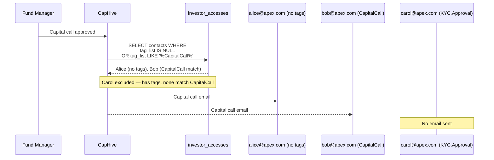

# Investor Access & Permissions Guide

Managing who can see what in CapHive is handled through a simple "Two-Key" system. This guide explains how to grant access to your investors and control exactly what data they can view.

## 📑 Table of Contents
1. [Key Takeaways](#-key-takeaways)
2. [The "Two-Key" System](#1-the-two-key-system)
3. [Step 1: Granting Entry (Investor Access)](#2-step-1-granting-entry-investor-access)
4. [Step 2: Sharing Content (Access Rights)](#3-step-2-sharing-content-access-rights)
5. [Managing Visibility & Folders](#4-managing-visibility--folders)
6. [Notification Topic Subscriptions (Tags)](#5-notification-topic-subscriptions-tags)
7. [The Investor Experience](#6-the-investor-experience)
8. [FAQ](#7-frequently-asked-questions-faq)

---

## 🚀 Key Takeaways
*   **Approval is Mandatory**: New users cannot see anything until their "Investor Access" is approved.
*   **Access is Explicit**: Investors only see data (Funds, Docs) that has been specifically shared with them via "Access Rights."
*   **Inheritance Saves Time**: Sharing a folder automatically shares all current and future documents inside it.
*   **Immediate Revocation**: Unapproving a user instantly blocks their view of all data.
*   **Multi-Firm Support**: Users representing multiple firms can switch between them seamlessly.
*   **Notification Topics**: Tag a contact with specific topics (e.g. `CapitalCall`, `KYC`) so they only receive relevant emails. Contacts with no tags receive everything.

---

## 1. The "Two-Key" System

Think of your fund as a secure building:

1.  **The Door Key (Investor Access)**: This determines **WHO** can enter the building. You create an "Investor Access" record for a person (e.g., John Doe) and link them to an Investor Firm (e.g., Acme Capital).
2.  **The Room Keys (Access Rights)**: This determines **WHAT** they can see once they are inside. You grant "Access Rights" to specific rooms (Funds, Documents, Deals, etc.).

```
graph TD
    User[Individual Person] -->|Key 1: Investor Access| Firm[Investor Firm]
    Firm -->|Key 2: Access Rights| Data[Funds, Docs, Deals]
    
    subgraph "The Gate"
    Approval{Approved?}
    end
    
    User --> Approval
    Approval -- Yes --> Firm
    Approval -- No --> Blocked[Access Denied]
```

---

## 2. Step 1: Granting Entry (Investor Access)

To allow an investor to log in, you must create an **Investor Access** record for them.

### How to add a new user:
1.  Navigate to the **Investor** record.
2.  Go to the **Stakeholders** or **Access** tab.
3.  Click **Add Stakeholder**.
4.  Enter their Email, First Name, and Last Name.
5.  **The Approval Gate**: By default, new users are "Unapproved." They cannot see any data until you click **Approve**.

### What happens automatically:
*   **User Creation**: If the person doesn't have a CapHive account yet, the system creates one for them automatically.
*   **Welcome Email**: Once you click **Approve**, they receive an email with a link to log in and set their password.

---

## 3. Step 2: Sharing Content (Access Rights)

Once a user has a "Door Key," you need to give them "Room Keys" to specific data.

### Three Ways to Share:
You can grant access at different levels of granularity:

1.  **By Firm (Recommended)**: Share a Fund or Document with "Acme Capital." Every approved person at Acme Capital will automatically see it.
2.  **By Category**: Share with "All LPs" or "All Portfolio Companies." This is the fastest way to share general updates or newsletters.
3.  **By Person**: Share a specific document with only one individual.

### Permission Levels:
*   **View (Read)**: The user can see and download the information.
*   **Manage (Create/Update/Delete)**: Usually reserved for your internal team or advisors who need to upload data on your behalf.

---

## 4. Managing Visibility & Folders

### Automatic Sharing (Inheritance)
If you share a **Folder** with an investor, they automatically get access to:
*   Every document currently inside that folder.
*   Any new documents you upload to that folder in the future.
*   Any sub-folders created inside it.

### Revoking Access
*   **Temporary Block**: Click **Unapprove** on their Investor Access record. They can still log in, but they will see a blank dashboard.
*   **Permanent Removal**: Delete the Investor Access record or the specific Access Right.

---

## 5. Notification Topic Subscriptions (Tags)

By default, every approved investor contact receives **all** email notifications. If a contact only wants to hear about specific topics — or if your fund has contacts who manage different areas (e.g. one person handles capital calls, another handles KYC) — you can use **Notification Topics** to filter what each person receives.

### How it works

Set a comma-separated list of topic names in the **Notification Topics** field on the Investor Access form. The contact will then receive **only** emails matching those topics. Leave the field blank to receive everything.

| `Notification Topics` field | What the contact receives |
|---|---|
| *(blank)* | All notifications — subscribed to everything |
| `CapitalCall` | Only capital call and remittance notices |
| `KYC` | Only KYC-related emails |
| `CapitalCall,Approval` | Capital calls and approval requests only |

> **Rule:** A contact with **no topics** gets all notifications. A contact with **any topics** gets only those topics and nothing else.

### Available topics

| Topic | Covers |
|---|---|
| `Approval` | Approval requests sent to investors |
| `CapitalCall` | Capital call notices and remittance confirmations |
| `Distribution` | Capital distribution payment notices |
| `InvestmentOpportunity` | New deal / investment opportunity alerts |
| `KYC` | KYC submission requests and reminders |
| `SecondarySale` | Secondary sale interest and SPA notifications |
| `Deal` | Deal stage-move notifications |

### How to set topics for a contact

1. Navigate to the **Investor** record.
2. Go to the **Stakeholders / Access** tab.
3. Click **Edit** next to the contact's Investor Access record.
4. Fill in the **Notification Topics** field with the relevant topic names, separated by commas (e.g. `CapitalCall,KYC`).
5. Click **Save**.

> **Note:** Topic names are case-sensitive. Use the exact names from the table above.

### Example scenario

Your fund has three contacts at Apex Capital:

| Contact | Role | `Notification Topics` |
|---|---|---|
| alice@apex.com | CFO — handles all calls | *(blank)* |
| bob@apex.com | Operations — capital calls only | `CapitalCall` |
| carol@apex.com | Legal — KYC and approvals only | `KYC,Approval` |

When a capital call is issued:
- Alice receives it (no topics = receives all).
- Bob receives it (`CapitalCall` matches).
- Carol does **not** receive it (`KYC,Approval` has no `CapitalCall` topic).

When a KYC request is sent:
- Alice receives it.
- Bob does **not** receive it (`CapitalCall` only).
- Carol receives it (`KYC` matches).

### How the filtering works



### Employee notifications are unaffected

Topic filtering applies **only to investor contacts** (entries in Investor Access). Your internal team members receive notifications through a separate path and are never filtered by `Notification Topics`.

---

## 6. The Investor Experience

When an investor logs in, they see a simplified dashboard tailored to them:
*   **Investments**: Details of the funds they have invested in.
*   **Documents**: A library of reports, tax forms, and notices shared with them.
*   **Deals**: Information on active or past investment opportunities.
*   **Notifications**: They receive an email alert whenever you share a new document or fund with them (if "Notify" is checked), subject to any Notification Topics they have set.

```
sequenceDiagram
    participant FM as Fund Manager
    participant System as CapHive
    participant LP as Investor (LP)
    
    FM->>System: Create Stakeholder (Unapproved)
    FM->>System: Click "Approve"
    System-->>LP: Sends Welcome Email
    FM->>System: Share "Q4 Report" (Access Right)
    System-->>LP: Sends "New Document Shared" Alert
    LP->>System: Logs in & views Report
```

---

## 7. Frequently Asked Questions (FAQ)

**Q: My investor says they can't see the fund details.**
Check three things:
1.  Is their status **Approved**?
2.  Have you granted an **Access Right** for that specific Fund to their Firm?
3.  Is the user linked to the correct Investor Firm?

**Q: How do I share a document with everyone at once?**
When creating the Access Right, select **Category** as the target and choose "Investor" (or your preferred group).

**Q: Can I see what the investor sees?**
Yes. Administrators can use the "Impersonate" or "View As" feature (if enabled) to verify exactly what an investor's dashboard looks like.

**Q: What if an investor works for multiple firms?**
The system handles this automatically. When they log in, they can switch between the different firms they advise or represent using the entity switcher in the top navigation.

**Q: A contact says they stopped receiving capital call emails after I tagged them.**
Once any topics are added to a contact's **Notification Topics** field, they only receive emails for those topics. If you tagged them with `KYC` but not `CapitalCall`, they will no longer receive capital call notices. Either add `CapitalCall` to their topics, or clear the field entirely so they receive all notifications again.

**Q: Do tags affect what the investor can see in the portal?**
No. Notification Topics only control which automated **emails** are delivered. They have no effect on what data the investor can see when logged in — that is controlled by Access Rights.

**Q: Can investor advisors also be tagged?**
Yes. Investor advisors are stored in Investor Access records and follow exactly the same subscription rules as regular investor contacts.

---
*For technical troubleshooting or advanced permission setups, please refer to the Administrator Guide or contact support.*
