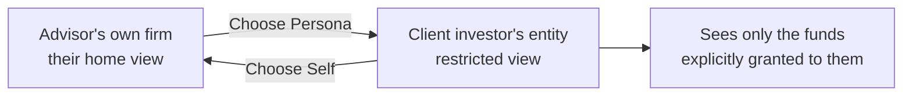
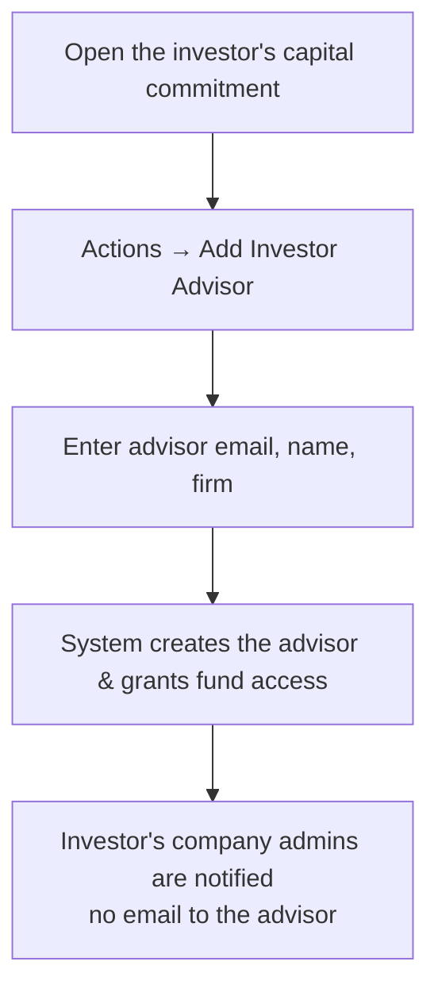

# Investor Advisor User Guide

An **Investor Advisor** is a trusted outside professional — from an advisory firm, family office, or wealth manager — who is given controlled access to part of your data so they can view or manage funds, deals, and KYC on behalf of their clients, without becoming a full member of your organisation.

> **Where to find it:** Sidebar → [**Funds → Funds**](/funds) → open the fund → **Commitments** tab → open the investor's commitment → **Actions → Add Investor Advisor**. Bulk-load from the fund page with **Import → Import Investor Advisors**; advisor records in your own entity are under Company menu → [**Advisors**](/investor_advisors). Needs the company admin role and the *Investor Advisors* feature on your user.

This guide explains what an advisor is, how to set one up, and exactly what they can and cannot do. It's written for the team granting the access.

---

## Table of Contents

1. [What an Investor Advisor Is](#what-an-investor-advisor-is)
2. [How Advisor Access Works](#how-advisor-access-works)
3. [Setting Up an Advisor](#setting-up-an-advisor)
4. [What an Advisor Can Do](#what-an-advisor-can-do)
5. [What an Advisor Cannot Do](#what-an-advisor-cannot-do)
6. [Frequently Asked Questions](#frequently-asked-questions)
7. [Related Guides](#related-guides)

---

## What an Investor Advisor Is

When an investor uses an outside advisor to manage their relationship with your fund, you can grant that advisor permissioned access rather than sharing logins or sending data by email. The advisor keeps their own identity (tied to their advisory firm) but can **switch into the investor's (client's) view** to see only the funds you've shared with them for that investor.

Think of it as handing a guest a key card that opens just a few named rooms — and only while they're switched into their client's persona.

---

## How Advisor Access Works

The advisor has two "hats" and switches between them:

- In their **home view**, they operate as a member of their own advisory firm.
- When they pick a client from the persona dropdown in the top bar, their account temporarily moves into that **investor's entity** (the advisor record added from a commitment belongs to the investor's entity) and takes on that record's **Allowed Roles** (`investor` when added from a commitment). They can see only the funds you've explicitly granted.
- When they choose **Self**, their normal identity and permissions return.

Access is always **explicit**: an advisor sees a fund or investor only if you've specifically shared that item with them. Nothing is visible by default.

---

## Setting Up an Advisor

### Before you start

- You need to be a **Company Admin** of the fund's entity **and** have the *Investor Advisors* feature enabled on your user.
- You'll need the advisor's email address.
- The advisor's own firm must be an entity of type **Investor Advisor**. When the email is new to CapHive the steps below create that firm for you. If the person already has a login, they must already sit in such a firm — otherwise the save is refused, because an advisor set up outside one can never switch into your client.

### Steps

1. Open the fund (Sidebar → **Funds → Funds**), click the **Commitments** tab and open the investor's commitment.
2. Click **Actions → Add Investor Advisor**.
3. Provide the **Advisor email**, **Advisor entity** (their advisory firm), **Advisor First name** and **Advisor Last name**, and click **Save**.
4. On save, the system creates the advisor's account and firm entity (if they're new), creates the advisor record under the investor's entity, and grants access to that specific fund for that investor.
5. The active company admins of the investor's entity get an in-app notification and email. The advisor is not sent an invitation; they sign in from the login page with **Log in with an email link instead** or **Reset Password**.

You can repeat this on other funds' commitments to widen what a given advisor can see. To load many advisors at once, use **Import → Import Investor Advisors** on the fund page. The Company menu → **Advisors** page (**New Investor Advisor**) only links a user who already holds the Investor Advisor role to your own entity; it cannot create a new advisor login.

---

## What an Advisor Can Do

Once switched into the client investor's persona, an advisor can — for the funds you've granted:

- **View permissioned funds** — dashboards, reports, and documents.
- **Manage KYC** — view, and where permitted, update KYC details for their clients.
- **Track investments** — follow commitments, capital calls, and distributions for their clients.
- **Receive notifications** — get alerts about KYC updates and fund activity relevant to their clients.

---

## What an Advisor Cannot Do

To protect your data and keep clients separate, an advisor **cannot**:

- **See anything not shared with them** — funds, investors, or deals you haven't explicitly granted are invisible.
- **Change your settings** — they can't manage your organisation's configuration, adjust employee permissions, or add other advisors.
- **Act as an administrator** — they operate under the advisor record's **Allowed Roles** (`investor` when added from a commitment), not as a Company Admin unless a company admin explicitly grants that role.
- **See across their other clients** — while switched into one client's persona, they can't see data belonging to any other client they advise.

---

## Frequently Asked Questions

### Navigation and getting there

**Where do I add an advisor for one of my investors?**
Sidebar → [**Funds → Funds**](/funds), open the fund, click the **Commitments** tab and open the investor's commitment. Then **Actions → Add Investor Advisor**, which opens the **Investor Advisor** form for that investor and fund. See [Setting Up an Advisor](#setting-up-an-advisor).

**Where do I see the advisors set up in my entity?**
Company menu (the **house icon** at the top right, tooltip "Company menu") → [**Advisors / External Company Advisors**](/investor_advisors) lists advisor records that belong to your own entity, each with **Show**, **Edit** and **Delete**. Advisors added from a commitment belong to the investor's entity, so a fund manager finds them on the stakeholder's **Users** tab instead. Needs the *Investor Advisors* feature on your user.

**Where do I bulk-load advisors for a fund?**
Open the fund and use **Import → Import Investor Advisors**, which opens the import form (import type **InvestorAdvisor**) with a sample sheet. The **Import** button shows only if you can edit the fund.

**Where can I see which funds an advisor can access for an investor?**
Open the stakeholder → **Users** tab; advisors are marked **Advisor** in the type column. A company admin can click the advisor's name to open their contact page, whose **Fund Access** tab lists the funds granted to them as an investor advisor.

**How does an advisor switch into a client's view?**
After logging in, the advisor picks the client from the persona dropdown in the top bar (tooltip "Choose Persona"); choosing **Self** switches back to their own firm. The dropdown only lists active entities that have set them up as an advisor.

### Creating, updating and managing advisors

**How do I add an advisor for an investor's fund commitment?**
On the commitment page, **Actions → Add Investor Advisor**, enter **Advisor email**, **Advisor entity** (their firm), **Advisor First name** and **Advisor Last name**, and click **Save**. You must be a company admin of the fund's entity.

**How do I give an existing advisor access to another fund for the same investor?**
Repeat **Actions → Add Investor Advisor** from that fund's commitment with the same email. CapHive reuses the advisor's account and advisor record and adds access to the new fund.

**How do I add an advisor to my own entity from the Advisors page?**
Company menu → [**Advisors**](/investor_advisors) → **New Investor Advisor**, enter the **Email** of a user who already has the Investor Advisor role, choose their **Permissions**, **Extended Permissions** and **Allowed Roles**, and **Save**. This form cannot create a new advisor login; use the commitment flow or the import for new people.

**How do I change what an advisor can do?**
For advisor records in your own entity: Company menu → **Advisors** → **Show** on the advisor → **Edit**. Adjust **Permissions**, **Extended Permissions** (for example *Investor Kyc Read*) and **Allowed Roles** (the roles they take on when switched in), then **Save**. Only company admins can grant the `company_admin` role to an advisor.

**How do I remove an advisor?**
As the fund manager, open the stakeholder → **Users** tab and use **Actions → Delete** on the row marked **Advisor**. If the advisor record belongs to your own entity (for example you are the investor firm), you can also delete it from Company menu → **Advisors** → **Show** → **Delete**.

**What columns does the advisor import need?**
**Email**, **Add To** (`Fund` or `Secondary Sale`), **Name** (the fund or sale name), **Stakeholder** and **Allowed Roles** (defaults to `employee,investor` if blank). For advisors who have no CapHive login yet, also fill **First Name**, **Last Name** and **Advisor Entity**.

**Which permission do I need?**
Adding, editing or deleting advisors needs the company admin role and the *Investor Advisors* feature on your user. Users who are themselves switched in as an advisor cannot open the Advisors page.

### Why use investor advisors

**Why use an investor advisor instead of sharing the investor's login?**
Each advisor has their own login and audit trail, sees only the funds you grant, and can be removed without touching the investor's own users. Shared logins cannot be traced to a person and are impossible to revoke cleanly.

**What does an advisor let an investor do?**
A wealth manager, family office or consultant can follow the investor's commitments, calls, distributions, documents and KYC in the portal, and receive the same notifications for the funds they are granted, while working across several clients from one login.

**Who typically uses this?**
Fund operations or IR teams add advisors when an LP asks for their wealth manager or family office to be given access. The advisor then uses the persona dropdown to move between their clients.

**What happens if I don't set up an advisor and just add the person as a Stakeholder User?**
The **New Users** form on a stakeholder refuses anyone who already holds the Investor Advisor role, and a regular investor login can belong to only one investor firm. People acting for several investors must be set up as advisors to see more than one.

### What happens when I …

**What happens when I save a new advisor from a commitment?**
If the email is new, CapHive creates an Investor Advisor entity for their firm and a user with the Investor Advisor role. It then creates the advisor record under the investor's entity (with investor-level role and *Investor Read* / *Investor Kyc Read*), a fund access right for that user, and an approved Stakeholder User on the investor with email enabled.

**Who is notified when an advisor is added?**
The active company admins of the investor's own entity get an in-app notification and email saying the investor advisor has been added. The advisor is not sent an invitation; they sign in from the login page with **Log in with an email link instead** or **Reset Password**.

**What does the advisor see after being added?**
Once switched into the investor, they see that investor's commitments, calls, distributions, documents and KYC for the funds granted to them, and they receive the investor's notifications for those funds (filtered by their Notification Topics). They see nothing for funds they have not been granted.

**What happens when an advisor switches persona?**
Their account temporarily moves to the chosen client's entity and their roles are replaced by that advisor record's **Allowed Roles**. Choosing **Self** restores their own firm and the roles set on their advisor account.

**What happens when an advisor record is deleted from the Advisors page?**
Every access right the advisor user holds in that entity is removed and their Stakeholder User rows on that entity's investors are deleted, so they lose the client from their persona list and stop receiving its notifications. Their CapHive login and their own firm are untouched, and no one is notified.

**What happens when I delete the advisor's row on the stakeholder's Users tab?**
The row is soft-deleted and the advisor's fund access is revoked for any fund where no other approved advisor access still links them to an investor in that fund. The advisor record itself stays, so they can still be re-added to a fund later.

### Troubleshooting and edge cases

**Can one advisor work with several of my funds?**
Yes. Add them from a commitment in each fund you want to share; their access expands to exactly those funds.

**Does the advisor need a separate login for each client?**
No. They keep one identity and switch personas to move between their own firm and each client organisation that has granted them access.

**Can an advisor see my other investors?**
No — only the specific investors and funds explicitly shared with them.

**How do I revoke access?**
Delete the advisor's row on the stakeholder's **Users** tab; their fund access is revoked wherever no other approved advisor access still links them. The investor firm's admin can also delete the advisor record under Company menu → **Advisors**, which removes all of its grants.

**What happens when the advisor switches back to their own firm?**
Their normal identity and permissions are restored, and your organisation's data is no longer visible to them.

**Saving says "No existing user found in the system. Advisor has not been setup."**
The **New Investor Advisor** form on the Advisors page only links an existing advisor login. Add the person through **Actions → Add Investor Advisor** on a commitment, or the fund import, which create the login for you.

**Saving says "User has not been setup as an investor advisor."**
That email belongs to a regular CapHive user (for example an investor or fund employee), who cannot be made an advisor. Use a different email for the advisor role, or ask CapHive support.

**The Add Investor Advisor item gives "not authorised".**
Only company admins of the fund's entity can add advisors. Ask a company admin to add them, or to give you the role.

**The advisor cannot find the client in their persona dropdown.**
The dropdown lists only active entities with an advisor record for that user. Check the advisor's row is still on the stakeholder's **Users** tab and that the investor's entity has not been deactivated; if the advisor record was deleted, add them again from the commitment.

**The advisor has no persona dropdown in the top bar at all.**
This is different from the dropdown being empty: the whole control is missing. It appears only once the advisor's own advisory firm is recorded on their account, which happens automatically when their login is created inside a firm whose entity type is **Investor Advisor**. If it never got recorded they will see no dropdown however many clients have added them. Ask CapHive support to check the advisor's user page, which shows exactly what is missing.

**We turned an existing user into an advisor and the dropdown never appeared.**
That is the usual cause of a missing dropdown. Adding an advisor from a commitment creates the login and the firm together, but when the email already belongs to someone in your system — for example an existing stakeholder user — that step is skipped and their advisory firm is never recorded on their account. Support can repair the account in seconds; the advisor then signs out and back in.

**Adding an advisor is refused with "… is not an advisory firm".**
The email belongs to a user who sits inside an ordinary company — a fund, a company or a stakeholder entity — rather than an advisory one. Create their firm as an entity of type **Investor Advisor**, move that user into it, then add them as an advisor. This check exists so the advisor is not created in a state where they could never switch to your client.

**The advisor signs in, switches to our client and the app looks empty.**
Once switched in, the advisor's menus come from the advisor record at that client, not from their own account, so a record with no modules ticked shows an advisor almost nothing and can make funds look inaccessible even where access has been granted. Advisors added with **Actions → Add Investor Advisor** inherit the investor's modules automatically; ones added from Company menu → [**Advisors**](/investor_advisors) need the boxes ticked on that form. Edit the advisor and enable the modules they need.

**The advisor can switch to our client but every screen is empty.**
Switching in grants no access by itself — it only puts the advisor into the client's view. They see a fund, deal or document only where it has been shared with them explicitly. Open the fund and grant them access, or add them again from the relevant commitment, which does both in one step.

**How do we check an advisor's setup is complete?**
Ask CapHive support to open the advisor's user page. For advisor accounts it shows an **Investor Advisor Health Check** listing whether the dropdown will appear, which companies they can switch to, and anything blocking them — each with what to do about it. It is visible to support only, so send them the advisor's email address.

## Related Guides

- [Investor Access & Permissions](investor_access_tutorial) — the Stakeholder User record an advisor gets on the investor.
- [Investors (Stakeholders)](investors_user_guide) — the investor an advisor acts for.
- [Capital Commitments](capital_commitments_user_guide) — the commitment page where **Add Investor Advisor** lives.
- [User and Role Management](user_role_management_user_guide) — the Investor Advisor role and allowed roles.
- [Entities](entities_user_guide) — the Investor Advisor entity created for the advisor's firm.
- [Investor KYC](investor_kyc_user_guide) — the KYC records advisors can read for their clients.
