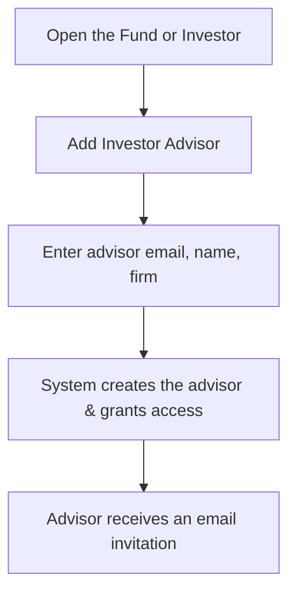

# Investor Advisor User Guide

An **Investor Advisor** is a trusted outside professional — from an advisory firm, family office, or wealth manager — who is given controlled access to part of your data so they can view or manage funds, deals, and KYC on behalf of their clients, without becoming a full member of your organisation.

This guide explains what an advisor is, how to set one up, and exactly what they can and cannot do. It's written for the team granting the access.

---

## Table of Contents

1. [What an Investor Advisor Is](#what-an-investor-advisor-is)
2. [How Advisor Access Works](#how-advisor-access-works)
3. [Setting Up an Advisor](#setting-up-an-advisor)
4. [What an Advisor Can Do](#what-an-advisor-can-do)
5. [What an Advisor Cannot Do](#what-an-advisor-cannot-do)
6. [Frequently Asked Questions](#frequently-asked-questions)

---

## What an Investor Advisor Is

When an investor uses an outside advisor to manage their relationship with your fund, you can grant that advisor permissioned access rather than sharing logins or sending data by email. The advisor keeps their own identity (tied to their advisory firm) but can **switch into your organisation's view** to see only the specific funds and investors you've shared with them.

Think of it as handing a guest a key card that opens just a few named rooms — and only while they're switched into your building.

---

## How Advisor Access Works

The advisor has two "hats" and switches between them:

- In their **home view**, they operate as a member of their own advisory firm.
- When they **switch** into your organisation, they temporarily take on a restricted role (by default, an investor-level view) and can see only what you've explicitly granted.
- When they **switch back**, their normal identity and permissions return.

Access is always **explicit**: an advisor sees a fund or investor only if you've specifically shared that item with them. Nothing is visible by default.

---

## Setting Up an Advisor

### Before you start

- You need to be a **Company Admin** (or hold equivalent permission) in the organisation adding the advisor.
- You'll need the advisor's email address.

### Steps

1. Go to the **Fund** or **Investor** you want to share, and open its **Team / Access** section.
2. Click **Add Investor Advisor**.
3. Provide the advisor's **email**, **first and last name**, and **advisory firm name**.
4. On save, the system creates the advisor's account (if they're new), links them to your organisation, and grants access to that specific fund and investor.
5. The advisor receives an email letting them know they've been added.

You can repeat this on other funds or investors to widen what a given advisor can see.

---

## What an Advisor Can Do

Once switched into your organisation's view, an advisor can — for the funds and investors you've shared:

- **View permissioned funds** — dashboards, reports, and documents.
- **Manage KYC** — view, and where permitted, update KYC details for their clients.
- **Track investments** — follow commitments, capital calls, and distributions for their clients.
- **Receive notifications** — get alerts about KYC updates and fund activity relevant to their clients.

---

## What an Advisor Cannot Do

To protect your data and keep clients separate, an advisor **cannot**:

- **See anything not shared with them** — funds, investors, or deals you haven't explicitly granted are invisible.
- **Change your settings** — they can't manage your organisation's configuration, adjust employee permissions, or add other advisors.
- **Act as an administrator** — they operate as a restricted investor/employee within your view, not as a Company Admin.
- **See across their other clients** — while switched into your organisation, they can't see data belonging to any other client they advise.

---

## Frequently Asked Questions

**Can one advisor work with several of my funds?**
Yes. Add them on each fund or investor you want to share; their access expands to exactly those items.

**Does the advisor need a separate login for each client?**
No. They keep one identity and switch personas to move between their own firm and each client organisation that has granted them access.

**Can an advisor see my other investors?**
No — only the specific investors and funds explicitly shared with them.

**How do I revoke access?**
Remove the advisor's access from the fund or investor you previously shared. Once their grants are removed, they can no longer see that data.

**What happens when the advisor switches back to their own firm?**
Their normal identity and permissions are restored, and your organisation's data is no longer visible to them.
