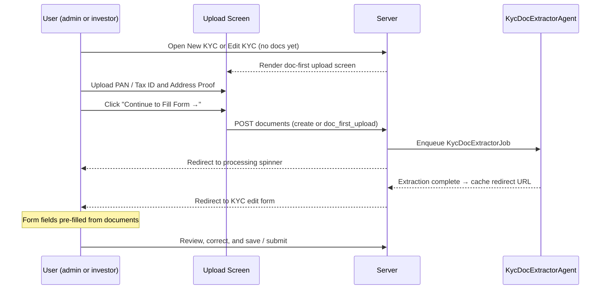
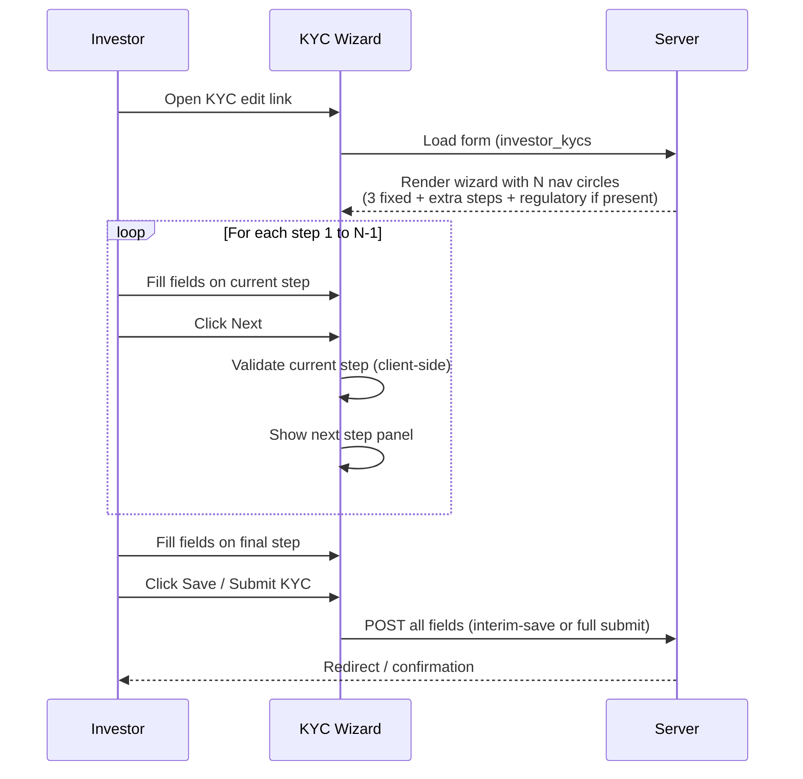

# Investor KYC User Guide

This guide covers the full lifecycle of Know Your Customer (KYC) records in CapHive — from creation through verification — for both individual and non-individual investors. It also covers jurisdiction-specific form types, PAN and bank verification, CKYC/KRA integration, and document management.

---

## Table of Contents

1. [What is Investor KYC?](#what-is-investor-kyc)
2. [KYC Types: Individual vs Non-Individual](#kyc-types-individual-vs-non-individual)
3. [KYC Lifecycle](#kyc-lifecycle)
4. [Creating a KYC Record](#creating-a-kyc-record)
5. [Document-First KYC Wizard](#document-first-kyc-wizard)
6. [Core Fields](#core-fields)
7. [Custom Fields and Form Types](#custom-fields-and-form-types)
8. [Dynamic Wizard Steps (Steps 4–9)](#dynamic-wizard-steps-steps-49)
9. [Managing Form Types: Tabbed View and Inline Edit](#managing-form-types-tabbed-view-and-inline-edit)
10. [Jurisdiction-Specific Forms: Tags (SEBI, GIFT, Default)](#jurisdiction-specific-forms-tags-sebi-gift-default)
11. [Sending the KYC Form to the Investor](#sending-the-kyc-form-to-the-investor)
12. [Investor Self-Completion](#investor-self-completion)
13. [PAN Verification](#pan-verification)
14. [Bank Account Verification](#bank-account-verification)
15. [CKYC Integration](#ckyc-integration)
16. [KRA Integration](#kra-integration)
17. [Assigning KYC Data from CKYC or KRA](#assigning-kyc-data-from-ckyc-or-kra)
18. [SEBI Investor Category and Sub-Category](#sebi-investor-category-and-sub-category)
19. [Document Requirements and Upload](#document-requirements-and-upload)
20. [Admin Verification](#admin-verification)
21. [KYC Expiry](#kyc-expiry)
22. [AML Reports](#aml-reports)
23. [Notifications](#notifications)
24. [Filtering and Finding KYC Records](#filtering-and-finding-kyc-records)
25. [Importing KYC Records](#importing-kyc-records)
26. [Frequently Asked Questions](#frequently-asked-questions)

---

## What is Investor KYC?

KYC (Know Your Customer) records store the identity, address, financial, and regulatory information required for each investor before they can participate in a fund. CapHive manages the full workflow: sending forms to investors, receiving completed data, running automated identity checks (PAN, bank, CKYC, KRA), tracking document uploads, and recording verification sign-off by your compliance team.

A KYC record is linked to an investor (folio) and is separate from the investor's contact details stored elsewhere in the system.

---

## KYC Types: Individual vs Non-Individual

CapHive supports two distinct KYC types that determine which fields, documents, and custom field forms apply.

| Type | When to use | Examples |
|---|---|---|
| **Individual** | A natural person investing in their own name | Retail investor, HNI, employee |
| **Non-Individual** | A legal entity or organisation | Company, LLP, trust, family office, HUF, partnership |

The type is set when the KYC record is created and **cannot be changed** afterwards. The underlying data model stores Individual KYC and Non-Individual KYC as separate record types, so the field sets, document checklists, and form configurations are kept entirely distinct.

---

## KYC Lifecycle

A KYC record moves through the following stages:

```
Created
  → Form sent to investor (optional)
  → Investor fills form (interim saves allowed without full validation)
  → Investor submits form (full validation enforced)
  → Admin reviews documents and data
  → CKYC / KRA fetch (optional enrichment)
  → Admin verifies KYC (marks Verified)
  → KYC active until Expiry Date (if set)
```

At any point the admin can request updates from the investor, which triggers a notification and resets the investor's form to editable.

---

## Creating a KYC Record

1. Navigate to the investor's (folio's) profile page.
2. Click the **KYC** tab.
3. Click **New KYC**.
4. Select the **KYC Type**: Individual or Non-Individual.
5. Select the **Form Type** (see [Custom Fields and Form Types](#custom-fields-and-form-types) below).
6. Fill in the core fields (or leave them for the investor to complete).
7. Click **Save**.

You can also create a KYC record via bulk import — see [Importing KYC Records](#importing-kyc-records).

---

## Document-First KYC Wizard

When the **Document-First KYC Wizard** is enabled for your organisation and a `KycDocExtractorAgent` is configured, the system shows a document upload screen **before** the regular KYC form whenever a KYC has no documents attached yet. An AI agent scans the uploaded documents and pre-fills the form fields automatically, reducing manual data entry.

This screen appears for both **fund admins** (on the New KYC and Edit KYC pages) and **investors** (via their magic-link edit page).

### What the wizard looks like

The upload screen shows three steps:

| Step | What happens |
|---|---|
| **Upload your documents** | You select files for the PAN / Tax ID field and Address Proof field |
| **Automatic Extraction** | CapHive sends the documents to the AI agent to extract field values |
| **Review and confirm** | You land on the pre-filled KYC edit form and review the extracted data |

### How to use it

1. Navigate to **New KYC** (or open an existing KYC that has no documents).
2. The upload screen appears automatically — you do not need to do anything special.
3. Upload a clear scan or photo for **PAN / Tax ID** and **Address Proof**.
4. Click **Continue to Fill Form →**.
5. CapHive processes the documents and redirects you to the KYC edit form with fields pre-filled from the extracted data.
6. Review and correct any extracted values, then save or submit as normal.

### Skipping the wizard

If you prefer to fill the form manually without uploading documents first, click **Fill Form Manually** at the bottom-left of the upload screen. You will go directly to the standard KYC edit form. You can still upload documents later from the Documents tab.

### When the wizard is shown vs. skipped

| Condition | Wizard shown? |
|---|---|
| `kyc_doc_first_wizard` flag enabled on entity | Required |
| `KycDocExtractorAgent` configured for entity | Required |
| KYC has no documents attached yet | Required — wizard is skipped once any document exists |
| KYC is already submitted or verified (locked) | No — locked KYCs go straight to the edit form |
| `skip_doc_first` URL parameter present | No — use this to bypass programmatically |

### Flow diagram



### Administrator setup

To enable the document-first wizard for your organisation:

1. Go to **Admin → Entity Settings** and enable **Document-First KYC Wizard**.
2. Go to **AI Agents** and ensure a `KycDocExtractorAgent` is created and enabled for your entity.
3. Configure the agent's **extraction rules** — one rule per document type (e.g. PAN Card → extract PAN number, Address Proof → extract address).

Contact your CapHive administrator if the wizard does not appear after enabling the flag.

---

## Core Fields

These fields apply to all KYC records regardless of type:

### Identity

| Field | Description |
|---|---|
| **Full Name** | Legal name as on identity documents |
| **Date of Birth** | Used for PAN verification and KRA lookup |
| **PAN** | Permanent Account Number (India); triggers automated verification |
| **KYC Type** | Individual or Non-Individual (set at creation, cannot be changed) |

### Address

| Field | Description |
|---|---|
| **Address** | Full registered address |

### Bank Details

| Field | Description |
|---|---|
| **Bank Name** | Name of the investor's bank |
| **Bank Branch** | Branch name or code |
| **Bank Account Type** | Savings, Current, NRE, NRO, etc. |
| **Bank Account Number** | Account number; triggers automated verification |
| **IFSC Code** | Indian bank IFSC code; triggers automated verification |

### Agreement Details

| Field | Description |
|---|---|
| **Agreement Committed Amount** | The commitment amount referenced in the KYC agreement |
| **Agreement Unit Type** | The unit class referenced in the agreement |

### Status and Control

| Field | Description |
|---|---|
| **Completed by Investor** | Checked when the investor has submitted the form |
| **Verified** | Checked by admin after review; records who verified and when |
| **Expiry Date** | Date after which the KYC is considered expired |
| **Send KYC Form to User** | Controls whether the investor can access the self-service form |
| **E-Sign Emails** | Additional email addresses to copy on e-signing notifications |
| **Docs Completed** | Auto-updated by the system when all required documents are uploaded |
| **AML Status** | Anti-money-laundering check status |

---

## Custom Fields and Form Types

Both Individual and Non-Individual KYC records support **custom fields** that extend the standard field set. Custom fields are grouped by **Form Type** — a named configuration that defines which extra fields appear on the KYC form.

### How form types work

1. Your administrator creates Form Types under **Settings → Form Types**, selecting KYC as the category and specifying whether the form applies to Individual or Non-Individual KYC.
2. Each Form Type can include any number of custom field definitions (text fields, dropdowns, date fields, file uploads, etc.).
3. When a KYC record is created, you select the Form Type for that record. The custom fields for that Form Type then appear on the form.
4. The investor sees and fills in those custom fields as part of their submission.

### Individual vs Non-Individual form types

Form Types are scoped to KYC type — an Individual Form Type will not appear on a Non-Individual KYC and vice versa. This allows you to have entirely different extended field sets for persons versus entities:

- **Individual examples:** Occupation, Income Range, Politically Exposed Person (PEP) status, source of funds declaration
- **Non-Individual examples:** Entity type, date of incorporation, registered address, authorised signatory details, beneficial ownership declarations, FATCA/CRS classification

---

## Dynamic Wizard Steps (Steps 4–9)

By default the KYC wizard has three fixed steps (KYC Details, Bank Details, Confirmation) plus an optional regulatory step. You can extend the wizard to up to **nine steps** by assigning custom fields to extra steps (4–9) in the Form Type configuration.

### How it works

Each `FormCustomField` has a **Step** attribute that controls where on the wizard it appears:

| Step value | Wizard position | Notes |
|---|---|---|
| Step 1 | Page 1 — KYC Details | Identity, PAN, date of birth |
| Step 2 | Page 2 — Bank Details | Bank account, IFSC, address |
| Step 3 (End) | Page 3 — Confirmation | Sign-off, comments, expiry |
| Step 4 | Page 4 (extra) | Only shown when fields are assigned |
| Step 5–9 | Pages 5–9 (extra) | Only shown when fields are assigned |

Extra steps appear **only when at least one custom field is assigned to that step**. If no fields are assigned to step 5, page 5 is not rendered and the investor never sees it. The wizard automatically adjusts the number of navigation circles to match the configured steps.

### Assigning a custom field to an extra step

1. Navigate to **Settings → Form Types** and open the InvestorKyc Form Type you want to configure.
2. Click **Edit**.
3. For each custom field you want on an extra step, change its **Step** dropdown to the target step (e.g. *Step 4 (Extra)*, *Step 5 (Extra)*, …).
4. Click **Save**.

The wizard will now display that many extra pages when an investor or admin opens the KYC edit form.

### Naming extra steps

By default extra steps are labelled *Step 4*, *Step 5*, etc. in the wizard card header. You can replace these with meaningful names:

1. Open the InvestorKyc Form Type for editing.
2. Find the **Extra Step Labels** section (appears below the Tag field).
3. Enter a label for each step you want to rename (e.g. *Beneficial Ownership*, *FATCA Declarations*).
4. Leave a field blank to keep the default *Step N* label.
5. Click **Save**.

The labels appear in the step card header when the investor fills in the form.

### Wizard navigation flow



---

## Managing Form Types: Tabbed View and Inline Edit

The **Form Type show page** (`/form_types/:id`) gives you two ways to review and maintain custom fields.

### Tabbed view

Click **Tabs by Step** at the top of the show page to switch from the flat table to a step-grouped tab view. Each tab shows only the fields assigned to that step, with a count badge. Click **Flat List** to return to the single table.

This is useful when a form type has many fields spread across multiple steps — you can quickly check what the investor will see on each page of the wizard.

### Inline edit of a single custom field

Every row in both views has an **Edit** button (pencil icon) in the Actions column. Clicking it opens the field's edit page pre-loaded with a *Cancel* link that returns you straight back to the Form Type show page — no need to navigate through the full Form Type edit form.

Use inline edit for quick changes to a single field's label, step assignment, required flag, or help text without disturbing the rest of the form type.

---

## Jurisdiction-Specific Forms: Tags (SEBI, GIFT, Default)

CapHive supports multiple regulatory environments through **form type tags**. A tag is a label applied to a Form Type that indicates which regulatory regime it belongs to.

Common tags:

| Tag | Purpose |
|---|---|
| **Default** | Standard KYC form with no special jurisdiction requirements |
| **SEBI** | Form with SEBI-mandated fields (investor category, sub-category, etc.) |
| **GIFT** | Form with GIFT City / IFSC-specific fields for GIFT-registered funds |

### How tags enable multiple KYC forms per investor type

The same investor type (Individual or Non-Individual) can have multiple Form Types distinguished only by their tag. For example:

- `IndividualKyc - Default` — used for domestic investors in non-SEBI funds
- `IndividualKyc - SEBI` — used for investors in SEBI-regulated AIFs; adds SEBI investor category and sub-category fields
- `IndividualKyc - GIFT` — used for investors in GIFT City funds; adds GIFT-specific declarations

This means the same individual investor might need a different form depending on which fund they are investing in. When creating the KYC record, select the Form Type that matches the regulatory context of the fund.

### Selecting the right form type

When creating a KYC record:

1. Look at the **fund's regulatory regime** (SEBI AIF, GIFT City, offshore, domestic non-regulated, etc.).
2. Select the Form Type with the matching tag for that regime.
3. The correct jurisdiction-specific custom fields will appear automatically.

### Switching form types

If a KYC record was created with the wrong Form Type tag, an administrator can change the Form Type on the record. Custom field data entered under the previous form type is not automatically migrated — the investor may need to re-fill jurisdiction-specific fields.

---

## Sending the KYC Form to the Investor

Once a KYC record is created, you can send the investor a link to fill in their own information online — no CapHive account required.

1. Open the KYC record.
2. Click **Send KYC Form**.
3. CapHive sends an email to the investor's registered email address with a secure, one-time-use link.
4. The **Send KYC Form to User** flag is set to true, enabling investor access.

> **Tip:** You can also enable sending automatically at the time of KYC creation by checking the relevant option in the creation form.

### E-Sign emails

If e-signing is required for the KYC form, you can add additional email addresses in the **E-Sign Emails** field. These addresses will be included in signing notifications alongside the investor's primary email.

---

## Investor Self-Completion

When an investor clicks their link, they see a form with all the standard and custom fields for their KYC type and Form Type.

### Interim saves

The investor can save their progress at any point without completing all required fields. This is useful for long forms that the investor completes over multiple sessions. Interim saves do **not** trigger validation — partially complete records are allowed.

### Final submission

When the investor clicks **Submit**, full validation is enforced:
- All required fields must be filled.
- PAN format is checked.
- Bank fields are checked for completeness.

After submission, the **Completed by Investor** flag is set to true and your team is notified.

---

## PAN Verification

CapHive automatically verifies PAN details against the government database using the Digio API.

### When it triggers

PAN verification runs automatically in the background whenever any of these fields change on a KYC record:

- PAN number
- Full Name
- Date of Birth

### What is checked

| Check | Details |
|---|---|
| **PAN number match** | Confirms the PAN number exists and is valid |
| **Name match** | Compares the name on the KYC with the name registered against the PAN |
| **Date of birth match** | Compares the date of birth on the KYC with the DOB registered against the PAN |

### Verification result fields

| Field | What it shows |
|---|---|
| **PAN Verification Status** | Pass / Fail / Pending / Not verified |
| **PAN Verification Response** | Full response from the Digio API (stored for audit) |

> **Note:** PAN verification only runs if your organisation has PAN verification enabled. Contact your administrator if the verification does not appear to be running.

### Interpreting results

- **Pass:** PAN, name, and DOB all matched. No action required.
- **Fail (name mismatch):** The investor's name on file does not match the PAN database. Ask the investor to check the name spelling.
- **Fail (DOB mismatch):** Date of birth does not match the PAN database. Confirm the investor's actual date of birth.
- **Fail (PAN not found):** The PAN number does not exist in the database. Confirm the number with the investor.

---

## Bank Account Verification

CapHive verifies the investor's bank account details using the Digio API (penny-drop method or name lookup, depending on configuration).

### When it triggers

Bank verification runs automatically in the background whenever any of these fields change:

- Bank Account Number
- IFSC Code
- Full Name

### What is checked

| Check | Details |
|---|---|
| **Beneficiary name at bank** | Confirms the name registered at the bank matches the investor's full name on the KYC |

### Verification result fields

| Field | What it shows |
|---|---|
| **Bank Verification Status** | Pass / Fail / Pending / Not verified |
| **Bank Verification Response** | Full response from the Digio API (stored for audit) |

> **Note:** Bank verification only runs if your organisation has bank verification enabled.

### Interpreting results

- **Pass:** The beneficiary name at the bank matches. The account details are confirmed.
- **Fail:** The name at the bank does not match the name on the KYC. Ask the investor to confirm whether the bank account is in their legal name, a joint name, or a company name.

---

## CKYC Integration

CKYC (Central KYC Registry) is India's central repository of KYC records maintained by CERSAI. CapHive can search CKYC and download a verified KYC record directly from the registry using the investor's PAN, which reduces manual data entry and ensures compliance.

### CKYC flow

CKYC lookup requires a three-step process with OTP verification:

**Step 1: Search CKYC**

1. Open the KYC record.
2. Click **Search CKYC**.
3. CapHive submits the investor's PAN to CKYC.
4. If a record is found, CKYC sends an OTP to the investor's mobile number registered in the registry.

**Step 2: Enter OTP**

1. Ask the investor for the OTP they received on their mobile.
2. Enter the OTP in the **CKYC OTP** field on the KYC record.
3. Click **Submit OTP**.

> **OTP rules:**
> - You have a maximum of **3 OTP attempts** per CKYC session.
> - You must wait at least **90 seconds** between resend requests.
> - If all 3 attempts are exhausted, you need to start a new CKYC search.

**Step 3: Download and review**

1. After successful OTP verification, CapHive downloads the CKYC record.
2. The downloaded data is stored in a **KYC Data** record linked to this KYC.
3. Review the downloaded data on the **Compare KYC Data** screen — CapHive shows the CKYC values side-by-side with the values currently on the KYC record.
4. Click **Assign KYC Data** to copy the CKYC values into the KYC record (see [Assigning KYC Data](#assigning-kyc-data-from-ckyc-or-kra)).

### Resending the OTP

If the investor did not receive the OTP or the OTP expired:

1. Click **Resend OTP**.
2. A new OTP is sent — subject to the 90-second cooldown.
3. The resend counter increments. After 3 resends, no further OTPs can be sent for this session.

---

## KRA Integration

KRA (KYC Registration Agency) is an alternate SEBI-recognised KYC registry. CapHive supports direct lookup via KRA using PAN and Date of Birth — **no OTP is required**.

### KRA flow

1. Open the KYC record.
2. Click **Fetch KRA Data**.
3. CapHive submits the investor's PAN and date of birth to the KRA.
4. If found, the response is downloaded and stored as a **KYC Data** record with source = KRA.
5. Review the fetched data via **Compare KYC Data** and assign it to the KYC record as needed.

### CKYC vs KRA comparison

| Feature | CKYC | KRA |
|---|---|---|
| Registry | CERSAI Central KYC | SEBI KRA (CAMS, Karvy, etc.) |
| OTP required | Yes — sent to investor's mobile | No — direct fetch |
| Inputs required | PAN | PAN + Date of Birth |
| Attempt limits | 3 OTP attempts, 90s cooldown | No limit |
| Best for | Comprehensive individual KYC with OTP | Quick lookups where investor is not available for OTP |

---

## Assigning KYC Data from CKYC or KRA

After downloading CKYC or KRA data, you can review and selectively apply it to the KYC record.

1. Open the KYC record.
2. Click **Compare KYC Data** (or navigate to the KYC Data tab).
3. CapHive shows the external data fields (name, address, PAN, email, date of birth) alongside the current KYC record values.
4. Click **Assign KYC Data** to apply the downloaded data to the KYC record.
5. Review the updated KYC record and save.

> The downloaded data is stored permanently in the KYC Data record for audit purposes, even after it is assigned. You can compare multiple KYC Data records (from different fetches or different sources) against the current KYC.

---

## SEBI Investor Category and Sub-Category

For KYC records created with a SEBI-tagged form type, CapHive captures the SEBI-mandated investor classification.

### Categories

| Category | Description |
|---|---|
| **Internal** | Internal/affiliated investors (GP, employees, etc.) |
| **Domestic** | Indian resident investors |
| **Foreign** | Foreign investors (FPI, FDI, etc.) |
| **Other** | Other categories not fitting the above |

### Sub-categories

Sub-categories are hierarchically validated — the permitted sub-categories depend on the selected category. Examples:

**Domestic sub-categories include:**
- Resident Individual
- HUF
- Private Company
- Public Company
- LLP / Partnership
- Trust
- Bank / FI
- Insurance Company
- Pension Fund
- Mutual Fund
- AIF
- Government / Statutory Body

**Foreign sub-categories include:**
- NRI (Repatriable)
- NRI (Non-Repatriable)
- FPI Category I
- FPI Category II
- FVCI

> If you select a sub-category that is not valid for the chosen category, CapHive will show a validation error and prevent saving.

SEBI category data can also be stored in a separate **SEBI Data** record linked to the KYC. This allows SEBI classification to be updated independently of the main KYC fields.

---

## Document Requirements and Upload

Each KYC type has a configurable document checklist that your administrator sets up under **Entity Settings**.

### Individual KYC documents (typical)

- PAN card copy
- Address proof (Aadhaar, passport, utility bill, etc.)
- Photograph
- Bank statement or cancelled cheque
- Signature specimen

### Non-Individual KYC documents (typical)

- Certificate of Incorporation / Registration
- MOA / AOA or Trust Deed / Partnership Deed
- Board resolution authorising investment
- Beneficial Ownership Declaration (UBO form)
- PAN card of entity
- Address proof of registered office
- KYC of authorised signatories
- Bank account proof

### How the system tracks document completeness

CapHive maintains a **Docs Completed** flag on each KYC record. This flag is automatically set to true when all documents in the required checklist have been uploaded to the KYC folder. You do not need to manually update this field.

To view the document checklist and upload status:

1. Open the KYC record.
2. Click the **Documents** tab.
3. The checklist shows each required document with its upload status.
4. Upload documents directly from this view.

> The investor sees a version of the same checklist when filling in their form online, allowing them to upload documents as part of self-completion.

### Generating KYC documents

CapHive can auto-generate KYC form documents from templates for e-signing:

1. Open the KYC record.
2. Click **Generate Docs**.
3. CapHive creates document records from the configured template(s).
4. These documents can then be sent for e-signing using the standard e-signing workflow.

---

## Admin Verification

After the investor has submitted their KYC and all documents are in order, a compliance team member must verify the record.

1. Open the KYC record.
2. Review all fields and documents.
3. Click **Verify KYC** (or toggle the **Verified** checkbox).
4. CapHive records:
   - **Verified** = true
   - **Verified By** = the current user
   - **Verified At** = current timestamp

Once verified, the KYC is considered compliant and active.

### Requesting updates from the investor

If something needs to be corrected:

1. Click **Request Updates**.
2. Enter a message explaining what needs to be corrected.
3. CapHive sends a notification to the investor with your message and re-enables their form for editing.
4. The **Completed by Investor** flag is reset.

---

## KYC Expiry

KYC records can be set to expire after a defined period (common in SEBI regulations where KYC must be refreshed every 2–3 years).

- Set the **Expiry Date** on the KYC record.
- CapHive tracks expired KYC records in the **Expired** filter on the KYC list page.
- When a KYC expires, the investor can be sent a new form to re-complete their KYC.

> Expired KYC records are not deleted — they remain for audit purposes. A new KYC record should be created for the renewal rather than editing the expired one.

---

## AML Reports

CapHive can automatically generate Anti-Money Laundering (AML) check reports when AML integration is enabled for your organisation.

- AML checks are triggered automatically when the investor's **Full Name** is saved and AML is enabled.
- The **AML Status** field on the KYC record reflects the result.
- The AML report is attached to the KYC record's document folder.

Contact your administrator if AML checking is not running for your organisation.

---

## Notifications

CapHive sends automated email notifications at key points in the KYC lifecycle:

| Notification | Recipient | Triggered when |
|---|---|---|
| **KYC Required** | Investor | KYC form is sent to the investor for the first time |
| **KYC Reminder** | Investor | Sent as a follow-up if the investor has not completed the form |
| **KYC Updated** | Fund employees / admins | Investor submits or updates their KYC form |
| **Updates Requested** | Investor | Admin clicks "Request Updates" and sends a correction request |

---

## Filtering and Finding KYC Records

### From the main KYC list

Navigate to **KYC** in the main menu to see all KYC records your role permits you to view.

### Quick filter tabs

| Filter | Shows |
|---|---|
| **All** | Every KYC record |
| **Unverified** | KYC records not yet verified by an admin |
| **Uncalled** | KYC records where the investor has a commitment but no capital call has been issued |
| **Agreement Uncalled** | KYC records where the agreement committed amount exceeds the total called amount |
| **Agreement Overcalled** | KYC records where more has been called than the agreement committed amount |

### Search and sort

Use the search bar at the top of the KYC list to search by:
- Investor name
- PAN number
- Email address
- Fund name

Click any column header to sort. Use the filter panel on the left to filter by:
- KYC type (Individual / Non-Individual)
- Verified status
- Docs completed
- Fund
- Form type / tag

---

## Importing KYC Records

You can bulk-import KYC records from a spreadsheet.

### Standard import columns

| Column | Description |
|---|---|
| **Investor Name** | Must match an existing investor/folio in CapHive |
| **KYC Type** | `individual` or `non_individual` |
| **Full Name** | Legal name |
| **Date of Birth** | DD/MM/YYYY format |
| **PAN** | PAN number |
| **Address** | Full address |
| **Bank Name** | Bank name |
| **Bank Branch** | Branch name |
| **Bank Account Type** | Account type |
| **Bank Account Number** | Account number |
| **IFSC Code** | Bank IFSC code |
| **Form Tag** | Tag to select the form type: `Default`, `SEBI`, `GIFT`, or a custom tag |

Plus any custom field columns defined for the selected form type.

### Using the Form Tag column

The **Form Tag** column is the key to loading jurisdiction-specific custom fields during import. The import engine looks up the Form Type using both the KYC type and the tag together:

- `individual` + `SEBI` tag → loads the Individual SEBI Form Type's custom fields
- `non_individual` + `GIFT` tag → loads the Non-Individual GIFT Form Type's custom fields
- `individual` + `Default` tag → loads the Individual Default Form Type

If the Form Tag column is blank, the system uses the Default tag.

### Running the import

1. Navigate to **KYC → Import**.
2. Download the sample template for the relevant KYC type.
3. Fill in your data (including the Form Tag column and any custom field columns for that tag's form type).
4. Upload the completed file.
5. CapHive validates and previews the rows before committing.
6. Review any errors and fix your spreadsheet if needed, then re-upload.

---

## Frequently Asked Questions

**Can I change a KYC record from Individual to Non-Individual?**
No. The KYC type is fixed at creation. If the wrong type was selected, you need to create a new KYC record with the correct type.

**Can the same investor have multiple KYC records?**
Yes — for example, one SEBI-tagged KYC for an AIF investment and one Default-tagged KYC for a different fund. Each KYC record is independent with its own form, documents, and verification status.

**PAN verification is showing Fail but the investor says their PAN is correct. What do I do?**
Check whether the name on the KYC exactly matches the name on the PAN card (including spacing, initials, and legal name vs. common name). A middle name or abbreviation difference can cause a name mismatch. If the DOB is the issue, confirm the investor's exact date of birth as registered with the income tax authority.

**The CKYC OTP timed out and I have no more attempts. What do I do?**
Start a new CKYC search by clicking **Search CKYC** again. This creates a new session with a fresh OTP attempt counter. Alternatively, use the KRA flow if OTP is not feasible.

**Bank verification is failing but the account details look correct.**
The bank verification checks the name at the bank. If the account is a joint account or a company account, the beneficiary name at the bank may not match the investor's name. In this case, document the discrepancy and verify manually.

**The investor says they did not receive the KYC form email.**
Ask them to check spam/junk folders. The email comes from the CapHive notification address, not the fund manager's email. If they still cannot find it, click **Send KYC Form** again on the KYC record to resend.

**What is the difference between CKYC and KRA?**
Both are central registries, but CKYC (CERSAI) requires an OTP sent to the investor's registered mobile, while KRA (SEBI-registered KYC agencies like CAMS KRA) allows direct lookup using PAN and date of birth with no OTP. KRA is faster but may not have records for all investors.

**Can I import SEBI custom fields using the import?**
Yes. Include the SEBI custom field columns in your spreadsheet alongside the standard columns, and set the **Form Tag** column to `SEBI`. The import engine will apply those values to the SEBI-tagged form type's custom fields.

**Where is the AML report stored?**
AML reports are auto-attached to the KYC record's document folder. Open the KYC record and navigate to the Documents tab to find the report.

**How do I renew an expired KYC?**
Create a new KYC record for the same investor with the updated information. The old expired record is retained for audit purposes. You can reference the previous KYC data when filling in the new one.

**How do I add more pages to the KYC wizard?**
Assign custom fields to steps 4–9 in the Form Type configuration. The wizard automatically adds a navigation circle and page for each step that has at least one field. See [Dynamic Wizard Steps](#dynamic-wizard-steps-steps-49) for the full walk-through.

**Can I give the extra wizard steps meaningful names instead of "Step 4", "Step 5", etc.?**
Yes. Open the InvestorKyc Form Type for editing and fill in the **Extra Step Labels** section. Enter a label for each numbered step you want to rename. Blank entries fall back to the default *Step N* label.

**I assigned a field to Step 5 but the wizard only shows 4 pages.**
Check that the step was saved correctly by opening the Form Type show page and switching to the **Tabs by Step** view. If the field does not appear under the Step 5 tab, re-edit the field and confirm the Step dropdown is set to *Step 5 (Extra)*.

**The document-first upload screen is not appearing even though the flag is enabled.**
Two conditions must both be true: (1) the `kyc_doc_first_wizard` flag is enabled in Entity Settings, and (2) a `KycDocExtractorAgent` must be created and enabled under AI Agents for your entity. If either is missing, the system falls back to the standard form. Also check that the KYC you are opening has no documents already attached — once any document exists on a KYC the upload screen is skipped.

**I see the upload screen on an existing KYC but I already uploaded documents last time.**
The upload screen only appears when the KYC has zero documents. If documents from a previous session are still attached, go directly to the edit form. You can trigger a fresh extraction via the AI Agents panel if needed.

**Can I skip the document-first screen and go straight to the form?**
Yes. Click **Fill Form Manually** at the bottom-left of the upload screen. This adds `skip_doc_first=true` to the URL and takes you directly to the standard KYC wizard. You can still upload documents later from the Documents tab on the KYC record.

**The form fields were not pre-filled after I uploaded documents.**
This usually means the extraction rules on the `KycDocExtractorAgent` do not match the document names or field names. Ask your administrator to check the agent's extraction rules — the `doc_label` in each rule must exactly match the document name as it is saved (e.g. `Upload PAN / Tax ID`), and the `target_field` must match the KYC field name.
