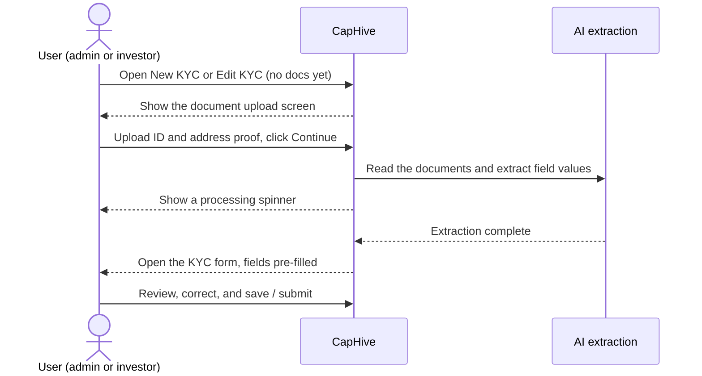
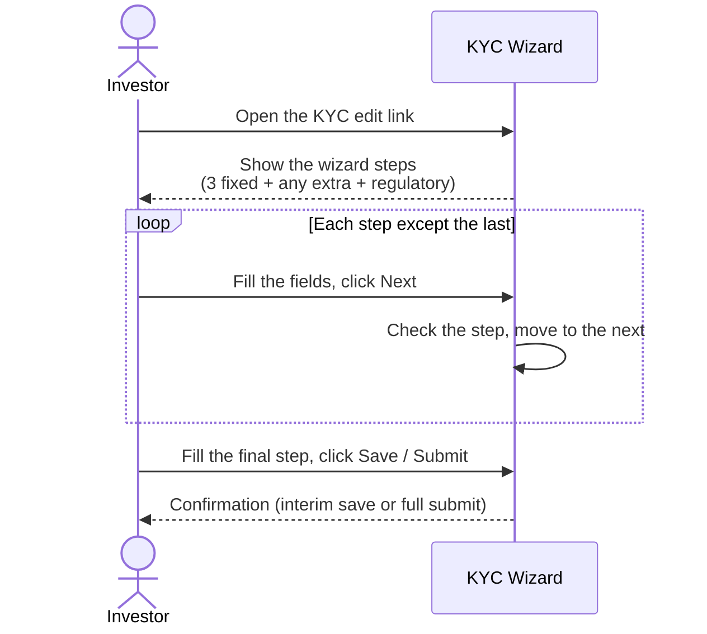

# Investor KYC User Guide

This guide covers the full lifecycle of Know Your Customer (KYC) records in CapHive — from creation through verification — for both individual and non-individual investors. It also covers jurisdiction-specific form types, PAN and bank verification, CKYC/KRA integration, and document management.

> **Where to find it:** Sidebar → [**Funds → KYCs**](/investor_kycs) lists all KYC records; for one investor, open Sidebar → [**Stakeholders → View Stakeholders**](/investors) → the stakeholder → **KYC** tab. Create one with **New KYC** (Individual or Non Individual), or **New KYC → Send KYC to Stakeholder** on the stakeholder tab. Needs the *KYCs* feature on your user plus the *KYC Create/Update/Approve* permissions (or company admin).

---

## Table of Contents

1. [What is Investor KYC?](#what-is-investor-kyc)
2. [KYC Types: Individual vs Non-Individual](#kyc-types-individual-vs-non-individual)
3. [KYC Lifecycle](#kyc-lifecycle)
4. [Creating a KYC Record](#creating-a-kyc-record)
5. [Document-First KYC Wizard](#document-first-kyc-wizard)
6. [Core Fields](#core-fields)
7. [Custom Fields and Form Types](#custom-fields-and-form-types)
8. [Dynamic Wizard Steps (Steps 4–9)](#dynamic-wizard-steps-steps-49)
9. [Managing Form Types: Tabbed View and Inline Edit](#managing-form-types-tabbed-view-and-inline-edit)
10. [Jurisdiction-Specific Forms: Tags (SEBI, GIFT, Default)](#jurisdiction-specific-forms-tags-sebi-gift-default)
11. [Sending the KYC Form to the Investor](#sending-the-kyc-form-to-the-investor)
12. [Investor Self-Completion](#investor-self-completion)
13. [PAN Verification](#pan-verification)
14. [Bank Account Verification](#bank-account-verification)
15. [CKYC Integration](#ckyc-integration)
16. [KRA Integration](#kra-integration)
17. [Assigning KYC Data from CKYC or KRA](#assigning-kyc-data-from-ckyc-or-kra)
18. [SEBI Investor Category and Sub-Category](#sebi-investor-category-and-sub-category)
19. [Document Requirements and Upload](#document-requirements-and-upload)
20. [Admin Verification](#admin-verification)
21. [KYC Expiry](#kyc-expiry)
22. [AML Reports](#aml-reports)
23. [Notifications](#notifications)
24. [Filtering and Finding KYC Records](#filtering-and-finding-kyc-records)
25. [Importing KYC Records](#importing-kyc-records)
26. [Worked Example](#worked-example)
27. [Frequently Asked Questions](#frequently-asked-questions)
28. [Related Guides](#related-guides)

---

## What is Investor KYC?

KYC (Know Your Customer) records store the identity, address, financial, and regulatory information required for each investor before they can participate in a fund. CapHive manages the full workflow: sending forms to investors, receiving completed data, running automated identity checks (PAN, bank, CKYC, KRA), tracking document uploads, and recording verification sign-off by your compliance team.

A KYC record is linked to an investor (folio) and is separate from the investor's contact details stored elsewhere in the system.

---

## KYC Types: Individual vs Non-Individual

CapHive supports two distinct KYC types that determine which fields, documents, and custom field forms apply.

| Type | When to use | Examples |
|---|---|---|
| **Individual** | A natural person investing in their own name | Retail investor, HNI, employee |
| **Non-Individual** | A legal entity or organisation | Company, LLP, trust, family office, HUF, partnership |

The type is set when the KYC record is created and **cannot be changed** afterwards. The underlying data model stores Individual KYC and Non-Individual KYC as separate record types, so the field sets, document checklists, and form configurations are kept entirely distinct.

---

## KYC Lifecycle

A KYC record moves through the following stages:

```
Created
  → Form sent to investor (optional)
  → Investor fills form (interim saves allowed without full validation)
  → Investor submits form (full validation enforced)
  → Admin reviews documents and data
  → CKYC / KRA fetch (optional enrichment)
  → Admin verifies KYC (marks Verified)
  → KYC active until Expiry Date (if set)
```

Until the KYC is verified, the admin can request updates from the investor, which emails a fresh link and resets the status to **Link Sent** so the investor can edit again.

---

## Creating a KYC Record

1. Open the stakeholder from Sidebar → **Stakeholders → View Stakeholders** (or go to Sidebar → **Funds → KYCs**).
2. Click the **KYC** tab.
3. Click the **New KYC** dropdown.
4. Choose **Individual** or **Non Individual**. If your entity has several KYC form types, each is listed with its tag, for example **Individual (SEBI)** — picking one selects both the KYC type and the Form Type (see [Custom Fields and Form Types](#custom-fields-and-form-types) below).
5. Fill in the core fields (or leave them for the investor to complete).
6. Click **Save**.

To create a blank Individual KYC and email it to the stakeholder in one step, use **New KYC → Send KYC to Stakeholder** on the stakeholder's **KYC** tab.

You can also create a KYC record via bulk import — see [Importing KYC Records](#importing-kyc-records).

### The New KYC dropdown

On Sidebar → [**Funds → KYCs**](/investor_kycs) and on a stakeholder's **KYC** tab, **New KYC** (shown to employees who can create KYCs) offers:

| Item | What it does |
|---|---|
| **Individual** / **Non Individual** | Opens a new KYC of that type. With several KYC form types, one item per form type with its tag, for example **Individual (SEBI)** |
| **Send KYC to Stakeholder** | Stakeholder's **KYC** tab only: creates a blank Individual KYC and emails it to the stakeholder |
| **Report** | Opens the KYC list with the **Filter** panel, to build your own filtered view |
| **View All Custom Notifications** | Lists your company's KYC email templates (custom KYC notifications) |
| **Custom KYC Notification** | Creates a company-wide template for the KYC emails (KYC required, reminder, updates requested, updated, submitted) |
| **Custom Agreement Notification** | Creates a company-wide template for emailing a document with **Send Document** or **Email Using Template:** |
| **Send Status: Not Sent** … **Send Status: Verified** | Filters the list by submission status (Not Sent, Link Sent, Draft Saved, Completed, Verified) |
| **Onboarding Agent: Completed** / **Onboarding Agent: Failed** | Shown when the KYC Onboarding Agent is enabled: filters to KYCs whose onboarding agent report is **Completed** or **Failed** |

Creating and saving the two notification templates needs the Company Admin role; see [Custom Notifications](custom_notifications_user_guide).

---

## Document-First KYC Wizard

When the **Document-First KYC Wizard** is enabled for your organisation, the system shows a document upload screen **before** the regular KYC form whenever a KYC has no documents attached yet. AI scans the uploaded documents and pre-fills the form fields automatically, reducing manual data entry.

This screen appears for both **fund admins** (on the New KYC and Edit KYC pages) and **investors** (via their magic-link edit page).

### What the wizard looks like

The upload screen shows three steps:

| Step | What happens |
|---|---|
| **Upload your documents** | You select files for the PAN / Tax ID field and Address Proof field |
| **Automatic Extraction** | CapHive sends the documents to the AI agent to extract field values |
| **Review and confirm** | You land on the pre-filled KYC edit form and review the extracted data |

### How to use it

1. Navigate to **New KYC** (or open an existing KYC that has no documents).
2. The upload screen appears automatically — you do not need to do anything special.
3. Upload a clear scan or photo for **PAN / Tax ID** and **Address Proof**.
4. Click **Continue to Fill Form →**.
5. CapHive processes the documents and redirects you to the KYC edit form with fields pre-filled from the extracted data.
6. Review and correct any extracted values, then save or submit as normal.

### Skipping the wizard

If you prefer to fill the form manually without uploading documents first, click **Fill Form Manually** at the bottom-left of the upload screen. You will go directly to the standard KYC edit form. You can still upload documents later from the Documents tab.

### When the wizard is shown vs. skipped

| Condition | Wizard shown? |
|---|---|
| Document-First Wizard enabled for the entity | Required |
| AI document extraction configured for the entity | Required |
| KYC has no documents attached yet | Required — the wizard is skipped once any document exists |
| KYC is already submitted or verified (locked) | No — locked KYCs go straight to the edit form |
| You chose to fill the form manually | No — see [Skipping the wizard](#skipping-the-wizard) |

### Flow diagram



### Administrator setup

To enable the document-first wizard for your organisation:

1. A company admin opens Company menu (the **house icon** at the top right) → **Company Profile** → **Edit** and ticks **Enable Document-First KYC Wizard** (shown when KYC is enabled).
2. Under **AI Agents**, ensure the KYC document-extraction agent is created and enabled for your entity.
3. Configure its **extraction rules** — one per document type (e.g. ID document → extract the tax ID, Address Proof → extract the address). Each rule matches a document to the KYC field it should fill.

Contact your CapHive administrator if the wizard does not appear after enabling it.

---

## Core Fields

These fields apply to all KYC records regardless of type:

### Identity

| Field | Description |
|---|---|
| **Full Name** | Legal name as on identity documents |
| **Date of Birth** | Used for PAN verification and KRA lookup |
| **PAN** | Permanent Account Number (India); triggers automated verification |
| **KYC Type** | Individual or Non-Individual (set at creation, cannot be changed) |

### Address

| Field | Description |
|---|---|
| **Address** | Full registered address |

### Bank Details

| Field | Description |
|---|---|
| **Bank Name** | Name of the investor's bank |
| **Bank Branch** | Branch name or code |
| **Bank Account Type** | Savings, Current, NRE, NRO, etc. |
| **Bank Account Number** | Account number; triggers automated verification |
| **IFSC Code** | Indian bank IFSC code; triggers automated verification |

### Agreement Details

| Field | Description |
|---|---|
| **Agreement Committed Amount** | The commitment amount referenced in the KYC agreement |
| **Agreement Unit Type** | The unit class referenced in the agreement |

### Status and Control

| Field | Description |
|---|---|
| **Completed by Investor** | Set when the investor clicks **Submit KYC** (status **Completed**) |
| **Verified** | Set by the **Verify** button after review; records who verified it |
| **Expiry Date** | Date after which the KYC is considered expired |
| **Send KYC Form to User** | Import-only trigger (**Send Kyc Form To User** column) that emails the form; it is reset after sending and the matching checkbox is not shown on the form |
| **Investor Signatory Emails** | Comma-separated emails of the people who sign documents generated for this KYC (templates in the **KYC Templates** folder with an **Investor Signatories** signature row). Copied into a commitment's own field only when the commitment is created. Shown to your company's users only, in step **3. KYC Details** |
| **Docs Completed** | Auto-updated by the system when all required documents are uploaded |
| **AML Status** | Anti-money-laundering check status |

---

## Custom Fields and Form Types

Both Individual and Non-Individual KYC records support **custom fields** that extend the standard field set. Custom fields are grouped by **Form Type** — a named configuration that defines which extra fields appear on the KYC form.

### How form types work

1. Your administrator creates Form Types under Company menu → [**Customize Forms**](/form_types), choosing `IndividualKyc` or `NonIndividualKyc` as the Form Name.
2. Each Form Type can include any number of custom field definitions (text fields, dropdowns, date fields, file uploads, etc.).
3. When a KYC record is created, you select the Form Type for that record. The custom fields for that Form Type then appear on the form.
4. The investor sees and fills in those custom fields as part of their submission.

### Individual vs Non-Individual form types

Form Types are scoped to KYC type — an Individual Form Type will not appear on a Non-Individual KYC and vice versa. This allows you to have entirely different extended field sets for persons versus entities:

- **Individual examples:** Occupation, Income Range, Politically Exposed Person (PEP) status, source of funds declaration
- **Non-Individual examples:** Entity type, date of incorporation, registered address, authorised signatory details, beneficial ownership declarations, FATCA/CRS classification

---

## Dynamic Wizard Steps (Steps 4–9)

By default the KYC wizard has three fixed steps (KYC Details, Bank Details, Confirmation) plus an optional regulatory step. You can extend the wizard to up to **nine steps** by assigning custom fields to extra steps (4–9) in the Form Type configuration.

### How it works

Each custom field has a **Step** setting that controls where on the wizard it appears:

| Step value | Wizard position | Notes |
|---|---|---|
| Step 1 | Page 1 — KYC Details | Identity, PAN, date of birth |
| Step 2 | Page 2 — Bank Details | Bank account, IFSC, address |
| Step 3 (End) | Page 3 — Confirmation | Sign-off, comments, expiry |
| Step 4 | Page 4 (extra) | Only shown when fields are assigned |
| Step 5–9 | Pages 5–9 (extra) | Only shown when fields are assigned |

Extra steps appear **only when at least one custom field is assigned to that step**. If no fields are assigned to step 5, page 5 is not rendered and the investor never sees it. The wizard automatically adjusts the number of navigation circles to match the configured steps.

### Assigning a custom field to an extra step

1. Go to Company menu → [**Customize Forms**](/form_types) and open the KYC Form Type you want to configure.
2. Click **Edit**.
3. For each custom field you want on an extra step, change its **Step** dropdown to the target step (e.g. *Step 4 (Extra)*, *Step 5 (Extra)*, …).
4. Click **Save**.

The wizard will now display that many extra pages when an investor or admin opens the KYC edit form.

### Naming extra steps

By default extra steps are labelled *Step 4*, *Step 5*, etc. in the wizard card header. You can replace these with meaningful names:

1. Open the KYC Form Type's page (**Show** on the [Form Types](/form_types) list).
2. Find the **Step Labels** section at the top (it appears once the fields span more than one step) and click its **Edit**.
3. Enter a label for each step you want to rename (e.g. *Beneficial Ownership*, *FATCA Declarations*).
4. Leave a field blank to keep the default *Step N* label.
5. Click **Save**.

The labels appear in the step card header when the investor fills in the form.

### Wizard navigation flow



---

## Managing Form Types: Tabbed View and Inline Edit

The **Form Type page** gives you two ways to review and maintain custom fields.

### Tabbed view

Click **Tabs by Step** at the top of the show page to switch from the flat table to a step-grouped tab view. Each tab shows only the fields assigned to that step, with a count badge. Click **Flat List** to return to the single table.

This is useful when a form type has many fields spread across multiple steps — you can quickly check what the investor will see on each page of the wizard.

### Inline edit of a single custom field

Every row in both views has an **Edit** button (pencil icon) in the Actions column. Clicking it opens an inline editor for that field above the list on the Form Type show page — no need to navigate through the full Form Type edit form.

Use inline edit for quick changes to a single field's label, step assignment, required flag, or help text without disturbing the rest of the form type.

---

## Jurisdiction-Specific Forms: Tags (SEBI, GIFT, Default)

CapHive supports multiple regulatory environments through **form type tags**. A tag is a label applied to a Form Type that indicates which regulatory regime it belongs to.

Common tags:

| Tag | Purpose |
|---|---|
| **Default** | Standard KYC form with no special jurisdiction requirements |
| **SEBI** | Form with SEBI-mandated fields (investor category, sub-category, etc.) |
| **GIFT** | Form with GIFT City / IFSC-specific fields for GIFT-registered funds |

### How tags enable multiple KYC forms per investor type

The same investor type (Individual or Non-Individual) can have multiple Form Types distinguished only by their tag. For example:

- `IndividualKyc - Default` — used for domestic investors in non-SEBI funds
- `IndividualKyc - SEBI` — used for investors in SEBI-regulated AIFs; adds SEBI investor category and sub-category fields
- `IndividualKyc - GIFT` — used for investors in GIFT City funds; adds GIFT-specific declarations

This means the same individual investor might need a different form depending on which fund they are investing in. When creating the KYC record, select the Form Type that matches the regulatory context of the fund.

### Selecting the right form type

When creating a KYC record:

1. Look at the **fund's regulatory regime** (SEBI AIF, GIFT City, offshore, domestic non-regulated, etc.).
2. Select the Form Type with the matching tag for that regime.
3. The correct jurisdiction-specific custom fields will appear automatically.

### Switching form types

If a KYC record was created with the wrong Form Type tag, an administrator can change the Form Type on the record. Custom field data entered under the previous form type is not automatically migrated — the investor may need to re-fill jurisdiction-specific fields.

---

## Sending the KYC Form to the Investor

Once a KYC record is created, you can send the investor a link to fill in their own information online — no password required.

1. Open the KYC record.
2. Open **KYC Actions** and click **Send KYC Required Notification** (first request) or **Send KYC Reminder** (follow-up). Custom KYC notifications appear as extra items with their tag in brackets.
3. Confirm the dialog. Each approved Stakeholder User of the stakeholder who can see the KYC, and whose Notification Topics are blank or include `KYC`, gets an email and in-app notification with a signed link valid for 30 days.
4. The KYC status becomes **Link Sent**. If the stakeholder has no approved users, nothing is sent and you see "KYC form could not be sent as no user has been assigned to the investor."

> **Tip:** To create a KYC and send it in one step, use **New KYC → Send KYC to Stakeholder** on the stakeholder's **KYC** tab. On bulk import, set **Send Kyc Form To User** to `Yes`. There is no send option on the KYC creation form.

### E-Sign emails

**Investor Signatory Emails** (step **3. KYC Details** of the KYC edit form, shown to your company's users only) lists who signs documents generated for this KYC, one signer per comma-separated email. They are the only investor signers: the investor's user emails are not added. Signers are copied onto a document when it is generated, so after changing the field generate the document again.

A commitment has its own **Investor Signatory Emails**, pre-filled from the KYC's value only when the commitment is created. Commitment documents (such as subscription agreements) use the commitment's field, and later changes on the KYC do not reach existing commitments. See [Who Signs](esigning_user_guide#who-signs-signatory-emails-and-labels) in the eSigning guide.

---

## Investor Self-Completion

When an investor clicks their link, they see a form with all the standard and custom fields for their KYC type and Form Type.

### Interim saves

The investor can click **Save Draft** at any point without completing all required fields. This is useful for long forms that the investor completes over multiple sessions. Drafts do **not** trigger full validation — partially complete records are allowed — and the status becomes **Draft Saved**.

### Final submission

When the investor clicks **Submit KYC** and confirms in the **Submit KYC?** dialog, full validation is enforced:
- All required fields must be filled.
- PAN format is checked.
- Bank fields are checked for completeness.

After submission, the status becomes **Completed**, the form is locked for the investor, and every active employee with the KYCs feature is emailed that the KYC was submitted.

---

## PAN Verification

CapHive automatically verifies PAN details against the government database using the Digio API.

### When it triggers

PAN verification runs automatically in the background whenever any of these fields change on a KYC record:

- PAN number
- Full Name
- Date of Birth

### What is checked

| Check | Details |
|---|---|
| **PAN number match** | Confirms the PAN number exists and is valid |
| **Name match** | Compares the name on the KYC with the name registered against the PAN |
| **Date of birth match** | Compares the date of birth on the KYC with the DOB registered against the PAN |

### Verification result fields

| Field | What it shows |
|---|---|
| **PAN Verification Status** | Pass / Fail / Pending / Not verified |
| **PAN Verification Response** | Full response from the Digio API (stored for audit) |

> **Note:** PAN verification only runs if your organisation has PAN verification enabled. Contact your administrator if the verification does not appear to be running.

### Interpreting results

- **Pass:** PAN, name, and DOB all matched. No action required.
- **Fail (name mismatch):** The investor's name on file does not match the PAN database. Ask the investor to check the name spelling.
- **Fail (DOB mismatch):** Date of birth does not match the PAN database. Confirm the investor's actual date of birth.
- **Fail (PAN not found):** The PAN number does not exist in the database. Confirm the number with the investor.

---

## Bank Account Verification

CapHive verifies the investor's bank account details using the Digio API (penny-drop method or name lookup, depending on configuration).

### When it triggers

Bank verification runs automatically in the background whenever any of these fields change:

- Bank Account Number
- IFSC Code
- Full Name

### What is checked

| Check | Details |
|---|---|
| **Beneficiary name at bank** | Confirms the name registered at the bank matches the investor's full name on the KYC |

### Verification result fields

| Field | What it shows |
|---|---|
| **Bank Verification Status** | Pass / Fail / Pending / Not verified |
| **Bank Verification Response** | Full response from the Digio API (stored for audit) |

> **Note:** Bank verification only runs if your organisation has bank verification enabled.

### Interpreting results

- **Pass:** The beneficiary name at the bank matches. The account details are confirmed.
- **Fail:** The name at the bank does not match the name on the KYC. Ask the investor to confirm whether the bank account is in their legal name, a joint name, or a company name.

---

## CKYC Integration

CKYC (Central KYC Registry) is India's central repository of KYC records maintained by CERSAI. CapHive can search CKYC and download a verified KYC record directly from the registry using the investor's PAN, which reduces manual data entry and ensures compliance.

### CKYC flow

CKYC lookup requires a three-step process with OTP verification:

**Step 1: Search CKYC**

1. Open the KYC record.
2. Click **KYC Actions → Fetch CKYC Data**. A **New CKYC Data** form opens with the KYC's PAN filled in.
3. Enter the investor's 10-digit mobile number (without country code) and click **Save**.
4. CapHive searches CKYC by PAN and, if a record is found, CKYC sends an OTP to the investor's registered mobile.

**Step 2: Enter OTP**

1. Ask the investor for the OTP they received on their mobile.
2. Enter it in the **OTP** field on the **CKYC** screen that opens.
3. Click **Submit**.

> **OTP rules:**
> - The **Resend OTP** button is enabled only after a **90-second** countdown.
> - If the OTP screen has been closed, open **KYC Actions → View CKYC Data** and click **Re-fetch** to start a new OTP.

**Step 3: Download and review**

1. After successful OTP verification, CapHive downloads the CKYC record.
2. The downloaded data is stored in a **KYC Data** record linked to this KYC (open it with **KYC Actions → View CKYC Data**).
3. When both CKYC and KRA are enabled, **KYC Actions → Assign CKYC/KRA Data** shows the fetched values side by side.
4. Choose the data to copy into the KYC record (see [Assigning KYC Data](#assigning-kyc-data-from-ckyc-or-kra)).

### Resending the OTP

If the investor did not receive the OTP or the OTP expired:

1. Wait for the 90-second countdown under **Resend OTP** to finish.
2. Click **Resend OTP**. A new OTP is sent and the countdown restarts.

---

## KRA Integration

KRA (KYC Registration Agency) is an alternate SEBI-recognised KYC registry. CapHive supports direct lookup via KRA using PAN and Date of Birth — **no OTP is required**.

### KRA flow

1. Open the KYC record.
2. Click **KYC Actions → Fetch KRA Data**. A **New KRA Data** form opens with the PAN and date of birth filled in.
3. Click **Save**; CapHive submits the investor's PAN and date of birth to the KRA.
4. If found, the response is downloaded and stored as a **KYC Data** record with source = KRA (open it later with **KYC Actions → View KRA Data**; **Re-fetch** fetches again).
5. Assign it to the KYC record as needed (see below).

### CKYC vs KRA comparison

| Feature | CKYC | KRA |
|---|---|---|
| Registry | CERSAI Central KYC | SEBI KRA (CAMS, Karvy, etc.) |
| OTP required | Yes — sent to investor's mobile | No — direct fetch |
| Inputs required | PAN | PAN + Date of Birth |
| Attempt limits | 90s cooldown before **Resend OTP** | No limit |
| Best for | Comprehensive individual KYC with OTP | Quick lookups where investor is not available for OTP |

---

## Assigning KYC Data from CKYC or KRA

After downloading CKYC or KRA data, you can review and selectively apply it to the KYC record.

1. Open the KYC record.
2. Click **KYC Actions → Assign CKYC/KRA Data** (shown when both CKYC and KRA are enabled for your entity).
3. CapHive shows the fetched CKYC and KRA data (name, address, PAN, email, date of birth) side by side.
4. Click **Select CKYC Data** or **Select KRA Data** to apply that data to the KYC record, or **Continue without Selecting**.
5. You land on the KYC edit form; review the updated record and save.

> The downloaded data is kept in its KYC Data record for audit purposes, even after it is assigned. Each KYC holds at most one CKYC and one KRA record for the same PAN.

---

## SEBI Investor Category and Sub-Category

For KYC records created with a SEBI-tagged form type, CapHive captures the SEBI-mandated investor classification.

### Categories

| Category | Description |
|---|---|
| **Internal** | Internal/affiliated investors (GP, employees, etc.) |
| **Domestic** | Indian resident investors |
| **Foreign** | Foreign investors (FPI, FDI, etc.) |
| **Other** | Other categories not fitting the above |

### Sub-categories

Sub-categories are hierarchically validated — the permitted sub-categories depend on the selected category. Examples:

**Domestic sub-categories include:**
- Resident Individual
- HUF
- Private Company
- Public Company
- LLP / Partnership
- Trust
- Bank / FI
- Insurance Company
- Pension Fund
- Mutual Fund
- AIF
- Government / Statutory Body

**Foreign sub-categories include:**
- NRI (Repatriable)
- NRI (Non-Repatriable)
- FPI Category I
- FPI Category II
- FVCI

> If you select a sub-category that is not valid for the chosen category, CapHive will show a validation error and prevent saving.

SEBI category data can also be stored in a separate **SEBI Data** record linked to the KYC. This allows SEBI classification to be updated independently of the main KYC fields.

---

## Document Requirements and Upload

Each KYC type has a configurable document checklist that a company admin sets up in the KYC document lists on Company menu → **Company Profile** → **Edit**.

### Individual KYC documents (typical)

- PAN card copy
- Address proof (Aadhaar, passport, utility bill, etc.)
- Photograph
- Bank statement or cancelled cheque
- Signature specimen

### Non-Individual KYC documents (typical)

- Certificate of Incorporation / Registration
- MOA / AOA or Trust Deed / Partnership Deed
- Board resolution authorising investment
- Beneficial Ownership Declaration (UBO form)
- PAN card of entity
- Address proof of registered office
- KYC of authorised signatories
- Bank account proof

### How the system tracks document completeness

CapHive maintains a **Docs Completed** flag on each KYC record. This flag is automatically set to true when all documents in the required checklist have been uploaded to the KYC folder. You do not need to manually update this field.

To view the document checklist and upload status:

1. Open the KYC record.
2. Click the **Documents** tab.
3. The checklist shows each required document with its upload status.
4. Upload documents directly from this view.

> The investor sees a version of the same checklist when filling in their form online, allowing them to upload documents as part of self-completion.

### Generating KYC documents

CapHive can auto-generate KYC form documents from templates for e-signing:

1. Open the KYC record.
2. Click **KYC Actions → Generate Docs**.
3. CapHive creates document records from the configured template(s).
4. These documents can then be sent for e-signing using the standard e-signing workflow.

---

## Admin Verification

After the investor has submitted their KYC and all documents are in order, a compliance team member must verify the record.

1. Open the KYC record.
2. Review all fields and documents.
3. Click **Verify** (you need the *KYC Approve* permission or company admin).
4. CapHive records:
   - **Verified** = true, status **Verified**
   - **Verified By** = the current user

Once verified, the KYC is considered compliant and active. A verified KYC cannot be edited, deleted or sent **Request Updates**; click **UnVerify** first, which sets the status back to **Completed**.

> **If Verify, Edit, or another button is greyed out:** your organisation may have a review workflow assigned to this KYC record. If so, the button stays disabled until that workflow completes successfully. Check the record's Workflow tab to see the review's current status — see the [Workflow Templates guide](workflow_templates_user_guide.md) for details.

### Requesting updates from the investor

If something needs to be corrected:

1. On an unverified KYC, click **Request Updates**.
2. In the **Request KYC Updates** dialog, enter an optional message explaining what needs to be corrected and click **Send Update Request**.
3. CapHive emails the stakeholder's approved users (filtered by the `KYC` topic) your message and a fresh link, and re-enables the form for editing.
4. The status resets to **Link Sent** and the **Completed by Investor** flag and submitted time are cleared; existing data and documents are kept.

---

## KYC Expiry

KYC records can be set to expire after a defined period (common in SEBI regulations where KYC must be refreshed every 2–3 years).

- Set the **Expiry Date** on the KYC record.
- CapHive counts expired KYC records in the **Expired** tile on the KYC list page and shows an **Expired** badge on the record.
- No expiry email is sent automatically unless the KYC Onboarding Agent is enabled, which sends expiry alerts to your team.
- When a KYC expires, the investor can be sent a new form to re-complete their KYC.

> Expired KYC records are not deleted — they remain for audit purposes. A new KYC record should be created for the renewal rather than editing the expired one.

---

## AML Reports

CapHive can generate Anti-Money Laundering (AML) check reports when AML integration is enabled for your organisation.

- AML checks are not run when a KYC is saved. Start one with **KYC Actions → Generate AML Report** on the KYC, with **Bulk Actions → Generate AML Reports** on the KYC list, or through the KYC Onboarding Agent.
- The check runs in the background using the KYC's full name; the **AML Status** field on the KYC record reflects the result.
- The AML report PDF is filed against the AML report record, not the KYC's **Documents** tab. View it with **KYC Actions → View AML Reports**.

Contact your administrator if AML checking is not running for your organisation.

---

## Notifications

CapHive sends automated email notifications at key points in the KYC lifecycle:

| Notification | Recipient | Triggered when |
|---|---|---|
| **KYC Required** | Investor | KYC form is sent to the investor for the first time |
| **KYC Reminder** | Investor | Sent as a follow-up if the investor has not completed the form |
| **KYC Updated** / **KYC Submitted** | Active employees with the KYCs feature | Investor saves or submits their KYC form |
| **Updates Requested** | Investor | Admin clicks **Request Updates** and sends a correction request |
| **Updates Requested** | Active employees with the KYCs feature | Investor clicks **Updates Required** on a submitted or verified KYC |

To use your own wording for any of these emails, create a **Custom KYC Notification** from **New KYC** (see [The New KYC dropdown](#the-new-kyc-dropdown) and [Custom Notifications](custom_notifications_user_guide)). Tagged reminder templates add their own **Send Reminder** items to **Bulk Actions** and **KYC Actions**.

---

## Filtering and Finding KYC Records

### From the main KYC list

Go to Sidebar → [**Funds → KYCs**](/investor_kycs) to see all KYC records your role permits you to view.

### Quick filter tabs

There are no filter tabs; the count tiles at the top of the list act as quick filters. Click a tile to show only those records:

| Tile | Shows |
|---|---|
| **Verified** | KYC records verified by an admin |
| **Unverified** | KYC records not yet verified by an admin |
| **Completed** | KYC records the investor has submitted |
| **Expired** | KYC records whose Expiry Date has passed |
| **Individual** / **Non Individual** | KYC records of that type |

### Search and sort

Use the search bar at the top of the KYC list to search by:
- Full name
- Stakeholder name
- PAN number
- Bank account number
- KYC type

Click any column header to sort. The **New KYC** dropdown also has **Report** and **Send Status** views (Not Sent, Link Sent, Draft Saved, Completed, Verified) that filter the list by submission status.

### Bulk Actions on the KYC list

Use **Bulk Actions** to act on many KYC records at once. Go to Sidebar → [**Funds → KYCs**](/investor_kycs) and apply a filter first — click a count tile (for example **Unverified**), or pick a **Send Status** view from the **New KYC** dropdown. The **Bulk Actions** button appears next to **KYC Documents** only while a filter is applied; on the unfiltered list employees with permission see **Send KYC Reminders** in its place. Typing in the search box alone does not show the button, and bulk actions use the filter, not the search text.

| Action (exact label) | What it does | Shown when |
|---|---|---|
| **Send KYC Link** | Queues the first "KYC required" email for each KYC that is not yet **Completed** or **Verified** and whose stakeholder has approved users. It only emails KYCs still flagged to have the form sent (set by **Send KYC to Stakeholder** or an import with **Send Kyc Form To User** = `Yes`, and cleared once that email goes out), so for most existing KYCs it sends nothing — use **Send Reminder** instead. | Always |
| **Verify** | Marks each KYC **Verified** (status **Verified**) without re-running form validation. Nobody is notified, and the **Verified By** user is not recorded. | Always |
| **Unverify** | Marks each KYC unverified and sets the status to **Link Sent**, which also clears **Completed by Investor** so the investor can edit and resubmit the form. (The single-record **UnVerify** button sets **Completed** instead.) | Always |
| **Generate AML Reports** | Queues an AML check for each KYC, the same as **KYC Actions → Generate AML Report**. KYCs with no full name are reported as errors. | AML is enabled for your organisation |
| **Validate Document Data** | Runs AI document validation/extraction on each unverified KYC's documents whose names have document questions set up, updating the KYC and its **Doc Validations** tab. Verified KYCs, and KYCs with no matching documents, are reported as errors. KYCs are processed one at a time, so large selections take a while. The item is listed twice in the menu; both do the same thing. | AI document validation is enabled for your organisation |
| **Send Reminder** | Emails the KYC reminder with a fresh 30-day link to each KYC that is not **Verified** or **Completed**, and sets it to **Link Sent**. KYCs whose stakeholder has no approved users are reported as errors. | Always. If your organisation has custom KYC reminder notifications, you instead see one **Send Reminder** item per custom notification, with the notification's tag after the label |
| **Verify Bank Details** | Queues a bank account check against the bank API for each KYC (same as the automatic check); KYCs without an account number and IFSC code get the status "No Bank Account Number / IFSC Code Entered". | Bank verification is enabled for your organisation |

Each action asks you to confirm, then applies to **every** KYC matching the filter, including those on other pages, and runs in the background with the message "Bulk Action started, please check back in a few mins.". You get an in-app alert per KYC and a final alert "*action* completed for N records"; if any KYC failed, the alert says how many errors and the error list is emailed to you. Emails and bank checks are spread over the next three minutes, so they can arrive after the completion alert. There is no bulk undo: **Verify** and **Unverify** reverse each other, but sent emails, AML reports and extracted document data stay.

---

## Importing KYC Records

You can bulk-import KYC records from a spreadsheet.

### Standard import columns

| Column | Description |
|---|---|
| **Stakeholder** | Must match an existing stakeholder in CapHive |
| **Investing Entity** | Legal name (the KYC's full name) |
| **Pan/Tax Id** | PAN number |
| **Address** / **Correspondence Address** | Full addresses |
| **Kyc Type** | `Individual` or `Non Individual` (blank means Individual) |
| **Date Of Birth** | Date of birth |
| **Bank Name** | Bank name |
| **Branch Name** | Branch name |
| **Bank Account Number** | Account number |
| **Account Type** | Account type |
| **Ifsc Code** | Bank IFSC code |
| **Verified** | `Yes` to import as verified |
| **Update Only** | `Yes` to update an existing KYC with the same PAN and Investing Entity |
| **Send Kyc Form To User** | `Yes` to email the form to the stakeholder's users |
| **Investor Signatory Emails** | Comma-separated signers for documents generated for this KYC; commitments created later copy it into their own field |
| **Agreement Committed Amount** / **Agreement Unit Type** | Agreement details |
| **Form Tag** | Tag of the form type to use: `Default`, `SEBI`, `GIFT`, or a custom tag |

Plus any custom field columns defined for the selected form type.

### Using the Form Tag column

The **Form Tag** column is the key to loading jurisdiction-specific custom fields during import. The import engine looks up the Form Type using both the KYC type and the tag together:

- `Individual` + `SEBI` tag → loads the Individual SEBI Form Type's custom fields
- `Non Individual` + `GIFT` tag → loads the Non-Individual GIFT Form Type's custom fields
- `Individual` + `Default` tag → loads the Individual Default Form Type

The Form Tag column is required: a blank tag fails the row with "Form Tag not specified", and a tag with no matching form type fails with "Form Type not found".

### Running the import

1. On Sidebar → **Funds → KYCs**, open **Upload/Download → Upload KYC Details**.
2. Download the sample file from the upload page.
3. Fill in your data (including the Form Tag column and any custom field columns for that tag's form type).
4. Upload the completed file.
5. CapHive imports the rows in the background; there is no preview step.
6. Review the upload's results for rows that failed, fix your spreadsheet, and re-upload those rows.

Use **Upload/Download → Upload KYC Documents** to bulk-load the files themselves.

---

## Worked Example

Onboarding an individual investor into a SEBI-regulated fund, end to end:

1. **Create:** on the stakeholder's **KYC** tab, click **New KYC → Individual (SEBI)** (so the SEBI category and sub-category fields appear), and **Save**.
2. **Send:** click **KYC Actions → Send KYC Required Notification** — the stakeholder's approved users receive a 30-day link, no password needed.
3. **Investor completes:** they upload their ID and address proof; the document-first wizard pre-fills the form, they review, fill the SEBI category (**Domestic → Resident Individual**), and click **Submit KYC**.
4. **Automated checks run:** ID and bank verification run in the background. ID comes back **Pass**; bank shows **Fail** because the account is in a joint name.
5. **Resolve:** you click **Request Updates** asking the investor to confirm the bank account name; they update it and resubmit, and the bank check now passes.
6. **Enrich (optional):** you fetch the investor's record from a central registry (**KYC Actions → Fetch CKYC Data** or **Fetch KRA Data**) and use **Assign CKYC/KRA Data** to fill any gaps.
7. **Verify:** you first set an **Expiry Date** two years out (a verified KYC can't be edited), then, with all fields, documents, and checks in order, click **Verify** — it records who verified it. The KYC will show in the **Expired** tile when that date passes; no reminder email is sent unless the KYC Onboarding Agent is enabled.

---

## Frequently Asked Questions

### Navigation and getting there

**Where do I find KYC records in CapHive?**
Sidebar → [**Funds → KYCs**](/investor_kycs) lists every KYC you are allowed to see, with **Verified**, **Unverified**, **Completed**, **Expired**, **Individual** and **Non Individual** count tiles at the top. The link sits in the **Funds** sidebar block (shown when the *Funds* feature is on) and the page needs the *KYCs* feature on your user. See [Filtering and Finding KYC Records](#filtering-and-finding-kyc-records).

**How do I see the KYCs of one stakeholder (investor)?**
Sidebar → [**Stakeholders → View Stakeholders**](/investors), open the stakeholder and click the **KYC** tab. The tab only appears when KYC is enabled for your entity; it lists that stakeholder's KYC records and has its own **New KYC** button.

**How do I open a single KYC record?**
Click the KYC's name in either list to open it. The KYC page shows the buttons **Edit**, **Delete**, **Verify** / **UnVerify** and **Request Updates**, a **KYC Actions** dropdown, and tabs for **Documents**, **Kyc Data**, **Audit Trail**, **Doc Validations** and **Workflow** (each shown when it applies to your entity and role).

**Where do investors fill in their KYC?**
From the link in the KYC email (valid for 30 days, no password needed), or after logging in via Sidebar → [**Funds → KYCs**](/investor_kycs) and opening the KYC. A [list of only the KYCs still waiting for them](/investor_kycs/investor_pending) has no menu link. See [Investor Self-Completion](#investor-self-completion).

**Where are the CKYC, KRA and AML tools?**
On the KYC record, open **KYC Actions**: **Fetch CKYC Data** / **View CKYC Data**, **Fetch KRA Data** / **View KRA Data**, **Assign CKYC/KRA Data** (when both are enabled), **Generate AML Report** and **View AML Reports**. Each item only appears when that integration is enabled for your entity.

**What is in the New KYC dropdown on the KYCs list?**
The form-type items (**Individual**, **Non Individual**, or one per tagged form type), **Report** (the list with the **Filter** panel), **View All Custom Notifications**, **Custom KYC Notification**, **Custom Agreement Notification**, the **Send Status: …** filters and, when the KYC Onboarding Agent is enabled, **Onboarding Agent: Completed** / **Failed**. On a stakeholder's **KYC** tab it also has **Send KYC to Stakeholder**. See [The New KYC dropdown](#the-new-kyc-dropdown).

**Where do I see all custom KYC notifications (KYC email templates)?**
On Sidebar → [**Funds → KYCs**](/investor_kycs) click **New KYC** → **View All Custom Notifications**; it lists your company's KYC templates with their email, subject, **Enabled** and **Latest**. The list opens for Company Admins. Every template in the company, including agreement templates, is under Profile menu → **My Inbox** → **Custom Notifications**. See [Custom Notifications](custom_notifications_user_guide).

**Where are the bulk actions for KYCs?**
On Sidebar → [**Funds → KYCs**](/investor_kycs), apply a filter (a count tile such as **Unverified**, or a **Send Status** view from **New KYC**) and open the **Bulk Actions** dropdown next to **KYC Documents**. It offers **Send KYC Link**, **Verify**, **Unverify**, **Send Reminder** and, when enabled for your organisation, **Generate AML Reports**, **Validate Document Data** and **Verify Bank Details**. See [Bulk Actions on the KYC list](#bulk-actions-on-the-kyc-list).

**Why don't I see the Bulk Actions button on the KYCs list?**
The button only appears while a filter is applied on **Funds → KYCs**; on the unfiltered list it is replaced by **Send KYC Reminders**. Typing in the search box does not count as a filter, so click a count tile or a **Send Status** view first. The **Generate AML Reports**, **Validate Document Data** and **Verify Bank Details** items also need AML, AI document validation or bank verification switched on for your organisation.

### Creating, updating and managing KYCs

**How do I create a KYC record?**
On the stakeholder's **KYC** tab (or on **Funds → KYCs**), click **New KYC** and choose **Individual** or **Non Individual**; if you have several KYC form types, each is listed with its tag, for example **Individual (SEBI)**. Fill in what you have and **Save**. See [Creating a KYC Record](#creating-a-kyc-record).

**How do I create a KYC and send it to the investor in one step?**
On the stakeholder's **KYC** tab, click **New KYC → Send KYC to Stakeholder** and confirm. CapHive creates a blank Individual KYC and emails the stakeholder's approved users a link to complete it. The option is only on the stakeholder's tab, not on the main KYCs list.

**How do I send (or resend) the KYC form for an existing KYC?**
Open the KYC and use **KYC Actions → Send KYC Required Notification** for the first request or **KYC Actions → Send KYC Reminder** for a follow-up. If you have custom KYC notifications, each appears as a separate item with its tag in brackets.

**How do I send reminders to everyone who has not submitted?**
On **Funds → KYCs** (with no filter applied) click **Send KYC Reminders** and confirm in the dialog. It reminds every unverified KYC that is not yet **Completed**. To remind only some, filter the list first and use **Bulk Actions → Send Reminder**.

**How do I set up a custom KYC notification (KYC email template)?**
On [**Funds → KYCs**](/investor_kycs) click **New KYC** → **Custom KYC Notification**. In **For Notification** pick the email to replace (**Notify kyc required**, **Kyc required reminder**, **Notify updates requested**, **Notify kyc updated** or **Notify kyc submitted**), optionally add a **Tag**, write the **Subject** and **Body**, keep **Template enabled** on and save. It needs the Company Admin role and applies company-wide. See [Custom Notifications](custom_notifications_user_guide).

**How do I set up a custom agreement notification (agreement email template)?**
On [**Funds → KYCs**](/investor_kycs) click **New KYC** → **Custom Agreement Notification**. **For Notification** is **Send document**; write the subject and body, keep **Template enabled** on and save (Company Admin role). Send a document with it from **Send Document → Send <subject>** on the document's page, or from **Email Using Template:** on a filtered documents list. See [Custom Notifications](custom_notifications_user_guide).

**How do I edit a KYC?**
Open the KYC and click **Edit**. Fund users can edit until the KYC is verified; to change a verified KYC, click **UnVerify** first. Investors can edit until they submit.

**Which Investor Signatory Emails are used for e-sign, the KYC's (investing entity's) or the commitment's?**
Both records have the field. Documents generated for the KYC (templates in the **KYC Templates** folder) use the KYC's **Investor Signatory Emails**, edited in step **3. KYC Details**. Commitment documents such as subscription agreements use the commitment's own **Investor Signatory Emails**, which is copied from the KYC only when the commitment is created. See [eSigning](esigning_user_guide#who-signs-signatory-emails-and-labels).

**How do I verify a KYC?**
Open the KYC, review the fields, documents and PAN/bank results, then click **Verify**. It needs the *KYC Approve* permission (or company admin). See [Admin Verification](#admin-verification).

**How do I ask the investor to correct something?**
Click **Request Updates** on an unverified KYC, add an optional message in **Request KYC Updates**, and click **Send Update Request**. See [Requesting updates from the investor](#requesting-updates-from-the-investor).

**How do I delete a KYC?**
Open the KYC and click **Delete**, then confirm. It needs the *KYC Delete* permission, and verified KYCs cannot be deleted; **UnVerify** first if you really need to remove one.

**How do I use bulk actions to work on many KYCs at once?**
Filter the **Funds → KYCs** list (a count tile or **Send Status** view), then open **Bulk Actions**: **Send KYC Link**, **Verify**, **Unverify**, **Send Reminder**, **Verify Bank Details**, **Generate AML Reports** and **Validate Document Data**. Bulk actions run in the background on every matching KYC, including those on other pages. See [Bulk Actions on the KYC list](#bulk-actions-on-the-kyc-list).

**How do I bulk verify or unverify many KYCs at once?**
Filter **Funds → KYCs** down to the KYCs you want (for example the **Completed** tile), then choose **Bulk Actions → Verify** or **Bulk Actions → Unverify** and confirm. Check the filtered list first: every matching KYC on every page is changed.

**How do I send a KYC reminder to many KYCs at once with bulk actions?**
Filter **Funds → KYCs** (for example **Send Status: Link Sent**), then choose **Bulk Actions → Send Reminder**, or the **Send Reminder** item carrying a custom reminder notification's tag. Verified and completed KYCs are skipped. Prefer this over **Bulk Actions → Send KYC Link**, which normally sends nothing for KYCs that already exist.

**How do I generate AML reports for many KYCs at once with bulk actions?**
With AML enabled for your organisation, filter **Funds → KYCs** and choose **Bulk Actions → Generate AML Reports**. Each KYC gets a background AML check, the same as **KYC Actions → Generate AML Report** on a single record.

**How do I bulk validate document data or verify bank details for many KYCs at once?**
Filter **Funds → KYCs**, then choose **Bulk Actions → Validate Document Data** (needs AI document validation enabled) or **Bulk Actions → Verify Bank Details** (needs bank verification enabled). Both run in the background on every matching KYC.

**How do I bulk-import KYC records?**
On **Funds → KYCs** open **Upload/Download → Upload KYC Details**. Use **Upload KYC Documents** for files. See [Importing KYC Records](#importing-kyc-records).

**How do I export KYC data?**
**Upload/Download → Download: IndividualKyc …** or **Download: NonIndividualKyc …** on **Funds → KYCs** downloads an Excel file of the current list for that form type, custom fields included.

**Which permissions do I need?**
Your user needs the *KYCs* feature. Company admins can do everything; other employees need *KYC Read*, *KYC Create*, *KYC Update*, *KYC Delete* or *KYC Approve* on their user, and only see KYCs linked to commitments in funds they have access to. **Send KYC Reminders** and **Upload/Download** need the employee role.

### Why use Investor KYC

**Why should I manage KYC in CapHive?**
Regulators require identity, address, bank and category details for every investor before they participate. CapHive collects them from the investor directly, runs PAN, bank, CKYC/KRA and AML checks, keeps documents and an audit trail on the record, and shows at a glance who is still pending or expired.

**What does KYC unlock elsewhere in CapHive?**
A verified KYC is required before you can generate commitment documents or a statement of account for a commitment, and before capital call (remittance), distribution and expression-of-interest documents are generated for that investor. Commitments, calls and distributions all read the investor's name, PAN and bank details from the linked KYC.

**What happens if I do not verify a KYC?**
Document generation for that investor's commitment, remittances and distributions is refused with a "not verified" message, and the record stays in the **Unverified** tile and the reminder pool. The investor can still see and edit the form.

**Who typically uses KYC?**
Compliance or onboarding staff create KYCs, send forms, review documents and verify; fund operations use the verified data for calls and distributions; investors and their advisors complete the form. Company admins grant the *KYC* permissions.

**Why use a Non-Individual KYC instead of Individual?**
Non-Individual KYCs carry the fields and document checklist for companies, LLPs, trusts and other entities, which differ from those for a natural person. The type cannot be changed later, so pick it correctly at creation. See [KYC Types](#kyc-types-individual-vs-non-individual).

### What happens when I …

**What happens when I save a new KYC?**
The record is saved with status **Not Sent** and gets its own `KYC-<id>` document folder, and KYC is switched on for the investor's portal. PAN and bank verification jobs are queued in the background when the needed fields are present and those checks are enabled for your entity. The investor is not emailed unless you used **Send KYC to Stakeholder**.

**What happens when I send the KYC form or a reminder?**
The status becomes **Link Sent** and each approved user of the stakeholder who can see the KYC, and whose Notification Topics are blank or include `KYC`, gets an email and in-app notification with a 30-day link. If the stakeholder has no approved users, **KYC Actions** shows "could not be sent as no user has been assigned to the investor" and nothing is sent.

**What happens when the investor clicks Save Draft or Submit KYC?**
**Save Draft** keeps partial data without full validation and sets the status to **Draft Saved**. **Submit KYC** enforces required fields, sets the status to **Completed**, locks the form for the investor, and emails every active employee who has the KYCs feature that the KYC was submitted.

**What happens when I click Verify?**
The status becomes **Verified** and CapHive records who verified it. The KYC can no longer be edited, deleted or sent back with **Request Updates**, and document generation for that investor's commitments, calls and distributions is allowed. Nobody is notified; **UnVerify** reverses it and sets the status back to **Completed**.

**What happens when I click Request Updates?**
The KYC goes back to **Link Sent**, the submitted flag and time are cleared, and the stakeholder's approved users (filtered by the `KYC` topic) get an email with your message and a fresh link. Existing data and documents are kept; when the investor resubmits, your team is notified again.

**What happens when the investor clicks Updates Required?**
On a submitted or verified KYC, the investor can click **Updates Required** to ask your team to change something. Every active employee with the KYCs feature gets an email and in-app notification; the KYC itself is not changed, so unverify and edit it or use **Request Updates**.

**What happens when I delete a KYC?**
The KYC is soft-deleted together with its AML reports and CKYC/KRA data records, and disappears from both KYC lists. No one is notified, and there is no restore button in the KYC screens, so recreate or re-import it if deleted by mistake.

**What happens when I import KYCs?**
Each row is matched to a stakeholder by the **Stakeholder** column; a new KYC is created unless one already exists with the same PAN and **Investing Entity** name, in which case the row is skipped unless **Update Only** is `Yes`. Imported rows run the same PAN/bank checks as manual saves, and **Send Kyc Form To User** = `Yes` emails the form.

**What happens when a KYC passes its Expiry Date?**
It moves into the **Expired** tile and shows an **Expired** badge; nothing is deleted. CapHive does not email anyone automatically on expiry unless the KYC Onboarding Agent is enabled, which sends expiry alerts to your team. See [KYC Expiry](#kyc-expiry).

**What happens when I generate an AML report?**
**KYC Actions → Generate AML Report** queues a background check with the AML provider using the KYC's full name. When the provider finishes, the PDF is filed against the AML report and the **AML Status** on the KYC is updated; view it under **KYC Actions → View AML Reports**.

**What happens when I use Bulk Actions → Send KYC Link on the KYCs list?**
For each matching KYC that is not **Completed** or **Verified** and whose stakeholder has approved users, CapHive queues the "KYC required" email. It is only sent to KYCs still flagged to have the form sent (by **Send KYC to Stakeholder** or an import with **Send Kyc Form To User** = `Yes`) and that flag clears after the first email, so for most existing KYCs nothing is sent even though the action reports completion. KYCs already submitted or with no approved users are listed as errors. Use **Send Reminder** to email a link again.

**What happens when I use Bulk Actions → Verify on the KYCs list?**
Every matching KYC is set to **Verified** and marked completed, without re-running form validation, and is then locked against editing like a manually verified KYC. Nobody is notified and the **Verified By** user is not recorded. **Bulk Actions → Unverify** reverses it.

**What happens when I use Bulk Actions → Unverify on the KYCs list?**
Every matching KYC is set to unverified with status **Link Sent**, and **Completed by Investor** is cleared, so the investor can edit and resubmit the form. Nobody is emailed. This differs from the **UnVerify** button on a single KYC, which leaves the status at **Completed**; run **Bulk Actions → Verify** to verify them again.

**What happens when I use Bulk Actions → Generate AML Reports on the KYCs list?**
Each matching KYC gets a background AML check using its full name, exactly as **KYC Actions → Generate AML Report** does; the **AML Status** updates and the report appears under **KYC Actions → View AML Reports**. KYCs with no full name are listed as errors. Investors are not notified and reports are not deleted if you run it again.

**What happens when I use Bulk Actions → Validate Document Data on the KYCs list?**
For each matching unverified KYC, AI reads the documents that have document questions set up, fills KYC fields from the answers and records results on the **Doc Validations** tab. Verified KYCs ("Cannot modify verified KYC") and KYCs with no matching documents are listed as errors. KYCs are processed one after another, so a large list can take a long time; changed field values are not rolled back automatically.

**What happens when I use Bulk Actions → Send Reminder on the KYCs list?**
Each matching KYC that is not **Verified** or **Completed** gets the KYC reminder email and in-app notification, with a 30-day link, sent to the stakeholder's approved users who have access and whose Notification Topics are blank or include `KYC`; its status becomes **Link Sent**. KYCs with no approved users are listed as errors. With custom reminder notifications, each tagged **Send Reminder** item uses that notification's content; emails go out over about three minutes and cannot be recalled.

**What happens when I use Bulk Actions → Verify Bank Details on the KYCs list?**
Each matching KYC is queued for a bank account check against the bank API (spread over about three minutes); the **Bank Verified** and **Bank Verification Status** fields update when it runs. KYCs with no account number or IFSC code get the status "No Bank Account Number / IFSC Code Entered". Nobody is notified.

### Troubleshooting and edge cases

**Can I change a KYC record from Individual to Non-Individual?**
No. The KYC type is fixed at creation. If the wrong type was selected, create a new KYC record with the correct type.

**Can the same investor have multiple KYC records?**
Yes — for example, one SEBI-tagged KYC for an AIF investment and one Default-tagged KYC for a different fund. Each KYC record is independent with its own form, documents, and verification status.

**PAN verification is showing Fail but the investor says their PAN is correct. What do I do?**
Check whether the name on the KYC exactly matches the name on the PAN card (including spacing, initials, and legal name vs. common name). A middle name or abbreviation difference can cause a name mismatch. If the DOB is the issue, confirm the investor's exact date of birth as registered with the income tax authority.

**The CKYC OTP timed out. What do I do?**
Click **Resend OTP** once its 90-second countdown ends. If you have left the OTP screen, open **KYC Actions → View CKYC Data** and click **Re-fetch** to send a new OTP. Alternatively, use **Fetch KRA Data** if an OTP is not feasible.

**Bank verification is failing but the account details look correct.**
The bank verification checks the name at the bank. If the account is a joint account or a company account, the beneficiary name at the bank may not match the investor's name. In this case, document the discrepancy and verify manually.

**The investor says they did not receive the KYC form email.**
Ask them to check spam/junk folders; the email comes from the CapHive notification address. Then check the stakeholder's **Users** tab: the person must be **Approved**, have **Email Enabled**, and have blank Notification Topics or `KYC` among them. Resend with **KYC Actions → Send KYC Required Notification**.

**What is the difference between CKYC and KRA?**
Both are central registries, but CKYC (CERSAI) requires an OTP sent to the investor's registered mobile, while KRA (SEBI-registered KYC agencies like CAMS KRA) allows direct lookup using PAN and date of birth with no OTP. KRA is faster but may not have records for all investors.

**Can I import SEBI custom fields using the import?**
Yes. Include the SEBI custom field columns in your spreadsheet alongside the standard columns, and set the **Form Tag** column to `SEBI`. The import engine will apply those values to the SEBI-tagged form type's custom fields.

**Where is the AML report stored?**
The AML report PDF is filed against the AML report record, not the KYC's **Documents** tab. Open the KYC and click **KYC Actions → View AML Reports** to see each report and download it.

**How do I renew an expired KYC?**
Create a new KYC record for the same investor with the updated information. The old expired record is retained for audit purposes. You can reference the previous KYC data when filling in the new one.

**How do I add more pages to the KYC wizard?**
Assign custom fields to steps 4–9 in the Form Type configuration. The wizard automatically adds a navigation circle and page for each step that has at least one field. See [Dynamic Wizard Steps](#dynamic-wizard-steps-steps-49) for the full walk-through.

**Can I give the extra wizard steps meaningful names instead of "Step 4", "Step 5", etc.?**
Yes. Open the KYC Form Type's page and click **Edit** in the **Step Labels** section at the top (shown once fields span more than one step). Enter a label for each numbered step you want to rename. Blank entries fall back to the default *Step N* label.

**I assigned a field to Step 5 but the wizard only shows 4 pages.**
Check that the step was saved correctly by opening the Form Type show page and switching to the **Tabs by Step** view. If the field does not appear under the Step 5 tab, re-edit the field and confirm the Step dropdown is set to *Step 5 (Extra)*.

**The document-first upload screen is not appearing even though it's enabled.**
Two things must both be set up: **Enable Document-First KYC Wizard** must be ticked on Company menu → **Company Profile** → **Edit**, and the KYC document-extraction agent must be created and enabled under AI Agents. If either is missing, the system falls back to the standard form. Also check that the KYC you are opening has no documents already attached — once any document exists, the upload screen is skipped.

**I see the upload screen on an existing KYC but I already uploaded documents last time.**
The upload screen only appears when the KYC has no documents. If documents from a previous session are still attached, go straight to the edit form. You can trigger a fresh extraction from the AI Agents panel if needed.

**Can I skip the document-first screen and go straight to the form?**
Yes. Click **Fill Form Manually** at the bottom-left of the upload screen to go directly to the standard KYC wizard. You can still upload documents later from the Documents tab.

**The form fields were not pre-filled after I uploaded documents.**
This usually means the extraction rules don't match the document names or the KYC fields. Ask your administrator to check the agent's extraction rules — each rule must point at the correct document name and the KYC field it should fill.

**The Verify, Edit or Request Updates button is greyed out.**
A review workflow may be assigned to this KYC; gated buttons stay disabled until the workflow completes. Check the KYC's **Workflow** tab. If there is no workflow, **Edit**, **Delete** and **Request Updates** are hidden on verified KYCs, and **Verify** needs the *KYC Approve* permission.

**I changed Investor Signatory Emails on the KYC (investing entity) but the commitment agreement still goes to the old signer — why?**
Existing commitments keep the value copied from the KYC when they were created; KYC changes are not copied to them. Open each commitment, click **Edit**, update its **Investor Signatory Emails** and save, then generate the document again, because signers are fixed when a document is generated (cancel and delete it first if it was already sent). See [eSigning](esigning_user_guide#changing-signers-on-documents-already-generated-or-sent).

**I cannot see some KYCs, or the KYCs menu is missing.**
The **Funds → KYCs** link needs the *Funds* feature and the page needs the *KYCs* feature on your user. Employees who are not company admins only see KYCs linked to commitments in funds they have been given access to, so a KYC with no commitment is visible only to company admins.

**The import says "a KYC already exists … Set Update Only to Yes".**
A KYC with the same stakeholder, PAN and **Investing Entity** name is already in CapHive. Set **Update Only** to `Yes` on that row to update it instead of creating a duplicate.

**A KYC bulk action finished but some KYCs did not change — why?**
Each KYC is checked on its own: **Send Reminder** and **Send KYC Link** skip completed or verified KYCs and those whose stakeholder has no approved users, **Validate Document Data** skips verified KYCs and KYCs without matching documents, and **Generate AML Reports** skips KYCs with no full name. The final alert says how many errors there were and the list is emailed to you. Emails, AML and bank checks are also queued, so they can finish a few minutes after the "completed" alert.

**Does a bulk action on the KYCs list apply to KYCs on other pages?**
Yes. A KYC bulk action applies to every KYC matching the current filter, including rows on other pages, not just the ones you can see. The text in the search box is not applied, so narrow the list with filters before you run it.

**Bulk Actions → Send KYC Link on the KYCs list sent no emails — why?**
The bulk **Send KYC Link** only emails KYCs still flagged to have the form sent, and that flag is cleared once the first "KYC required" email goes out, so existing KYCs are normally skipped without an error. Use **Bulk Actions → Send Reminder**, or **KYC Actions → Send KYC Required Notification** on a single KYC.

**Why is Validate Document Data listed twice in the KYC Bulk Actions menu?**
Both **Validate Document Data** items in the KYC **Bulk Actions** menu run the same action; only their confirmation messages differ. Use either one.

**Can I undo a bulk action on KYCs?**
There is no undo for KYC bulk actions. **Bulk Actions → Verify** and **Bulk Actions → Unverify** reverse each other (bulk unverify leaves the status at **Link Sent**), but emails already sent, AML reports and data extracted from documents stay.

## Related Guides

- [Investors (Stakeholders)](investors_user_guide) — the stakeholder whose **KYC** tab holds these records.
- [Investor Access & Permissions](investor_access_tutorial) — approved Stakeholder Users are who receive KYC emails.
- [Capital Commitments](capital_commitments_user_guide) — commitments link to a KYC and need it verified for documents.
- [Custom Fields](custom_fields_user_guide) — form types and tags that shape the KYC form.
- [Workflow Templates](workflow_templates_user_guide) — review workflows that gate **Verify** and **Edit**.
- [KYC Onboarding Agent](agents/kyc_onboarding_agent_user_guide) — automated chasing, checks and expiry alerts.
- [KYC Document Extractor Agent](agents/kyc_doc_extractor_agent_user_guide) — the AI behind the document-first wizard.
- [e-Signing](esigning_user_guide) — signing KYC documents generated from the record.
- [Custom Notifications](custom_notifications_user_guide) — your own wording for KYC emails and agreement emails.
