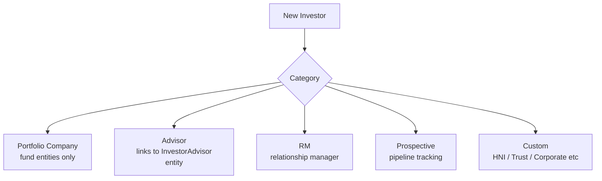
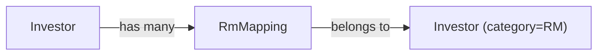
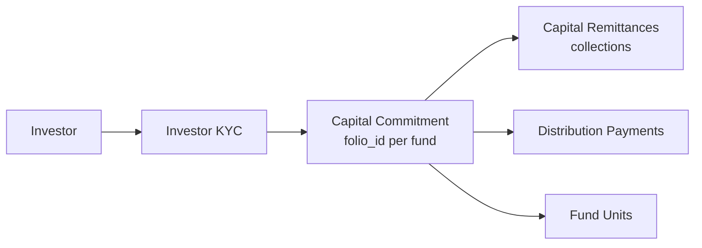
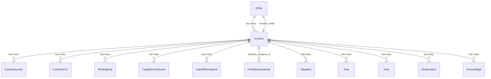

# Investors User Guide

An Investor record represents any participant in your fund or portfolio — a limited partner committing capital, a portfolio company you have invested in, a relationship manager, or a prospective investor being tracked in the pipeline. This guide explains investor categories, how to create and manage investor profiles, RM mappings, and how investors connect to KYC, access rights, capital commitments, and portfolio investments.

---

## Table of Contents

1. [Key Concepts](#key-concepts)
2. [Investor Categories](#investor-categories)
3. [Creating an Investor](#creating-an-investor)
4. [Auto-Created Investor Entity](#auto-created-investor-entity)
5. [Investor Profile Fields](#investor-profile-fields)
6. [RM Mappings](#rm-mappings)
7. [Investor Access Rights](#investor-access-rights)
8. [Tagging and Search](#tagging-and-search)
9. [Sector (Portfolio Companies)](#sector-portfolio-companies)
10. [Linking to KYC](#linking-to-kyc)
11. [Linking to Capital Commitments](#linking-to-capital-commitments)
12. [Portfolio Company Investors](#portfolio-company-investors)
13. [Soft Delete (Defunct)](#soft-delete-defunct)
14. [Investor Notifications](#investor-notifications)
15. [Relationships Summary](#relationships-summary)
16. [Key Fields Reference](#key-fields-reference)
17. [Frequently Asked Questions](#frequently-asked-questions)

---

## Key Concepts

| Term | Meaning |
|---|---|
| **Investor** | A participant record scoped to your entity (fund/company) |
| **Investor Entity** | The entity record representing the investor's own organisation |
| **Category** | Classification of what role the investor plays |
| **RM Mapping** | Assignment of a Relationship Manager to an investor |
| **Investor Access** | A user granted portal access for this investor |
| **Last Interaction Date** | Tracked for pipeline/CRM purposes |

---

## Investor Categories

Every investor is assigned a **Category** that determines available workflows:

| Category | Description |
|---|---|
| **Portfolio Company** | A company in your portfolio. Available only for Investment Fund and Angel Fund entities |
| **Advisor** | A third-party advisor (e.g. distributor) linked to an Investor Advisor entity |
| **RM** | A relationship manager employee tracked as an investor record |
| **Prospective** | A prospect being tracked; no active investment yet |
| **Custom categories** | Configurable per entity (e.g. HNI, Trust, Corporate) |

The available categories are determined by:
1. The `INVESTOR_CATEGORIES` environment variable (system defaults)
2. Any custom categories configured in **Entity → Investor Categories**
3. `Prospective` is always included
4. `Portfolio Company` is added for Investment Fund and Angel Fund entity types



---

## Creating an Investor

Navigate to **[Entity] → Investors → New**.

Required fields:

| Field | Notes |
|---|---|
| **Investor Name** | Must be unique within this entity |
| **Category** | See categories above |
| **Primary Email** | Must be unique within this entity |

Optional but important:

| Field | Notes |
|---|---|
| **PAN** | Tax identifier — used to find/match the investor's entity |
| **City** | Location for reporting |
| **Tags** | Comma-separated labels for filtering |
| **Sector** | Only relevant for Portfolio Company category |

---

## Auto-Created Investor Entity

When you create a new investor, the system looks for an existing **Investor Entity** by:
1. Matching `primary_email` to an existing entity
2. Matching `PAN` to an existing entity

If no match is found, a new entity of type **Investor** is created automatically with the investor's name, email, and PAN.

This means every investor in your system has their own entity record, which gives them their own document folder, permissions, and optionally their own portal access.

When you add a new investor, the fund entity's permissions are automatically copied to the investor's entity (e.g. if your fund has documents enabled, the investor entity gets documents enabled too).

---

## Investor Profile Fields

Beyond the required fields, an investor profile can hold:

| Field | Notes |
|---|---|
| **Description** | Rich text narrative about the investor |
| **Logo** | Uploaded via the Documents section (stored as a document named "Logo") |
| **Last Interaction Date** | Updated manually or via notes/tasks to track recency of contact |
| **Tags** | Searchable labels (max 120 characters) |
| **Sector** | Industry sector, cleared automatically if category changes away from Portfolio Company |
| **Custom Fields** | Entity-defined additional fields via Form Custom Fields |

---

## RM Mappings

A **Relationship Manager (RM)** is assigned to an investor via an RM Mapping record.



Each RM mapping links:
- The **investor** being managed
- The **RM** (another investor record with category = RM)

Multiple RMs can be mapped to one investor (e.g. primary and secondary RM). RM mappings are used to:
- Route notifications to the responsible RM when investor-related events occur
- Filter investor lists by RM
- Generate RM-level performance reports

To add an RM mapping: navigate to the investor record and use **Add RM Mapping**.

---

## Investor Access Rights

An investor has two types of access rights:

1. **Access Rights** (`foreign_key: access_to_investor_id`) — grants the investor (or their entity) access to objects like Funds, Investment Opportunities, Secondary Sales
2. **Investor Access Rights** (`as: :owner`) — grants employees and advisors access to view *this* investor's details

Access rights control visibility in the investor portal and govern which notifications are sent. See the Investor Access guide for the full workflow.

---

## Tagging and Search

Tags are comma-separated labels stored as a string (e.g. `high-value,co-invest,offshore`). They support:
- Fuzzy search via the `with_tag_list` scope
- Filtering in the investor list
- Quick grouping for bulk operations

The tag list field is limited to 120 characters. Use concise tags.

---

## Sector (Portfolio Companies)

The **Sector** field is only meaningful for **Portfolio Company** investors. It stores the industry sector (e.g. `Fintech`, `Healthcare`, `SaaS`).

If you change an investor's category away from Portfolio Company, the sector is automatically cleared on save.

---

## Linking to KYC

An investor can have multiple **KYC records** (one per investing entity or beneficial owner). KYC records store identity documents, bank details, and regulatory checks.

Each **Capital Commitment** links to a specific KYC record (via `investor_kyc_id`) to identify which legal entity is making the investment. See the Investor KYC guide.

---

## Linking to Capital Commitments

For LP-type investors (those committing capital to a fund), the investment journey is:



One investor can have multiple capital commitments across different funds or with different folio IDs in the same fund.

---

## Portfolio Company Investors

Investors with category **Portfolio Company** have a different set of relationships:

- They are the subject of **Portfolio Investments** (buys/sells by funds)
- They have **KPI Reports** uploaded by the fund
- They have **Valuations** recorded periodically
- They participate in **Aggregate Portfolio Investment** calculations

The `valuation_updated` callback on the investor re-triggers FMV computation on all portfolio investments for that company when a new valuation is saved.

---

## Soft Delete (Defunct)

Deleting an investor is not reversible in the normal sense. Instead, the system renames the investor before destroy:

```
investor_name = "Acme Capital" → "Acme Capital Defunct 4721"
```

This preserves uniqueness constraints (so a new investor with the same name can be created) while maintaining an audit trail in historical records (capital calls, remittances, etc. still show the original linked investor).

> **Warning:** Once an investor is destroyed, all linked records (capital commitments, remittances, distributions, KYC records, access rights) are also destroyed. This is irreversible.

---

## Investor Notifications

The `notification_users` method determines who receives notifications for investor-related events. It selects from approved investor access users, with special handling for investor advisors:

- **Regular employees** are included if Pundit policy grants them `show?` access on the related model
- **Investor advisors** are included only if they have show access to the specific model (not just generic investor access)

This ensures advisors only receive notifications for items they are actually permitted to see.

---

## Relationships Summary



---

## Key Fields Reference

| Field | Type | Description |
|---|---|---|
| `investor_name` | String | Display name (unique per entity) |
| `category` | String | Role classification |
| `primary_email` | String | Contact email (unique per entity) |
| `pan` | String | Tax identifier |
| `city` | String | Location |
| `tag_list` | String | Comma-separated searchable tags |
| `sector` | String | Industry sector (Portfolio Company only) |
| `investor_entity_id` | Integer | Linked entity representing the investor's own organisation |
| `last_interaction_date` | Date | CRM engagement tracking |
| `investor_access_count` | Integer | Cached count of active investor accesses |

---

## Frequently Asked Questions

**Q: Can two investors have the same name within an entity?**
No. Investor names must be unique per entity. If you need to track the same organisation under different funds, use different investor records with distinct names or differentiate via tags.

**Q: What happens when I delete an investor?**
The investor name is suffixed with `Defunct {random_number}` (to free the name for reuse), then the record is destroyed along with all linked KYC records, capital commitments, remittances, distribution payments, access rights, and notes. This is permanent.

**Q: Can the same entity be an investor in multiple funds?**
Yes. Each fund has its own investor record pointing to the same investor entity. This is normal for LPs who invest across multiple funds managed by the same GP.

**Q: How do I track a prospective investor?**
Create an investor with category **Prospective**. Use tasks, notes, and the last interaction date to manage the relationship. Upgrade the category when they commit capital.

**Q: Can I bulk-import investors?**
Yes. Use the import upload feature. The import sets the `imported` flag to suppress the `InvestorAddedJob` notification during bulk load.

**Q: How do RM notifications work?**
When a significant event occurs (e.g. a new capital call, KYC update), the system sends notifications to the investor's RM via `rm_mappings`. The RM must have their own user account and notification preferences configured.

**Q: Can an investor have advisors separate from the fund's advisors?**
Yes. Investor advisors are linked via `investor_accesses` with the `investor_advisor` role. They can view the investor's portfolio and receive notifications only for items they are permitted to access.
