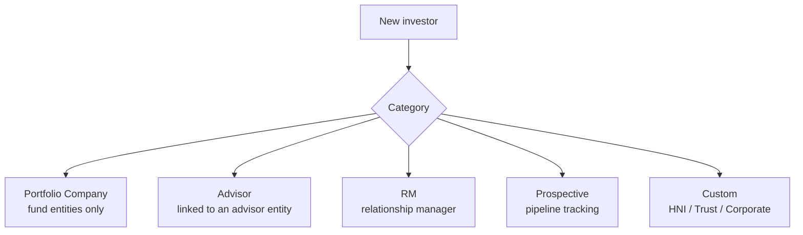
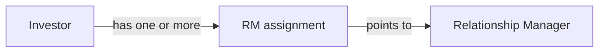
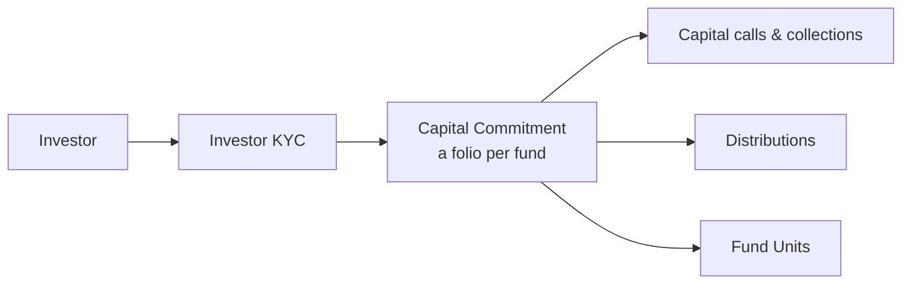

# Investors (Stakeholders) User Guide

An **investor** record — shown in the CapHive menus and screens as a **Stakeholder** — represents anyone who participates in your fund or portfolio — a limited partner committing capital, a portfolio company you've invested in, a relationship manager, or a prospect you're tracking. This guide explains investor categories, creating and managing profiles, assigning relationship managers, and how investors connect to KYC, access, commitments, and portfolio investments.

> **Where to find it:** Sidebar → [**Stakeholders → View Stakeholders**](/investors) lists them; [**Stakeholders → New Stakeholder**](/investors/new) creates one. Open a stakeholder to reach its **Users**, **KYC**, **Commitments**, **Units**, **Tasks** and **Access Rights** tabs. Needs the *Investors* feature on your user plus the *Investor Create/Update/Destroy* permission (or the company admin role) for changes.

> **Terminology:** "Stakeholder" and "Investor" are the same thing. The sidebar menu is **Stakeholders**, the create form is titled **Stakeholder**, and the record is stored as an Investor. A stakeholder is the *organisation* (the LP firm, the portfolio company). The *people* at that organisation who log in are **Stakeholder Users** (Investor Access records) — see the [Investor Access guide](investor_access_tutorial). To create a stakeholder, follow [Creating a Stakeholder (Investor)](#creating-a-stakeholder-investor) below.

---

## Table of Contents

1. [Key Concepts](#key-concepts)
2. [Investor Categories](#investor-categories)
3. [Creating a Stakeholder (Investor)](#creating-a-stakeholder-investor)
4. [Every Investor Gets Its Own Entity](#every-investor-gets-its-own-entity)
5. [The Investor Profile](#the-investor-profile)
6. [Relationship Manager (RM) Assignments](#relationship-manager-rm-assignments)
7. [Access and Visibility](#access-and-visibility)
8. [Tags and Search](#tags-and-search)
9. [Sector (Portfolio Companies)](#sector-portfolio-companies)
10. [How an Investor Connects to Everything Else](#how-an-investor-connects-to-everything-else)
11. [Portfolio Company Investors](#portfolio-company-investors)
12. [Deleting an Investor](#deleting-an-investor)
13. [Investor Notifications](#investor-notifications)
14. [Worked Example](#worked-example)
15. [Frequently Asked Questions](#frequently-asked-questions)

---

## Key Concepts

| Term | Meaning |
|------|---------|
| **Investor / Stakeholder** | A participant record within your fund or company. "Stakeholder" is the label used on screen; "Investor" is the same record. |
| **Investor entity** | The separate entity that represents the investor's own organisation (its documents, users, permissions). |
| **Category** | What role the investor plays (LP, portfolio company, RM, prospect…). |
| **RM assignment** | The relationship manager responsible for an investor. |
| **Stakeholder User (Investor access)** | A person given portal access on behalf of a stakeholder. Created from the **Users** tab of the stakeholder page, *not* from the Stakeholders menu. |
| **Last interaction date** | When you last engaged — useful for pipeline/CRM tracking. |

---

## Investor Categories

Every investor has a **category** that determines which workflows apply:

| Category | What it's for |
|----------|---------------|
| **Portfolio Company** | A company in your portfolio (available only for fund-type entities). |
| **Advisor** | A third-party advisor or distributor, linked to an advisor entity. |
| **RM** | A relationship manager tracked as an investor record. |
| **Prospective** | A prospect being tracked, with no active investment yet. |
| **Custom** | Your own categories (e.g. HNI, Trust, Corporate). |

The category list is the system defaults — or, if your entity has its own **Investor Categories** configured, that list instead — plus "Prospective" (always available) and "Portfolio Company" for fund-type entities.

---

## Creating a Stakeholder (Investor)

1. In the left sidebar, open **Stakeholders**.
2. Click **New Stakeholder** (or open **View Stakeholders** and click **New** at the top of the list).
3. The form is titled **Stakeholder : New**. Fill in the fields below.
4. Click **Save**. The new stakeholder opens on its own page with tabs for **Users**, **KYC** (when KYC is enabled), **Commitments** and **Units** (fund entities) or **Investments** (company entities), **Tasks**, **Access Rights** (if you can edit the stakeholder), **Emails** (company admins) and **Workflow**.

Creating a stakeholder does **not** give anyone a login. To let people at that organisation sign in, go to the stakeholder's **Users** tab and add a Stakeholder User — see the [Investor Access guide](investor_access_tutorial).

**Required:**

| Field | Notes |
|-------|-------|
| **Stakeholder Name** (Investor Name) | Unique within this entity. |
| **Category** | See above. |
| **Primary Email** | Unique within this entity. |

**Optional but useful:**

| Field | Notes |
|-------|-------|
| **PAN / Tax ID** | Used to find or match the investor's own entity. |
| **City** | For reporting. |
| **Tags** | Comma-separated labels for filtering. |
| **Sector** | Relevant only for portfolio companies. |

---

## Every Investor Gets Its Own Entity

When you create an investor, the system looks for an existing **investor entity** by matching the email, then the tax ID. If none exists, it creates a new one automatically using the investor's name, email, and tax ID.

This means every investor has its own container — its own document folder, permissions, and (optionally) portal access. When you save a stakeholder, your entity's enabled features (documents, funds, KYC, approvals and so on) are copied onto the investor's entity automatically, so for example if your fund has documents enabled, the investor's entity does too.

---

## The Investor Profile

Beyond the basics, a profile can hold:

| Field | Notes |
|-------|-------|
| **Description** | A narrative about the investor. |
| **Logo** | Uploaded in the Documents section. |
| **Last Interaction Date** | Moved automatically when a note is logged against the stakeholder (tasks on the stakeholder do not move it). |
| **Tags** | Searchable labels. |
| **Sector** | Cleared automatically if the category moves away from Portfolio Company. |
| **Custom Fields** | Any extra fields your organisation has configured. |

---

## Relationship Manager (RM) Assignments

You can assign one or more **relationship managers** to an investor. An RM is simply another investor record in the **RM** category.

An RM assignment controls visibility: a user logged in under the RM role sees the commitments, calls and other records of the stakeholders mapped to them (subject to access rights). The mapping itself sends no email or notification — an RM is notified only where they are also an approved Stakeholder User or hold an access right on the item. There is no add-RM button on the stakeholder page: create the RM as a stakeholder in the **RM** category, then open [**Rm Mappings**](/rm_mappings) (no sidebar link) and click **New Rm Mapping**.

---

## Access and Visibility

An investor connects to access in two directions:

- **Outward access** — granting the investor (or its entity) access to items such as funds, investment opportunities, and secondary sales, which appear in their portal.
- **Inward access** — granting your employees and advisors permission to view *this* investor's details.

Access controls both what's visible in the portal and which notifications go out. See the [Investor Access guide](investor_access_tutorial) for the full workflow.

---

## Tags and Search

Tags are comma-separated labels (e.g. `high-value, co-invest, offshore`) used for fuzzy search, list filtering, and quick grouping for bulk actions. Keep them short.

---

## Sector (Portfolio Companies)

The **Sector** field (e.g. `Fintech`, `Healthcare`, `SaaS`) is meaningful only for **Portfolio Company** investors. If you change an investor's category away from Portfolio Company, the sector is cleared automatically.

---

## How an Investor Connects to Everything Else

For an LP committing capital, the journey runs:

One investor can hold several commitments — across different funds, or as different folios in the same fund. An investor can have several **KYC records** too (one per investing entity or beneficial owner), and each commitment is tied to a specific KYC so it's clear which legal entity is investing. See the [Investor KYC guide](investor_kyc_user_guide).

---

## Portfolio Company Investors

Investors in the **Portfolio Company** category work differently — they're the subject of your investments rather than a source of capital:

- They're the target of **portfolio investments** (your funds' buys and sells).
- They have **KPI reports** uploaded against them.
- They have **valuations** recorded periodically.

When a new valuation is saved for a portfolio company, the fair market value of all the fund's investments in that company is recalculated automatically.

---

## Deleting an Investor

Deleting an investor needs the *Investor Destroy* permission. To free the name for reuse, the system renames the investor before removing it — for example "Acme Capital" becomes "Acme Capital Defunct 4721".

> **Warning:** removing an investor also soft-deletes its linked records — commitments, KYC, remittances, distribution payments, fund units, access, notes and tasks. No one is notified. It can be undone only from the [deleted stakeholders list](/investors/show_deleted) (no menu link) with **Restore**, which brings the linked records back too; the "Defunct" suffix stays in the name until you edit it.

---

## Investor Notifications

Notifications for investor-related events go to the investor's approved portal contacts (Stakeholder Users), filtered by their Notification Topics and by whether they are permitted to see the item. Advisors receive them only for the specific items they're permitted to see — so an advisor is never notified about something outside their remit. RM mappings send nothing by themselves.

---

## Worked Example

Onboarding a new LP, *Maple Pension*, into your fund:

1. **Stakeholders → New Stakeholder.** Name "Maple Pension", category **Prospective** (you're still in talks), primary email and tax ID set. An investor entity is created automatically.
2. Add a couple of **tags** (`pension, co-invest`) and assign a **relationship manager** from [**Rm Mappings**](/rm_mappings) → **New Rm Mapping**.
3. As discussions progress, log notes with **Add Note** — each one moves the **last interaction date** so the pipeline reflects recency.
4. When Maple commits, change the category to your LP category, add a **KYC record**, and create a **capital commitment** with a folio — capital calls, distributions, and fund units now flow from there.
5. The assigned RM can see Maple's commitments and calls when logged in under the RM role; they receive emails only if they are also an approved Stakeholder User or access-right holder.

---

## Frequently Asked Questions

### Navigation and getting there

**Where do I find Stakeholders (investors) in CapHive?**
Sidebar → [**Stakeholders → View Stakeholders**](/investors) lists every stakeholder of your entity. The same **Stakeholders** block also has [**New Stakeholder**](/investors/new), [**Pending Access**](/investor_accesses?approved=false), [**All Stakeholder Access**](/investor_accesses) and [**Notes**](/notes). The block only appears when the *Investors* feature is enabled for your user.

**How do I open a stakeholder's page?**
Sidebar → [**Stakeholders → View Stakeholders**](/investors) and click the stakeholder name to open its page. The page has tabs for **Users**, **KYC** (when KYC is enabled), **Commitments** and **Units** (fund entities) or **Investments** (company entities), **Tasks**, **Access Rights** (if you can edit the stakeholder), **Emails** (company admins only) and **Workflow**.

**Where are the stakeholder's notes? I do not see a Notes tab.**
There is no Notes tab. On the stakeholder page use the **View Notes** button (lists that stakeholder's notes) or **Add Note** (opens a new note pre-filled for that stakeholder). All notes across stakeholders are under Sidebar → [**Stakeholders → Notes**](/notes).

**What is in the Misc menu on a stakeholder page?**
**Misc** holds **Dashboard**, **Documents** (the stakeholder's document folder), **Portfolio Report**, **Portfolio Investment Report** and **Emails**. For **Portfolio Company** stakeholders it also shows **CapTable**, **Portfolio Report Extracts**, **Generate AI Charts** and the agent buttons (**Run Portfolio Company Agent**, **Run Scoring Agent**, **Run Presentation Analyst**, **AI Assistant**), which are greyed out until support enables that agent.

### Creating, editing, deleting and managing

**How do I create a stakeholder?**
Sidebar → [**Stakeholders → New Stakeholder**](/investors/new), or click **New** at the top of **View Stakeholders**. Enter **Stakeholder Name**, **Category** and **Primary Email** (all three are required and the name and email must be unique within your entity), then **Save**. See [Creating a Stakeholder (Investor)](#creating-a-stakeholder-investor). This does not create a login; add people on the **Users** tab afterwards.

**What happens when I save a new stakeholder?**
CapHive looks for an existing investor entity by the primary email, then by PAN/Tax ID, and creates one if none is found, copying your entity's enabled features (documents, funds, KYC, approvals and so on) onto it. A document folder is created, the last-interaction date is initialised, and a background job regenerates your active Stakeholder Notices so the new stakeholder is included. No email is sent to the stakeholder or to your team.

**How do I edit a stakeholder?**
Open the stakeholder and click **Edit**. Renaming it also renames the linked KYC records, commitments, remittances, distribution payments, deal investors and document folders. Changing the **Category** away from **Portfolio Company** clears the **Sector** field automatically.

**Why can I not change the primary email of a stakeholder?**
Once the stakeholder has any Stakeholder Users, the primary email is locked because those logins are tied to the investor entity that the email resolves to; the edit form hides the email field and the server rejects the change. While there are no users yet, changing the email re-matches (or creates) the investor entity for the new address.

**How do I delete a stakeholder, and what happens?**
Open the stakeholder and click **Delete** (needs the *Investor Destroy* permission). The record is first renamed "<name> Defunct <number>" so the original name can be reused, then it and its dependants (commitments, KYC, remittances, distribution payments, fund units, access, notes, tasks) are soft-deleted. No one is notified. See [Deleting an Investor](#deleting-an-investor).

**Can I undo a deletion?**
Yes, within the soft-delete window. There is no menu link; open the [deleted stakeholders list](/investors/show_deleted), find the record and click **Restore**. Restoring is recursive, so the deleted commitments, KYC records and access records come back with it, but the "Defunct" suffix stays in the name until you edit it.

**How do I merge two duplicate stakeholders?**
Open the [merge stakeholders page](/investors/merge) (no menu link; needs the *Investor Update* permission), choose the stakeholder to merge from and the one to keep, and submit. A background job moves KYC records, commitments, remittances, distribution payments, fund units, notes, deal investors and Stakeholder Users to the surviving record and you get an in-app alert when it finishes. The merge cannot be undone.

**Can I bulk-import stakeholders?**
Yes. On **View Stakeholders** open **Actions → Upload**. The sheet needs **Name**, **Primary Email**, **Category**, **Tags**, **City** and **Sector** columns plus any custom-field columns. Imported stakeholders skip the notice-regeneration job that a manual create triggers, so a large load does not fan out work.

**How do I export the stakeholder list?**
On **View Stakeholders** open **Actions → Download**. It produces an Excel file of the currently filtered list, including custom fields.

**Which permission do I need to work with stakeholders?**
Your user needs the *Investors* feature enabled to see the menu at all. Company admins can do everything. Employees need the *Investor Create*, *Investor Update* or *Investor Destroy* permission (set by a company admin on their user record) for the matching action, and only employees with *Investor Read* see every stakeholder; others see only stakeholders they have been given access to on the stakeholder's **Access Rights → Employee Access** sub-tab.

**How do I assign a relationship manager (RM)?**
Create the RM as a stakeholder in the **RM** category first, then open [**Rm Mappings**](/rm_mappings) (no sidebar link) and click **New Rm Mapping**, picking the RM and the stakeholder. There is no add-RM button on the stakeholder page itself. See [Relationship Manager (RM) Assignments](#relationship-manager-rm-assignments).

**What happens when I save an RM mapping?**
The mapping stores which RM entity is responsible for which stakeholder. Its effect is on visibility: a user logged in under the RM role sees the commitments, calls and other records of the stakeholders mapped to them (subject to access rights). It does not send any email or notification by itself.

### Why it matters

**Why should I create stakeholders instead of tracking investors in a spreadsheet?**
Every commitment, capital call, distribution, fund unit, KYC record, document share and portal login in CapHive hangs off a stakeholder record. Without it there is nothing to attach a commitment to, nothing to share documents with and no one to notify. It is also the unit of the LP CRM: notes, tasks and last-interaction dates are logged against it.

**Who typically uses this?**
Investor-relations and fund-operations staff create and maintain stakeholders; compliance uses the **KYC** tab; finance uses **Commitments** and **Units**; company admins manage **Access Rights** and **Emails**. Portfolio-company records are used by the deal and portfolio teams for investments, KPIs and valuations.

**What happens if I do not create a stakeholder for an investor?**
You cannot record a commitment, issue a capital call, distribute, allot units, run KYC or share documents with them, and they cannot be given portal access. Emails from them cannot be matched to a record either.

**What is the difference between a Stakeholder and a Stakeholder User?**
A **Stakeholder** is the organisation (LP firm, portfolio company, prospect). A **Stakeholder User** is a person at that organisation, stored as an Investor Access record on the stakeholder's **Users** tab; they can log in only once approved. See the [Investor Access guide](investor_access_tutorial).

**Can two stakeholders share a name within an entity?**
No. Stakeholder names and primary emails must both be unique per entity. Use distinct names or tags to differentiate, or merge true duplicates.

**Can the same organisation be an investor in several funds?**
Yes. Each fund entity has its own stakeholder record pointing at the same investor entity, which is matched by primary email or PAN when you create it.

**How do I track a prospect?**
Create a stakeholder with category **Prospective**, then use **Add Note**, tasks and tags. Every note logged against it moves the last-interaction date, which drives the ["not interacted in N days" filter](/investors?not_interacted=90) and the **Investors No Interaction** dashboard widget. Change the category when they commit. See the [LP CRM guide](lp_crm_user_guide).

**Who gets notified about events on a stakeholder?**
Notifications for capital calls, distributions, KYC and document shares go to the stakeholder's **approved** Stakeholder Users, filtered by their Notification Topics and by whether they are permitted to see the item. Unapproved users, and RMs who are not themselves an approved user or access-right holder, receive nothing.

**How do RM notifications work?**
The RM mapping itself sends nothing. An RM receives emails only where they are an approved Stakeholder User on that stakeholder or hold an access right on the item, in which case they get the same notifications as any other recipient.

**Can a stakeholder have advisors separate from the fund's advisors?**
Yes. Investor advisors are added per commitment and get their own access, and are notified only about items they are permitted to see. See the [Investor Advisor guide](investor_advisor_user_guide).

### Troubleshooting

**I cannot see the Stakeholders menu.**
The block is shown only when the *Investors* feature is enabled on your user (ask a company admin to enable it on your user record). Investor and advisor logins never see it; they see **Investments** instead.

**The New button or Edit button is missing.**
Creating needs the *Investor Create* permission and editing needs *Investor Update* (or the company admin role). Ask a company admin to add the permission on your user's **Edit** page under the extended permissions toggles.

**I can only see some stakeholders in the list.**
Employees without *Investor Read* see only stakeholders they have been explicitly given access to. A company admin can grant *Investor Read* for the whole list, or add you on the stakeholder's **Access Rights → Employee Access** sub-tab for individual records.

**Saving fails with "name already exists" or "email has already been used".**
Both fields are unique per entity. Search **View Stakeholders** for the existing record (it may be a prospect or a Defunct-renamed deletion) and either reuse it, edit it, or merge the two.

**The Sector I entered disappeared.**
Sector is kept only for **Portfolio Company** stakeholders; it is cleared automatically on save when the category is anything else.

**A stakeholder has a "Defunct" suffix in its name.**
It was deleted and later restored, or it is a soft-deleted record that still shows in a report. Edit the name to remove the suffix once you are sure it is the record you want to keep.

## Related Guides

- [Investor Access & Permissions](investor_access_tutorial) — adding Stakeholder Users, approval, access rights and notification topics.
- [LP Relationship CRM](lp_crm_user_guide) — notes, follow-ups and pipeline tracking on stakeholder records.
- [Investor KYC](investor_kyc_user_guide) — the KYC tab and verification workflow.
- [Investor Advisor](investor_advisor_user_guide) — outside advisors acting for a stakeholder.
- [Capital Commitments](capital_commitments_user_guide) — the commitments and folios a stakeholder holds.
- [Entities](entities_user_guide) — the investor entity created behind every stakeholder.
- [Custom Fields](custom_fields_user_guide) — extra fields on the stakeholder form.
- [Portfolio Investments](portfolio_investments_user_guide) — how portfolio-company stakeholders are used.
