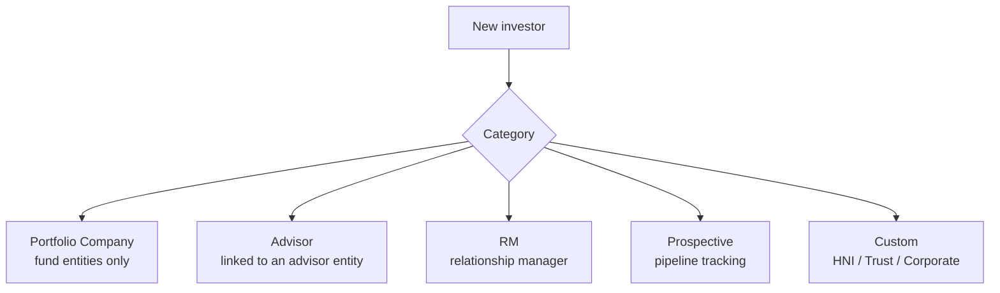
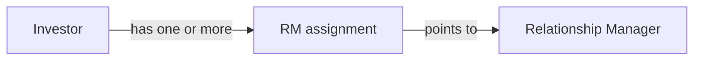
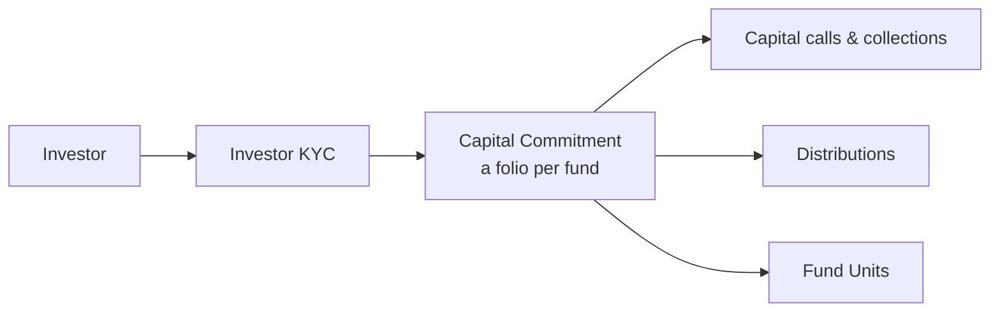

# Investors User Guide

An **investor** record represents anyone who participates in your fund or portfolio — a limited partner committing capital, a portfolio company you've invested in, a relationship manager, or a prospect you're tracking. This guide explains investor categories, creating and managing profiles, assigning relationship managers, and how investors connect to KYC, access, commitments, and portfolio investments.

---

## Table of Contents

1. [Key Concepts](#key-concepts)
2. [Investor Categories](#investor-categories)
3. [Creating an Investor](#creating-an-investor)
4. [Every Investor Gets Its Own Entity](#every-investor-gets-its-own-entity)
5. [The Investor Profile](#the-investor-profile)
6. [Relationship Manager (RM) Assignments](#relationship-manager-rm-assignments)
7. [Access and Visibility](#access-and-visibility)
8. [Tags and Search](#tags-and-search)
9. [Sector (Portfolio Companies)](#sector-portfolio-companies)
10. [How an Investor Connects to Everything Else](#how-an-investor-connects-to-everything-else)
11. [Portfolio Company Investors](#portfolio-company-investors)
12. [Deleting an Investor](#deleting-an-investor)
13. [Investor Notifications](#investor-notifications)
14. [Worked Example](#worked-example)
15. [Frequently Asked Questions](#frequently-asked-questions)

---

## Key Concepts

| Term | Meaning |
|------|---------|
| **Investor** | A participant record within your fund or company. |
| **Investor entity** | The separate entity that represents the investor's own organisation (its documents, users, permissions). |
| **Category** | What role the investor plays (LP, portfolio company, RM, prospect…). |
| **RM assignment** | The relationship manager responsible for an investor. |
| **Investor access** | A person given portal access on behalf of an investor. |
| **Last interaction date** | When you last engaged — useful for pipeline/CRM tracking. |

---

## Investor Categories

Every investor has a **category** that determines which workflows apply:

| Category | What it's for |
|----------|---------------|
| **Portfolio Company** | A company in your portfolio (available only for fund-type entities). |
| **Advisor** | A third-party advisor or distributor, linked to an advisor entity. |
| **RM** | A relationship manager tracked as an investor record. |
| **Prospective** | A prospect being tracked, with no active investment yet. |
| **Custom** | Your own categories (e.g. HNI, Trust, Corporate). |

The category list combines the system defaults, any custom categories you configure for the entity, "Prospective" (always available), and "Portfolio Company" for fund-type entities.

---

## Creating an Investor

Go to **[Entity] → Investors → New**.

**Required:**

| Field | Notes |
|-------|-------|
| **Investor Name** | Unique within this entity. |
| **Category** | See above. |
| **Primary Email** | Unique within this entity. |

**Optional but useful:**

| Field | Notes |
|-------|-------|
| **PAN / Tax ID** | Used to find or match the investor's own entity. |
| **City** | For reporting. |
| **Tags** | Comma-separated labels for filtering. |
| **Sector** | Relevant only for portfolio companies. |

---

## Every Investor Gets Its Own Entity

When you create an investor, the system looks for an existing **investor entity** by matching the email, then the tax ID. If none exists, it creates a new one automatically using the investor's name, email, and tax ID.

This means every investor has its own container — its own document folder, permissions, and (optionally) portal access. When you add an investor to a fund, the fund's enabled features are extended to the investor's entity automatically, so for example if your fund has documents enabled, the investor's entity does too.

---

## The Investor Profile

Beyond the basics, a profile can hold:

| Field | Notes |
|-------|-------|
| **Description** | A narrative about the investor. |
| **Logo** | Uploaded in the Documents section. |
| **Last Interaction Date** | Update it via notes or tasks to track recency of contact. |
| **Tags** | Searchable labels. |
| **Sector** | Cleared automatically if the category moves away from Portfolio Company. |
| **Custom Fields** | Any extra fields your organisation has configured. |

---

## Relationship Manager (RM) Assignments

You can assign one or more **relationship managers** to an investor. An RM is simply another investor record in the **RM** category.

RM assignments are used to route notifications to the responsible RM when something happens for that investor, to filter investor lists by RM, and to produce RM-level reports. Add one from the investor record using **Add RM Mapping**.

---

## Access and Visibility

An investor connects to access in two directions:

- **Outward access** — granting the investor (or its entity) access to items such as funds, investment opportunities, and secondary sales, which appear in their portal.
- **Inward access** — granting your employees and advisors permission to view *this* investor's details.

Access controls both what's visible in the portal and which notifications go out. See the [Investor Access guide](investor_access_tutorial) for the full workflow.

---

## Tags and Search

Tags are comma-separated labels (e.g. `high-value, co-invest, offshore`) used for fuzzy search, list filtering, and quick grouping for bulk actions. Keep them short.

---

## Sector (Portfolio Companies)

The **Sector** field (e.g. `Fintech`, `Healthcare`, `SaaS`) is meaningful only for **Portfolio Company** investors. If you change an investor's category away from Portfolio Company, the sector is cleared automatically.

---

## How an Investor Connects to Everything Else

For an LP committing capital, the journey runs:

One investor can hold several commitments — across different funds, or as different folios in the same fund. An investor can have several **KYC records** too (one per investing entity or beneficial owner), and each commitment is tied to a specific KYC so it's clear which legal entity is investing. See the [Investor KYC guide](investor_kyc_user_guide).

---

## Portfolio Company Investors

Investors in the **Portfolio Company** category work differently — they're the subject of your investments rather than a source of capital:

- They're the target of **portfolio investments** (your funds' buys and sells).
- They have **KPI reports** uploaded against them.
- They have **valuations** recorded periodically.

When a new valuation is saved for a portfolio company, the fair market value of all the fund's investments in that company is recalculated automatically.

---

## Deleting an Investor

Deleting an investor is permanent. To free the name for reuse while keeping an audit trail, the system renames the investor before removing it — for example "Acme Capital" becomes "Acme Capital Defunct 4721" — so historical records (capital calls, remittances) still reference the original.

> **Warning:** removing an investor also removes all its linked records — commitments, capital calls, distributions, KYC, and access. This can't be undone.

---

## Investor Notifications

Notifications for investor-related events go to the investor's approved portal contacts. Employees receive them when they have permission to see the related item; advisors receive them only for the specific items they're permitted to see — so an advisor is never notified about something outside their remit.

---

## Worked Example

Onboarding a new LP, *Maple Pension*, into your fund:

1. **[Fund] → Investors → New.** Name "Maple Pension", category **Prospective** (you're still in talks), primary email and tax ID set. An investor entity is created automatically.
2. Add a couple of **tags** (`pension, co-invest`) and assign a **relationship manager**.
3. As discussions progress, update the **last interaction date** via notes so the pipeline reflects recency.
4. When Maple commits, change the category to your LP category, add a **KYC record**, and create a **capital commitment** with a folio — capital calls, distributions, and fund units now flow from there.
5. The assigned RM is notified automatically as events occur on Maple's account.

---

## Frequently Asked Questions

**Can two investors share a name within an entity?**
No — investor names must be unique per entity. Use distinct names or tags to differentiate.

**What happens when I delete an investor?**
The name is suffixed "Defunct …" to free it for reuse, then the record and all its linked KYC, commitments, calls, distributions, access, and notes are permanently removed.

**Can the same organisation be an investor in several funds?**
Yes. Each fund has its own investor record pointing to the same investor entity — normal for LPs investing across a manager's funds.

**How do I track a prospect?**
Create an investor with category **Prospective** and use tasks, notes, and the last-interaction date. Change the category when they commit.

**Can I bulk-import investors?**
Yes, via import. Bulk imports skip the usual "new investor" notification so a large load doesn't flood inboxes.

**How do RM notifications work?**
When a significant event occurs (a new capital call, a KYC update), the investor's assigned RM is notified. The RM needs their own account and notification settings.

**Can an investor have advisors separate from the fund's advisors?**
Yes. Investor advisors get their own access and are notified only about items they're permitted to see. See the [Investor Advisor guide](investor_advisor_user_guide).
