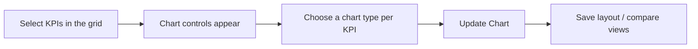

# Flexible KPI Charts User Guide

The Flexible KPI Charting tool lets you build interactive visualisations straight from the KPI Grid — choose which metrics to plot, mix chart types, save layouts, and compare several views side by side. This guide shows you how.

> **Where to find it:** Open a portfolio company under Sidebar → [**Stakeholders → View Stakeholders**](/investors) and click its **Kpis** tab, or go to the [KPI Reports list](/kpi_reports) and click **Grid View**. Tick KPIs in the grid's first column to open **Chart Controls**; saved layouts are under **Saved Charts**. Needs the *Enable Kpis* permission on your user.

---

## Table of Contents

1. [Where to Find It](#where-to-find-it)
2. [Building a Chart](#building-a-chart)
3. [Saving a Chart Layout](#saving-a-chart-layout)
4. [Loading and Comparing Saved Charts](#loading-and-comparing-saved-charts)
5. [Charts Follow Your Grid Filters](#charts-follow-your-grid-filters)
6. [Consistent KPI Names](#consistent-kpi-names)
7. [Worked Example](#worked-example)
8. [Tips for Best Results](#tips-for-best-results)
9. [Frequently Asked Questions](#frequently-asked-questions)

---

## Where to Find It

Open a portfolio company's **Kpis** tab (the grid loads directly), or go to the [KPI Reports list](/kpi_reports) and click **Grid View** (fund logins have no KPIs sidebar entry; company logins use Sidebar → **Stakeholders → KPIs**). The charting controls are built into the grid and appear above the data table as soon as you select something to plot.

---

## Building a Chart

1. **Select KPIs** — tick the checkboxes next to the metric names in the first column of the grid.
2. **Chart Controls appear** as soon as you select one (they stay hidden while nothing is ticked).
3. **Choose a chart type for each KPI:**
   - **Line** — best for trends over time.
   - **Bar** — best for comparing values across periods.
   - **Area** — emphasises the size of change over time.
   - **Pie / Donut** — shows the make-up of a single period (best with few data points).
4. **Mix types** — combine them in one chart (e.g. Revenue as bars, Net Profit Margin as a line).
5. **Update Chart** — click to draw the chart, in a card titled **Current Selection**. Only **approved** KPI values are charted; staged values never are.

---

## Saving a Chart Layout

Once you have a layout you like:

1. Enter a name in the **Setting Name** box in the chart controls.
2. Click **Save Setting**.

The layout (the ticked KPI names and their chart types only — not any saved layouts you have ticked) is saved against your account and the current portfolio company, ready to reuse. It is private to you. Saving again with an existing name overwrites that layout. There is no delete or rename button for saved layouts.

---

## Loading and Comparing Saved Charts

The **Saved Charts** dropdown (top right of the grid) loads your saved layouts:

- **Compare several** — tick more than one (or click **Add All**) and each renders as its own card, so you can view different metric sets side by side.
- **Turn one off** — untick it to remove its card.
- **Clear all** — use **Clear All** to reset every selection and return to a clean grid. Saved layouts themselves are not deleted.

---

## Charts Follow Your Grid Filters

Charts are drawn for the grid's current filters:

- **Time window** — narrow the grid to, say, the last 12 months or a specific range, and the chart shows only that window.
- **Tags** — the chart respects the active tags (Actual, Budget, Projected) selected in the grid.
- **After a filter change** — applying a grid filter (e.g. Monthly to Quarterly) reloads the grid and clears your ticked KPIs and saved-layout selections. Re-tick the KPIs (or pick saved layouts) and click **Update Chart** to redraw for the new filters.

---

## Consistent KPI Names

The system shows the **standard investor-facing name** for each metric (from your KPI mappings), so legends and labels stay consistent even when different companies use different raw names. You can also plot any of the company's KPIs — including ones outside the category tab you're currently viewing (e.g. an income-statement metric while on the balance-sheet tab).

---

## Worked Example

Comparing growth and profitability for a portfolio company:

1. In Grid View, tick **Revenue** and **Net Profit Margin**.
2. In the controls, set **Revenue** to **Bar** and **Net Profit Margin** to **Line** (a mixed chart makes the two easy to tell apart).
3. Click **Update Chart**, then name the layout "Revenue vs Margin (12M)" and **Save Setting**.
4. Set the grid's time window to **Last 12 Months** and tag to **Actual**. Applying the filter clears your selections, so tick "Revenue vs Margin (12M)" in **Saved Charts** — it is drawn for just that window.
5. Next quarter, reopen it from **Saved Charts** and add a second saved view alongside it to compare periods.

---

## Tips for Best Results

- **Pick the right type** — Line for growth metrics, Bar for volume metrics; mixing them keeps a combined chart readable.
- **Declutter fast** — if the page gets busy, **Clear All** in the Saved Charts menu is the quickest way back to a clean grid.

---

## Frequently Asked Questions

### Navigation and getting there

**Where do I find Flexible KPI Charts in CapHive?**
Open the portfolio company (Sidebar → [**Stakeholders → View Stakeholders**](/investors)) and click its **Kpis** tab, which opens the KPI grid directly. Alternatively go to the [KPI Reports list](/kpi_reports) (no fund sidebar entry; company logins use Sidebar → **Stakeholders → KPIs**) and click **Grid View**. See [Where to Find It](#where-to-find-it).

**Where are the chart controls?**
They are hidden until you tick at least one checkbox next to a KPI name in the grid's first column; then a **Chart Controls** card appears above the table with a chart-type picker per KPI, **Update Chart**, **Clear All**, a **Setting Name** box and **Save Setting**.

**Where are my saved chart layouts?**
In the **Saved Charts** drop-down at the top right of the grid, under **Select Charts to Draw**, with **Add All** and **Clear All** links. On a company's grid it lists only the layouts you saved for that company. See [Loading and Comparing Saved Charts](#loading-and-comparing-saved-charts).

**Can I use flexible charts on a dashboard?**
Yes. The **Kpis** widget on the Portfolio Company Dashboard (stakeholder page → **Misc → Dashboard**) renders the same grid; set it up at Company menu (house icon, top right) → [**Dashboard Widgets**](/dashboard_widgets). If the widget is configured with `no_actions`, the **Saved Charts** drop-down is hidden there.

**Who can use flexible charts?**
Anyone who can open the KPI grid, which needs the *Enable Kpis* permission on the user. A company admin can switch it on at Company menu → [**User**](/users) → edit the user. Saving a layout needs no extra permission.

### Creating, updating and managing charts

**How do I build a chart?**
Tick the KPIs you want in the grid, choose **Line**, **Bar**, **Area**, **Pie** or **Donut** for each in **Chart Controls** (new selections start as Line), then click **Update Chart**. The chart appears in a card titled **Current Selection**. See [Building a Chart](#building-a-chart).

**How do I save a chart layout?**
With KPIs selected, type a name in **Setting Name** and click **Save Setting**. A "Setting saved successfully!" message appears and the name is added to **Saved Charts**. See [Saving a Chart Layout](#saving-a-chart-layout).

**How do I update a saved layout?**
Rebuild the selection (tick the KPIs and pick the chart types again), type exactly the same name in **Setting Name** and click **Save Setting**. The saved layout for that name and company is replaced; there is no separate edit screen.

**How do I show one or several saved layouts?**
Open **Saved Charts** and tick one or more names (or click **Add All**). Each ticked layout is drawn immediately as its own card below the grid; untick a name to remove its card.

**How do I delete or rename a saved layout?**
There is no delete or rename button in the grid today. To "rename", save the same selection under a new name; the old name stays in **Saved Charts**, so ask CapHive support if you need old layouts removed.

**How do I clear everything and start again?**
Click **Clear All** in **Chart Controls** or in the **Saved Charts** drop-down (or the **×** on the controls card). It unticks every KPI and saved layout and redraws with nothing selected; saved layouts themselves are not deleted.

**Can I export a chart?**
There is no export button on flexible charts. Use **Actions → Download** on the grid to export the underlying numbers to Excel.

### Why use flexible charts

**Why should I use flexible charts?**
They let you visualise any combination of a company's KPIs straight from the grid in a few clicks, instead of exporting to Excel and building charts by hand each quarter.

**What can I do with flexible charts?**
Mix chart types in one chart (e.g. Revenue as bars and margin as a line), save named layouts per company, draw several saved layouts side by side, and redraw them for whatever period, tag and category the grid is filtered to.

**What happens if I never save a layout?**
Nothing is stored. You can still build and view charts, but the selection is lost as soon as the grid reloads, so you must re-tick the KPIs each visit.

**Who typically uses flexible charts?**
Portfolio managers, analysts and fund operations staff reviewing company performance, and anyone preparing a quick visual for an IC or board discussion.

### What happens when I …

**What happens when I click Update Chart?**
The grid's current filters (period, number of periods, tag, category) and your selection are sent to CapHive, which draws one card for **Current Selection** plus one per ticked saved layout. Nothing is saved and no one is notified.

**What happens when I click Save Setting?**
A layout (the KPI names and chart types only) is stored against your user, your company and the portfolio company you are viewing. Saving again with the same name overwrites it. It is private: colleagues do not see your saved layouts.

**What data do the charts show?**
Only approved KPI values for the reports currently in the grid. Staged (unapproved) values are not charted even when the grid is showing **View Including Staged**, and dates outside the grid's filter are left out. See [Charts Follow Your Grid Filters](#charts-follow-your-grid-filters).

**What happens when I change a grid filter?**
Applying the filter reloads the grid, which clears the current KPI ticks and saved-layout selections. Re-tick the KPIs (or pick saved layouts) and click **Update Chart**; the charts are then drawn for the new period, tag and category.

**What happens to saved layouts when KPI names change?**
A layout stores standard KPI names from the company's KPI mappings. If a mapping's standard name changes or the mapping is removed, that KPI no longer appears in the saved chart until you re-save the layout with the new name.

### Troubleshooting and edge cases

**I ticked KPIs but no chart appears.**
Ticking only opens **Chart Controls**; click **Update Chart** to draw. If a card appears but is empty, check that the KPI has approved values for the periods in the grid.

**"Please enter a name for the setting" when I click Save Setting.**
**Setting Name** is empty. Type a name and click **Save Setting** again.

**My saved layout is missing from Saved Charts.**
Saved layouts are per user and per portfolio company: they only appear on the grid of the company you saved them for, and only for you. Check you are on the right company's **Kpis** tab and logged in as the user who saved it.

**A colleague cannot see the chart layout I saved.**
Layouts are private to the user who saved them. Share the KPI names and chart types so they can save their own copy.

**My pie or donut chart looks crowded.**
Pie and donut show the make-up of values and work best with few data points. Narrow the grid to fewer periods or use Line or Bar for time series. See [Tips for Best Results](#tips-for-best-results).

**Can I chart a KPI from another category tab?**
Yes. Selections use the company's standard KPI names from all its mappings, so a saved layout can include metrics from other categories than the one the grid is currently filtered to. See [Consistent KPI Names](#consistent-kpi-names).

## Related Guides

- [KPI Management & Workbook Upload](kpi_upload_user_guide) — upload and approve the KPI values the charts draw.
- [KPI Parent-Child Mapping](kpi_parent_child_mapping_user_guide) — the standard KPI names used in chart legends.
- [KPI RAG Status](kpi_rag_status_user_guide) — red/amber/green flags shown in the same grid.
- [Dashboard Widgets](dashboard_widgets_user_guide) — put the Kpis grid and its charts on the Portfolio Company Dashboard.
- [Agent Charts](agent_charts_user_guide) — AI-generated charts built from a plain-English prompt instead.
- [Stakeholders (Investors)](investors_user_guide) — portfolio company pages that host the Kpis tab.
