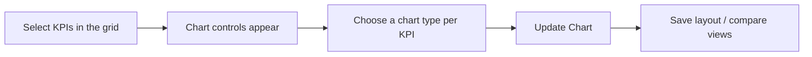

# Flexible KPI Charts User Guide

The Flexible KPI Charting tool lets you build interactive visualisations straight from the KPI Grid — choose which metrics to plot, mix chart types, save layouts, and compare several views side by side. This guide shows you how.

---

## Table of Contents

1. [Where to Find It](#where-to-find-it)
2. [Building a Chart](#building-a-chart)
3. [Saving a Chart Layout](#saving-a-chart-layout)
4. [Loading and Comparing Saved Charts](#loading-and-comparing-saved-charts)
5. [Charts Follow Your Grid Filters](#charts-follow-your-grid-filters)
6. [Consistent KPI Names](#consistent-kpi-names)
7. [Worked Example](#worked-example)
8. [Tips for Best Results](#tips-for-best-results)

---

## Where to Find It

Go to the **KPIs** section and switch to **Grid View**. The charting controls are built into the grid and appear above the data table as soon as you select something to plot.

---

## Building a Chart

1. **Select KPIs** — tick the checkboxes next to the metric names in the first column of the grid.
2. **Chart controls appear** as soon as you select one.
3. **Choose a chart type for each KPI:**
   - **Line** — best for trends over time.
   - **Bar (Column)** — best for comparing values across periods.
   - **Area** — emphasises the size of change over time.
   - **Pie / Donut** — shows the make-up of a single period (best with few data points).
4. **Mix types** — combine them in one chart (e.g. Revenue as bars, Net Profit Margin as a line).
5. **Update Chart** — click to refresh the visualisation.

---

## Saving a Chart Layout

Once you have a layout you like:

1. Enter a name in the **Setting Name** box in the chart controls.
2. Click **Save Setting**.

The layout is saved against your account and the current portfolio company, ready to reuse.

---

## Loading and Comparing Saved Charts

The **Saved Charts** dropdown (top right of the grid) loads your saved layouts:

- **Compare several** — tick more than one and each renders as its own card, so you can view different metric sets side by side.
- **Turn one off** — untick it to remove its card.
- **Clear all** — use **Clear All** to reset every selection and return to a clean grid.

---

## Charts Follow Your Grid Filters

Charts always reflect the grid's current filters:

- **Time window** — narrow the grid to, say, the last 12 months or a specific range, and the chart shows only that window.
- **Tags** — the chart respects the active tags (Actual, Budget, Projected) selected in the grid.
- **Live updates** — change a grid filter (e.g. Monthly to Quarterly) and the charts update automatically.

---

## Consistent KPI Names

The system shows the **standard investor-facing name** for each metric (from your KPI mappings), so legends and labels stay consistent even when different companies use different raw names. You can also plot any of the company's KPIs — including ones outside the category tab you're currently viewing (e.g. an income-statement metric while on the balance-sheet tab).

---

## Worked Example

Comparing growth and profitability for a portfolio company:

1. In Grid View, tick **Revenue** and **Net Profit Margin**.
2. In the controls, set **Revenue** to **Bar** and **Net Profit Margin** to **Line** (a mixed chart makes the two easy to tell apart).
3. Set the grid's time window to **Last 12 Months** and tag to **Actual** — the chart redraws for just that window.
4. Click **Update Chart**, then name the layout "Revenue vs Margin (12M)" and **Save Setting**.
5. Next quarter, reopen it from **Saved Charts** and add a second saved view alongside it to compare periods.

---

## Tips for Best Results

- **Pick the right type** — Line for growth metrics, Bar for volume metrics; mixing them keeps a combined chart readable.
- **Declutter fast** — if the page gets busy, **Clear All** in the Saved Charts menu is the quickest way back to a clean grid.
