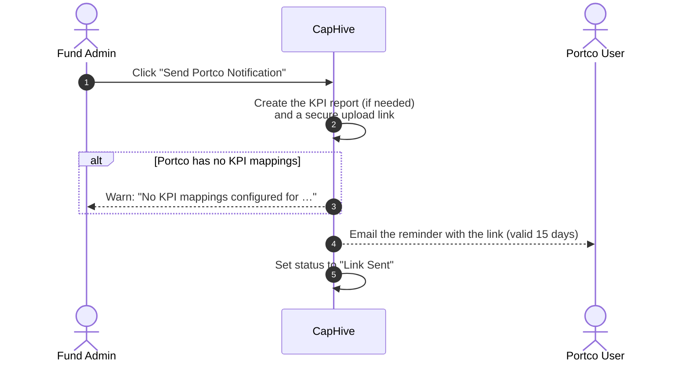
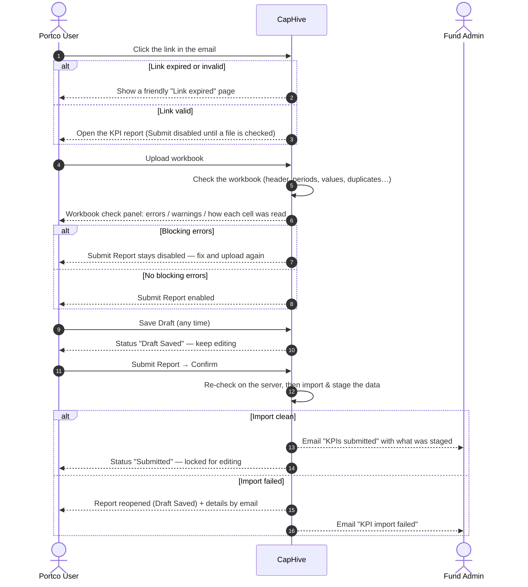
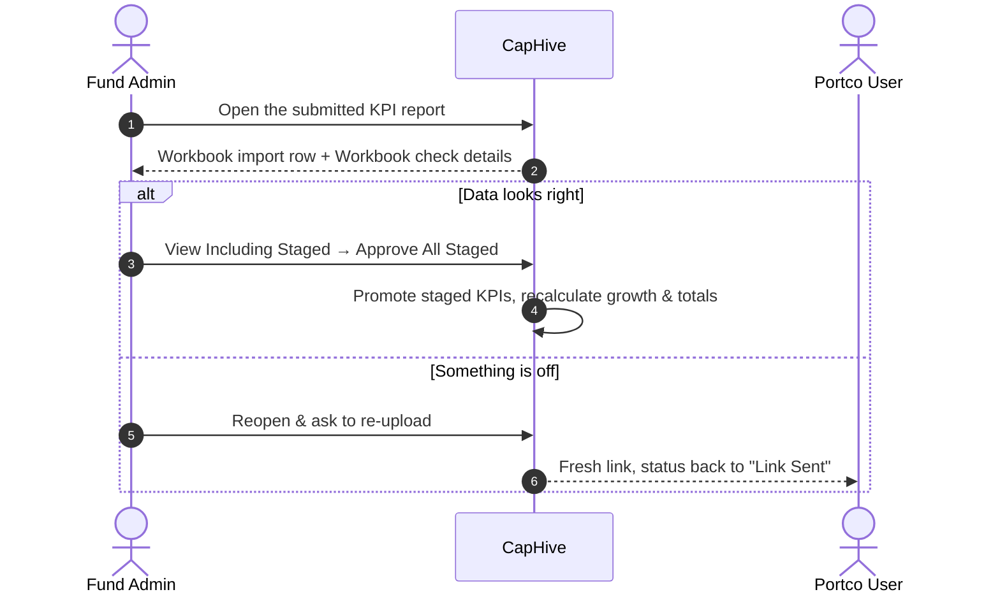
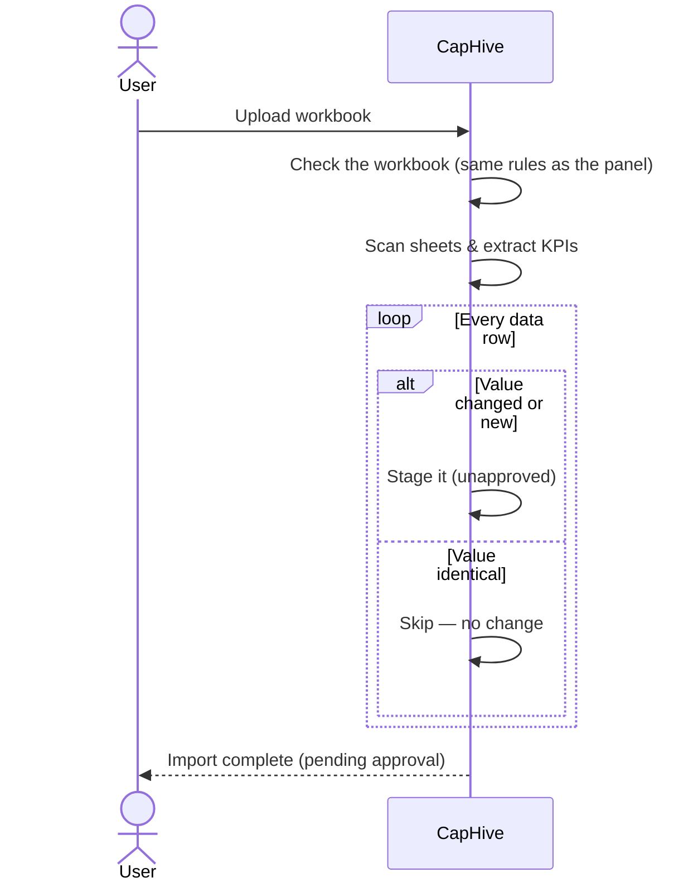
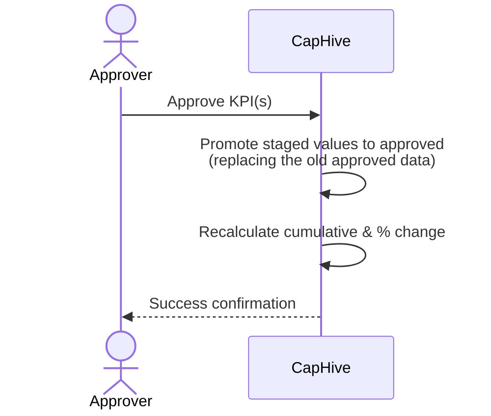
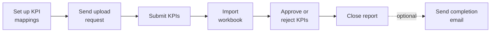

# KPI Management & Workbook Upload User Guide (V9.4.0)

This guide provides a comprehensive overview of the Key Performance Indicator (KPI) reporting system in IRM. It covers everything from preparing your Excel workbooks, through the **Workbook check** that runs on every upload, to the automated approval workflows.

> **Where to find it:** Fund logins open the [**KPI Reports**](/kpi_reports) list (no sidebar entry) or open a portfolio company under Sidebar → [**Stakeholders → View Stakeholders**](/investors) → **Kpis** tab; company logins use Sidebar → [**Stakeholders → KPIs**](/kpi_reports). Create one with **New Kpi Report**, or request one from a portfolio company with **Send Portco Notification**. Needs the *Enable Kpis* permission on your user and KPIs enabled for your entity.

## 📑 Table of Contents
1. [Key Takeaways](#-key-takeaways)
2. [Roles & Permissions](#-roles--permissions)
3. [The Reporting Workflow](#-the-reporting-workflow)
4. [The Workbook Check](#-the-workbook-check)
5. [Report Status Lifecycle](#-report-status-lifecycle)
6. [Tracking a Report: the Journey Step Bar](#-tracking-a-report-the-journey-step-bar)
7. [Workbook Preparation Checklist](#-workbook-preparation-checklist)
8. [How Numbers Are Read](#-how-numbers-are-read)
9. [Supported Date Formats](#-supported-date-formats)
10. [Parent & Child KPIs](#-parent--child-kpis)
11. [Automated System Actions](#-automated-system-actions)
12. [Common Pitfalls & Troubleshooting](#-common-pitfalls--troubleshooting)
13. [FAQ](#-faq)

---

## 🚀 Key Takeaways
*   **Two-Stage Process**: Data is first **Staged** (Unapproved) and then **Promoted** (Approved) by an authorized user.
*   **Approved Data Only**: Dashboards, performance tables, and growth calculations only use **Approved** data.
*   **Checked Before You Save**: Every uploaded workbook is checked by CapHive the moment it is uploaded. The **Workbook check** panel shows what will be stored, cell by cell, and lists anything that must be fixed (red) or is worth a look (amber) — before you save or submit.
*   **Formatting Is Understood**: `1,200`, `(500)`, `₹ 12,50,000`, `$1.2M`, `2.5 Cr`, `42%` are read as the numbers you meant. Text is never silently stored as 0.
*   **The Requested Period Must Be There**: A portfolio company's upload must contain the period the fund asked for (e.g. Jun 2026), with values — otherwise it cannot be submitted.
*   **Submit Means Staged**: The fund's "KPIs submitted" email is sent only once the data has actually been imported and staged for approval.
*   **Template Download**: A pre-filled workbook (your KPI names, units and the requested period) is one click away on the report page.
*   **Smart Matching**: The system skips identical values to avoid duplicates and flags changes for review.
*   **Automated Calculations**: Quarterly, YTD, and Annual totals are automatically recalculated upon approval — from monthly Actuals, or from quarterly Actuals if that's all a company reports (never both, so totals aren't duplicated).
*   **Direct Links**: Portfolio companies should use the link in their reminder email to upload directly to the correct period.
*   **Save Draft / Submit**: Portfolio companies can save work-in-progress with **Save Draft** and use **Submit Report** when done.
*   **Status Tracking**: Every report has a visible status badge — fund admins can see which companies have submitted at a glance.
*   **Link Expiry**: Magic links are valid for 15 days. The expiry date is shown in the email. Contact your fund manager for a new link if needed.

---

## 👥 Roles & Permissions
The KPI system ensures data integrity through role-based access:

| Role | Permissions |
| :--- | :--- |
| **Fund Admin / Approver** | Full access. Can create reports, approve staged KPIs (approving needs the *company_admin* or *approver* role), trigger recomputations, send notifications, and **reopen** a submitted report to ask the portfolio company for a fresh upload. On a submitted report's page, the **View Including Staged** button links directly to the grid view where staged KPIs can be reviewed and approved. |
| **Portfolio Company User** | Can save drafts and submit KPI reports for their company via secure email links or the [**Pending KPI Reports**](/kpi_reports/portco_pending) page. Can only change the notes and the workbook on a report — the period, company and tags are set by the fund. |
| **Advisor / Read-Only** | Can view approved reports and dashboards but cannot modify data or approve uploads. |

### Designated KPI Contact
KPI reminder emails go to the portfolio company's approved portal users whose access record's **Notification Topics** (tag list) is either blank (subscribed to everything) or contains `Kpi`. A user whose access record has other tags but not `Kpi` is skipped.

To designate a contact, a fund admin edits the user's access record on the stakeholder's **Users** tab and adds `Kpi` to its notification topics (or leaves them blank).

---

## 🔄 The Reporting Workflow

### 1. Notification & Request
The process typically begins when a Fund Admin sends a reminder to a Portfolio Company.
*   **Self-Reporting**: The system enables "Self-Reporting" for the specific period, creating a report shell and setting its status to **Link Sent**. The request always lives on the **end of the period** (e.g. a request typed as 18 June is stored as 30 June).
*   **Reminder Email**: The company receives an email with a direct link to the upload portal. The link is valid for **15 days** — the expiry date is shown in the email.
*   **Bulk Send**: Fund admins can notify all portfolio companies at once. Companies that have already submitted are automatically skipped.
*   **No KPI Mappings?** If a portfolio company has no KPI mappings configured yet, the fund sees a warning at send time and a red **No KPI mappings configured** badge on the report — the company's uploads will be refused until mappings are added on the company's **Kpi Mapping** tab.
*   **Automated Reminders**: The periodic job re-sends reminders only to companies whose status is still **Link Sent** or **Draft Saved** — submitted companies are never nagged.

### 2. Portfolio Company Fills Out the Report
*   The portco user clicks the link in the email (no login required). **Submit Report** is disabled until a workbook has been checked.
*   Optionally click **Download KPI template** to get a workbook already laid out with the company's KPI names, expected units and the requested period.
*   Upload the workbook (.xlsx, .xls or .csv). The **Workbook check** panel appears within seconds — see the next section. Fix anything in red and upload again; the panel and buttons update automatically.
*   **Save Draft** at any point to preserve progress without notifying the fund. Saving a draft returns to the **Edit** page with a success message.
*   When all data is final, click **Submit Report** and confirm. CapHive re-checks the workbook on the server, imports it, and **only then** notifies the fund team. If the check fails at that moment, nothing is submitted: the changes are kept as a draft and the reasons are shown.
*   After submission, the report is locked for editing.

### 3. Portco Pending Dashboard
Portfolio company users can open the [**Pending KPI Reports**](/kpi_reports/portco_pending) page (there is no menu link today, so bookmark it) to see all outstanding requests from any fund, each with a **Fill Report** button, without needing the original email.
*   **Direct Entity Querying**: This dashboard is optimized to query directly by the portfolio company's entity, ensuring reliable access without requiring explicit access rights on the fund's KPI reports.
*   **Standardized Dates**: Outstanding requests are displayed with dates formatted in standard ISO8601 (`YYYY-MM-DD`) format for clarity.

### 4. Fund Admin Review
*   The fund admin receives the **KPIs submitted** email once the workbook has been imported — it states how many values and KPIs were staged and how many warnings to look at.
*   The KPI report **Show page** now has a **Workbook import** row (Imported / Import pending / Import failed, error and warning counts, values staged, how many differ from already-approved figures) and a collapsible **Workbook check details** card showing exactly what the portfolio company saw — including, for every value, what was in the file and how it was read.
*   Click **View Including Staged** (outlined green, shown only when the status is **Submitted**) to open the KPI **Grid View** filtered to this portfolio company with staged KPIs highlighted in orange.
*   From the grid view the admin can approve individual KPIs or use **Actions → Approve All Staged** to promote all staged data in one step (or **Reject** / **Reject All Staged** to discard staged values). Growth and cumulative recalculations trigger automatically on approval.
*   **Reopen & ask to re-upload** (on submitted reports) sends the report back to the portfolio company with a fresh link when something needs correcting.
*   **Close report** (on the report page, once the report has KPIs) approves every KPI still pending for the portfolio company — on every period the upload filled, not just this report — and marks the report **Reviewed**. See [Tracking a Report](#-tracking-a-report-the-journey-step-bar). **Submitted** (and **Reviewed**) reports are excluded from all future reminder cycles.

### 5. Staged Import (The Upload)

Whether uploaded by a portfolio company or by a fund user, a workbook goes through the same import:

### 6. Authorized Approval

An Admin reviews the staged data. Unapproved values are highlighted in **orange** with a **"Pending"** badge in the KPI Grid View.

---

## 🔍 The Workbook Check

The **Workbook check** panel appears on the report page as soon as a file finishes uploading (portfolio company and fund users alike; on the fund's *New report* page it uses the company, date and period chosen in the form). It shows:

| Section | What it tells you |
| :--- | :--- |
| **Requested period** | "You were asked for **Jun 2026 (Month)** — column present, KPIs filled 9 of 12" (or "column not found in the file"). |
| **Errors** (red) | Must be fixed before submitting. Each names the sheet and cell (e.g. `MIS!C7`), the KPI and the period. |
| **Warnings** (amber) | Worth reviewing; they do not block submission. |
| **Summary** | How many of the expected KPIs were found (and which are missing), which periods the file covers, which other periods it will also update, hidden sheets ignored. |
| **How we read your file** | One row per value: KPI, period, cell, *what was in the file*, *what will be stored*, *how* (e.g. "stripped currency; unit 'Cr' × 10,000,000"), the currently approved figure, and a status (new / same as approved / changed / blank / future — ignored / error). Rows for the requested period are bold; values that differ from approved figures are amber; errors are red. |

**Blocking errors** (Submit disabled):
*   No workbook, or the file is not a spreadsheet.
*   No sheet has a header row with period columns.
*   None of the fund's KPI names appear in the file.
*   The requested period is missing, or present but empty for every KPI.
*   Excel error cells (`#DIV/0!`, `#REF!`, `#N/A`…), text where a number is expected (`ten`), or ambiguous numbers (`10 (prev 8)`, a sheet mixing `1.234,56` and `1,234.56`).
*   The same KPI on two rows with **different** values for the same period; the same period appearing twice in the header without a distinguishing Actual/Budget label.
*   The portfolio company has no KPI mappings configured.

**Warnings** (shown, not blocking): a mapped KPI missing from the file; a column header we don't recognise (e.g. *Comments*) or an Actual/Budget-row label we don't recognise (e.g. *Variance*) — the column is ignored; a hidden sheet ignored; a future-dated *Actual* column ignored; other periods that will also be updated and approved figures that would change; monthly columns supplied for a quarterly/annual request; a placeholder like `TBD` treated as blank; a KPI repeated with the same value; and the plausibility hints in the next paragraph.

**Plausibility hints** compare each value with the company's approved history (last 3 years): a value ~1,000× or more away from the last approved figure ("is the sheet in crores?"), a percentage typed as `42` where history is `0.42`, a change beyond the thresholds set on the KPI mapping, a value in the red or amber **RAG band** the fund defined for that KPI, a sign flip against recent history, or a >200 % swing where no thresholds are set. A brand-new KPI with no history gets none of these. See the [RAG Status User Guide](kpi_rag_status_user_guide) for how a fund sets up RAG bands and what "red"/"amber"/"green" mean for a given KPI.

The verdict is remembered on the report: reload the page and it is still there; **Re-check file** runs it again on the attached workbook.

**Fund users** see the same panel when they upload on a report's edit page or the *New report* page. A workbook with blocking errors cannot be saved by anyone — the **Save** button is disabled while errors are shown and the server refuses a forced save. Save is never disabled just because no file has been chosen, and for fund-created reports "the file doesn't contain this report's period" is a warning rather than an error.

---

## 🔵 Report Status Lifecycle

Each portco self-reporting request moves through these states:

| Status | Meaning | Who Sees It |
| :--- | :--- | :--- |
| **Shell Created** | Report created, link not yet sent | Fund admin |
| **Link Sent** | Reminder email delivered to portco (also after the fund reopens a report) | Both |
| **Draft Saved** | Portco saved progress, not yet submitted — also where a report lands if a submission's import failed | Both |
| **Submitted** | Portco clicked Submit; the workbook is being / has been imported (see the *Workbook import* row: pending → imported) and the fund has been notified | Both |
| **Reviewed** | Closed with **Close report** on the report page | Both |

The status badge is visible on the report form for both the fund admin and the portfolio company user.

---

## 🧭 Tracking a Report: the Journey Step Bar

Every KPI report you **request** after your company's KPI report journeys were set up shows a **step bar** at the top of its page, listing every task the report goes through, and a **What's needed now** panel with the next thing to do and a button that takes you there. CapHive works out which task the report is on from its own data — sending the request, the portfolio company submitting, the import finishing and approvals all move it on by themselves. Only fund users see it; the portfolio company does not.

A report gets a step bar when it is created on the **New Kpi Report** screen, sent to a portfolio company with **Send Portco Notification** (including a period an earlier upload already created), created as a scheduled request, or when a workbook is uploaded on it. The extra reports an upload creates for the other periods and roll-ups in the file (Apr, May, YTD, Budget …) get **no** step bar, so a first upload with three years of history still gives you one journey, not thirty. Reports that existed before the journeys were set up, and a company's own KPI reports (no portfolio company), show no step bar.

Each task in the bar has a mark: ✓ done · **●** we are here (waiting on this, not done yet) · ○ later · **↺** done before but undone, so it must be done again · n/a not needed for this report (hover to see why).

| Task | Done when | n/a when | Moves back when |
|---|---|---|---|
| **Set up KPI mappings** | the portfolio company has at least one KPI mapping (computed ones don't count) | — | its last mapping is deleted |
| **Send upload request** | the upload link was sent to the portfolio company (the step bar's button clicks **Send upload request** on the report page) | the fund uploads the KPIs itself | — |
| **Submit KPIs** | the portfolio company submitted the report | the fund uploads the KPIs itself | **Reopen & ask to re-upload**, or the import of a submission failed |
| **Import workbook** | the report's workbook imported without blocking errors and the report has KPIs | — | the report's KPIs are deleted, or every KPI on it was rejected |
| **Approve or reject KPIs** | no KPI of the portfolio company is still pending, on any period (the step bar's **Review pending KPIs** opens the grid in a new tab) | — | a KPI of the portfolio company is unapproved |
| **Close report** | someone clicked **Close report** | — | the report is reopened |
| **Send completion email** *(optional)* | someone clicked **Send completion email** | — | any of the above (it can then be sent again) |

**Close report** approves every KPI still pending for the portfolio company — the upload staged values on every period it found, so they sit on several reports — then marks the report **Reviewed**. A confirm popup says how many KPIs and periods it will approve. To reject some values first, use the grid view (**Actions → Reject All Staged** or the reject button on a value).

**Send completion email** is not part of the standard journey. A company admin adds it: Company menu (house icon) → [**Workflows**](/workflow_templates) → open **KPI Report Review** → **Add Step**, choose **Kind** *System*, **Check** *Send completion email*, and pick the **Actors** who should receive it. Once a report is closed, its page shows **Send completion email**; clicking it emails "KPIs for Acme Pvt Ltd — Jun 30, 2026 are complete" (company and period date) with a link to the report. It is sent once; the button disappears afterwards. The portfolio company is never emailed by it.

**Who is reminded.** When a task stalls longer than the template's reminder interval, CapHive emails its owner, and the completion email goes to the same people, in this order: the portfolio company's **Managed by** employee (set it on the stakeholder's edit page — it appears for Portfolio Company stakeholders); otherwise the step's **Owner** (reminders) or **Actors** (completion email) on the template; otherwise every employee tagged **Kpi**. If nobody is found, the panel shows **Owner unavailable** and nobody is emailed.

**Setting it up.** A company admin opens Company menu (house icon) → [**Workflows**](/workflow_templates) → **Set up journeys** → **Set up KPI report journeys**. It adds the **KPI Report Review** template and a rule giving it to every requested KPI report; existing reports are left alone and nobody is emailed. A new fund company that already has KPIs enabled when it is created gets it automatically.

**Deleting a KPI mapping.** A mapping no KPI uses is deleted as before. If KPIs use it, **Delete** first shows what will go: how many KPIs and periods (and how many are approved), any computed KPI whose formula uses its name, and that it cannot be undone — confirming deletes the mapping together with its KPIs and recalculates the company's totals and % changes. A mapping with child mappings cannot be deleted; move or delete the children first (the **Delete** button is disabled and says which).

---

## 📋 Workbook Preparation Checklist

The easiest way to get a clean upload is **Download KPI template** on the report page. If you use your own file:

### 1. Structure & Layout
*   **Header Detection**: The system scans the first 10 rows to find your period headers (e.g., "Jan 2024"). Title rows above the header are fine.
*   **Header Requirement**: A header row normally contains at least **two** period columns. A single-period sheet (`KPI | Jun 2026`) is accepted when the KPI names beneath it match your fund's list.
*   **KPI Column**: Place KPI names in the first column(s). The system matches these against your configured "Reported KPI Names". Extra label columns (Unit, Segment) before the first period column are fine.
*   **Data Rows**: Values should be directly beneath the header row.
*   **Requested Period**: For a portfolio company upload, the period the fund asked for must be one of the columns, with values.
*   **Actual / Budget side by side**: put a label row (Actual, Budget, IC) directly under the period headers; other labels in that row (e.g. Variance) are ignored.
*   **Hidden sheets** are ignored — unhide a sheet if it should be read.

### 2. KPI Naming
*   **Smart Matching**: Names are matched case-insensitively and space-insensitively (e.g., "Gross Profit" matches "gross profit").
*   **Consistency**: Ensure names match the "Reported KPI Names" in your mapping settings.
*   **No Repeats**: A KPI should appear once per sheet. If it appears twice with the same value it is imported once; with different values the upload is blocked until you keep one.

### 3. Data Integrity
*   **Numbers**: plain numbers are best, but common formatting is understood (see the next section). Use `n/a`, `na`, `TBD` or `—` for values you don't have — they are left blank.
*   **No Duplicate Periods**: Avoid two "Jan 2024" columns in the same sheet unless an Actual/Budget label row tells them apart.
*   **Future Dates**: Values for future dates are skipped for "Actual" tags — the panel tells you which column and what date it was read as.

---

## 🔢 How Numbers Are Read

| You type | Stored as |
| :--- | :--- |
| `1,200` · `12,50,000` · `1 200` | 1200 · 1250000 · 1200 |
| `(500)` · `500-` | −500 |
| `₹ 5,00,000` · `INR 42` · `$1.2M` | 500000 · 42 · 1200000 |
| `45 L` · `2.5 Cr` · `12 Bn` · `800K` | 4500000 · 25000000 · 12000000000 · 800000 — a unit written in the cell overrides the unit configured on the KPI mapping |
| `42%` on a percentage KPI | 0.42 (matches how Excel stores percentages) |
| European style `1.234,56` | 1234.56 — as long as the whole sheet uses that style |
| `n/a` · `TBD` · `—` | left blank (with a warning) |
| `#DIV/0!` · `ten` · `10 (prev 8)` · mixed styles | **not accepted** — the panel names the cell |

Values on a KPI whose mapping has a denomination (thousands, lakhs, millions, crores) are multiplied accordingly, unless the cell carries its own unit.

---

## 📅 Supported Date Formats
Your column headers should use one of these recognized formats:

| Type | Examples |
| :--- | :--- |
| **Monthly** | `Jan 2024`, `January 2024`, `Sep 23`, `Apr'25` |
| **Quarterly** | `Q1 FY24`, `Q3 CY22`, `Jan-Mar 2024`, `Mar-May 2026`, `JFM 2024` |
| **Annual** | `FY 2023-24`, `FY2024`, `CY2024`, `2024` |
| **Half-Year** | `H1 2023`, `H2 FY24` |
| **YTD** | `YTD Nov 23`, `YTD Jan-Sept 2023` |
| **Standard** | `DD-MM-YYYY`, `DD/MM/YYYY` |

Fiscal-year labels (`FY26`, `Q1 FY26`, `H1 FY26`) follow your fund's financial-year start (April by default; January or another month where configured — a portfolio company can have its own setting). `FY26` therefore means the year ending March 2026 for an April start and the year ending December 2026 for a January start.

---

## 🌳 Parent & Child KPIs

Funds can map a KPI as a parent with children — *Revenue* with *North / South / East / West*, or *Net Sales* with *Enterprise / Mid-Market / SMB* (see the *KPI Parent-Child Mapping User Guide* for set-up). Uploads support the common layouts:

*   **Parent row followed by child rows** (indented or in a second column) — the standard layout.
*   **Parent name repeated on every child row** (`Net Sales | Enterprise | 600`) — read as child rows.
*   **The same child name under two parents** (`Enterprise` under both *Net Sales* and *Operating Cost*) — resolved by the section it sits in. If the sheet gives no clue which section a row belongs to (e.g. the child appears before any parent row), the row is **skipped with a warning** rather than guessed — put it under its parent row.
*   **Sum check**: when a parent and all of its children carry values for a period and the children don't add up to the parent (±1 %), the panel shows a hint (not a blocker).

---

## ⚙️ Automated System Actions
After approval, the system automatically triggers several high-impact tasks:
1.  **Growth Metrics**: Recalculates Year-on-Year (YoY) and Month-on-Month (MoM) percentage changes. A change from a negative figure follows the direction of the movement: a loss that shrinks from (100) to (80) is +20%, and one that grows to (125) is -25%. A percentage KPI such as EBITDA % changes in percentage points (from (63.2)% to (55.7)% is +7.5). Figures already stored keep their old change until you run **Recompute percentage change** on the company's KPI report.
2.  **Cumulative Totals**: Recomputes **Quarterly**, **YTD**, and **Annual** sums from monthly Actuals. If a company reports Actuals at Quarter level instead (no monthly data), **YTD** builds up as each quarter comes in and **Annual** is computed once all of Q1–Q4 are in — the system never double-counts a year that already has monthly data.
3.  **Audit Trail**: Appends approval details (User, Timestamp) to the KPI notes.
4.  **Search Indexing**: Updates the search engine so new data is immediately findable.

---

## 🛠️ Common Pitfalls & Troubleshooting

### 1. "Please fix these errors before submitting" (Submit Report disabled)
*   **Cause**: The Workbook check found a blocking problem. The panel lists each one with the sheet, cell, KPI and period.
*   **Fix**: Correct the file as described and upload again — the panel and buttons update automatically. If you are stuck, **Download KPI template** and paste your numbers into it.

### 2. "You were asked for Jun 2026 (Month), but no column in the file is that period"
*   **Cause**: The workbook doesn't contain the period the fund requested (the panel lists the periods it did find).
*   **Fix**: Add the requested column. If the fund asked for a quarter/year and you only have monthly figures, monthly columns ending on the requested date are accepted with a warning — quarterly figures are derived where the fund has configured cumulation.

### 3. "No sheet in the file has a header row with at least two period columns"
*   **Cause**: The system couldn't find your period headers in the first 10 rows of any sheet.
*   **Fix**: Ensure your headers use supported formats (e.g., "Jan 2024") and are not buried deep in the sheet.

### 4. "…is not a number" / "contains more than one number" / "Excel error '#DIV/0!'"
*   **Cause**: A value cell holds text, two figures, or a broken formula result.
*   **Fix**: Type a plain number, or use `n/a` if you don't have the value. Common formatting (commas, brackets, currency, K/L/M/Cr, %) is fine.

### 5. "…appears at MIS!C2 (2,450) and MIS!C4 (2,999) with different values — keep one"
*   **Cause**: The same KPI is on two rows (or in two sheets) with different numbers for the same period.
*   **Fix**: Delete or rename one of them. If both are legitimate (e.g. the second is a different section), ask your fund to map it under the right parent.

### 6. "Your fund has not configured which KPIs to collect from … yet"
*   **Cause**: No KPI mappings exist for the portfolio company.
*   **Fix**: Contact your fund manager; they add mappings on the portfolio company's **Kpi Mapping** tab.

### 7. "KPI Name Not Mapped" / "Target KPI '…' not found"
*   **Cause**: The KPI name in Excel doesn't match any "Reported KPI Name" in the system.
*   **Fix**: Check your mapping settings or update the Excel file to use the correct name (the template has the right names).

### 8. "Value Skipped (Identical)"
*   **Cause**: The value in Excel is exactly the same as the currently approved value.
*   **Fix**: No action needed. The system does this to save time and avoid redundant approvals.

### 9. "…which is in the future — Actual values under it are ignored"
*   **Cause**: You are uploading "Actual" data for a date that hasn't occurred yet — or a fiscal-year label was read differently than you meant (the message shows the date it was read as).
*   **Fix**: Use the "Budget" tag row for forward-looking data, or check the fiscal-year label / your fund's financial-year setting.

### 10. "Not submitted — the KPI workbook has N blocking errors"
*   **Cause**: Submit was attempted while the workbook still had blocking errors (for example after the panel was bypassed).
*   **Fix**: Your changes were saved as a draft; fix the errors shown and submit again.

### 11. "This link has expired or is invalid" Error Page
*   **Cause**: The magic link you clicked has expired (valid for 15 days) or is invalid.
*   **Fix**: Contact your fund manager to request a new invitation link.

---

## Frequently Asked Questions

### Navigation & getting there

**Where do I see where a KPI report stands (the journey step bar)?**
Open the KPI report from the [**KPI Reports**](/kpi_reports) list. Reports requested after your company's KPI report journeys were set up show a step bar at the top with every task and a **What's needed now** panel with the next step and a button for it. See [Tracking a Report](#-tracking-a-report-the-journey-step-bar).

**How do I set up the KPI report journey for my company?**
A company admin opens Company menu (house icon) → [**Workflows**](/workflow_templates) → **Set up journeys** → **Set up KPI report journeys** and confirms. It adds the **KPI Report Review** template and a rule giving it to every requested KPI report; existing reports are left alone and nobody is emailed.

**Where do I find the KPI Reports page in CapHive?**
Fund logins: open the [**KPI Reports**](/kpi_reports) list (there is no sidebar entry for it on the fund sidebar), or open the portfolio company under Sidebar → [**Stakeholders → View Stakeholders**](/investors) and click its **Kpis** tab, which embeds the KPI grid for that company. Company (portfolio company) logins have Sidebar → [**Stakeholders → KPIs**](/kpi_reports). The page needs the *Enable Kpis* permission (see below).

**How do I open a single KPI report?**
On the [**KPI Reports**](/kpi_reports) list click the report row (or use **Grid View** and open the report from the grid) to open the report page. Its **Edit** button opens the edit page, which is also the page a portfolio company lands on from its magic link. See [Fund Admin Review](#4-fund-admin-review).

**Where is the Kpis tab on a stakeholder page? I can't see it.**
The **Kpis** and **Kpi Mapping** tabs appear only on stakeholders whose **Category** is *Portfolio Company*, and only when your login has *Enable Kpis*. Ordinary LP stakeholders do not get these tabs.

**Where do I see the KPI grid with staged values?**
On the [**KPI Reports**](/kpi_reports) list click **Grid View**, then [**Actions → View Including Staged**](/kpi_reports?grid_view=true&view_unapproved=true), or click **View Including Staged** on a submitted report's page. Staged values are orange with a **Pending** badge. The **KPIs** chart is hidden in this view because it plots approved values only; it shows again after **Hide Staged**. See [Authorized Approval](#6-authorized-approval).

**Where is the Pending KPI Reports dashboard for a portfolio company user?**
Open the [**Pending KPI Reports**](/kpi_reports/portco_pending) page (there is no menu link to it today, so bookmark it). It lists every outstanding request from any fund with a **Fill Report** button that opens the report's edit page. See [Portco Pending Dashboard](#3-portco-pending-dashboard).

**What permission do I need, and how do I get it?**
Your user needs the **Enable Kpis** permission toggle and your company must have KPIs enabled. A company admin switches the toggle on at Company menu → [**User**](/users) → edit the user → **Permissions**. Approving, rejecting or unapproving a KPI additionally needs the *company_admin* or *approver* role (`KpiPolicy#approve?`). If KPIs are off for the whole company, contact CapHive support.

### Create, update, delete & manage

**How do I create a KPI report as a fund user?**
On the [**KPI Reports**](/kpi_reports) list click [**New Kpi Report**](/kpi_reports/new), pick the **Portfolio Company**, set **As Of**, **Period** and **Tag** (Actual / Budget / IC), attach the workbook, tick **Upload new KPIs** and click **Save**. The Workbook check panel runs as soon as the file is uploaded. See [The Workbook Check](#-the-workbook-check).

**How do I ask a portfolio company to upload its own KPIs?**
On the [**KPI Reports**](/kpi_reports) list click **Send Portco Notification** (shown for Investment Fund entities), pick one or more companies (or **All Companies**), set **As Of** and **Period** and click **Send Reminders**. The same modal is under Sidebar → **Stakeholders → View Stakeholders** → **Actions → Send KPI Reminder**, and per company via **Actions → Send Reminder** on the grid view. For a report that already exists, open it and click **Send upload request**. See [Notification & Request](#1-notification--request).

**How do I edit an existing KPI report?**
Open the report and click **Edit**. Fund users can change the company, date, period, tag, notes and workbook; a portfolio company can only change notes and the workbook. A report that is **Submitted** or **Reviewed** can be edited by the fund only.

**How do I re-run the import on a report without re-uploading the file?**
Open the report and click **Refresh** (fund users of the owning entity only). It re-runs `ImportKpiWorkbookJob` on the attached KPIs workbook, creating and updating staged KPIs. Use **Re-check file** on the edit page if you only want the Workbook check verdict refreshed.

**How do I delete a KPI report?**
Open the report and click **Delete** (only users of the entity that owns the report see it). This hard-deletes the report together with all of its KPIs, access rights and import-upload records, and there is no restore. Prefer **Reject All Staged** if you only want to discard unapproved values.

**How do I bulk upload KPIs for many periods or companies?**
On the [**KPI Reports**](/kpi_reports) list click **Upload**, which opens Company menu → [**Imports**](/import_uploads/new) with import type **Kpi** and a [sample file](/sample_uploads/kpis.xlsx). The import creates one KPI report per company/period row and stages the values for approval. Needs *Enable Import Uploads*.

**How do I export KPI data?**
In **Grid View** use **Actions → Download** to export the visible grid as Excel. The [KPI list](/kpis) (**Actions → Reports**) also downloads to Excel from its filter view; large downloads are prepared in the background and you get a notification with a link.

**How do I approve staged KPIs?**
Open the grid with **View Including Staged** and click **Approve** on an individual value, or **Actions → Approve All Staged** for the whole company. You need the *company_admin* or *approver* role. See [Authorized Approval](#6-authorized-approval).

**How do I reject staged values I don't want?**
In the same staged grid click **Reject** on a value, or **Actions → Reject All Staged**. Rejecting deletes the unapproved row immediately and cannot be undone; the previously approved value is untouched.

**How do I mark a report as Reviewed (close a KPI report)?**
Open the report and click **Close report** (shown once the report has KPIs and isn't reviewed yet). The popup says how many pending KPIs it will approve across how many periods; confirm and the report becomes **Reviewed**. Reject any wrong values on the grid view first, because closing approves everything still pending for that portfolio company.

**How do I set who manages a portfolio company (Managed by)?**
Open the stakeholder from Sidebar → [**Stakeholders → View Stakeholders**](/investors), click **Edit** and pick an employee in **Managed by** (shown for stakeholders whose Category is *Portfolio Company*), then save. That person gets the reminders and the completion email for the company's KPI report journeys.

**How do I add the completion email to the KPI report journey?**
A company admin opens Company menu (house icon) → [**Workflows**](/workflow_templates), opens **KPI Report Review**, clicks **Add Step**, chooses **Kind** *System* and **Check** *Send completion email*, and picks the **Actors** to receive it. Reports requested afterwards include the task; it is optional and not added by default.

**How do I delete a KPI mapping that already has KPIs?**
Open the mapping and click **Delete**. A popup lists how many KPIs and periods will be deleted (and how many are approved), any computed KPI whose formula uses the mapping, and that it can't be undone; confirm to delete the mapping and its KPIs. To keep the history, rename the mapping instead.

### Why it matters

**Why use the KPI report journey?**
It shows on one page where each period's KPI report stands — mappings, request, submission, import, approval and closing — and what is needed next, instead of checking status badges, the grid and your inbox. It also reminds the right person when a task stalls and can tell your team when a portfolio company's period is complete.

**How do I send the upload request for one KPI report from its page?**
Open the report and click **Send upload request** (or the same button in its step bar), then **Proceed**. The popup says how many portal users get the magic link. It sends the link for that report's own period, so no new report is created. The button shows to the fund while the report is set up for portfolio company upload and the link hasn't been sent yet.

**Why is Send upload request greyed out on a KPI report?**
The portfolio company has no approved portal user who receives KPI emails; hovering the button says so. Users whose notification tags leave out KPIs don't count. Add or approve a user for the company under **Stakeholders**, then reload the report. Until then the step bar stays on **Send upload request**.

**Why does a report the fund uploaded show Send upload request and Submit KPIs as n/a?**
Those tasks are for portfolio companies that upload their own KPIs. When the fund uploads the workbook itself the report isn't set up for portfolio company upload, so both show "Uploaded by the fund" and the journey goes straight from the mappings to the import.

**Why should I use KPI reports instead of keeping a spreadsheet?**
You get one approved, auditable number per KPI per period per company, with the fund deciding what to collect (via KPI mappings) and the portfolio company doing the typing. Everything downstream (dashboards, performance tables, growth %, RAG status, flexible charts, portfolio reports and the AI portfolio agents) reads only approved KPIs.

**What can I do with KPI data once it is approved?**
Compare companies and periods in the KPI grid, view [**Actuals/Budget**](/kpi_reports?budget_view=true), see the auto-computed Quarter/YTD/Annual totals and MoM/YoY changes, colour values by RAG bands, build charts (see the *KPI Flexible Charts* guide), and feed the Portfolio Company and Portfolio Report agents.

**What happens if I never set up KPI reporting?**
Nothing is collected automatically. The Portfolio Company agent will report every company as missing KPIs, the Kpis tab stays empty, and portfolio reports have no operating metrics to show.

**Who typically uses this feature?**
Fund operations or portfolio-monitoring staff (create, remind, approve), portfolio company finance staff (upload through the magic link or Pending dashboard) and approvers or company admins (approve and reject staged values).

### What happens when I…

**What happens when I click Close report on a KPI report?**
Every KPI still pending for that portfolio company is approved — on all the periods the upload filled, not only this report — growth and cumulative totals are recalculated, and the report becomes **Reviewed**. Its journey moves past **Approve or reject KPIs** and **Close report**. Nobody is emailed. To undo, unapprove values on the grid or use **Reopen & ask to re-upload**.

**What happens when I click Send completion email?**
The portfolio company's **Managed by** employee is emailed "KPIs for Acme Pvt Ltd — Jun 30, 2026 are complete" (company and period date) with a link to the report; if nobody manages it, the step's actors are, else every employee tagged Kpi. The portfolio company is not emailed. It is sent once; the task is then done and the button disappears.

**What happens to the step bar when I reopen a report or unapprove a KPI?**
The journey moves back: **Reopen & ask to re-upload** or a failed import returns it to **Submit KPIs**, unapproving a KPI returns every open report of that company to **Approve or reject KPIs**, and deleting the report's KPIs returns it to **Import workbook**. The move is recorded in the journey history and the completion email can be sent again later.

**What happens when I delete a KPI mapping that KPIs use?**
After you confirm the popup, the mapping and all its KPIs are deleted together (if anything fails, nothing is deleted and you see a message), and the company's cumulative values and % changes are recalculated in the background. Open KPI report journeys of that company move back if needed — for example to **Set up KPI mappings** when it was the last mapping.

**What happens when a journey task stalls — who gets reminded?**
After the template's reminder interval, CapHive emails the task's owner: the portfolio company's **Managed by** employee if set and active, otherwise the step's owner on the template, otherwise every employee tagged **Kpi**. It repeats each interval while the task stays current. If nobody is found, the panel shows **Owner unavailable**.

**What happens when I click Send Reminders?**
`SendPortcoNotificationJob` finds or creates the report shell for each company (tag *Actual*, requested period, self-reporting enabled), sets its status to **Link Sent** and emails the company's approved portal users via `KpiReportNotifier` (email plus in-app notification, WhatsApp if enabled). Companies already **Submitted** or **Reviewed** are skipped, and you get an in-app notice per company sent.

**Where do I end up after sending a reminder to one company?**
On that company's KPI report for the period. With one company and a date, CapHive creates (or finds) the report shell and starts its journey before the email goes out, then opens the report so you can follow the step bar from **Send upload request** on; the email follows a moment later and moves the report to **Link Sent**. If the period is already **Submitted** or **Reviewed**, no reminder is sent and the report opens with a notice saying so. Sending to several companies keeps you on the page you sent from.

**What happens if a company has no approved portal users or no KPI mappings?**
On the company's grid view, **Actions → Send Reminder** is greyed out; hovering it says the company has no approved portal user for KPI requests. Approve or add a user under **Stakeholders** (with no notification tags, or tagged *Kpi*) and reload. From the multi-company modal, no reminder is sent for that company; you receive an in-app alert and an email titled *Errors sending PortCo KPI notifications* listing the reason (for example "No approved portal users found"). Missing mappings do not stop the email but you are warned at send time, the report shows a **No KPI mappings configured** badge and every upload will be refused until mappings exist.

**Who at the portfolio company gets the reminder email?**
Approved portal users of the company whose **Notification Topics (tag_list)** on their access record is blank, or contains `Kpi`. Users whose access record has other tags but not `Kpi` are skipped. Set the tags on the stakeholder's **Users** tab by editing the access record (`InvestorAccess#tag_list`).

**What happens when a portfolio company clicks Save Draft?**
The report is saved with status **Draft Saved** (or keeps its current status), the workbook is attached, nothing is imported, and no one at the fund is notified. The Workbook check verdict is stored with the report so it is still there on reload.

**What happens when a portfolio company clicks Submit Report?**
The workbook is re-checked on the server; if it passes, the status becomes **Submitted**, the import is marked pending and `ImportKpiWorkbookJob` stages every value as unapproved. Only once the import completes cleanly is the fund emailed (`KpiReportSubmittedNotifier` to fund employees tagged `Kpi`, or all employees if none are tagged) and the report locked for the company.

**What happens if the submit-time check fails?**
Nothing is submitted: the changes are kept as a draft, the status stays (or becomes **Draft Saved**), the fund is not notified and the errors are listed. If the import itself later fails, the report is reopened as **Draft Saved** with *Import failed*, the fund employees get a *KPI import failed* email and the uploader receives the error details by email.

**What happens when a fund user uploads a workbook on a company's behalf?**
The same import runs and the values are staged, but the fund is notified immediately from the request rather than after the import, and the report is not locked. Values identical to already-approved figures are skipped.

**What happens when I approve a KPI?**
`KpiApprover` copies the staged value over the existing approved row (or marks the staged row approved if there is none), records who approved and when, then `KpiCumulateJob` recomputes Quarter/YTD/Annual totals and MoM/YoY changes and the RAG status refreshes. Dashboards and charts show the new value straight away; no one is emailed.

**Can I undo an approval?**
Yes. Open the KPI and click **Unapprove** (company_admin or approver role). The value goes back to unapproved and is again shown in orange in the staged grid. The previous approved figure it replaced is not restored, so re-upload if you need the old number.

**What happens when I click Reopen & ask to re-upload?**
The report goes back to **Draft Saved**, its submission markers are cleared, and the portfolio company is re-sent the magic link (status then shows **Link Sent**). Already-staged values from the earlier submission stay in the grid until you approve or reject them.

**What happens on the scheduled reminder run?**
`GeneratePeriodicKpiReportsJob` runs for every entity with KPIs enabled, creates the period's report shell for each portfolio company according to the entity's *KPI reminder frequency* (Monthly or Quarterly) and *reminder before* days, and reminds only companies still in **Link Sent** or **Draft Saved**. These two settings are configured by CapHive support on your entity settings.

**What happens when I click Recompute Percentages or Recompute Auto-Fill?**
**Recompute Percentages** re-runs the MoM/YoY change job for the company; **Recompute Auto-Fill** clears the company's cumulation flag and re-runs `KpiCumulateJob` (Quarter/YTD/Annual and forward-fill). Both run in the background and post an in-app notification when done.

**What happens when I click Analyze on a report?**
`KpiAnalystJob` sends the report's KPIs (and the previous period's) to the configured LLM and writes the commentary back on the report. It is only offered when AI chat is enabled for your entity, and the confirmation warns that data leaves CapHive.

### Existing questions & troubleshooting

**Why doesn't my KPI report show a step bar?**
Only reports requested after your company's KPI report journeys were set up get one: created on **New Kpi Report**, requested with **Send Portco Notification**, created as a scheduled request, or uploaded on. Reports an upload creates for other periods, reports from before setup, and a company's own KPI reports get none. Portfolio company users never see it.

**Why did one upload create many reports but only one has a journey?**
A workbook usually has several period columns, so the import fills one report per period (and Budget or roll-up reports). Only the report you asked for or uploaded on is the request, so only it gets a journey; the others hold data and stay without a step bar.

**Why is Approve or reject KPIs still waiting after I approved everything on the report?**
The task counts every pending KPI of the portfolio company, not just this report's, because an upload stages values on every period it finds. Open **Review pending KPIs** from the panel (the grid with staged values) and approve or reject the rest, or click **Close report** to approve them all.

**Why does Import workbook say "No KPIs on this report"?**
The report has no KPIs left: every value on it was rejected, or the workbook had no column for this report's period, so the values went to other periods. Upload a workbook that has this period's column, or ask the portfolio company to re-upload.

**Why does the panel say Owner unavailable?**
Nobody is set to be reminded about the task: the portfolio company has no active **Managed by** employee, the step has no owner on the template, and no employee is tagged **Kpi**. Set **Managed by** on the stakeholder, pick an owner on the template step, or tag an employee **Kpi**.

**Why can't I delete a KPI mapping — the Delete button is disabled?**
The mapping is a parent of other mappings. Hover the button to see which; move those child mappings under another parent or delete them first, then delete this one.

**Why don't I see the Send completion email button?**
It shows only on a closed (**Reviewed**) report whose journey template has the **Send completion email** step, until the email has been sent. Add the step to **KPI Report Review** under [**Workflows**](/workflow_templates); reports requested afterwards include it.

**I uploaded my KPIs, but the dashboard hasn't updated. Why?**
Your data is likely in the **Staged (Unapproved)** state. Dashboards only reflect **Approved** data. Ask your fund admin to open the report and click **View Including Staged**, then approve the values from the grid.

**I submitted, but the fund says they weren't notified. Why?**
The fund is emailed once the workbook has been imported (usually within a minute of submitting). Check the report page: the *Workbook import* row shows *Import pending* → *Imported*. If it shows *Import failed*, the report has been reopened for you with the details by email — fix and resubmit.

**How do I see how my numbers were read?**
The **How we read your file** table in the Workbook check panel shows, for every value, what was in the file and what will be stored — including any unit or currency handling.

**How do I see my "Pending" data?**
In the **KPI Grid View**, authorized users can enable **View Including Staged** to see unapproved values highlighted in orange.

**What happens if I upload the same file twice?**
The system checks for identical values. If the data hasn't changed, it will skip the import for those specific KPIs to avoid redundant approvals.

**My file has older months too. Will they be imported?**
Yes — every period in the file is imported and staged (the panel lists them under "Also updates"). Values that differ from figures the fund has already approved are highlighted, and still need the fund's approval.

**Can I upload data for multiple companies in one workbook?**
Not through a KPI report: each report is scoped to one portfolio company. Fund users can load many companies at once with the **Upload** bulk import ([**Imports**](/import_uploads/new), type **Kpi**).

**The system didn't recognize my date headers. What should I do?**
Ensure your dates are in one of the supported formats (see [Supported Date Formats](#-supported-date-formats)) and are located within the first 10 rows of the sheet.

**What is the difference between "Save Draft" and "Submit Report"?**
**Save Draft** saves your progress without notifying the fund — you can come back and continue editing. **Submit Report** re-checks the workbook, imports it, notifies the fund team once the data is staged, and locks the report for editing. Use Save Draft freely while you're working, and Submit only when all numbers are final.

**How do I get back to the KPI report after approving KPIs?**
The step bar's **Review pending KPIs** opens the grid in a new tab, so the report stays open in your first tab. The grid shows a banner with how many KPIs are still pending and **Back to the report**. When none are left it says **All KPIs decided** and that **Close report** is next. The report tab's step bar has already moved on, without a refresh.

**What does the portfolio company see after submitting its KPIs?**
A **KPIs submitted** page with the company, period and submission date, whether the workbook is still being imported or is with the fund for review, and the file it sent. The upload steps are gone because a submitted report can't be changed. Opening the link again shows the same page. If the fund reopens the report, the next link shows the upload steps again.

**My magic link expired. How do I get a new one?**
Magic links are valid for 15 days (the expiry date is shown in the reminder email). If your link has expired, contact your fund manager and ask them to resend the notification.

**I submitted by accident, or with the wrong file. Can it be undone?**
Contact your fund manager. On the report page they can click **Reopen & ask to re-upload**, which sends you a fresh link.

**I keep receiving reminder emails even though I already submitted. Why?**
This should not happen — the system skips already-submitted reports in all reminder cycles. If you're still receiving emails, check that you clicked **Submit Report** (not just Save Draft). The status badge on your report should read "Submitted".

**The Send Portco Notification button is missing.**
It is shown only when your entity type is *Investment Fund* and you have *Enable Kpis*. Company-type entities do not send KPI reminders; they upload their own KPIs.

**Approve / Reject buttons are missing on the staged grid.**
They render only for users with the *company_admin* or *approver* role, only on unapproved rows, and only when the grid is opened with **View Including Staged**. **Approve All Staged** additionally needs at least one unapproved KPI for that company.

**Save is disabled on the fund's New report page.**
A workbook with blocking errors cannot be saved by anyone — fix the red items in the Workbook check and upload again. Save is never disabled just because no file is chosen; for fund-created reports "the file doesn't contain this report's period" is only a warning.

**How do KPI reports interact with KPI mappings and RAG status?**
Only KPIs with a matching mapping on the company's **Kpi Mapping** tab are imported; the mapping's data type, denomination and thresholds drive how values are read and flagged. RAG bands on the mapping are re-evaluated when a KPI is saved or approved. See the *KPI Parent-Child Mapping* and *KPI RAG Status* guides.

---
*For technical support or custom KPI mapping, please contact your system administrator.*

## Related Guides

- [KPI Parent-Child Mapping](kpi_parent_child_mapping_user_guide) — set up the mappings that decide which KPIs a company's workbook can populate.
- [KPI RAG Status](kpi_rag_status_user_guide) — red/amber/green bands the Workbook check and grid use to flag values.
- [KPI Flexible Charts](kpi_flexible_charts_user_guide) — chart approved KPIs on the grid view.
- [Dashboard Widgets](dashboard_widgets_user_guide) — surface KPI data on the IR Dashboard.
- [Stakeholders (Investors)](investors_user_guide) — where portfolio companies and their portal users are managed.
- [Portfolio Company Agent](agents/portfolio_company_agent_user_guide) — monitors KPI submission compliance and sends consolidated reminders.
- [Portfolio Report Agent](agents/portfolio_report_agent_user_guide) — builds portfolio reports from approved KPIs.
