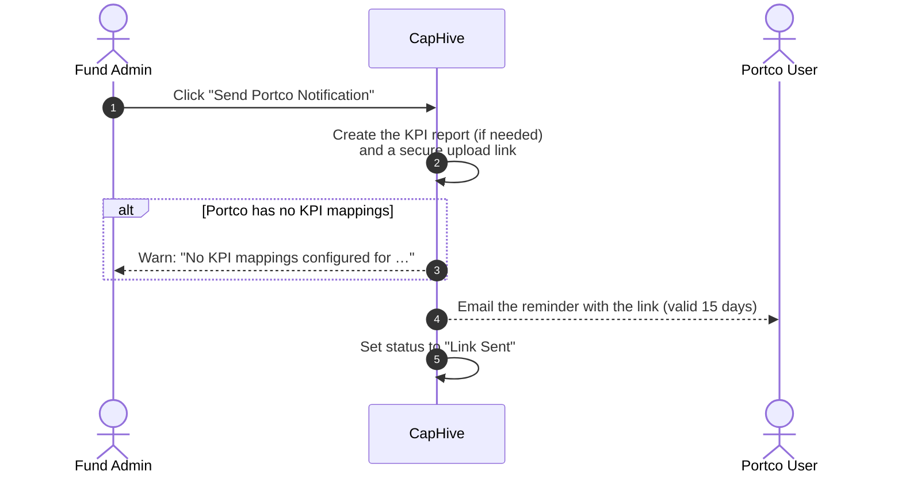
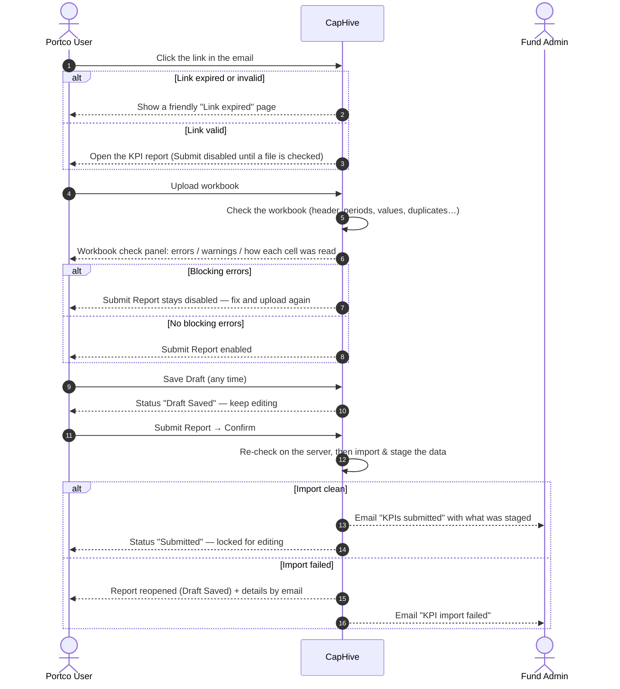
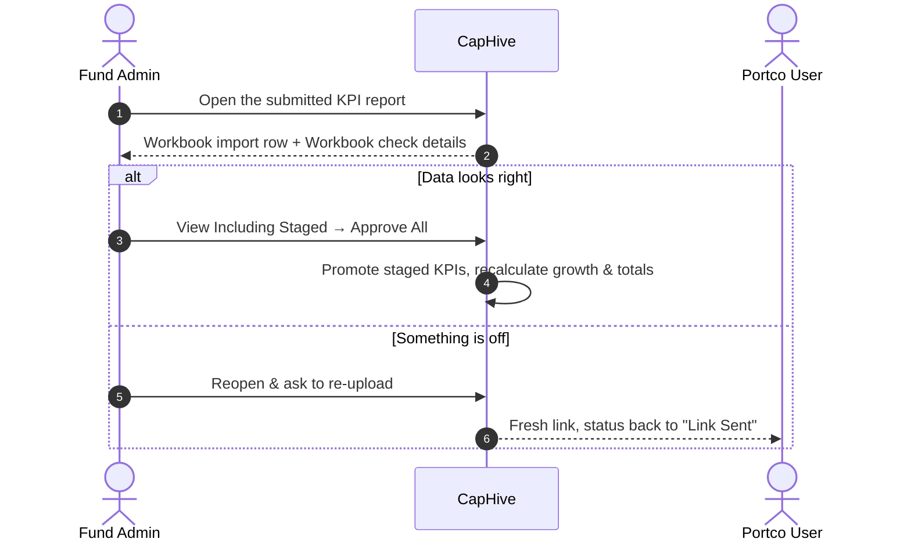
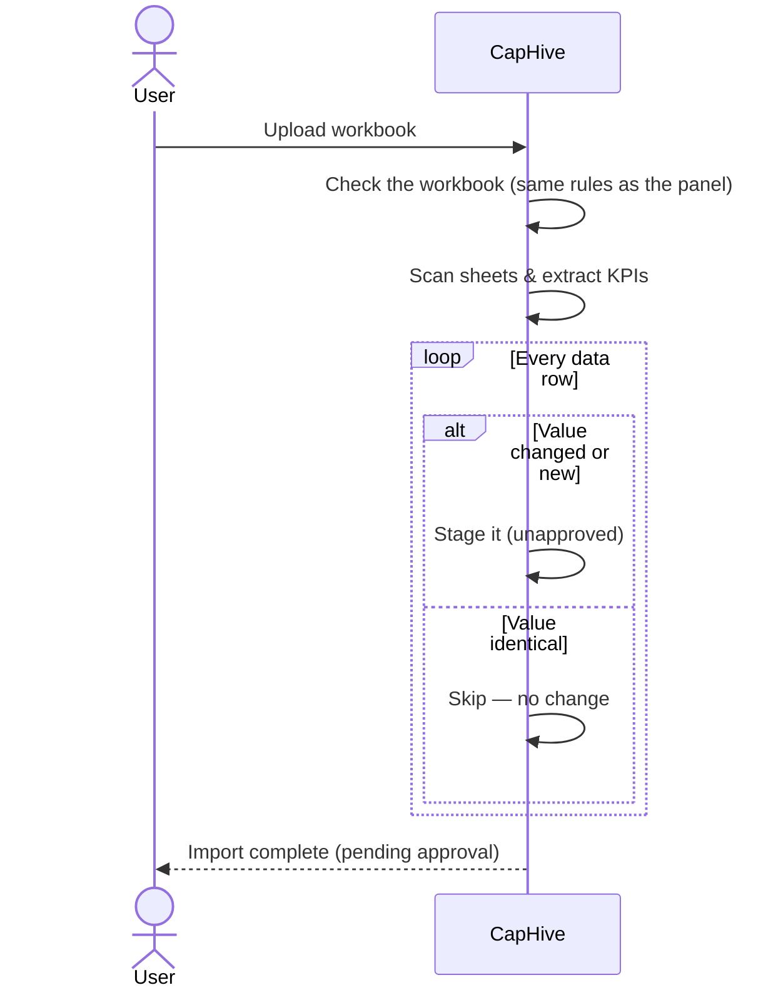
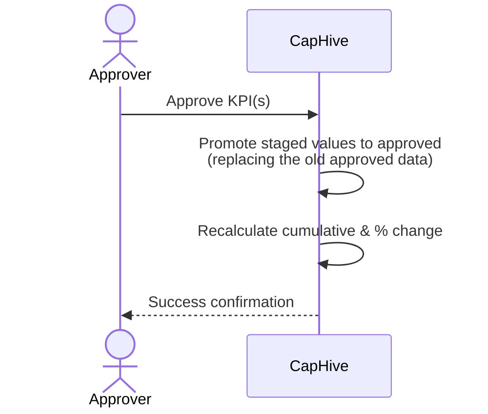

# KPI Management & Workbook Upload User Guide (V9.4.0)

This guide provides a comprehensive overview of the Key Performance Indicator (KPI) reporting system in IRM. It covers everything from preparing your Excel workbooks, through the **Workbook check** that runs on every upload, to the automated approval workflows.

## 📑 Table of Contents
1. [Key Takeaways](#-key-takeaways)
2. [Roles & Permissions](#-roles--permissions)
3. [The Reporting Workflow](#-the-reporting-workflow)
4. [The Workbook Check](#-the-workbook-check)
5. [Report Status Lifecycle](#-report-status-lifecycle)
6. [Workbook Preparation Checklist](#-workbook-preparation-checklist)
7. [How Numbers Are Read](#-how-numbers-are-read)
8. [Supported Date Formats](#-supported-date-formats)
9. [Parent & Child KPIs](#-parent--child-kpis)
10. [Automated System Actions](#-automated-system-actions)
11. [Common Pitfalls & Troubleshooting](#-common-pitfalls--troubleshooting)
12. [FAQ](#-faq)

---

## 🚀 Key Takeaways
*   **Two-Stage Process**: Data is first **Staged** (Unapproved) and then **Promoted** (Approved) by an authorized user.
*   **Approved Data Only**: Dashboards, performance tables, and growth calculations only use **Approved** data.
*   **Checked Before You Save**: Every uploaded workbook is checked by CapHive the moment it is uploaded. The **Workbook check** panel shows what will be stored, cell by cell, and lists anything that must be fixed (red) or is worth a look (amber) — before you save or submit.
*   **Formatting Is Understood**: `1,200`, `(500)`, `₹ 12,50,000`, `$1.2M`, `2.5 Cr`, `42%` are read as the numbers you meant. Text is never silently stored as 0.
*   **The Requested Period Must Be There**: A portfolio company's upload must contain the period the fund asked for (e.g. Jun 2026), with values — otherwise it cannot be submitted.
*   **Submit Means Staged**: The fund's "KPIs submitted" email is sent only once the data has actually been imported and staged for approval.
*   **Template Download**: A pre-filled workbook (your KPI names, units and the requested period) is one click away on the report page.
*   **Smart Matching**: The system skips identical values to avoid duplicates and flags changes for review.
*   **Automated Calculations**: Quarterly, YTD, and Annual totals are automatically recalculated upon approval — from monthly Actuals, or from quarterly Actuals if that's all a company reports (never both, so totals aren't duplicated).
*   **Direct Links**: Portfolio companies should use the link in their reminder email to upload directly to the correct period.
*   **Save Draft / Submit**: Portfolio companies can save work-in-progress with **Save Draft** and use **Submit Report** when done.
*   **Status Tracking**: Every report has a visible status badge — fund admins can see which companies have submitted at a glance.
*   **Link Expiry**: Magic links are valid for 15 days. The expiry date is shown in the email. Contact your fund manager for a new link if needed.

---

## 👥 Roles & Permissions
The KPI system ensures data integrity through role-based access:

| Role | Permissions |
| :--- | :--- |
| **Fund Admin / Approver** | Full access. Can create reports, approve staged KPIs, trigger recomputations, send notifications, mark reports as reviewed, and **reopen** a submitted report to ask the portfolio company for a fresh upload. On a submitted report's page, the **View Including Staged** button links directly to the grid view where staged KPIs can be reviewed and approved. |
| **Portfolio Company User** | Can save drafts and submit KPI reports for their company via secure email links or the **Pending KPI Reports** dashboard. Can only change the notes and the workbook on a report — the period, company and tags are set by the fund. |
| **Advisor / Read-Only** | Can view approved reports and dashboards but cannot modify data or approve uploads. |

### Designated KPI Contact
Each portfolio company can have one or more **designated KPI contacts**. When any approved user at the portfolio company has the tag **"Kpi"** on their profile, only those tagged users receive KPI reminder emails — untagged users are skipped. If no user has the "Kpi" tag, all approved users are notified as usual.

To designate a contact, a fund admin (or the portco user themselves) adds the tag `Kpi` to the relevant user's profile via the investor's user management page.

---

## 🔄 The Reporting Workflow

### 1. Notification & Request
The process typically begins when a Fund Admin sends a reminder to a Portfolio Company.
*   **Self-Reporting**: The system enables "Self-Reporting" for the specific period, creating a report shell and setting its status to **Link Sent**. The request always lives on the **end of the period** (e.g. a request typed as 18 June is stored as 30 June).
*   **Reminder Email**: The company receives an email with a direct link to the upload portal. The link is valid for **15 days** — the expiry date is shown in the email.
*   **Bulk Send**: Fund admins can notify all portfolio companies at once. Companies that have already submitted are automatically skipped.
*   **No KPI Mappings?** If a portfolio company has no KPI mappings configured yet, the fund sees a warning at send time and a red **No KPI mappings configured** badge on the report — the company's uploads will be refused until mappings are added under *Investors → KPI Mappings*.
*   **Automated Reminders**: The periodic job re-sends reminders only to companies whose status is still **Link Sent** or **Draft Saved** — submitted companies are never nagged.

### 2. Portfolio Company Fills Out the Report
*   The portco user clicks the link in the email (no login required). **Submit Report** is disabled until a workbook has been checked.
*   Optionally click **Download KPI template** to get a workbook already laid out with the company's KPI names, expected units and the requested period.
*   Upload the workbook (.xlsx, .xls or .csv). The **Workbook check** panel appears within seconds — see the next section. Fix anything in red and upload again; the panel and buttons update automatically.
*   **Save Draft** at any point to preserve progress without notifying the fund. Saving a draft returns to the **Edit** page with a success message.
*   When all data is final, click **Submit Report** and confirm. CapHive re-checks the workbook on the server, imports it, and **only then** notifies the fund team. If the check fails at that moment, nothing is submitted: the changes are kept as a draft and the reasons are shown.
*   After submission, the report is locked for editing.

### 3. Portco Pending Dashboard
Portfolio company users can visit **KPI Reports → Pending KPI Requests** to see all outstanding requests from any fund, without needing the original email.
*   **Direct Entity Querying**: This dashboard is optimized to query directly by the portfolio company's entity, ensuring reliable access without requiring explicit access rights on the fund's KPI reports.
*   **Standardized Dates**: Outstanding requests are displayed with dates formatted in standard ISO8601 (`YYYY-MM-DD`) format for clarity.

### 4. Fund Admin Review
*   The fund admin receives the **KPIs submitted** email once the workbook has been imported — it states how many values and KPIs were staged and how many warnings to look at.
*   The KPI report **Show page** now has a **Workbook import** row (Imported / Import pending / Import failed, error and warning counts, values staged, how many differ from already-approved figures) and a collapsible **Workbook check details** card showing exactly what the portfolio company saw — including, for every value, what was in the file and how it was read.
*   Click **View Including Staged** (outlined green, shown only when the status is **Submitted**) to open the KPI **Grid View** filtered to this portfolio company with staged KPIs highlighted in orange.
*   From the grid view the admin can approve individual KPIs or use **Actions → Approve All** to promote all staged data in one step. Growth and cumulative recalculations trigger automatically on approval.
*   **Reopen & ask to re-upload** (on submitted reports) sends the report back to the portfolio company with a fresh link when something needs correcting.
*   **Reviewed** reports are excluded from all future reminder cycles.

### 5. Staged Import (The Upload)

Whether uploaded by a portfolio company or by a fund user, a workbook goes through the same import:

### 6. Authorized Approval

An Admin reviews the staged data. Unapproved values are highlighted in **orange** with a **"Pending"** badge in the KPI Grid View.

---

## 🔍 The Workbook Check

The **Workbook check** panel appears on the report page as soon as a file finishes uploading (portfolio company and fund users alike; on the fund's *New report* page it uses the company, date and period chosen in the form). It shows:

| Section | What it tells you |
| :--- | :--- |
| **Requested period** | "You were asked for **Jun 2026 (Month)** — column present, KPIs filled 9 of 12" (or "column not found in the file"). |
| **Errors** (red) | Must be fixed before submitting. Each names the sheet and cell (e.g. `MIS!C7`), the KPI and the period. |
| **Warnings** (amber) | Worth reviewing; they do not block submission. |
| **Summary** | How many of the expected KPIs were found (and which are missing), which periods the file covers, which other periods it will also update, hidden sheets ignored. |
| **How we read your file** | One row per value: KPI, period, cell, *what was in the file*, *what will be stored*, *how* (e.g. "stripped currency; unit 'Cr' × 10,000,000"), the currently approved figure, and a status (new / same as approved / changed / blank / future — ignored / error). Rows for the requested period are bold; values that differ from approved figures are amber; errors are red. |

**Blocking errors** (Submit disabled):
*   No workbook, or the file is not a spreadsheet.
*   No sheet has a header row with period columns.
*   None of the fund's KPI names appear in the file.
*   The requested period is missing, or present but empty for every KPI.
*   Excel error cells (`#DIV/0!`, `#REF!`, `#N/A`…), text where a number is expected (`ten`), or ambiguous numbers (`10 (prev 8)`, a sheet mixing `1.234,56` and `1,234.56`).
*   The same KPI on two rows with **different** values for the same period; the same period appearing twice in the header without a distinguishing Actual/Budget label.
*   The portfolio company has no KPI mappings configured.

**Warnings** (shown, not blocking): a mapped KPI missing from the file; a column header we don't recognise (e.g. *Comments*) or an Actual/Budget-row label we don't recognise (e.g. *Variance*) — the column is ignored; a hidden sheet ignored; a future-dated *Actual* column ignored; other periods that will also be updated and approved figures that would change; monthly columns supplied for a quarterly/annual request; a placeholder like `TBD` treated as blank; a KPI repeated with the same value; and the plausibility hints in the next paragraph.

**Plausibility hints** compare each value with the company's approved history (last 3 years): a value ~1,000× or more away from the last approved figure ("is the sheet in crores?"), a percentage typed as `42` where history is `0.42`, a change beyond the thresholds set on the KPI mapping, a value in the red or amber **RAG band** the fund defined for that KPI, a sign flip against recent history, or a >200 % swing where no thresholds are set. A brand-new KPI with no history gets none of these. See the [RAG Status User Guide](/user_guides/kpi_rag_status_user_guide) for how a fund sets up RAG bands and what "red"/"amber"/"green" mean for a given KPI.

The verdict is remembered on the report: reload the page and it is still there; **Re-check file** runs it again on the attached workbook.

**Fund users** see the same panel when they upload on a report's edit page or the *New report* page. A workbook with blocking errors cannot be saved by anyone — the **Save** button is disabled while errors are shown and the server refuses a forced save. Save is never disabled just because no file has been chosen, and for fund-created reports "the file doesn't contain this report's period" is a warning rather than an error.

---

## 🔵 Report Status Lifecycle

Each portco self-reporting request moves through these states:

| Status | Meaning | Who Sees It |
| :--- | :--- | :--- |
| **Shell Created** | Report created, link not yet sent | Fund admin |
| **Link Sent** | Reminder email delivered to portco (also after the fund reopens a report) | Both |
| **Draft Saved** | Portco saved progress, not yet submitted — also where a report lands if a submission's import failed | Both |
| **Submitted** | Portco clicked Submit; the workbook is being / has been imported (see the *Workbook import* row: pending → imported) and the fund has been notified | Both |
| **Reviewed** | Fund admin marked as reviewed | Both |

The status badge is visible on the report form for both the fund admin and the portfolio company user.

---

## 📋 Workbook Preparation Checklist

The easiest way to get a clean upload is **Download KPI template** on the report page. If you use your own file:

### 1. Structure & Layout
*   **Header Detection**: The system scans the first 10 rows to find your period headers (e.g., "Jan 2024"). Title rows above the header are fine.
*   **Header Requirement**: A header row normally contains at least **two** period columns. A single-period sheet (`KPI | Jun 2026`) is accepted when the KPI names beneath it match your fund's list.
*   **KPI Column**: Place KPI names in the first column(s). The system matches these against your configured "Reported KPI Names". Extra label columns (Unit, Segment) before the first period column are fine.
*   **Data Rows**: Values should be directly beneath the header row.
*   **Requested Period**: For a portfolio company upload, the period the fund asked for must be one of the columns, with values.
*   **Actual / Budget side by side**: put a label row (Actual, Budget, IC) directly under the period headers; other labels in that row (e.g. Variance) are ignored.
*   **Hidden sheets** are ignored — unhide a sheet if it should be read.

### 2. KPI Naming
*   **Smart Matching**: Names are matched case-insensitively and space-insensitively (e.g., "Gross Profit" matches "gross profit").
*   **Consistency**: Ensure names match the "Reported KPI Names" in your mapping settings.
*   **No Repeats**: A KPI should appear once per sheet. If it appears twice with the same value it is imported once; with different values the upload is blocked until you keep one.

### 3. Data Integrity
*   **Numbers**: plain numbers are best, but common formatting is understood (see the next section). Use `n/a`, `na`, `TBD` or `—` for values you don't have — they are left blank.
*   **No Duplicate Periods**: Avoid two "Jan 2024" columns in the same sheet unless an Actual/Budget label row tells them apart.
*   **Future Dates**: Values for future dates are skipped for "Actual" tags — the panel tells you which column and what date it was read as.

---

## 🔢 How Numbers Are Read

| You type | Stored as |
| :--- | :--- |
| `1,200` · `12,50,000` · `1 200` | 1200 · 1250000 · 1200 |
| `(500)` · `500-` | −500 |
| `₹ 5,00,000` · `INR 42` · `$1.2M` | 500000 · 42 · 1200000 |
| `45 L` · `2.5 Cr` · `12 Bn` · `800K` | 4500000 · 25000000 · 12000000000 · 800000 — a unit written in the cell overrides the unit configured on the KPI mapping |
| `42%` on a percentage KPI | 0.42 (matches how Excel stores percentages) |
| European style `1.234,56` | 1234.56 — as long as the whole sheet uses that style |
| `n/a` · `TBD` · `—` | left blank (with a warning) |
| `#DIV/0!` · `ten` · `10 (prev 8)` · mixed styles | **not accepted** — the panel names the cell |

Values on a KPI whose mapping has a denomination (thousands, lakhs, millions, crores) are multiplied accordingly, unless the cell carries its own unit.

---

## 📅 Supported Date Formats
Your column headers should use one of these recognized formats:

| Type | Examples |
| :--- | :--- |
| **Monthly** | `Jan 2024`, `January 2024`, `Sep 23`, `Apr'25` |
| **Quarterly** | `Q1 FY24`, `Q3 CY22`, `Jan-Mar 2024`, `Mar-May 2026`, `JFM 2024` |
| **Annual** | `FY 2023-24`, `FY2024`, `CY2024`, `2024` |
| **Half-Year** | `H1 2023`, `H2 FY24` |
| **YTD** | `YTD Nov 23`, `YTD Jan-Sept 2023` |
| **Standard** | `DD-MM-YYYY`, `DD/MM/YYYY` |

Fiscal-year labels (`FY26`, `Q1 FY26`, `H1 FY26`) follow your fund's financial-year start (April by default; January or another month where configured — a portfolio company can have its own setting). `FY26` therefore means the year ending March 2026 for an April start and the year ending December 2026 for a January start.

---

## 🌳 Parent & Child KPIs

Funds can map a KPI as a parent with children — *Revenue* with *North / South / East / West*, or *Net Sales* with *Enterprise / Mid-Market / SMB* (see the *KPI Parent-Child Mapping User Guide* for set-up). Uploads support the common layouts:

*   **Parent row followed by child rows** (indented or in a second column) — the standard layout.
*   **Parent name repeated on every child row** (`Net Sales | Enterprise | 600`) — read as child rows.
*   **The same child name under two parents** (`Enterprise` under both *Net Sales* and *Operating Cost*) — resolved by the section it sits in. If the sheet gives no clue which section a row belongs to (e.g. the child appears before any parent row), the row is **skipped with a warning** rather than guessed — put it under its parent row.
*   **Sum check**: when a parent and all of its children carry values for a period and the children don't add up to the parent (±1 %), the panel shows a hint (not a blocker).

---

## ⚙️ Automated System Actions
After approval, the system automatically triggers several high-impact tasks:
1.  **Growth Metrics**: Recalculates Year-on-Year (YoY) and Month-on-Month (MoM) percentage changes.
2.  **Cumulative Totals**: Recomputes **Quarterly**, **YTD**, and **Annual** sums from monthly Actuals. If a company reports Actuals at Quarter level instead (no monthly data), **YTD** builds up as each quarter comes in and **Annual** is computed once all of Q1–Q4 are in — the system never double-counts a year that already has monthly data.
3.  **Audit Trail**: Appends approval details (User, Timestamp) to the KPI notes.
4.  **Search Indexing**: Updates the search engine so new data is immediately findable.

---

## 🛠️ Common Pitfalls & Troubleshooting

### 1. "Please fix these errors before submitting" (Submit Report disabled)
*   **Cause**: The Workbook check found a blocking problem. The panel lists each one with the sheet, cell, KPI and period.
*   **Fix**: Correct the file as described and upload again — the panel and buttons update automatically. If you are stuck, **Download KPI template** and paste your numbers into it.

### 2. "You were asked for Jun 2026 (Month), but no column in the file is that period"
*   **Cause**: The workbook doesn't contain the period the fund requested (the panel lists the periods it did find).
*   **Fix**: Add the requested column. If the fund asked for a quarter/year and you only have monthly figures, monthly columns ending on the requested date are accepted with a warning — quarterly figures are derived where the fund has configured cumulation.

### 3. "No sheet in the file has a header row with at least two period columns"
*   **Cause**: The system couldn't find your period headers in the first 10 rows of any sheet.
*   **Fix**: Ensure your headers use supported formats (e.g., "Jan 2024") and are not buried deep in the sheet.

### 4. "…is not a number" / "contains more than one number" / "Excel error '#DIV/0!'"
*   **Cause**: A value cell holds text, two figures, or a broken formula result.
*   **Fix**: Type a plain number, or use `n/a` if you don't have the value. Common formatting (commas, brackets, currency, K/L/M/Cr, %) is fine.

### 5. "…appears at MIS!C2 (2,450) and MIS!C4 (2,999) with different values — keep one"
*   **Cause**: The same KPI is on two rows (or in two sheets) with different numbers for the same period.
*   **Fix**: Delete or rename one of them. If both are legitimate (e.g. the second is a different section), ask your fund to map it under the right parent.

### 6. "Your fund has not configured which KPIs to collect from … yet"
*   **Cause**: No KPI mappings exist for the portfolio company.
*   **Fix**: Contact your fund manager; they add mappings under *Investors → KPI Mappings*.

### 7. "KPI Name Not Mapped" / "Target KPI '…' not found"
*   **Cause**: The KPI name in Excel doesn't match any "Reported KPI Name" in the system.
*   **Fix**: Check your mapping settings or update the Excel file to use the correct name (the template has the right names).

### 8. "Value Skipped (Identical)"
*   **Cause**: The value in Excel is exactly the same as the currently approved value.
*   **Fix**: No action needed. The system does this to save time and avoid redundant approvals.

### 9. "…which is in the future — Actual values under it are ignored"
*   **Cause**: You are uploading "Actual" data for a date that hasn't occurred yet — or a fiscal-year label was read differently than you meant (the message shows the date it was read as).
*   **Fix**: Use the "Budget" tag row for forward-looking data, or check the fiscal-year label / your fund's financial-year setting.

### 10. "Not submitted — the KPI workbook has N blocking errors"
*   **Cause**: Submit was attempted while the workbook still had blocking errors (for example after the panel was bypassed).
*   **Fix**: Your changes were saved as a draft; fix the errors shown and submit again.

### 11. "This link has expired or is invalid" Error Page
*   **Cause**: The magic link you clicked has expired (valid for 15 days) or is invalid.
*   **Fix**: Contact your fund manager to request a new invitation link.

---

## ❓ FAQ

**Q: I uploaded my KPIs, but the dashboard hasn't updated. Why?**
A: Your data is likely in the **Staged (Unapproved)** state. Dashboards only reflect **Approved** data. Contact your Fund Admin to open the KPI report show page and click **View Including Staged** to review and approve the uploaded data from the grid view.

**Q: I submitted, but the fund says they weren't notified. Why?**
A: The fund is emailed once the workbook has been imported (usually within a minute of submitting). Check the report page: the *Workbook import* row shows *Import pending* → *Imported*. If it shows *Import failed*, the report has been reopened for you with the details by email — fix and resubmit.

**Q: How do I see how my numbers were read?**
A: The **How we read your file** table in the Workbook check panel shows, for every value, what was in the file and what will be stored — including any unit or currency handling.

**Q: How do I see my "Pending" data?**
A: In the **KPI Grid View**, authorized users can enable **"View Including Staged"** to see unapproved values highlighted in orange.

**Q: What happens if I upload the same file twice?**
A: The system checks for identical values. If the data hasn't changed, it will skip the import for those specific KPIs to avoid redundant approvals.

**Q: My file has older months too. Will they be imported?**
A: Yes — every period in the file is imported and staged (the panel lists them under "Also updates"). Values that differ from figures the fund has already approved are highlighted, and still need the fund's approval.

**Q: Can I upload data for multiple companies in one workbook?**
A: No. Each upload is scoped to a specific Portfolio Company to ensure data security and correct mapping.

**Q: The system didn't recognize my date headers. What should I do?**
A: Ensure your dates are in one of the supported formats (see *Supported Date Formats*) and are located within the first 10 rows of the sheet.

**Q: What is the difference between "Save Draft" and "Submit Report"?**
A: **Save Draft** saves your progress without notifying the fund — you can come back and continue editing. **Submit Report** re-checks the workbook, imports it, notifies the fund team once the data is staged, and locks the report for editing. Use Save Draft freely while you're working, and Submit only when all numbers are final.

**Q: My magic link expired. How do I get a new one?**
A: Magic links are valid for 15 days (the expiry date is shown in the reminder email). If your link has expired, contact your fund manager and ask them to resend the notification.

**Q: I submitted by accident, or with the wrong file. Can it be undone?**
A: Contact your fund manager. On the report page they can click **Reopen & ask to re-upload**, which sends you a fresh link.

**Q: I keep receiving reminder emails even though I already submitted. Why?**
A: This should not happen — the system skips already-submitted reports in all reminder cycles. If you're still receiving emails, check that you clicked **Submit Report** (not just Save Draft). The status badge on your report should read "Submitted".

**Q: Who gets the reminder email at my company?**
A: By default, all approved users at your company receive the reminder. If any user at your company has the **"Kpi"** tag on their profile, only those tagged users will receive reminder emails. To designate specific KPI contacts, ask your fund manager to add the `Kpi` tag to the relevant user profiles. Multiple users can be tagged, and all of them will receive the reminders.

---
*For technical support or custom KPI mapping, please contact your system administrator.*
