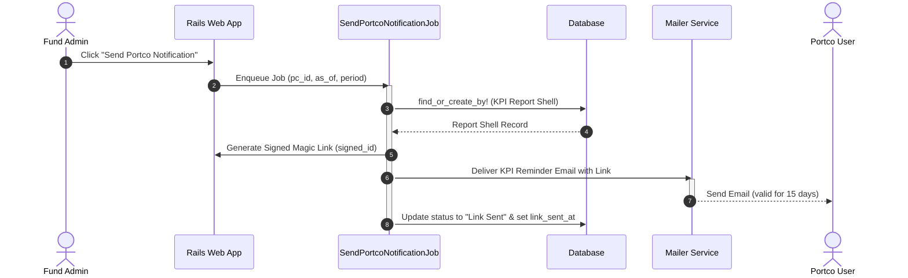
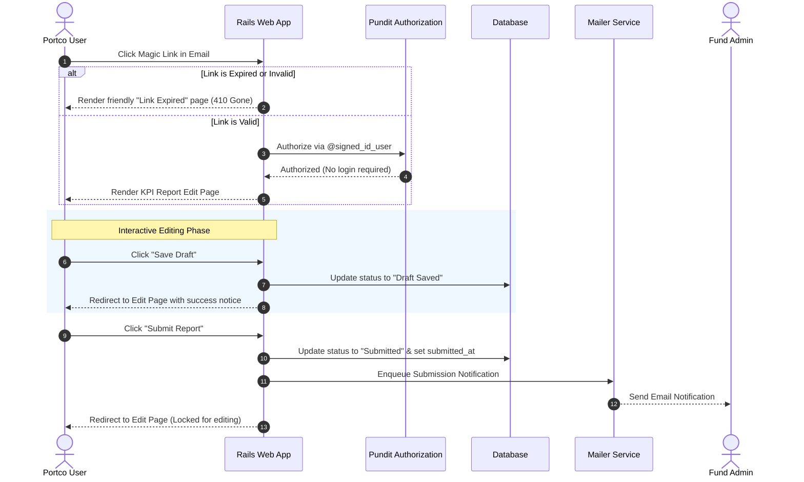
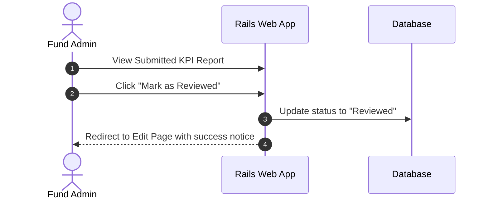
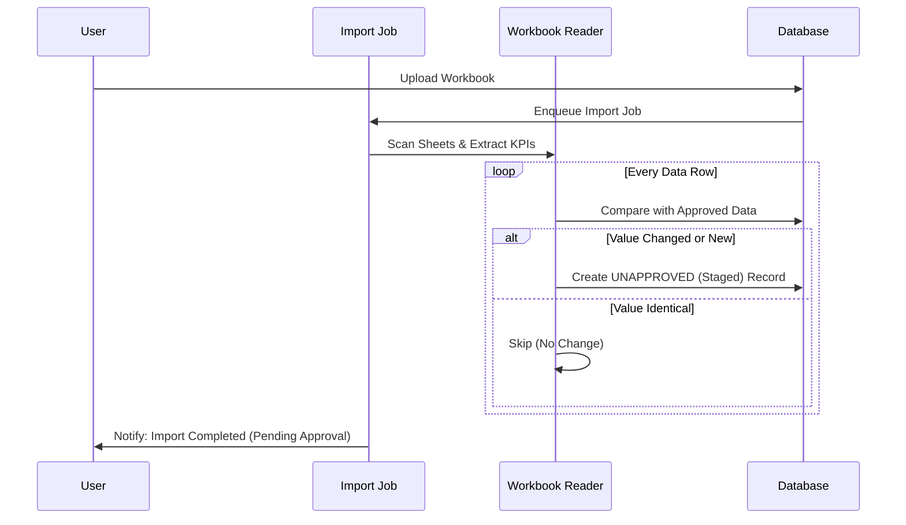
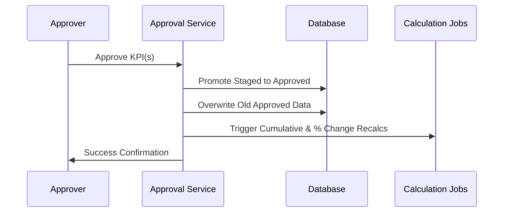

# KPI Management & Workbook Upload User Guide (V9.3.0)

This guide provides a comprehensive overview of the Key Performance Indicator (KPI) reporting system in IRM. It covers everything from preparing your Excel workbooks to the automated approval workflows.

## 📑 Table of Contents
1. [Key Takeaways](#-key-takeaways)
2. [Roles & Permissions](#-roles--permissions)
3. [The Reporting Workflow](#-the-reporting-workflow)
4. [Report Status Lifecycle](#-report-status-lifecycle)
5. [Workbook Preparation Checklist](#-workbook-preparation-checklist)
6. [Supported Date Formats](#-supported-date-formats)
7. [Automated System Actions](#-automated-system-actions)
8. [Common Pitfalls & Troubleshooting](#-common-pitfalls--troubleshooting)
9. [FAQ](#-faq)

---

## 🚀 Key Takeaways
*   **Two-Stage Process**: Data is first **Staged** (Unapproved) and then **Promoted** (Approved) by an authorized user.
*   **Approved Data Only**: Dashboards, performance tables, and growth calculations only use **Approved** data.
*   **Smart Matching**: The system skips identical values to avoid duplicates and flags changes for review.
*   **Automated Calculations**: Quarterly, YTD, and Annual totals are automatically recalculated upon approval.
*   **Direct Links**: Portfolio companies should use the link in their reminder email to upload directly to the correct period.
*   **Save Draft / Submit**: Portfolio companies can save work-in-progress with **Save Draft** and use **Submit Report** when done. The fund is notified automatically upon submission.
*   **Status Tracking**: Every report has a visible status badge — fund admins can see which companies have submitted at a glance.
*   **Link Expiry**: Magic links are valid for 15 days. The expiry date is shown in the email. Contact your fund manager for a new link if needed.

---

## 👥 Roles & Permissions
The KPI system ensures data integrity through role-based access:

| Role | Permissions |
| :--- | :--- |
| **Fund Admin / Approver** | Full access. Can create reports, approve staged data, trigger recomputations, send notifications, and mark reports as reviewed. |
| **Portfolio Company User** | Can save drafts and submit KPI reports for their company via secure email links or the **Pending KPI Reports** dashboard. |
| **Advisor / Read-Only** | Can view approved reports and dashboards but cannot modify data or approve uploads. |

### Designated KPI Contact
Each portfolio company can have one or more **designated KPI contacts**. When any approved user at the portfolio company has the tag **"Kpi"** on their profile, only those tagged users receive KPI reminder emails — untagged users are skipped. If no user has the "Kpi" tag, all approved users are notified as usual.

To designate a contact, a fund admin (or the portco user themselves) adds the tag `Kpi` to the relevant user's profile via the investor's user management page.

---

## 🔄 The Reporting Workflow

### 1. Notification & Request
The process typically begins when a Fund Admin sends a reminder to a Portfolio Company.
*   **Self-Reporting**: The system enables "Self-Reporting" for the specific period, creating a report shell and setting its status to **Link Sent**.
*   **Reminder Email**: The company receives an email with a direct link to the upload portal. The link is valid for **15 days** — the expiry date is shown in the email.
*   **Bulk Send**: Fund admins can notify all portfolio companies at once. Companies that have already submitted are automatically skipped.
*   **Automated Reminders**: The periodic job re-sends reminders only to companies whose status is still **Link Sent** or **Draft Saved** — submitted companies are never nagged.

### 2. Portfolio Company Fills Out the Report
*   The portco user clicks the link in the email (no login required).
*   They can **Save Draft** at any point to preserve progress without notifying the fund. Saving a draft redirects the user back to the **Edit** page with a success message, keeping them in their editing context.
*   When all data is final, they click **Submit Report**. The fund team is notified immediately by email.
*   After submission, the report is locked for editing.

### 3. Portco Pending Dashboard
Portfolio company users can visit **KPI Reports → Pending KPI Requests** to see all outstanding requests from any fund, without needing the original email.
*   **Direct Entity Querying**: This dashboard is optimized to query directly by the portfolio company's entity, ensuring reliable access without requiring explicit access rights on the fund's KPI reports.
*   **Standardized Dates**: Outstanding requests are displayed with dates formatted in standard ISO8601 (`YYYY-MM-DD`) format for clarity.

### 4. Fund Admin Review
*   The fund admin receives a notification email when a portco submits.
*   They review the data and click **Mark as Reviewed** to advance the report to **Reviewed** status.
*   **Editing Context**: Clicking **Mark as Reviewed** redirects the admin back to the **Edit** page to keep them in their workflow.
*   **Clean Layout**: The "Mark as Reviewed" button is located cleanly outside the main form to prevent nested form conflicts.
*   **Reviewed** reports are excluded from all future reminder cycles.

### 5. Staged Import (The Upload)

When a workbook is uploaded, the system performs a "Staged Import":

### 3. Authorized Approval

An Admin reviews the staged data. Unapproved values are highlighted in **orange** with a **"Pending"** badge in the KPI Grid View.

---

## 🔵 Report Status Lifecycle

Each portco self-reporting request moves through these states:

| Status | Meaning | Who Sees It |
| :--- | :--- | :--- |
| **Shell Created** | Report created, link not yet sent | Fund admin |
| **Link Sent** | Reminder email delivered to portco | Both |
| **Draft Saved** | Portco saved progress, not yet submitted | Both |
| **Submitted** | Portco clicked Submit — fund notified | Both |
| **Reviewed** | Fund admin marked as reviewed | Both |

The status badge is visible on the report form for both the fund admin and the portfolio company user.

---

## 📋 Workbook Preparation Checklist

### 1. Structure & Layout
*   **Header Detection**: The system scans the first 10 rows to find your date headers (e.g., "Jan 2024").
*   **Header Requirement**: A valid header row must contain at least **two** date-like values.
*   **KPI Column**: Place KPI names in the first column. The system matches these against your configured "Reported KPI Names."
*   **Data Rows**: Values should be directly beneath the header row.

### 2. KPI Naming
*   **Smart Matching**: Names are matched case-insensitively and space-insensitively (e.g., "Gross Profit" matches "gross profit").
*   **Consistency**: Ensure names match the "Reported KPI Names" in your mapping settings.

### 3. Data Integrity
*   **Numeric Only**: Ensure values are numbers. Use `na` or `n/a` for non-applicable fields.
*   **No Duplicates**: Avoid duplicate period headers (e.g., two "Jan 2024" columns) in the same sheet.
*   **Future Dates**: Values for future dates are automatically skipped for "Actual" tags.

---

## 📅 Supported Date Formats
Your column headers should use one of these recognized formats:

| Type | Examples |
| :--- | :--- |
| **Monthly** | `Jan 2024`, `January 2024`, `Sep 23` |
| **Quarterly** | `Q1 FY24`, `Q3 CY22`, `Jan-Mar 2024`, `JFM 2024` |
| **Annual** | `FY 2023-24`, `FY2024`, `CY2024`, `2024` |
| **Half-Year** | `H1 2023`, `H2 FY24` |
| **YTD** | `YTD Nov 23`, `YTD Jan-Sept 2023` |
| **Standard** | `DD-MM-YYYY`, `DD/MM/YYYY` |

---

## ⚙️ Automated System Actions
After approval, the system automatically triggers several high-impact tasks:
1.  **Growth Metrics**: Recalculates Year-on-Year (YoY) and Month-on-Month (MoM) percentage changes.
2.  **Cumulative Totals**: Recomputes **Quarterly**, **YTD**, and **Annual** sums based on monthly data.
3.  **Audit Trail**: Appends approval details (User, Timestamp) to the KPI notes.
4.  **Search Indexing**: Updates the search engine so new data is immediately findable.

---

## 🛠️ Common Pitfalls & Troubleshooting

### 1. "No Date Headers Found"
*   **Cause**: The system couldn't find at least two date-like values in the first 10 rows.
*   **Fix**: Ensure your headers use supported formats (e.g., "Jan 2024") and are not buried deep in the sheet.

### 2. "KPI Name Not Mapped"
*   **Cause**: The KPI name in Excel doesn't match any "Reported KPI Name" in the system.
*   **Fix**: Check your mapping settings or update the Excel file to use the correct name.

### 3. "Value Skipped (Identical)"
*   **Cause**: The value in Excel is exactly the same as the currently approved value.
*   **Fix**: No action needed. The system does this to save time and avoid redundant approvals.

### 4. "Future Date Skipped"
*   **Cause**: You are uploading "Actual" data for a date that hasn't occurred yet.
*   **Fix**: Use the "Budget" or "Projected" tag if you are uploading future-looking data.

### 5. "This link has expired or is invalid" Error Page
*   **Cause**: The magic link you clicked has expired (valid for 15 days) or is invalid.
*   **Fix**: Contact your fund manager to request a new invitation link. The system will render a friendly, unauthenticated-safe error page with instructions instead of redirecting you to the sign-in page.

---

## ❓ FAQ

**Q: I uploaded my KPIs, but the dashboard hasn't updated. Why?**
A: Your data is likely in the **Staged (Unapproved)** state. Dashboards only reflect **Approved** data. Contact your Fund Admin to review and approve the upload.

**Q: How do I see my "Pending" data?**
A: In the **KPI Grid View**, authorized users can enable **"View Including Staged"** to see unapproved values highlighted in orange.

**Q: What happens if I upload the same file twice?**
A: The system checks for identical values. If the data hasn't changed, it will skip the import for those specific KPIs to avoid redundant approvals.

**Q: Can I upload data for multiple companies in one workbook?**
A: No. Each upload is scoped to a specific Portfolio Company to ensure data security and correct mapping.

**Q: The system didn't recognize my date headers. What should I do?**
A: Ensure your dates are in one of the supported formats (see Section 6) and are located within the first 10 rows of the sheet.

**Q: What is the difference between "Save Draft" and "Submit Report"?**
A: **Save Draft** saves your progress without notifying the fund — you can come back and continue editing. **Submit Report** finalises the submission, notifies the fund team, and locks the report for editing. Use Save Draft freely while you're working, and Submit only when all numbers are final.

**Q: My magic link expired. How do I get a new one?**
A: Magic links are valid for 15 days (the expiry date is shown in the reminder email). If your link has expired, contact your fund manager and ask them to resend the notification. They can do this from the KPI reports page by clicking **Send Portco Notification** again.

**Q: I submitted by accident. Can I undo it?**
A: Contact your fund manager. They can update the report status from their end if needed.

**Q: I keep receiving reminder emails even though I already submitted. Why?**
A: This should not happen — the system skips already-submitted reports in all reminder cycles. If you're still receiving emails, check that you clicked **Submit Report** (not just Save Draft). The status badge on your report should read "Submitted".

**Q: Who gets the reminder email at my company?**
A: By default, all approved users at your company receive the reminder. If any user at your company has the **"Kpi"** tag on their profile, only those tagged users will receive reminder emails. To designate specific KPI contacts, ask your fund manager to add the `Kpi` tag to the relevant user profiles. Multiple users can be tagged, and all of them will receive the reminders.

---
*For technical support or custom KPI mapping, please contact your system administrator.*
