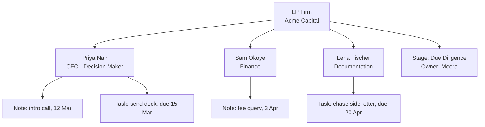
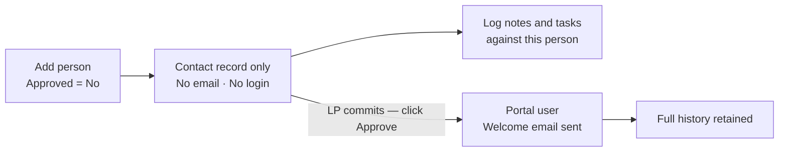
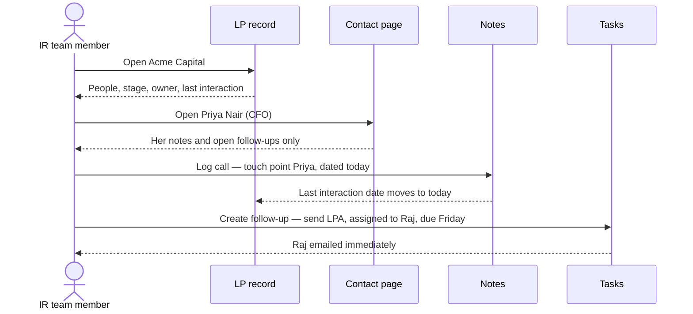

# LP Relationship CRM User Guide

CapHive doubles as a lightweight CRM for the people side of fundraising: one place that holds every prospective and existing LP, the individuals who work there, what was said to each of them, and what happens next.

The goal is blunt — **no relationship should live only in one person's inbox or head**. When a colleague goes on leave, changes role, or leaves the firm, the next person should be able to open the LP page and pick the conversation up cold.

Nothing here is a separate product or a separate login. It is the Stakeholder pages you already use, with contact detail, an interaction log, and follow-ups attached.

---

## 📑 Table of Contents

1. [Key Takeaways](#-key-takeaways)
2. [How the Pieces Fit Together](#1-how-the-pieces-fit-together)
3. [One-Time Setup: Your CRM Fields](#2-one-time-setup-your-crm-fields)
4. [The LP Record](#3-the-lp-record)
5. [The People at Each LP](#4-the-people-at-each-lp)
6. [Adding Contacts in Bulk](#5-adding-contacts-in-bulk)
7. [Logging Interactions](#6-logging-interactions)
8. [Follow-Ups and Tasks](#7-follow-ups-and-tasks)
9. [The Contact Page: One Person's Whole History](#8-the-contact-page-one-persons-whole-history)
10. [Seeing the Whole Pipeline](#9-seeing-the-whole-pipeline)
11. [The Email Trail](#10-the-email-trail)
12. [Summarising Notes Automatically](#11-summarising-notes-automatically)
13. [Who Can See What](#12-who-can-see-what)
14. [From Prospect to Investor](#13-from-prospect-to-investor)
15. [Worked Example: A Fundraise Conversation End to End](#14-worked-example-a-fundraise-conversation-end-to-end)
16. [What This CRM Deliberately Does Not Do](#15-what-this-crm-deliberately-does-not-do)
17. [Frequently Asked Questions](#16-frequently-asked-questions)

---

## 🚀 Key Takeaways

* **One record per LP firm, many people under it.** The firm holds the relationship; the individuals hold the contact detail.
* **A contact is not a login.** You can record someone's full details, role and background with **Approved** set to **No** — they get no portal access and no email from CapHive.
* **Every note and task can name the person it was with** (the "touch point"), so each individual has their own history, not just the firm. This works inside deals too, and a person's page gathers both.
* **The LP page shows the whole relationship** — people, notes, follow-ups, reminders, documents, commitments — in one set of tabs.
* **A stale relationship is visible.** The stakeholder list can be filtered by "no interaction in the last N days", and a dashboard widget surfaces LPs who have gone quiet.
* **Your own vocabulary.** Engagement stages, roles and any other CRM field are configured by your firm — nothing is hard-coded.

---

## 1. How the Pieces Fit Together

Five layers, each one nested inside the one above it:

| Layer | What it is | Where you find it |
|---|---|---|
| **LP firm** | The organisation you are raising from — Acme Capital | Stakeholders list |
| **People** | The individuals at that firm — CFO, Head of Ops, the decision maker | Stakeholder page → **Users / Access** tab |
| **Interactions** | Dated notes of every call, meeting and email exchange | Stakeholder page → **Notes** tab |
| **Follow-ups** | What happens next, who owns it, by when | Stakeholder page → **Tasks** tab |
| **Pipeline view** | All LPs at once, filtered by stage, owner, or silence | Stakeholders list |

---

## 2. One-Time Setup: Your CRM Fields

Every firm tracks relationships slightly differently, so the CRM-specific information is captured through **custom fields** rather than fixed boxes. Your administrator configures them once, and they then appear automatically on the forms, on the record pages, in list filters, and in spreadsheet imports and exports.

### The standard starter set

Ask your administrator (or support) to install the standard LP CRM field set for your firm. It creates two groups of fields:

**On each person (contact):**

| Field | Type | Purpose |
|---|---|---|
| **Designation** | Text | Their job title at the LP, e.g. CFO |
| **POC Role** | Dropdown | What they handle: Decision Maker, Finance, Documentation, Legal, Operations, Other |
| **Intro** | Long text | Relationship context — how you know them, who introduced you, what they care about |
| **LinkedIn** | Text (URL) | Profile link |
| **Primary Contact** | Tick box | The main point of contact at this LP |

**On each LP firm:**

| Field | Type | Purpose |
|---|---|---|
| **Engagement Status** | Dropdown | Identified, Contacted, In Discussion, Due Diligence, Soft Commit, Committed, Passed |
| **Relationship Owner** | Text | The team member accountable for this LP |

### Making it your own

- **Rename anything.** If your firm says "Stage" instead of "Engagement Status", change the label.
- **Change the dropdown choices.** Add "Re-engage Next Fund", remove stages you don't use.
- **Add your own fields.** Ticket size, preferred region, source of introduction, next AGM date — anything.
- **Mark a field as filterable** so it appears as a filter on the list pages. Engagement Status, POC Role and Relationship Owner are filterable out of the box.

Installing the standard set is safe to repeat: fields you have already renamed, reordered or extended are never overwritten.

> For the full mechanics of creating and editing fields, see the **Custom Fields User Guide**.

---

## 3. The LP Record

Each LP firm is a **Stakeholder** record. For fundraising you will mostly use these fields:

| Field | Why it matters for the CRM |
|---|---|
| **Name** | The firm as you refer to it internally |
| **Category** | Use **Prospective** for LPs you are still courting; move them to your investor category once they commit |
| **Primary Email** | Also used to match inbound email to this LP (see [The Email Trail](#10-the-email-trail)) |
| **Tags** | Free-form labels — `EU`, `family-office`, `warm-intro`, `Fund III target` |
| **Sector / City** | Useful for segmenting outreach |
| **Engagement Status / Relationship Owner** | Your custom pipeline fields from the setup above |

### Last interaction

The LP record quietly tracks **when it was last touched**. Every note logged against the firm updates this date. You never set it by hand — it is the number behind "who haven't we spoken to in 90 days?".

### The tabs on an LP page

Opening a Stakeholder gives you the whole relationship without leaving the page:

- **Users / Access** — the people at this LP
- **Notes** — the interaction log
- **Tasks** — open and completed follow-ups
- **Reminders** — scheduled nudges
- **KYC / Commitments / Units / Investments** — the money side, once they invest
- **Access Rights** — what has been shared with them in the portal
- **Emails** — inbound email matched to this LP (administrators)

---

## 4. The People at Each LP

This is the heart of the CRM. A firm does not take a meeting — a person does.

Go to the LP → **Users / Access** tab → **Add**. For each individual you can record:

- First name, last name, email
- Country code and phone; whether WhatsApp is enabled
- **CC addresses** — assistants or shared mailboxes to copy on correspondence
- **Notification Topics** — which automated emails they should receive (see the *Investor Access & Permissions Guide*)
- Your CRM fields: **Designation, POC Role, Intro, LinkedIn, Primary Contact**

### The single most important setting: Approved

**Approved = No** means *this is a contact record only*:

- They do **not** get a welcome email.
- They **cannot** log in or see anything.
- They still appear everywhere in the CRM — in the people list, in the touch-point dropdowns on notes and tasks, in filters and exports.

That is exactly what you want for a prospect you have met twice and who has no business seeing your portal yet.

**Approved = Yes** turns the same record into a portal login: the person receives a welcome email and can then see whatever has been shared with their firm. The Approve button carries an on-hover reminder of this, because approving is visible to the outside world and contact-only records are not.

> ⚠️ **Do not bulk-approve your contact list.** Approving sends real emails to real prospects. Approve individually, and only when you intend that person to have portal access.

### Editing a contact

Open the contact and click **Edit**, or use **Edit** from the row menu in the people list. Both routes save the same information; editing from the list keeps you in the list, editing from the contact page returns you to the contact page.

### Advisors

If a person is an investor advisor acting on the LP's behalf, their contact page gains a **Fund Access** tab showing which funds the LP has authorised them to see.

---

## 5. Adding Contacts in Bulk

Coming back from a conference with forty business cards is the normal case, so contacts can be imported from a spreadsheet.

Use **Import** on the people list and upload a sheet with these columns:

`Stakeholder`, `First Name`, `Last Name`, `Email`, `Email Enabled`, `Cc`, `Country Code`, `Phone`, `WhatsApp Enabled`, `Approved`

**Your CRM fields can be imported too.** Simply add a column whose heading matches the field label — `Designation`, `POC Role`, `Intro` — and the values are filed against each person exactly as if you had typed them into the form.

Points to watch:

- **`Stakeholder` must match an existing LP name exactly.** Create the LP records first.
- **Set `Approved` to `No`** unless you genuinely intend to send those people a welcome email.
- A column heading that matches none of your configured fields will be created as a new field — so check your spelling before uploading a large sheet.
- If someone's email address already belongs to a user at a different firm, that row cannot be imported; the error report will name it.

---

## 6. Logging Interactions

A note is one dated entry in the LP's history. Notes are the habit the entire CRM depends on: an LP page with no notes is an LP nobody can hand over.

Add one from the LP page → **Notes** tab → **New Note**, or from a contact's page.

| Field | What to put in it |
|---|---|
| **For** | The LP firm (pre-filled when you start from the LP page) |
| **Touch Point** | **The person the conversation was with** — the CRM's key field |
| **On** | The date the conversation actually happened, not the date you typed it up |
| **Details** | What was said. Rich text — headings, bullets, links, pasted email text |
| **Tags** | Comma-separated labels: `intro-call`, `fees`, `dd-question`, `Fund III` |
| **Reminder Emails / Reminder Date** | Optionally email yourself or a colleague on a future date about this note |

### Why the Touch Point matters

Without it you know "someone at Acme asked about fees". With it you know **Sam in finance** asked about fees, you can open Sam's page and see every previous exchange with Sam, and the person covering for you can do the same.

The dropdown offers only people recorded under that LP — so if a name is missing, add them as a contact first (Approved = No, thirty seconds).

### Notes logged inside a deal

The same Touch Point field is on notes logged from a **deal**, under one of its investors. The people offered are that investor's own contacts — the identical list you see on their stakeholder page — so a conversation recorded during a live deal names the same person as one recorded on the LP record, and both land in that person's history.

That matters because deal conversations are usually the important ones. Without it, the busiest months of a relationship would be missing from the person's page.

### What happens automatically

- The LP's **last interaction date** moves to today, which is what keeps them out of the "gone quiet" list. (Notes logged under a deal update that deal investor's own last-interaction date, not the LP's.)
- The note appears in the LP's Notes tab, in that person's Notes tab, and in the global Notes list.
- If you set a reminder, it is scheduled and appears in the LP's **Reminders** tab.
- The **With** column in any notes or tasks list is a link — click a name to open that person's page.

---

## 7. Follow-Ups and Tasks

Notes record the past; tasks own the future. An LP in an active conversation with **no open task** is a relationship drifting.

Create one from the LP page → **Tasks** tab → **New Task**, or from a contact's page.

| Field | Purpose |
|---|---|
| **Details** | What needs doing |
| **For** | The LP firm |
| **With** (Touch Point) | The person at the LP this involves |
| **Assigned To** | The colleague accountable — they are emailed immediately |
| **Due Date** | When it must be done; overdue items are flagged in red |
| **Category** | Finance, Ops, Compliance, IR, Other — or your own |
| **Reminders** | One or several nudges before the due date |
| **Recurrence** | For anything on a cadence, e.g. a quarterly catch-up call |

Follow-ups raised inside a **deal**, against one of its investors, offer the same Touch Point list — that investor's own contacts — so "chase the signed NDA" can name the person you will actually chase.

### Views that help

- **List view** — the default, with a **With** column showing the touch point. Click a name to open that person's page.
- **Board view** — a Kanban board with To Do / In Progress / Done columns; drag cards between them. Useful in a Monday pipeline meeting. A deal has its own board covering the deal and every investor on it — see the **Tasks User Guide**.
- **Show All / Incomplete** — toggle between the full history and only what is outstanding.
- **Dashboard cards** — Completed, Incomplete, Delayed, Due This Week, each one clickable.

### Templates and imports

Repeatable sequences (an onboarding checklist, a diligence pack chase) can be built as **task templates** so the whole checklist is created in one click with due dates pre-filled. Large batches of tasks can also be imported from a spreadsheet.

> For everything else about tasks — recurrence rules, template design, folder organisation — see the **Tasks User Guide**.

---

## 8. The Contact Page: One Person's Whole History

Click any contact's name to open their page. It shows their details and CRM fields at the top, then tabs beneath:

- **Notes** — every note logged *with this person*, wherever it was written
- **Tasks** — every follow-up naming them, including completed ones
- **Fund Access** — advisors only

**"Wherever it was written" is the point.** These lists are not limited to the LP record: a note taken during a deal, against that person, appears here alongside the rest. The **For** column tells you which record each entry was logged against, so you can see at a glance what came out of a live deal and what came from the ongoing relationship.

Both lists are already filtered to that person, and anything you create from these tabs is pre-linked to them — you do not have to remember to set the touch point. If you clear the Touch Point before saving, the entry is created as an ordinary note or task and simply does not appear on this page, since it is no longer about this person.

This is the page to open before a call. *"Last time we spoke you were worried about the drawdown schedule"* is the difference between a warm relationship and a cold one, and it should not depend on whose inbox it lives in.

---

## 9. Seeing the Whole Pipeline

The Stakeholders list is the pipeline view. It answers the two questions a fundraise runs on.

### "Where is everyone right now?"

Filter by **Category** (Prospective vs. committed investors) and by your filterable custom fields — **Engagement Status**, **Relationship Owner**. Combine them: *In Discussion, owned by Meera.*

### "Who have we gone quiet on?"

Filter by **no interaction in the last N days**. A relationship with no note for 90 days is either dead or being neglected, and both are worth knowing. A dashboard widget can be pinned to show LPs with no interaction in the last 30 days so the question is asked without anyone having to remember to ask it.

### Search

Full-text search across stakeholders and contacts finds a firm or a person by name, email, or tag when you cannot remember where they sit.

---

## 10. The Email Trail

Email sent to your CapHive inbound address is matched to the right LP automatically, and appears under the LP's **Emails** tab (visible to administrators). Matching works in three passes:

1. The sender or a CC address matches a **recorded contact's email** — the strongest signal, and one more reason to record contacts properly.
2. Failing that, the sender's **domain** matches the LP's primary email domain.
3. Failing that, a CC address's domain matches.

Generic domains (gmail, outlook, yahoo and similar) are never used for domain matching, since they identify nothing. Where the match is ambiguous, the email is held for a person to assign.

The **Gmail add-on** and **Outlook integration** let you work from your mail client. See their respective guides.

> Email capture is a supporting record, not a replacement for notes. A thread of forty replies does not tell a colleague what was decided — that is what a three-line note is for.

---

## 11. Summarising Notes Automatically

If your firm has the **Note Summarisation Agent** enabled, a **Summarise Notes** button appears on any LP's Notes tab. It reads the notes for a chosen period (monthly or quarterly), tags any that were left untagged, and writes a summary of the relationship over that window.

Use it for quarterly IR reviews, for handovers, and for the "what has actually happened with this LP since January?" question that is otherwise a twenty-minute read.

If the button is greyed out, the agent is not enabled for your firm — contact support.

---

## 12. Who Can See What

Two rules worth being precise about:

**Investors never see your CRM.** Notes, tasks, engagement stages and contact intros are internal. Nothing in this guide is visible to an LP through the portal, whether or not their contacts are approved. What LPs see is controlled entirely by Access Rights.

**Internally, the shared view depends on role.**

| Role | Notes they see | Follow-ups they see |
|---|---|---|
| **Company administrator** | Every note for the firm | Every task for the firm |
| **Employee** | Only the notes they wrote themselves | Only the tasks assigned to them (plus deal-related tasks) |

This matters more than it sounds. The whole point of the CRM is that a relationship does not depend on one person — so if your IR team members are not company administrators, they will each see their own slice and not each other's. **Settle this before rolling the CRM out**, and give the people who need the shared relationship view the role that grants it. Otherwise you will have rebuilt, inside CapHive, the silo you were trying to remove.

---

## 13. From Prospect to Investor

When an LP commits, nothing needs to be re-entered:

1. Change the LP's **Category** from Prospective to your investor category, and set **Engagement Status** to Committed.
2. **Approve** the contacts who need portal access — they receive their welcome email then, and only then.
3. Grant **Access Rights** to the relevant funds and documents.
4. The entire history — every note, every follow-up, every person and their intro — carries over untouched.

Contacts who should not have a login (a junior analyst, a departed colleague, a warm contact you want to keep for the next fund) simply stay unapproved. They remain fully usable as CRM records for the next raise, which is the point of recording them in the first place.

---

## 14. Worked Example: A Fundraise Conversation End to End

**March — first contact.**
Meera meets Priya Nair, CFO of Acme Capital, at a conference. She creates the Stakeholder *Acme Capital*, category **Prospective**, Engagement Status **Contacted**, Relationship Owner **Meera**. She adds Priya as a contact with **Approved = No**, Designation *CFO*, POC Role *Decision Maker*, and an Intro line: *"Met at LP Summit, introduced by Ravi at Northgate. Focused on European mid-market; sceptical about long lock-ups."*

She logs a note dated the day of the meeting, touch point **Priya**, and creates a task: *Send Fund III deck*, assigned to herself, due in three days.

**April — the conversation widens.**
Priya loops in Sam Okoye in finance. Meera adds Sam as a contact (POC Role *Finance*) and logs the fee discussion against **Sam**, not against the firm. Engagement Status moves to **In Discussion**.

**May — diligence.**
Lena Fischer joins on documentation. Tasks pile up: side letter comments, DDQ responses, KYC pack — each one with the right person in the **With** column and a real owner and due date. The Board view is used in the Monday IR meeting to walk the columns.

**June — Meera is on leave.**
Raj takes the call. He opens Acme Capital, sees the stage, the owner, four people with their roles and intros, eleven notes and three open tasks. He opens Priya's page, reads the last three exchanges, and takes the call without needing to phone Meera. **This is the entire purpose of the CRM.**

**July — commitment.**
Acme commits. The category changes, Priya and Sam are approved so they can access the portal, fund documents are shared, and the whole relationship history stays exactly where it is. Lena stays unapproved — a perfectly good contact record for Fund IV.

---

## 15. What This CRM Deliberately Does Not Do

Being honest about the boundaries saves disappointment:

- **It does not capture email automatically into the log.** Inbound email is matched to the LP, but interactions are written up as notes by a human. That is deliberate: a note says what was decided; a thread does not.
- **It does not do campaigns or bulk outreach.** The list view tells you who to contact; people do the contacting.
- **It does not report on conversion or stage history.** Changing the Engagement Status overwrites the old value — there is no record of how long an LP sat in Due Diligence. If that matters to you, raise it; it is a small addition but it cannot be reconstructed after the fact.
- **A note or task has one touch point, not several.** For a four-person meeting, pick the principal and name the others in the note text.
- **Deal activity does not move the LP's "last spoken to" clock.** A note logged under a deal updates that deal investor's own last-interaction date. So an LP being worked hard inside a deal can still appear in the "gone quiet" list — log a note on the LP record itself when the relationship, rather than the transaction, has moved.
- **There is no sync with an external CRM.**

---

## 16. Frequently Asked Questions

**Can I record someone without giving them access to anything?**
Yes — that is the normal case. Leave **Approved** set to **No**. No email is sent and they cannot log in, but they are fully usable everywhere in the CRM.

**Will adding a contact email a prospect?**
Not while they are unapproved. The welcome email is sent when you click **Approve**, which is why bulk-approving a contact list is dangerous.

**Someone is missing from the Touch Point dropdown.**
The dropdown lists only people recorded under that LP. Add them as a contact first — it takes seconds, and they do not need to be approved.

**Can I log a note against a person without picking a firm?**
No. Notes hang off the LP (or, inside a deal, off that deal's investor); the touch point narrows them to a person. This is what keeps each contact's history scoped to the right relationship.

**Do notes I write inside a deal show on the person's page?**
Yes, as long as you set the Touch Point. Their page gathers everything recorded with them, and the **For** column shows whether an entry came from the LP record or from a deal.

**Why is an LP in the "gone quiet" list when we spoke last week?**
Most likely the conversation was logged under a deal, which updates the deal investor's date rather than the LP's. Add a note on the LP record when the relationship itself has moved on.

**We use different pipeline stages.**
Edit the Engagement Status choices to your own vocabulary — nothing is hard-coded.

**How do I find LPs nobody has spoken to in months?**
Filter the Stakeholders list by "no interaction in the last N days", or pin the no-interaction dashboard widget. The clock is driven by notes, so it is only as honest as your logging.

**Can I import my existing contact spreadsheet?**
Yes, including your CRM fields — add a column per field label. Create the LP records first, since the `Stakeholder` column must match an existing name exactly.

**A person moved to a different firm. What do I do?**
Add them as a contact under the new firm. Leave the old record in place — it is the history of what happened while they were there.

**Do notes and tasks show up for the investor in the portal?**
Never. They are internal only.

**My colleague cannot see the notes I wrote.**
Visibility follows role. Company administrators see every note and task for the firm; employees see only the notes they authored and the tasks assigned to them. If your IR team needs a genuinely shared relationship view, their roles need to reflect that — see [Who Can See What](#12-who-can-see-what).

**Two people at the same LP contradict each other. Where do I record that?**
Log two notes, one against each touch point. The disagreement itself is relationship intelligence and belongs in the record.

---

## Related Guides

- **Investor Access & Permissions Guide** — approval, access rights, notification topics
- **Tasks User Guide** — recurrence, templates, reminders, imports
- **Custom Fields User Guide** — creating and editing your own fields
- **Investors User Guide** — the stakeholder record in full
- **Gmail Add-on / Outlook Setup Guides** — working from your mail client
